# 세정 장치의 웨이퍼 안착 위치 오차 검사 (Lee 2008)

- 원제: Position Error Inspection for Mounting Wafer in Cleaning Device
- 저자: Jung Woo Lee*, Liliana*, Byung-Gook Lee*, Joon-Jae Lee** (*동서대학교 컴퓨터정보공학부, **계명대학교 게임모바일콘텐츠학과)
- 원문: 같은 폴더의 `Lee2008_CGIV_wafer_position_vision.pdf` (Fifth International Conference on Computer Graphics, Imaging and Visualizsation(원문 표기), CGIV 2008, pp. 280–285, DOI 10.1109/CGIV.2008.23)
- 번역 범위: 전문
- 그림: 원문 그림 17개를 `그림/`에 넣고 본문에서 처음 언급되는 곳에 삽입

## 초록 (Abstract)

최근 많은 검사 시스템이 컴퓨터 비전 기술을 사용하고 있다. 우리도 반도체 생산 공정 중 세정 공정에서 웨이퍼를 안착할 때의 위치 오차를 인식하기 위해 컴퓨터 비전을 사용한다. 로봇은 웨이퍼를 세정 챔버로 옮긴다. 그런데 가끔 로봇이 웨이퍼를 잘못된 위치에 놓는다. 이 경우 잘못된 위치는 세정 시스템 고장이나 웨이퍼 파손의 원인이 된다.

본 논문에서는 다중 세정 시스템(multi-cleaning system)에서 기가 이더넷(Giga Ethernet) 기반의 다중 카메라를 이용한 위치 오차 인식 시스템을 제안한다. 이는 높은 프레임률로 영상을 획득한 뒤 보정(캘리브레이션, calibration)과 영상 처리를 수행하여 세정 공정이 시작되기 전에 웨이퍼 위치를 확인하는 방식으로 이루어진다. 로봇이 웨이퍼를 잘못된 위치에 놓으면 장비가 세정 공정을 멈춘다. 따라서 웨이퍼가 파손되거나 장비가 세정 공정에 지장을 받는 것을 막을 수 있다.

## 1. 서론 (Introduction)

웨이퍼 세정 공정 중 하나는 웨이퍼를 씻는 것이다. 로봇 팔이 웨이퍼를 세정 챔버 안으로 옮겨 정해진 자리에 놓는다. 때때로 로봇 팔은 웨이퍼를 잘못된 위치에 놓는다. 다른 장소에 놓는다는 뜻이 아니라, 제자리에 정확히 맞지 않는다는 뜻이다. 웨이퍼가 제자리에 놓이지 않으면 웨이퍼가 파손되거나 장비가 멈춘다. 장비가 멈추면 생산 품질이 나빠진다. 따라서 이런 경우가 일어나서는 안 된다. 세정 공정을 시작하기 전에 웨이퍼 위치가 올바른지 아닌지(원문 "weather" [역주: whether의 오기]) 확인하는 것이 중요하다. 웨이퍼 위치를 보기 위해 카메라로 웨이퍼 영상을 획득한다. 획득한 영상은 보정과 영상 처리에 사용된다. 이 보정 후에 웨이퍼의 위치를 정확히 얻는다.

## 2. 세정 시스템의 구조 (Structure of cleaning system)

웨이퍼 세정 시스템은 팔 로봇을 사용하여 챔버 안의 정해진 자리에 웨이퍼를 놓는다. 챔버 안에는 웨이퍼를 촬영할 카메라도 설치된다. 카메라를 웨이퍼 자리 바로 위에 두면 팔 로봇이 웨이퍼를 놓을 때 카메라에 부딪힌다. 따라서 카메라는 챔버의 위쪽 구석에 두어야 한다. 카메라 다음으로 중요한 구성 요소는 조명(lamp)이다. 조명이 없으면 획득 영상이 충분히 밝지 않다. 게다가 획득 영상이 너무 밝으면 웨이퍼가 하얗게 보여 영상 처리가 웨이퍼를 식별하지 못한다. 또한 웨이퍼는 반사체이므로 조명을 쉽게 반사한다. 따라서 조명을 웨이퍼에 너무 가까이 둘 수 없다. 원치 않는 조건을 피하려면 조명을 카메라보다 아래에, 카메라와 평행하지 않게 두어야 한다. 그래도 조명에는 풀어야 할 문제가 남는데, 웨이퍼의 그림자가 생기는 것이다. 그림자 때문에 영상 처리가 웨이퍼의 형상을 잘못 검출하게 된다. 이 문제를 없애기 위해 챔버 양쪽에 조명 두 개를 둔다. 조명 하나는 카메라 아래에, 다른 하나는 반대편에 둔다. 이 두 조명은 각각의 본그림자(umbra)를 반그림자(penumbra)로 바꾼다. 반그림자의 색은 대비가 있어 웨이퍼와 쉽게 분리된다. 챔버 전체의 배치는 그림 1에서 볼 수 있다.

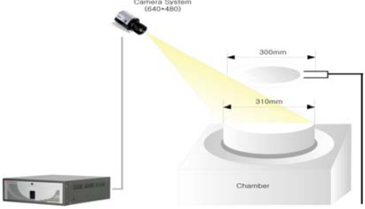
*그림 1 — 세정 시스템의 구조 (Camera System (640×480), 300mm, 310mm, Chamber)*

## 3. 보정 (Calibration)

카메라가 위쪽 구석에 있으므로 웨이퍼의 기울어진(shared [역주: sheared(전단·비스듬히 찌그러진)의 오기로 보인다]) 영상을 획득한다. 이 기울어진 영상을 원래 영상으로 사상하기 위해 보정 과정이 필요하다. 보정의 입력으로는 체스보드 패턴을 촬영한 영상을 사용한다. 이 시스템에서는 칸 하나의 크기가 3x3 cm인 7x7 칸 체스보드를 사용했다. 실제로 체스보드는 웨이퍼와 같은 크기이다. 체스보드 영상이 주어지면 첫 단계는 모든 칸의 내부 모서리(inside corner)를 모두 찾는 것이다. 체스보드의 획득 영상은 그림 2와 같다.

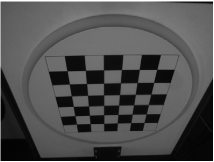
*그림 2 — 체스보드 웨이퍼*

장비가 세정 공정을 시작하면, 로봇은 웨이퍼를 체스보드와 같은 자리로 옮겨 놓는다. 체스보드의 모든 획득 모서리(acquire corner)를 얻기 위해 OpenCv 라이브러리를 사용한다. 우리가 설계한 시스템에서는 보정 후 36개의 획득 모서리를 얻으며, 그림 3과 같다.

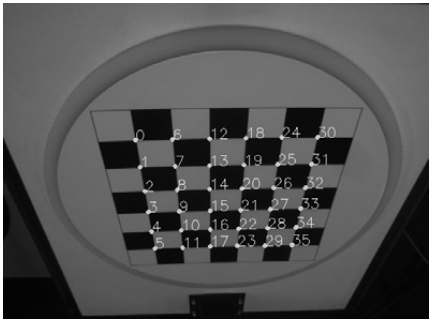
*그림 3 — 획득 모서리*

월드 좌표계의 점 $P(u, v)$와 영상 화소 좌표계의 점 $Q(x, y)$를 생각하자. 이 절의 목표는 $Q(x, y)$에서 $P(u, v)$로의 사상을 복원하는 것이다. 보정 식은 식 1과 같다. [1][2]

$$(u, v) = \left(\frac{\alpha_1 x + \alpha_2 y + \alpha_3}{\alpha_7 x + \alpha_8 y + \alpha_9},\ \frac{\alpha_4 x + \alpha_5 y + \alpha_6}{\alpha_7 x + \alpha_8 y + \alpha_9}\right) \tag{1}$$

식 1을 이용하여 모든 $\alpha$ 값을 구한다. 좌표는 이미 알고 있으므로, 값을 구하기 위해 식 1을 식 2로 바꿀 수 있다.

$$\begin{pmatrix} uw \\ vw \\ w \end{pmatrix} = \begin{pmatrix} \alpha_1 & \alpha_2 & \alpha_3 \\ \alpha_4 & \alpha_5 & \alpha_6 \\ \alpha_7 & \alpha_8 & \alpha_9 \end{pmatrix}\begin{pmatrix} x \\ y \\ z \end{pmatrix} \tag{2}$$

같은 방식으로 식 2는 식 3으로 바꿀 수 있다.

$$\begin{aligned} \alpha_1 x + \alpha_2 y + \alpha_3 - u\alpha_7 x - u\alpha_8 y - u\alpha_9 &= 0 \\ \alpha_4 x + \alpha_5 y + \alpha_6 - u\alpha_7 x - u\alpha_8 y - u\alpha_9 &= 0 \end{aligned} \tag{3}$$

[역주: 식 3의 둘째 줄은 원문대로 $u$로 적었으나 $v$여야 한다. 식 4에서는 $v$로 되어 있다.]

식 3은 행렬 형태로 식 4처럼 쓸 수 있다.

$$\underbrace{\begin{bmatrix} x_1 & y_1 & 1 & 0 & 0 & 0 & -u_1x_1 & -u_1y_1 & -u_1 \\ 0 & 0 & 0 & x_1 & y_1 & 1 & -v_1x_1 & -v_1y_1 & -v_1 \\ \vdots & & & & & & & & \vdots \\ x_n & y_n & 1 & 0 & 0 & 0 & -u_nx_n & -u_ny_n & -u_n \\ 0 & 0 & 0 & x_n & y_n & 1 & -v_nx_n & -v_ny_n & -v_n \end{bmatrix}}_{A} \underbrace{\begin{bmatrix} \alpha_1 \\ \alpha_2 \\ \vdots \\ \alpha_9 \end{bmatrix}}_{\alpha} = 0 \tag{4}$$

식 4는 간단히 $A\alpha = 0$으로 쓸 수 있다. 이것이 $\alpha$를 구하기 위해 만족해야 할 조건이다. 식 1에서 좌표 $(u, v)$는 보정 과정에서 정확히 얻을 수 있다. 그러나 실제로는 $A\alpha = 0$에서 $\alpha$를 구하기 어렵다. 그래서 $A\alpha$를 0에 가장 가깝게 만드는 $\alpha$ 값을 찾는다. 그런 다음 그 $\alpha$ 값을 보정 파라미터로 사용한다.

전치 행렬과 공분산 행렬의 곱을 통해 고윳값과 고유벡터를 계산할 수 있다 [역주: 즉 $A^TA$의 고유분해]. 그런 다음 $A\alpha$가 0에 가장 가까운 것을 찾는다. 9개의 고윳값은 각각 9개의 고유벡터 집합에 대응한다. 가장 작은 고윳값에 대응하는 고유벡터를 식 1의 $\alpha$로 사용한다. 이렇게 보정 파라미터를 얻으며, 그 뒤 보정 파라미터는 다른 보정에서 사용할 때까지 저장된다. 그림 3[역주: 그림 4를 가리키는 것으로 보인다]에서 영상의 사상된 점들의 결과를 볼 수 있다.

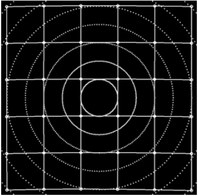
*그림 4 — 보정 영상*

## 4. 보정의 문제와 해결 (Problem and solution of calibration)

일반적인 방법으로 보정을 할 수 있다. 문제는 로봇이 체스보드 웨이퍼를 옮겨 그림 5처럼 알 수 없는 방향으로 놓을 때 생긴다. 이는 로봇이 체스보드를 웨이퍼 자리에 놓기 전에 체스보드의 방향을 보도록 제어할 수 없기 때문이다.

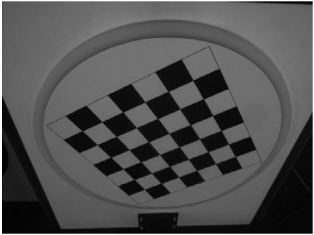
*그림 5 — 체스보드 웨이퍼*

로봇이 체스보드를 임의의 방향으로 놓아 약간의 회전과 기울어짐(share [역주: shear의 오기로 보인다])이 생기면 그림 5처럼 체스보드가 잘 놓이지 않으며, 이 경우 내부 모서리 좌표를 찾기가 매우 어려워진다. 또한 좌표의 색인(index)을 잘못 매길 가능성도 매우 커진다.

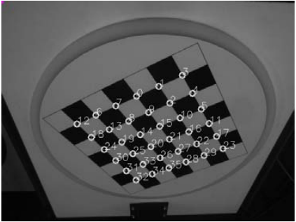
*그림 6 — 획득 모서리*

좌표의 색인 번호가 올바르지 않으면 보정도 잘 이루어질 수 없다. 예를 들어 그림 7은 맞지 않는 체스보드 좌표를 보여 준다. 작은 원은 원래 좌표를, 점은 실제 좌표를 나타낸다. 논리적으로 각 작은 원을 어느 점과 대응시켜야 할지 알 수 없다.

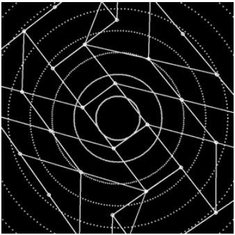
*그림 7 — 보정 영상*

이 문제 때문에 이를 제대로 해결할 방법을 찾아야 한다. 이 시스템에서 개발한 방법은 체스보드 삼각분할(triangulation)이다. 모서리 좌표를 이용하여 두 좌표마다 변(edge)을, 세 변마다 면(face)을 만들 수 있다. 삼각분할 결과는 그림 8에서 볼 수 있다.[3]

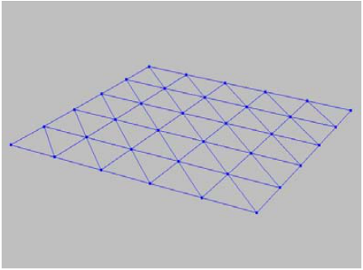
*그림 8 — 삼각분할*

모든 좌표의 올바른 색인을 찾기 위해 먼저 경계 변을 찾는다. 경계 변은 면 두 개와만 연결된다 [역주: 일반적으로 경계 변은 면 하나에만 속한다. 원문 그대로 옮김]. 차수(degree)가 2뿐인 아래쪽 모서리 꼭짓점에서 시작한다. 이 꼭짓점의 색인은 0이어야 한다. 수직이든 수평이든 어느 한 방향으로 진행하면서 경계 변을 바탕으로 다음 경계 꼭짓점을 찾는다. 한 행의 색인 매기기를 마치면 색인을 마친 그 행을 삭제한다. 그런 다음 다음 행에 대해 같은 방식으로 계속한다. 이 방법으로 모든 모서리 좌표를 찾고 색인을 매길 수 있다.

그림 9는 삼각분할 방법으로 찾은 올바른 좌표 색인을 보여 준다.

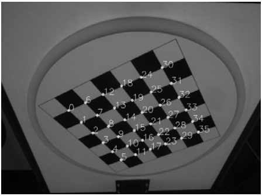
*그림 9 — 보정*

올바른 좌표 색인이 주어지면 체스보드의 기울어진 영상을 보정하여 원하는 형태로 사상할 수 있으며, 그림 10과 같다.

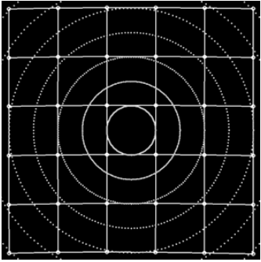
*그림 10 — 보정 영상*

## 5. 등록 (Registration)

보정 과정을 마치면 체스보드 웨이퍼를 꺼낸다. 이 상태에서는 세정 시스템 안에 아무것도 없다. 이는 카메라가 배경 영상을 획득하기에 좋은 상황이다. 나중에 실제 웨이퍼 영상을 뺄 때(subscript [역주: subtract의 오기]) 이 영상을 기준으로 사용한다. 그림 11은 획득한 배경 영상을 보여 준다.

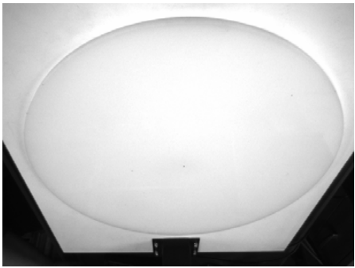
*그림 11 — 보정 영상 [역주: 본문상 배경 영상이다. 캡션은 원문 그대로]*

배경 영상 획득을 마치면 실제 웨이퍼가 세정 시스템 안으로 들어온다. 비교 대상으로서 이 웨이퍼는 올바른 위치에 놓여야 한다. 그런 다음 카메라로 웨이퍼 영상을 획득하며, 그림 12와 같다.

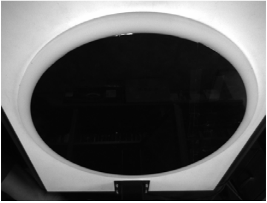
*그림 12 — 웨이퍼 영상*

배경 획득 영상과 웨이퍼 획득 영상을 이용하여 같은 배경을 찾는다. 그림 13은 그림 12에서 그림 11을 뺀 결과를 보여 준다.

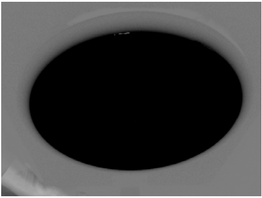
*그림 13 — 차영상(Difference Image)*

그림 13에서 웨이퍼 주변에 잡음이 있음을 볼 수 있다. 웨이퍼 경계를 뚜렷하게 검출할 수 없다. 실제 형상을 얻기 위해 그림 13의 영상을 이진 영상으로 바꾼다. 실제 검은 화소는 0(영) 값으로, 나머지는 1로 설정한다. 그림 13의 이진 영상은 그림 14에서 볼 수 있다.

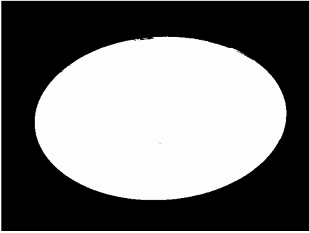
*그림 14 — 문턱값 처리 영상(Threshold Image)*

이진 영상이 주어지면, 이진 영상에서 웨이퍼의 검은 영역과 같은 웨이퍼의 흰 영역을 비교한다. 이 방법으로 원래 웨이퍼의 경계선을 얻을 수 있으며, 그림 15를 보라.

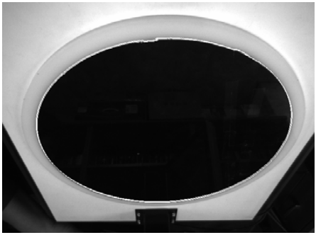
*그림 15 — 에지 추출*

그러나 그림 15의 결과는 원이 아니다. 타원이다. 앞의 보정 과정에서 구한 파라미터를 이용하면 타원이 원으로 사상되며, 그림 16과 같다. 원 형상을 얻으면 반지름, 중심점, 모든 경계 좌표를 잘 계산할 수 있다.

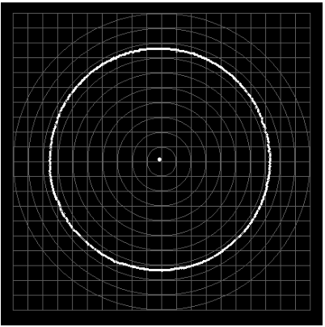
*그림 16 — 변환 영상*

변환을 마치면 중심점을 저장해야 한다. 그래야 다른 웨이퍼가 세정 시스템 안으로 들어왔을 때 저장된 좌표와 비교할 수 있다.

## 6. 인식 과정 (Recognition process)

보정 과정은 등록 과정에서 사용되는 계수 파라미터를 만들어 내며, 등록 과정은 배경 영상과 원래 웨이퍼의 획득을 포함한다. 등록의 최종 산출물은 웨이퍼가 놓여야 할 올바른 자리의 중심점 좌표이다. 그런 다음 로봇이 자동으로 웨이퍼를 세정 챔버에 놓는다. 실제로 로봇은 웨이퍼를 정확히 같은 자리에 놓을 수 없다. 어느 정도의 어긋남(distortion)이 생긴다. 예를 들어 그림 17은 생길 수 있는 어긋남을 보여 준다.

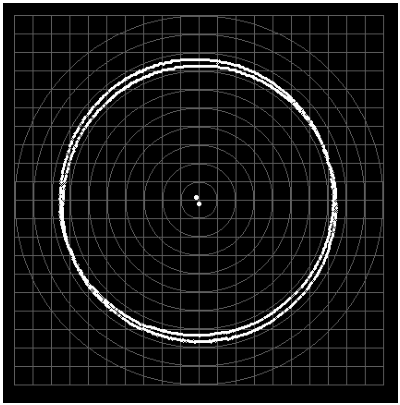
*그림 17 — 변환 영상*

세정 공정을 실행하기 전에 시스템은 웨이퍼 위치를 앞서 계산한 올바른 위치와 비교한다. 허용 어긋남이 15mm 이내이면 장비가 세정 공정을 실행하고, 그렇지 않으면 장비가 멈춘다.

## 7. 결론 (Conclusion)

웨이퍼 세정 시스템에서 웨이퍼는 로봇이 놓지만, 로봇은 웨이퍼를 정확히 같은 자리에 놓지 못한다. 자리 어긋남으로 인한 웨이퍼 파손을 피하기 위해 보정 방법을 제안한다. 먼저 웨이퍼 자리에서 체스보드 영상을 획득한다. 로봇이 체스보드를 무작위로 놓으므로, 체스보드의 모든 모서리 좌표를 찾기 위해 보정을 사용해야 한다. 그런 다음 이 좌표로 원래 웨이퍼의 중심점, 반지름, 경계 좌표를 등록한다. 따라서 세정될 다른 웨이퍼를 등록된 좌표와 비교할 수 있다. 최종적으로 웨이퍼의 위치 오차가 얼마인지 계산할 수 있다.

## 감사의 글 (Acknowledgement)

본 연구는 교육과학기술부(MEST)와 한국산업기술재단(KOTEF)의 지역혁신 인력양성사업, 그리고 Cronic Vision Corporation의 재정 지원을 받았다.

## 참고문헌

- [1] K. Taniguchi and S. Tatsumi, "A detection method for irregular lightness variation of low contrast," IEEE Systems, Man and Cyber-netics, Vol.7, pp. 6401-6406, 2004..".
- [2] F. H. Y. Chan, F. K. Lam and H. Zhu, " Adaptive thresholding by variational method, " IEEE Transactions on Image Processing, Vol.2, No.3, pp. 168-174, March
- [3] R.Sukthankar, R.Stockton and M. Mullin "Smarter presentations: Exploiting homography in camera-projector system." In Proceedings of the International on Computer Vision, 2001
- [4] R.Sukthankar, R.Stockton and M. Mullin "Self-Calibration Camera-Assisted Presentation Interface.".
- [5] G. Leach, "Improving Worst-Case Optimal Delaunay Triangulation Algorithms", proceedings of the 4th Canadian Conference on Computational Geometry, 340-346, June 1992.
