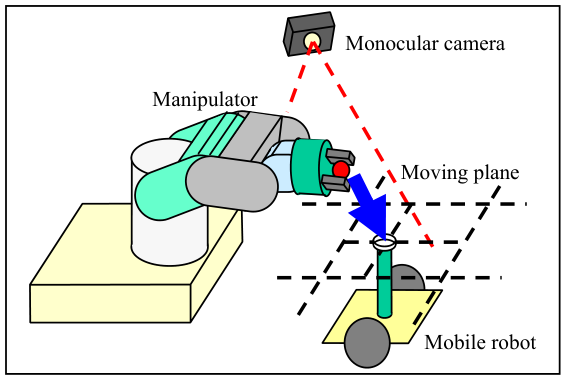
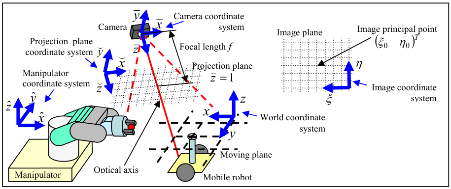
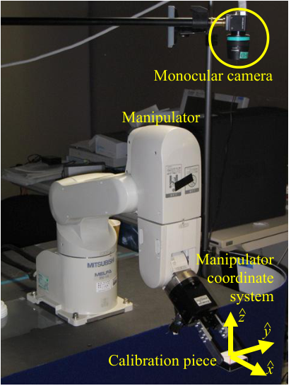
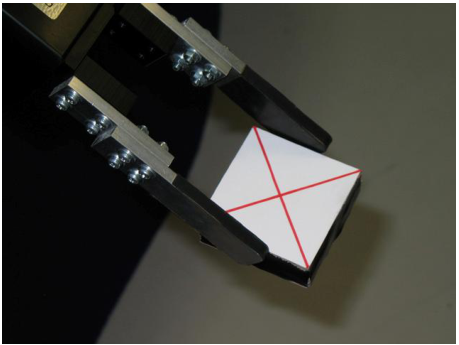
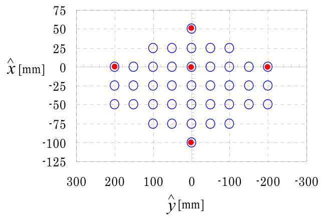
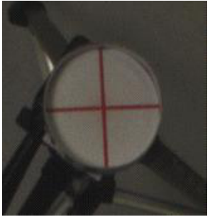
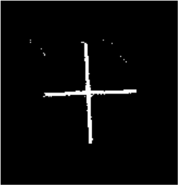
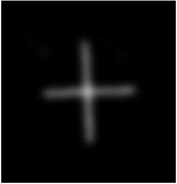

# 이송 로봇 시스템을 위한 카메라 보정 없는 비전 보정 (Kimura 2007)

- 원제: Camera Calibrationless Vision Calibration for Transfer Robot System
- 저자: Nobutaka Kimura*a, Toshio Moriya a, Kohsei Matsumoto a (a: Advanced Research Lab, Hitachi, Ltd., 1099 Ohzenji, Asao, Kawasaki, Kanagawa, Japan 215-0013)
- 원문: 같은 폴더의 `Kimura2007_SPIE_camerafree_calib.pdf` (Machine Vision Applications in Industrial Inspection XV, edited by Fabrice Meriaudeau, Kurt S. Niel, Proc. of SPIE-IS&T Electronic Imaging, SPIE Vol. 6503, 65030F, 2007)
- 번역 범위: 전문
- 그림: 원문 그림 8개를 `그림/`에 넣고 본문에서 처음 언급되는 곳에 삽입. 표 1은 마크다운 표로 옮김.

## 초록 (ABSTRACT)

본 연구는 로봇 비전을 갖춘 매니퓰레이터가 평평한 바닥 위를 움직이는 이동 로봇에 물체를 이송하는 시스템에 초점을 두었다. 이 시스템에서는 매니퓰레이터의 엔드이펙터가 평면 위에서 작업하므로 단일 비전(single vision)만 필요하다. 로봇 비전 시스템에서는 보통 비전 보정(vision calibration)에 많은 과정이 필요하며, 그중 하나가 카메라 파라미터 측정이다. 우리는 연구 대상 시스템에 필요한 보정 과정의 수를 줄이기 위해 카메라 파라미터를 명시적으로 요구하지 않는 보정 기법을 개발했다.

이 기법에서는 사영 변환(projective transformation) 틀을 이용하여 이동 평면에서 영상 좌표계와 이동 로봇 좌표계 사이의 관계를 측정했다. 같은 방식으로 임의의 평면에서 영상과 매니퓰레이터 사이의 관계도 측정했다. 그 결과를 분석하여, 카메라 파라미터를 명시적으로 계산하지 않고 이동 로봇과 매니퓰레이터 사이의 관계를 얻었다. 이는 보정판(calibration board) 영상 촬영을 생략할 수 있다는 뜻이다.

물체 이송 작업으로 보정 기법을 시험했다. 결과는 이 기법이 작업을 수행하기에 충분한 정확도를 가짐을 보여 주었다.

키워드: 비전 보정, 자율 로봇, 협조 로봇, 이송 로봇 시스템, 카메라 보정 불필요(camera calibrationless), 단일 비전

## 1. 서론 (INTRODUCTION)

우리는 로봇 시스템이 머지않아 공장처럼 정비된 환경뿐 아니라 사무실처럼 복잡한 환경에서도 쓰일 것이라고 믿는다. 그러한 환경은 종종 예기치 않게 변하며, 자율 로봇은 그런 변화에 대응하기에 적합하다. 자율 로봇은 서로의 오차에 대응할 수 있으므로 여러 로봇이 협조하여 공통 작업을 수행하는 시스템에 사용된다. 로봇 비전은 멀리 있는 물체의 정보를 얻을 수 있는 중요한 센서이다.

본 연구는 자율 협조 로봇 시스템에 초점을 두었다. 그 시스템의 예로, 로봇 비전을 갖춘 매니퓰레이터가 평평한 바닥 위를 움직이는 이동 로봇에 물체를 이송하는 시스템을 다루었다. 이 시스템에서는 매니퓰레이터의 엔드이펙터가 평면 위에서 작업하므로 단일 비전만 있으면 된다. 시스템의 개념을 그림 1에 나타냈다. 단일 비전이 이동 로봇이 가진 트레이 위의 마커 위치를 인식하고, 매니퓰레이터는 미리 정해 둔 평면 위의 임의의 위치에 멈춘 이동 로봇에 물체를 이송한다.

*그림 1 — 단일 비전을 사용하는 이송 로봇 시스템의 개념 (Monocular camera: 단안 카메라, Manipulator: 매니퓰레이터, Moving plane: 이동 평면, Mobile robot: 이동 로봇)*

(각주) *nobukata.kimura.fd@hitachi.com; phone 81 44 959-0852; fax 81 44 959-0242

로봇 비전 시스템을 사용하려면 먼저 이를 보정해야 한다. 이를 위해서는 카메라 파라미터를 측정하고, 월드 좌표계와 로봇 좌표계 사이의 관계를 확립해야 한다. 우리 연구 대상 시스템에서는 이동 로봇 좌표계도 보정해야 한다. 따라서 각 보정에서 높은 정확도를 달성해야 하며, 시스템 보정에 많은 과정이 필요하다.

우리는 연구 대상 시스템을 위해 필요한 보정 과정의 수를 줄이는 비전 보정 기법을 개발했다. 사영 변환 틀을 이용하여 평면 위에서 영상 좌표계와 로봇 좌표계 사이의 관계를 계산함으로써, 카메라 파라미터를 명시적으로 측정하는 과정을 생략할 수 있다. 이는 실제 운용에서 보정판 영상을 촬영하는 과정을 생략할 수 있다는 뜻이다.

본 논문에서는 이 기법의 유도와 물체 이송 실험을 통한 시험을 기술한다.

## 2. 비전 보정 기법의 유도 (DERIVATION OF VISION CALIBRATION TECHNIQUE)

### 2.1 좌표계와 광학계의 정의 (Definition of coordinate and optical systems)

월드 좌표계 $\boldsymbol{x} = \{x\ \ y\ \ z\}^T$, 영상 좌표계 $\boldsymbol{\xi} = \{\xi\ \ \eta\}^T$, 카메라 좌표계 $\bar{\boldsymbol{x}} = \{\bar{x}\ \ \bar{y}\ \ \bar{z}\}^T$, 매니퓰레이터 좌표계 $\hat{\boldsymbol{x}} = \{\hat{x}\ \ \hat{y}\ \ \hat{z}\}^T$를 사용했다. 카메라 좌표계의 원점은 카메라의 광학 중심(optical center)이며, $\bar{z}$축은 카메라의 광축에 해당한다. 길이 단위는 월드, 카메라, 매니퓰레이터 좌표계에서 공통이며, 이동 로봇의 좌표계는 월드 좌표계에 해당한다.

카메라는 내부 파라미터로 초점거리 $f$와 영상 주점(image principal point) $\{\xi_0\ \ \eta_0\}^T$만 가지며 핀홀 카메라 모델을 적용할 수 있다고 가정한다.

다음으로 투영면 좌표계(projection plane coordinate system) $\breve{\boldsymbol{x}} = \{\breve{x}\ \ \breve{y}\ \ \breve{z}\}^T$를 정의한다. $\breve{x}$축과 $\breve{y}$축의 방향은 $\xi$축과 $\eta$축의 방향에 대응하며, 카메라의 투영면 $\Gamma$는 $\breve{z} = 1$ 평면에 해당한다. 따라서 영상점 $\boldsymbol{\xi} = \{\xi\ \ \eta\}^T$를 $\Gamma$에 투영한 점은 투영면 좌표계에서 $\breve{\boldsymbol{x}} = \{\breve{x}\ \ \breve{y}\ \ \breve{z}\}^T = \{\xi\ \ \eta\ \ 1\}^T$로 표현된다. 투영면 좌표계의 길이 단위를 월드 좌표계의 길이 단위에 맞추기 위해, 투영면 $\Gamma$를 평행이동하여 투영면과 투영면 좌표계 $\breve{\boldsymbol{x}}$를 다시 정의했으며, 그 결과 광학 중심은 투영면 좌표계에서 $\{\xi_0\ \ \eta_0\ \ 1-f\}^T$로 표현된다. 이 개념을 그림 2에 나타냈다.

*그림 2 — 이송 로봇 시스템의 좌표계와 광학계 개념 (Camera coordinate system: 카메라 좌표계, Projection plane coordinate system: 투영면 좌표계, Manipulator coordinate system: 매니퓰레이터 좌표계, Focal length: 초점거리, Projection plane $\breve{z}=1$: 투영면, Optical axis: 광축, World coordinate system: 월드 좌표계, Moving plane: 이동 평면, Image plane: 영상면, Image principal point: 영상 주점, Image coordinate system: 영상 좌표계)*

### 2.2 영상 좌표계와 로봇 좌표계 사이의 보정 (Calibration between coordinate systems of image and robot)

임의의 평면 위의 한 점을 월드 좌표계에서 $\boldsymbol{x}_i$로, 그 점을 영상면에 투영한 점을 영상 좌표계에서 $\boldsymbol{\xi}_i$로 나타낸다. $\boldsymbol{x}_i$와 $\boldsymbol{\xi}_i$ 사이의 관계는 다음과 같다.

$$\tilde{\boldsymbol{\xi}}_i \approx \boldsymbol{A}\left[\boldsymbol{R}\ \ \bar{\boldsymbol{t}}\right]\tilde{\boldsymbol{x}}_i = \boldsymbol{A}\bar{\boldsymbol{x}}_i \tag{1}$$

여기서 $\boldsymbol{A}$는 카메라 내부 파라미터 행렬, $\boldsymbol{R}$과 $\bar{\boldsymbol{t}}$는 외부 파라미터, $\tilde{\boldsymbol{\xi}}_i = \{\boldsymbol{\xi}_i^T\ \ 1\}^T$, $\tilde{\boldsymbol{x}}_i = \{\boldsymbol{x}_i^T\ \ 1\}^T$, $\bar{\boldsymbol{x}}_i$는 카메라 좌표계로 표현한 점이며, 기호 "$\approx$"는 "스칼라배를 제외하고 같음"을 뜻한다.

카메라 좌표계에서 평면의 단위 법선 벡터를 $\bar{\boldsymbol{n}}$으로 나타낸다. 평면과 광학 중심 사이의 거리를 $d$로 나타내며, 다음과 같다.

$$d = \bar{\boldsymbol{n}} \cdot \bar{\boldsymbol{x}}_j \tag{2}$$

여기서 $\bar{\boldsymbol{n}} \cdot \bar{\boldsymbol{x}}_j$는 벡터 $\bar{\boldsymbol{n}}$과 $\bar{\boldsymbol{x}}_j$의 내적이다.

다음으로, 카메라 좌표계 $\bar{\boldsymbol{x}}$와 월드 좌표계 $\boldsymbol{x}$ 사이의 관계는 다음과 같다.

$$\bar{\boldsymbol{x}} = \boldsymbol{R}\boldsymbol{x} + \bar{\boldsymbol{t}}. \tag{3}$$

벡터 연산과 식 (2)로부터 다음을 얻는다.

$$\bar{\boldsymbol{t}} = \frac{\bar{\boldsymbol{n}} \cdot \bar{\boldsymbol{x}}_j}{d}\bar{\boldsymbol{t}} = \frac{\bar{\boldsymbol{t}}\bar{\boldsymbol{n}}^T}{d}\bar{\boldsymbol{x}}_j \tag{4}$$

그리고 식 (3)과 (4)로부터 다음을 얻는다.

$$\begin{aligned} \boldsymbol{x}_i &= \boldsymbol{R}^{-1}\left(\bar{\boldsymbol{x}}_i - \bar{\boldsymbol{t}}\right) \\ &\approx \boldsymbol{R}^{-1}\left(\boldsymbol{I} - \frac{\bar{\boldsymbol{t}}\bar{\boldsymbol{n}}^T}{d}\right)\boldsymbol{A}^{-1}\tilde{\boldsymbol{\xi}}_i = \boldsymbol{H}\tilde{\boldsymbol{\xi}}_i \end{aligned} \tag{5}$$

식 (5)는 임의의 평면 위의 점들에 대해 영상 좌표계와 월드 좌표계 사이의 관계를 표현한다. $\boldsymbol{I}$는 $3\times 3$ 단위 행렬이고, $\boldsymbol{H}$는 다음과 같은 $3\times 3$ 행렬이다.

$$\boldsymbol{H} = \begin{bmatrix} h_{11} & h_{12} & h_{13} \\ h_{21} & h_{22} & h_{23} \\ h_{31} & h_{32} & h_{33} \end{bmatrix} \tag{6}$$

행렬 $\boldsymbol{H}$를 추정해야(guess) 한다. $\boldsymbol{H}$에는 임의의 스칼라를 곱할 수 있으므로 일반성을 잃지 않고 $h_{33} = 1$로 정의할 수 있다. 따라서 $\boldsymbol{H}$의 미지수는 8개뿐이다. 영상 좌표계와 월드 좌표계의 점 한 쌍에서 식 두 개가 유도되므로, 최소 네 쌍의 점으로 $\boldsymbol{H}$를 추정할 수 있다. 네 쌍보다 많이 사용하는 경우에는 최소제곱법이나 다른 추정 방법을 사용한다.

2.2절의 식 (3)~(6)에 대한 논의에서 월드 좌표계를 매니퓰레이터 좌표계로 바꿔 놓을 수 있다.

### 2.3 이송 로봇 시스템의 비전 보정 (Vision calibration for transfer robot system)

월드 좌표계를 매니퓰레이터 좌표계와 투영면 좌표계로 바꿔 놓으면 다음을 얻는다.

$$\bar{\boldsymbol{x}} = \boldsymbol{R}'\hat{\boldsymbol{x}} + \bar{\boldsymbol{t}}', \tag{7}$$

$$\begin{aligned} \hat{\boldsymbol{x}}_k &= \boldsymbol{R}'^{-1}\left(\bar{\boldsymbol{x}}_k - \bar{\boldsymbol{t}}'\right) \\ &\approx \boldsymbol{R}'^{-1}\left(\boldsymbol{I} - \frac{\bar{\boldsymbol{t}}'\bar{\boldsymbol{n}}^T}{d}\right)\boldsymbol{A}^{-1}\tilde{\boldsymbol{\xi}}_k = \boldsymbol{H}'\tilde{\boldsymbol{\xi}}_k \end{aligned} \tag{8}$$

$$\bar{\boldsymbol{x}} = \boldsymbol{R}''\breve{\boldsymbol{x}} + \bar{\boldsymbol{t}}'', \text{ and} \tag{9}$$

$$\begin{aligned} \breve{\boldsymbol{x}}_l &= \boldsymbol{R}''^{-1}\left(\bar{\boldsymbol{x}}_l - \bar{\boldsymbol{t}}''\right) \\ &\approx \boldsymbol{R}''^{-1}\left(\boldsymbol{I} - \frac{\bar{\boldsymbol{t}}''\bar{\boldsymbol{n}}^T}{d}\right)\boldsymbol{A}^{-1}\tilde{\boldsymbol{\xi}}_l = \boldsymbol{H}''\tilde{\boldsymbol{\xi}}_l \end{aligned} \tag{10}$$

행렬 $\boldsymbol{H}$와 $\boldsymbol{H}''$는 최소 네 쌍의 점으로 추정한다. [역주: 문맥상 $\boldsymbol{H}'$와 $\boldsymbol{H}''$로 보인다. 원문 그대로 옮김]

다음으로, 월드 좌표계에서 $\boldsymbol{a}_i$ ($i$ = 1, 2, 3, 4)로 나타내는 평면 A 위의 점들과, 매니퓰레이터 좌표계에서 $\hat{\boldsymbol{b}}_k$ ($k$ = 5, 6, 7, 8)로 나타내는 평면 B 위의 점들로 논의를 이어 간다. $\boldsymbol{a}_i$를 투영면 $\Gamma$에 투영한 점을 $\breve{\boldsymbol{c}}_i$로 나타낸다. 각각에 대응하는 영상점을 $\boldsymbol{\alpha}_i$, $\boldsymbol{\beta}_k$, $\boldsymbol{\gamma}_i$로 나타내면, 식 (5), (8), (10)으로부터 다음을 얻는다.

$$\boldsymbol{a}_i \approx \boldsymbol{H}_{\mathrm{A}}\tilde{\boldsymbol{\alpha}}_i,\quad \hat{\boldsymbol{b}}_k \approx \boldsymbol{H}_{\mathrm{B}}\tilde{\boldsymbol{\beta}}_k,\quad \breve{\boldsymbol{c}}_i \approx \boldsymbol{H}_{\Gamma}\tilde{\boldsymbol{\gamma}}_i. \tag{11}$$

각 평면의 단위 법선 벡터를 $\boldsymbol{n}_{\mathrm{A}}$, $\hat{\boldsymbol{n}}_{\mathrm{B}}$, $\breve{\boldsymbol{n}}_{\Gamma}$로 나타내면, 각 좌표계에서 원점과 평면 사이의 거리를 다음과 같이 얻는다.

$$d_{\mathrm{A}} = \boldsymbol{n}_{\mathrm{A}} \cdot \boldsymbol{a}_i,\quad d_{\mathrm{B}} = \hat{\boldsymbol{n}}_{\mathrm{B}} \cdot \hat{\boldsymbol{b}}_k,\quad \text{and}\quad d_{\Gamma} = \breve{\boldsymbol{n}}_{\Gamma} \cdot \breve{\boldsymbol{c}}_i. \tag{12}$$

식 (3)으로부터 월드 좌표계에서의 광학 중심 $\boldsymbol{h}$는 다음과 같다.

$$\boldsymbol{h} = -\boldsymbol{R}^{-1}\bar{\boldsymbol{t}}. \tag{13}$$

다음으로 $\boldsymbol{h}$를 추정하는 방법을 논의한다.

평면 A와 B의 점들을 이용하여 월드 좌표계와 매니퓰레이터 좌표계 사이의 관계를 추정한다. 평면 A의 영상 위의 점 $\boldsymbol{\alpha}_m$에 대응하는 점을 월드 좌표계에서 $\boldsymbol{a}_m$으로 나타내고, 평면 B 위에서 $\boldsymbol{\beta}_m = \boldsymbol{\alpha}_m$에 대응하는 점을 매니퓰레이터 좌표계에서 $\hat{\boldsymbol{b}}_m$으로 나타낸다. 식 (11)로부터 다음을 얻는다.

$$\boldsymbol{a}_m \approx \boldsymbol{H}_{\mathrm{A}}\boldsymbol{H}'^{-1}_{\mathrm{B}}\hat{\boldsymbol{b}}_m = \boldsymbol{H}_1\hat{\boldsymbol{b}}_m, \tag{14}$$

그리고 식 (3)과 (7)로부터 월드 좌표계와 매니퓰레이터 좌표계 사이의 관계는 다음과 같다.

$$\boldsymbol{x} = \boldsymbol{R}^{-1}\boldsymbol{R}'\hat{\boldsymbol{x}} + \boldsymbol{R}^{-1}\left(\bar{\boldsymbol{t}}' - \bar{\boldsymbol{t}}\right) = \boldsymbol{R}_1\hat{\boldsymbol{x}} + \boldsymbol{t}_1. \tag{15}$$

이 보정의 최종 목적은 식 (15)가 나타내는 관계를 추정하는 것이다. 점 $\hat{\boldsymbol{b}}_m$을 월드 좌표계에서 $\boldsymbol{b}_m$으로 나타낸다. 식 (15)와 $\boldsymbol{h}$, $\boldsymbol{a}_m$, $\boldsymbol{b}_m$ 사이의 기하학적 관계로부터 다음을 얻는다.

$$\begin{aligned} \boldsymbol{a}_m - \boldsymbol{h} &\approx \boldsymbol{b}_m - \boldsymbol{h} \\ &= \boldsymbol{R}_1\left\{\hat{\boldsymbol{b}}_m - \boldsymbol{R}_1^{-1}\left(\boldsymbol{h} - \boldsymbol{t}_1\right)\right\} \\ &= \boldsymbol{R}_1\left(\hat{\boldsymbol{b}}_m - \hat{\boldsymbol{s}}_1\right) \end{aligned} \tag{16}$$

식 (12)와 (16), 그리고 벡터 연산을 이용하면 다음을 얻는다.

$$\left(\boldsymbol{I} - \frac{\boldsymbol{h}\boldsymbol{n}_{\mathrm{A}}^T}{d_{\mathrm{A}}}\right)\boldsymbol{a}_m \approx \boldsymbol{R}_1\left(\boldsymbol{I} - \frac{\hat{\boldsymbol{s}}_1\hat{\boldsymbol{n}}_{\mathrm{B}}^T}{d_{\mathrm{B}}}\right)\hat{\boldsymbol{b}}_m. \tag{17}$$

식 (17)을 식 (14)와 비교하면 다음을 얻는다.

$$\begin{aligned} \boldsymbol{a}_m &\approx \left(\boldsymbol{I} - \frac{\boldsymbol{h}\boldsymbol{n}_{\mathrm{A}}^T}{d_{\mathrm{A}}}\right)^{-1}\boldsymbol{R}_1\left(\boldsymbol{I} - \frac{\hat{\boldsymbol{s}}_1\hat{\boldsymbol{n}}_{\mathrm{B}}^T}{d_{\mathrm{B}}}\right)\hat{\boldsymbol{b}}_m \\ &\approx \boldsymbol{H}_1\hat{\boldsymbol{b}}_m \end{aligned} \tag{18}$$

스칼라 상수 $\omega_1$을 사용하면 식 (18)은 다음과 같이 다시 쓸 수 있다.

$$\left(\boldsymbol{I} - \frac{\boldsymbol{h}\boldsymbol{n}_{\mathrm{A}}^T}{d_{\mathrm{A}}}\right)\boldsymbol{H}_1 = \omega_1\boldsymbol{R}_1\left(\boldsymbol{I} - \frac{\hat{\boldsymbol{s}}_1\hat{\boldsymbol{n}}_{\mathrm{B}}^T}{d_{\mathrm{B}}}\right). \tag{19}$$

다음으로, 다음 관계를 만족하는 단위 벡터 $\boldsymbol{u}$와 $\boldsymbol{v}$를 정의한다.

$$\begin{cases} |\boldsymbol{u}| = 1,\quad |\boldsymbol{v}| = 1,\quad \boldsymbol{u}\cdot\boldsymbol{v} = 0 \\ \boldsymbol{u}\cdot\hat{\boldsymbol{n}}_{\mathrm{B}} = 0,\quad \boldsymbol{v}\cdot\hat{\boldsymbol{n}}_{\mathrm{B}} = 0,\quad (\boldsymbol{H}_1\boldsymbol{u})\cdot\boldsymbol{n}_{\mathrm{A}} = 0 \end{cases}. \tag{20}$$

식 (19)의 양변에 $(u\boldsymbol{u} + v\boldsymbol{v})$를 오른쪽에서 곱하면($u$와 $v$는 임의의 스칼라) 다음을 얻는다.

$$u\boldsymbol{H}_1\boldsymbol{u} + v\left(\boldsymbol{I} - \frac{\boldsymbol{h}\boldsymbol{n}_{\mathrm{A}}^T}{d_{\mathrm{A}}}\right)\boldsymbol{H}_1\boldsymbol{v} = \omega_1\boldsymbol{R}_1(u\boldsymbol{u} + v\boldsymbol{v}). \tag{21}$$

식 (21)에서 $u$와 $v$는 임의이다. $u$ = 1, $v$ = 0을 대입하면 $|\boldsymbol{R}_1\boldsymbol{u}| = 1$로부터 $\omega_1 = |\boldsymbol{H}_1\boldsymbol{u}|$를 얻는다. 식 (21)의 양변을 제곱하고 계수를 비교하면 광학 중심 $\boldsymbol{h}$에 대한 조건식을 다음과 같이 얻는다.

$$\begin{cases} \boldsymbol{p}\cdot(\boldsymbol{h} - \boldsymbol{q}) = 0,\quad |\boldsymbol{h} - \boldsymbol{q}|^2 = r^2 \\ \boldsymbol{p} = \dfrac{\boldsymbol{H}_1\boldsymbol{u}}{|\boldsymbol{H}_1\boldsymbol{u}|},\quad \boldsymbol{q} = \dfrac{d_{\mathrm{A}}\boldsymbol{H}_1\boldsymbol{v}}{\boldsymbol{n}_{\mathrm{A}}\cdot(\boldsymbol{H}_1\boldsymbol{v})},\quad r = \dfrac{d_{\mathrm{A}}|\boldsymbol{H}_1\boldsymbol{u}|}{\boldsymbol{n}_{\mathrm{A}}\cdot(\boldsymbol{H}_1\boldsymbol{v})} \end{cases}. \tag{22}$$

식 (22)의 표현은 다음을 보여 준다.

(a) 점 $\boldsymbol{h}$와 $\boldsymbol{q}$는 법선 벡터가 $\boldsymbol{p}$인 같은 평면 위에 있다.
(b) 점 $\boldsymbol{h}$는 반지름이 $r$이고 중심점이 $\boldsymbol{q}$인 원 $\Omega_1$의 원주 위에 있다.

다음으로 평면 A와 $\Gamma$의 점들을 이용하여 투영면 좌표계와 월드 좌표계 사이의 관계를 추정한다. 식 (14)부터 식 (22)까지의 일련의 논의에서 매니퓰레이터 좌표계를 투영면 좌표계로 바꾸면, 원주 위에 광학 중심 $\boldsymbol{h}$를 갖는 또 하나의 원 $\Omega_2$를 얻는다. 따라서 광학 중심 $\boldsymbol{h}$는 $\Omega_1$과 $\Omega_2$의 교점이다.

이제 $\boldsymbol{R}_1$을 추정한다. 식 (21)에서 $(u, v)$ = (0, 1)과 (1, 0)을 대입하면 다음을 얻는다.

$$\boldsymbol{R}_1\boldsymbol{u} = \frac{\boldsymbol{H}_1\boldsymbol{u}}{|\boldsymbol{H}_1\boldsymbol{u}|} = \boldsymbol{f},\quad \boldsymbol{R}_1\boldsymbol{v} = \frac{\left(\boldsymbol{I} - \dfrac{\boldsymbol{h}\boldsymbol{n}_{\mathrm{A}}^T}{d_{\mathrm{A}}}\right)\boldsymbol{H}_1\boldsymbol{v}}{|\boldsymbol{H}_1\boldsymbol{u}|} = \boldsymbol{g}. \tag{23}$$

$\boldsymbol{R}_1$은 회전 행렬이므로 외적 연산으로부터 $\boldsymbol{R}_1\boldsymbol{u}\times\boldsymbol{R}_1\boldsymbol{v} = \boldsymbol{R}_1(\boldsymbol{u}\times\boldsymbol{v})$이다. 따라서 다음을 얻는다.

$$\begin{aligned} \boldsymbol{R}_1\left[\boldsymbol{u}\ \ \boldsymbol{v}\ \ \boldsymbol{u}\times\boldsymbol{v}\right] &= \left[\boldsymbol{f}\ \ \boldsymbol{g}\ \ \boldsymbol{f}\times\boldsymbol{g}\right] \\ \boldsymbol{R}_1 &= \left[\boldsymbol{f}\ \ \boldsymbol{g}\ \ \boldsymbol{f}\times\boldsymbol{g}\right]\left[\boldsymbol{u}\ \ \boldsymbol{v}\ \ \boldsymbol{u}\times\boldsymbol{v}\right]^{-1} \end{aligned}. \tag{24}$$

마지막으로 식 (16)에서 정의한 $\hat{\boldsymbol{s}}_1$을 추정한다. 식 (19)의 양변에 $\hat{\boldsymbol{n}}_{\mathrm{B}}$를 오른쪽에서 곱하면 다음을 얻는다.

$$\hat{\boldsymbol{s}}_1 = d_{\mathrm{B}}\hat{\boldsymbol{n}}_{\mathrm{B}} - \frac{d_{\mathrm{B}}}{|\boldsymbol{H}_1\boldsymbol{u}|}\boldsymbol{R}_1^{-1}\left(\boldsymbol{I} - \frac{\boldsymbol{h}\boldsymbol{n}_{\mathrm{A}}^T}{d_{\mathrm{A}}}\right)\boldsymbol{H}_1\hat{\boldsymbol{n}}_{\mathrm{B}}. \tag{25}$$

식 (24), (25), (16)으로부터 $\boldsymbol{t}_1$을 얻는다. 따라서 월드 좌표계와 매니퓰레이터 좌표계 사이의 관계 (15)를 얻으며, 이 시스템의 보정이 완료된다.

### 2.4 이송 로봇 시스템 비전 보정의 절차와 특징 (Procedures and features of vision calibration for transfer robot system)

연구 대상 시스템의 비전 보정 절차는 다음과 같다.

1) 이동 로봇이 움직이는 평면 위에서 월드 좌표계 위치를 알고 있는 최소 4개 점의 영상을 촬영한다.
2) 임의의 평면 위에서 매니퓰레이터 좌표계 위치를 알고 있는 최소 4개 점의 영상을 촬영한다.

이 기법의 특징은 다음과 같다.

a) 매니퓰레이터 좌표계는 미지이고 임의여도 된다.
b) 카메라 좌표계는 미지이고 임의여도 된다.
c) 카메라 파라미터가 필요 없다.

## 3. 물체 이송 작업을 통한 기법 시험 (TESTING TECHNIQUE WITH OBJECT-TRANSFER TASK)

### 3.1 실험 개요 (Experiment outline)

물체 이송 작업으로 이 보정 기법을 시험했다. 엔드이펙터로 두 손가락(two-fingers)을 가진 매니퓰레이터를 제어하여, 평면 위를 움직이는 임의의 목표(이동 로봇의 트레이) 위에 물체(종이컵)를 자동으로 놓게 했다.

단안 카메라는 작업 공간 전체가 시야에 들어오도록 고정했다. 매니퓰레이터가 특징점이 있는 조각(piece)을 잡고, 그 조각이 임의의 평면 위에서 움직이는 동안 카메라가 조각의 영상을 촬영했다. 조각의 위치는 매니퓰레이터 좌표계에서 알려져 있었다. 영상 처리로 영상 좌표계에서의 특징점 위치를 구하여 영상 좌표계와 매니퓰레이터 좌표계 사이의 관계를 보정했다. 그런 다음 조각을 같은 평면 위의 임의의 위치로 옮기고 영상을 촬영했다. 매니퓰레이터 좌표계에서 추정 좌표와 실제 좌표(매니퓰레이터가 인식한 좌표)를 비교했다.

이 보정 기법이 물체 이송 작업에 충분한 정확도를 가짐을 확인했다.

### 3.2 실험 장비 (Experimental equipments)

실험 장비를 그림 3에, 보정 조각(calibration piece)을 그림 4에 나타냈다. 그림 3에는 매니퓰레이터 좌표계도 나타나 있다.

*그림 3 — 실험 장비 (Monocular camera: 단안 카메라, Manipulator: 매니퓰레이터, Manipulator coordinate system: 매니퓰레이터 좌표계, Calibration piece: 보정 조각)*

*그림 4 — 특징점이 있는 보정 조각*

매니퓰레이터는 7 자유도를 가지며 PC의 명령으로 제어된다. 매니퓰레이터는 두 손가락을 여닫아 보정 조각이나 종이컵을 잡을 수 있으며, 작업 공간 안에서 물체를 $\hat{x}$, $\hat{y}$, $\hat{z}$ 각 방향으로 평행이동할 수 있다. 그림 3에 보인 매니퓰레이터의 자세는 원점 $\{\hat{x}\ \ \hat{y}\ \ \hat{z}\}^T = \{0\ \ 0\ \ 0\}^T$에 있다.

카메라의 영상 해상도는 1024 × 768 화소, 렌즈 초점거리는 4 mm, CCD는 1/3 인치이다.

보정 조각은 50 × 50 mm²이며, 특징점은 교차하는 빨간 선들의 교점이다.

### 3.3 보정 실험 절차 (Procedures of calibration experiment)

영상 좌표계와 매니퓰레이터 좌표계 사이의 관계를 구하기 위해 각 좌표계에서 5쌍의 점을 사용했다. 특징점이 움직이는 평면은 임의이므로 $\hat{z} = \hat{z}_c$ = 상수로 선택했다. 5개 점은 그림 5에서 빨간 점으로 표시되어 있다.

*그림 5 — 매니퓰레이터 좌표계에서의 보정점과 시험점*

영상 처리로 영상 내 점들의 좌표를 구했다. 먼저 영상을 RGB 공간에서 HSV(H: 색상, S: 채도, V: 명도) 공간으로 변환했다. 다음으로 HSV 공간의 문턱값을 이용하여 영상(그림 6)을 이진 영상(그림 7)으로 변환했다. 마지막으로 이진 영상에 가우시안 필터(Gaussian Filter)를 적용하여, 교차하는 선들의 교점을 휘도값이 가장 높은 점으로 구했다(그림 8).

2.2절의 기법을 이용하여 영상 좌표계와 매니퓰레이터 좌표계 사이의 관계를 구했다. 식 (8)의 행렬 $\boldsymbol{H}'$을 추정하는 데 최소제곱법을 사용했다. 그런 다음 그림 5의 파란 점 39개를 이용하여 매니퓰레이터 좌표계에서 추정 좌표와 실제 좌표를 비교함으로써 기법을 시험했다.

*그림 6 — 특징점의 원 영상*

*그림 7 — 특징점의 이진 영상*

*그림 8 — 특징점의 필터링 영상*

그 뒤 이동 로봇 위에 놓은 특징점들의 영상을 촬영하여 영상 좌표계와 월드 좌표계 사이의 관계를 구했다. 2.3절의 기법을 이용하여 이송 로봇 시스템의 비전 보정을 완료했으며, 이 기법이 물체 이송 작업에 충분한 정확도를 가짐을 확인했다.

### 3.4 실험 결과 (Experimental results)

기법의 정확도를 확인하기 위해, 그림 5에 보인 39개 점에 대해 매니퓰레이터 좌표계에서 추정 좌표와 실제 좌표를 비교했다. 결과에 무작위성 요소가 있으므로 카메라 위치를 고정한 채 시험을 여러 번 수행했다. 결과를 표 1에 나타냈다.

**표 1. 로봇 좌표의 추정값과 실제값 사이의 오차**

| | Average for tests | First test | Second test | Third test |
|---|---|---|---|---|
| Average error[mm] | 2.12 | 1.84 | 2.14 | 2.39 |
| Maximum error[mm] | 3.98 | 3.68 | 3.99 | 4.33 |

(열: 시험 평균, 1차 시험, 2차 시험, 3차 시험 / 행: 평균 오차, 최대 오차)

표에서 분명히 보이듯이 평균 오차는 약 2 mm이고 최대 오차는 5mm를 넘지 않는다. 물체 이송 작업을 수행하여 이 오차가 작업에 충분히 작음을 확인했다.

따라서 제안 기법을 이용하면 카메라 파라미터를 명시적으로 계산하지 않고도 연구 대상 시스템의 로봇 비전을 보정할 수 있다. 위에서 언급한 오차는 카메라 렌즈의 왜곡 때문에 생긴다.

## 4. 결론 (CONCLUSION)

카메라 파라미터를 명시적으로 계산하지 않고 이송 로봇 시스템의 단안 로봇 비전을 보정하는 기법을 개발했다. 실제 운용에서는 보정판 영상 촬영을 생략할 수 있다. 앞으로 카메라의 렌즈 왜곡을 고려하여 이 기법을 더 발전시킬 것이다.

## 참고문헌

1. D. Kurabayashi and H. Asama, "Communication between Autonomous Robots and Environments by Intelligent Data Carriers," Journal of the Robotics Society of Japan, Vol. 17, No. 5, pp. 633-636, 1999.
2. M. Inaba, "Robot Vision for Grasping," Journal of the Robotics Society of Japan, Vol. 11, No. 7, pp. 947-952, 1993.
3. H. Takahashi and F. Tomita, "Camera Calibration for Robot Vision," Journal of the Robotics Society of Japan, Vol. 10, No. 2, pp. 177-184, 1992.
4. Y. Shimizu, N. Ohta and K. Kanatani, "Optimal Homography Computation Program with a Reliability Measure," Report of Information Processing Society of Japan, 98-CVIM-111-5, pp. 33-40, 1998.
