# 웨이퍼 이송 로봇의 위치 모니터링 및 자동 티칭 시스템 개발 — 원문

> 정리 메모 (원문 아님)
> - 출처: 사용자가 DBpia 뷰어에서 복사한 텍스트(395~397쪽)와 쪽 캡처(395·396·398·399·400·402·403·404·406쪽). 복사 원본은 같은 폴더의 `원문_붙여넣기원본.md`.
> - 398쪽부터는 캡처 이미지에서 받아 적었다. 문장은 고치지 않았다. 원문의 오타로 보이는 곳(예: "플레4로봇", "get motio’’", "로프 포트", 식 (2c)의 sin(β))도 그대로 두었다.
> - 손댄 것은 단 구분(2단 편집을 한 줄로 이음), 복사 과정에서 생긴 이중 공백 제거, 문단·절 제목 줄바꿈뿐이다.
> - 그림은 캡처에서 잘라 `그림/`에 넣고, 원문에서 그림이 놓인 자리에 가장 가까운 문단 사이에 넣었다.
> - **빠진 쪽**: 397쪽 그림(Fig. 2~4, 캡션만 있음), 401쪽 전체(Fig. 11·12와 5절 앞부분으로 추정), 405쪽 전체(7절 결론 본문과 참고문헌 (1)~(9) 앞부분).

---

Trans. Korean Soc. Mech. Eng. A, Vol. 49, No. 5, pp. 395~406, 2025 **395**

<응용논문> DOI https://doi.org/10.3795/KSME-A.2025.49.5.395 ISSN 1226-4873(Print) 2288-5226(Online)

## 웨이퍼 이송 로봇의 위치 모니터링 및 자동 티칭 시스템 개발

지용경* · 사이풀* · 최성순** · 장훈석** · 심재홍*** · 김기현*** · 김효영***†

\* 한국공학대학교 IT반도체융합공학과, ** TFC LAB, *** 한국공학대학교 메카트로닉스공학부

**Development of Position Monitoring and Auto-Teaching System for Wafer Transfer Robots**

Young Kyoung Ji\*, MD Saiful Islam\*, Seong Soon Choi\*\*, Hoon Seok Jang\*\*, Jae Hong Shim\*\*\*, Ki Hyun Kim\*\*\* and Hyo Young Kim\*\*\*†

\* Dept. of IT Semiconductor Convergence Engineering, Tech Univ. of Korea, ** TFC LAB, *** Dept. of Mechatronics Engineering, Tech Univ. of Korea

(Received February 4, 2025 ; Revised March 1, 2025 ; Accepted March 4, 2025)

**Key Words**: Wafer Transfer Robot(웨이퍼 이송 로봇), Wafer Scratches(웨이퍼 손상), WTR Monitoring(웨이퍼이송로봇 모니터링), Auto Teaching(오토티칭, 자동교시), Robot Calibration(로봇 교정)

**초록**: 반도체 제조에서 웨이퍼 표면 상태는 제품 품질과 수율에 매우 중요한 요소이다. 웨이퍼 이송 로봇 블레이드와 웨이퍼 표면 간 충돌로 발생하는 미세 스크래치는 회로 성능을 저하시킬 뿐만 아니라 결함과 비용을 증가시키게 된다. 본 연구는 초기 설치 및 예방 유지보수(PM) 과정에서 로봇 기울기와 웨이퍼 저장 컨테이너(FOUP) 간의 상관관계를 분석하여 로봇 자세를 최적화하는 방법을 제안하고 있다. 모니터링 시스템으로 상대 기울기를 측정하고 데이터를 분석해 기존 로봇으로 스크래치를 줄이며 유지보수 효율을 높이는 방안을 확인하였다.

**Abstract**: In semiconductor manufacturing, wafer surface conditions are critical for product quality and yield. Micro-scratches caused by collisions between wafer transfer robot blades and wafer surfaces can degrade circuit performance, exacerbate defect rates, and increase costs. To address this problem, this study proposes a method for optimizing robot posture during initial installation and preventive maintenance (PM) by analyzing the correlation between robot tilt and front opening unified pod (FOUP) wafer storage containers. A monitoring system was implemented to measure tilt errors, and sensor data were analyzed to improve robot posture. The results demonstrate that existing robots can effectively reduce wafer scratches and enhance maintenance efficiency, providing a cost-effective solution for improving operational performance.

† Corresponding Author, kimhy@tukorea.ac.kr
Ⓒ 2025 The Korean Society of Mechanical Engineers

### 1. 서 론

반도체 제조 공정에서 웨이퍼 이송 로봇(WTR: wafer transfer robot)은 웨이퍼를 신속하고 정확하게 정해진 위치로 이송하여 생산 효율성을 크게 향상시키고 있다.(1,2) 웨이퍼 이송 로봇의 정밀한 위치 제어 기술은 미세한 오차를 줄이고, 안정적인 웨이퍼 이송 과정을 통해 최종 반도체 칩의 불량률 감소와 품질 향상에 기여해 왔다. 그러나 웨이퍼 이송 과정에서 발생할 수 있는 외란이나 초기 설치 불량으로 인해 웨이퍼가 손상되는 문제는 여전히 해결해야 할 중요한 과제 중 하나이다. 특히 웨이퍼 이송 로봇 블레이드와 웨이퍼 간 충돌로 발생하는 미세 스크래치는 회로 성능 저하, 불량률 증가, 생산 비용 상승을 초래하게 되어 많은 기업에서 해결하고자 하는 문제중 하나이다. 이러한 문제를 해결하기 위해 웨이퍼 이송 로봇 관련 기술적 개선에 관한 연구가 진행되 *(396쪽)* 어 왔다.(3~9) 일반적으로 반도체 생산라인에서 제조 공정 후반부에서 결함이 발견되는 경우 공정 전반부에서 발견되는 결함과 비교하여 볼 때 재테스트 시간 소요 및 관련 비용이 급격히 증가하여 공정 전체의 생산성과 효율성에 더 큰 부정적인 영향을 미치게 된다. 따라서 웨이퍼 이송 로봇 모니터링 시스템에 관한 연구는 로봇 시스템을 실시간으로 모니터링 하면서 이상 상태를 초기에 감지하여 이벤트 발생 시 바로 문제를 해결하는 데 초점이 맞춰져 있다.(10~12) 최근 웨이퍼 선폭이 점점 더 미세화되고 생산 속도의 향상이 요구됨에 따라, 고속 이송 과정에서 발생하는 웨이퍼 표면 스크래치 문제를 해결하는 것이 반도체 제조 산업에서 중요한 과제로 떠오르고 있다.(13~15) 본 연구는 이러한 기술적 요구를 해결하기 위해 웨이퍼 이송 로봇과 EFEM(equipment front end module)에서 발생하는 웨이퍼 손상 문제를 중점적으로 다룬다.

### 2. EFEM 정렬 오차와 웨이퍼 이송 로봇의 영향

EFEM(equipment front end module)은 반도체 제조 공정 자동화에서 중요한 역할을 하는 장치로, 웨이퍼를 다양한 공정 장비와 저장 시스템 사이에서 정확하고 효율적으로 이송하는 기능을 담당하는 구성 요소이다. EFEM은 일반적으로 제진대 위에 설치되는 다른 공정 장비와 달리 공장 바닥면에 고정되는 경우가 많다. 따라서 바닥면의 기울기가 틀어진 경우, 웨이퍼 이송 로봇과 EFEM 간의 상대 기울기가 맞지 않는 상황이 자주 발생한다. 또한, EFEM은 별도의 제진 장비 없이 설치되는 경우가 많아 외부 장비에서 전달되는 진동으로 인해 시간이 지남에 따라 자세가 틀어질 가능성도 높다. 일반적으로 한대의 웨이퍼 이송 로봇이 1 ~ 4대의 EFEM에 웨이퍼를 로딩-언로딩 하게 되는데, 바닥면의 상태에 따라 다수의 EFEM이 설치 기울기 각도가 모두 다르게 된다.웨이퍼 이송 로봇에 의해 발생하는 웨이퍼 스크래치 문제는 이러한 EFEM의 부정확한 설치 상태가 주요 원인 중 하나이다. EFEM과 웨이퍼 이송 로봇 설치 시 상대 기울기 오차를 최소화해야만 스크래치 문제를 효과적으로 해결할 수 있다. 실제로 반도체 생산라인에서 웨이퍼 이송 로봇의 초기 설치 및 유지보수 과정에서 다수의 EFEM과 발생하는 상대 기울기 오차는 웨이퍼 표면 스크래치의 주요 원인 중 하나로, 현재는 작업자의 숙련도에 의존해 수작업으로 장비를 셋업하고 있는 실정이다. 본 연구는 반도체 생산라인에서 유지 보수 기간이 짧은 EFEM 장비의 상태를 효율적으로 점검하고, 기존에 숙련된 작업자의 육안 점검과 경험에 의존하여 문제를 해결하던 방식을 개선하고자 한다.

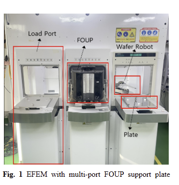

Fig. 1은 3개의 로드 포트가 설치된 EFEM을 나타낸다. 로드 포트는 EFEM의 부속 장치로, FOUP(front opening unified pod)를 EFEM에 장착하거나 제거하는 역할을 수행한다. FOUP은 웨이퍼를 저장하고 이동하기 위한 용기로, 여러 장의 웨이퍼를 안전하게 고정하여 외부 환경으로부터 보호하는 기능을 가진다. EFEM은 FOUP에서 웨이퍼를 꺼내 공정 장비로 이송하거나, 공정이 완료된 웨이퍼를 FOUP으로 되돌리는 자동화 장치로, 반도체 제조 공정의 필수 장비 중 하나이다. 이 과정에서 웨이퍼를 FOUP에 장착하거나 꺼내는 작업은 EFEM 내부의 웨이퍼 이송 로봇에 의해 수행된다. 웨이퍼 이송 로봇은 FOUP 내부 슬롯에 웨이퍼를 정확하게 배치하거나 꺼내며, 공정 장비에서 로드 포트의 플레이트 위에 위치한 FOUP으로 웨이퍼를 이송하는 역할을 한다. 이는 반도체 제조 공정의 자동화와 효율성을 높이는 데 중요한 역할을 한다.(16,17) Fig. 2는 웨이퍼 이송 로봇(WTR: wafer transfer robot)을 나타내고 있다. 일반적으로 웨이퍼 이송 로봇은 로봇팔과 end-effector, 센서시스템, 컨트롤러 등으로 구성된다. 최근 웨이퍼 이송 로봇 제조업체들은 *(397쪽)* 생산성을 향상하기 위해 고속 구동이 가능한 로봇을 개발하는 한편, 웨이퍼 표면의 스크래치를 최소화하기 위해 로봇의 반복 정밀도를 개선하거나 end-effector의 진동을 저감하는 기술 개발에 주력하고 있다. 웨이퍼 이송 로봇의 주요 구성 요소 중 하나인 end effector의 블레이드는 웨이퍼를 직접 잡거나 고정하는 역할을 수행한다. End effector는 흔히 그리퍼(gripper) 또는 척(chuck)이라고도 불리며, 일반적으로 진공 척(vacuum chuck) 또는 클램프(clamp) 방식을 사용하여 웨이퍼를 안전하게 처리한다.

> Fig. 2 Wafer transfer robot (Kawasaki NTJ20) — *(그림 캡처 없음)*

Fig. 3은 웨이퍼를 잡거나 고정하는 다양한 블레이드의 유형을 나타낸다. 웨이퍼를 고정하는 방법에 따라 블레이드는 크게 세 가지 방식으로 구분된다: 진공 압을 이용하는 vacuum-type 방식, 웨이퍼를 패드(pad) 위에 얹어 옮기는 passive-type 방식, 웨이퍼의 끝단을 그립하여 이동시키는 edge grip-type 방식이다.(18,19) 초기에는 소형 웨이퍼(100 ~ 200 mm) 를 다룰 때 주로 vacuum-type 방식이 사용되었다. 그러나 웨이퍼 크기가 300 mm로 증가함에 따라, 웨이퍼 표면과의 접촉을 최소화하기 위해 edge grip-type 블레이드가 널리 채택되고 있다.(20~22) 향후 450 mm 웨이퍼가 도입되면서 edge grip-type 블레이드의 중요성은 더욱 커질 것으로 예상된다. 본 연구에서는 웨이퍼 표면에 발생하는 스크래치의 주요 원인 중 하나인 로드 포트와 edge grip-type 블레이드의 기울기 문제를 중점적으로 분석한다. 이를 해결하기 위해 다중 센서를 활용한 웨이퍼 이송 로봇의 정밀 위치 측정 및 상태 진단 기술을 제안하며, 최적화된 티칭(teaching) 방법론을 제시한다. 또한, 제안한 시스템의 구현을 위해 웨이퍼 이송 로봇 모니터링 시스템의 하드웨어 및 소프트웨어를 개발하였다. 개발된 시스템은 웨이퍼 이송 과정에서 발생하는 진동 및 로드 포트와 edge grip-type 블레이드 간 상대 기울기 오차를 보정할 수 있도록 설계되었으며, 이를 통해 시스템의 실효성을 실험적으로 입증하고자 한다.

> Fig. 3 Examples of blade types: (a) passive type blade; (b) edge grip type blade; (c) vacuum type blade — *(그림 캡처 없음)*

### 3. 웨이퍼 스크래치 문제점

Fig. 4는 실험에 사용된 일반적인 FOUP의 구조를 나타낸다. FOUP 내부에는 25개의 슬롯이 있으며, 각 슬롯 간 간격은 10 mm로 일정하게 설계되어 있다. 지면에 수직인 축을 Z축으로 정의하였으며, 로봇의 Z축 명령 좌표는 슬롯 간 중간 지점에 블레이드가 정확히 위치하도록 설정된다.

> Fig. 4 FOUP with 25 slots spaced 10 mm apart — *(그림 캡처 없음)*

Fig. 5는 로봇 블레이드가 FOUP 내부 웨이퍼 사이로 진입하는 상황을 간략화하여 나타낸 그림이다. Fig. 5(a)는 웨이퍼 이송 로봇과 FOUP 간에 상대 기울기 오차가 없는 이상적인 셋업 환경을 *(398쪽)*

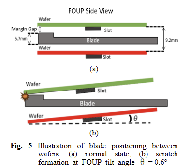

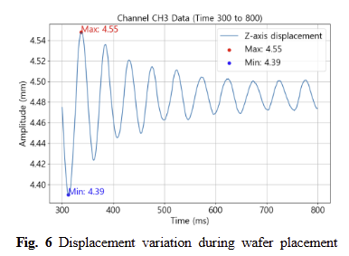

보여준다. 이러한 이상적인 조건에서 blade의 두께는 5.7 mm(가와사키 gripper 모델), 웨이퍼의 두께는 0.8 mm이며, 블레이드가 웨이퍼 사이에 존재할 수 있는 공간은 9.2 mm로 계산된다. 블레이드의 허용 공간은 9.2 mm에서 5.7 mm를 뺀 약 3.5 mm로 산출된다. 이러한 계산 결과는 이론적으로는 비교적 충분한 공간으로 보이지만, 실제 현장에서는 중력으로 인한 웨이퍼 끝단의 처짐과 진동으로 인해 이 허용 공간이 감소하게 되는 문제가 발생한다. 특히 외팔보 구조를 가지고 있는 반도체 이송로봇의 경우 끝단의 진동은 피할 수 없는 문제이다. Fig. 6은 실험에 사용된 웨이퍼 이송 로봇 블레이드 끝단의 진동 특성을 나타내는 변위 데이터를 보여준다. 본 실험은 실제 반도체 생산라인에서 사용 중인 로봇과 블레이드를 정상적인 구동 조건하에서 수행되었으며, 진동 데이터를 측정하였다. 실험 결과, Fig. 6에서 나타난 바와 같이 블레이드가 웨이퍼를 놓는 순간, 4.39 mm 위치에서 4.55 mm 위치까지 약 0.16 mm의 진폭을 가진 진동이 관찰되었다. 비록 작은 수치로 보일 수 있으나, 이러한 진동으로 인한 오차값은 로봇으로 제어할 수 없는 오차이기에 주의가 필요하다. 블레이드 끝단에서 웨이퍼 스크래치 문제는 자중에 의한 처짐에 의해 주로 발생한다. 블레이드 처짐은 웨이퍼의 무게(127.62 g)와 블레이드 자체 무게로 인해 발생하게 된다. 블레이드 자체 무게에 의한 처짐은 일정하므로 로봇의 위치 명령을 보정하여 해결할 수 있지만, 웨이퍼 무게에 의한 처짐은 로딩 및 언로딩 상태에 따라 변화하기 때문에 실시간 제어가 없이는 보상이 어렵다. 효율성 측면에서, 현재의 반도체 생산라인에서는 환경 변화에 따라 웨이퍼 이송 로봇을 실시간으로 제어하지 않는다. 최근 생산성을 높이기 위해 웨이퍼 이송 로봇의 고속 이송이 점점 더 요구되고 있으며, 이에 따라 블레이드는 점점 더 얇고 가볍게 설계되고 있다. 그러나 이러한 설계는 블레이드 끝단의 처짐과 진동을 더욱 심화시키는 결과를 초래한다. 처짐과 진동으로 인한 영향을 최소화하기 위해서는 웨이퍼 이송 로봇과 FOUP이 최대한 기울기 오차 없이 설치되는 것이 중요하다. Fig. 5(b)와 같이 웨이퍼 이송 로봇과 FOUP 간 상대 기울기 각도가 0.6°만 기울어져도 웨이퍼 하단에 스크래치가 발생하는 현상이 확인되었다. 따라서 이러한 스크래치를 방지하기 위해 초기 설치 과정에서 정밀한 위치 조정이 필수적이며, 시간이 지남에 따라 발생하는 기울기 오차를 효과적으로 관리하는 것이 중요함을 알 수 있다.(23) 웨이퍼에 스크래치가 발생하는 경우를 분석하기 위해 본 연구에서는 웨이퍼 이송 로봇의 두 가지 동작을 정의한다. 첫 번째는 웨이퍼를 FOUP에 놓는 동작으로 ‘put motion’이라고 정의하며, 두 번째는 FOUP에서 웨이퍼를 꺼내는 동작으로 ‘get motion’이라고 정의한다. ‘put motion’에서는 웨이퍼를 놓은 후 로봇 암이 후퇴할 때 블레이드의 기울기 변화나 로드 포트의 기울기 차이로 인해 웨이퍼 하단에 스크래치가 발생할 위험이 있다. 반면, ‘get motio’’에서는 블레이드가 FOUP에 진입하는 과정에서 웨이퍼 하단에 스크래치를 유발할 수 있다. 반도체 생산라인에서 블레이드 처짐과 진동으로 인한 스크래치 발생은 장비 설계와 사양에 의해 결정되 *(399쪽)* 는 구조적 문제로, 현장 작업자가 직접적으로 제어하거나 개선하기 어려운 요인이다. 특히, 웨이퍼 이송 로봇을 생산라인의 환경 변화에 따라 실시간으로 제어하는 것은 현실적으로 어렵다. 따라서, 웨이퍼 스크래치 문제를 최소화하기 위한 최선의 방법은 현재의 생산 환경을 고려하여 초기 설치 과정에서 정밀한 조정을 수행하고, 시간이 지남에 따라 발생하는 기울기 오차를 효과적으로 보정하는 시스템을 도입하는 것이다. 이러한 보정 시스템은 라인의 생산 장비를 변경하지 않고도 큰 추가 비용 없이 불량률을 줄이고, 생산 안정성을 높이는 데 기여할 수 있게 된다.

### 4. 모니터링 시스템 설계

웨이퍼 이송 로봇의 ‘put motion’과 ‘get motion’ 동작 중 발생할 수 있는 웨이퍼 스크래치를 방지하기 위해, FOUP과 블레이드의 상대 기울기를 측정할 수 있는 모니터링 시스템을 설계하였다. 이 모니터링 시스템은 기울기 센서와 변위 센서를 활용하여 FOUP과 블레이드 간의 상대 기울기를 정밀하게 측정하도록 설계되었다. Fig. 7은 설계된 모니터링 시스템의 측정 및 분석 과정을 나타낸 플로우 차트이다. 먼저, 기울기 센서를 통해 FOUP과 블레이드 간의 기울기 데이터를 수집하며, 변위 센서를 이용해 로드 포트와 웨이퍼 슬롯 간의 위치 정보를 측정한다. 이렇게 수집된 데이터를 바탕으로 FOUP과 블레이드 간의 상대 기울기를 계산하고, 웨이퍼 슬롯 간 여유 간격(margin gap)을 산출하여 웨이퍼의 위치 정확도를 평가하게 된다. 이후 계산된 기울기 값과 여유 간격 데이터를 기반으로 스크래치 발생 위험도를 분석하며, 위험도는 시각적으로 표시되어 작업자가 현재 상태를 쉽게 확인할 수 있도록 하였다. 설계된 모니터링 시스템은 웨이퍼 스크래치 발생 원인을 사전에 진단하고, 위험도를 경고함으로써 스크래치로 인한 불량률을 줄이는 데 기여할 수 있다. 또한, 생산 라인의 초기 설치 및 유지 관리 과정에서 발생할 수 있는 상대 기울기 오차를 효과적으로 보정할 수 있는 유용한 도구로 활용될 수 있다.

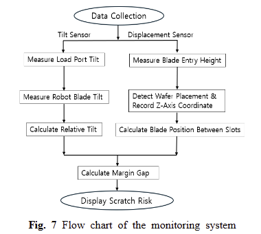

Fig. 8은 제안된 모니터링 시스템의 개념 설계를 나타낸다. Fig. 8에서 볼 수 있듯이, 제안된 모니터링 시스템은 기존 FOUP 형태를 최대한 활용하도록 설계되었다. 이 시스템은 EFEM의 로드포트에 기존 FOUP 대신 설치되며, 웨이퍼 이송 로봇의 초기 셋업을 조정하고 기울기 오차를 보정하는 작업에 사용된다. 보정 작업이 완료된 후에는 모니터링 시스템을 제거하고 다시 FOUP을 원래 위치에 장착하여 정상적으로 생산 라인을 가동할 수 있다. 개발된 모니터링 시스템은 총 4개의 센서로 구성되어 있다. 상단에는 FOUP과 바닥면의 절대 기울기를 측정하는 기울기 센서(tilt sensor)가 부착되어 있다. 중심부에는 웨이퍼와 센서 간 거리를 측정하기 위한 360도 회전 변위 센서(360° rotary displacement sensor)가 장착되어 있다. 또한, X축과 Y축 방향으로 웨이퍼 중심에서의 거리를 측정하기 위해 2개의 웨이퍼 중심 측정 센서(wafer center measurement sensor)가 설치되어 있다. 본 연구에서 사용한 변위 센서는 광축 기준으로 약 ±1.5°의 측정 오차를 갖는다. 로봇 블레이드는 진동이 0.02 mm 이하로 안정화된 상태에서 측정을 개시하였으며, 반복 정밀도를 확보하기 위해 동일 조건에서 10 ~ 20 *(400쪽)* 회 측정을 수행한 뒤, 그 평균값을 최종 측정값으로 사용하였다.

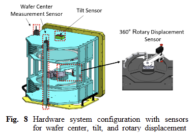

모니터링 시스템은 1번 슬롯부터 5번 슬롯, 그리고 21번 슬롯부터 25번 슬롯까지의 웨이퍼를 측정할 수 있도록 설계되었다. 웨이퍼 중심을 기준으로 양쪽 슬롯과 웨이퍼 중심을 잇는 축을 X축으로 정의하고, 웨이퍼 평면상에서 이 축에 수직한 방향을 Y축으로 정의하였다. 기울기 센서는 FOUP과 바닥면 간의 절대 기울기를 측정하며, 360도 회전 변위 센서는 웨이퍼 중심에서 반지름 둘레를 360도로 회전하면서 웨이퍼와의 거리를 측정한다. 측정된 데이터는 웨이퍼 중심 기준으로 X축과 Y축 방향의 기울기를 계산하는 데 사용된다. 이 기울기는 블레이드의 상대 기울기로 정의되며, FOUP의 절대 기울기와 비교함으로써 블레이드의 절대 기울기를 계산할 수 있다. 이러한 시스템을 통해 초기 설치 과정에서의 셋업 조정을 정밀하게 수행하고, 기울기 오차를 효과적으로 보정할 수 있게 된다. Fig. 9는 설계한 모니터링 시스템의 개념도를 나타내고 있다. 본 시스템은 300 mm 웨이퍼를 기준으로 설계되었으나, 작은 크기의 웨이퍼도 센서 위치만 조정하면 동일한 측정 방법으로 사용할 수 있게 설계하였다. 기울기를 변위 값으로 측정하는 360도 회전 변위 센서는 웨이퍼 반지름 150 mm 지점이 아닌, Fig. 9에서 나타난 것처럼 반지름 129 mm 지점에서 측정하도록 설계되었다. 이는 정확한 모니터링을 보장하고 시스템의 보정을 간소화하기 위한 것이다.

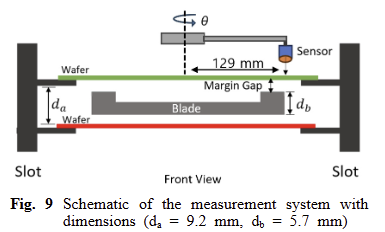

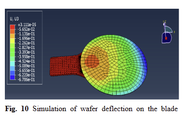

웨이퍼 이송 로봇과 FOUP 간의 기울기 오차를 확인하기 위해 두 가지 상황에서 측정을 수행하였다. 첫 번째는 웨이퍼가 FOUP 슬롯에 안착되기 전에 로봇 블레이드 위에 놓여 있을 때의 기울기 측정이다. 두 번째는 웨이퍼가 FOUP 슬롯에 완전히 안착된 후의 기울기 측정이다. 두 측정값을 비교하여 로봇과 FOUP간의 기울기 오차를 분석하였다. 로봇 블레이드 위에서 웨이퍼의 기울기는 두 가지 요소가 영향을 주게 된다. 첫 번째는 로봇 자체의 설치 기울기에 의해 발생하는 오차이며. 두 번째는 블레이드 자체 자중으로 인한 처짐에 의한 오차다. 이러한 처짐은 FEM 해석과 간단한 실험적 검증을 통해 간단하게 확인할 수 있다. Fig. 10에서 보이듯이 FEM 해석 결과, 반지름 129 mm 지점과 웨이퍼 끝단인 150 mm 사이에서 0.26 mm의 처짐이 발생함을 확인하였다. 이러한 처짐에 의한 변위도 기울기를 계산할 때 고려하였다. Fig. 11은 360도 회전 변위 센서를 활용하여 웨이퍼 표면을 1회전 하면서 웨이퍼와 센서 간의 간격을 측정한 결과를 나타낸다. 본 실험은 웨이퍼 이송 로봇과 로드포트에 설치된 모니터링 시스템을 이용하여 상대 기울기 오차를 측정할 수 있는지 검증하기 위해, 의도적으로 기울기 오차를 포함한 환경에서 수행되었다. 이를 위해 웨이퍼 이송 로봇의 초기 셋업 과정에서는 정밀 티칭을 생략하고, 수평계를 사용하여 대략적으로 기울기를 조정하였다. Fig. 11(a)는 슬롯에 안착된 웨이퍼를 측정한 값과 블레이드 위에 놓인 웨이퍼를 측정한 값 간의 차이를 나타낸다. 생산라인에서 로봇을 셋업할때 Fig. 11(a)에서 최소값(min.)과 최대값(max.)의 차이를 최소화하면서 웨이퍼 이송 로봇을 정확히 설치 및 유지·보수 하는 것이 중요하다. Fig. 11(b)는 블레이드 위에 놓인 웨이퍼를 360도 회전 변위 센서를 사용해 스캔한 회전 각도별 변위 데이터를 보여준다. 360도 회전 변위 센서는 Fig. 8에서와 같이 모니터링 시스템에 부착되어 있다. 따라서 로드포트, FOUP과 동일한 좌표계를 공유하는 개발한 모니터링 시스템은 블레이드 위에 놓여진 웨이퍼의 변위 측정을 통해 상대적인 기울기를 정밀하게 측정할 수 있다.

> *(401쪽 누락 — Fig. 11, Fig. 12와 5절 앞부분으로 추정)*

*(402쪽)* 한다. FOUP의 기울기와 블레이드의 기울기를 각각 구한 후, 이를 바탕으로 margin gap을 측정 및 계산한다. Margin gap은 웨이퍼 이송 로봇의 블레이드와 반도체 웨이퍼 간의 충돌을 방지하기 위한 여유 간격으로 정의된다. Margin gap이 클수록 웨이퍼 이송 로봇의 설치 상태가 양호하다고 판단할 수 있다. Margin gap은 put motion 과정에서 웨이퍼를 배치하는 순간의 위치와 복귀 위치를 측정한 뒤, 슬롯 사이에서 블레이드 위치를 측정한 후에 계산할 수 있다. 측정된 margin gap은 블레이드와 FOUP간 상대 기울기 오차가 클수록 감소하기 때문에, 계산 시 이 상대 기울기 오차를 반영해야 한다. 이를 위해 식 (2)와 같은 회전 변환 행렬과 각 축의 기울기 값을 활용하여 여유 간격 감소량을 도출할 수 있다.

$$R_x(\alpha)=\begin{pmatrix}1&0&0\\0&\cos(\alpha)&-\sin(\alpha)\\0&\sin(\alpha)&\cos(\alpha)\end{pmatrix}\qquad(2a)$$

$$R_y(\beta)=\begin{pmatrix}\cos(\beta)&0&\sin(\beta)\\0&1&0\\-\sin(\beta)&0&\cos(\beta)\end{pmatrix}\qquad(2b)$$

$$R_z(\gamma)=\begin{pmatrix}\cos(\gamma)&0&\sin(\gamma)\\0&1&0\\-\sin(\beta)&0&\cos(\gamma)\end{pmatrix}\qquad(2c)$$

$$R(\alpha,\beta,\gamma)=R_z(\gamma)\cdot R_y(\beta)\cdot R_x(\alpha)\qquad(3)$$

$$v=\begin{pmatrix}x\\y\\z\end{pmatrix},\; v'=R(\alpha,\beta,\gamma)\cdot v\qquad(4)$$

원문 식 그림: 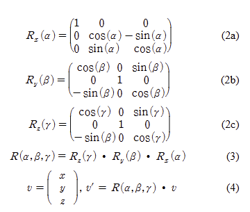

전체 α, β, γ는 각각 X, Y, Z축의 회전각이며, 전체 회전 행렬 R은 식 (3)과 같이 나타낼 수 있다. 이 회전 행렬을 이용하여, 식 (4)와 같은 간단한 좌표이동을 이용하면 회전 값에 의한 웨이퍼의 높이 변화량인 z 값의 최대값과 최소값을 구할 수 있다. 로드포트와 웨이퍼 이송로봇의 상대 기울기 오차가 없는 이상적인 경우에 margin gap은 최대가 되며, 상대 기울기 오차가 있는 경우 z축 변화량에 의해 margin gap이 감소하게 된다. 본 연구에서는 블레이드가 get motion을 수행할 때, 블레이드와 웨이퍼 사이의 거리를 2.7 mm로 설정하였다. 이는 Fig. 5에서 볼 수 있듯이 9.2 mm에서 5.7 mm를 뺀 값의 절반값과 처짐량과 진동 떨림을 고려한 1 mm를 더한 값이다. 검증을 위해 x축, y축 기울기 값이 0인 이상적인 조건에서 x축, y축 기울기를 각각 0.2도 기울었을 때 계산하면 z축 변화량이 1.27 mm로, margin gap 값은 1.43 mm로 여유 갭이 줄어든 것을 확인할 수 있다. 실험적 검증을 위해 로봇의 베이스를 x축, y축 각각 0.2도 기울이고 실험했을 때 margin gap은 약 1.4 mm가 측정되었다. 계산한 1.43 mm와 거의 유사한 수치로서 개발한 모니터링 시스템을 활용하여 블레이드와 FOUP의 기울기를 측정해 z축 변화량을 계산하고, z축 변화량이 margin gap과 같아지는 조건에서 웨이퍼 스크래치가 발생함을 실험적으로 확인하였다. 이와 같이 실험적으로 검증이 되었으나, z축 변화량은 기울기에 따른 변화를 수식으로 나타내어 분석하였으며, 최종적으로 기울기와 스크래치 발생 간의 관계를 Fig. 13과 같이 시각화하여 임계조건을 도출하였다.

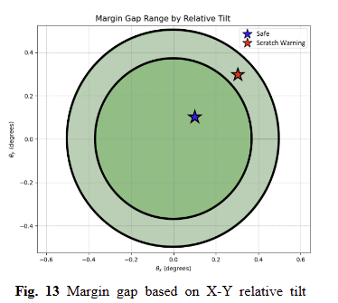

Fig. 13의 그래프는 블레이드와 FOUP 간의 기울기에 따른 margin gap을 기반으로 계산된 값을 그래프의 영역으로 나타낸 것이며, 스크래치 발생 가능성이 있는 최대 영역을 의미하였다. 가장 바깥쪽 경계선 외부는 웨이퍼에 스크래치가 발생하는 충돌 영역을 나타낸다. 이는 상대 기울기가 0인 이상적인 margin gap이 가질 수 있는 최대 기울기의 범위를 의미한다. 연한 녹색 영역 경우, 측정 오차와 센서 오차를 고려하여 0.1도의 오차가 있을 경우를 감안해 설정된 값으로, 스크래치 발생 위험을 보수적으로 평가한 영역을 나타낸다. 가장 안쪽에 있는 원인 진한 녹색 영역은 안정적인 기울기 범위를 나타낸다. 즉 빨간색 별 표시 영역의 경우 스크래치가 발생할 위험이 있는 범위에 있어 수정이 필요하다는 것을 의미하며 파란색 별 표시 영역은 안전한 범위 *(403쪽)* 안에 있다는 것을 의미한다. 만약 연한 녹색 영역 외부에 표시가 있다면 현재 스크래치가 발생 중이라는 것을 의미한다.

### 6. 실험 결과 및 고찰

개발한 모니터링 시스템을 실제 EFEM에 적용하여 실험을 진행하였다. Fig. 14는 실험 환경을 나타낸다. 실험에 사용된 웨이퍼 이송 로봇은 가와사키 gripper 타입 로봇이며, EFEM은 3개의 load port로 구성되어 있다. Foup은 로드 포트 위의 플레이트에 고정되어 있다. 따라서 foup 기울기는 로드 포트의 플레이트(plate) 기울기와 같다.

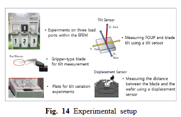

Fig. 15는 실험에 사용된 3개의 로드 포트를 나타낸다. Fig. 15(a)와 같이 로드 포트 1은 정상 상태의 기울기로 고정하였으며, 로드 포트 2와 3의 plate는 Fig. 15(b), (c)와 같이 FOUP의 기울기를 임의로 조정하였다.

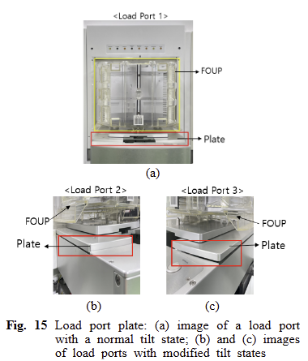

Table 1과 2는 개발한 모니터링 시스템을 이용하여 3개의 로드 포트에서 측정한 FOUP의 기울기, 웨이퍼 이송 로봇 블레이드의 기울기, 상대 기울기, margin gap의 측정 결과를 나타낸다. Table 1은 로드 포트의 플레4로봇 블레이드 기울기를 조정해야 되는 경우를 보여준다. 개발한 모니터링 시스템을 이용하여 로드 포트와 블레이드의 상대 기울기를 측정하였다. 또한, 모니터링 시스템에 내장된 변위 센서를 활용하여 웨이퍼 이송 로봇 블레이드의 put motion을 블레이드와 웨이퍼 사이의 위치를 앞서 언급한 2.7 mm로 설정하였다. 마지막으로, 제시한 계산 방법을 적용하여 x축 및 y축 기울기에 대한 회전 행렬식을 이용해 Table 1의 z축의 높이 변화량(Z-axis variation)를 산출하고 2.7 mm를 차감 최종 *(404쪽)* margin gap을 도출하였다.

**Table 1** Parameter measurement results from the monitoring system (load port tilt adjustment required)

| | Load port 1 | Load port 2 | Load port 3 |
|---|:---:|:---:|:---:|
| Foup tilt (θx, θy) | (0,0)° | (0.59, -0.34)° | (0.23, 0.21)° |
| Blade tilt (θx, θy) | (0.23, -0.267)° | (0.23, -0.267)° | (0.23, -0.267)° |
| Relative tilt (θx, θy) | (0.23, -0.267)° | (-0.36, -0.073)° | (0, 0.477)° |
| Z-axis variation | 1.56 mm | 1.62 mm | 2.12 mm |
| Margin gap | 1.14 mm | 1.08 mm | 0.58 mm |

**Table 2** Parameter measurement results from the monitoring system (blade tilt adjustment required)

| | Load port 1 | Load port 2 | Load port 3 |
|---|:---:|:---:|:---:|
| Foup tilt (θx, θy) | (0,0)° | (0.1, 0.25)° | (-0.21, -0.11)° |
| Blade tilt (θx, θy) | (0.23, -0.267)° | (0.23, -0.267)° | (0.23, -0.267)° |
| Relative tilt (θx, θy) | (0.23, -0.267)° | (0.13, -0.517)° | (0.44, -0.157)° |
| Z-axis variation | 1.56 mm | 2.40 mm | 2.10 mm |
| Margin gap | 1.14 mm | 0.3 mm | 0.6 mm |

(정리 메모: 원문 표에서 Blade tilt 행은 세 칸이 병합된 한 값이다.)

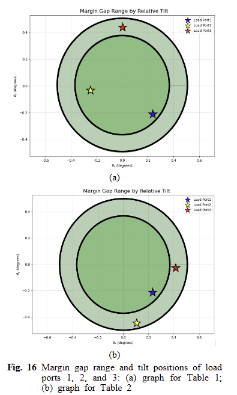

웨이퍼 끝단에 부착된 변위 센서를 이용하여 웨이퍼 이송 로봇의 진동을 측정하였으며, 실험을 통해 측정된 웨이퍼 처짐량을 고려하여 최종적으로 margin gap에 반영하였다. 웨이퍼의 자중에 의해 블레이드의 처짐량은 0.26 mm로 측정되었으며, 웨이퍼를 놓거나 잡는 순간 발생하는 진동의 peak to peak 값은 0.16 mm로 나타났다. Table 1에 따르면, 로드 포트 1의 margin gap이 가장 큰 값으로 계산되었다. Fig. 16(a)에서는 로드 포트 1이 가장 안전한 영역인 안쪽에 위치하고 있음을 확인할 수 있다. 반면, 모니터링 시스템에서 측정된 로드 포트 3의 기울기는 로드 포트 2보다 작음에도 불구하고 margin gap이 더 작아 스크래치 발생 위험 범위에 포함되는 것으로 나타났다. 이는 웨이퍼 이송 로봇 블레이드와 로드 포트 3간의 상대 기울기 각도가 크기 때문에 발생하는 현상이다. 불안정한 상태에 있는 로드 포트 3을 안정적인 영역으로 조정하는 방법으로는 로드 포트의 기울기를 조정하는 방법과 블레이드의 기울기를 조정하는 방법이 있다. 그러나 블레이드의 각도를 조정할 경우, 정상 범위에 위치한 로드 포트 1과 로프 포트 2의 결과에 영향을 미칠 수 있다. 이러한 경우, 두 가지 방법 중 로드 포트 1과 로드포트 2에 영향을 주지 않는 로드 포트 3의 플레이트를 조정하는 것이 보다 효율적인 티칭 방법이 될 것이다. Table 2에 제시된 실험 조건에서는, Fig. 16(b)에서 확인할 수 있듯이 로드 포트 2와 로드 포트 3의 기울기가 모두 스크래치 발생 위험 범위에 포함되어 있다. Table 2에서 로드 포트 2의 FOUP 기울기는 Table 1에서 로드포트 2의 FOUP 기울기보다 안정적임에도 불구하고 상대 기울기에 의해서 스크래치 발생이 더 높은 것을 확인할 수 있다. 이러한 경우, 두 로드 포트를 개별적으로 수정하는 것보다 로봇 블레이드의 기울기를 조정하는 것이 더욱 효과적인 티칭 방법이 될 수 있다. 모든 장비의 기울기를 완벽하게 조정하는 것이 가장 이상적이지만, 실제 반도체 생산 라인에서는 수백 대의 EFEM 장비와 로봇이 서로 다른 바닥 기울기를 가진 상태에서 설치되어 있다. 새로운 공정이 도입되면서 로봇 또는 로드 포트가 재설치될 경우, 짧은 유지보수 기간 내에 모든 장비를 이상적으로 교정하는 것은 시간과 비용 측면에서 현실적인 제약이 크다. 현재 기존 방식에서는 장비 기울기로 인해 스크래치 문제가 발생하면 현업 담당자가 육안으로 문제를 확인하고 수작업으로 조정하고 있다. 그러나 각 로드 포트와 로봇이 각각 얼마나 기울어져 있는지, 상대 기울기 값이 정량적으로 얼마인지에 대한 데이터를 수집하지 않고 있어, 유지보수 후 교정 정확도를 평가할 방법이 없어 업무 효율성이 크게 저하되는 문제가 있다. 개발한 모니터링 시스템을 활용하면 정밀한 자세 교정과 시간 효율성을 동시에 확보할 수 있어, 공정 품질과 장비 안정성을 향상시키는 데 기여할 수 있다.

### 7. 결론 및 향후 연구

본 연구에서는 반도체 제조 공정에서 발생하는 웨이퍼 표면 스크래치 문제를 해결하기 위해, 웨

> *(405쪽 누락 — 결론 본문과 참고문헌 (1)~(9) 앞부분)*

### 참고문헌 (406쪽, (9) 뒷부분부터)

(9) …Scheduling Method for Track Systems in Semiconductor Fabrication,” *Trans. Korean Soc. Mech. Eng. A*, Vol. 25, No. 3, pp. 443~451.

(10) Budnitzki, M. and Kuna, M., 2019, “Scratching of Silicon Surfaces,” *Int. J. Solids Struct.*, Vol. 161, pp. 245~255.

(11) Yeb, B. S., 2011, “Development of Automatic Precision Inspection System for Defect Detection of Photovoltaic Wafer,” *J. Korean Soc. Manuf. Technol. Eng.*, Vol. 20, No. 5, pp. 666~672.

(12) Kim, W. S., Jeon, Y. H. and Lee, D. Y., 2005, “Simulator of Integrated Single-Wafer Processing Tools with Contingency Handling,” *Trans. Korean Soc. Mech. Eng. A*, Vol. 29, No. 1, pp. 96~106.

(13) Zhang, J., Qin, W. and Wu, L., 2015, “A Performance Analytical Model of Automated Material Handling System for Semiconductor Wafer Fabrication System,” *Int. J. Prod. Res.*, Vol. 54, No. 6, pp. 1650~1669.

(14) Ellis, K. P., Lu, Y. and Bish, E. K., 2004, “Scheduling of Wafer Test Processes in Semiconductor Manufacturing,” *Int. J. Prod. Res.*, Vol. 42, No. 2, pp. 215~242.

(15) Jeong, S. Y., 2015, “Analysis of the Relationship between Wafer Surface Defects and Stick-Slip Occurrence in CMP,” *Master’s Thesis*, Hannam University, Daejeon, Republic of Korea.

(16) Liu, Y., Xu, M. and Cao, Y., 2012, “Research, Design and Experiment of End Effector for Wafer Transfer Robot,” *Ind. Robot Int. J. Robot. Res. Appl.*, Vol. 39, No. 1, pp. 79~91.

(17) Lee, D. H., Kim, S., Lee, C. and Cho, Y. H., 2013, “Full Duplex Robot System for Transferring Flat Panel Display Glass,” *J. Korean Soc. Manuf. Technol. Eng.*, Vol. 22, No. 6, pp. 996~1002.

(18) Han, B. Y., Zhao, B. and Sun, R. H., 2023, “Research on Motion Control and Wafer-Centering Algorithm of Wafer-Handling Robot in Semiconductor Manufacturing,” *Sensors*, Vol. 23, No. 20, Article 8502.

(19) Wang, M. J., Chung, H. C. and Wu, H. C., 2004, “Evaluating the 300 mm Wafer-Handling Task in Semiconductor Industry,” *Int. J. Ind. Ergon.*, Vol. 34, No. 6, pp. 459~466.

(20) Jeon, D., Choi, J. and Lee, M., 2018, “New Wafer Alignment Process Using Multiple Vision Method for Industrial Manufacturing,” *Electronics*, Vol. 7, No. 3, Article 39.

(21) Qiao, G., Schlenoff, C. and Weiss, B. A., 2017, “Quick Positional Health Assessment for Industrial Robot Prognostics and Health Management (PHM),” *Proc. 2017 IEEE International Conference on Robotics and Automation (ICRA)*, Singapore, pp. 1815~1820.

(22) Fan, S. K. S., Hsu, C. Y., Tsai, D. M., He, F. and Cheng, C. C., 2020, “Data-Driven Approach for Fault Detection and Diagnostic in Semiconductor Manufacturing,” *IEEE Trans. Autom. Sci. Eng.*, Vol. 17, No. 4, pp. 1925~1936.

(23) Son, Y. G. and Kim, B. S., 2023, “Reliability Estimation of Position Repeatability for Robot Systems,” *Trans. Korean Soc. Mech. Eng. A*, Vol. 47, No. 2, pp. 115~121.

(24) Islam, M. S., Ji, Y. K., Kim, K. and Kim, H. Y., 2025, “Advanced Machine Learning Techniques for Predicting Z-Axis Belt Wear in Wafer Transfer Robots,” *Int. J. Precis. Eng. Manuf. Smart Technol.*, Vol. 3, No. 1, pp. 17~30.

(25) Son, Y. G., 2023, “Application of Gaussian Process Regression for Life Prediction of A Robot, based on RMS Torque Data of Axis Motors,” *Trans. Korean Soc. Mech. Eng. A*, Vol. 47, No. 12, pp. 1013~1020.

(26) Kim, B., Park, W., Kim, K. and Kim, H. Y., 2023, “CNN-based Classification of the Laser Assembly Process for Ultra-Small Batteries,” *J. Mech. Sci. Technol.*, Vol. 37, No. 12, pp. 6181~6192.

(27) Chen, L. and Moon, S. K., 2024, “In-Situ Defect Detection in Laser-Directed Energy Deposition with Machine Learning and Multi-Sensor Fusion,” *J. Mech. Sci. Technol.*, Vol. 38, pp. 4477~4484.
