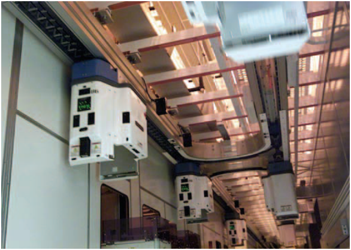
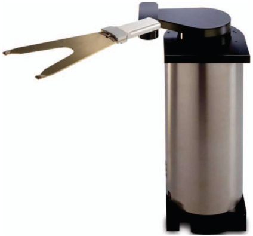
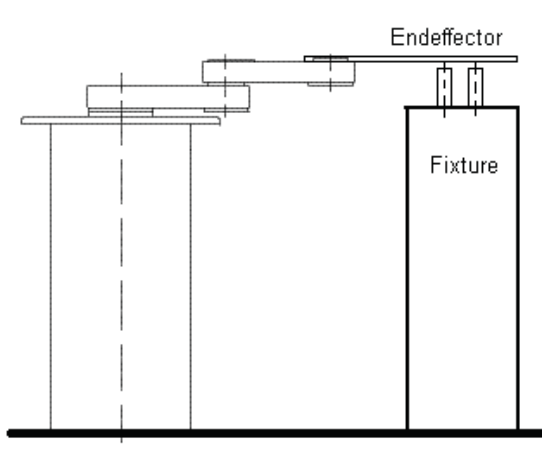
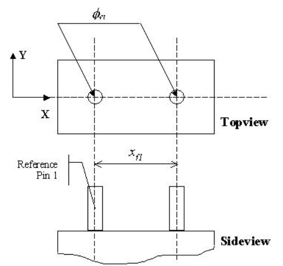
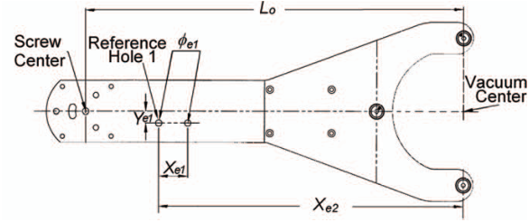
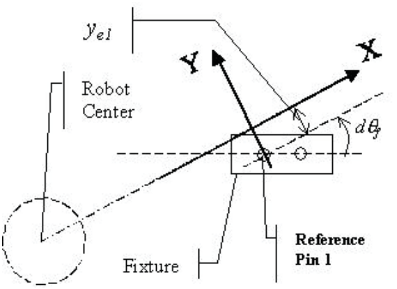
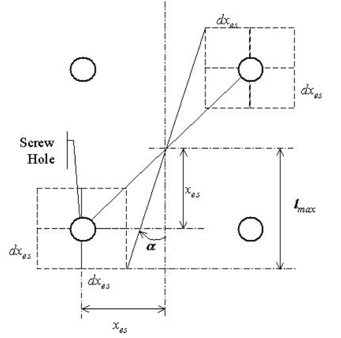
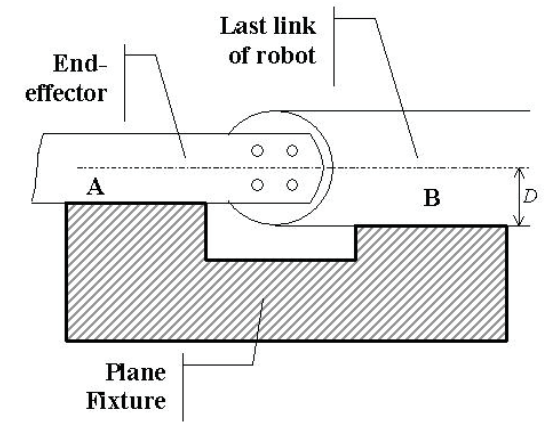

# 웨이퍼 핸들링 로봇의 보정: 고정구(지그) 접근법 (Zhang 2007)

- 원제: Calibration of Wafer Handling Robots: A Fixturing Approach
- 저자: Mike Tao Zhang (Senior Member, IEEE), Ken Goldberg (Fellow, IEEE)
- 원문: 같은 폴더의 `Zhang2007_CASE_wafer_robot_jig.pdf` (Proceedings of the 3rd Annual IEEE Conference on Automation Science and Engineering, Scottsdale, AZ, USA, 2007년 9월 22~25일, SuRP-B03.1, pp. 255–260)
- 번역 범위: 전문
- 그림: 원문 그림 8개를 `그림/`에 넣고 본문에서 처음 언급되는 곳에 삽입

## 초록 (Abstract)

반도체 제조 산업은 설치·셋업 중단 시간(downtime)이 짧으면서도 매우 정확한 로봇 동작을 요구한다. 우리는 웨이퍼 핸들링 로봇을 위한 빠르고, 저렴하며, 다루기 쉬운 보정(캘리브레이션, calibration) 시스템을 개발한다. 이 시스템은 고정구(fixture)와 간단한 보상(compensation) 알고리즘으로 정의된다. 로봇 반복정밀도(repeatability), 엔드이펙터 불확도(uncertainty), 웨이퍼 안착점(placement point)의 공차 요구 사항이 주어졌을 때, 결정론적 공차 모델(deterministic tolerance model)에 기반하여 고정구 설계 및 배치 사양을 유도한다. 고정구 기반 보정을 적용함으로써 엔드이펙터의 공차 요구 사항을 20배 완화하는 데 성공했다.

## I. 서론 (INTRODUCTION)

반도체 제조는 엄청난 자동화 기술을 활용하는 빠르게 성장하는 산업이다. 첨단 로봇, 자동 물류 시스템(automated material handling systems, AMHS), 고정밀 장비, 다양한 정보 기술이 공장 전체에 배치되어 있다.

실리콘 웨이퍼는 보통 두께 1mm 미만, 지름 200mm 또는 300mm이다. 웨이퍼는 FOUP에 보관된다. FOUP(Front Opening Unified Pod)는 웨이퍼 운반 용기이며, 보통 FOUP 하나에 슬롯이 25개 있다. 웨이퍼가 담긴 FOUP 하나를 로트(lot)라고 한다.

AMHS는 장비와 보관 스토커(stocker) 사이에서 로트를 이송하는 데 쓰인다. 그림 1은 첨단 팹(웨이퍼 제조 시설) AMHS의 일부를 보여 준다.

*그림 1 — OHV(Overhead Hoist Vehicle, 천장 호이스트 차량)가 천장에 매달린 궤도를 통해 장비로 로트를 운반한다.*

로트가 장비의 로드 포트(load port)에 도착하면, 웨이퍼 핸들링 로봇이 FOUP에서 웨이퍼를 집어 프리얼라이너(pre-aligner)에 넘긴다. 정렬이 끝나면 로봇이 웨이퍼를 공정 장비로 이송한다. 팹에서는 많은 산업용 로봇이 웨이퍼 핸들링에 쓰인다. 그림 2는 널리 쓰이는 웨이퍼 핸들링 로봇을 보여 준다.

*그림 2 — 산업용 웨이퍼 핸들링 로봇*

웨이퍼 핸들링 로봇은 일반적으로 반복정밀도가 높지만, 상대 위치·자세 오차 때문에 절대 위치 정확도는 꽤 낮다. 현재 웨이퍼 핸들링 로봇은 대부분 티치 펜던트(teach pendant)를 이용한 재생(playback) 방식으로 프로그래밍된다. 이 절차에서는 작업자가 로봇에게 모든 웨이퍼 안착점을 티칭해야 한다. 손상 등의 이유로 엔드이펙터를 교체해야 하면 이 수동 티칭을 처음부터 다시 수행해야 한다. 따라서 이 절차는 비용이 많이 들고, 부정확하며, 시간이 오래 걸린다. 수동 티칭을 피하기 위해, 적절한 소프트웨어 보상으로 로봇 정확도를 높이는 로봇 보정이 흔히 적용된다. 이는 전체 제조 시스템의 신뢰성, 처리량, 총비용에 상당한 영향을 미친다.

*그림 3 — 고정구를 이용한 웨이퍼 핸들링 로봇 보정 (Endeffector: 엔드이펙터, Fixture: 고정구)*

시장 조사에 따르면 선도적인 [로봇 보정] 제품들은 특징적으로 설치와 운용이 쉽고, 무엇보다 더 경제적이다[1]. 이는 반도체 제조 산업에서 특히 그렇다. 이처럼 역동적으로 변하는 환경에서는 교체 작업의 셋업 시간을 줄이는 것이 전체 비용 절감에 크게 기여한다.

우리는 로봇·부품의 현장 교체 시 수동 재티칭을 없애는 툴링(tooling) 개념을 제안한다. 그림 3에 보인 것처럼, 로봇이 놓인 베이스에 표준 고정구를 부착한다. 처음에 작업자가 로봇에게 모든 웨이퍼 안착점을 수동으로 티칭한다. 고정구는 하나의 핵심 안착점(critical placement point)을 정확하게 찾는 데 도움을 준다. 엔드이펙터가 바뀌어도 작업자는 모든 안착점을 다시 티칭할 필요가 없다. 이 고정구로 정의된 핵심 안착점만 다시 티칭하면 된다. 그러면 로봇은 핵심 안착점의 초기 티칭 데이터와 재티칭 데이터 사이의 오프셋을 바탕으로 다른 안착점들을 자동으로 생성한다. 로봇이 이 안착점들에 공차 요구 사항 이내로 도달함이 보장된다. 본 논문에서는 공차 요구 사항이 충족됨을 보장하는 고정구의 수학적·개념적 설계 및 배치 규칙을 기술한다.

(각주) 원고 접수 2007년 5월 2일. 본 연구는 Adept Technology, Inc.와 California State MICRO Grant 00-032의 지원을 받았다. M. T. Zhang은 Submicron Development Center, Spansion Inc.(Sunnyvale, CA 94088 USA) 소속이다(e-mail: mike.zhang@cal.berkeley.edu). K. Goldberg는 University of California, Berkeley(CA 94720 USA)의 산업공학·운영연구학과 및 전기공학·컴퓨터과학과 소속이다.

## II. 관련 연구 (RELATED WORKS)

반도체 제조의 특성상 동작 정확도와 짧은 중단 시간이 요구된다. 따라서 간단하고 신뢰할 수 있는 보정 방법론이 매우 필요하다. Kim 등[2]은 AGV와 6자유도 매니퓰레이터로 구성된 웨이퍼 핸들링 로봇을 위한 자기 보정(self-calibration) 및 항법 시스템을 개발했다. 이들은 카메라를 이용해 랜드마크에 대한 차량의 위치 오차를 인식한 뒤, 고전적인 정기구학 보정 방법론으로 그 오차를 공구 좌표계(tooling frame)의 보상 파라미터로 변환했다.

기구학 보정은 로봇의 정적(또는 기하학적) 정확도를 개선하는 적절한 보정 계수를 찾는다. 위치 결정 부정확성의 약 90%는 기하학적 오차 때문이다[3]. 그래서 보정 연구의 대부분이 이 분야에서 이루어졌다.

로봇 보정은 모델링, 자세 측정(pose measurement), 식별(identification)의 세 가지 기본 요소로 이루어진다.

모델링은 로봇 기구학 보정에서 결정적이다. D-H 변환 행렬을 사용하는 기존 방법론은 잘 확립되어 있다[4]. 많은 연구자가 이 모델의 효과나 정확도를 높이도록 수정하는 연구를 한다. Kim 등[5]은 거의 평행한 관절을 다루도록 D-H 행렬을 조정하고, 자를 이용한 간단한 보정 기법을 개발했다. Ravi와 Basu[6]는 D-H 모델을 선형 방정식으로 줄이기 위해 로봇 링크를 한 번에 하나씩 보정했다. Hollerbach[7]는 링크별 보정을 위해 고정구로 안착점을 결정하는 "원-점(circle-point)" 기법을 개발했다. Newman 등[8]은 같은 방법론을 산업용 로봇 보정에 적용하되 고정구를 레이저 측정 시스템으로 대체했다. 국소 보정(local calibration)은 로봇의 작업 공간이 줄어들수록 더 높은 정확도로 동작한다는 단순한 사실에 기반한다[9]. Young과 Chen[10]은 로봇 작업 공간 내 위치에 따른 보정 오차 파라미터의 변화를 정식화하는 가변 D-H 파라미터 모델을 제안했다. Jang 등[11]은 로봇 작업 공간을 국소 영역으로 나누고 각 영역에서 보정 알고리즘을 유도했다.

고전적인 자세 측정 방식은 다양한 센서로 오프라인 측정을 하는 것이다. 최근에는 자기 보정을 개발하기 위해 온라인 측정에 관심이 모이고 있다. 자기 보정은 안착점을 측정하고 실시간으로 보상 알고리즘을 생성한다. 이 방식으로 더 자주 보정을 수행하여 번거로운 수동 티칭을 없애고 중단 시간과 전체 비용을 줄일 수 있다. Lu와 Lin[12]은 로봇 작업 셀(workcell)을 위한 자기 보정 시스템을 개발했다. 비전 시스템으로 주요 상대 위치 오차를 찾고, 고정구, 시험 블록, 3D 힘 센서로 작은 상대 오차를 보정했다. Zhuang과 Meng[13]은 카메라를 장착한 로봇 매니퓰레이터를 자기 보정했다. 비선형 인자법(factor method)으로 축척 인자를 제외한 자세 측정을 추정했다. 그런 다음 카메라에 보이는 알려진 축척(scale)으로 이 인자를 계산했다. 자기 보정은 복잡한 센서 대신 운동 구속(motion constraint)으로도 달성할 수 있다. Zhuang 등[14]은 세 평면 구속 시스템이 3D 비구속 점 측정 시스템과 동등함을 보였다. 따라서 값비싼 3D 측정 장치를 평면 구속으로 대체할 수 있다. Edwards와 Galloway[15]는 엔드이펙터를 알려진 자세로 고정하는 고정구를 이용한 단일점 보정 기법을 제안했다. 본 논문에서는 간단한 보상 알고리즘으로 로봇이 높은 정확도를 달성하도록 보장하는 고정구(구속)와 배치 설계에 초점을 둔다.

공간 불확도를 표현하고 추정하는 데 통계도 적용된다. Smith와 Cheeseman[16]은 좌표계 사이의 위치·자세 불확도를 기술하는 통계적 틀을 제시했다. 이들은 공칭값에서 평가한 공분산 행렬로 공간 불확도를 표현했다. Renders 등[17]은 측정 잡음과 미지의 로봇 파라미터의 영향을 고려하는 확장 최소제곱 식별 알고리즘을 제시했다. Jackson 등[18]은 측정 잡음의 확률적 특성화를 포함하는 로봇 식별 알고리즘을 제안했다.

본 논문에서는 웨이퍼 핸들링 로봇을 보정하는 하드웨어 기반 접근법을 개발한다. 보정 요구 사항을 달성할 수 있도록 신중하게 설계하고 배치한 고정구를 사용해 자세 측정을 수행한다.

## III. 문제 정의 (PROBLEM STATEMENT)

로봇 반복정밀도, 엔드이펙터 불확도, 웨이퍼 안착점의 공차 요구 사항이 주어졌을 때, 핵심 안착점의 공칭값을 보상하는 간단한 보정 알고리즘이 모든 안착점의 공차 요구 사항을 만족할 수 있도록 하는 고정구 설계 및 배치 사양을 찾고자 한다.

모든 웨이퍼 안착점, 로봇, 엔드이펙터는 서로에 대해 수평이 맞춰져 있다고 가정한다. 따라서 분석은 X-Y 평면에 초점을 둔다. 또한 안착점들의 초기 티칭이 핵심 안착점의 티칭만큼 정확하다고 가정한다. 문제를 결정론적 모델과 통계적 모델의 두 가지 접근법으로 푼다. 그림 4는 제안한 고정 시스템의 사양을 보여 준다. 그림 5는 제안한 엔드이펙터 설계를 보여 준다.

*그림 4 — 고정구 설계 사양 (Topview: 평면도, Sideview: 측면도, Reference Pin 1: 기준 핀 1)*

*그림 5 — 제안한 엔드이펙터 설계 (Screw Center: 나사 중심, Reference Hole 1: 기준 구멍 1, Vacuum Center: 진공 중심)*

문제의 입력은 다음과 같다.

- 엔드이펙터 위 진공 구멍 세 개의 불확도: $dx_v$, $dy_v$.
- 엔드이펙터 위 나사 구멍 네 개의 불확도: $dx_{es}$, $dy_{es}$.
- 로봇 마지막 링크 위 나사 구멍 네 개의 불확도: $dx_{rs}$, $dy_{rs}$.
- 원래 엔드이펙터의 길이(진공 중심에서 나사 중심까지)와 그 불확도: $L_o$, $dL_o$ (그림 5 참조).
- 엔드이펙터를 교체할 경우 새 엔드이펙터의 길이(진공 중심에서 나사 중심까지)와 그 불확도: $L_n$, $dL_n$.
- 로봇 반복정밀도(로봇 마지막 링크의 불확도): $d\theta_{rl}$ = ±0.01°, $dx_{rl}$ = 0.05mm, $dy_{rl}$ = ±380 × tan (0.01°) = ±0.066mm.
- 각 안착점의 공차 요구 사항: 카세트: $dx_{ca}$, $dy_{ca}$. 프리얼라이너: $dx_{pr}$, $dy_{pr}$. 공정 장비: $dx_{eq}$, $dy_{eq}$.

*그림 6 — 고정구와 로봇 중심 사이의 정렬 불확도 (Robot Center: 로봇 중심, Fixture: 고정구, Reference Pin 1: 기준 핀 1)*

문제의 출력은 다음과 같다.

- 엔드이펙터 설계 파라미터와 그 불확도: $x_{e1}$, $x_{e2}$, $y_{e1}$, $\psi_{e1}$, $dx_{e1}$, $dx_{e2}$, $dy_{e1}$, $d\psi_{e1}$ (그림 5 참조).
- 고정구 설계 파라미터와 그 불확도: $x_{f1} = x_{e1}$, $\psi_{f1} = \psi_{e1}$, $dx_{f1}$, $d\psi_{f1}$ (그림 5 참조).
- 고정구 배치(로봇 중심과의 정렬) 불확도 $d\theta_f$ (그림 6 참조).

[역주: 그림 4·5에는 각도 기호가 $\phi_{f1}$, $\phi_{e1}$로, 본문에는 $\psi$로 표기되어 있다. 원문 그대로 둔다.]

## IV. 모델링 (MODELING)

결정론적 모델로 문제를 다룬다. 이 모델은 최악 조건(worst-case) 분석을 제공한다.

원래 엔드이펙터에 대한 사양을 유도한다. 엔드이펙터에서 고정구에 대한 기준 구멍(reference hole)의 불확도는 다음과 같다.

$$\begin{aligned} dx_{rh,f} &= dx_{e1} + dx_{f1} + \frac{\phi_{e1} + d\phi_{e1} - \phi_{f1} + d\phi_{f1}}{2} \\ dy_{rh,f} &= dy_{e1} + dy_{f1} + \frac{\phi_{e1} + d\phi_{e1} - \phi_{f1} + d\phi_{f1}}{2} \\ d\theta_{rh,f} &= \tan^{-1}\left(\frac{2dy_{e1} + (\phi_{e1} + d\phi_{e1} - (\phi_{f1} - d\phi_{f1}))}{x_{f1} - dx_{f1}}\right) \end{aligned}$$

따라서 월드 좌표계(World Frame)에서 구멍의 불확도는 다음과 같다.

$$d\theta_{rh} = d\theta_{rh,f} + d\theta_f,\quad dx_{rh} = dx_{rh,f},\quad dy_{rh} = dy_{rh,f}$$

*그림 7 — 엔드이펙터 나사 중심의 각도 불확도 (Screw Hole: 나사 구멍)*

엔드이펙터 나사 중심은 엔드이펙터 위 나사 구멍 네 개의 기하학적 중심이다. 그 평면 불확도는 $dx_{esc} = dx_{es}$, $dy_{esc} = dx_{es}$이다 [역주: $dy_{esc} = dy_{es}$의 오기로 보인다]. 그림 7에 보인 것처럼 각도 불확도는 $d\theta_{esc} = (45° - \alpha) = 45° - \tan^{-1}\left(\frac{x_{es} - dx_{es}}{l_{max}}\right) = 45° - \tan^{-1}\left(\frac{x_{es} - dx_{es}}{x_{es} + dx_{es}}\right)$이다. 로봇 마지막 링크에서 로봇 나사 중심은 나사 구멍 네 개의 기하학적 중심이다. 그 평면 불확도는 $dx_{rsc} = dx_{rs}$, $dy_{rsc} = dx_{rs}$, $d\theta_{rsc} = 45° - \tan^{-1}\left(\frac{x_{rs} - dx_{rs}}{x_{rs} + dx_{rs}}\right)$이다.

따라서 로봇 마지막 링크에 대한 엔드이펙터 나사 중심의 위치 불확도는 다음과 같다.

$$\begin{aligned} dx_{sc,rl} &= dx_{rsc} + dx_{esc} \\ dy_{sc,rl} &= dy_{rsc} + dy_{esc} \\ d\theta_{sc,rl} &= d\theta_{esc} + d\theta_{rsc} \\ &= \left(45° - \tan^{-1}\left(\frac{x_{es} - dx_{es}}{x_{es} + dx_{es}}\right)\right) + \left(45° - \tan^{-1}\left(\frac{x_{rs} - dx_{rs}}{x_{rs} + dx_{rs}}\right)\right). \end{aligned}$$

월드 좌표계에서 로봇 마지막 링크의 불확도는 다음과 같다.

$$\begin{aligned} d\theta_r &= d\theta_{rh} + d\theta_{sc,rl} + d\theta_{rl} \\ dx_r &= dx_{rh} + dx_{sc,rl} + dx_{rl} + (L_o - x_{e2} + dx_{e2} + dL_o)(1 - \cos d\theta_r) \\ dy_r &= dy_{rh} + dy_{sc,rl} + dy_{rl} + (L_o - x_{e2} + dx_{e2} + dL_o)\sin d\theta_r \end{aligned}$$

진공 중심은 그림 5에 보인 것처럼 엔드이펙터 위 진공 구멍 세 개의 중심이다. 그 불확도는 $dx_{vc} = dx_v$, $dy_{vc} = dy_v$이다. 이제 초기 티칭 후 고정구를 제거하고 로봇이 핵심 안착점에 도달하도록 프로그래밍하면, 월드 좌표계에서 원래 엔드이펙터의 진공 중심의 불확도는 다음과 같다.

$$\begin{aligned} d\theta_{vo} &= d\theta_r \\ dx_{vo} &= dx_r + dx_{vc} + (L_o + dL_o)(1 - \cos d\theta_{vo}) \\ &= dx_{rh} + dx_{sc,rl} + dx_{rl} + dx_{vc} + (2L_o + 2dL_o - x_{e2} + dx_{e2})(1 - \cos d\theta_r) \\ dy_{vo} &= dy_r + dy_{vc} + (L_o + dL_o)\sin d\theta_{vo} \\ &= dy_{rh} + dy_{sc,rl} + dy_{rl} + dy_{vc} + (2L_o + 2dL_o - x_{e2} + dx_{e2})\sin d\theta_r \end{aligned}$$

각 안착점의 공차 요구 사항을 만족하려면 원래 엔드이펙터에 대해 다음 부등식이 성립해야 한다.

$$dx_{vo} < \min(dx_{ca}, dx_{pr}, dx_{eq}, \ldots) \tag{1}$$
$$dy_{vo} < \min(dy_{ca}, dy_{pr}, dy_{eq}, \ldots) \tag{2}$$

다음으로 길이 $L_n$인 새 엔드이펙터로 교체한다. 월드 좌표계에서 진공 중심의 불확도는 다음과 같다.

$$\begin{aligned} d\theta_{vn} &= d\theta_{vo} \\ dx_{vn} &= dx_{rh} + dx_{sc,rl} + dx_{rl} + dx_{vc} + (2L_n + 2dL_n - x_{e2} + dx_{e2})(1 - \cos d\theta_r) \\ dy_{vn} &= dy_{rh} + dy_{sc,rl} + dy_{rl} + dy_{vc} + (2L_n + 2dL_n - x_{e2} + dx_{e2})\sin d\theta_r \end{aligned}$$

따라서 다음을 얻는다.

$$\begin{aligned} \Delta dx_v &= dx_{vn} - dx_{vo} = 2(L_n - L_o + dL_n - dL_o)(1 - \cos d\theta_r) \\ \Delta dy_v &= dy_{vn} - dy_{vo} = 2(L_n - L_o + dL_n - dL_o)\sin d\theta_r \end{aligned}$$

$D_x = \max(0, \Delta dx_v)$, $D_y = \max(0, \Delta dy_v)$라 하자. 공차 요구 사항을 만족하기 위해 부등식 (1)과 (2)를 다음과 같이 수정한다.

$$\max(dx_{vo}, dx_{vn}) = dx_{vo} + D_x < \min(dx_{ca}, dx_{pr}, dx_{eq}, \ldots) \tag{3}$$
$$\max(dy_{vo}, dy_{vn}) = dy_{vo} + D_y < \min(dy_{ca}, dy_{pr}, dy_{eq}, \ldots) \tag{4}$$

## V. 구현 (IMPLEMENTATION)

다음 예제로 엔드이펙터와 고정구 설계 기준을 검증한다. $x_{f1} = x_{e1}$ = 120mm, $x_{e2}$ = 270mm, $y_{e1}$ = 10mm, $\psi_{e1} = \psi_{f1}$, $L_o = L_n$ = 300mm, $dx_{e2} = dL_o = dL_n = dx_v = dy_v$ = ±0.1mm, $d\theta_f$ = ±0.005°, $dx_{e1} = dx_{f1} = dy_{e1} = d\psi_{f1} = d\psi_{e1}$ = ±0.01mm, $dx_{es} = dy_{es} = dx_{rs} = dy_{rs}$ = ±0.005mm, $dx_{ca} = dy_{ca} = dx_{pr} = dy_{pr} = dx_{eq} = dy_{eq}$ = ±0.5mm가 주어졌을 때, 엔드이펙터와 고정구 설계가 공차 요구 사항을 만족하는지 확인하고자 한다.

4절의 분석에 따르면 다음을 얻는다.

$$\begin{aligned} dx_{rh,f} &= 0.01 + 0.01 + \frac{0.01 + 0.01}{2} = 0.03mm \\ dy_{rh,f} &= 0.01 + 0.01 + \frac{0.01 + 0.01}{2} = 0.03mm \\ d\theta_{rh,f} &= \tan^{-1}\left(\frac{2 \times 0.01 + (0.01 + 0.01)}{120 - 0.01}\right) = 0.019° \\ d\theta_{rh} &= d\theta_{rh,f} + d\theta_f = 0.019° + 0.005° = 0.024° \\ dx_{rh} &= dx_{rh,f} = 0.03mm \\ dy_{rh} &= dy_{rh,f} = 0.03mm \end{aligned}$$

- $dx_{esc} = dy_{esc} = dx_{rsc} = dy_{rsc}$ = 0.005mm
- $dx_{sc,rl} = dx_{rsc} + dx_{esc}$ = 0.01mm
- $dy_{sc,rl} = dy_{rsc} + dy_{esc}$ = 0.01mm
- $d\theta_{sc,rl} = 2\times\left[45° - \tan^{-1}\left(\frac{20 - 0.005}{20 + 0.005}\right)\right]$ = 0.0286°
- $d\theta_{vo} = d\theta_r = d\theta_{rh} + d\theta_{sc,rl} + d\theta_{rl}$ = 0.024° + 0.0286° + 0.01° = 0.0526°
- $dx_{vo} = dx_{rh} + dx_{sc,rl} + dx_{rl} + dx_{vc} + (2L_o + 2dL_o - x_{e2} + dx_{e2})(1 - \cos d\theta_r)$ = 0.03 + 0.01 + 0.05 + 0.1 + (2×300+2×0.1-270+0.1) (1-cos0.0526°) = 0.19mm
- $dy_{vo} = dy_{rh} + dy_{sc,rl} + dy_{rl} + dy_{vc} + (2L_o + 2dL_o - x_{e2} + dx_{e2})\sin d\theta_r$ = 0.03 + 0.01 + 0.066 + 0.1 + (2×300+2×0.1-270+0.1) sin0.0526° = 0.5mm
- $D_x = \max(0, \Delta dx_v)$ = 0
- $D_y = \max(0, \Delta dy_v)$ = 0
- $\max(dx_{vo}, dx_{vn}) = dx_{vo} + D_x = dx_{vo}$ = 0.19mm
- $\max(dy_{vo}, dy_{vn}) = dy_{vo} + D_y = dy_{vo}$ = 0.5mm
- $\min(dx_{ca}, dx_{pr}, dx_{eq}) = \min(dy_{ca}, dy_{pr}, dy_{eq})$ = 0.5mm

따라서 $\max(dx_{vo}, dx_{vn})$ = 0.19mm < 0.5mm = $\min(dx_{ca}, dx_{pr}, dx_{eq})$이고 $\max(dy_{vo}, dy_{vn})$ = 0.5mm = $\min(dy_{ca}, dy_{pr}, dy_{eq})$이다. 식 (3)과 (4)가 기술하는 공차 요구 사항이 만족된다.

이 모델링은 엔드이펙터와 고정구 설계가 공차 요구 사항을 충족함이 보장됨을 보여 준다.

그러나 엔드이펙터와 로봇 마지막 링크 양쪽의 나사 구멍 네 개의 공차 등급이 0.005mm 이내인데, 이는 가공하기에 너무 빡빡하다. 그래서 나사 구멍 위치에 대한 공차 요구 사항을 완화하기 위해 추가 평면 고정구(plane fixture)를 제안한다.

엔드이펙터의 작은 자세 오차는 진공 중심에서 큰 위치 오차로 이어지므로, 위 계산에서 보인 것처럼 로봇 마지막 링크에 대한 자세 오차 $d\theta_{sc,rl}$은 0.0286°보다 작아야 한다. 앞의 설계에서는 나사 구멍 위치를 매우 정밀하게 관리하여 엔드이펙터의 자세 공차 요구 사항을 달성했다. 이 때문에 나사 구멍 위치에 0.005mm 공차가 요구되었다.

*그림 8 — 평면 고정구를 이용한 조립 (End-effector: 엔드이펙터, Last link of robot: 로봇 마지막 링크, Plane Fixture: 평면 고정구)*

그림 8에 보인 것처럼 제안한 평면 고정구는 간단하다. 핵심 특징은 평면 A와 평면 B로, 두 평면은 각도 오차 0.02° 미만으로 평행하며 거리 $D$의 오차 $dD$가 0.05mm 미만이다. 그런 다음 새 설계를 다음과 같이 계산한다.

$x_{f1} = x_{e1}$ = 120mm, $x_{e2}$ = 270mm, $y_{e1}$ = 10mm, $\psi_{e1} = \psi_{f1}$, $L_o = L_n$ = 300mm, $dx_{e2} = dL_o = dL_n = dx_v = dy_v$ = ±0.1mm, $d\theta_f$ = ±0.005°, $dx_{e1} = dx_{f1} = dy_{e1} = d\psi_{f1} = d\psi_{e1}$ = ±0.01mm, $dx_{es} = dy_{es} = dx_{rs} = dy_{rs}$ = ±0.1mm, $dx_{ca} = dy_{ca} = dx_{pr} = dy_{pr} = dx_{eq} = dy_{eq}$ = ±0.5mm가 주어졌을 때, 엔드이펙터와 고정구 설계가 공차 요구 사항을 만족하는지 확인하고자 한다. 다음을 얻는다.

- $dx_{esc} = dy_{esc} = dx_{rsc} = dy_{rsc}$ = 0.01mm [역주: 앞의 가정 $dx_{es}$ = 0.1mm와 아래 $dx_{sc,rl}$ = 0.2mm로 보아 0.1mm의 오기로 보인다. 원문 그대로 둔다]
- $dx_{sc,rl} = dx_{rsc} + dx_{esc}$ = 0.2mm
- $dy_{sc,rl} = dD$ = 0.05mm
- $d\theta_{sc,rl}$ = 0.02°
- $d\theta_{vo} = d\theta_r = d\theta_{rh} + d\theta_{sc,rl} + d\theta_{rl}$ = 0.024° + 0.02° + 0.01° = 0.044°
- $dx_{vo} = dx_{rh} + dx_{sc,rl} + dx_{rl} + dx_{vc} + (2L_o + 2dL_o - x_{e2} + dx_{e2})(1 - \cos d\theta_r)$ = 0.03 + 0.2 + 0.05 + 0.1 + (2×300+2×0.1-270+0.1) (1-cos0.044°) = 0.38mm
- $dy_{vo} = dy_{rh} + dy_{sc,rl} + dy_{rl} + dy_{vc} + (2L_o + 2dL_o - x_{e2} + dx_{e2})\sin d\theta_r$ = 0.03 + 0.05 + 0.066 + 0.1 + (2×300+2×0.1-270+0.1) sin0.044° = 0.496mm
- $D_x = \max(0, \Delta dx_v)$ = 0
- $D_y = \max(0, \Delta dy_v)$ = 0
- $\max(dx_{vo}, dx_{vn}) = dx_{vo} + D_x = dx_{vo}$ = 0.38mm
- $\max(dy_{vo}, dy_{vn}) = dy_{vo} + D_y = dy_{vo}$ = 0.496mm
- $\min(dx_{ca}, dx_{pr}, dx_{eq}) = \min(dy_{ca}, dy_{pr}, dy_{eq})$ = 0.5mm

따라서 $\max(dx_{vo}, dx_{vn})$ = 0.38mm < 0.5mm = $\min(dx_{ca}, dx_{pr}, dx_{eq})$이고 $\max(dy_{vo}, dy_{vn})$ = 0.496mm < $\min(dy_{ca}, dy_{pr}, dy_{eq})$이다. 공차 요구 사항이 만족된다. 따라서 평면 고정구를 사용함으로써 나사 구멍의 위치 공차 요구 사항을 0.005mm에서 0.1mm로 완화하는 데 성공했다.

## VI. 결론 (CONCLUSION)

반도체 제조 산업은 셋업 중단 시간이 짧으면서도 매우 정확한 로봇 동작을 요구한다. 우리는 웨이퍼 핸들링 로봇을 위한 빠르고, 저렴하며, 다루기 쉬운 보정 시스템을 개발했다. 이 시스템은 고정구와 효과적인 보상 알고리즘으로 정의된다. 로봇 반복정밀도, 엔드이펙터 불확도, 웨이퍼 안착점의 공차 요구 사항이 주어졌을 때 고정구 설계 및 배치 사양을 유도했다. [19]에서는 통계적 모델을 자세히 기술한다. 본 논문에서는 간단한 최악 조건 분석 도구인 결정론적 모델에 초점을 두었다. 고정구 기반 보정을 적용함으로써 엔드이펙터의 공차 요구 사항을 20배 완화하는 데 성공했다. 다음 목표는 각 고정구 파라미터가 로봇 보정에 미치는 민감도를 연구하는 것이다. 이를 통해 가공하기 쉬운 최적 고정구 설계에 이를 것이다.

## 감사의 글 (ACKNOWLEDGMENT)

적극적으로 참여하고 귀중한 의견을 준 Adept Technology, Inc.의 Dimitri Kambouridis, Tom Wahl, Rodney Lum, Paul Larskulsint, Greg Hirth, Brian Carlisle에게 감사한다.

## 참고문헌

- [1] F. Hidalgo and P. Brunn, "Robot metrology and calibration systems a market review," Industrial Robot, vol. 25, no. 1, pp. 42-47, 1998.
- [2] D. Kim, J. Kim, H. Sung, and S. Kim, "Sensor-based navigation control and calibration of a wafer-handling mobile robot," in Proc. IEEE Industry Application Conf., New York, NY, 1995, pp. 1922-1929.
- [3] R. Bernhardt and S. Albright, Robot Calibration, Chapman & Hall, London, 1993.
- [4] L. Everett and T. Hsu, "The theory of kinematic parameter identification for industrial robots," ASME J. Dyn. Sys. Meas. Cont., vol. 110, pp. 96-100, 1988.
- [5] D. Kim, K. Cook, and J. Oh, "Identification and compensation of robot kinematic parameter for positioning accuracy improvement," Robotica, vol. 9, pp. 99-105, 1990.
- [6] K. Ravi and A. Basu, "An active technique for piecewise calibration of robot manipulators," in Proc. IEEE/RSJ Int. Conf. Intell. Robots Syst., 1995, pp. 501-506.
- [7] J. Hollerbach, "The calibration index and taxonomy for robot kinematic calibration methods," Int. J. Robot. Res., vol. 15, no. 12, pp. 573-591, 1996.
- [8] W. Newman, C. Birkhimer, R. Horning, and A. Wilkey, "Calibration of a Motoman P8 robot based on laser tracking," in Proc. IEEE Int. Conf. Robot. Automat., San Francisco, CA, 2000, pp. 3597-3602.
- [9] L. Everett, "Research topics in robot calibration," in Robot Calibration, F. Hidalgo and P. Brunn, Ed. London: Chapman & Hall, 1993.
- [10] K. Young and J. Chen, "Implementation of a variable D-H parameter model for robot calibration using an FCMAC learning algorithm," J. Intell. Robots Syst., vol. 24, pp. 313-346, 1999.
- [11] J. Jang, S. Kim, and Y. Kwak, "Calibration of geometric and nongeometric errors of an industrial robot," Robotica, vol. 19, pp. 311-321, 2001.
- [12] T. Lu and G. Lin, "An on-line relative position and orientation error calibration methodology for workcell robot operations," Robot. Computer-Integrated Manuf., vol. 13, no. 3, pp. 89-99, 1997.
- [13] H. Zhuang and Y. Meng, "Using a scale: self-calibration of a robot system with factor method," in Proc. IEEE Int. Conf. Robot. Automat., Seoul, Korea, 2001, pp. 2797-2803.
- [14] H. Zhuang, S. Motaghedi, and Z. Roth, "Robot calibration with planar constraints," in Proc. IEEE Int. Conf. Robot. Automat., Detroit, MI, 1999, pp. 805-810.
- [15] C. Edwards and R. Galloway, "A single-point calibration technique for a six degree-of-freedom articulated arm," Robotica, vol. 13, no. 3, pp. 189-198, 1994.
- [16] R. Smith and P. Cheeseman, "On the representation and estimation of spatial uncertainty," Int. J. Robot. Res., vol. 5, no. 4, pp. 56-68, 1986.
- [17] J. Renders, E. Rossignol, M. Becquet, and R. Hanus, "Kinematic calibration and geometrical parameter identification for robots," IEEE Trans. Robot. Automat., vol. 7, no. 6, pp. 721-731, 1991.
- [18] E. Jackson, Z. Lin, and D. Eddy, "A global formulation of robot manipulator kinematic calibration based on statistical considerations," in Proc. IEEE Int. Conf. Syst. Man Cybernetics, 1995, pp. 3328-3333.
- [19] M. T. Zhang and K. Goldberg, "Fixture-based industrial robot calibration for silicon wafer handling," Industrial Robot, vol. 32, no. 1, 2005.
