# 반도체 제조용 웨이퍼 핸들링 로봇의 운동 제어와 웨이퍼 센터링 알고리즘 연구 (Han 2023)

- 원제: Research on Motion Control and Wafer-Centering Algorithm of Wafer-Handling Robot in Semiconductor Manufacturing
- 원문: 같은 폴더의 `Han2023_Sensors.pdf` (Sensors 2023, 23, 8502, Article. https://doi.org/10.3390/s23208502, MDPI, CC BY 4.0)
- 저자: Bing-Yuan Han¹, Bin Zhao²,*, Ruo-Huai Sun²,³ (¹중국농업대학 정보전기공학원, ²SIASUN Robot & Automation Co., Ltd., ³동북대학 정보과학공학원). *교신저자
- 번역 범위: 전문 (본문·수식·그림 캡션·표·부록 성격의 기타 사항). 참고문헌은 원문 그대로 옮겼다.
- 그림: 원문 그림 15개를 `그림/`에 넣고 본문에서 처음 언급되는 곳에 삽입

## 초록

이 논문은 반도체 제조에서 이송 과정 중 웨이퍼 표면의 접촉과 오염을 막기 위해, 핸들링 로봇의 이동 제어와 웨이퍼 보정을 위한 AWC(Active Wafer Centering, 능동 웨이퍼 센터링) 알고리즘을 연구한다. 먼저 웨이퍼 핸들링 로봇의 기구 및 소프트웨어 구조를 분석하고, 이어서 반도체 제조 방법을 위한 실험 플랫폼을 설명한다. 둘째로, 기하학적 방법으로 반도체 로봇의 기구학을 분석하고, 극좌표와 관절 공간으로부터 로봇 본체의 운동 제어를 분리(decouple)한다. 웨이퍼 중심 위치는 AWC 보정을 위해 일반화 최소제곱 역(generalized least-square inverse) 방법으로 보정한다. AWC 알고리즘은 보정(calibration), 편차 보정(deviation correction), 후퇴 검출(retraction detection)로 나뉜다. 이것들은 로봇의 웨이퍼 보정 과정을 분석하여 결정한다. 결론적으로 반도체 로봇의 운동 제어와 AWC 알고리즘의 정확성, 실현 가능성, 효과를 실험으로 검증한다. 웨이퍼 보정 후 AWC의 정밀도는 <± 0.15 mm로, 로봇 웨이퍼 이송 요구 사항을 충족한다.

키워드: 집적회로(Integrated Circuit, IC); 핸들링 로봇(handling robot); 운동 제어(motion control); 능동 웨이퍼 센터링 알고리즘(Active Wafer Centering algorithm)

> 인용: Han, B.-Y.; Zhao, B.; Sun, R.-H. Research on Motion Control and Wafer-Centering Algorithm of Wafer-Handling Robot in Semiconductor Manufacturing. Sensors 2023, 23, 8502. 학술 편집자: Bijan Shirinzadeh. 접수: 2023년 8월 22일, 수정: 2023년 10월 4일, 승인: 2023년 10월 10일, 게재: 2023년 10월 16일.
> 저작권: © 2023 저자들. 라이선스 MDPI(스위스 바젤). 이 논문은 크리에이티브 커먼즈 저작자 표시(CC BY) 라이선스(https://creativecommons.org/licenses/by/4.0/) 조건에 따라 배포되는 오픈 액세스 논문이다.

## 1. 서론 (Introduction)

작업 환경이 각별한 반도체 장비 제조 산업에서 웨이퍼 핸들링 로봇의 궤적 계획 성능, 신뢰성, 제어 정확도는 엄격한 요구 사항을 따른다 [1–5]. 반도체 제조 공정은 정밀하며 엄격하게 통제된 환경에서 수행되어야 한다. 이러한 환경 요구 사항은 생산된 소자가 기대 성능과 품질 요구를 충족하도록 온도, 압력, 습도, 청정도 같은 여러 핵심 파라미터를 만족해야 한다. 세계 반도체 산업이 계속 확장됨에 따라 반도체 로봇 시장도 국내외로 확대되었다 [6]. 중국의 독자적 지식재산권과 핵심 기술을 갖춘 반도체 핸들링 로봇을 개발하는 것은 국내 반도체 장비 제조 시장의 수요를 충족하는 데 결정적이다 [7,8]. 반도체 산업은 제조 공정의 안정성과 일관성을 보장하기 위해 엄격한 환경 기준을 지켜야 한다. 최근 몇 년간 운동 제어와 반도체 웨이퍼 이송 방법에 관한 연구는 상당한 진전을 이루었으며, 이는 여러 문헌에서 입증되었다. 문헌 [9]는 각 단계의 웨이퍼 지연 시간을 가능한 한 줄였다. Xion, Pan, Qiao는 PM(process module)에서 웨이퍼 지연 시간을 최대한 줄이도록 로봇 유휴 시간을 로봇 대기 시간으로 배정하는 다항 복잡도 알고리즘 세 가지를 제안하였다. 이 연구는 실용적 가치가 있다. 문헌 [10]은 인코더-디코더 구조에 기반한 새로운 네트워크 WaferSegClassNet(WSCN)을 제안하였으며, 이는 반도체 웨이퍼의 결함 크기 문제를 풀 수 있다. 반도체 웨이퍼 제조 공정에서 웨이퍼는 일련의 연속 단계를 거친다. 문헌 [11]은 미리 정한 목표 생산성 수준을 충족하면서 웨이퍼 수율을 최대화하도록 웨이퍼를 분배하는 체계적 접근법을 제시한다. 문헌 [12]는 웨이퍼 중심과 매니퓰레이터 사이의 상대 거리를 얻기 위한 센서 수를 줄인 웨이퍼 정렬 알고리즘을 설명한다. 이는 기존 알고리즘의 센서 4개보다 적은 센서 3개의 데이터만으로 설계할 수 있다. 따라서 이 논문 [역주: 문헌 [12]를 가리킴]에서 제안한 정렬 알고리즘은 설계 비용과 연산량이 낮다는 장점이 있다.

능동 웨이퍼 센터링에 관해서는 해외에서 더 많은 관련 연구가 이루어져야 하며 [역주: 원문 그대로. 문맥상 '해외에서 더 많은 관련 연구가 이루어졌다'는 뜻으로 보인다], AWC 알고리즘은 웨이퍼 중심과 매니퓰레이터 사이의 상대 거리를 얻는 데 센서 두 개만 필요하다. 이 논문은 제조 환경에서 빠르고 안정적이며 효율적인 이송과 작업을 달성하는 것을 목표로, 반도체 장비 핸들링 로봇의 운동 제어와 AWC 웨이퍼 보정 알고리즘에 초점을 맞춘다 [13–19]. 이 논문은 기하학적 방법으로 반도체 핸들링 로봇의 전동 기구와 기구학을 분석하고, 그 결과가 AWC 알고리즘의 기초를 이룬다. AWC(Active Wafer Centering) 보정을 위한 웨이퍼 보정은, 핑거(finger) 중심이 센서를 두 번 트리거하는 위치에 기반하여 일반화 최소제곱 역 방법으로 계산한다. 웨이퍼 AWC 알고리즘은 보정, 편차 보정, 후퇴 검출의 세 과정으로 이루어진다. 이 알고리즘은 웨이퍼 정렬을 빠르게 완료하여 반도체 생산의 효율과 품질을 높이는 것을 목표로 한다. 웨이퍼 정렬을 빠르게 수행할 수 있어 반도체 생산 효율과 품질이 크게 높아진다. 웨이퍼 AWC 기술은 반도체 생산 라인에서 널리 쓰이며 생산 효율과 품질 향상에 필수가 되었다. 마지막으로 실험 시스템을 구축하고, 제안 알고리즘을 실험으로 검증한다.

## 2. 로봇 시스템 개요 (Overview of Robot Systems)

### 2.1. 기구 파라미터 (Mechanical Parameters)

반도체 핸들링용 로봇은 능동 관절 세 개를 가진다. 독립적으로 승강하는 Z축 하나와, 두 제어 축인 회전 T축과 신장 R축이다. 아래 그림 1은 두 능동 관절이 각각 파란색(L) 링크 로드와 빨간색(R) 링크 로드를 제어함을 보여 준다. 그림에 A/B 핸드가 표시되어 있다. 그림의 로봇 위치 상태를 영점으로, 시계 방향을 양(+)으로 설정한다(Brooks 참조).

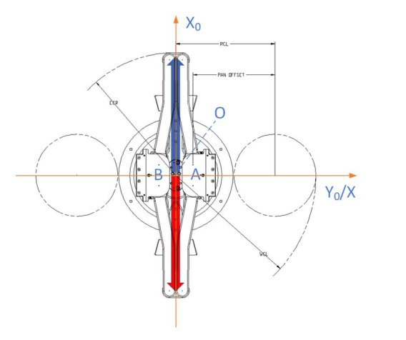
*그림 1 — 반도체 핸들링 로봇의 능동 구동기와 좌표계 개략도.*

반도체 웨이퍼 핸들링 로봇의 회전 운동과 신장 운동은 로드 L과 로드 R의 결합 운동으로 실현되며, 다음과 같은 특성을 가진다.

1. 로봇의 회전 운동은 연결 로드 L과 R이 같은 각속도로 회전하여 합성되며, 이때 연결 로드 L과 R 사이의 끼인각은 변하지 않는다.
2. 고정 위치에서 로봇의 신축(telescopic) 운동은 링크 L과 R이 반대 방향으로 같은 각속도로 회전하여 이루어진다. 이때 L과 R 링크 방위각의 산술 평균은 변하지 않는다.
3. L과 R 로봇 링크의 각속도가 다르면, 회전 방향이 같든 다르든 거시적으로는 매니퓰레이터가 늘어나면서 회전하는 것으로 나타난다.

### 2.2. 소프트웨어 구조 (Software Architecture)

그림 2는 반도체 로봇의 소프트웨어 구조 시스템 구성과 AWC 흐름도를 보여 준다. AWC 알고리즘은 보정, 편차 보정, 후퇴 검출의 세 과정으로 이루어진다. 소프트웨어 시스템은 분할 코어(split-core) 제어 방식을 쓴다. 반도체 로봇 Robot Controller4.0 소프트웨어의 운영체제는 MontaVista5.0을 지원하며, 커널 계층(라이브러리), 플랫폼 계층, 응용 계층으로 나뉜다. MontaVista5.0 Linux는 가장 넓은 범위의 CPU 아키텍처, 마더보드, 시스템 수준 플랫폼을 지원하는, 현재 이용 가능한 임베디드 Linux 개발 솔루션이다. 또한 완전한 도구 세트와 배포 가능한 런타임 구성 요소를 제공한다. 이 시스템은 여러 단일 코어 프로세서를 갖추며, 각각 운동 제어 알고리즘, 로봇 알고리즘, 로봇 태스킹, 로봇 참조(referencing) 중 하나를 실행한다. 또한 로봇 변수와 통신 방법을 위한 공유 메모리로 데이터를 주고받는다.

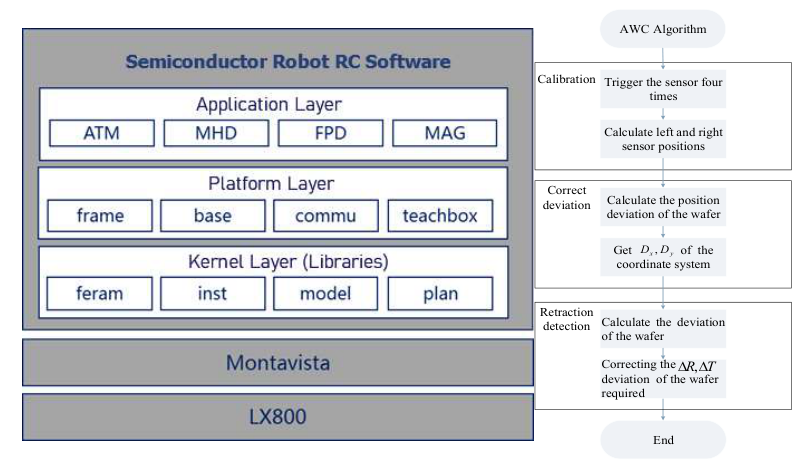
*그림 2 — 반도체 로봇의 소프트웨어 구조와 AWC 흐름도. (왼쪽: Semiconductor Robot RC Software — Application Layer(ATM, MHD, FPD, MAG), Platform Layer(frame, base, commu, teachbox), Kernel Layer (Libraries)(feram, inst, model, plan), Montavista, LX800. 오른쪽 AWC 알고리즘: Calibration — 센서를 네 번 트리거 → 좌우 센서 위치 계산; Correct deviation — 웨이퍼의 위치 편차 계산 → 좌표계의 $D_x, D_y$ 구함; Retraction detection — 웨이퍼의 편차 계산 → 필요한 웨이퍼 편차 $\Delta R, \Delta T$ 보정 → End)*

- 커널 계층(라이브러리)은 RC(robot controller, 로봇 제어기) 범용 알고리즘 라이브러리로, FERAM(강유전체 라이브러리), INST(명령어 라이브러리), MODEL(모델 라이브러리), PLAN(계획 라이브러리), AWC(편차 보정 알고리즘)를 포함한다.
- 플랫폼 계층은 RC 범용 소프트웨어 구조로, RC 시스템 구성과 관련되며 FRAME 라이브러리, BASE 라이브러리, COMMU 라이브러리, TEACHBOX 라이브러리를 포함한다.
- 응용 계층은 RC 로봇 응용 시스템으로, 대기(atmospheric) 로봇 ATM, 대하중 기계 MHD, FPD, 다이렉트 드라이브 로봇 MAG 등을 포함한다.
- 다이렉트 드라이브 로봇 응용은 주로 클린 다이렉트 드라이브 로봇 응용 기능으로, 응용 인터페이스 표시, 상위 컴퓨터와의 통신, 응용 명령, 응용 모델, 응용의 전원 투입 로직 등의 기능을 포함한다.

## 3. 핸들링 로봇의 운동 제어 (Motion Control of Handling Robot)

반도체 핸들링 로봇은 일반적으로 자유도가 적으며, 주요 운동은 상승(Z), 신장(R), 회전(T)이다. 기구가 소형으로 설계되어 여러 관절 사이에 기구학적 결합(kinematic coupling)이 있는 것이 보통이므로, 분리(decoupled) 제어를 구현해야 한다.

### 3.1. 핸들링 로봇의 극좌표계 수립 (Establishment of Polar Coordinate System for Handling Robot)

로봇의 $Z$축은 하나의 차원으로 독립 제어되며 기구학 계산에 관여할 필요가 없으므로, 회전 축과 신축 축만으로 계산용 평면 좌표계를 수립할 수 있다. 그림 1과 같이 극좌표계 $OX$와 직교 좌표계 $X_0OY_0$는 모두 지면에 고정되며, 영점에 대한 링크 L의 시계 방향 회전각을 $\theta_1$, 영점에 대한 링크 R의 시계 방향 회전각을 $\theta_2$로 정의한다. $\theta_1, \theta_2$는 각각 RC 시스템에서 두 연결 로드 L과 R의 제어 모터 회전각이다.

### 3.2. 기하학적 순기구학 (관절 좌표 → 극좌표) (Geometric Forward Kinematics (Joint Coordinates to Polar Coordinates))

그림 3은 반도체 핸들링 로봇 A/B 핸드의 신축 기구에 대한 기하학적 개략도를 보여 준다. 여기서 $OE$와 $OF$는 각각 연결 로드 L과 R을 가리킨다. 반도체 핸들링 로봇은 자유도가 적으므로 기하학적 방법을 쓰는 연산은 보통 계산량이 적고, 로봇 기구의 기하학적 특징을 이용해 빠르게 결과를 얻을 수 있다.

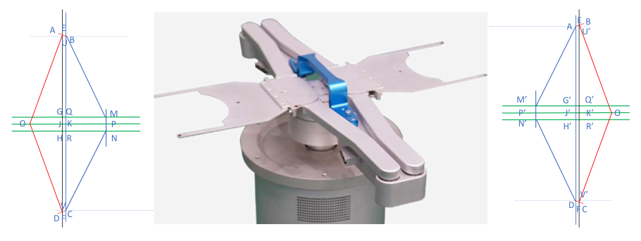
*그림 3 — A/B 핸드 신축 기구의 변화를 나타낸 기하학적 도해.*

A 핸드 신장: 위 그림은 반도체 핸들링 로봇의 A 핸드가 신장된 상태를 보여 준다. $OE$와 $OF$는 각각 $AB$와 $CD$의 수직이등분선(mid-plumb line)을 나타낸다. $OP$가 $AD$, $BC$와 만나는 교점을 각각 $J$, $K$로 표시한다. $AD$의 수직이등분선을 $OJ$로, $BC$의 수직이등분선을 $OK$로 나타낸다. 점 $B$와 $C$에서 내린 수선이 $EF$와 만나는 점을 $U$와 $V$라 한다. 이를 바탕으로 다음 기하 관계가 성립한다.

$$\begin{cases} \overline{BM} = \overline{NC} = d_1 \\ \overline{OE} = \overline{OF} = d_2 \\ \overline{MP} = \overline{PN} = \overline{GJ} = \overline{JH} = \overline{QK} = \overline{KR} = d_3 \\ \overline{AE} = \overline{EB} = \overline{CF} = \overline{FD} = d_4 \\ \overline{BU} = \overline{CV} = \overline{JK} = \overline{GQ} = \overline{HR} \\ BU \perp EF,\ CV \perp EF \end{cases}$$

연결 로드 L이 연결 로드 R에 대해 시계 방향(양의 각)으로 회전하면, 반도체 핸들링 로봇은 A 핸드가 신장된 상태를 보인다. 이때 $\angle EOF = 180^\circ - (\theta_1 - \theta_2)$이다.

$\gamma = (\theta_1 - \theta_2)/2$로 정의하면 $\angle EOF = 2(90^\circ - \gamma)$이다. 여기서 $\gamma \in [0^\circ, 90^\circ)$이며, 위 그림과 같다.

$$\begin{cases} \angle EOP = \angle POF = \angle BEU = \angle CFV = 90^\circ - \gamma \\ \overline{EJ} = \overline{OE} \times \sin(\angle EOP) = d_2\cos(\gamma) \\ \overline{EU} = \overline{EB} \times \cos(\angle BEU) = d_4\sin(\gamma) \end{cases} \tag{1}$$

$\overline{BQ} = \overline{UG} = \overline{EJ} - \overline{GJ} - \overline{EU} = d_2\cos(\gamma) - d_4\sin(\gamma) - d_3$이므로,

$$\angle QMB = \arcsin\left(\overline{BQ}/\overline{BM}\right) \tag{2}$$

$OP$의 길이는 R축의 좌표를 나타낸다. 즉,

$$\begin{cases} \overline{OP} = \overline{OJ} + \overline{JK} + \overline{KP} \\ = \overline{OE} \times \cos(\angle EOP) + \overline{EB} \times \sin(\angle BEU) + \overline{BM} \times \cos(\angle QMB) \\ = d_2\sin(\gamma) + d_4\cos(\gamma) + d_1\cos(f) \end{cases} \tag{3}$$

여기서,

$$f = \arcsin\left((d_2\cos(\gamma) - d_4\sin(\gamma) - d_3)/d_1\right) \tag{4}$$

B 핸드 신장: 위 그림은 반도체 핸들링 로봇의 B 핸드가 신장된 상태를 보여 준다. $OE$는 $AB$의 수직이등분선, $OF$는 $CD$의 수직이등분선을 나타낸다. $J'$과 $K'$은 $OP'$이 각각 $AD$, $BC$와 만나는 점이다. $OJ'$은 $A$에서 $D$로의 수선의 중점을, $OK'$은 $B$에서 $C$로의 수선의 중점을 나타낸다. 점 $B$와 $C$에서 그은 수직선이 $EF$와 만나는 점을 각각 $U'$, $V'$이라 한다. 이를 바탕으로 다음 기하 관계가 성립한다.

$$\begin{cases} \overline{AM'} = \overline{N'D} = d_1 \\ \overline{OE} = \overline{OF} = d_2 \\ \overline{M'P'} = \overline{P'N'} = \overline{G'J'} = \overline{J'H'} = \overline{Q'K'} = \overline{K'R'} = d_3 \\ \overline{AE} = \overline{EB} = \overline{CF} = \overline{FD} = d_4 \\ \overline{AU'} = \overline{DV'} = \overline{J'K'} = \overline{G'Q'} = \overline{H'R'} \\ AU' \perp EF,\ CV \perp EF \end{cases}$$

연결 로드 L이 연결 로드 R에 대해 반시계 방향(음의 각)으로 회전하면, 반도체 핸들링 로봇은 B 핸드가 신장된 상태를 보인다. 이때 $\gamma = (\theta_1 - \theta_2)/2$로 정의하면 $\angle EOF = 2(90^\circ + \gamma)$이다. 여기서 $\gamma \in (-90^\circ, 0^\circ]$이며, 위 그림에 대응한다.

$$\angle EOP' = \angle P'OF = \angle AEU' = \angle DFV' = 90^\circ + \gamma \tag{5}$$

$$\begin{cases} \overline{EK'} = \overline{OE} \times \sin(\angle EOP') = d_2\cos(\gamma) \\ \overline{EU'} = \overline{AE} \times \cos(\angle AEU') = -d_4\sin(\gamma) \end{cases} \tag{6}$$

여기서 $\overline{OP'} = \overline{OK'} + \overline{K'J'} + \overline{J'P'}$, $\overline{AG'} = \overline{U'Q'} = \overline{EK'} - \overline{Q'K'} - \overline{EU'}$이다. 따라서 다음 식을 얻는다.

$$\angle G'M'A = \arcsin\left(\overline{AG'}/\overline{AM'}\right) \tag{7}$$

$\overline{OP'}$의 길이가 R축의 좌표를 결정하며, 다음과 같이 계산할 수 있다.

$$\begin{cases} \overline{OP'} = \overline{OK'} + \overline{K'J'} + \overline{J'P'} \\ = \overline{OE} \times \cos(\angle EOP') + \overline{AE} \times \sin(\angle AEU') + \overline{AM'} \times \cos(\angle G'MA) \\ = -d_2\sin(\gamma) + d_4\cos(\gamma) + d_1\cos(\mathrm{g}) \end{cases} \tag{8}$$

여기서,

$$\mathrm{g} = \arcsin\left((d_2\cos(\gamma) + d_4\sin(\gamma) - d_3)/d_1\right) \tag{9}$$

T축 회전: 영점에서 반도체 핸들링 로봇의 A축은 극좌표계에서 방위각 0°인 극축 $OX$의 양의 방향을 향하고, 직교 보조 좌표계에서는 방위각 90°인 $OY_0$ 축의 양의 방향을 향한다. 이때 L 링크($OE$)의 방위각은 극좌표계에서 $-90^\circ + \theta_1$, 보조 직교 좌표계에서 $\theta_1$이고, R 링크($OF$)의 방위각은 극좌표계에서 $90^\circ + \theta_2$, 보조 직교 좌표계에서 $180^\circ + \theta_2$이다. $\angle EOF$의 이등분선이 핸드 A의 방향을 나타낸다. 극좌표계에서 매니퓰레이터의 방위각은 $(\theta_1 + \theta_2)/2$이다. 보조 직교 좌표계에서는 $90^\circ + (\theta_1 + \theta_2)/2$이다. 마찬가지로 B 매니퓰레이터 핸드에 대해서도 같은 결과를 얻을 수 있다.

따라서 매니퓰레이터 A/B 핸드의 평면 극좌표 값은 다음과 같다.

$$\begin{cases} \theta_{\mathrm{T}} = (\theta_1 + \theta_2)/2 \\ r = \arcsin\left((d_2\cos(\gamma) - d_4\sin(\gamma) - d_3)/d_1\right) \\ R = side \times d_2\sin(\gamma) + d_4\cos(\gamma) + d_1\cos(r) \end{cases} \tag{10}$$

반도체 핸들링 로봇의 역문제 풀이는 더 간단하므로 여기서는 다시 서술하지 않는다.

## 4. 자동 웨이퍼 정렬 (Automatic Wafer Alignment)

능동 웨이퍼 센터링(Active Wafer Centering)이라 불리는 웨이퍼 AWC는 광학 센서와 자동 제어 시스템을 이용해 웨이퍼를 자동으로 위치시키고 중심 정렬하는 첨단 반도체 웨이퍼 보상 기술이다. 웨이퍼 AWC 기술은 전통적인 기계식 수동 정렬 방법보다 정밀도가 높고 속도가 빠르며 성능이 안정적이다. 구체적으로 웨이퍼 AWC 기술의 원리는 광학 센서로 웨이퍼 표면을 스캔·측정하여 웨이퍼의 위치, 회전각, 편차에 관한 실시간 정보를 얻고, 이 정보를 자동 제어 시스템으로 보내 분석·계산하는 것이다. 자동 제어 시스템은 웨이퍼의 실시간 상태에 따라 로봇 팔의 움직임을 정확히 제어하여 웨이퍼가 올바른 위치와 각도로 돌아가게 하여 칩 준비와 가공 정확도를 보장한다. AWC 알고리즘은 세 부분으로 이루어진다.

보정(Calibration): 로봇 핑거 중심이 웨이퍼 중심과 일치하도록 위치시킨다. 로봇이 작업 스테이션의 높은 신축 동작을 수행하도록 제어하여, 센서가 트리거될 때 매니퓰레이터의 공간 위치를 포착한다. 이로부터 로봇 베이스 좌표계에서 두 센서의 위치 $(P_{xS}, P_{yS})$, $(P_{xR}, P_{yR})$을 계산한다.

편차 보정(Correcting deviation): 웨이퍼 중심과 로봇 핑거 중심 사이의 편차를 결정한다. 두 센서의 위치를 분석하고 웨이퍼를 놓을 때 생기는 편차를 고려하여, 로봇 좌표계에서 로봇 중심에 대한 웨이퍼의 편차 $(D_x, D_y)$를 결정할 수 있다.

후퇴 검출(Detecting retraction): 복귀 이동 중에 스테이션에서 꺼낸 웨이퍼가 센서를 두 번 작동시키고, 이 두 점의 위치를 기록한다. 센서의 공간 위치 정보를 이용하여, 웨이퍼를 보정하는 데 필요한 $(\Delta R, \Delta T)$를 편차 값으로 측정할 수 있다.

### 4.1. 보정 시 NOTCH 점 필터링 (Calibrated NOTCH Point Filtering)

NOTCH 판별 방법은 다음과 같다. 특히 그림 4에서 NOTCH의 개구부는 2.73 mm보다 작다. 이론 데이터를 바탕으로 일정한 여유를 고려하여 NOTCH 임계값을 4 mm로 설정한다(NOTCH_THRES = 4 mm). 실제 응용에서 두 현(string)의 크기는 각각 0.8 mm와 1.2 mm이다.

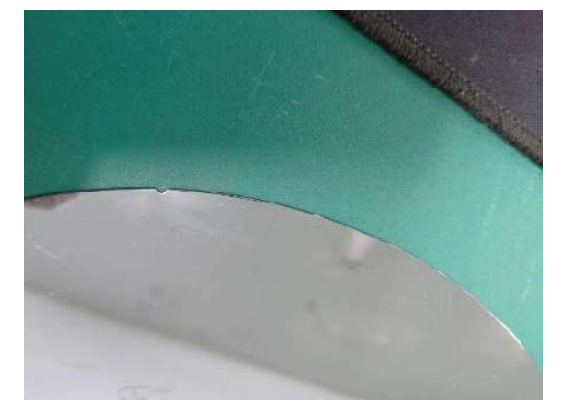
*그림 4 — NOTCH 판별.*

판별 기준은 다음과 같다. 연속된 임의의 세 트리거 점 a, b, c에 대해, NOTCH를 지나는 충분조건은 Dab < NOTCH_THRES 이고 Dbc < NOTCH_THRES 인 것이다.

따라서 일반적인 접근은 다음과 같다.

매니퓰레이터 위의 웨이퍼가 센서를 지나가 트리거 점이 존재하도록 한다.

트리거 점의 개수는 경우별로 다음과 같이 다룬다.

1. 4개. 네 점 중에 NOTCH가 있으면 오류를 보고한다. 그렇지 않으면 AWC 편차를 정상적으로 계산한다.
2. 5개. 다섯 점 중에 NOTCH가 있으면 오류를 보고한다. 그다음 4번째와 5번째 트리거 점이 NOTCH에 위치할 수 있는지 판단하고, 그럴 수 있으면 오류를 보고한다. NOTCH가 없거나 트리거 점이 NOTCH에 위치하지 않으면, 5번째 점을 버리고 처음 4개 점으로 AWC 편차를 계산한다.
3. 6개 이상. 6 이상이면 처음 6개를 제외한 모든 이탈(departure) 점을 제외한다. 그다음 연속된 세 점의 각 세트가 NOTCH를 지나면서 작동된 것인지 확인한다. 그렇다면 그 세 점의 데이터를 제거하고 나머지 세 점으로 AWC 편차를 계산한다.
4. 3개 이하. 3 이하이면 AWC 계산을 위한 수집 점이 충분하지 않으므로 오류를 보고한다.

### 4.2. 센서 보정 (Sensor Calibration)

이 논문은 AWC용으로 KEYENCE Probe 센서를 쓰며, 이 센서는 FINE, TURBO, HPS 모드를 가진다. 제품 설명서에 따라 적절한 모드를 선택한다. 그림 5의 개략도는 AWC 보정 중 트리거 위치와 센서 위치를 보여 준다. R과 S는 센서이고 원은 웨이퍼이다. 보정 절차는 다음 단계로 이루어진다.

1. 작업 스테이션을 선택하고 웨이퍼를 매니퓰레이터 중심에 놓아, 웨이퍼 중심과 매니퓰레이터 중심이 일치하도록 한다.
2. 로봇을 제어하여 웨이퍼 가장자리가 다음 순서로 센서를 네 번 트리거하도록 움직인다. 로봇이 작업 스테이션 가장자리로 이동할 때 왼쪽 센서가 두 번, 오른쪽 센서가 두 번 후퇴(retract)한다.

그림 5에서 로봇 중심 $A_0$와 $B_0$의 위치는 각각 $(\rho_1, \theta_1)$, $(\rho_2, \theta_2)$로 기록하고, 점 $A_0$와 $B_0$의 평면 위치는 $(\rho_1 s_1, \rho_1 c_1)$, $(\rho_2 s_2, \rho_2 c_2)$로 기록한다. 여기서 $s_1, c_1, s_2, c_2$는 $\theta_1$과 $\theta_2$의 사인과 코사인이다. 로봇 중심 $C_0$와 $D_0$의 위치는 각각 $(\rho_3, \theta_3)$, $(\rho_4, \theta_4)$로, 평면 위치는 $(\rho_3 s_3, \rho_3 c_3)$, $(\rho_4 s_4, \rho_4 c_4)$로 기록한다. 여기서 $s_3, c_3, s_4, c_4$는 각 $\theta_3$과 $\theta_4$의 사인과 코사인이다. 센서의 위치는 점 S와 R로 표시한다. 평면기하의 수직 지름 정리(vertical diameter theorem)에 따르면 점 N은 수직인 선분 $A_0B_0$와 $SS'$의 교점이다. 마찬가지로 같은 정리에 따라 선분 $C_0D_0$와 $RR'$은 점 M에서 수직으로 만난다.

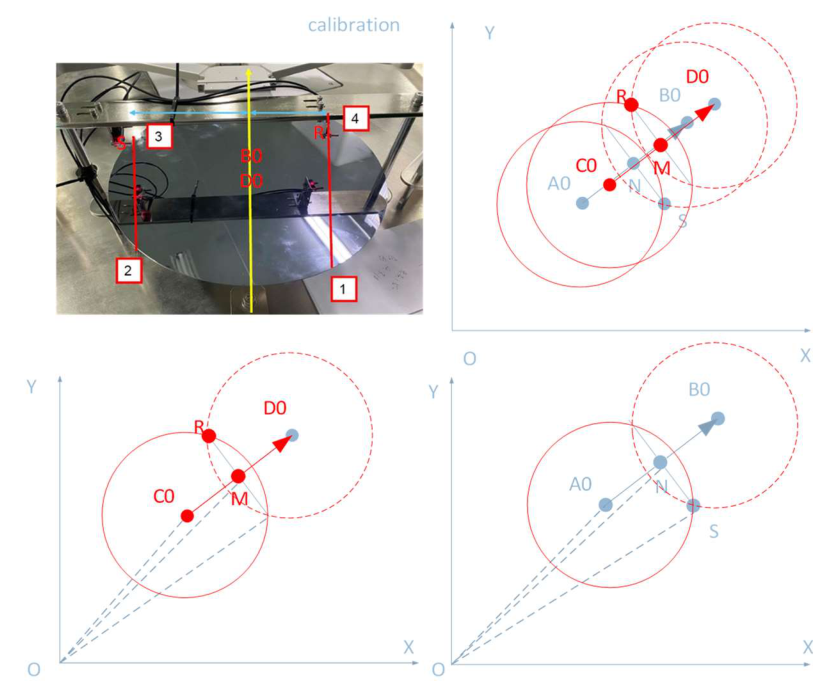
*그림 5 — AWC 보정 중 트리거 위치와 센서 위치의 2차원(2D) 기하.*

오른쪽 센서는 다음을 이용해 계산한다.

$$\begin{cases} \overrightarrow{e_{A_0B_0}} = \dfrac{\overrightarrow{A_0B_0}}{|A_0B_0|} = \begin{pmatrix} e_x \\ e_y \end{pmatrix} \\ \overrightarrow{e_{NS}} = \begin{pmatrix} e_y \\ -e_x \end{pmatrix},\ \overrightarrow{e_{NS'}} = \begin{pmatrix} -e_y \\ e_x \end{pmatrix} \end{cases} \tag{11}$$

여기서,

$$|NS| = |NS'| = \sqrt{R_{wafer}^2 - \left(\frac{|A_0B_0|}{2}\right)^2} \tag{12}$$

센서의 좌표는 다음과 같다.

$$\begin{pmatrix} P_{xS} \\ P_{yS} \end{pmatrix} = \frac{1}{2}\begin{pmatrix} R_1 s_1 \\ R_1 c_1 \end{pmatrix} + \frac{1}{2}\begin{pmatrix} R_2 s_2 \\ R_2 c_2 \end{pmatrix} + side \times |d_S| \begin{pmatrix} e_y \\ -e_x \end{pmatrix} \tag{13}$$

왼쪽 센서 위치의 좌표를 얻으려면 오른쪽 센서에 쓴 것과 같은 과정을 따르면 된다.

$$\begin{pmatrix} P_{xR} \\ P_{yR} \end{pmatrix} = \frac{1}{2}\begin{pmatrix} R_3 s_3 \\ R_3 c_3 \end{pmatrix} + \frac{1}{2}\begin{pmatrix} R_4 s_4 \\ R_4 c_4 \end{pmatrix} + side \times |d_R| \begin{pmatrix} e_y \\ -e_x \end{pmatrix} \tag{14}$$

작업 스테이션에서 센서의 방향 파라미터는 변수 'side'로 나타낸다. 매니퓰레이터 베이스에서 작업 스테이션을 바라볼 때, 센서가 관찰 방향의 오른쪽인 점 S에 있으면 'side' 파라미터를 1로 설정한다. 반대이면 −1로 설정한다.

두 센서의 위치는 다음과 같다.

$$\begin{cases} \begin{pmatrix} P_{xS} \\ P_{yS} \end{pmatrix} = \frac{1}{2}\begin{pmatrix} R_1 s_1 \\ R_1 c_1 \end{pmatrix} + \frac{1}{2}\begin{pmatrix} R_2 s_2 \\ R_2 c_2 \end{pmatrix} + |d_S| \begin{pmatrix} e_y \\ -e_x \end{pmatrix} \\ \begin{pmatrix} P_{xR} \\ P_{yR} \end{pmatrix} = \frac{1}{2}\begin{pmatrix} R_3 s_3 \\ R_3 c_3 \end{pmatrix} + \frac{1}{2}\begin{pmatrix} R_4 s_4 \\ R_4 c_4 \end{pmatrix} + |d_S| \begin{pmatrix} e_y \\ -e_x \end{pmatrix} \end{cases} \tag{15}$$

[역주: 식 (15) 둘째 줄의 $|d_S|$는 원문 표기 그대로이며, 식 (14)와 비교하면 $|d_R|$의 오기로 보인다. 또 앞 문단에서 극좌표 반지름을 $\rho_i$로 정의했으나 식 (13)–(15)에서는 $R_i$로 표기하였다.]

### 4.3. 최소제곱을 위한 일반화 역행렬 방법 보정 (Generalized Inverse Method Correction for Least Squares)

#### 4.3.1. 핑거 좌표계에서 웨이퍼 편차 계산 (Calculation of Wafer Deviation in Finger Coordinate System)

핑거 좌표계에서 웨이퍼의 편차 $(D_x, D_y)$를 계산해야 한다. 웨이퍼를 집는 과정에서 로봇은 홈 상태에서 작업 스테이션 쪽으로 이동한다. 오른쪽 센서는 차례로 두 번 트리거되며, 각각 핑거 중심 $A_1$, $B_1$과 웨이퍼 중심 $O_1$, $O_2$에 대응한다. 왼쪽 센서는 그림에 나타나 있지 않지만 마찬가지로 차례로 두 번 트리거되며, 각각 핑거 중심 $C_1$, $D_1$과 웨이퍼 중심 $O_3$, $O_4$에 대응한다. 다만 왼쪽 센서는 오른쪽과 같은 방식으로 근사한다.

그림 6은 로봇의 베이스 좌표계 $XOY$를 보여 준다. $A_1$이 놓인 핑거 좌표계 $x_1oy_1$은 $XOY$를 시계 방향으로 $\theta_1$만큼 회전한 다음 양의 $Y$축 방향으로 $\rho_1$만큼 평행이동하여 얻는다. $x_1oy_1$에서 $O_1$의 좌표는 $D_x$와 $D_y$이다. 따라서 $XOY$에서 $O_1$의 좌표는 다음과 같다.

$$\begin{pmatrix} x_{O_1} \\ y_{O_1} \\ 1 \end{pmatrix} = \begin{bmatrix} c_1 & s_1 & 0 \\ -s_1 & c_1 & 0 \\ 0 & 0 & 1 \end{bmatrix} \begin{bmatrix} 1 & 0 & 0 \\ 0 & 1 & \rho_1 \\ 0 & 0 & 1 \end{bmatrix} \begin{bmatrix} D_x \\ D_y \\ 1 \end{bmatrix} \tag{16}$$

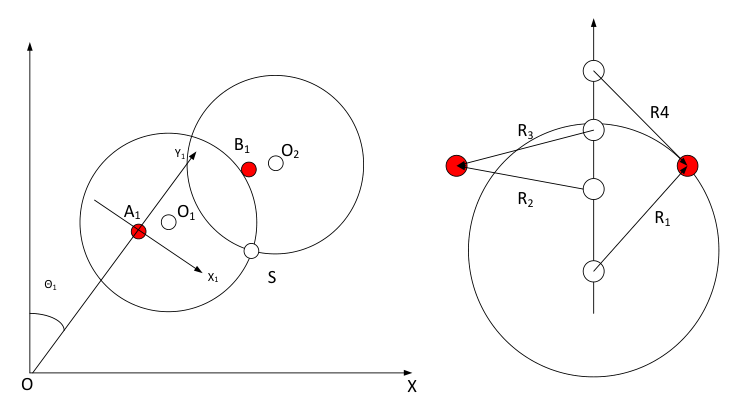
*그림 6 — AWC 보정 중 트리거 위치와 센서 위치의 개략도.*

유추에 의해 다음을 얻을 수 있다.

$$\begin{cases} \begin{pmatrix} x_1 \\ y_1 \end{pmatrix} = \begin{pmatrix} \rho_1 s_1 + D_x c_1 + D_y s_1 \\ \rho_1 c_1 - D_x s_1 + D_y c_1 \end{pmatrix} \\ \begin{pmatrix} x_2 \\ y_2 \end{pmatrix} = \begin{pmatrix} \rho_2 s_2 + D_x c_2 + D_y s_2 \\ \rho_2 c_2 - D_x s_2 + D_y c_2 \end{pmatrix} \\ \begin{pmatrix} x_3 \\ y_3 \end{pmatrix} = \begin{pmatrix} \rho_1 s_3 + D_x c_3 + D_y s_3 \\ \rho_1 c_3 - D_x s_3 + D_y c_3 \end{pmatrix} \\ \begin{pmatrix} x_4 \\ y_4 \end{pmatrix} = \begin{pmatrix} \rho_2 s_4 + D_x c_4 + D_y s_4 \\ \rho_2 c_4 - D_x s_4 + D_y c_4 \end{pmatrix} \end{cases} \tag{17}$$

네 센서 좌표가 모두 같은 원 위에 있으므로 원의 중심, 즉 핑거 중심에 대한 웨이퍼 중심의 편차를 찾을 수 있다. $|SO_1|$과 $|SO_2|$, 그리고 $|RO_3|$과 $|RO_4|$의 크기가 같다는 점에 기반하여 연립방정식을 세울 수 있다.

$$F = \begin{cases} (\rho_1 s_1 + D_x c_1 + D_y s_1 - x_S)^2 + (\rho_1 c_1 - D_x s_1 + D_y c_1 - y_S)^2 - R_{wafer}^2 = 0 \\ (\rho_2 s_2 + D_x c_2 + D_y s_2 - x_S)^2 + (\rho_1 c_2 - D_x s_2 + D_y c_2 - y_S)^2 - R_{wafer}^2 = 0 \\ (\rho_3 s_3 + D_x c_3 + D_y s_3 - x_R)^2 + (\rho_3 c_3 - D_x s_3 + D_y c_3 - y_R)^2 - R_{wafer}^2 = 0 \\ (\rho_4 s_4 + D_x c_4 + D_y s_4 - x_R)^2 + (\rho_4 c_4 - D_x s_4 + D_y c_4 - y_R)^2 - R_{wafer}^2 = 0 \end{cases} \tag{18}$$

위 방정식을 풀어 미지 파라미터 $(D_x, D_y)$의 값을 결정한다.

[역주: 식 (17)의 $\rho_1 s_3$, $\rho_2 s_4$와 식 (18) 둘째 줄의 $\rho_1 c_2$는 원문 표기 그대로이다. 문맥상 각각 $\rho_3$, $\rho_4$, $\rho_2$로 보인다.]

#### 4.3.2. 비선형 연립방정식의 최소제곱해를 위한 일반화 역행렬 방법 (Generalized Inverse Method for Least Squares Solutions of Systems of Nonlinear Equations)

실제 센서 네트워크에서는 측정 오차와 센서 오차 같은 요인 때문에 네 센서 좌표 위치가 같은 원 위에 있지 않을 수 있다. 그 결과 식 (6)의 이상적인 경우의 연립방정식은 과결정(hyper-positive definite) [역주: 원문 "hyper-positive definite"는 과결정(overdetermined)을 뜻하는 것으로 보인다]이 되어 정확한 해를 얻을 수 없다. 이 문제를 풀기 위해 과결정 방정식계를 최소제곱법으로 근사하여, 모든 경우에 센서 위치에 기반한 위치 결정 계산이 가능하도록 할 수 있다. 이것이 비선형 연립방정식이므로, 일반화 역행렬을 이용해 제약 없는 최적화 문제를 풀 수 있다는 점이 중요하다. 이 접근은 센서 네트워크의 위치 결정 문제를 성공적으로 해결한다. [역주: "식 (6)"은 원문 그대로이며, 문맥상 식 (18)을 가리키는 것으로 보인다.]

$$\begin{cases} F^{(k)} = \left(f_0^{(k)}, f_1^{(k)}, \ldots, f_{n-1}^{(k)}\right)^{\mathrm{T}} \\ f_i^{(k)} = f_i\left(D_0^{(k)}, D_1^{(k)}, \ldots, D_{m-1}^{(k)}\right),\ i = 0, 1, \ldots, n-1 \\ f_i(D_0, D_1, \ldots, D_{m-1}) = 0,\ i = 0, 1, \ldots, n-1,\ n \geqslant m \end{cases} \tag{19}$$

$m$이 $n$과 같으면 비선형 연립방정식을 풀 수 있다. 여기서 $(D_0, D_1)$은 $(D_x, D_y)$와 같고 $m$은 2이다. 결과 야코비 행렬(Jacobi matrix)은 다음과 같다.

$$A = \begin{bmatrix} \frac{\partial f_0}{\partial D_0} & \frac{\partial f_0}{\partial D_1} & \cdots & \frac{\partial f_0}{\partial D_{m-1}} \\ \frac{\partial f_1}{\partial D_0} & \frac{\partial f_1}{\partial D_1} & \cdots & \frac{\partial f_1}{\partial D_{m-1}} \\ \vdots & \vdots & & \vdots \\ \frac{\partial f_{m-1}}{\partial D_0} & \frac{\partial f_{m-1}}{\partial D_1} & \cdots & \frac{\partial f_{n-1}}{\partial D_{m-1}} \end{bmatrix} \tag{20}$$

다음은 AWC 보정 비선형 연립방정식의 최소제곱해를 계산하는 반복식이다.

$$D^{(k+1)} = D^{(k)} - \alpha_k Z^{(k)} \tag{21}$$

여기서 $Z^{(k)}$는 선형 대수 연립방정식 $A^{(k)}Z^{(k)} = F^{(k)}$에 대해 선형 최소제곱법으로 얻은 해를 나타낸다. $\alpha_k$의 값은 단일 함수(unitary function) $\sum_{i=0}^{m-1}\left(f_i^{(k)}\right)^2$의 극값이며, 유리 극값(rational extrema) 방법으로 계산한다. 이로써 특수해를 얻고, 핑거 좌표계에서 웨이퍼 중심의 편차를 알 수 있다.

### 4.4. 후퇴 검출 (Retraction Detection)

웨이퍼 중심을 스테이션에 정렬하기 위해 로봇의 T 좌표와 R 좌표를 편향시키며, 그 결과 신축 보상 $\Delta R$과 회전 보상 $\Delta T$가 생긴다.

오른쪽 센서 보상: 위 그림 7과 같이 다음을 얻을 수 있다.

$$OA_1 = \sqrt{|OO_1|^2 - C_1O_1^2} - C_1A_1 \tag{22}$$

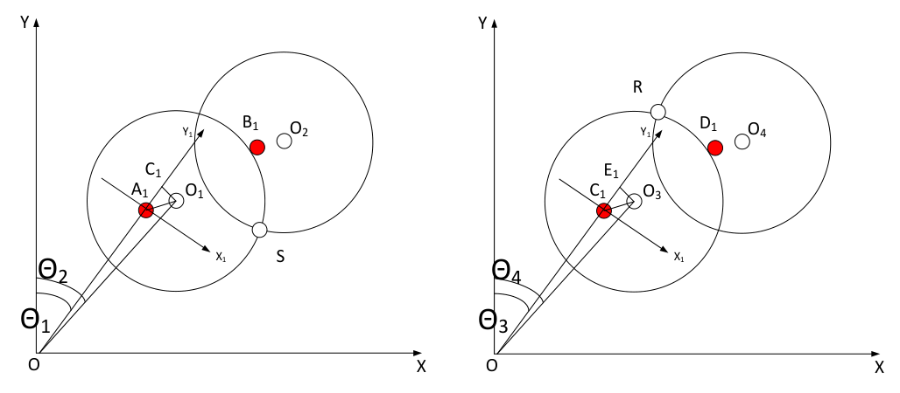
*그림 7 — AWC 후퇴 보상 중 트리거 위치와 센서 위치의 개략도.*

$XOY$ 평면에서 점 $O_1$의 좌표는 다음과 같다.

$$\begin{cases} |OO_1| = RR_1\ \ \rho_1 = OA_1 \\ \begin{pmatrix} x_{O_1} \\ y_{O_1} \end{pmatrix} = \begin{pmatrix} RR_1 c_2 \\ RR_1 s_2 \end{pmatrix} = \begin{pmatrix} (\rho_1 + D_y)s_1 + D_x c_1 \\ (\rho_1 + D_y)c_1 - D_x s_1 \end{pmatrix} \end{cases} \tag{23}$$

유도하면 $\theta_2 = 2\tan(\mathrm{s2}, \mathrm{c2})$를 얻고 [역주: 원문 표기 그대로. 문맥상 atan2 함수로 보인다], 이로부터 다음이 나온다.

$$\begin{cases} \nabla R_r = OA_1 - RR_1 \\ \nabla T_r = \theta_2 - \theta_1 \end{cases} \tag{24}$$

왼쪽 센서 보상: 왼쪽 센서의 후퇴 검출 값 $\nabla R$과 $\nabla T$는 오른쪽 센서와 같은 방법으로 얻을 수 있다.

$$\begin{pmatrix} c_4 \\ s_4 \end{pmatrix} = \begin{pmatrix} (\rho_3 + D_y)s_3/RR_2 + D_x c_3/RR_2 \\ (\rho_3 + D_y)c_3/RR_2 - D_x s_3/RR_2 \end{pmatrix} \tag{25}$$

유도하면 $\theta_4 = 2\tan(s4, c4)$를 얻고, 이로부터 다음이 나온다.

$$\begin{cases} \nabla R_l = OC_1 - RR_2 \\ \nabla T_l = \theta_4 - \theta_3 \end{cases} \tag{26}$$

신축 보상 $\Delta R$과 회전 보상 $\Delta T$의 값은 다음과 같이 결정할 수 있다.

$$\begin{cases} \Delta R = (\nabla R_r + \nabla R_l)/2 \\ \Delta T = (\nabla T_r + \nabla T_l)/2 \end{cases} \tag{27}$$

보정, 편차 보정, 후퇴 검출의 세 과정을 마치면 웨이퍼에 대해 AWC 보정 캘리브레이션이 수행된다.

## 5. 실험 결과 및 분석 (Experimental Results and Analysis)

반도체 핸들링 로봇의 운동 제어와 AWC 알고리즘의 검증 플랫폼은 그림 8과 같다. 이 논문에서 제안한 운동 제어 및 웨이퍼 보정 알고리즘은 Linux Ubuntu 운영체제에서 동작한다. 이어서 운동 제어와 웨이퍼 보정 알고리즘의 검증을 논의한다.

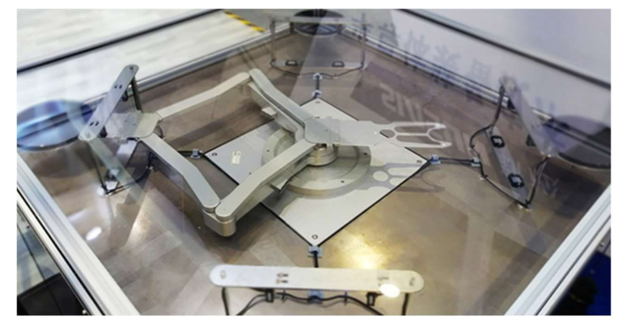
*그림 8 — 반도체 핸들링 로봇용 알고리즘 검증 플랫폼.*

### 5.1. 운동 제어 실험 (Motion Control Experiment)

원뿔 등거리 나선(conic isometric helix) 방정식을 오프라인 프로그래밍 소프트웨어에 입력하여 다음과 같이 기구학의 정해와 역해를 모두 검증한다.

$$\begin{cases} x = (Rvt/H)\cos\omega t \\ y = (Rvt/H)\sin\omega t \\ z = vt \end{cases} \tag{28}$$

여기서 $H$는 원뿔면 등거리 나선의 높이, $\omega$는 중심축 둘레의 회전 각속도, $R$은 원뿔면 등거리 나선 평면의 반지름, $v$는 상승 선속도를 나타낸다.

그림 9에서 빨간 곡선은 나선 방정식으로 교시한 로봇의 실제 궤적 $P = \begin{bmatrix} p_x & p_y & p_z \end{bmatrix}$를 나타내고, 초록색은 역기구학으로 관절 값을 구하고 순기구학으로 기준 궤적 값 $P' = \begin{bmatrix} p'_x & p'_y & p'_z \end{bmatrix}$를 얻어 교시한 궤적이다. 협동 로봇의 끝단 시연 궤적 $P$(빨강) 그래프가 기구학 해 궤적 $P'$(초록)과 일치하므로, 역기구학 모델링이 올바름을 보여 준다.

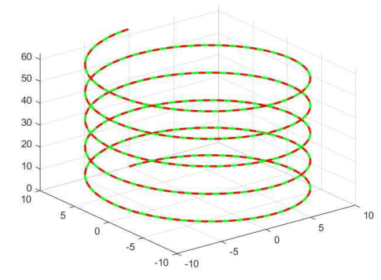
*그림 9 — 기구학 검증.*

로봇 기구학 오차를 실험으로 검증하고, 제안한 역기구학 이동 전력 소비 제약 알고리즘을 로봇 제어기에 구현하였다. 실험은 시연 중에 성공적으로 재현되었다. 그림 10은 절대 기구학 오차를 보여 준다. 로봇의 이론 위치 값과 기구학의 실제 위치 값 사이의 절대 오차는 약 0.0001 mm로, 공학 응용 요구 사항을 충족한다.

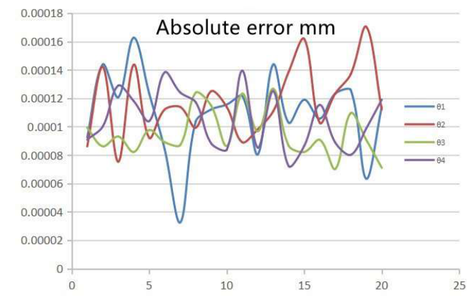
*그림 10 — 절대 기구학 오차 개략도. (그래프 제목: Absolute error mm, 범례 θ1–θ4)*

### 5.2. 자동 웨이퍼 정렬 보정 실험 (Automatic Wafer Alignment Calibration Correction Experiment)

자동 웨이퍼 정렬 보정 알고리즘의 정확도를 검증하기 위해, 실제 반도체 산업 환경에서 핸들링 로봇으로 알고리즘을 실험하였다. 무작위 샘플링 분석을 위해 STN2(스테이션 2)와 STN4(STN 뒤에 스테이션 번호를 붙임) 두 스테이션의 정확도를 측정하였다. STN2의 위치는 {900.75 mm, 46.47°}, STN4의 위치는 {931.26 mm, 1.21°}이다. 표 1과 표 2는 신장·후퇴 시 두 센서 위치를 보정하기 위해 AWC 알고리즘으로 수집한 데이터(mm 단위)를 보여 준다.

**표 1.** 로봇 신장 시 두 센서의 보정.

| 센서 위치 (Sensor Position) | $P_x$ (mm) | $P_y$ (mm) |
|---|---|---|
| STN2 left | 347.108654 | 436.242168 |
| STN2 right | 491.692988 | 285.199749 |
| STN4 left | 90.105124 | 520.304507 |
| STN4 right | −119.096223 | 526.010610 |

**표 2.** 로봇 후퇴 시 두 센서의 보정.

| 센서 위치 (Sensor Position) | $P_x$ (mm) | $P_y$ (mm) |
|---|---|---|
| STN2 left | 347.191978 | 436.337168 |
| STN2 right | 491.819200 | 285.329218 |
| STN4 left | 90.123207 | 520.472600 |
| STN4 right | −119.115173 | 526.250830 |

표 3은 최소제곱 기반 일반화 역행렬을 이용해 핑거 좌표계에서 웨이퍼 편차(mm)를 계산하는 방법을 보여 준다.

**표 3.** 핑거 좌표계에서의 웨이퍼 편차 계산.

| 위치 보정 (Position Correction) | $D_x$ (mm) | $D_y$ (mm) |
|---|---|---|
| STN2 deviation | −0.810415 | −0.960259 |
| STN4 deviation | −0.862323 | −0.976955 |

표 4는 신축 보상($\Delta R$, mm 단위)과 회전 보상($\Delta T$, 도 단위)의 값을 보여 준다.

**표 4.** 신축 보상 값 $\Delta R$과 회전 보상 값 $\Delta T$의 계산.

| 후퇴 검출 (Retraction Detection) | $\Delta R$ (mm) | $\Delta T$ |
|---|---|---|
| STN2 compensation | 0.959894 | 0.051550 |
| STN4 compensation | 0.976556 | 0.053054 |

로봇은 보정, 편차 보정, 후퇴 검출의 세 과정으로 웨이퍼를 검증한다. 정확도 분석을 위해 두 스테이션 STN2와 STN4의 정확도를 측정하고 계산 데이터를 수집한다. 웨이퍼의 편차를 측정하여 알고리즘의 정확성을 입증할 수 있다(그림 11a,b).

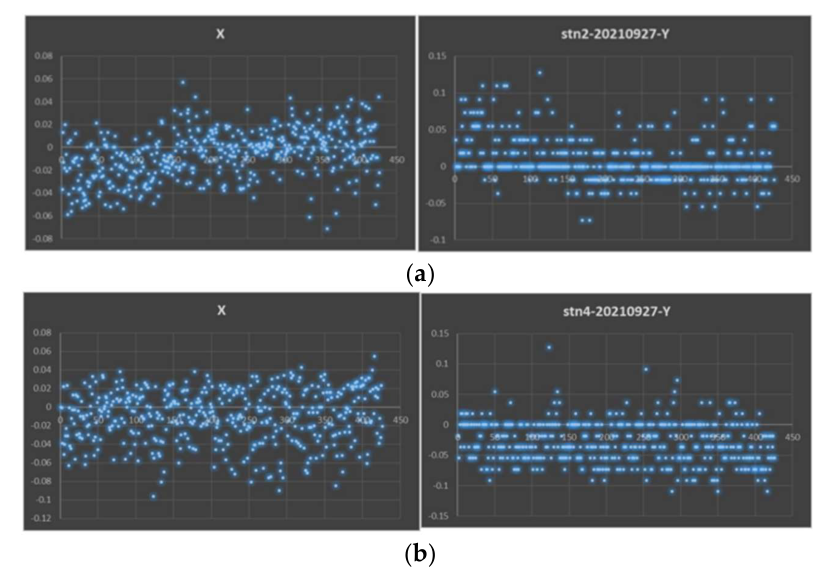
*그림 11 — (a) STN2에 대한 AWC 알고리즘의 정확도. (b) STN4에 대한 AWC 알고리즘의 정확도. (각 행 왼쪽은 X, 오른쪽은 Y 방향 편차 산점도이며, 그래프 제목은 stn2-20210927-Y, stn4-20210927-Y)*

### 5.3. 반복 자동 웨이퍼 정렬 오차 실험 (Cyclic Automatic Wafer Alignment Error Experiment)

AWC 알고리즘은 일정 임계값 이하의 정확도 데이터 오차에 대해 분석·검증되었다. STN은 웨이퍼 박스의 위치를 나타내며, 검은 삼각형은 실리콘 웨이퍼와 로봇의 접촉점을 나타낸다. 이 논문에서 제시한 알고리즘은 이 시험에 그림 12와 같이 세 스테이션을 사용해야 한다.

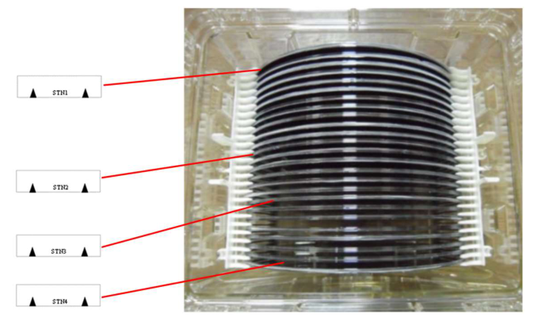
*그림 12 — STN1~STN4 스테이션.*

실험 시험 흐름은 다음과 같다. 먼저 STN2의 웨이퍼를 핸드 B가 집어 STN3으로 옮긴다. 그다음 핸드 A가 STN3의 웨이퍼를 STN4로 옮기고, 마지막으로 핸드 B가 STN4의 웨이퍼를 다시 STN2로 옮긴다. 그림 13–15는 24시간 동안 AWC 보정·교정으로 수집한 오차 데이터를 보여 준다.

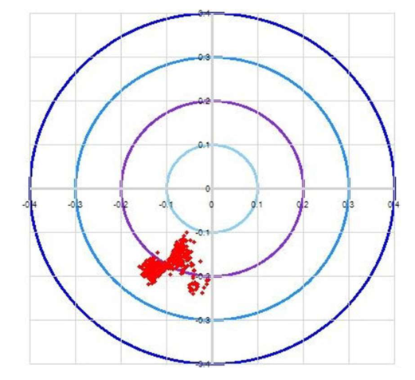
*그림 13 — 핸드 B가 스테이션 2에서 3으로 웨이퍼를 PICK할 때 AWC 알고리즘의 정확도.*

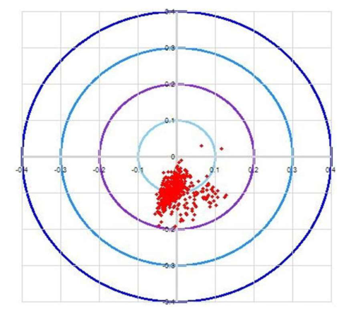
*그림 14 — 핸드 A가 스테이션 3에서 4로 웨이퍼를 PICK할 때 AWC 알고리즘의 정확도.*

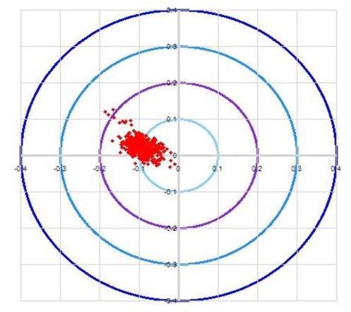
*그림 15 — 핸드 B가 스테이션 4에서 2로 웨이퍼를 PICK할 때 AWC 알고리즘의 정확도.*

작업 범위가 1000 mm를 넘는 실제 응용에서 AWC는 보정 후 <±0.15 mm의 정확도를 달성한다. 주요 오차원은 GPI 코드 디스크 각도 정밀도의 세분(subdivision) 오차이며, 식각(etching) 공정은 오류를 막기 위해 높은 정확도를 요구하므로 정밀도 편차 때문에 문제가 생길 수 있다. 위치 결정 정확도가 낮으면 식각 공정 산업에서 사용하는 데 지장이 될 수 있다.

## 6. 결론 (Conclusions)

이 논문은 반도체 제조에 쓰이는 로봇의 운동 제어와 웨이퍼 정렬 알고리즘 문제를 논의한다. 운동 제어에 관해서는 반도체 핸들링용 로봇의 기구학을 분석하는 기하학적 접근법을 제안한다. 제안 방법은 본체 운동 제어를 극좌표와 관절 공간으로 분리한다. 웨이퍼 보정 알고리즘에 관해서는 실리콘 웨이퍼 보정 알고리즘을 제시한다. 제안 방법은 AWC 알고리즘이라 부르는 일반화 최소제곱 역 방법으로 웨이퍼 위치 보정의 비선형 방정식 문제를 푼다. 실험은 이 문서에서 제안한 방법이 기구학에서 0.0001 mm의 절대 오차를, AWC 보정 후 ±0.15 mm 미만의 정확도를 달성함을 보여 준다. 이 결과는 제안 방법의 효과와 타당성을 확인한다. 이 연구는 반도체 웨이퍼 핸들링 로봇의 실제 구현을 위한 기반을 제공하고, 고품질 반도체 제조를 위한 참고 자료가 된다.

## 기타 사항

- 저자 기여(Author Contributions): 방법론, B.Z.; 소프트웨어, B.-Y.H.; 자원, R.-H.S. 모든 저자는 출판본 원고를 읽고 동의하였다.
- 연구비(Funding): 이 연구는 중국 국가자연과학기금(National Natural Science Foundation of China, 과제 U20A20197)과 랴오닝성 중점 연구개발(Provincial Key Research and Development for Liaoning, 과제 2020JH2/10100040)의 지원을 받았다.
- 기관 윤리위원회 승인: 해당 없음.
- 연구 대상자 동의: 해당 없음.
- 데이터 가용성: 해당 없음.
- 이해 상충: 저자들은 이해 상충이 없음을 밝힌다.
- 면책/출판사 고지(Disclaimer/Publisher's Note): 모든 출판물에 담긴 진술, 의견, 데이터는 오로지 개별 저자와 기여자의 것이며 MDPI 및/또는 편집자의 것이 아니다. MDPI 및/또는 편집자는 본문에서 언급한 아이디어, 방법, 지침, 제품으로 인한 사람이나 재산의 피해에 대해 책임을 지지 않는다.

## 참고문헌

1. Xie, D.M. Research on Control Method of Vacuum Manipulator. Ph.D. Thesis, Shenyang Institute of Automation, Chinese Academy of Sciences, Beijing, China, 2007.
2. Zhu, Q.H.; Wu, N.Q.; Teng, S.H. Petri net modeling and deadlock analysis of multi-assembly devices in semiconductor manufacturing. J. Southeast Univ. 2010, 40, 267–271.
3. Li, X.; Zhou, B.H.; Lu, Z.Q. Real-time scheduling algorithm for semiconductor wafer etching system based on resident constraint. J. Shanghai Jiaotong Univ. 2009, 43, 1742–1745+1750.
4. Wang, W.Z. Research on Some Problems of Silicon Wafer Handling Robot Applied to EFEM Module. Ph.D. Thesis, Northeastern University, Boston, MA, USA, 2012.
5. Bormanis, O.; Ribickis, L. Power Module Temperature in Simulation of Robotic Manufacturing Application. Latv. J. Phys. Tech. Sci. 2021, 58, 3–14.
6. Yang, F.; Tang, X.; Wu, N. Wafer Residency Time Analysis for Time-Constrained Single-Robot-Arm Cluster Tools with Activity Time Variation. IEEE Trans. Control Syst. Technol. 2020, 28, 1177–1188.
7. Gao, S.; Xu, L.J. 6-SPS Parallel Robot Dynamics Analytical Model. J. Sichuan Union Univ. 1998, 2, 34–39.
8. Hua, N.; Li, H.Y.; Wang, Y.J.; Sui, M.S. Processing technology of quartz glass wafer. Infrared Laser Eng. 2016, 45, 101–105.
9. Xion, W.; Pan, C.; Qiao, Y. Reducing Wafer Delay Time by Robot Idle Time Regulation for Single-Arm Cluster Tools. IEEE Trans. Autom. Sci. Eng. 2021, 18, 1653–1667.
10. Nag, S.; Makwana, D.; Sai, C.T.R. WaferSegClassNet—A light-weight network for classification and segmentation of semiconductor wafer defects. Comput. Ind. 2022, 142, 103720.
11. Lee, D.; Lee, C.; Choi, S. A method for wafer assignment in semiconductor wafer fabrication considering both quality and productivity perspectives. J. Manuf. Syst. 2019, 52, 23–31.
12. Kim, H. Wafer Center Alignment System of Transfer Robot Based on Reduced Number of Sensors. Sensors 2022, 22, 8521.
13. Tang, J.Y.; Li, L. Semiconductor processing cycle prediction based on multi-layer data analysis framework. Comput. Integr. Manuf. Syst. 2019, 25, 1086–1092.
14. Huang, Y.C.; Qu, D.K.; Xu, F. Research on dynamic control of frog-leg vacuum manipulator. J. Sichuan Univ. 2013, 45, 158–163.
15. Cao, W.M.; Wang, Y.N.; Yin, F. Research on real-time three-dimensional monitoring method of teleoperation robot movement. Chin. J. Sci. Instrum. 2010, 31, 727–735.
16. Yang, Z.L.; Wan, J.L.; Zhang, J.; Jiang, X.K. Data-driven defect pattern recognition method for wafer graph. China Mech. Eng. 2019, 30, 230–236.
17. Zhao, B.; Wu, C.; Zou, F. Research on Small Sample Multi-target Grasping Technology based on Transfer Learning. Sensors 2023, 23, 5826.
18. Yin, J.; Bai, Q.; Haitjema, H. Two-dimensional detection of subsurface damage in silicon wafers with polarized laser scattering. J. Mater. Process. Technol. 2020, 284, 116746.
19. Lee, I.; Park, H.; Jang, J. System-Level Fault Diagnosis for an Industrial Wafer Transfer Robot with Multi-Component Failure Modes. Appl. Sci. 2023, 13, 10243.
