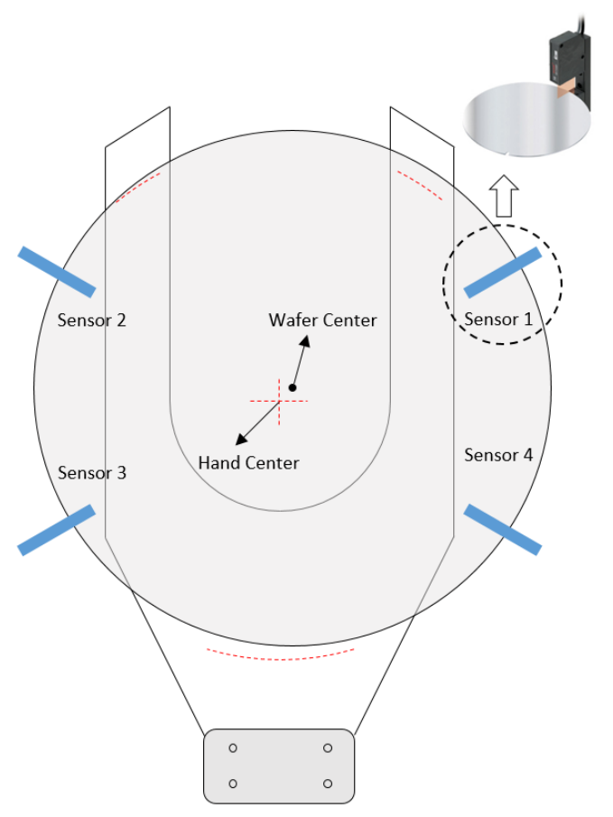
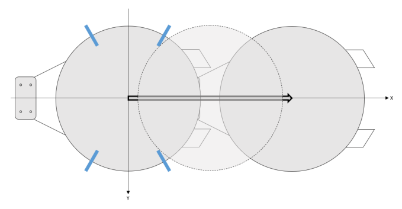
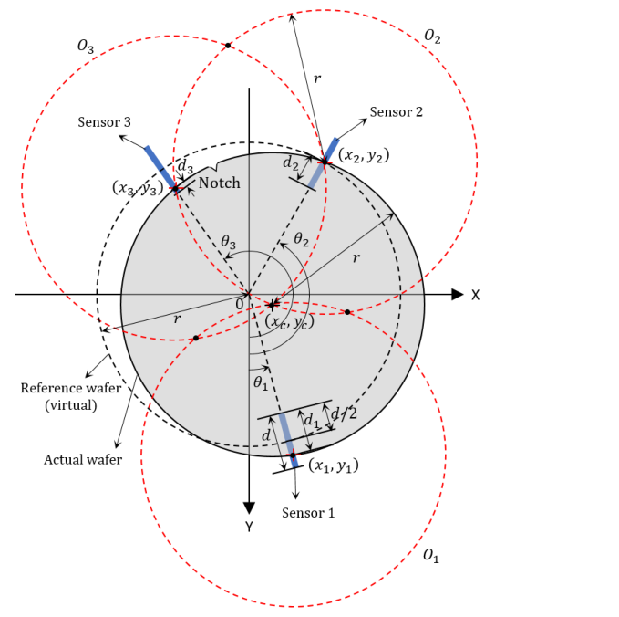
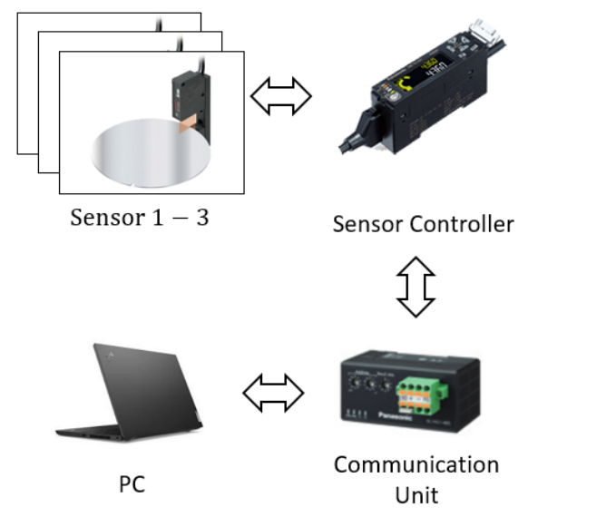
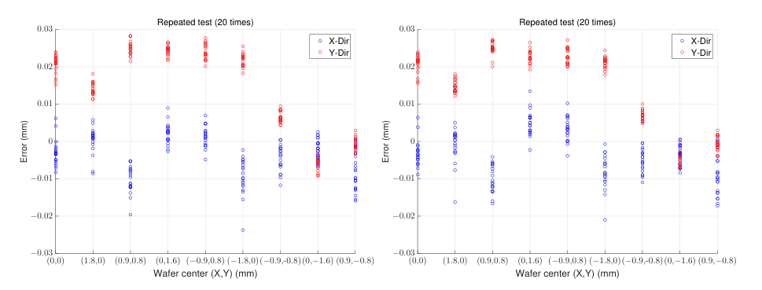
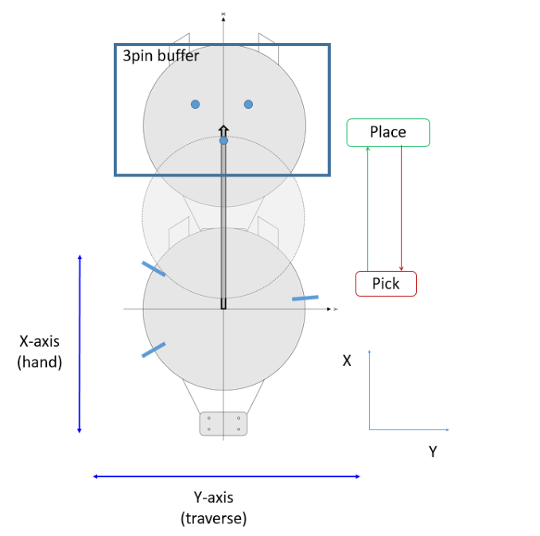
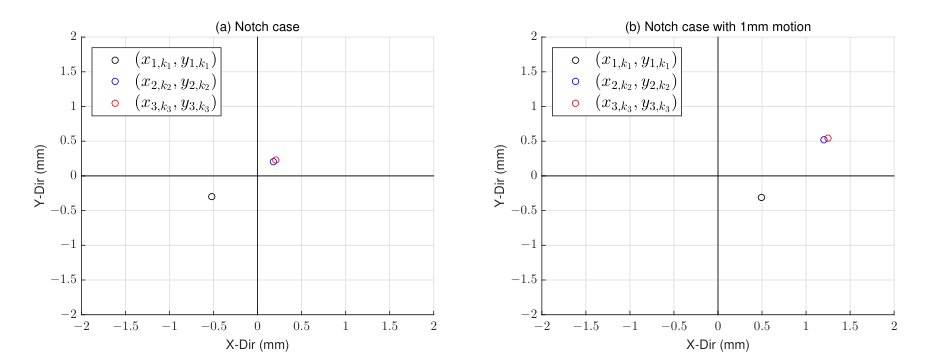

# 센서 수를 줄인 이송 로봇의 웨이퍼 중심 정렬 시스템 (Kim 2022)

- 원제: Wafer Center Alignment System of Transfer Robot Based on Reduced Number of Sensors
- 원문: 같은 폴더의 `Kim2022_Sensors.pdf` (Sensors 2022, 22, 8521, Communication. https://doi.org/10.3390/s22218521, MDPI, CC BY 4.0)
- 저자: Hyungjong Kim (한국생산기술연구원, Korea Institute of Industrial Technology)
- 번역 범위: 전문 (본문·가정·보조정리·증명·그림 캡션·표·기타 사항). 참고문헌은 원문 그대로 옮겼다.
- 그림: 원문 그림 7개를 `그림/`에 넣고 본문에서 처음 언급되는 곳에 삽입

## 초록

이 단신(brief)은 웨이퍼 중심과 로봇 핸드 사이의 상대 거리를 구하는, 센서 수를 줄인 웨이퍼 정렬 알고리즘을 제시한다. '센서 수를 줄였다(reduced number)'는 것은 기존 방법보다 센서 수가 적은데도 기존 알고리즘과 비슷한 결과를 얻는 개선된 방법이라는 뜻이다. 실제로 이 알고리즘은 기존 알고리즘의 센서 4개보다 적은 센서 3개의 데이터만으로 설계할 수 있다. 따라서 제안한 정렬 알고리즘의 장점으로는 낮은 비용과 적은 연산량으로 설계할 수 있다는 점이 있다. 방법의 성능을 검증하기 위해 제안한 정렬 알고리즘을 반도체 공정의 코터/디벨로퍼(coater/developer) 시스템용 이송 로봇에 적용하였다. 제안한 방법의 성능은 시뮬레이션과 실험 결과로 모두 검증하였다.

키워드: 반도체 웨이퍼(semiconductor wafer); 웨이퍼 중심 정렬(wafer center alignment); 광센서 3개(three optical sensors); 웨이퍼 이송 로봇(wafer transfer robot)

> 인용: Kim, H. Wafer Center Alignment System of Transfer Robot Based on Reduced Number of Sensors. Sensors 2022, 22, 8521. 학술 편집자: Luis Payá. 접수: 2022년 9월 18일, 승인: 2022년 11월 2일, 게재: 2022년 11월 5일.
> 출판사 고지: MDPI는 출판된 지도와 기관 소속에 관한 관할권 주장에 대해 중립을 유지한다.
> 저작권: © 2022 저자. 라이선스 MDPI(스위스 바젤). 이 논문은 크리에이티브 커먼즈 저작자 표시(CC BY) 라이선스(https://creativecommons.org/licenses/by/4.0/) 조건에 따라 배포되는 오픈 액세스 논문이다.

## 1. 서론 (Introduction)

웨이퍼 중심의 정렬 문제는 반도체 제조 공정에서 중요하고 핵심적인 주제이다. 리소그래피 응용에서 코팅 성능, 화학적 가장자리 비드 제거(chemical edge bead removal, EBR), 뒷면 세정(backside rinse) 단계에 영향을 주기 때문이다 [1]. 반도체 공정이 딥 서브마이크로미터(20 nm 이하) 시대, 예컨대 EUV 공정에 들어서면 그 영향은 더 커진다. 정렬 문제를 풀기 위한 접근법이 여럿 있다 [2–14]. 가장 대표적인 장치는 회전 기구와 광학 비전 센서로 이루어진 웨이퍼 사전 정렬 시스템(wafer pre-alignment system, 프리얼라이너(pre-aligner)라 부름)이다 [6]. 이 시스템은 기하학적 중심의 위치와 노치(notch) 방향을 정확하게 검출할 수 있지만, 최대 편심과 노치 정보를 찾기 위해 회전 기구가 필요하고, 그 동작 과정이 공정을 지연시킨다. 회전 기구 대신 웨이퍼를 든 로봇 핸드의 직선 운동을 이용하는 방법이 [15,16]에서 연구되었다. AWC(automatic wafer centering, 자동 웨이퍼 센터링)라 부르는 이 방법은 투과형(thru-beam) 센서 여러 개로 웨이퍼를 가로지르는 거리로부터 웨이퍼 중심을 계산한다. 이 방법은 진공 로봇에서 널리 쓰이지만, 이 역시 감지 정보를 얻기 위한 추가 동작이 필요하다. 이를 해결하기 위해 [17]의 저자들은 회전 기구 없이 웨이퍼 중심을 검출할 수 있는 자동 정렬 시스템을 제안하였다. 이 시스템은 웨이퍼 이송용 로봇 핸드와 웨이퍼 위치 정보를 얻는 비전 센서 4개로 이루어진다. 따라서 별도의 얼라이너 없이도, 이송 로봇의 로봇 핸드에 웨이퍼가 놓일 때마다 웨이퍼 중심을 정렬할 수 있다.

이 논문에서는 주로 센서 수가 기존 연구보다 하나 적은 경우에 초점을 맞춘다. 이를 위해 제안 알고리즘은 기존 방법의 센서 4개보다 적은 센서 3개의 데이터만으로 설계된다. 따라서 제안한 정렬 알고리즘의 장점으로는 낮은 비용과 적은 연산량으로 설계할 수 있다는 점이 있다. 제안 방법을 구성적으로 설계하기 위해 몇 가지 가정을 두고 그 아래에서 수학적 증명을 제시한다. 성능을 검증하기 위해 최종적으로 반도체 공정의 코터/디벨로퍼 시스템용 이송 로봇에 적용한다.

논문의 구성은 다음과 같다. 2절에서는 웨이퍼 중심을 찾는 알고리즘을 제시한다. 이를 위해 이론적 뒷받침이 되는 가정과 보조정리(lemma)를 소개한다(2.1절 참조). 또한 2.2절에서는 웨이퍼 노치를 피하는 알고리즘을 제시한다. 3절에서는 제안 알고리즘을 코터/디벨로퍼 시스템의 이송 로봇에서 실험으로 시험한다. 마지막으로 4절에 결론을 둔다.

표기법(Notation): 익숙한 $x$축과 $y$축을 갖는 직교 평면을 고려한다. $A$에서 $B$로 가는 벡터를 $\overrightarrow{AB}$로 나타내며, 점 $A$를 꼬리(tail), 점 $B$를 머리(head)라 부른다. 그러면 평면의 모든 점의 집합은 꼬리가 원점 $O$에 있는 모든 벡터의 집합과 대응한다. 예를 들어 점 $A = (1, 2)$이고, 벡터를 대괄호를 써서 $\vec{a} = \overrightarrow{OA} = \begin{bmatrix}1 & 2\end{bmatrix}^\top$로 쓰며, 여기서 $\top$은 행렬 전치를 뜻한다 [18]. 이 논문에서 모든 점은 원점 $O$를 꼬리로 하는 벡터로 나타낸다.

## 2. 주요 결과 (Main Results)

여기서는 앞 절에서 말한 대로 센서 3개의 데이터만으로 설계할 수 있는 웨이퍼 중심 검출 방법을 논의한다. 문헌에서 잘 알려져 있듯이, 웨이퍼의 모양이 원이고 세 센서 정보를 알고 있으므로 삼각형의 외심(circumcenter)으로부터 웨이퍼 중심을 유도할 수 있다. 그러나 그림 1과 같이 웨이퍼 가장자리의 노치 때문에 정확한 중심을 결정하지 못할 수 있다. 이 문제를 풀기 위해 제안 방법은 두 부분으로 구성된다. 첫째 부분은 세 센서 데이터와 알려진 웨이퍼 반지름 $r$로부터 웨이퍼 중심을 구하는 것이다. 둘째 부분에서는 그림 2와 같은 로봇 핸드의 이동을 이용해, 비정상적인 경우에 대처하기 위해 노치를 피하는 알고리즘을 소개한다.

*그림 1 — 센서 4개를 쓰는 웨이퍼 중심 정렬 시스템.*

*그림 2 — 웨이퍼를 든 로봇 핸드의 동작(센서 4개의 경우).*

이제 센서 3개인 경우를 고려하며, 센서를 설치한 구성은 그림 3과 같다. 측정 가능한 센서 범위 $d$는 알려져 있다고 가정한다. 또한 $Y$축에 대한 설치 센서의 각도 $\theta_1, \theta_2, \theta_3$은 서로 다른 알려진 양수이며 $0 \le \theta_1 < \theta_2 < \theta_3 < 360^\circ$라고 가정한다. 실제 웨이퍼 중심 $\begin{bmatrix}x_c & y_c\end{bmatrix}^\top$를 구하기 위해 다음을 가정한다.

*그림 3 — 센서 3개를 쓰는 정렬 시스템의 구성.*

**가정 1 (Assumption 1).** *범위 $d$는 웨이퍼 지름 $2r$보다 작다. 즉 $r - \frac{d}{2} > 0$이다. 센서 번호 $i = 1, 2, 3$에 대해 감지 범위(그림 3의 굵은 파란 선)는 다음과 같은 연결된 콤팩트 집합(connected compact set) $S_i$이다.*

$$S_i := \left\{ (r + \lambda d)\begin{bmatrix}\sin(\theta_i) & \cos(\theta_i)\end{bmatrix}^\top \in \mathbb{R}^2 \;\middle|\; -\frac{1}{2} \le \lambda \le \frac{1}{2} \right\}.$$

**가정 2 (Assumption 2).** *실제 웨이퍼 중심은 다음과 같이 제한된다.*

$$\begin{bmatrix}x_c & y_c\end{bmatrix}^\top \in \left\{ \begin{bmatrix}x & y\end{bmatrix}^\top \in \mathbb{R}^2 \;\middle|\; \sqrt{x^2 + y^2} \le \frac{d}{2} \right\} =: W.$$

**가정 3 (Assumption 3).** *임의의 $i, j \in \{1, 2, 3 \mid i \ne j\}$에 대해 $90^\circ \le |\theta_i - \theta_j| \le 270^\circ$이면 $|\cos(\theta_i - \theta_j)| < 2\left(\frac{r}{r + d/2}\right)^2 - 1$이다. 그렇지 않으면 $d < 2(\sqrt{2} - 1)r$이다.*

여기서 가정 1과 2는 웨이퍼 가장자리를 검출하기 위한 센서와 웨이퍼 위치에 대해 받아들일 만한 조건이다. 가정 3은 웨이퍼 중심을 식별하기 위해 필요하다(뒤에서 논의).

### 2.1. 중심 계산 알고리즘 (Center Calculation Algorithm)

이 절에서는 센서 값으로부터 웨이퍼 중심을 찾는 알고리즘을 제안한다. 그림 3과 같이, 센서가 웨이퍼 가장자리를 검출한 세 점 $\begin{bmatrix}x_i & y_i\end{bmatrix}^\top$ ($i = 1, 2, 3$)은 다음과 같다.

$$\begin{aligned} x_i &= (r - d/2 + d_i)\sin\theta_i, \\ y_i &= (r - d/2 + d_i)\cos\theta_i \end{aligned} \tag{1}$$

여기서 $d_i$는 측정 가능한 센서 값이다. $\begin{bmatrix}x_i & y_i\end{bmatrix}^\top$의 존재는 다음 보조정리에서 증명한다.

**보조정리 1 (Lemma 1).** *임의의 $\begin{bmatrix}x_c & y_c\end{bmatrix}^\top \in W$에 대해 $i = 1, 2, 3$에 대하여 $(x_i - x_c)^2 + (y_i - y_c)^2 = r^2$를 만족하는 점 $\begin{bmatrix}x_i & y_i\end{bmatrix}^\top \in S_i$가 존재한다.*

**증명.** 식 (1)은 다음과 같이 나타낼 수 있다.

$$\begin{bmatrix}x_i \\ y_i\end{bmatrix} = (r + \lambda_i d)\begin{bmatrix}\sin(\theta_i) \\ \cos(\theta_i)\end{bmatrix}, \quad \lambda_i = \frac{d_i}{d} - \frac{1}{2}. \tag{2}$$

여기서 $0 \le d_i \le d$이므로 가정 1로부터 $\begin{bmatrix}x_i & y_i\end{bmatrix}^\top \in S_i$가 성립한다. 이제

$$\begin{bmatrix}\bar{x}_i \\ \bar{y}_i\end{bmatrix} := R(\theta_i)\begin{bmatrix}x_i \\ y_i\end{bmatrix} \quad \text{and} \quad \begin{bmatrix}\bar{x}_{c,i} \\ \bar{y}_{c,i}\end{bmatrix} := R(\theta_i)\begin{bmatrix}x_c \\ y_c\end{bmatrix}$$

라 두자. 여기서 $R(\theta_i)$는 다음과 같은 회전 행렬이다.

$$R(\theta_i) := \begin{bmatrix}\cos\theta_i & -\sin\theta_i \\ \sin\theta_i & \cos\theta_i\end{bmatrix}. \tag{3}$$

그러면 식 (2)와 (3)으로부터 다음을 얻는다.

$$\begin{bmatrix}\bar{x}_i \\ \bar{y}_i\end{bmatrix} = R(\theta_i)\begin{bmatrix}x_i \\ y_i\end{bmatrix} = \begin{bmatrix}0 \\ r + \lambda_i d\end{bmatrix}.$$

$\lambda_i = \frac{1}{d}\left(\sqrt{r^2 - \bar{x}_{c,i}^2} - r + \bar{y}_{c,i}\right)$일 때 $\begin{bmatrix}\bar{x}_i & \bar{y}_i\end{bmatrix}^\top$가 방정식 $(\bar{x}_i - \bar{x}_{c,i})^2 + (\bar{y}_i - \bar{y}_{c,i})^2 = r^2$를 만족함은 쉽게 보일 수 있다. 또한 $-\frac{1}{2} \le \lambda_i \le \frac{1}{2}$임을 다음과 같이 보일 수 있다.

1. $\begin{bmatrix}\bar{x}_{c,i} & \bar{y}_{c,i}\end{bmatrix}^\top \in W$이므로 가정 2로부터 $-\frac{d}{2} \le \bar{y}_{c,i} \le \frac{d}{2}$이다. 그러면 다음을 얻을 수 있다.

$$\begin{aligned}\lambda_i &= \frac{1}{d}\left(\sqrt{r^2 - \bar{x}_{c,i}^2} - r + \bar{y}_{c,i}\right) \\ &\le \frac{1}{d}\left(\sqrt{r^2} - r + \bar{y}_{c,i}\right) = \frac{1}{d}\bar{y}_{c,i} \le \frac{1}{2}. \end{aligned} \tag{4}$$

2. 다음으로,

$$\begin{aligned}\lambda_i &= \frac{1}{d}\left(\sqrt{r^2 - \bar{x}_{c,i}^2} - r + \bar{y}_{c,i}\right) \\ &= \sqrt{\left(\frac{r}{d}\right)^2 - \left(\frac{\bar{x}_{c,i}}{d}\right)^2} - \frac{r}{d} + \frac{\bar{y}_{c,i}}{d} \\ &\ge \sqrt{\left(\frac{r}{d}\right)^2 - \frac{1}{4} + \left(\frac{\bar{y}_{c,i}}{d}\right)^2} - \frac{r}{d} + \frac{\bar{y}_{c,i}}{d}. \end{aligned}$$

$\eta := \frac{\bar{y}_{c,i}}{d}$로 정의한다. 그러면 $-\frac{1}{2} \le \eta \le \frac{1}{2}$이고,

$$f(\eta) := \sqrt{\left(\frac{r}{d}\right)^2 - \frac{1}{4} + \eta^2} - \frac{r}{d} + \eta$$

는 $\eta$에 대한 단조 증가 함수이다([19], [page 95]). 가정 1의 $r - d/2 > 0$으로부터 $\eta$에 대한 도함수가 다음을 만족하기 때문이다.

$$\dot{f}(\eta) = \eta\left(\left(\frac{r}{d}\right)^2 - \frac{1}{4} + \eta^2\right)^{-\frac{1}{2}} + 1 > 0.$$

이는 다음을 뜻한다.

$$\lambda \ge f(\eta) \ge f\!\left(-\frac{1}{2}\right) = -\frac{1}{2}. \tag{5}$$

따라서 식 (4)와 (5)에 의해 다음을 얻는다.

$$-\frac{1}{2} \le \lambda = \frac{1}{d}\left(\sqrt{r^2 - \bar{x}_{c,i}^2} - r + \bar{y}_{c,i}\right) \le \frac{1}{2}.$$

마지막으로 (3)의 행렬 $R$로부터 다음이 성립한다.

$$(\bar{x}_i - \bar{x}_{c,i})^2 + (\bar{y}_i - \bar{x}_{y,i})^2 = r^2 \quad \Rightarrow \quad (x_i - x_c)^2 + (y_i - y_c)^2 = r^2.$$

[역주: 좌변 둘째 항의 $\bar{x}_{y,i}$는 원문 표기 그대로이며, 문맥상 $\bar{y}_{c,i}$의 오기로 보인다.]

그러면 임의의 $\begin{bmatrix}x_c & y_c\end{bmatrix}^\top \in W$에 대해, $\lambda_i = \frac{1}{d}\left(\sqrt{r^2 - (x_c\cos(\theta_i) - y_c\sin(\theta_i))^2} - r + x_c\sin(\theta_i) + y_c\cos(\theta_i)\right)$일 때 $R^{-1}(\theta_i)\begin{bmatrix}0 & r + \lambda_i d\end{bmatrix}^\top \in S_i$가 방정식 $(x_i - x_c)^2 + (y_i - y_c)^2 = r^2$를 만족하는 점이다. 행렬 $R(\theta_i)$가 가역이므로 증명이 완료된다 [18]. □

이제 식 (1)로부터 반지름 $r$인 세 원(그림 3의 빨간 점선 원)의 방정식을 다음과 같이 얻을 수 있다.

$$O_i := \left\{ \begin{bmatrix}x & y\end{bmatrix}^\top \in \mathbb{R}^2 \mid (x - x_i)^2 + (y - y_i)^2 = r^2 \right\}, \quad i = 1, 2, 3.$$

그러면 각 쌍 $\{O_1, O_2\}$, $\{O_1, O_3\}$, $\{O_2, O_3\}$에 대해 다음과 같이 두 교점을 얻을 수 있다.

$$O_1 \cap O_2 = \left\{ \begin{bmatrix}x_{1,1} & y_{1,1}\end{bmatrix}^\top, \begin{bmatrix}x_{1,2} & y_{1,2}\end{bmatrix}^\top \right\}, \tag{6}$$

$$O_1 \cap O_3 = \left\{ \begin{bmatrix}x_{2,1} & y_{2,1}\end{bmatrix}^\top, \begin{bmatrix}x_{2,2} & y_{2,2}\end{bmatrix}^\top \right\}, \tag{7}$$

$$O_2 \cap O_3 = \left\{ \begin{bmatrix}x_{3,1} & y_{3,1}\end{bmatrix}^\top, \begin{bmatrix}x_{3,2} & y_{3,2}\end{bmatrix}^\top \right\}. \tag{8}$$

여기서 가정 3 아래에서 교점의 존재를 다음 보조정리에서 증명한다.

**보조정리 2 (Lemma 2).** *가정 1과 3 아래에서, 각 쌍 $(O_1, O_2)$, $(O_1, O_3)$, $(O_2, O_3)$에 대해 서로 다른 두 교점이 존재한다.*

**증명.** $i, j \in \{1, 2, 3 \mid i \ne j\}$에 대해 $\left\| \begin{bmatrix}x_i & y_i\end{bmatrix}^\top - \begin{bmatrix}x_j & y_j\end{bmatrix}^\top \right\| < 2r$이면 두 원 $O_i$와 $O_j$ 사이에 서로 다른 두 교점이 있음은 쉽게 보일 수 있다. 가정 1, $0 \le d_i \le d$, $0 \le d_j \le d$로부터 다음을 얻는다.

$$\begin{aligned} &\left\| \begin{bmatrix}x_i & y_i\end{bmatrix}^\top - \begin{bmatrix}x_j & y_j\end{bmatrix}^\top \right\|^2 \\ &= (r + d_i - d/2)^2 + (r + d_j - d/2)^2 - 2(r + d_i - d/2)(r + d_j - d/2)\cos(\theta_i - \theta_j) \\ &\le 2\left(r + \frac{d}{2}\right)^2 - 2\left(r + d_i - \frac{d}{2}\right)\left(r + d_j - \frac{d}{2}\right)\cos(\theta_i - \theta_j). \end{aligned}$$

1. 임의의 $i, j \in \{1, 2, 3 \mid i \ne j\}$에 대해 $90 \le |\theta_i - \theta_j| \le 270$이면, $-1 \le \cos(\theta_i - \theta_j) \le 0$과 가정 3의 $|\cos(\theta_i - \theta_j)| < 2\left(\frac{r}{r + d/2}\right)^2 - 1$로부터 다음이 성립한다.

$$\begin{aligned}\left\| \begin{bmatrix}x_i & y_i\end{bmatrix}^\top - \begin{bmatrix}x_j & y_j\end{bmatrix}^\top \right\|^2 &\le 2\left(r + \frac{d}{2}\right)^2 + 2\left(r + \frac{d}{2}\right)^2 |\cos(\theta_i - \theta_j)| \\ &< 4r^2. \end{aligned}$$

2. 그렇지 않으면, $0 \le \cos(\theta_i - \theta_j) \le 1$과 가정 3의 $d < 2(\sqrt{2} - 1)r$로부터 다음이 성립한다.

$$\begin{aligned}\left\| \begin{bmatrix}x_i & y_i\end{bmatrix}^\top - \begin{bmatrix}x_j & y_j\end{bmatrix}^\top \right\|^2 &\le 2\left(r + \frac{d}{2}\right)^2 \\ &< 4r^2. \end{aligned}$$

따라서 증명이 완료된다. □

사실 보조정리 2의 증명에 필요한 가정 3은 충분조건일 뿐이다. 따라서 가정 3이 성립하지 않는다고 해서 두 교점이 존재하지 않는다는 뜻은 아니다. 다음으로, 아래 보조정리는 웨이퍼 중심과 교점 사이의 관계를 보여 준다.

**보조정리 3 (Lemma 3).** *웨이퍼 중심 $\begin{bmatrix}x_c & y_c\end{bmatrix}^\top$는 각 쌍 $(O_1, O_2)$, $(O_1, O_3)$, $(O_2, O_3)$의 두 교점 중 하나에 위치한다. 즉, $i = 1, 2, 3$에 대해*

$$\begin{bmatrix}x_c & y_c\end{bmatrix}^\top \in \left\{ \begin{bmatrix}x_{i,1} & y_{i,1}\end{bmatrix}^\top, \begin{bmatrix}x_{i,2} & y_{i,2}\end{bmatrix}^\top \right\}$$

*이다.*

**증명.** $\left\| \begin{bmatrix}x_c & y_c\end{bmatrix}^\top - \begin{bmatrix}x_i & y_i\end{bmatrix}^\top \right\| = r$이므로, $i = 1, 2, 3$에 대해

$$\begin{bmatrix}x_c & y_c\end{bmatrix} \in O_i \tag{9}$$

임에 주목한다. 그러면 식 (9)로부터 다음을 얻는다.

$$\begin{bmatrix}x_c & y_c\end{bmatrix}^\top \in O_1 \cap O_2 \cap O_3.$$

이는 다음을 뜻한다.

$$\begin{bmatrix}x_c & y_c\end{bmatrix}^\top \in O_1 \cap O_2, \quad \begin{bmatrix}x_c & y_c\end{bmatrix}^\top \in O_1 \cap O_3, \quad \begin{bmatrix}x_c & y_c\end{bmatrix}^\top \in O_2 \cap O_3.$$

따라서 식 (6)–(8)에 의해 증명이 완료된다. □

마지막으로 보조정리 3으로부터 웨이퍼 중심을 다음과 같이 얻는다.

$$\begin{bmatrix}x_c \\ y_c\end{bmatrix} = \begin{bmatrix}x_{1,k} \\ y_{1,k}\end{bmatrix} \tag{10}$$

여기서 $k \in \{1, 2\}$는 다음을 만족하는 값이다.

$$\begin{bmatrix}x_{1,k} \\ y_{1,k}\end{bmatrix} \in O_2 \quad \text{and} \quad \begin{bmatrix}x_{1,k} \\ y_{1,k}\end{bmatrix} \in O_3. \tag{11}$$

실제로는 센서 측정 오차 때문에 식 (11)을 정확히 만족하는 $k$를 찾기가 쉽지 않다. 따라서 (10) 대신 다음 방법을 제시한다.

$$x_c = \frac{x_{1,k_1} + x_{2,k_2} + x_{3,k_3}}{3}, \qquad y_c = \frac{y_{1,k_1} + y_{2,k_2} + y_{3,k_3}}{3}$$

여기서 $k_1, k_2, k_3 \in \{1, 2\}$는 모든 $q(\cdot, \cdot, \cdot)$ 가운데 $q(k_1, k_2, k_3)$가 최솟값을 갖도록 고르며, $q(k_1, k_2, k_3)$는 다음과 같다.

$$q(k_1, k_2, k_3) := \left\| \begin{bmatrix}x_{1,k_1} \\ y_{1,k_1}\end{bmatrix} - \begin{bmatrix}x_{2,k_2} \\ y_{2,k_2}\end{bmatrix} \right\| + \left\| \begin{bmatrix}x_{1,k_1} \\ y_{1,k_1}\end{bmatrix} - \begin{bmatrix}x_{3,k_3} \\ y_{3,k_3}\end{bmatrix} \right\| + \left\| \begin{bmatrix}x_{2,k_2} \\ y_{2,k_2}\end{bmatrix} - \begin{bmatrix}x_{3,k_3} \\ y_{3,k_3}\end{bmatrix} \right\|.$$

### 2.2. 노치 검출 알고리즘 (Notch Detection Algorithm)

그림 3과 같이 웨이퍼 가장자리의 노치는 올바른 웨이퍼 중심을 얻는 데 주요 장애물 중 하나이다. 이 문제를 풀기 위해 회전 운동을 이용하는 전략이 [20]에서 제안되었다. 회전 운동 대신, 노치가 센서 위에 놓여도 웨이퍼 중심을 얻을 수 있도록(archive) [역주: 원문 "archive"는 "achieve"의 오기로 보인다] 그림 2의 직선(prismatic) 운동을 이용하는 알고리즘을 제안한다. 제안 알고리즘은 다음 순서로 진행된다.

1. 시작(Start).
2. 2.1절의 알고리즘으로 교점을 찾고 $v_1 := \begin{bmatrix}x_{1,k_1} & y_{1,k_1}\end{bmatrix}^\top$, $v_2 := \begin{bmatrix}x_{2,k_2} & y_{2,k_2}\end{bmatrix}^\top$, $v_3 := \begin{bmatrix}x_{3,k_3} & y_{3,k_3}\end{bmatrix}^\top$로 둔다.
3. $\|v_1 - v_2\| + \|v_1 - v_3\| + \|v_2 - v_3\|$가 $\epsilon > 0$보다 작으면 7로 건너뛴다.
4. 웨이퍼를 든 로봇 핸드를 *X 방향*으로 $\alpha$만큼 이동한다. 여기서 $\alpha$는 양수이다.
5. 2와 같이 다시 시도하여 $\bar{v}_1 := \begin{bmatrix}x_{1,k_1} & y_{1,k_1}\end{bmatrix}^\top$, $\bar{v}_2 := \begin{bmatrix}x_{2,k_2} & y_{2,k_2}\end{bmatrix}^\top$, $\bar{v}_3 := \begin{bmatrix}x_{3,k_3} & y_{3,k_3}\end{bmatrix}^\top$로 정의한다.
6. $j = 1, 2, 3$과 $e_y = \begin{bmatrix}0 & 1\end{bmatrix}^\top$에 대해 $|v_i^\top \cdot e_y - \bar{v}_j^\top \cdot e_y|$를 최소화하도록 $j$를 골라 $v_j$를 웨이퍼 중심으로 선택한다. 그다음 8로 건너뛴다.
7. $\frac{(v_1 + v_2 + v_3)}{3}$을 웨이퍼 중심으로 선택한다.
8. 끝(End).

여기서 $\epsilon$과 $\alpha$는 적절한 설계 파라미터이다. *X 방향* 운동으로 센서 값을 바꿔야 하므로 $i = 1, 2, 3$에 대해 $\theta_i \ne 90^\circ$이고 $\theta_i \ne 270^\circ$라고도 가정한다.

## 3. 실험 결과 (Experimental Results)

여기서는 방법의 성능을 검증하기 위해, 그림 4와 같이 반도체 공정의 실제 300 mm 코터/디벨로퍼 시스템에 제안한 웨이퍼 정렬 알고리즘을 구현한다. 이를 위해 실험에는 투과형 디지털 변위 센서와 컨트롤러(Panasonic Industry Company가 제조한 HG-T 시리즈)를 사용한다. 센서 데이터를 PC로 전송하기 위해 RS-485 통신을 사용한다. 측정 가능한 센서 범위는 $d$ = 5 mm이고 설치 센서의 각도는 $\theta_1 = 5^\circ$, $\theta_2 = 150^\circ$, $\theta_3 = 210^\circ$이다. 파라미터 $r$, $d$, $\theta_1$, $\theta_2$, $\theta_3$은 가정 3을 만족함에 주목한다.

그림 5는 각각 제안 알고리즘과 [17]의 기존 알고리즘의 실험 결과를 보여 준다. 여기서 $x$축과 $y$축은 각각 웨이퍼의 실제 중심 좌표, 그리고 그것과 이 논문의 제안 알고리즘으로 계산한 중심 사이의 오차를 뜻한다. 표 1과 같이 두 알고리즘 모두 피크-투-피크(peak-to-peak) 오차가 $x$ 방향과 $y$ 방향에서 각각 약 0.022 mm 미만이다(사양의 상한은 0.2 mm이다).

*그림 4 — 실험 구성.*

*그림 5 — 제안 알고리즘(왼쪽)과 기존 알고리즘(오른쪽)의 실험 결과.*

그림 6과 같이, 로봇은 픽 앤드 플레이스(pick and place) 동작으로 웨이퍼를 원하는 위치로 이송한다. X축은 짧은 스트로크로 고정밀 운동이 가능한 반면, Y축은 로봇 본체를 움직이는 주행(traverse) 방향이어서 Y축의 운동 정밀도는 상대적으로 낮다. 따라서 요구 사양은 만족하지만 Y 방향 오차가 X 방향 오차보다 크다.

*그림 6 — 실험을 위한 웨이퍼 픽 앤드 플레이스.*

**표 1.** 20회 반복 시험의 피크-투-피크 오차(단위: mm).

| 웨이퍼 중심 X, Y | 제안 X-Dir | 제안 Y-Dir | 기존 X-Dir | 기존 Y-Dir |
|---|---|---|---|---|
| (0,0) | 0.0145 | 0.0087 | 0.0153 | 0.0083 |
| (1.8,0) | 0.0143 | 0.0068 | 0.0213 | 0.0059 |
| (0.9,0.8) | 0.0144 | 0.0067 | 0.0125 | 0.0071 |
| (0,1.6) | 0.0116 | 0.0047 | 0.0157 | 0.0072 |
| (−0.9,0.8) | 0.0119 | 0.0076 | 0.0141 | 0.0072 |
| (−1.8,0) | 0.0215 | 0.0071 | 0.0202 | 0.0066 |
| (−0.9,−0.8) | 0.0122 | 0.0051 | 0.0106 | 0.0052 |
| (0,−1.6) | 0.0088 | 0.0067 | 0.0089 | 0.0062 |
| (0.9,−0.8) | 0.0162 | 0.0070 | 0.0177 | 0.0068 |

2.2절에서 제안한 노치 검출 알고리즘의 능력을 검증하기 위해, 웨이퍼 노치가 센서 3 위에 놓인 경우에 대해 실험을 수행한다. 노치 알고리즘의 파라미터는 $\epsilon = 0.3$, $\alpha = 1$로 정하였다.

그림 7a와 같이 점 $\begin{bmatrix}x_{1,k_1} & y_{1,k_1}\end{bmatrix}^\top$는 $\begin{bmatrix}x_{2,k_2} & y_{2,k_2}\end{bmatrix}^\top$, $\begin{bmatrix}x_{3,k_3} & y_{3,k_3}\end{bmatrix}^\top$와 상대적으로 멀리 떨어져 있다. 즉 $q(k_1, k_2, k_3) > \epsilon$이다. 이 문제를 풀기 위해 노치 검출 알고리즘에 따라 웨이퍼를 X 방향으로 $\alpha$ = 1 mm 이동한다. 그러면 그림 7b와 같이 점 $\begin{bmatrix}x_{1,k_1} & y_{1,k_1}\end{bmatrix}^\top$는 X 방향으로만 움직이지만 나머지 점들은 Y 방향 이동도 갖는다. 따라서 $\begin{bmatrix}x_{1,k_1} & y_{1,k_1}\end{bmatrix}^\top$를 웨이퍼 중심으로 선택할 수 있다(2.2절의 노치 검출 알고리즘 참조).

*그림 7 — 노치 경우의 실험 결과 (a)와 X 방향으로 1 mm 이동한 뒤의 결과 (b).*

## 4. 결론 (Conclusions)

이 단신에서는 웨이퍼 중심과 로봇 핸드 중심 사이의 상대 거리를 구하는 웨이퍼 정렬 알고리즘을 제시하였다. 제안 알고리즘은 기존 알고리즘보다 적은 센서 3개의 데이터만으로 설계할 수 있었으며, 따라서 낮은 비용과 적은 연산량을 달성하였다. 투과형 디지털 변위 센서 3개로 구성된 실제 로봇 시스템을 통해 그 성능이 기존 방법과 비슷함을 검증하였다.

## 기타 사항

- 연구비(Funding): 이 연구는 한국산업기술평가관리원(Korea Evaluation Institute Of Industrial Technology)의 지원을 받았다(과제 번호: 20008905).
- 기관 윤리위원회 승인(Institutional Review Board Statement): 해당 없음.
- 연구 대상자 동의(Informed Consent Statement): 해당 없음.
- 데이터 가용성(Data Availability Statement): 해당 없음.
- 이해 상충(Conflicts of Interest): 저자는 이해 상충이 없음을 밝힌다.

## 참고문헌

1. Jekauc, I.; Watt, M.; Hornsmith, T.; Tiffany, J. Necessity of chemical edge bead removal in modern day lithographic processing. In Proceedings of the Advances in Resist Technology and Processing XXI; Sturtevant, J.L., Ed.; International Society for Optics and Photonics, SPIE: Bellingham, WA, USA, 2004; Volume 5376, pp. 1255–1263.
2. Tadashi, H. Method of Detecting Position of Orientation Flat of Semiconductor Wafer. JP Patent 06236918, 23 August 1994.
3. Berken, L.M. Wafer Positioning System. U.S. Patent 5740062, 14 April 1998.
4. Freerks, F.W. Wafer Position Error Detection and Correction System. U.S. Patent 5980194, 9 November 1999.
5. Yoo, W.S. Wafer Alignment System and Method. U.S. Patent 6516244, 4 February 2003.
6. Cong, M.; Kong, X.; Du, Y.; Liu, J. Wafer Pre-Aligner System Based on Vision Information Processing. Inf. Technol. J. 2007, 6, 1245–1251.
7. Qu, D.; Qiao, S.; Rong, W.; Song, Y.; Zhao, Y. Design and Experiment of The Wafer Pre-alignment System. In Proceedings of the 2007 International Conference on Mechatronics and Automation, Harbin, China, 5–8 August 2007; pp. 1483–1488.
8. Chen, Y.; Chen, Y.; Lee, J. A novel method for real-time wafer positioning during transfer process. In Proceedings of the SICE Annual Conference 2011, Tokyo, Japan, 13–18 September 2011; pp. 1933–1937.
9. Chen, Y.; Lee, Y.; Lee, J.; Chen, J. Implementation of a wafer positioning system. In Proceedings of the SICE Annual Conference 2011, Tokyo, Japan, 13–18 September 2011; pp. 1938–1943.
10. Chen, Y.; Chen, Y.; Lee, J. Experimental results of a wafer positioning system using machine vision after system calibration. In Proceedings of the 2012 Proceedings of SICE Annual Conference (SICE), Akita, Japan, 20–23 August 2012; pp. 1014–1017.
11. He, Y.; Zhang, C.; Ye, W.; He, Z.; Chen, X.; Gao, J.; Zhang, K.; Yang, Z.; Chen, X.; Chen, Y.; et al. A direct-drive SCARA robot for wafer ceramic-substrate handling based on visual servoing. In Proceedings of the 2017 IEEE International Conference on Cybernetics and Intelligent Systems (CIS) and IEEE Conference on Robotics, Automation and Mechatronics (RAM), Ningbo, China, 19–21 November 2017; pp. 428–433.
12. Xu, J.; Hu, H.; Lei, Y.; Liu, H. A Wafer Prealignment Algorithm Based on Fourier Transform and Least Square Regression. IEEE Trans. Autom. Sci. Eng. 2017, 14, 1771–1777.
13. Kim, J. New Wafer Alignment Process Using Multiple Vision Method for Industrial Manufacturing. Electronics 2018, 7, 39.
14. Pan, S.; Wang, S.; Xu, J.; Fan, L.; Yuan, F.; Shu, T.; Dai, F.; Yan, X.; Bu, Y.; Wang, X. Sub-pixel position estimation algorithm based on Gaussian fitting and sampling theorem interpolation for wafer alignment. Appl. Opt. 2021, 60, 9607–9618.
15. Chung, M.J.; Lee, S.J. Development of Automatic Wafer Centering System for Vacuum Transfer Robot using for Semiconductor Manufacturing. Appl. Mech. Mater. 2014, 607, 782–785.
16. Cheng, H.; Chen, S.; Mooring, B.W. Accuracy Analysis of Dynamic-Wafer-Handling Robotic System in Semiconductor Manufacturing. IEEE Trans. Ind. Electron. 2014, 61, 1402–1410.
17. Hayashi, T. Substrate Transfer Apparatus, Substrate Transfer Method, and Recording Medium Having Recorded Program for Executing the Substrate Transfer Method. U.S. Patent 1017908670000, 16 March 2016.
18. Poole, D. Linear Algebra: A Modern Introduction; Available Titles CengageNOW Series; Thomson Brooks/Cole: Pacific Grove, CA, USA, 2005.
19. Rudin, W. Principles of Mathematical Analysis; International Series in Pure and Applied Mathematics; McGraw-Hill: New York, NY, USA, 1976.
20. Yamamoto, S.; Kamei, K. Apparatus for Detecting Position of a Notch in a Semiconductor Wafer. U.S. Patent US5438209A, 1 August 1995.
