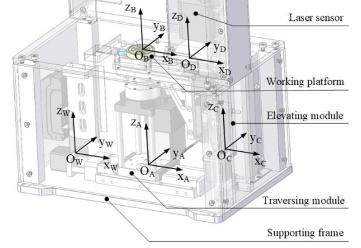
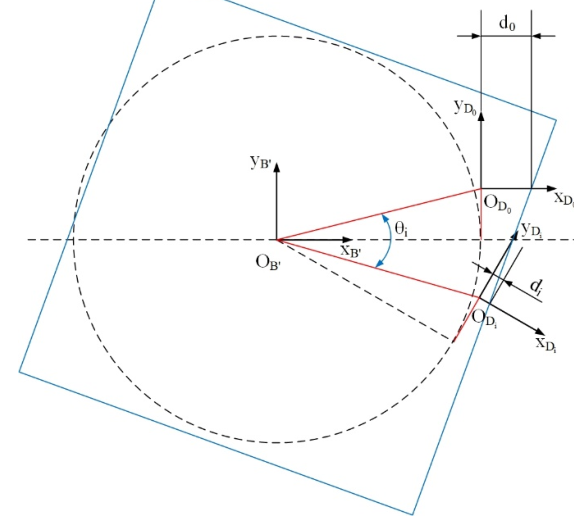
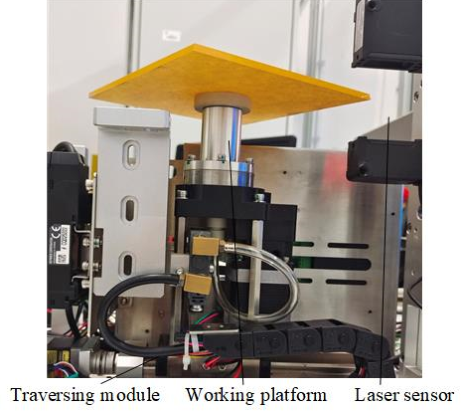
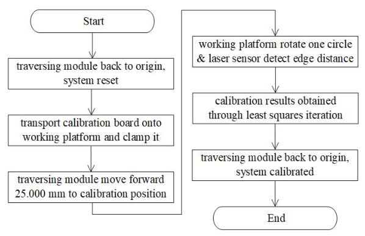
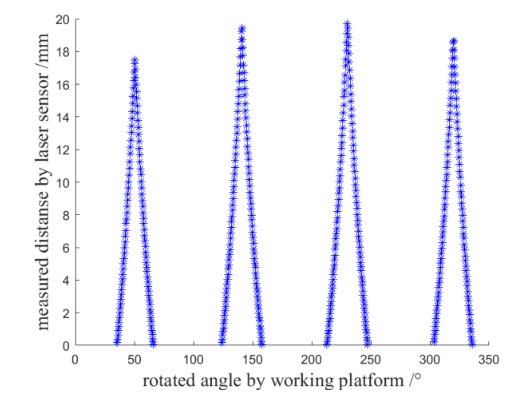
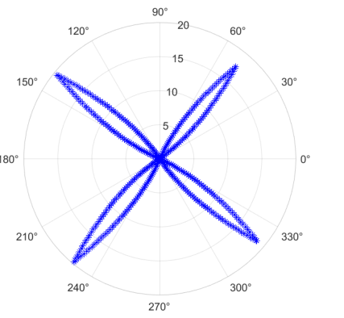
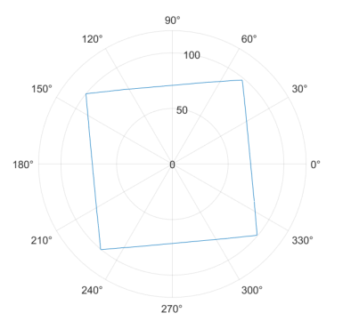

# θ-X-Z형 웨이퍼 프리얼라인 장치의 거친-정밀(coarse to fine) 보정 방법 (Wu 2024)

- 원제: A coarse to fine calibration method for the q-X-Z type wafer pre-alignment device
- 원문: 같은 폴더의 `Wu2024_JPCS.pdf` (Journal of Physics: Conference Series 2785 (2024) 012021, MEMA-2024, IOP Publishing, doi:10.1088/1742-6596/2785/1/012021, CC BY 4.0)
- 저자: Huikai Wu¹, Yijun Zhou¹*, Chen Luo¹, Buchao Si² (¹ 동남대학교 기계공학원, 중국 난징 / ² Science Co Ltd 운동학 연구개발·생산부, 중국 난징). 교신저자: zhouyj@seu.edu.cn
- 번역 범위: 전문 (PDF 1쪽의 IOP 표지 "You may also like" 광고 목록은 제외)
- 그림: 원문 그림 7개를 `그림/`에 넣고 본문에서 처음 언급되는 곳에 삽입
- [역주] 원문은 그리스 문자 θ, ρ가 글꼴 문제로 본문·표에서 "q", "r"로 찍혀 있다(제목의 "q-X-Z"도 θ-X-Z를 뜻한다). 수식 안에서는 θ, ρ로 제대로 표기되어 있으므로, 번역에서는 본문의 q·r을 θ·ρ로 읽어 옮기되 표와 제목은 원문 표기를 괄호로 병기했다.

## 초록

웨이퍼 프리얼라인 장치(wafer pre-alignment device)는 집적회로(IC) 제조 산업에서 장비 전단 모듈(equipment front-end module, EFEM)의 핵심 구성 요소이다. 이 장치는 웨이퍼가 후속 정밀 정렬 웨이퍼 스테이지로 이송되기 전에 웨이퍼의 위치·방향 오차를 보정한다. θ-X-Z형 웨이퍼 프리얼라인 장치의 보정(calibration) 문제를 풀기 위해, 본 연구는 장치의 기구학 모델(kinematic model)을 세우고 각 축과 레이저 센서 사이의 관계를 구성한다. 웨이퍼 에지 데이터에서 4점을 직접 골라 보정하는 기존 방법과 달리, 본 논문은 정사각형 보정판(square calibration board)의 에지 데이터를 모두 활용하는 방법을 제안한다. 이 방법은 거친 단계에서 정밀 단계로 가는(coarse to fine) 생각에 기반한 반복 계산으로 장치 파라미터를 구하며, 10 μm 이내의 보정 정확도를 얻는다. 제안 방법의 통계적 정확도와 운용 반복정밀도(repeatability)는 웨이퍼 프리얼라인 장치에 대한 일련의 보정 실험으로 검증하였다.

## 1. 서론 (Introduction)

웨이퍼 프리얼라인 장치는 EFEM과 정밀 웨이퍼 공정 장비 사이를 잇는 중요한 다리로서, 웨이퍼에 고정밀 공정이 수행되기 전에 이송 오차를 제거한다. 노치(notch)나 플랫 에지(flat edge)가 있는 일반적인 원형 웨이퍼의 경우, 후속 고정밀 IC 제조 단계로 넘길 때 50 μm 이내의 프리얼라인 정확도를 달성해야 한다. 웨이퍼 프리얼라인 장치의 작동 원리를 분석해 보면[1], 주로 기계식과 광학식 프리얼라인 방법이 있다. 기계식 방법은 복잡한 기계 구조에 의존하며 밀리미터 수준의 프리얼라인 정확도밖에 얻지 못한다. 또한 웨이퍼 에지와의 접촉을 피할 수 없어 웨이퍼를 오염시키거나 심지어 손상시킬 가능성이 크다[2]. 광학식 방법은 웨이퍼 에지 정보를 얻는 방식에 따라 비전 기반 방법과 레이저 센서 기반 방법으로 나눌 수 있다. 비전 기반 방법은 카메라로 단일 촬영[3] 또는 다중 촬영[4]을 통해 표면 정보 영상을 얻고, 에지 검출, 허프 변환(Hough transform) 등 디지털 영상처리 기법으로 웨이퍼 에지 데이터를 얻는다. 레이저 센서 기반 방법은 소형 삼각측량 레이저 위치 센서[5]나 레이저 광막 센서(laser light curtain sensor)[6]로 웨이퍼 윤곽을 복원한다. 레이저 센서 기반 방법은 비전 기반 방법에 비해 계산 자원 요구량을 크게 줄인다.

부품의 제작 오차와 조립 중 누적된 편차 때문에, 웨이퍼 프리얼라인 장치에서 작업 플랫폼(working platform)의 실제 회전축과 이론상 회전축 사이에는 항상 어느 정도 차이가 있다. 따라서 작업 플랫폼과 레이저 센서 사이의 실제 거리를 정확히 찾아야 한다. 흔히 쓰이는 간접 방법은 웨이퍼 이송 로봇의 자세를 계속 조정하여 편차를 보상한다[7]. 기존의 직접 보정 방법은 획득한 웨이퍼 에지 데이터에서 4점을 골라 거리를 계산하지만, 결과의 편차가 커서 정확도 요구를 만족하지 못한다.

본 논문에서는 θ-X-Z형 웨이퍼 프리얼라인 장치의 기구학 모델을 세워 작업 플랫폼과 레이저 센서 사이의 공간 관계를 밝힌다. 동시에 실제값과 설계값의 차이를 보정해야 할 두 개의 파라미터로 통합한다. 정사각형 보정판으로 원시 데이터를 획득하여 10 μm 미만의 정확도를 얻는 거친-정밀 보정 방법을 제안한다. 마지막으로 θ-X-Z형 웨이퍼 프리얼라인 장치를 이용한 보정 실험으로 제안 방법의 통계적 정확도와 반복정밀도를 검증한다.

## 2. 기구학 모델 (Kinematic model)

### 2.1. 좌표계 설정 (Establishment of the coordinate system)

θ-X-Z형 웨이퍼 프리얼라인 장치의 기구학 모델은 그림 1과 같다.

*그림 1 — θ-X-Z형 웨이퍼 프리얼라인 장치 모델. (그림 속 표기: Laser sensor=레이저 센서, Working platform=작업 플랫폼, Elevating module=승강 모듈, Traversing module=이송(횡행) 모듈, Supporting frame=지지 프레임)*

월드 좌표계 $\{W\}$는 지지 프레임(supporting frame)에 고정되며, 원점 $O_W$는 이송 모듈(traversing module)의 리셋 원점이고, $x_W$ 방향은 이송 모듈의 양의 방향이다. 이송 좌표계 $\{A\}$는 이송 모듈 자신에 고정되며, 원점 $O_A$는 작업 플랫폼의 회전축과 $x_W$의 교점이고, $x_A$ 방향은 $x_W$ 방향과 일치한다. 회전 좌표계 $\{B\}$는 작업 플랫폼에 고정된다. 원점 $O_B$는 작업 플랫폼과 실제 회전축의 교점이다. $z_B$ 방향은 회전축과 일치한다. 측정 좌표계 $\{D\}$는 레이저 센서에 고정되며, 원점 $O_D$는 센서 측정 범위의 시작점이고, $x_D$ 방향은 센서의 측정 방향이며 작업 플랫폼의 표면 평면 안에 놓인다. 승강 좌표계 $\{C\}$는 승강 모듈(elevating module)에 고정되며, 원점 $O_C$는 승강 모듈 위의 한 점이고, $z_C$ 방향은 승강 모듈의 양의 방향이다. 요약하면 $z_W$, $z_A$, $z_B$ 방향은 작업 플랫폼의 회전축과 평행하다. 보정 과정에는 승강 좌표계가 관여하지 않으므로 여기서는 더 다루지 않는다.

### 2.2. 동차 좌표 변환 관계 (Relationship of homogeneous coordinate transformation)

이송축이 리셋되었을 때 이송 좌표계 $\{A\}$와 월드 좌표계 $\{W\}$는 완전히 일치한다. 이송축이 거리 $x$만큼 전진하면, 해당 동차 변환 행렬(homogeneous transformation matrix)은 다음과 같다.

$$
{}^{W}_{A}T=\begin{bmatrix}{}^{W}_{A}R & {}^{W}p_{A_O}\\ 0 & 1\end{bmatrix}=\begin{bmatrix}1&0&0&x\\0&1&0&0\\0&0&1&0\\0&0&0&1\end{bmatrix}\tag{1}
$$

회전 좌표계 $\{B\}$는 이송 좌표계 $\{A\}$에 대해 $z_A$ 방향 둘레의 회전과 그 방향의 평행이동만 가진다. 원점 $O_A$와 $O_B$ 사이에는 고정 거리 $z$가 있다. 작업 플랫폼이 각도 θ(원문 q)만큼 회전하면 해당 동차 변환 행렬은 다음과 같다.

$$
{}^{A}_{B}T=\begin{bmatrix}{}^{A}_{B}R & {}^{A}p_{B_O}\\ 0 & 1\end{bmatrix}=\begin{bmatrix}\cos\theta&-\sin\theta&0&0\\ \sin\theta&\cos\theta&0&0\\0&0&1&z\\0&0&0&1\end{bmatrix}\tag{2}
$$

측정 좌표계 $\{D\}$는 작업 플랫폼 표면과 레이저 센서의 측정 방향을 기준으로 설정되므로, 이것과 회전 좌표계 $\{B\}$ 사이의 동차 변환 행렬은 다음과 같다.

$$
{}^{D}_{B}T=\begin{bmatrix}{}^{D}_{B}R & {}^{D}p_{B_O}\\ 0 & 1\end{bmatrix}=\begin{bmatrix}\cos\theta&-\sin\theta&0&-a_2\\ \sin\theta&\cos\theta&0&-b_2\\0&0&1&0\\0&0&0&1\end{bmatrix}\tag{3}
$$

따라서 다음을 쉽게 유도할 수 있다.

$$
{}^{B}_{D}T={}^{D}_{B}T^{-1}=\begin{bmatrix}\cos\theta&\sin\theta&0&a_2\cos\theta+b_2\sin\theta\\ -\sin\theta&\cos\theta&0&-a_2\sin\theta+b_2\cos\theta\\0&0&1&0\\0&0&0&1\end{bmatrix}\tag{4}
$$

한편 월드 좌표계 $\{W\}$와 측정 좌표계 $\{D\}$는 둘 다 지지 프레임에 직접 고정되어 있다. 사용한 레이저 센서는 $x_D$ 방향의 1차원 거리 정보만 얻을 수 있으므로, $z_D$ 방향을 $z_W$ 방향과 평행하게 정의해도 영향이 없다. 따라서 동차 변환 행렬은 다음과 같다.

$$
{}^{W}_{D}T=\begin{bmatrix}{}^{W}_{D}R & {}^{W}p_{D_O}\\ 0 & 1\end{bmatrix}=\begin{bmatrix}1&0&0&a_1\\0&1&0&b_1\\0&0&1&z\\0&0&0&1\end{bmatrix}\tag{5}
$$

## 3. 보정 모델 (Calibration model)

### 3.1. 프리얼라인 장치 보정 과정 (Process of pre-alignment device calibration)

장치의 기계 구조를 분석해 보면, 작업 플랫폼은 이송 모듈 위에 설치되어 있고, 이송 모듈의 전진 거리는 작업 플랫폼과 레이저 센서가 작동을 시작하기 전에 이미 정해진다. 따라서 보정 중에는 이송 모듈과 작업 플랫폼의 운동 사이에 결합(coupling) 관계가 없으며, 이는 작업 플랫폼이 회전할 때 그 회전축이 지지 프레임에 대해 고정되어 있다는 뜻이다. 이 문제는 그림 2와 같이 반전법(reversal method)으로 단순화할 수 있는데, 가상 좌표계 $\{B'\}$는 이송 좌표계 $\{A\}$에 대해 항상 상대적으로 정지해 있고, 대신 가상의 레이저 센서가 작업 플랫폼 둘레를 반대 방향으로 돌면서 측정한다.

*그림 2 — 반전법에서의 좌표계 관계.*

$z_D$ 방향은 $z_B$ 방향과 평행하다고 알려져 있으므로 $z_{B'}$ 방향과도 평행하다. 따라서 반전법으로 풀 때는 작업 플랫폼의 표면 평면 안에서 풀게 되어, 문제가 2차원 경우로 단순화된다. 정사각형 보정판은 작업 플랫폼에 고정되어 있으므로, 그 에지 곡선은 가상 좌표계 $\{B'\}$에서 구간별로 매끄럽다(piecewise smooth). 대수 곡선 이론에 따르면 임의의 평면 매끄러운 곡선은 $f(x,y)=0$으로 나타낼 수 있고, $g(\rho,\theta)=f(\rho\cos\theta,\rho\sin\theta)=0$으로 매개변수 치환을 할 수 있다. 일반 두께의 흔한 8인치(200 mm) 직경 웨이퍼의 프리얼라인을 고려한다. 이는 통상적인 프리얼라인 조건에서 웨이퍼 운반 캐리어로부터 웨이퍼 프리얼라인 장치로 옮길 때 웨이퍼 중심과 작업 플랫폼 회전축 사이에 약 1 mm의 편심이 있기 때문이다. 따라서 웨이퍼 에지와 작업 플랫폼 회전축 사이의 거리는 보통 99~101 mm 사이이다. 선택한 정사각형 보정판은 주로 꼭짓점 근처의 에지 데이터 정보가 필요하므로, 작업 플랫폼 위에 대략 동심으로 놓인다는 점을 고려해 한 변이 140.00 mm인 보정판을 선택하였다. 위 실험 구성에서 보정판 꼭짓점에서 작업 플랫폼 회전축까지의 거리는 $70\sqrt{2}\approx 99$ mm로, 실험에 필요한 거리를 적절히 만족한다. 제안 보정 방법의 구체적인 보정 조작 과정은 다음과 같다.

- 프리얼라인 장치의 전원을 켜고 리셋한 뒤, 정사각형 보정판을 작업 플랫폼으로 옮겨 진공 척(vacuum chuck)으로 고정한다.
- 이송 모듈이 거리 $x$만큼 전진하여 작업 플랫폼이 미리 정한 보정 위치에 도달하게 한다.
- 작업 플랫폼이 한 바퀴 회전하는 동안 레이저 센서가 보정판의 에지 거리 $d_i$를 수집하고 대응하는 회전각 $\theta_i$를 실시간으로 기록한다.
- 상위 컴퓨터(host computer) 프로그램이 수집한 원시 데이터 $\{(d_i,\theta_i)\}$를 바탕으로 보정 결과를 계산한다.
- 보정 절차가 끝나면 프리얼라인 장치를 리셋한다.

### 3.2. 보정 모델의 풀이 (Solution of calibration model)

보정 데이터 수집 과정에서 작업 플랫폼의 회전축은 지지 프레임에 대해 고정되어 있으므로, 가상 좌표계 $\{B'\}$와 측정 좌표계 $\{D\}$의 상대 위치는 고정이며, 해당 동차 변환 행렬은 다음과 같다.

$$
{}^{B'}_{D}T=\begin{bmatrix}{}^{B'}_{D}R & {}^{B'}p_{D_o}\\ 0 & 1\end{bmatrix}=\begin{bmatrix}1&0&0&a_2\\0&1&0&b_2\\0&0&1&0\\0&0&0&1\end{bmatrix}\tag{6}
$$

동차 좌표 변환 식 (1)~(6)을 결합하면 다음을 유도할 수 있다.

$$
{}^{W}_{D}T\,{}^{D}p={}^{W}p={}^{W}_{A}T\,{}^{A}p={}^{W}_{A}T\,{}^{A}_{B'}T\,{}^{B'}_{D}T\,{}^{D}p\tag{7}
$$

${}^{D}p$의 첫 성분은 레이저 센서가 측정한 거리값으로 항상 0인 것은 아니므로, 식 (7)은 다음과 같이 단순화할 수 있다.

$$
{}^{W}_{D}T={}^{W}_{A}T\,{}^{A}_{B'}T\,{}^{B'}_{D}T\tag{8}
$$

식 (8) 양변의 동차 좌표 변환 행렬이 같으므로 대응하는 위치 원소도 같고, 이로부터 $a_1=a_2+x$, $b_1=b_2$라는 식이 나온다. 반전법의 생각에 따라 가상 좌표계 $\{B'\}$의 원점 $O_{B'}$을 극(pole)으로, $x_{B'}$ 방향을 극축(polar axis)으로 삼으면, 보정 과정에서 수집된 데이터는 이렇게 구성한 가상 극좌표계에서 다음과 같이 쉽게 나타낼 수 있다.

$$
\left\{\left(\sqrt{(a_2+d_i)^2+b_2^{\,2}},\ \theta_i+\tan^{-1}\frac{b_2}{a_2+d_i}\right)\right\}
$$

보정판의 에지 데이터를 수집한 뒤, 얻은 데이터를 국소 최대값을 분할점으로 삼아 묶음으로 나누고 각각 직선 곡선 맞춤(straight curve fitting)을 수행한다. 한편으로, 여기서의 곡선 맞춤은 극좌표계에서 직접 수행되므로 기존 직교 좌표계에 존재하는 좌표 민감도 문제를 피한다. 다른 한편으로, 여기서의 곡선 맞춤 최적화 목적은 극좌표를 통해 최소제곱 거리 합으로 자연스럽게 표현될 수 있다. 따라서 보정판의 각 에지에 대해 곡선 맞춤 문제는 4-파라미터 비구속 최적화 문제가 된다. 장치의 실제 물리 모델과 결합하면 이는 다음과 같은 4-파라미터 구속 최적화 문제로 바꿀 수 있다.

$$
\mathrm{Min}\qquad Z=\sum_{i=1}^{N} e_i^{2}\left(a_2,b_2,\rho,\theta\right)\tag{9}
$$

여기서

$$
\begin{cases}
e_i=l_i\cos(\varphi_i-\theta)-\rho\\
l_i=\sqrt{(a_2+d_i)^2+b_2^{\,2}}\\
\varphi_i=\theta_i+\tan^{-1}\dfrac{b_2}{a_2+d_i}
\end{cases}\tag{10}
$$

## 4. 실험 (Experiments)

### 4.1. 실험 절차 (Experimental procedure)

제안한 θ-X-Z형 웨이퍼 프리얼라인 장치 보정 방법을 평가하기 위해 그림 3과 같은 실험 장치를 구성하였다. 이송 모듈은 위치 반복정밀도(repeat positioning accuracy) ±1 μm, 행정 범위 0~30 mm인 정밀 볼스크루 직선 운동 모듈을 사용한다. 이 모듈은 탄성 이중 다이어프램 적층 커플링을 통해 분해능 1600 pulse/rev의 폐루프 스테핑 모터로 구동된다. 작업 플랫폼은 감속비 10:1의 중공 회전 플랫폼(hollow rotating platform)을 주 구조체로 한다. 중공 회전 플랫폼의 위치 반복정밀도는 ±0.0014°이고 회전 행정 범위에는 제한이 없다. 이는 분해능 1600 pulse/rev의 폐루프 스테핑 모터에 직결되어 위치 제어를 받으며, 상단에는 음압 고정을 위한 단공(single-hole) 진공 척이 설치되어 있다. 실험에 사용한 라인 CCD 레이저 센서는 측정 범위 28 mm, 분해능 1 μm, 최대 1 kS/s의 높은 샘플링 속도를 가지며, 정확도와 속도 요구를 만족한다.

*그림 3 — 실험 장치. (그림 속 표기: Traversing module=이송 모듈, Working platform=작업 플랫폼, Laser sensor=레이저 센서)*

위와 같은 실험 사양에서, 모든 운동 제어와 데이터 기록은 산업용 PC(industrial personal computer, IPC)로 수행한다. 실험 장치를 구성한 뒤 정사각형 보정판을 작업 플랫폼 위로 옮기고 단단히 고정한다. 먼저 상위 컴퓨터 프로그램으로 이송 모듈을 리셋한다. 이송 모듈을 지정 거리 25.000 mm만큼 전진시켜 미리 설정한 파라미터 보정 데이터 수집 위치에 도달하게 한다. 그런 다음 작업 플랫폼을 등속으로 한 바퀴 회전시킨다. 플랫폼 회전각을 기록하는 동안 프로그램은 레이저 센서가 측정한 거리값을 읽고 기록하여 보정용 원시 데이터 한 묶음을 얻는다. 위의 상세 실험 단계의 흐름도는 그림 4와 같으며, 이 단계들로 수집한 원시 데이터를 하나의 실험 그룹이라 부른다.

*그림 4 — 실험 단계 흐름도. (시작 → 이송 모듈 원점 복귀·시스템 리셋 → 보정판을 작업 플랫폼으로 옮겨 고정 → 이송 모듈을 보정 위치로 25.000 mm 전진 → 작업 플랫폼 1회전 및 레이저 센서로 에지 거리 검출 → 최소제곱 반복으로 보정 결과 획득 → 이송 모듈 원점 복귀·시스템 보정 완료 → 끝)*

### 4.2. 실험 결과 (Experimental results)

실험 단계로 수집한 원시 데이터는 그림 5와 같다. 가로축은 작업 플랫폼의 회전 각도(°)이고 세로축은 레이저 센서가 측정한 거리이다. 원시 데이터 한 그룹에는 4개의 고립된 봉우리(peak)가 있다. 각 봉우리 왼쪽 원시 데이터의 거리값은 작업 플랫폼의 회전각이 커짐에 따라 0에서 봉우리 값까지 단조 증가한다. 봉우리 오른쪽 원시 데이터의 거리값은 회전각이 커짐에 따라 봉우리 값에서 0까지 단조 감소한다. 이는 보정판 에지 곡선의 한 꼭짓점에 대응시킬 수 있어, 실제 물리적 의미에 근거해 분석하기 편리하다. 위 원시 데이터를 레이저 센서 기준 극좌표에 그리면 그림 6과 같다. 측정 좌표계의 관점에서, 보정해야 할 값이 길이에서 빠진 원시 데이터의 모양을 볼 수 있다.

*그림 5 — 수집한 원시 데이터 한 그룹. (가로축: 작업 플랫폼 회전각/°, 세로축: 레이저 센서 측정 거리/mm)*

*그림 6 — 극좌표로 나타낸 원시 데이터.*

원시 데이터 한 그룹은 거리값이 국소 최대인 점을 찾아 분할할 수 있다. 분할된 각 부분 데이터에 대해 최소제곱법으로 반복 계산하여 보정 결과를 찾는다. 보정 모델의 풀이에 따르면 식 (9)와 (10)으로 정해지는 최소제곱 맞춤의 목적함수는 비선형 특성을 가진다. 본 논문은 정사각형 보정판의 각 에지마다 Levenberg-Marquardt(L-M) 알고리즘[8]에 기반한 비선형 파라미터 맞춤을 사용한다. L-M 알고리즘의 반복 초기값 선택은 매우 중요하다. 이는 알고리즘의 실행 시간과 계산 결과의 정확도에 직접 영향을 준다. 따라서 보정판 에지의 네 꼭짓점을 원시 데이터에서 처음 찾은 네 개의 국소 최대 데이터 점으로 대체한다. 레이저 센서의 데이터 측정 방향은 작업 플랫폼의 반지름 방향과 같은 평면에 있도록 설계되었으므로, 반복 파라미터 $b_2$의 초기값은 0으로 둔다. 그런 다음 원시 데이터의 네 국소 최대점 정보를 바탕으로 미정계수법(undetermined coefficient method)을 써서 $a_2$의 대략적인 추정값을 구해 반복 초기값으로 삼는다. 각 에지의 반복 과정에서는 초기 $a_2$와 $b_2$가 주어지면, 대응하는 파라미터 θ(원문 q)와 ρ(원문 r)의 초기값을 원시 데이터에서 이웃한 두 국소 최대점을 잇는 직선으로 대략 정할 수 있다. 원시 데이터 각 그룹의 국소 최대점 정보로 각 파라미터 값을 미리 추정해 반복 초기값으로 쓰면, L-M 알고리즘이 얻는 결과가 항상 신뢰 구간 안에 들고 더 적은 반복으로 계산 정확도 요구를 만족하게 되어, 반복 알고리즘의 실행 시간이 단축된다. 그림 5에 보인 원시 데이터 그룹을 반복 풀이한 뒤의 파라미터는 표 1과 같다.

**표 1.** 원시 데이터 한 그룹의 파라미터 반복 결과.

| | edge #1 | edge #2 | edge #3 | edge #4 | Average |
|---|---|---|---|---|---|
| q(°) [θ] | 95.414 | 185.463 | 275.401 | 365.494 | |
| r(mm) [ρ] | 69.143 | 69.634 | 70.885 | 70.415 | |
| a₂(mm) | 80.511 | 80.520 | 80.517 | 80.519 | 80.51675 |
| b₂(mm) | 0.865 | 0.869 | 0.874 | 0.866 | 0.8685 |

표 1의 반복 결과에 따르면, 같은 보정 데이터 그룹 안에서도 각 에지에 대응하는 θ와 ρ 값은 서로 다르다. 이는 보정 모델을 세우는 과정에서 극좌표 조건의 직선 방정식을 빌려 최적화 목적을 구성했기 때문이다. 최적화와 반복으로 구한 이 두 파라미터의 실제 물리적 의미는 다음과 같다. 에지의 데이터 수집 순서(처음에서 끝으로)에 따라 에지에 양의 방향을 정하면, θ 값은 정사각형 보정판의 이 에지의 양의 방향이 극축으로부터 반시계 방향으로 회전한 각도에 해당한다. ρ 값은 극좌표의 극에서 이 에지까지의 수직 거리에 해당한다. 보정판의 실제 윤곽은 그림 7과 같이 복원할 수 있다.

*그림 7 — 복원된 정사각형 보정판 윤곽.*

보정 결과가 통계적으로 유의하도록 하고 보정 방법의 반복정밀도가 좋은지 검증하기 위해, 정사각형 보정판을 작업 플랫폼으로 옮겨 한 번 고정한 뒤 보정판을 양호한 진공 고정 상태로 유지한다. 보정 데이터 수집 절차를 50회 반복하고, 제안한 거친-정밀 보정 방법으로 수집한 원시 데이터에서 목표 파라미터를 반복 풀이한다. 이 작업을 한 세트로 기록하고, 보정판을 떼어 낸 뒤 실험 장치를 리셋한다. 반복 풀이로 얻은 결과 파라미터를 통계 분석하기 위해 보정 실험을 5세트 반복한다. 5세트 보정 실험 전체의 결과는 표 2와 같다.

**표 2.** 반복 세트 보정 실험의 통계 결과.

| Sets no. | a₂ (mm) max | a₂ (mm) min | b₂ (mm) max | b₂ (mm) min | 3s(a₂)/mm | 3s(b₂)/mm |
|---|---|---|---|---|---|---|
| set #1 | 80.521 | 80.511 | 0.875 | 0.867 | 8.835 | 7.114 |
| set #2 | 80.520 | 80.511 | 0.875 | 0.868 | 8.136 | 7.098 |
| set #3 | 80.521 | 80.511 | 0.875 | 0.865 | 9.076 | 8.410 |
| set #4 | 80.521 | 80.511 | 0.875 | 0.865 | 9.061 | 9.033 |
| set #5 | 80.521 | 80.511 | 0.875 | 0.865 | 9.226 | 8.799 |
| average | 80.5208 | 80.511 | 0.875 | 0.866 | 8.8668 | 8.0908 |

[역주] 3s 열의 단위는 원문에 "mm"로 적혀 있으나 값의 크기(약 8~9)와 max-min 차(약 0.01 mm)로 보아 μm로 보인다. 원문 표기를 그대로 두었다.

따라서 본 논문이 제안한 보정 방법으로 웨이퍼 프리얼라인 장치를 정밀하게 보정할 수 있다. 표 1의 통계 결과에 따르면[역주: 문맥상 표 2], 실험에 사용한 θ-X-Z형 웨이퍼 프리얼라인 장치의 파라미터 $a_2$와 $b_2$ 보정 결과의 반복정밀도 범위는 ±10 mm[역주: 문맥상 ±10 μm] 이내로 판정할 수 있다. 이 보정 방법으로 웨이퍼 프리얼라인 장치 작업 플랫폼의 실제 회전축과 레이저 센서의 실제 측정 시작점 사이의 위치 관계를 충분히 정확하게 정할 수 있으므로, 이 장치를 기반으로 웨이퍼 중심 위치를 계산하여 프리얼라인 정확도 요구를 만족할 수 있다. 또한 웨이퍼 프리얼라인 장치를 웨이퍼 이송 시스템에 통합할 때의 장치 간 보정 과정도 단순화할 수 있다.

## 5. 결론 (Conclusion)

- θ-X-Z형 웨이퍼 프리얼라인 장치의 기구학 모델을 세웠다. 서로 다른 운동 모듈과 레이저 센서 사이 좌표계의 동차 변환 관계를 분석하여 보정 과정의 목표 파라미터를 제시하고, 모델의 미지 파라미터와 보정 결과 사이의 대응을 명확히 하였다.
- 웨이퍼 프리얼라인 장치 보정 문제의 기존 풀이에서 착안하여 정사각형 보정판을 보정 대상으로 선택하고, 수집한 보정판 에지 데이터 정보를 충분히 활용하는 거친-정밀 파라미터 보정 방법을 제안하였다.
- 여러 세트의 보정 실험과 반복정밀도 시험을 수행하여, 수립한 웨이퍼 프리얼라인 장치 기구학 모델과 거친-정밀 최소제곱 파라미터 보정 방법의 유효성을 검증하였으며, 목표 파라미터의 보정 정확도를 10 μm 이내로 달성하였다. 이는 웨이퍼 프리얼라인 장치의 파라미터 보정에 지침이 될 만한 의의가 있다.

## 감사의 글 (Acknowledgments)

이 연구는 장쑤성 중점 연구개발 특별기금(No. BE2023041)의 지원을 받았다.

## 참고문헌

- [1] Zhuang, X. W., Zhang, P., Hao, L. N., & Huang, C. B. (2011, February). An Overview on Wafer Pre-Aligner. In Advanced Engineering Forum (Vol. 2, pp. 320-323). Trans Tech Publications Ltd.
- [2] Kim, H. T., & Choi, M. S. (2011). A Dual Vacuum Wafer Prealigner and a Multiple Level Structure. Transactions of The Korea Fluid Power Systems Society, 8(3), 14-20.
- [3] Koo, J. M., & Cho, T. H. (2010). A wafer pre-alignment system using one image of a whole wafer. Journal of the semiconductor & display technology, 9(3), 47-51.
- [4] Xu, J., Hu, H., Lei, Y., & Liu, H. (2017). A wafer prealignment algorithm based on Fourier transform and least square regression. IEEE Transactions on Automation Science and Engineering, 14(4), 1771-1777.
- [5] Chen, J., Lan, Z., Xue, C., Lan, J., Liu, Z., & Yang, Y. (2023). A Wafer Pre-Alignment Algorithm Based on Weighted Fourier Series Fitting of Circles and Least Squares Fitting of Circles. Micromachines, 14(5), 956.
- [6] Kim, H. (2022). Wafer Center Alignment System of Transfer Robot Based on Reduced Number of Sensors. Sensors, 22(21), 8521.
- [7] Bratovanov, N. (2021, June). Implementation of pick-and-place algorithms for the purposes of wafer handling robotics simulations. In 2021 3rd International Congress on Human-Computer Interaction, Optimization and Robotic Applications (HORA) (pp. 1-5). IEEE.
- [8] Gavin, H. P. (2019). The Levenberg-Marquardt algorithm for nonlinear least squares curve-fitting problems. Department of civil and environmental engineering, Duke University, 19.
