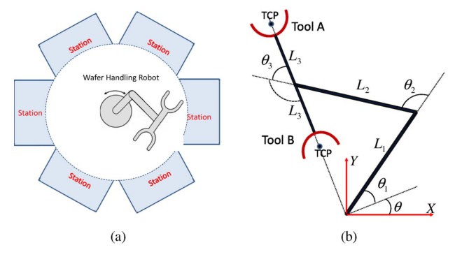
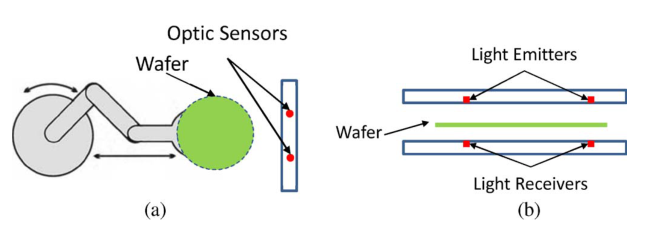
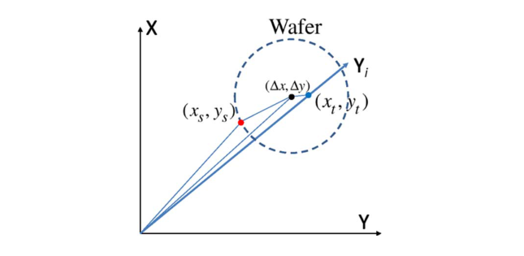
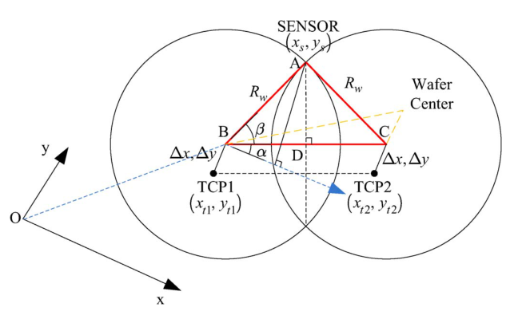
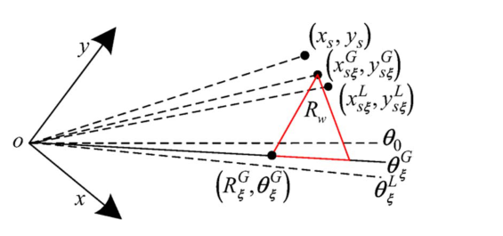
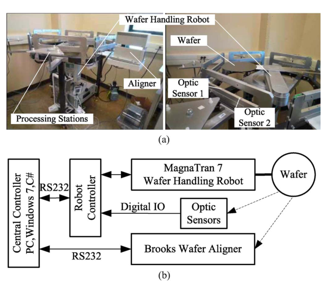
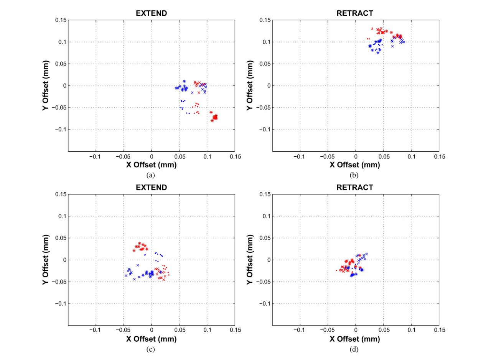

# 반도체 제조용 동적 웨이퍼 핸들링 로봇 시스템의 정확도 분석 (Cheng 2013)

- 원제: Accuracy Analysis of Dynamic-Wafer-Handling Robotic System in Semiconductor Manufacturing
- 원문: 같은 폴더의 `Cheng2013_TIE_wafer_eccentricity.pdf` (IEEE Transactions on Industrial Electronics, vol. 61, no. 3, pp. 1402–1410, 2014년 3월호. 온라인 공개 2013년 5월. DOI 10.1109/TIE.2013.2261034)
- 저자: Hongtai Cheng, Heping Chen (Texas State University), Benjamin W. Mooring (Lam Research Corporation)
- 번역 범위: 전문 (본문, 표, 그림 캡션, 저자 소개. 참고문헌은 원문 그대로)
- 그림: 원문 그림 7개를 `그림/`에 넣고 본문에서 처음 언급되는 곳에 삽입. 표 I·II는 원문에서 그림으로 들어 있으나 마크다운 표로 옮겼다.

## 초록 (Abstract)

웨이퍼 핸들링 로봇(wafer-handling robot)은 반도체 제조에서 웨이퍼를 옮기는 데 널리 쓰인다. 웨이퍼 이송 효율을 높이기 위해 각 스테이션에 광센서(optic sensor)를 설치해 웨이퍼 편심(eccentricity)을 이송 중에(on the fly) 추정한다. 그러나 광선 반지름, 로봇 운동 오차, 시스템 비선형성과 불확실성 같은 비이상적 요인 때문에, 반도체 제조의 까다로운 요구를 만족하는 고정확도 편심 추정을 달성하기 어렵다. 편심 추정 정확도를 더 높이기 위해 로봇 기구학 오차(kinematic error), 센서 보정(calibration) 오차, 편심 식별 오차 사이의 관계를 분석한다. 분석 결과는 오차 모델링(error modeling) 방법과 전역 데이터 샘플링(global data sampling) 방법이 모두 웨이퍼 편심 추정 정확도를 크게 높일 수 있음을 보인다. 제안한 편심 추정 기법은 웨이퍼 핸들링 로봇 시스템에서 수행한 실험으로 검증한다. 결과는 개발한 방법이 반도체 제조에서 웨이퍼 핸들링 정확도를 높이고 웨이퍼 핸들링 사이클 타임을 줄이는 데 쓰일 수 있음을 보여 준다.

**색인어(Index Terms)** — 동적 웨이퍼 핸들링, 로봇 오차 모델링, 반도체 제조, 웨이퍼 핸들링 로봇.

## I. 서론 (Introduction)

웨이퍼 핸들링 로봇[1]은 현재 반도체 제조 공정에서 연마(polishing), 식각(etching), 이온 주입(implanting) 등 서로 다른 공정을 맡는 웨이퍼 공정 스테이션 사이로 웨이퍼를 옮기는 데 쓰인다. 웨이퍼는 스테이션 사이를 정확하고 빠르고 부드럽게 옮겨져야 하므로, 웨이퍼 핸들링 로봇을 이용한 자동 고정확도 웨이퍼 이송은 반도체 제조에서 매우 중요하다[2].

알다시피 웨이퍼 크기는 15년마다 바뀌고, 웨이퍼가 클수록 생산성과 이익이 커진다. 현재 반도체 제조는 자동화와 로봇 기술[3]–[5]에 크게 의존하며, 정밀한 설계·측정·제어와 밀접하게 관련된다[6]. 한편 칩 집적도는 약 2년마다 두 배가 된다. 따라서 웨이퍼 위의 선폭은 점점 좁아진다. 이러한 혁신은 웨이퍼 핸들링 로봇을 포함한 반도체 제조 장비에 엄격한 도전 과제를 안긴다[7]–[9].

(원고 접수 2012년 8월 24일, 수정 2013년 2월 12일, 채택 2013년 3월 24일. 공개 2013년 5월 1일, 현재 버전 2013년 8월 23일. H. Cheng과 H. Chen은 Texas State University Ingram School of Engineering(San Marcos, TX 78666 USA) 소속(e-mail: h_c45@txstate.edu; hc15@txstate.edu). B. W. Mooring은 Lam Research Corporation(Fremont, CA 94538 USA) 소속(e-mail: ben.mooring@lamresearch.com). 이 논문의 그림 중 하나 이상의 컬러 버전은 http://ieeexplore.ieee.org 에서 볼 수 있다. Digital Object Identifier 10.1109/TIE.2013.2261034)

그림 1(a)는 공정 스테이션 6개를 가진 웨이퍼 핸들링 로봇을 위에서 본 모습이다. 제조 셀 중앙에 설치된 웨이퍼 핸들링 로봇[10]은 주위 공정 스테이션 사이로 웨이퍼를 옮긴다. 스테이션 중 하나에 얼라이너(aligner)를 설치해 웨이퍼 편심을 측정할 수 있다[11].

*그림 1 — (a) 웨이퍼 핸들링 로봇과 그 주위의 스테이션. 로봇은 공정 스테이션 사이로 웨이퍼를 옮긴다. (b) 웨이퍼 핸들링 로봇의 개략도.*

로봇은 한 스테이션에서 웨이퍼를 집어 다른 스테이션으로 옮긴다. 웨이퍼 중심과 로봇 블레이드 중심[공구 중심점(tool center point, TCP)]이 일치하지 않을 수 있으므로, 웨이퍼 중심 오프셋(편심)을 보상하지 않으면 웨이퍼를 다른 스테이션에 정확히 놓을 수 없다.

이 문제를 풀기 위해 현재는 스테이션에서 웨이퍼를 집은 뒤 얼라이너에 올려놓는다. 얼라이너가 웨이퍼 편심을 측정하면, 로봇 좌표계로 변환된 편심을 바탕으로 로봇이 웨이퍼를 다시 집도록 제어한다. 그렇게 중심이 맞춰진 웨이퍼를 다른 스테이션에 정확히 놓는다. 이 집기–측정–놓기(pick-measure-place) 과정은 대체로 시간이 많이 들고 비효율적이다. 따라서 생산 처리량(throughput)이 제한되고 생산 비용이 늘어난다. 반도체 제조에서 효율은 생산성을 높이고[12], [13] 비용을 줄이는[14]–[16] 핵심 요소다. 그러므로 생산 효율을 높일 수 있도록 웨이퍼 측정 시간을 줄이는 새 기법을 개발할 필요가 있다.

분명히 얼라이너를 쓰는 측정 단계는 웨이퍼 이송에 추가 시간을 차지해 사이클 타임을 늘린다. 따라서 얼라이너를 쓰는 측정 과정을 없앨 수 있다면 생산 사이클 타임은 크게 줄어든다. 그러나 서로 다른 스테이션 사이로 웨이퍼를 정확히 옮기려면 편심 식별이 반드시 필요하다.

광센서는 측정 장치에 널리 쓰인다[17]. 얼라이너 없이 웨이퍼 편심을 추정하기 위해, 보통 각 스테이션에 광센서를 설치하고 이송 중에 로봇 위치를 측정하는 데 쓴다. Cheng과 Zhang[18]은 광센서 3개로 웨이퍼 가장자리 트리거 점(trigger point)을 검출했다. 이 점들이 기록되면 웨이퍼 편심을 식별할 수 있다. 그러나 센서 위치 보정 문제는 다루지 않았고, 웨이퍼 편심 추정 방법에도 몇 가지 한계가 있다. 이런 문제를 극복하기 위해 Hosek과 Prochazka[19]는 이송 중 웨이퍼 편심을 추정하는 직접 계산법을 개발했다. 시간 지연 문제를 논의하고, 웨이퍼 편심 식별 오차를 다루는 보상 방법을 제안했다. 또한 센서 위치 보정 방법도 제시했다. 그러나 로봇 기구학 오차와 그 영향은 분석하지 않았다. Chen 등[20]은 광센서 2개로 이송 중 웨이퍼 편심을 계산했다. 복잡한 해석해를 유도하는 대신, 센서 위치를 보정하고 편심을 식별하는 수치 최적화 방법을 제안했다. 편심 식별 오차를 약 50 μm로 줄이는 데 성공했다. 그러나 편심 오차가 줄어든 이유는 다루지 않았는데, 이것은 웨이퍼 이송 정확도를 높이는 데 매우 도움이 될 수 있다.

앞의 문제들을 다루기 위해, 이 논문은 편심 식별 오차를 논의하는 오차 분석 방법을 제시한다. 동적 웨이퍼 핸들링 로봇 시스템에는 로봇 기구학 오차, 데이터 측정 오차, 센서 위치 보정 오차 등 여러 오차 원인이 있다. 이 오차들과 웨이퍼 편심 추정 정확도 사이의 관계를 분석한다. 제안한 방법을 평가하기 위해 실험을 수행했다.

## II. 동적 웨이퍼 이송 기법 (Dynamic-Wafer-Transfer Techniques)

### A. 웨이퍼 핸들링 로봇 (Wafer-Handling Robot)

그림 1(b)는 기구학 파라미터와 월드 좌표계를 함께 나타낸 웨이퍼 핸들링 로봇이다. 그림 1(b)에서 $\theta$와 $\theta_i$ ($i$ = 1, 2, 3)는 회전각이고, $L_i$ ($i$ = 1, 2, 3)는 링크 길이이며 $L_1 = L_2 = L$이다. 웨이퍼 핸들링 로봇은 3자유도(3-DOF) 기계 시스템이다(로봇은 $Z$ 방향으로 위아래로도 움직일 수 있다). ToolB는 ToolA와 180° 오프셋만 다르다. ToolB의 웨이퍼 핸들링 과정은 ToolA와 비슷하므로, 이 논문에서는 ToolA를 쓰는 웨이퍼 핸들링 과정만 다룬다. Denavit–Hartenberg 표기법[21]을 쓰고 [20]을 따르면, 월드 좌표계에서 ToolA 좌표계로의 변환 행렬은 다음과 같다.

$$x_t = -(2L\sin\theta_1 + L_3)\sin\theta \qquad y_t = (2L\sin\theta_1 + L_3)\cos\theta. \tag{1}$$

$R = (2L\sin\theta_1 + L_3)$로 두면

$$x_t = -R\sin\theta \qquad y_t = R\cos\theta \tag{2}$$

여기서 $R$은 로봇 TCP와 로봇 원점 사이의 거리이고, $\theta$는 회전각이다.

### B. 문제 정식화 (Problem Formulation)

그림 2는 광센서 기반 편심 추정 방법이 어떻게 동작하는지 보여 주는 개략도다.

*그림 2 — 웨이퍼 핸들링 로봇, 웨이퍼, 광센서. (a) 위에서 본 모습. (b) 옆에서 본 모습.*

로봇이 웨이퍼를 스테이션에서 꺼내거나 넣을 때 회전각 $\theta$는 일정하게 유지되고, 로봇은 $R$을 줄이거나/늘리며 팔을 접거나(retract)/편다(extend). 이 과정에서 TCP 위치는 (2)로 얻을 수 있다. 웨이퍼가 광센서를 지나면 광점이 가려져 센서가 꺼지고, 그렇지 않으면 켜진다. 로봇은 로봇 툴 위 웨이퍼의 위치를 실제로 측정할 수단이 없으므로, 센서가 트리거되는 순간의 현재 TCP를 기록한다.

웨이퍼가 광센서 2개를 지나면 TCP 4개를 기록할 수 있다. 웨이퍼가 로봇 툴 위에 중심이 맞게 놓여 있으면 웨이퍼 중심은 TCP와 겹친다. 그렇지 않으면 그림 3과 같이 오차, 즉 편심이 생긴다.

*그림 3 — 웨이퍼 편심. $\Delta x$와 $\Delta y$는 각각 $X$축과 $Y$축 방향으로 $(x_t, y_t)$에 대한 웨이퍼 중심 오프셋이다.*

웨이퍼 편심 모델은 다음과 같이 얻는다.

$$(x_s - x_t - \Delta x)^2 + (y_s - y_t - \Delta y)^2 = R_w^2 \tag{3}$$

여기서 $R_w$는 웨이퍼 반지름, $(x_s, y_s)$는 센서 위치, $(x_t, y_t)$는 TCP 좌표, $(\Delta x, \Delta y)$는 각각 $X$축과 $Y$축 방향의 웨이퍼 오프셋이다.

식 (3)은 센서 위치, TCP, 웨이퍼 편심 사이의 관계를 나타내며, 센서 보정이나 편심 추정 어느 쪽에도 쓸 수 있다. 각 작업마다 미지 변수가 두 개이므로, 식을 풀려면 적어도 데이터 두 묶음이 필요하다.

### C. 이송 중 웨이퍼 편심 추정 기법 (On-the-Fly Wafer Eccentricity Estimation Techniques)

웨이퍼 편심을 식별하려면 광센서 위치를 알아야 한다. 센서 위치는 주어지지 않으므로 식별해야 한다. 센서 보정과 웨이퍼 편심 식별을 위한 두 방법, 해석적 방법과 수치적 방법을 논의한다.

*1) 해석적 방법(Analytical Methods):* 로봇이 웨이퍼를 센서 사이로 옮기면 각 센서는 두 위치 $(x_{t1}, y_{t1})$과 $(x_{t2}, y_{t2})$에서 두 번 트리거된다. 센서 위치 $(x_s, y_s)$는 그림 4처럼 두 웨이퍼 원이 교차하는 곳이다.

*그림 4 — 웨이퍼 오프셋이 있는 상태의 센서 보정.*

그림 4에서 다음 식을 얻는다.

$$(x_s - x_{ti} - \Delta x)^2 + (y_s - y_{ti} - \Delta y)^2 = R_w^2,\quad i = 1, 2. \tag{4}$$

웨이퍼 집기–놓기 과정에서 각도 $\theta$는 보통 일정하게 유지된다. 두 트리거 위치에 대응하는 $R$을 $R_1$, $R_2$라 하고 $\Delta x$, $\Delta y$, $\theta$가 변하지 않는다고 하면, 센서 위치는

$$\begin{aligned} x_s &= -R_1\sin\theta + \Delta x + R_w\cos(\alpha+\beta)\\ y_s &= R_1\cos\theta + \Delta y + R_w\sin(\alpha+\beta) \end{aligned} \tag{5}$$

이고, 여기서

$$\begin{aligned} \alpha &= \arctan\frac{y_{t2}-y_{t1}}{x_{t2}-x_{t1}} = -\arctan(\cot\theta) = (\theta - \pi/2)\\ \beta &= \arccos\left(\frac{\sqrt{(y_{t2}-y_{t1})^2 + (x_{t2}-x_{t1})^2}}{2R_w}\right) = \arccos\frac{R_2 - R_1}{2R_w}. \end{aligned} \tag{6}$$

간단히 하기 위해 이 논문의 유도는 제1사분면으로 한정한다. 다른 사분면의 경우도 부호만 다를 뿐 비슷하다. 따라서

$$\begin{aligned} x_s &= -R_1\sin\theta + \Delta x + R_w\sin(\theta+\beta)\\ y_s &= R_1\cos\theta + \Delta y - R_w\cos(\theta+\beta). \end{aligned} \tag{7}$$

분명히 센서 위치와 웨이퍼 편심 사이에는 선형 관계가 있다. 따라서 웨이퍼 편심을 알면 센서 위치를 식별할 수 있고, 센서 위치를 알면 웨이퍼 편심을 계산할 수 있다.

*2) 수치적 방법(Numerical Methods):* 해석해는 명확하고 단순하지만, 편심 측정 오차와 로봇 운동 오차 같은 온갖 잡음과 오차에 민감하다. 따라서 이런 문제를 극복하는 데는 수치 최적화가 더 나은 방법이다.

각 스테이션의 광센서 2개의 위치를 식별하기 위해, 로봇이 중심이 맞춰진 웨이퍼($\Delta x = 0, \Delta y = 0$)를 움직여 센서를 트리거하는 동안 일련의 로봇 TCP를 기록한다. 웨이퍼는 얼라이너를 써서 TCP에 중심을 맞춘다. 측정된 일련의 TCP로 센서 위치를 찾기 위해 다음 최적화 문제를 세운다.

$$F_s = \sum_{i=1}^{n}\left(R_w - \sqrt{(x_s-x_t)^2 + (y_s-y_t)^2}\right)^2. \tag{8}$$

$F_s$를 최소화하면 각 센서의 센서 위치 $(x_s, y_s)$를 얻을 수 있다. 웨이퍼 이송 과정에서 TCP 점 4개가 기록되므로, 웨이퍼 편심을 추정하는 최소화 문제를 다음과 같이 세울 수 있다.

$$F_c = \sum_{i=1}^{4}\left(R_w - \sqrt{(x_s-x_t-\Delta x)^2 + (y_s-y_t-\Delta y)^2}\right)^2. \tag{9}$$

$F_c$를 최소화하면 웨이퍼 편심을 얻는다.

## III. 웨이퍼 편심 오차 분석 (Wafer Eccentricity Error Analysis)

### A. 편심 추정 기법의 오차 원인 (Error Sources in Eccentricity Estimation Techniques)

웨이퍼를 정확히 옮기려면 웨이퍼 핸들링 로봇 시스템의 오차를 분석해야 한다. 웨이퍼 편심 식별에 오차를 일으킬 수 있는 주요 오차 원인은 다음과 같다.

1) 센서 트리거 점 오차. [20]에서 설명했듯이, 로봇은 웨이퍼를 스테이션에 집고 놓기 위해 뒤로(접기, retract) 앞으로(펴기, extend) 움직이므로, "EXTEND"와 "RETRACT"의 트리거 점이 다를 수 있다. 이 센서 트리거 점들은 따로 분석해야 한다.
2) 로봇 기구학 오차. 로봇 기계 부품은 높은 정밀도로 제작·조립되지만, 고정확도 웨이퍼 핸들링 공정에서는 엔코더 분해능, 기계 조립 오차 같은 기구학 오차가 여전히 남는다.
3) 모델링되지 않은 시스템 오차. 로봇 기구학 오차 외에도 측정 잡음, 유격(freeplay), 그리고/또는 웨이퍼 핸들링 로봇의 구동 기구가 일으키는 히스테리시스 메커니즘 같은 다른 오차가 있다. 이 오차들은 국소 보정(local calibration)으로는 정확히 보정·보상할 수 없다.
4) 센서 위치 보정 오차. 센서 위치를 보정하더라도 편심 식별에 영향을 줄 수 있는 보정 오차가 남는다.
5) 기타 오차 원인으로 센서가 트리거된 순간과 로봇이 위치를 기록하기까지의 응답 사이 시간 지연이 있다. 이런 원인이 일으키는 오차는 보통 매우 작아 무시할 수 있다.

### B. 오차 모델링을 적용한 이송 중 편심 추정 (Error Modeling-Enabled On-the-Fly Eccentricity Estimation)

로봇 기구학 파라미터에는 오차가 있으므로, 파라미터 오차를 포함한 기구학 모델을 살펴봐야 한다. 모든 파라미터에 오차가 있다고 가정하면 (2)는 다음과 같이 쓸 수 있다.

$$\begin{aligned} \tilde{x}_t &= -(R+\Delta R)\sin(\theta+\Delta\theta)\\ \tilde{y}_t &= (R+\Delta R)\cos(\theta+\Delta\theta) \end{aligned} \tag{10}$$

여기서 $\tilde{x}_t$와 $\tilde{y}_t$는 파라미터 오차를 포함한 TCP 좌표이고, $\Delta\bullet$는 각 변수의 오차를 나타낸다.

$\tilde{x}_t$와 $\tilde{y}_t$는 $\theta$와 $\theta_1$의 함수이므로 상수가 아니고 비선형이다. 이 때문에 분석이 어렵다. 웨이퍼 핸들링 로봇이 스테이션에서 웨이퍼를 집거나 놓을 때 각도 $\theta$는 일정하게 유지된다. 따라서 주어진 스테이션에서 (10)의 유일한 변수는 $\theta_1$이다. 그러므로 각 스테이션의 작은 국소 작업 영역 안에서는 $\Delta R$과 $\Delta\theta$가 일정하다고 가정하는 것이 합리적이다. 따라서 (3)은 다음과 같이 쓸 수 있다.

$$\big(x_s + (R+\Delta R)\sin(\theta+\Delta\theta) - \Delta x\big)^2 + \big(y_s - (R+\Delta R)\cos(\theta+\Delta\theta) - \Delta y\big)^2 = R_w^2. \tag{11}$$

센서 위치를 보정하려면 웨이퍼 편심 값, 즉 $\Delta x$와 $\Delta y$를 알아야 한다. 편심 값은 얼라이너로 측정한다. 로봇 파라미터 $R$과 $\theta$는 광센서가 트리거될 때 기록한다. 따라서 (11)에는 미지 파라미터 $x_s$, $y_s$, $\Delta R$, $\Delta\theta$의 4개가 있다. 이 파라미터들을 식별하기 위해 다음 최소화 문제를 세운다.

$$F_s = \sum_{i=1}^{n}\left(R_w - \sqrt{\Delta x_{ei}^2 + \Delta y_{ei}^2}\right)^2 \tag{12}$$

여기서

$$\begin{aligned} \Delta x_{ei} &= x_s + (R_i+\Delta R)\sin(\theta_i+\Delta\theta) - \Delta x_i\\ \Delta y_{ei} &= y_s - (R_i+\Delta R)\cos(\theta_i+\Delta\theta) - \Delta y_i \end{aligned}$$

이며, $R_i$, $\theta_i$, $\Delta x_i$, $\Delta y_i$는 각각 실험에서 기록한 $R$, $\theta$, $\Delta x$, $\Delta y$의 값이다. $F_s$를 최소화하면 각 센서 위치 $(x_s, y_s)$와 기구학 오차 $\Delta R$, $\Delta\theta$를 얻을 수 있다. 또한 앞의 파라미터들이 보정되면 (12)의 최소화 문제로 웨이퍼 편심을 계산할 수 있다.

### C. 오차 모델링을 포함한 기하 관계 (Geometrical Relation With Error Modeling)

웨이퍼 이송 정확도를 높이려면 웨이퍼 편심 추정 오차를 분석해야 한다.

그림 4에서 로봇 기구학 오차 $\Delta R$과 $\Delta\theta$를 고려하고, 두 트리거 점에 대응하는 $R$이 각각 $R_1$과 $R_2$라 하면, 실제 TCP 좌표는

$$\begin{aligned} x_{t1} &= -(R_1+\Delta R)\sin(\theta+\Delta\theta)\\ y_{t1} &= (R_1+\Delta R)\cos(\theta+\Delta\theta)\\ x_{t2} &= -(R_2+\Delta R)\sin(\theta+\Delta\theta)\\ y_{t2} &= (R_2+\Delta R)\cos(\theta+\Delta\theta). \end{aligned} \tag{13}$$

(13)을 (5)와 (6)에 대입하면

$$\begin{aligned} x_s &= -(R_1+\Delta R)\sin(\theta+\Delta\theta) + \Delta x + R_w\sin(\theta+\Delta\theta+\beta)\\ y_s &= (R_1+\Delta R)\cos(\theta+\Delta\theta) + \Delta y - R_w\cos(\theta+\Delta\theta+\beta). \end{aligned} \tag{14}$$

간단히 하기 위해 이후 절에서는 $R_1$을 $R$로 바꿔 쓴다. 여기서의 $R$은 (2)의 $R$과 다른 변수임에 유의한다. 선형 근사를 하면

$$\begin{aligned} x_s &= f_x(R,\theta) + \Delta x + \frac{\partial f_x}{\partial R}\Delta R + \frac{\partial f_x}{\partial\theta}\Delta\theta + o(\cdot)\\ y_s &= f_y(R,\theta) + \Delta y + \frac{\partial f_y}{\partial R}\Delta R + \frac{\partial f_y}{\partial\theta}\Delta\theta + o(\cdot) \end{aligned} \tag{15}$$

여기서 $o(\cdot)$는 고차 무한소이고

$$\begin{aligned} f_x(R,\theta) &= -R\sin\theta + R_w\sin(\theta+\beta)\\ f_y(R,\theta) &= R\cos\theta - R_w\cos(\theta+\beta)\\ \frac{\partial f_x}{\partial R} &= -\sin\theta,\quad \frac{\partial f_x}{\partial\theta} = -R\cos\theta + R_w\cos(\theta+\beta)\\ \frac{\partial f_y}{\partial R} &= \cos\theta,\quad \frac{\partial f_y}{\partial\theta} = -R\sin\theta + R_w\sin(\theta+\beta). \end{aligned} \tag{16}$$

III-A절에 나열한 오차 원인은 없앨 수 없으므로, 그 영향을 줄이는 새 방법을 찾아야 한다.

### D. GDS

앞 절들에서 센서 위치를 보정하고 웨이퍼 편심을 추정하는 수치 최적화 방법을 소개했다. 기존 연구자들이 쓴 센서 보정 데이터 집합은 주로 로봇 작업 각도 $\theta_0$에서 샘플링한 것으로, 이를 국소 데이터 샘플링(local data sampling, LDS)이라 부를 수 있다. 그러나 동적 웨이퍼 핸들링 과정에는 앞서 말했듯 LDS로는 정확히 보정·보상할 수 없는 오차가 있다. 여기서는 $\theta_0$ 주변의 여러 로봇 각도에서 데이터를 샘플링하는 방법을 제안하고 이를 전역 데이터 샘플링(global data sampling, GDS)이라 부른다. 전역 샘플링 데이터 집합 $S$는 다음 요건을 만족해야 한다.

1) $\theta_i = \theta_0 + \Delta\theta_i \in S$이면, $\theta_j = \theta_0 - \Delta\theta_i \in S$인 $\theta_j$가 존재한다($\forall i, j$). 여기서 $\Delta\theta_i > 0$은 오프셋 값이다.
2) 양의 오프셋을 가진 $\theta_i$의 개수는 음의 오프셋을 가진 $\theta_j$의 개수와 같다.

LDS와 GDS의 차이는 다음과 같이 분석한다. 웨이퍼 핸들링 로봇 시스템의 오차 원인 때문에 실제 센서 위치 $(\bar{x}_s, \bar{y}_s)$를 보정하기는 어렵다. GDS를 쓰면 모델링되지 않은 시스템 오차들이 서로 상쇄될 수 있다. 따라서 GDS가 더 나은 보정 결과를 얻을 수 있다고 보는 것이 합리적이다.

그림 5는 LDS와 GDS의 기하 관계를 보여 준다. 이등변삼각형은 그림 4의 삼각형 ABC에 해당한다. $(x^L_{s\xi}, y^L_{s\xi})$는 국소 샘플링 데이터 집합으로 보정한 센서 위치이고, $(x^G_{s\xi}, y^G_{s\xi})$는 전역 샘플링 데이터 집합으로 보정한 센서 위치다. 위첨자 $\bullet^G$는 GDS를, $\bullet^L$은 LDS를 뜻한다. 아래첨자 $\bullet_\xi$는 최적화된 변수를 뜻한다. 센서 보정 뒤 최적 센서 위치 $(x_{s\xi}, y_{s\xi})$와 기구학 오차 $(\Delta R, \Delta\theta)$를 얻는다. 따라서 대응하는 로봇 각도 $\theta_\xi$와 반지름 $R_\xi$는 (15)로 계산할 수 있다. 즉,

*그림 5 — 로봇 파라미터와 센서 위치 보정에 쓰이는 LDS 방법과 GDS 방법. $(x^L_{s\xi}, y^L_{s\xi})$는 국소 샘플링 데이터 집합으로, $(x^G_{s\xi}, y^G_{s\xi})$는 전역 샘플링 데이터 집합으로 보정한 센서 위치다. $\theta_0$는 로봇 작업 각도이고, $\theta^L_\xi$와 $\theta^G_\xi$는 LDS와 GDS의 내재 로봇 각도다.*

$$\begin{aligned} x_{s\xi} &= f_x(R_\xi,\theta_\xi) + \Delta x + \frac{\partial f_x}{\partial R}\Delta R + \frac{\partial f_x}{\partial\theta}\Delta\theta + o(\cdot)\\ y_{s\xi} &= f_y(R_\xi,\theta_\xi) + \Delta y + \frac{\partial f_y}{\partial R}\Delta R + \frac{\partial f_y}{\partial\theta}\Delta\theta + o(\cdot). \end{aligned} \tag{17}$$

**보조정리 1(Lemma 1):** 동적 웨이퍼 핸들링 과정에서 GDS는 로봇 각도 $\theta_\xi$와 로봇 작업 각도 $\theta_0$ 사이의 오차를 줄일 수 있다.

*증명:* $i$번째 샘플링 데이터 $(R_i, \theta_i)$를 센서 위치 모델 (15)에 대입하면

$$x_{si} = f_x(R_0+\Delta R, \theta_0+\Delta\theta) + \Delta x_i + \left.\frac{\partial f_x}{\partial R}\right|_{R_0,\theta_0}(\Delta R_i + \delta R_i) + \left.\frac{\partial f_x}{\partial\theta}\right|_{R_0,\theta_0}(\Delta\theta_i + \delta\theta_i) + o(\cdot) \tag{18}$$

여기서 $(\Delta R_i, \Delta\theta_i)$는 샘플링한 오프셋 각도이고, $(\delta R_i, \delta\theta_i)$는 모델링되지 않은 시스템 오차다. 여기서는 $X$축 방향 센서 위치만 제시한다. $Y$축 방향 센서 위치의 분석도 비슷하다. 간단히 하기 위해 수치 최적화를 다음과 같이 모델링한다.

$$x_{s\xi} = f_x(R_0+\Delta R, \theta_0+\Delta\theta) + \frac{1}{n}\sum_{i=1}^{n}\Delta x_i + o(\cdot) \times \frac{1}{n}\left.\frac{\partial f_x}{\partial R}\right|_{R_0,\theta_0}\sum_{i=1}^{n}(\Delta R_i + \delta R_i) + \frac{1}{n}\left.\frac{\partial f_x}{\partial\theta}\right|_{R_0,\theta_0}\sum_{i=1}^{n}(\Delta\theta_i + \delta\theta_i) \tag{19}$$

[역주: 원문 (19)는 줄바꿈 위치에 "$+o(\cdot)$" 다음 "$\times$"가 붙어 있다. 문맥상 "$+$"의 오기로 보이나 원문대로 옮겼다.]

여기서 $n$은 데이터 집합의 개수다. 데이터 집합이 GDS 요건을 만족하면 $\sum_{i=1}^{n}\Delta\theta_i = \sum_{i=1}^{n}\Delta R_i = 0$이다. 따라서 (19)에서 $\Delta R_i$와 $\Delta\theta_i$가 들어간 항은 상쇄된다. 또한 웨이퍼 핸들링 과정 동안 웨이퍼가 로봇 툴에 대해 정지해 있으면 $\Delta x_i \equiv \Delta x$이다. 따라서

$$x_{s\xi} = f_x(R_0+\delta\bar{R}, \theta_0+\delta\bar{\theta}) + \frac{\partial f_x}{\partial R}\Delta R + \frac{\partial f_x}{\partial\theta}\Delta\theta + \Delta x + o(\cdot) \tag{20}$$

여기서 $(\delta\bar{R}, \delta\bar{\theta})$는 남은 비모델 오차(residual unmodeled error)다. (20)을 (17)과 비교하면 $f_x(R_0+\delta\bar{R}, \theta_0+\delta\bar{\theta}) = f_x(R_\xi, \theta_\xi)$이다. 다른 모든 변수가 고정되면 (11)은 $(R, \theta)$ 사이의 음함수로 볼 수 있으므로

$$\frac{\partial R}{\partial\theta} = \frac{(R+\Delta R)\left[g_x\cos(\theta+\Delta\theta) - g_y\sin(\theta+\Delta\theta)\right]}{g_x\sin(\theta+\Delta\theta) - g_y\cos(\theta+\Delta\theta)} \tag{21}$$

이며, 여기서

$$\begin{aligned} g_x &= x_s + (R+\Delta R)\sin(\theta+\Delta\theta) - \Delta x\\ g_y &= y_s - (R+\Delta R)\cos(\theta+\Delta\theta) - \Delta y. \end{aligned}$$

따라서 $f_x(R,\theta)$는 합성함수 $f_x(R(\theta), \theta)$로 볼 수 있다. 웨이퍼 핸들링 로봇에서는 보통 $\theta_0 \approx (\pi/2) + (\pi/3)i\ (i = 0, \ldots, 5)$, $R_0 > 50$ cm, $R_w = 30$ cm이다. 따라서

$$\left.\frac{\partial f_x(R(\theta),\theta)}{\partial\theta}\right|_{\theta_0} = \left.\frac{\partial f_x}{\partial R}\right|_{R_0,\theta_0}\left.\frac{\partial R}{\partial\theta}\right|_{R_0,\theta_0} + \left.\frac{\partial f_x}{\partial\theta}\right|_{R_0,\theta_0} \neq 0.$$

[역주: 원문은 $R_w = 30$ cm로 적었다. 300 mm 웨이퍼의 반지름은 15 cm이므로 지름을 적은 것으로 보이나 원문대로 옮겼다.]

따라서 $f_x(R(\theta), \theta)$는 $\theta_0$ 근방에서 $\theta$에 대해 단조(monotonic)다. 그러므로 $\theta_\xi = \theta_0 + \delta\bar{\theta}$이다. 유격이나 히스테리시스 비선형성 같은 비모델 오차가 있을 수 있으므로, 이는 국소 위치로는 보정·보상할 수 없다. 그 결과 생기는 $\delta\bar{\theta}$는 GDS를 쓴 경우보다 크다. 따라서 GDS에 대응하는 로봇 각도 $\theta^G_\xi$는 LDS에 대응하는 등가 로봇 각도 $\theta^L_\xi$보다 로봇 작업 각도 $\theta_0$에 더 가깝다. 오차 모델링이 없는 방법에서는 $\Delta R = 0$이고 $\Delta\theta = 0$이다. 따라서 남은 비모델 오차에 더해 로봇 기구학 오차도 로봇 각도에 더해진다: $\theta_\xi = \theta_0 + \delta\bar{\theta} + \Delta\theta$. 그러므로 오차 모델링 역시 센서 보정 정확도를 높이고 $\theta_\xi$와 $\theta_0$ 사이의 오차를 줄일 수 있다. ■

### E. 편심 추정 오차 분석 (Eccentricity Estimation Error Analysis)

**명제 1(Proposition 1):** 동적 웨이퍼 핸들링 과정에서, 오차 모델링과 GDS에 기반한 제안 웨이퍼 편심 추정 방법은 기존 방법보다 더 나은 정확도를 얻을 수 있다.

*증명:* 오차 모델링과 GDS가 없는 방법의 경우: (15)로부터, 로봇 기구학 오차를 고려하지 않고 보정한 센서 위치는 다음과 같이 쓸 수 있다.

$$x_{s\xi} = f_x(R_\xi,\theta_\xi) + \Delta x \qquad y_{s\xi} = f_y(R_\xi,\theta_\xi) + \Delta y \tag{22}$$

여기서 $(x_{s\xi}, y_{s\xi})$는 보정된 센서 위치다. 보정된 센서 위치를 쓰면 웨이퍼 편심은 다음과 같이 얻는다.

$$\begin{aligned} \Delta x' &= x_{s\xi} - f_x(R_0,\theta_0) = f_x(R_\xi,\theta_\xi) + \Delta x - f_x(R'_0,\theta_0)\\ \Delta y' &= y_{s\xi} - f_y(R_0,\theta_0) = f_y(R_\xi,\theta_\xi) + \Delta y - f_y(R'_0,\theta_0) \end{aligned} \tag{23}$$

여기서 $\theta_0$는 작업 각도, $R'_0$는 기록된 센서 데이터, $(\Delta x', \Delta y')$는 새 웨이퍼 편심이다. 로봇 운동 오차 $(\Delta R, \Delta\theta)$를 고려하면[여기서는 간단히 $(\delta\bar{R}, \delta\bar{\theta})$를 $(\Delta R, \Delta\theta)$에 합친다] 실제 센서 위치 $(\bar{x}_s, \bar{y}_s)$는

$$\begin{aligned} \bar{x}_s &= x_{s\xi} + \delta x_{s\xi} = f_x(R_\xi+\Delta R, \theta_\xi+\Delta\theta) + \Delta x = f_x(R_\xi,\theta_\xi) + \Delta x + E_x(\Delta R, \Delta\theta, \theta_\xi)\\ \bar{y}_s &= y_{s\xi} + \delta y_{s\xi} = f_y(R_\xi+\Delta R, \theta_\xi+\Delta\theta) + \Delta y = f_y(R_\xi,\theta_\xi) + \Delta y + E_y(\Delta R, \Delta\theta, \theta_\xi) \end{aligned} \tag{24}$$

이며, 보정된 센서 위치 오차 $(\delta x_{s\xi}, \delta y_{s\xi})$는 (15)로부터 다음과 같이 유도된다.

$$\begin{aligned} \delta x_{s\xi} &= E_x(\Delta R, \Delta\theta, \theta_\xi) = \left.\frac{\partial f_x}{\partial R}\right|_{\theta_\xi}\Delta R + \left.\frac{\partial f_x}{\partial\theta}\right|_{\theta_\xi}\Delta\theta + o(\cdot)\\ \delta y_{s\xi} &= E_y(\Delta R, \Delta\theta, \theta_\xi) = \left.\frac{\partial f_y}{\partial R}\right|_{\theta_\xi}\Delta R + \left.\frac{\partial f_y}{\partial\theta}\right|_{\theta_\xi}\Delta\theta + o(\cdot). \end{aligned} \tag{25}$$

실제 센서 위치를 쓰면 웨이퍼 편심은

$$\begin{aligned} \Delta x' &= \bar{x}_s - f_x(R_0,\theta_0) - E_x(\Delta R, \Delta\theta, \theta_0)\\ \Delta y' &= \bar{y}_s - f_y(R_0,\theta_0) - E_y(\Delta R, \Delta\theta, \theta_0). \end{aligned} \tag{26}$$

따라서

$$\begin{aligned} \Delta x' &= f_x(R_\xi,\theta_\xi) + \Delta x - f_x(R'_0,\theta_0) + \delta x'\\ \Delta y' &= f_y(R_\xi,\theta_\xi) + \Delta y - f_y(R'_0,\theta_0) + \delta y' \end{aligned} \tag{27}$$

여기서 $(\delta x', \delta y')$는 웨이퍼 편심 추정 오차다.

$$\begin{aligned} \delta x' &= E_x(\Delta R, \Delta\theta, \theta_\xi) - E_x(\Delta R, \Delta\theta, \theta_0)\\ \delta y' &= E_y(\Delta R, \Delta\theta, \theta_\xi) - E_y(\Delta R, \Delta\theta, \theta_0). \end{aligned} \tag{28}$$

(16)과 (21)을 (28)에 대입하면

$$\begin{aligned} \delta x' &= \left(\left.\frac{\partial f_x}{\partial R}\right|_{\theta_\xi} - \left.\frac{\partial f_x}{\partial R}\right|_{\theta_0}\right)\Delta R + \left(\left.\frac{\partial f_x}{\partial\theta}\right|_{\theta_\xi} - \left.\frac{\partial f_x}{\partial\theta}\right|_{\theta_0}\right)\Delta\theta\\ &= (\sin\theta_0 - \sin\theta_\xi)\Delta R + (R_0\cos\theta_0 - R_\xi\cos\theta_\xi)\Delta\theta + R_w\left[\cos(\theta_\xi+\beta) - \cos(\theta_0+\beta)\right]\Delta\theta\\ &= \Delta R(\theta_0-\theta_\xi)\cos\theta_\xi + R_\xi(\theta_\xi-\theta_0)\Delta\theta\sin\theta_\xi + R_w(\theta_0-\theta_\xi)\Delta\theta\sin(\theta_\xi+\beta) + (R_0-R_\xi)\Delta\theta\cos\theta_\xi\\ &= \left\{\left[R_\xi\sin\theta_\xi - R_w\sin(\theta_\xi+\beta)\right]\Delta\theta\right\}(\theta_\xi-\theta_0) + \left\{\left.\frac{\partial R}{\partial\theta}\right|_{\theta_\xi}\Delta\theta\cos\theta_\xi - \Delta R\cos\theta_\xi\right\}(\theta_\xi-\theta_0). \end{aligned} \tag{29}$$

마찬가지로

$$\delta y' = \left\{\left[R_w\sin(\theta_\xi+\beta) - R_\xi\cos\theta_\xi\right]\Delta\theta\right\}(\theta_\xi-\theta_0) + \left\{\left.\frac{\partial R}{\partial\theta}\right|_{\theta_\xi}\Delta\theta\sin\theta_\xi - \Delta R\sin\theta_\xi\right\}(\theta_\xi-\theta_0). \tag{30}$$

제안 방법의 경우: 로봇 오차를 고려하면, 센서 보정 뒤 (17)은 다음과 같이 다시 쓸 수 있다.

$$\begin{aligned} x_{s\xi} &= f_x(R_\xi+\Delta R, \theta_\xi+\Delta\theta) + \Delta x = f_x(R_\xi,\theta_\xi) + \Delta x + E_x(\Delta R, \Delta\theta, \theta_\xi)\\ y_{s\xi} &= f_y(R_\xi+\Delta R, \theta_\xi+\Delta\theta) + \Delta y = f_y(R_\xi,\theta_\xi) + \Delta y + E_y(\Delta R, \Delta\theta, \theta_\xi). \end{aligned} \tag{31}$$

이송 중 웨이퍼 편심 추정을 할 때는

$$\begin{aligned} x_{s\xi} &= f_x(R'_0+\Delta R, \theta_0+\Delta\theta) + \Delta x' = f_x(R'_0,\theta_0) + \Delta x' + E_x(\Delta R, \Delta\theta, \theta_0)\\ y_{s\xi} &= f_y(R'_0+\Delta R, \theta_0+\Delta\theta) + \Delta y' = f_y(R'_0,\theta_0) + \Delta y' + E_y(\Delta R, \Delta\theta, \theta_0). \end{aligned} \tag{32}$$

웨이퍼 오프셋은 다음과 같이 얻을 수 있다.

$$\begin{aligned} \Delta x' &= f_x(R_\xi,\theta_\xi) + \Delta x - f_x(R'_0,\theta_0) + E_x(\Delta R, \Delta\theta, \theta_\xi) - E_x(\Delta R, \Delta\theta, \theta_0)\\ \Delta y' &= f_y(R_\xi,\theta_\xi) + \Delta y - f_y(R'_0,\theta_0) + E_y(\Delta R, \Delta\theta, \theta_\xi) - E_y(\Delta R, \Delta\theta, \theta_0). \end{aligned} \tag{33}$$

보정된 $\Delta R$과 $\Delta\theta$에 오차가 있으므로 실제 센서 위치는 다음과 같이 표현할 수 있다.

$$\begin{aligned} \bar{x}_s &= x_{s\xi} + \delta x_{s\xi} = f_x(R_\xi,\theta_\xi) + \Delta x + E_x(\Delta R+\delta R, \Delta\theta+\delta\theta, \theta_\xi)\\ \bar{y}_s &= y_{s\xi} + \delta x_{s\xi} = f_y(R_\xi,\theta_\xi) + \Delta y + E_y(\Delta R+\delta R, \Delta\theta+\delta\theta, \theta_\xi) \end{aligned} \tag{34}$$

[역주: 원문 (34) 둘째 식의 $\delta x_{s\xi}$는 $\delta y_{s\xi}$의 오기로 보이나 원문대로 옮겼다.]

여기서 $\delta R$과 $\delta\theta$는 보정 오차다. 따라서 센서 보정 오차 $(\delta x_{s\xi}, \delta y_{s\xi})$는

$$\begin{aligned} \delta x_{s\xi} &= E_x(\delta R, \delta\theta, \theta_\xi)\\ \delta y_{s\xi} &= E_y(\delta R, \delta\theta, \theta_\xi). \end{aligned} \tag{35}$$

실제 센서 위치로 웨이퍼 오프셋을 측정하면

$$\begin{aligned} \bar{x}_s &= f_x(R'_0,\theta_0) + \Delta x + E_x(\Delta R+\delta R, \Delta\theta+\delta\theta, \theta_0)\\ \bar{y}_s &= f_y(R'_0,\theta_0) + \Delta y + E_y(\Delta R+\delta R, \Delta\theta+\delta\theta, \theta_0). \end{aligned} \tag{36}$$

따라서

$$\begin{aligned} \Delta x' &= f_x(R_\xi,\theta_\xi) - f_x(R'_0,\theta_0) + \Delta x + E_x(\Delta R, \Delta\theta, \theta_\xi) - E_x(\Delta R, \Delta\theta, \theta_0) + \delta x'\\ \Delta y' &= f_y(R_\xi,\theta_\xi) - f_y(R'_0,\theta_0) + \Delta y + E_y(\Delta R, \Delta\theta, \theta_\xi) - E_y(\Delta R, \Delta\theta, \theta_0) + \delta y' \end{aligned} \tag{37}$$

여기서 $(\delta x', \delta y')$는 웨이퍼 편심 추정 오차다.

$$\begin{aligned} \delta x' &\approx E_x(\delta R, \delta\theta, \theta_\xi) - E_x(\delta R, \delta\theta, \theta_0)\\ \delta y' &\approx E_y(\delta R, \delta\theta, \theta_\xi) - E_y(\delta R, \delta\theta, \theta_0). \end{aligned} \tag{38}$$

(29)와 (30)을 (28) 및 (38)과 비교하면, 분명히 $\delta x'$, $\delta y'$와 $(\theta_\xi - \theta_0)$ 사이에는 비례 관계가 있다. 보조정리 1로부터 GDS가 $(\theta_\xi - \theta_0)$ 값을 줄일 수 있음을 쉽게 확인할 수 있다. 웨이퍼 핸들링 로봇은 반복정밀도(repeatability)가 높으므로 $\delta R \ll \Delta R$, $\delta\theta \ll \Delta\theta$라 가정할 수 있다. 따라서 (28), (38), (29), (30)에서 다음 부등식을 얻는다.

$$\begin{aligned} E_x(\delta R, \delta\theta, \theta_\xi) - E_x(\delta R, \delta\theta, \theta_0) &< E_x(\Delta R, \Delta\theta, \theta_\xi) - E_x(\Delta R, \Delta\theta, \theta_0)\\ E_y(\delta R, \delta\theta, \theta_\xi) - E_y(\delta R, \delta\theta, \theta_0) &< E_y(\Delta R, \Delta\theta, \theta_\xi) - E_y(\Delta R, \Delta\theta, \theta_0). \end{aligned} \tag{39}$$

따라서 오차 모델링과 GDS를 쓰면 웨이퍼 편심 추정 오차가 줄고 정확도가 높아진다. ■

## IV. 실험 (Experiments)

웨이퍼 편심 추정 정확도를 높이는 제안 방법의 효과를 검증하기 위해, 센서 보정과 편심 추정 알고리즘을 여러 조건에서 구현한다. 그림 6은 웨이퍼 핸들링 로봇과 시스템 구성을 보여 준다.

그림 6(a)처럼 Brooks Automation MagnaTran 7 웨이퍼 핸들링 로봇이 스테이션 6개의 중앙에 설치되어 있다. 각 스테이션에는 웨이퍼 홀더가 있다. 표준 300 mm 웨이퍼를 스테이션 사이로 옮긴다. 웨이퍼 편심 값을 측정하기 위해 Brooks Automation의 얼라이너를 스테이션 6에 장착했다. 각 스테이션의 프레임에 광센서 2개를 장착했다.

*그림 6 — 웨이퍼 핸들링 스테이션 실험 플랫폼. (a) 웨이퍼 핸들링 로봇과 그 주위의 스테이션 및 장치. (b) 플랫폼 구조.*

그림 6(b)는 실험 시스템의 구성도다. 웨이퍼 핸들링 로봇은 로봇 제어기가 직접 구동한다. 모든 광센서는 로봇 제어기의 내장 디지털 I/O를 통해 로봇 제어기에 연결된다. Windows 운영체제를 쓰는 컴퓨터가 RS232로 얼라이너와 로봇 제어기를 제어하고 통신한다.

### A. 센서 보정 (Sensor Calibration)

센서 보정 단계는 다음과 같다.

1) 로봇이 웨이퍼를 얼라이너에 놓는다. 얼라이너가 편심을 측정하고, 웨이퍼 편심은 로봇 좌표계로 변환된다.
2) 로봇이 로봇 좌표계의 편심을 이용해 웨이퍼를 집는다.
3) 측정된 편심이 0에 가까워질 때까지 1)과 2)를 반복한다.
4) 로봇이 주어진 오프셋으로, 즉 $\Delta x$와 $\Delta y$를 아는 상태로 얼라이너에서 웨이퍼를 집는다.
5) 로봇이 로봇 각도 $\theta$를 따라 웨이퍼를 광센서 사이로 움직인다. 센서가 트리거될 때 로봇 위치를 기록한다. 이 단계를 서로 다른 로봇 각도로 여러 번 반복한다.
6) 기록된 데이터로, 각 스테이션에서 Nelder–Mead 방법[22]을 써서 (8)(오차 모델링 없음) 또는 (12)(오차 모델링 있음)의 최적해를 찾는다.

제안한 보정·추정 방법의 효과를 분석하기 위해 다음 실험을 수행한다.

1) GDS와 오차 모델링을 쓰는 방법: 5)단계의 로봇 각도 $\theta$를 III-D절의 GDS 요건에 따라 바꾼다. 6)단계의 수치 최적화 문제는 오차 모델링을 포함하는 (12)를 쓴다.
2) LDS를 쓰고 오차 모델링을 쓰지 않는 방법: 5)단계의 로봇 각도 $\theta$를 각 스테이션의 작업 각도 $\theta_0$로 고정한다. 6)단계의 수치 최적화 문제는 오차 모델링을 포함하지 않는 (8)을 쓴다.

스테이션 1의 작업 각도 $\theta_0$는 91.48°다. 샘플링 데이터는 웨이퍼 핸들링 로봇이 센서 사이를 여러 번 지나가도록 제어해 얻는다. 전역 데이터 집합은 ±0°, ±0.5°, ±1.0°, ±1.5°의 오프셋으로 얻는다. 국소 데이터 집합은 작업 각도에서만 샘플링한다. 제안 방법에서는 센서 위치 $x_s$, $y_s$ 외에 로봇 기구학 오차 $\Delta R$과 $\Delta\theta$도 식별해야 한다.

또한 각 유형을 "EXTEND"와 "RETRACT" 경우로 나눈다. 따라서 모두 네 조합이 있다. 스테이션 1에서 식별한 파라미터는 표 I에 있다. $\Delta\theta$의 단위는 라디안이고, 나머지의 단위는 밀리미터다.

**표 I. 센서 보정 결과 (SENSOR CALIBRATION RESULTS)**

| Cases | Sensor1 | Sensor2 | $\Delta R$ | $\Delta\theta$ |
|---|---|---|---|---|
| E-W-G | (461.770, 64.956) | (452.132, -141.963) | -7.416 | 0.015 |
| R-W-G | (461.898, 63.981) | (451.707, -142.962) | -7.153 | 0.017 |
| E-W/O-L | (468.138, 71.855) | (461.802, -135.228) | 0 | 0 |
| R-W/O-L | (467.809, 71.877) | (461.251, -135.183) | 0 | 0 |

"E"는 "EXTEND", "R"은 "RETRACT", "W/O"는 오차 모델링 없음, "W"는 오차 모델링 있음, "G"는 GDS, "L"은 LDS를 뜻한다. 표 I에서 같은 방법을 쓰더라도 "EXTEND"와 "RETRACT" 경우의 보정된 센서 위치가 다름을 알 수 있다. 따라서 웨이퍼 편심 추정에서 "EXTEND"와 "RETRACT" 경우를 분리할 필요가 있다.

### B. 편심 추정 (Eccentricity Estimation)

보정된 파라미터를 쓰면 웨이퍼 편심을 이송 중에 식별할 수 있다. 웨이퍼 편심 식별 정확도를 확인하기 위해, 웨이퍼를 $X$ 방향과 $Y$ 방향 모두 −3 mm에서 3 mm까지 0.5 mm 간격의 오프셋으로 로봇 툴 위에 놓는다. 이는 웨이퍼 핸들링 공정에서 전형적인 범위다. 얼라이너로도 웨이퍼 편심을 측정하고, 그 값을 로봇 좌표계로 변환한다. 웨이퍼 편심 식별 단계는 다음과 같다.

1) 로봇이 웨이퍼를 얼라이너에 놓고 얼라이너가 편심을 측정한다. 웨이퍼 편심은 로봇 좌표계로 변환된다.
2) 로봇이 각 스테이션의 작업 각도를 따라 웨이퍼를 광센서 사이로 움직인다. 센서가 트리거되면 TCP를 기록한다.
3) 서로 다른 웨이퍼 편심 값에 대해 앞의 두 단계를 여러 번 반복한다.
4) 기록된 데이터로, 각 스테이션에서 Nelder–Mead 방법[22]을 써서 편심 값을 계산한다.
5) 계산된 편심 값을 얼라이너로 측정한 값과 비교한다. 오차를 기록한다.

4)단계에서, GDS와 오차 모델링을 쓰는 경우에는 (12)를, LDS를 쓰고 오차 모델링을 쓰지 않는 경우에는 (9)를 쓴다. 얼라이너로 측정한 편심이 정확하다고 가정하고, 개발한 방법으로 계산한 편심 값을 얼라이너 값과 비교한다. 그렇게 얻은 오차를 그림 7에 그렸다.

*그림 7 — 이 방법으로 계산한 값과 얼라이너로 측정한 값 사이의 편심 오차. 표식(marker)이 다르면 작업 스테이션이 다르다. (a) LDS를 쓰고 오차 모델링을 쓰지 않은 "EXTEND" 경우. (b) LDS를 쓰고 오차 모델링을 쓰지 않은 "RETRACT" 경우. (c) GDS와 오차 모델링을 쓴 "EXTEND" 경우. (d) GDS와 오차 모델링을 쓴 "RETRACT" 경우.*

그림 7의 서로 다른 표식은 서로 다른 스테이션의 결과를 나타낸다. -W-G 경우는 $X$ 오프셋과 $Y$ 오프셋 모두 ±50 μm 범위 안에 있음을 볼 수 있다. -W/O-L 경우와 비교하면 추정된 편심의 정확도가 크게 향상되었다. 통계 결과는 표 II에 있으며, 모든 값의 단위는 밀리미터다.

**표 II. 웨이퍼 편심 추정 오차 (WAFER ECCENTRICITY ESTIMATE ERROR)**

| Cases | Max Error | Mean Error | RMS Error |
|---|---|---|---|
| E-W-G | 0.0458 | (-0.0018, -0.0129) | (0.0215, 0.0276) |
| R-W-G | 0.0365 | (-0.0065, -0.0145) | (0.0150, 0.0193) |
| E-W/O-L | 0.1163 | (0.0810, -0.0296) | (0.0835, 0.0419) |
| R-W/O-L | 0.1317 | (0.0514, 0.1078) | (0.0545, 0.1088) |

표 II에서 오차 모델링과 GDS가 모든 경향에서 -W/O-L 경우보다 더 나은 성능(더 정확하고(accurate) 더 정밀함(precise))을 얻음을 알 수 있다. 이 결과는 앞의 오차 분석과 일치한다. 오차를 줄이는 여러 수단을 적용한 수치 최적 방법의 편심 오차는, 비슷한 실험 시스템을 썼으므로 [10]의 결과와도 비교할 수 있다. [10]에서는 직접 계산법으로 센서를 보정하고 웨이퍼 오프셋을 추정했으며, $X$축과 $Y$축 방향 최대 오차는 각각 0.181 mm와 0.139 mm였다. 실험 결과와 다른 연구와의 비교로부터, 제안 방법이 더 나은 성능을 얻음을 알 수 있다.

**비고 1(Remark 1):** 얼라이너는 웨이퍼 편심 측정의 기준으로 쓰인다. 따라서 얼라이너가 들여오는 오차와 잡음은 없애기 어렵다. 사용한 얼라이너의 정확도가 약 ±15 μm임을 고려하면, 제안 방법은 더 나은 웨이퍼 편심 추정 정확도를 얻을 수 있다. 따라서 제안 방법은 반도체 제조에서 웨이퍼 핸들링 정확도를 높이고 웨이퍼 핸들링 사이클 타임을 줄이는 데 쓰일 수 있다.

## V. 결론 (Conclusion)

이 논문은 반도체 제조의 동적 웨이퍼 핸들링 과정에서 쓰는 고정확도 이송 중 웨이퍼 편심 추정 방법을 제시한다. 이송 중 편심 추정은 로봇 스테이션에 장착한 광센서로 구현한다. 웨이퍼 핸들링 로봇의 기구학 모델을 바탕으로 웨이퍼 편심 모델과 수치 최적화를 정식화해 시스템 불확실성과 잡음의 영향을 다룬다. 로봇 기구학 오차, 센서 보정 오차, 편심 식별 오차 사이의 관계를 분석한다. 이론적 결과는 오차 모델링과 GDS가 모두 추정 정확도를 높일 수 있음을 보이며, 이는 웨이퍼 핸들링 로봇 시스템으로도 검증했다. 실험 결과는 제안 방법이 다른 연구자들이 제안한 방법보다 더 나은 결과를 얻음을 보여 준다. 따라서 개발한 방법은 반도체 제조에서 웨이퍼 핸들링 정확도를 높이고 웨이퍼 핸들링 사이클 타임을 줄이는 데 쓰일 수 있다.

## 저자 소개 (원문 말미)

**Hongtai Cheng** (M'12)는 하얼빈 공업대학(Harbin Institute of Technology, 중국 하얼빈)에서 2006년 전기공학 학사, 2008년 전기공학 석사, 2011년 전력전자 및 전기구동 박사 학위를 받았다. 현재 Texas State University–San Marcos Ingram School of Engineering(미국 텍사스주 San Marcos)에서 박사후 연구를 하고 있다. 연구 관심사는 지능 로봇 제어, 제어 시스템 설계와 구현, 제조 자동화, 부족구동(underactuated) 기계 시스템의 비선형 제어다.

**Heping Chen** (S'00–M'05–SM'06)는 1989년 하얼빈 공업대학에서 제어시스템공학 학사, 1999년 싱가포르 난양공과대학(Nanyang Technological University)에서 전기전자공학 공학석사(M.Eng.), 2003년 미국 미시간 주립대학(Michigan State University, East Lansing)에서 전기컴퓨터공학 박사 학위를 받았다. 2005년부터 2010년까지 ABB, Inc.(미국 코네티컷주 Windsor) ABB Corporate Research의 Robotics and Automation Laboratories에서 일했다. 현재 Texas State University–San Marcos Ingram School of Engineering 조교수다. 연구 관심사는 마이크로·나노 제조, 마이크로·나노 로봇, 산업 자동화, 제어 시스템 설계와 구현이다.

**Benjamin W. Mooring**은 Clemson University(미국 사우스캐롤라이나주 Clemson)에서 1973년 기계공학 학사, 1974년 기계공학 석사 학위를, 1979년 Purdue University(미국 인디애나주 West Lafayette)에서 기계공학 박사 학위를 받았다. 같은 해 Texas A&M University(미국 텍사스주 College Station) 기계공학과 교수진에 합류해 로봇 매니퓰레이터의 식별과 보정 분야를 연구했다. 1989년 IBM에 입사해 맞춤형 제조 응용을 개발하는 그룹에서 일했다. 1995년 Applied Materials에 입사하며 반도체 제조 장비 업계로 옮겼고, 1998년 Lam Research로 옮겼다. 현재 Lam의 Corporate Technology Development 그룹 펠로(Fellow)로, 반도체 웨이퍼 조작(manipulation)과 관련된 문제에 집중하고 있다.

## 참고문헌

- [1] M. Cong, Y. Zhou, Y. Jiang, R. Kang, and D. Guo, "An automated wafer handling system based on the integrated circuit equipments," in Proc. Int. Conf. Robot. Biomimetics, Hong Kong, China, Jul. 2005, pp. 240–245.
- [2] K. Mathia, Robotics for Electronics Manufacturing—Principles and Applications in Cleanroom Automation. Cambridge, U.K.: Cambridge Univ. Press, 2010.
- [3] A. Tay, H. T. Chua, Y. Wang, and Y. S. Ngo, "Equipment design and control of advanced thermal-processing module in lithography," IEEE Trans. Ind. Electron., vol. 57, no. 3, pp. 1112–1119, Mar. 2010.
- [4] J. Wang, H. Chung, and H. Wu, "Evaluating the 300 mm wafer-handling task in semiconductor industry," Int. J. Ind. Ergonom., vol. 34, no. 6, pp. 459–466, Dec. 2004.
- [5] B.-J. You, Y. S. Oh, and Z. Bien, "A vision system for an automatic assembly machine of electronic components," IEEE Trans. Ind. Electron., vol. 37, no. 5, pp. 349–357, Oct. 1990.
- [6] X. J. Lu and M. H. Huang, "Nonlinear-measurement-based integrated robust design and control for manufacturing system," IEEE Trans. Ind. Electron., vol. 60, no. 7, pp. 2711–2720, Jul. 2013.
- [7] S. H. Lee, K.-N. Chen, and J.-Q. Lu, "Wafer-to-wafer alignment for three-dimensional integration: A review," J. Microelectromech. Syst., vol. 20, no. 4, pp. 885–898, Aug. 2011.
- [8] Z. Z. Liu, F. L. Luo, and M. Rahman, "Robust and precision motion control system of linear-motor direct drive for high-speed x-y table positioning mechanism," IEEE Trans. Ind. Electron., vol. 52, no. 5, pp. 1357–1363, Oct. 2005.
- [9] C.-W. Wu and M.-Y. Liao, "Generalized inference for measuring process yield with the contamination of measurement errors—Quality control for silicon wafer manufacturing processes in the semiconductor industry," IEEE Trans. Semicond. Manuf., vol. 25, no. 2, pp. 272–283, May 2012.
- [10] M. Cong, X. Yu, B. Chen, and J. Liu, "Research on a novel R-θ wafer handling robot," in Proc. Int. Conf. Autom. Logistics, Jinan, China, Oct. 2007, pp. 597–602.
- [11] K. Wang, Y. Song, Z. Yang, Y. Zhao, and J. Wang, "Design and implementation of wafer transporting system for photo lithographer," in Proc. 3rd IEEE Int. Conf. NEMS, Jan. 2008, pp. 305–310.
- [12] R. van Roijen, S. Conti, R. Keyser, R. Arndt, R. Burda, J. Ayala, R. Henry, J. Levy, J. Maxson, E. Meyette, W. Steer, K. Tabakman, and C. Yu, "Reducing environmentally induced defects while maintaining productivity," IEEE Trans. Semicond. Manuf., vol. 26, no. 1, pp. 35–41, Feb. 2013.
- [13] A. Kalir, "Segregating preventive maintenance work for cycle time optimization," IEEE Trans. Semicond. Manuf., vol. 26, no. 1, pp. 125–131, Feb. 2013.
- [14] L. Pfitzner, N. Benesch, R. Öchsner, C. Schmidt, and C. Schneider, "Cost reduction strategies for wafer expenditure," Microelectron. Eng., vol. 56, no. 1/2, pp. 61–71, May 2001.
- [15] M. Heertjes, X. Schuurbiers, and H. Nijmeijer, "Performance-improved design of N-PID controlled motion systems with applications to wafer stages," IEEE Trans. Ind. Electron., vol. 56, no. 5, pp. 1347–1355, May 2009.
- [16] T.-B. Chan, A. Pant, L. Cheng, and P. Gupta, "Design-dependent process monitoring for wafer manufacturing and test cost reduction," IEEE Trans. Semicond. Manuf., vol. 25, no. 3, pp. 447–459, Aug. 2012.
- [17] G. Liu, R. Dass, S.-K. Nguang, and A. Partridge, "Principles, design, and calibration for a genre of irradiation angle sensors," IEEE Trans. Ind. Electron., vol. 60, no. 1, pp. 210–216, Jan. 2013.
- [18] D. Cheng and W. W. Zhang, "System and method for detecting the center of an integrated circuit wafer," U. S. Patent No. 4 819 167, Apr. 1989.
- [19] M. Hosek and J. Prochazka, "On-the-fly substrate eccentricity recognition for robotized manufacturing systems," J. Manuf. Sci. Eng., vol. 127, no. 1, pp. 206–216, Feb. 2005.
- [20] H. Chen, B. Mooring, and H. Stern, "Dynamic wafer handling process in semiconductor manufacturing," in Proc. IEEE Int. Conf. ROBIO, Dec. 2011, pp. 932–937.
- [21] R. J. Schilling, Fundamentals of Robotics. Englewood Cliffs, NJ, USA: Prentice-Hall, 1990.
- [22] P. C. Wang and T. E. Shoup, "Parameter sensitivity study of the Nelder-Mead simplex method," Adv. Eng. Software, vol. 42, no. 7, pp. 529–533, Jul. 2011.
