# 자세 추정용 피듀셜 마커 — ARTag, AprilTag, ArUco, STag 마커의 개관, 응용과 실험 비교 (Kalaitzakis 2021)

- 원제: Fiducial Markers for Pose Estimation: Overview, Applications and Experimental Comparison of the ARTag, AprilTag, ArUco and STag Markers
- 원문: 같은 폴더의 `Kalaitzakis2021_JIRS_fiducial_comparison.pdf` (Journal of Intelligent & Robotic Systems (2021) 101: 71, 26쪽, 온라인 공개 2021년 3월 26일. DOI 10.1007/s10846-020-01307-9)
- 저자: Michail Kalaitzakis, Brennan Cain, Sabrina Carroll, Anand Ambrosi, Camden Whitehead, Nikolaos Vitzilaios (University of South Carolina)
- 번역 범위: 전문 (본문, 각주, 표, 그림 캡션, 저자 기여, 저자 소개. 참고문헌은 원문 그대로)
- 그림: 원문 그림 14개를 `그림/`에 넣고 본문에서 처음 언급되는 곳에 삽입. 표 1·2·5·10·11·12·13은 마크다운 표로 옮겼다. 표 3·4·6·7·8·9는 행이 40~50개인 큰 수치 표이고 PDF에서 글자 추출이 되지 않아 원문 표를 그림(`그림/표N.png`)으로 넣고 아래에 요점을 적었다.
- 표의 색 표시: 원문 표는 검출률이 가장 높은 값을 초록, 오차가 가장 낮은 값을 파랑, 표준편차가 가장 낮은 값을 자홍색으로 표시한다. 마크다운으로 옮긴 표에서는 [역주] 파랑 → **굵게**, 자홍 → *기울임*, 초록 → 값 뒤 `‡` 로 바꿔 표시했다.

## 초록 (Abstract)

강건한 위치 추정(localization)은 이동 로봇의 항법과 제어에 매우 중요하다. 위성항법시스템(Global Navigation Satellite Systems, GNSS), 시각-관성 오도메트리(Visual-Inertial Odometry, VIO), 동시적 위치 추정 및 지도 작성(Simultaneous Localization and Mapping, SLAM)은 이 목표를 달성하는 여러 방법을 제공한다. 그러나 경우에 따라 이 방법들을 쓸 수 없거나 충분히 높은 정확도를 내지 못할 수 있다. 이런 경우 이 방법들을 피듀셜 마커(fiducial marker) 자세 추정(pose estimation)으로 보강하거나 대체할 수 있다. 피듀셜 마커는 오류 검출 기능이 내장된, 쉽게 인식되는 특징을 제공해 위치 추정 시스템의 정확도와 강건성을 높일 수 있다. 이 논문은 최근 몇 년간 개발된 피듀셜 마커를 개관하고, 최신이자 가장 널리 쓰이는 패키지를 대표하는 네 마커(ARTag, AprilTag, ArUco, STag)를 실험적으로 비교한다. 이 마커들을 그림자와 움직임 흐림(motion blur)에서 오는 모사 잡음을 포함한 여러 시나리오에서 정확도, 검출률, 계산 비용 측면으로 평가한다. 단일 마커, 평면·비평면 번들(bundle), 크기가 다른 마커들로 이루어진 번들 등 여러 마커 구성도 다룬다.

**키워드(Keywords)** — 위치 추정 · 자세 추정 · 피듀셜 마커

## 1 서론 (Introduction)

자율 시스템은 항법[2]을 위해서든 물체 조작(manipulation)[3]을 위해서든 신뢰할 수 있는 위치 추정 프레임워크가 필요하다. 자율 항법 응용은 흔히 GPS나 Galileo 같은 위성항법시스템(GNSS)에 의존하지만, 최근 시각-관성 오도메트리(VIO)[4–6]와 SLAM[7, 8]의 발전으로 GNSS 신호가 약하거나 없는 환경에도 자율 플랫폼을 배치할 수 있게 되었다. VIO와 SLAM 방법은 시각적 특징이 뚜렷한 구조화된 환경에서는 정확한 위치 추정을 제공하지만, 시각적 특징이 빈약하거나 조명 조건이 까다로운 환경에서는 자주 실패한다[9, 10]. 이런 경우 플랫폼의 위치 추정 능력을 보강하기 위해 피듀셜 마커를 자주 쓴다.

(이 논문의 예비 버전은 2020 International Conference on Unmanned Aircraft Systems(ICUAS 2020)에서 발표되었고 [1]로 출판되었다. 교신 저자: Nikolaos Vitzilaios, vitzilaios@sc.edu. 저자 상세 정보는 논문 마지막 쪽에 있다.)

피듀셜 마커는 시각적 특성이 강하고 매우 잘 구별되는 패턴을 제공하며, 대부분 오검출에 대한 안전장치로 특정 인코딩도 갖고 있다. 따라서 마커를 서로 다른 물체의 식별·검출·위치 추정에 쓰는 물체 조작 응용 작업에서 흔히 쓰이는 프레임워크다[11].

오픈소스로 제공되는 것을 포함해 다양한 피듀셜 마커 패키지가 있다. 이 오픈소스 패키지 중 다수는 로봇공학 커뮤니티에 ROS 패키지로도 제공된다[12]. 이 연구에서는 피듀셜 마커의 개발과, 자율 시스템 및 로봇공학 응용에서의 사용에 관한 문헌 조사를 제시한다. 또한 최신이면서 널리 쓰이는 네 패키지(ARTag, AprilTag, ArUco, STag)를 실험적으로 비교한다.

여러 패키지를 비교한 선행 연구가 있지만, 대부분 다양한 조건에서의 검출률에 초점을 둔다. 예를 들어 [13]의 저자들은 중간 정도의 회전과 부분 가림이 있는 상황에서 세 패키지(ARTag, AprilTag, CALTag)를 검출률 중심으로 비교한다. [14]의 저자들은 세 마커 라이브러리(ARToolKit, AprilTag, ArUco)를 여러 조명 조건, 물의 탁도, 마커 크기, 거리, 회전에서 수중 검출 성능과 소요 처리 시간으로 비교한다. 마지막으로 [15]의 저자들은 카메라 센서가 자세 결과에 미치는 영향을 알아보기 위해 고해상도 웹캠과 저해상도 HDR(High Dynamic Range) 카메라의 두 카메라를 ArUco 마커 라이브러리와 함께 쓴다.

이 연구에서는 네 피듀셜 마커 패키지(ARTag, AprilTag, ArUco, STag)를 위치 추정 정확도와 강건성에 초점을 두고 실험적으로 비교한다. 비평면 번들과 크기가 다른 마커들의 번들을 포함한 여러 마커 구성과, 그 구성이 위치 추정 결과에 미치는 영향도 고려한다. 또한 서로 다른 조명 조건과 움직임 흐림의 영향도 조사한다. 마지막으로 자율 플랫폼에 흔히 쓰이는 세 컴퓨팅 시스템에서 각 마커의 계산 성능을 평가한다.

논문의 구성은 다음과 같다. 2절은 피듀셜 마커에 관한 문헌 조사와 무인항공시스템(Unmanned Aircraft Systems, UAS) 및 이동 로봇 연구의 주목할 만한 응용 예를 제시한다. 3절은 실험 구성과 수행한 여러 실험을 설명한다. 4절은 실험 결과를 제시하고 논의한다. 마지막으로 5절에서 결론을 내린다.

## 2 로봇 연구에서의 피듀셜 마커 (Fiducial Markers in Robotics Research)

### 2.1 피듀셜 마커 개관 (Fiducial Marker Review)

일반적인 형태의 피듀셜 마커는 영상에서 기준점이나 측정값을 제공하는 데 쓰이는 물체다. 응용 분야는 의료 영상에서 PCB 제조까지 여러 분야에 걸친다. 마커를 기준점으로만 쓰는 경우에는 원이나 고리 같은 단순한 패턴을 쓴다. 다른 경우 피듀셜 마커에는 인코딩된 특정 ID나 메시지도 들어 있다. 바코드와 QR 코드가 이런 마커의 가장 잘 알려진 예다.

UAS와 로봇 응용에 쓰이는 마커는 원래 증강현실(Augmented Reality, AR) 응용을 위해 개발되었다. 이들은 크기와 형상을 알고 있는 인공 랜드마크로, 식별에 쓰이는 특정 패턴을 갖는다. 피듀셜 마커 설계에 가장 흔히 쓰이는 두 패턴은 정사각형과 원형이다. 대부분 마커는 흑백(단색)이지만 최근에는 다색 마커도 도입되었다. 끝으로 대부분 마커는 기하학적 패턴으로 여러 비트의 데이터를 인코딩하며, 이는 식별과 오검출(false positive) 감소에 쓰인다. 표 1은 이 절에서 다룰 마커들과 그 주요 특성을 보여 준다.

**표 1. 피듀셜 마커와 주요 특성 개관(알파벳순)** [역주: 원문 표의 "Marker" 열에는 각 마커의 그림이 들어 있으나 여기서는 생략했다.]

| 이름 (Name) | 형상 (Shape) | 색 (Color) | 인코딩 (Encoding) | 비고 (Remarks) |
|---|---|---|---|---|
| AprilTag [16, 17] | 정사각형 | 흑백 | 위상적(Topological) | 강건성을 높이기 위해 영상 분할을 개선. |
| ARTag [18, 19] | 정사각형 | 흑백 | 위상적 | 가장 널리 쓰이는 패키지. |
| ARToolKit [20] | 정사각형 | 흑백 | 위상적 | 최초의 정사각형 마커 중 하나. |
| ArUco [21] | 정사각형 | 흑백 | 위상적 | 구성 가능한(configurable) 라이브러리를 쓸 수 있음. |
| BinaryID [22] | 정사각형 | 흑백 | 위상적 | 인코딩에 이진 패턴을 씀. 회전에 강건. |
| BullsEye [23] | 원 | 흑백 | 위상적 | 정밀하고 가림에 강건한 결과. |
| CALTag [24] | 정사각형 | 흑백 | 위상적 | 카메라 보정 응용용으로 설계. |
| CCC [25] | 원 | 흑백 | 지원 안 함 | 가장 단순한 피듀셜 마커. |
| CCTag [26] | 원 | 흑백 | 위상적 | 가림과 움직임 흐림에 매우 강건. |
| ChromaTag [27] | 정사각형 | 다색 | 위상적 | 검출이 빠르지만 강건하지 않음. |
| FourierTag [28, 29] | 원 | 회색조 | 주파수 스펙트럼 | 정확도가 완만하게 저하되도록 설계. |
| InterSense [30] | 원 | 흑백 | 위상적 | 다양한 조명 조건에서 강건. |
| Multi-ring [31] | 원 | 다색 | 지원 안 함 | 조명 조건에 어느 정도 강건. |
| Pi-Tag [32] | 정사각형 | 흑백 | 위상적 | 빠르고 가림에 적당히 강건. |
| RuneTag [33, 34] | 원 | 흑백 | 위상적 | 가림에 매우 강건하지만 검출 속도가 느림. |
| SIFT [35] | 정사각형 | 회색조 | 기울기(Gradient) | 장면에 SIFT 특징을 인위적으로 추가하도록 설계. |
| STag [36] | 정사각형 | 흑백 | 위상적 | 안정성 향상을 위해 타원 맞춤을 씀. |
| Topotag [37] | 정사각형 | 흑백 | 위상적 | 형상을 바꿀 수 있는 마커. |
| TRIP [38] | 원 | 흑백 | 위상적 | 인코딩에 이진수 대신 삼진수를 씀. |
| VisualCode [39] | 정사각형 | 흑백 | 위상적 | 모바일 기기의 제한된 자원에서 동작하도록 설계. |
| WhyCode [40] | 원 | 흑백 | 위상적 | 인코딩을 지원하는 단순한 원형 패턴. |

대부분의 정사각형 마커는 원래 영상 기반 AR 회의용으로 만들어진 마커 추적 시스템인 ARToolkit[20]에 기반한다. 마커 위치를 검출하기 위해 전역 임계값(global threshold)으로 윤곽을 네 선분으로 맞출 수 있는 영역을 찾는다. ARToolkit은 정사각형 테두리 안에 어떤 형상이나 패턴이든 넣어 마커의 ID로 쓸 수 있게 하며, 서로 다른 마커를 식별하는 데 영상 상관(image correlation)을 쓴다. 이 덕분에 사용자가 쉽게 구별할 수 있는 마커를 쓸 수 있지만, 마커 ID가 충분히 정의되지 않은 특성 탓에 오검출과 미검출이 늘어난다.

VisualCode는 일반적인 정사각형 외형에 내부 정사각형 비트 83개의 용량을 가진 피듀셜 마커다[39]. 검출 시스템과 따로 개발된 다른 마커와 달리, 이 마커는 이 연구 당시 쓸 수 있었던 자원 제약이 큰 휴대전화 기기에서 쓰도록 특별히 개발되었다.

[22]의 저자들은 ARToolKit에 기반한 binARyID 마커를 제시한다. 이 마커들은 각 마커를 식별하는 데 복잡한 사용자 정의 패턴 대신 단순한 패턴을 도입한다. 쓰이는 패턴은 회전과 다양한 조명 조건에서 강건하도록 선택된다. 그 결과 정확도가 높아지고 검출 오차가 줄어든다.

ARTag[18, 19]는 가장 널리 쓰이는 패키지 중 하나다. ARToolkit에 기반하지만 마커 내부 패턴을 만드는 데 디지털 부호 이론(digital coding theory)을 쓴다. 정사각형 내부를 6×6 비트 행렬로 만들어, 각 마커에 고유한 36비트 길이의 워드를 ID로 준다. 마커 라이브러리는 마커 부호어(codeword) 사이의 최소 해밍 거리(Hamming distance)를 보장하도록 만든다. 또한 기울기 기반 방법으로 선을 검출하고, 이를 후보 마커의 사각형(quadrilateral)으로 묶는다. 이러한 개선으로 태그 검출 신뢰성이 높아지고 부분 가림 상태에서도 검출할 수 있게 되었다.

Pi-Tag[32]는 정사각형 테두리를 가지고 식별에 둥근 내부 비트를 쓰는 피듀셜 마커다. 초기 호모그래피(homography) 추정과 식별이라는 기존의 2단계 과정을, 두 단계를 영상 공간 안에서 직접 처리하는 시스템으로 단순화한다. 공선성(collinearity)과 복비(cross-ratio)를 이용해 알고리즘이 빠르고 정확하며 가림에 적당히 강건하므로, 카메라 보정과 증강현실 같은 실제 응용에 실용적이다.

AprilTag[16, 17]는 ARTag가 확립한 프레임워크 위에 여러 개선을 더한다. 영상의 기울기 패턴을 분석해 선을 정밀하게 추정하는 그래프 기반 영상 분할 알고리즘을 도입하고, 교차하지 않는 에지도 가능한 후보로 식별할 수 있는 사각형(quad) 추출 방법을 포함한다. 2D 바코드 시스템에서 비롯되는 문제를 해결하기 위해 새 부호 체계도 구현한다. 이러한 문제에는 회전과의 비호환성과 실외 조건의 오검출이 있다. 그 결과 AprilTag는 가림과 뒤틀림(warping)에 대한 강건성이 높아지고 오검출이 줄었다. 또한 연구자들이 알고리즘을 최적화하면서 계속 발전하고 있다. [41]에서는 AprilTag 자세 추정의 주요 오차 원인이 카메라의 각회전임을 밝힌다. 정렬되지 않은 요(yaw)가 일으키는 문제를 다루기 위해 좌표계를 재정렬하는 삼각함수 보정 방법과, 추적 데이터를 필터링하는 자세 색인 확률적 센서 오차 모델(pose-indexed probabilistic sensor error model)을 도입한다.

ArUco[21]는 ARTag와 ARToolkit에 기반한 또 다른 패키지다. ArUco의 가장 주목할 만한 기여는 사용자가 구성 가능한 라이브러리를 만들 수 있게 한 것이다. 가능한 모든 마커를 표준 라이브러리에 넣는 대신, 사용자가 필요에 따라 맞춤 라이브러리를 생성할 수 있다. 라이브러리에는 가능한 한 가장 큰 해밍 거리를 가진 특정 마커만 들어간다. 맞춤 라이브러리가 작다는 것의 장점은 계산 시간이 줄어든다는 것이다.

STag[36]는 자세 추정 측정값의 안정성에 초점을 맞춘, 새로 개발된 피듀셜 마커 패키지다. STag는 이 범주의 이전 마커들처럼 정사각형 테두리를 갖지만, 중앙에 원형 패턴도 포함한다. 정사각형 테두리의 선분 분할과 사각형 검출 뒤, 검출된 마커에 대해 초기 호모그래피를 계산한다. 그런 다음 마커 중앙의 원형 패턴을 검출해 타원 맞춤(elliptical fitting)으로 초기 호모그래피를 정밀화할 수 있다. 타원 맞춤은 사각형으로 얻는 것보다 더 나은 위치 추정을 제공함이 밝혀졌다. 이 정밀화 단계가 측정값의 안정성을 높인다.

정사각형 마커 외에, 원형 마커가 가장 흔히 쓰이는 또 다른 패턴이다. 원형 피듀셜의 초기 예 중 하나이자 아마도 이 범주에서 가장 유명한 예는 대비 동심원(Contrasting Concentric Circle, CCC)[25]이다. CCC는 흰 바탕 위에 검은 고리를 놓은 단순한 패턴이다. 따라서 CCC는 인코딩이 불가능하다.

더 최근의 예로는 감지형(sentient) 응용을 위해 설계된 둥근 흑백 마커 TRIP[38]이 있다. 중앙에 과녁(bull's eye)이 있고, 그 둘레에 고르게 떨어진 동심 고리 두 개가 12개 섹터로 나뉘어 마커 ID를 인코딩하는 데 쓰인다. 고리 두 개를 쓰므로 TRIP은 이전 마커들이 쓰는 이진수 대신 삼진수로 메시지를 인코딩할 수 있다. 섹터 중 하나는 "상징화 섹터(symbolization sector)"로 정의되어 부호가 시작되는 곳을 나타내고 마커의 축 하나를 정의한다. 부호는 반시계 방향으로 읽는다.

비슷한 또 다른 예로 InterSense 마커[30]가 있다. 바깥쪽에 검은 고리가 있고 안쪽은 2D 바코드로 되어 있으며, 실제 세계의 다양한 조명 조건에 강건하도록 설계되었다. TRIP처럼 마커 라이브러리 전체에서 일정한 중앙 과녁이 있고, 같은 크기의 섹터 8개 중 3개가 마커의 방향을 정의하는 데 쓰인다. 나머지 내부 섹터는 각각 데이터 셀 세 개를 담아 마커를 인코딩하는 데 쓸 수 있다.

RuneTag[33, 34]는 동심 원형 구역을 하나 또는 세 개 가질 수 있는 원형 마커다. 고리들은 같은 크기의 섹터로 나뉘어 검은 점으로 채울 수 있으며, 바깥쪽 점이 가장 크고 안쪽 점이 가장 작다. 세 고리 각각의 점 배치가 태그의 정체를 정의한다. 매우 정밀한 특성 덕분에 RuneTag는 카메라 보정과 물체 측정 양쪽의 표적으로 제안된다. RuneTag의 또 다른 장점은 부분 가림에 강건하다는 것이다. 그러나 설계의 초점이 빠른 검출보다 강건성에 있으므로, 빠른 검출이 필요한 많은 로봇 응용에는 비실용적이다.

또 다른 둥근 흑백 마커는 BullsEye[23]다. 마커는 식별과 회전각 결정에 쓰이는 서로 다른 비트로 된 여러 고리로 나뉜다. 중심은 흰색이고, 검출용 검은 고리가 이를 둘러싸며, 그 바깥에 추가 인코딩 고리가 있다. 많은 정사각형 피듀셜처럼 코너를 찾아 마커의 바깥 테두리를 검출하는 대신, BullsEye 알고리즘은 원의 중심 검출에 기반하므로 가림에 더 강건하다. 추적 동작 중 10분의 1화소까지의 부화소(subpixel) 정밀도를 낸다는 것이 실험으로 입증되었다.

CCTag[26]는 검은 고리와 흰 고리가 동심으로 이루어진 둥근 흑백 마커다. 영상에서 평면 특징을, 특히 한 방향 움직임 흐림이 있는 경우에도 신뢰성 있게 검출·식별하도록 설계되었다. CCTag에는 ID 인코딩이 없지만, 저자들은 고리 크기를 바꾸어 원형 바코드로 쓸 수 있을 것이라고 제안한다. CCTag는 먼 거리, 가림, 흐림 조건에서 RuneTag보다 훨씬 나은 검출률을 보인다. 또한 오검출과 오식별 비율이 낮아, 불리한 조건에서도 검출 정확도와 인식률이 높은 태그를 제공한다.

WhyCon 마커[42]는 검은 원판과 흰 원형 내부로 된 단순한 원형 피듀셜 마커로, ID 인코딩이 없다. 마커 정체는 알고리즘에서 지름 비율로 결정하며, 오검출을 막기 위해 내부/외부 구역 면적 비에 여유 있는 허용 오차를 둔다. 빠른 검출이 필요한 작업용으로 저가 장치에서 쓰도록 설계되었다. WhyCode 마커[40]는 WhyCon의 확장으로, 전통적인 위상적 인코딩을 갖추어 평범한 흰 원형 내부 대신 6비트 중앙 구성요소를 제공한다. 비트 정보를 추가해 태그의 방향을 결정하고 응용에 쓸 수 있다.

대부분 피듀셜 마커는 흑백이지만, ChromaTag[27]처럼 색 비트를 쓰는 패키지도 있다. 이 태그는 흑백 정사각형 태그와 비슷하게 검출용 검은 테두리와 식별용 패턴 내부를 갖는다. 주된 차이는 검출성을 높이고 오검출을 줄이기 위해 내부 비트에 색을 넣었다는 것이다. 컬러 마커는 검출 시간과 오검출 감소 같은 장점을 보이지만, 거리가 멀어지거나 각도가 가파르면 강건하지 않다.

다중 고리(Multi-ring) 원형 컬러 피듀셜 시스템은 [31]에서 소개되었다. 마커 식별에 다양한 색을 쓰지만 인코딩은 제공하지 않는다. 다양한 조명 조건에 강건하고 시각 기반 AR 시스템에서 쓸 수 있지만, 방향 정보는 제공할 수 없다.

위상적 피듀셜 마커는 정사각형이든 원형이든 일정한 형상에 의존하는 경우가 많지만, 형상이 바뀌는 피듀셜 시스템도 있다. TopoTag[37]의 경우 내부 형상과 외부 형상을 모두 바꿀 수 있어, 다양한 외형과 서로 다른 내부 비트 형상을 쓸 수 있다. 이는 해독 중 회전 모호성을 최소화하는 장점이 있다. 또한 기준 노드(baseline node)를 두는데, 이는 사실상 다른 어떤 비트와도 다르게 설계된 비트로, 주위의 나머지 일반 노드를 결정하는 데 뚜렷한 노드를 제공한다.

지금까지 소개한 마커는 모두 메시지나 ID 인코딩에 위상적 방법을 쓰지만, 주목할 만한 예외가 있다. FourierTag[28, 29]는 위상적 방법 대신 이진 데이터를 회색조의 방사 대칭 구조로 인코딩한다. 이 대안적 방법은 불리한 영상 조건에서 부분 데이터 추출을 최적화하는 데 쓰이며 검출 범위를 넓힌다. 작업에 따라 강건성과 인코딩 용량 사이의 필요한 균형을 맞추도록 시스템을 최적화할 수 있다. 주요 장점은 정확도가 천천히 저하된다는 것이다. 다른 태그는 완전히 검출되거나 완전히 놓치는 반면, 이 태그는 부드럽게 저하될 수 있다.

비슷하게, SIFT[35]는 인코딩을 위해 정사각형 마커 중앙에 둥근 기울기를 둔다. 가우시안 차분(Difference-of-Gaussian) 필터로 이산 특징을 찾기 위해 가우시안 라플라시안(Laplacian of Gaussians)의 근사를 쓴다. 같은 팀이 개발한 SURF 태그는 위상적 태그와 같은 비트 기반 방법을 쓰는 것처럼 보이지만, 검출 시스템은 SIFT와 같은 방식으로 동작하도록 설계되었으며 검출 과정을 빠르게 하기 위해 방사형 근사를 더 많이 쓴다[35].

또 다른 피듀셜 마커로 카메라 보정용으로 개발된 CALTag("CALibration Tag")[24]가 있다. 많은 흑백 정사각형으로 이루어진 정사각형 흑백 태그로, 각 정사각형의 중앙에 개별 식별 비트가 있다. 이 많은 면과 작은 구성요소는 높은 정밀도가 필요한 보정 작업에 매우 유리하다. 그러나 정밀도가 식별률을 대가로 얻어지므로 자율 시스템 응용에는 덜 유리하다.

PolarTag[43]는 빛의 편광을 이용해, 다른 방법으로는 보이지 않는 태그를 검출한다는 점에서 새로운 피듀셜 마커다. 여러 층과 방향의 편광 필터를 써서 최대 40비트의 데이터를 인코딩할 수 있다. 초기 시험에서 PolarTag는 3.0 m까지의 거리와 110°의 각도에서 비트 오류 없이 동작했고, 주변광과 가림에 강건했다. PolarTag의 주요 단점은 제작이 더 어렵다는 것이다. 앞에서 소개한 마커들은 모두 일반 프린터로 만들 수 있기 때문이다.

### 2.2 응용 (Applications)

다양한 피듀셜 마커가 있는 만큼, 피듀셜 마커는 여러 UAS와 로봇 응용에서도 쓰여 왔다. 여기에는 GNSS 없이 차량이 자기 위치를 결정하게 하는 위치 추정 작업이 포함되며, 이는 고정밀 임무나 GNSS 불가 환경에서 매우 중요할 수 있다. 피듀셜 마커를 위치 추정에 쓴 연구의 예를 2.2.1절에 제시한다. 또한 UAS 정밀 착륙과 정지·이동 표적 추적을 포함하는 응용을 2.2.2절에서 살펴본다.

#### 2.2.1 위치 추정 (Localization)

로봇공학에서 피듀셜 마커의 주요 응용 중 하나는 위치 추정과 지도 작성이다. VIO와 SLAM 같은 다른 방법도 정확한 데이터를 제공할 수 있지만, 이상적인 조명 조건과 뚜렷한 시각적 특징이 필요하다[9, 10]. 이 조건이 충족되지 않는 환경에서 위치 추정의 품질을 높이기 위해 피듀셜 마커를 쓴다.

피듀셜을 이용한 랜드마크 기반 위치 추정의 예가 [44]에 있다. 여기서는 ARTag로 오도메트리와 GPS 기반 위치 추정 프레임워크를 보강·개선해, GNSS 불가 환경에서 피듀셜 기반 위치 추정 능력의 타당성을 보인다. [45]에서는 복잡한 GNSS 불가 공간에서 ARTag로 여러 장애물과 표적을 표시해 소형 UAS의 항법을 돕는다. [46]에서는 AprilTag 배열로 영역을 표시해 실내 위치 추정을 한다. 피듀셜에서 얻은 위치 결과를 칼만 필터 프레임워크에 넣어 정확도를 높이고, 피듀셜이 검출되지 않을 때 플랫폼의 위치를 추정한다.

위치 추정의 또 다른 접근은 외부 카메라로 마커를 부착한 플랫폼을 추적하는 것이다. 이 방법들은 카메라의 시선(line of sight)에 제약을 받지만, 플랫폼이 특정 환경에서 동작할 때는 적합한 접근이다. [47]에서는 다중 로봇 시험·교육 센터의 안전한 환경을 만들기 위해 여러 이동 로봇에 ArUco 마커를 붙인다. 외부 카메라로 여러 로봇을 식별하고 위치를 추적한다. [48]에서는 UAS에 여러 ARTag 마커로 된 복잡한 3D 번들을 장착한다. 이 번들 덕분에 UAS의 자세와 상관없이 외부 카메라로 플랫폼을 검출·추적할 수 있다.

피듀셜은 특정 작업을 위한 표적 식별과 정밀 위치 추정을 가능하게 하도록 관심 영역을 표시하는 데도 쓸 수 있다. [49]에서는 ArUco 기반 위치 추정 시스템으로 표적을 식별하고 수중 원격 조종 차량(ROV)의 엔드이펙터를 안내한다. ArUco를 써서 시스템은 해류 같은 외란을 극복할 수 있는 위치 추정 프레임워크를 얻고, 플랫폼은 여러 상호작용 작업을 수행할 수 있다. 비슷하게 [50]에서는 청소 로봇의 엔드이펙터에 PiTag 마커를 붙여 베이스에 대한 팔과 빗자루의 위치를 고정확도로 추정한다. [51, 52]에서는 송전탑과 교량 같은 구조물의 특정 영역에 ARTag 마커를 붙여, 구조물의 중요 부위를 육안 검사하는 동안 UAS가 안전하게 항행하게 한다. 마지막으로 [53]에서는 ArUco 번들로 표적 영역을 표시해 구조물 하부에 센서 패키지를 설치하고 회수한다.

SLAM은 전통적으로 검출하기 어려울 수 있고 고급 카메라 시스템이 필요한 자연 랜드마크에 의존한다. 대신 단일 단안 카메라만으로 ARTag를 활용해 저비용 SLAM 기법을 만드는 연구가 있었다[54]. TagSLAM[55] 개발에서도 비슷한 작업이 이루어졌다. TagSLAM은 최근 개발된 피듀셜 기반 시각 SLAM으로, 오픈소스 ROS 패키지로 제공된다. 기존 SLAM의 흔한 문제인 루프 폐합(loop closure) 문제, 즉 이전에 본 랜드마크를 정확히 인식하지 못해 루프를 닫는 대신 새 랜드마크로 지정하는 문제를 막는 장점이 있다.

[56]에서 자세히 설명한 자율 비행 방법은 SLAM의 저비용 대안으로 ArUco 마커와 퍼지 논리 제어를 결합한다. 제안 시스템은 미리 정한 경로를 따라 배치한 일련의 태그를, SLAM에서 전통적으로 쓰는 자연 랜드마크 대신 인공 랜드마크로 쓴다. 환경 속 특징들의 추정 위치를 계속 다시 계산하는 대신, 새로 발견한 각 마커를 이전에 검출한 마커들을 기준으로 정의해 필요한 계산을 줄이는 장점이 있다. ArUco 마커로 위치 데이터를 추정하고 이를 지도 작성에 쓰는 또 다른 방법이 [57]에서 제안된다. 이는 키포인트 방법과 비슷하지만 더 나은 지도와 위치 추정 결과를 제공한다. 사용 가능한 관측을 미리 모아 초기 자세 그래프를 만들고, 회전·평행이동 오차를 사이클들에 분산시켜 정밀화하며, 최종적으로 최종 지도의 오차를 줄이도록 정밀화한다.

#### 2.2.2 UAS 착륙과 추적 (UAS Landing and Tracking)

로봇공학 분야에서 피듀셜 마커 기술의 또 다른 흔한 응용은 UAS 착륙과 물체 추적이다.

[59]에서는 지상의 고정 ArUco 마커를 착륙 표적으로 쓰는 시스템을 제안한다. 이 연구는 GPS에 의존하는 것보다 ArUco 태그를 쓸 때 착륙 정밀도가 높아짐을 보인다. 저자들은 착륙 정확도가 높아지는 대신 착륙에 시간이 더 걸린다고 언급한다. 마커 검출 과정을 빠르게 하기 위해, 관심 영역(region-of-interest) 방법을 쓰는 AprilTag 라이브러리 확장이 [60]에서 제시된다. 이 방법은 결과의 정확도를 희생하지 않고 검출 속도를 3~7배 높인다. 그런 다음 위치 데이터를 확장 칼만 필터에서 IMU 데이터와 융합해 UAS의 정밀 착륙을 가능하게 한다. [61]에서는 ArUco 마커로 비슷한 해법을 제시한다. 다만 이 논문은 착륙을 돕기 위해 전방 카메라와 하방 카메라를 모두 활용한다. 전방 카메라를 추가해 UAS가 낮은 고도에서 더 먼 거리부터 착륙 태그를 검출할 수 있다.

착륙 지점이 고정되지 않고 움직이는 경우도 있다. 이런 경우 착륙 영역의 정밀한 위치 추정이 매우 중요하다. [62]에서 저자들은 기울어지는 플랫폼 위에 AprilTag를 쓴다. 착륙 플랫폼은 흔들리는 배를 모방하도록 되어 있어, 플랫폼 각도가 사인파로 변조된다. 멀리서 접근할 때는 큰 AprilTag를 쓰고, 드론이 충분히 가까워져 작은 AprilTag들을 검출할 수 있으면 그것들을 쓴다. 착륙 플랫폼에 크기가 다른 마커 번들을 쓰는 예는 [63, 64]에서도 볼 수 있으며, [65]는 기울어지며 움직이는 플랫폼에 UAV를 착륙시키는 방법을 보인다. 이 연구의 제어기는 마커가 기체 탑재 카메라의 시야 안에 머물도록 설계되었다. 마커와의 시각 접촉을 잃으면 제어기는 모델 전파(propagation)로 마커 위치를 추정한다.

Kyristsis 등[66]은 빠르게 움직이는 무인 지상 차량(UGV) 위의 착륙 시스템을 제시한다. 드론은 30 km/h로 달리는 자동차 뒤에 끌려가는 착륙 패드에 대해, 플랫폼 위의 큰 AprilTag 하나와 작은 AprilTag 여러 개를 추적하면서 상대 자세를 유지할 수 있다. [67]에서는 AprilTag 하나를 쓰고 IMU와 GPS를 위치 추정 필터에 통합한다. 실험에서 이 시스템이 최대 50 km/h로 움직이는 자동차 지붕에 착륙할 수 있음을 보인다.

여러 논문이 다중 로봇 시스템의 상태 추적에 특히 피듀셜 마커를 쓴다. [68, 69]에서는 UGV에 대해 일정한 위치를 유지하기 위해 AprilTag와 ArUco를 쓴다. Hood 등[70]은 이 UGV 추적을 활용해, UGV의 라이다 기반 SLAM으로 시각 SLAM 패키지를 보강하여 정확도를 높인다. 이 논문에서는 ARTag가 두 좌표계 사이의 상대 변환을 제공하고 드론의 안전한 제어에도 쓰인다. Tweddle과 Saenz-Otero[71]는 대비 동심원 태그로 도킹하는 우주선을 추적한다. 이 태그를 로봇 제어기의 입력으로 쓰는 대신, 이 논문은 여러 CCC 태그로 우주선들의 상대 위치 데이터를 사용자에게 제공하는 원격 조작 시스템을 제안한다. [72]에서는 수중 보행 로봇이 따라갈 추적점을 제공하는 데 FourierTag를 쓴다.

최근 연구는 피듀셜 마커를 더 복잡한 상황에 쓸 수 있음도 보여 준다. Deeds 등[73]은 GPS로 AprilTag 마커가 있을 것으로 예상되는 위치까지 항행한 뒤, 모드를 바꾸어 표적 위치를 추적하고 착륙할 수 있다. Falanga 등[74]은 AprilTag로 UAS를 배의 갑판에 착륙시키며, [75]는 이를 더 발전시켜, UAS가 검사 작업을 위해 시각 연결(visual tether)을 끊어야 하는 경우에도 반복적으로 이륙하고 배를 따라가고 다시 배에 착륙할 수 있는 종합 시스템을 제공한다. 배와 드론 양쪽의 GPS·IMU와 융합한 ARTag 마커를 써서, UAS는 배로 돌아와 시각 연결을 다시 확립하고 안전하게 착륙할 수 있다.

## 3 실험 구성 (Experimental Setup)

2.2절에서 설명한 응용들을 보면 가장 흔히 쓰이는 피듀셜은 정사각형임이 분명하다. 따라서 이 연구에서 평가할 네 피듀셜 마커로 ARTag[18, 19], AprilTag[16, 17], ArUco[21], STag[36]를 골랐다. 그림 1처럼 모두 정사각형 흑백 마커다. 이 마커들을 고른 근거는 이들이 (i) 최신 마커이고, (ii) UAS 문헌에서 널리 쓰이며, (iii) 오픈소스이거나 ROS 구현을 제공한다는 점이다. ARTag, AprilTag, ArUco는 로봇공학 커뮤니티에서 널리 쓰인다. 반면 STag는 결과의 안정성에 초점을 맞춘 새 패키지로, 안정성은 강건하고 정밀한 위치 추정의 중요한 요소다.

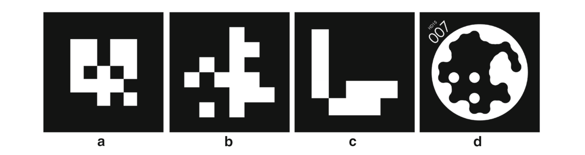
*그림 1 — 이 연구에서 쓴 마커: a ARTag[58], b AprilTag[16, 17], c ArUco[21], d STag[36].*

이 논문은 앞에서 말한 패키지들의 여러 구성, 즉 단일 마커(그림 1), 평면 다중 마커 번들(그림 2), 비평면 2마커 번들(그림 3)을 조사한다. 많은 선행 연구에서 보듯, 위치 추정 프레임워크의 정확도나 강건성을 높이기 위해 여러 마커를 한 번들로 묶는 것이 흔하다. 번들은 단일 마커에 의존하는 시스템보다 실패에 강건하다고 여겨지므로, 이 논문에서는 이 주장을 실험으로 조사한다.

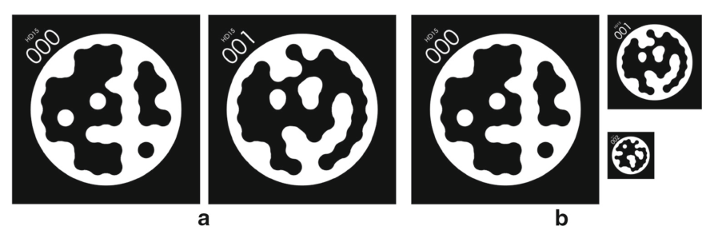
*그림 2 — STag 다중 태그 번들. (a) 같은 크기의 마커 두 개 (b) 크기가 다른 마커 세 개.*

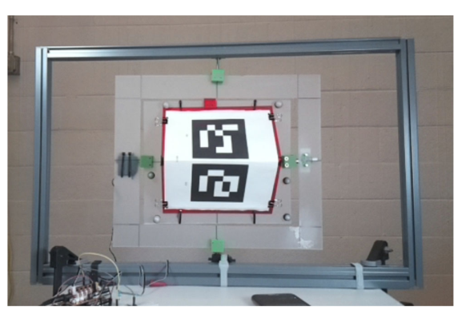
*그림 3 — 비평면 구성의 2마커 번들. 마커는 수직축 둘레로 회전한다.*

마커 크기는 구성마다 다르다. 구체적으로 단일 마커 구성은 14.6 cm 정사각형 태그 하나를 담는다. 2마커 번들은 10.8 cm 정사각형 태그 두 개로 되어 있고, 3마커 번들은 10.8 cm, 5.4 cm, 2.7 cm 정사각형 태그를 포함한다. 비평면 번들은 2마커 번들을 볼록하게 90° 각도로 접어 강체 플랫폼에 붙인 것이다.

이 비교에는 자율 플랫폼에 흔히 탑재되는 세 가지 소형 컴퓨터에서 네 패키지의 효율 평가도 포함한다. 사용한 컴퓨터는 Raspberry Pi 3B+, NVidia Jetson TX2, Intel NUC(NUC5i7RYH)다. Raspberry Pi는 널리 쓰이는 저가 해법이고, Jetson TX2와 Intel NUC는 각각 강력한 GPU와 CPU 때문에 골랐다. 각 컴퓨터 시스템의 사양은 표 2에 있다.

**표 2. 컴퓨터 시스템 사양 (Computer system specifications)**

| | Pi 3B+ | Jetson TX2 | Intel NUC |
|---|---|---|---|
| RAM | 1GB | 8GB | 16GB |
| RAM Type | LPDDR2 SDRAM | LPDDR4 | DDR3L |
| CPU Cores | 4 | 2 + 4 | 2 |
| CPU Clock | 1.4GHz | 2GHz + 2GHz | 3.1 GHz |
| GPU Cores | None | 256 | 48 |
| GPU Clock | N/A | 1.3GHz | 0.3GHz |

카메라 센서로는 Logitech C270 웹캠과 Raspberry Pi 카메라 버전 2 모듈(piCam)을 쓴다. Logitech은 1280x720 pixel² 고해상도 영상을 25 fps로 찍는 데 쓰고, piCam은 640x480 pixel² 해상도로 20 fps로 데이터를 모으는 데 쓴다. 그림 4는 마커에서 0.75 m 떨어진 거리에서 두 카메라로 찍은 영상이다. piCam의 시야가 더 넓고, Logitech 카메라보다 대비와 화이트 밸런스가 개선되어 있음을 보여 준다.

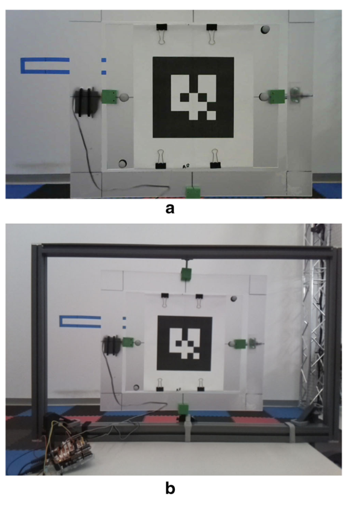
*그림 4 — 마커에서 0.75 m 거리에서 (a) Logitech 카메라와 (b) Raspberry Pi 카메라로 찍은 영상.*

이 연구를 위해 마커를 잡고 필요에 따라 방향을 바꾸는 구동식 2축 짐벌(gimbal)을 만들었다. 그림 5는 실험 구성의 개요다. 마커 받침은 서로 수직인 두 축(수직·수평)으로 구동할 수 있다. 카메라는 높이를 조절할 수 있는 스탠드에 장착되며, 스탠드는 마커 받침에서 여러 거리로 옮길 수 있다. 실험 사이에 구성이 조금 바뀌는 경우에도 정확한 참값(ground truth)을 얻기 위해, 카메라 스탠드와 마커 받침을 모두 OptiTrack 모션 캡처(MoCap) 시스템으로 추적한다. 모든 컴퓨터에서 같은 데이터를 처리할 수 있도록, 카메라에서 스트리밍된 영상과 MoCap의 자세 데이터를 ROS bag 파일에 저장한다.

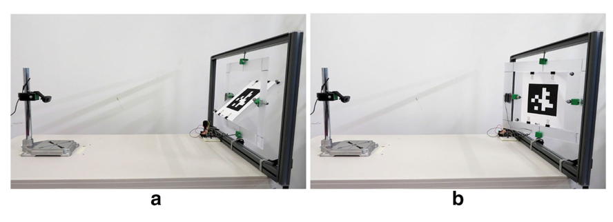
*그림 5 — 각 영상 오른쪽에 2축 짐벌이 있는 실험 구성 개요. 마커 위치를 (a) 종(longitudinal) 방향과 (b) 횡(lateral) 방향으로 바꾼다.*

### 3.1 단일 마커 실험 (Single Marker Experiments)

각 마커 패키지의 검출률과 정확도를 조사하기 위해 여러 거리와 각도에서 데이터를 모은다. 고려한 거리는 카메라에 수직인 각도에서 0.75 m, 1.0 m, 1.5 m, 1.75 m, 2.0 m다. 각 패키지의 검출률과 정확도에 대한 영향을 알아보기 위해 두 가지 조명 조건을 고려한다(그림 6). 각 패키지와 각 거리마다 60초 동영상을 찍어, 고해상도 카메라와 저해상도 카메라에서 각각 모두 1500장과 1200장의 영상을 얻는다.

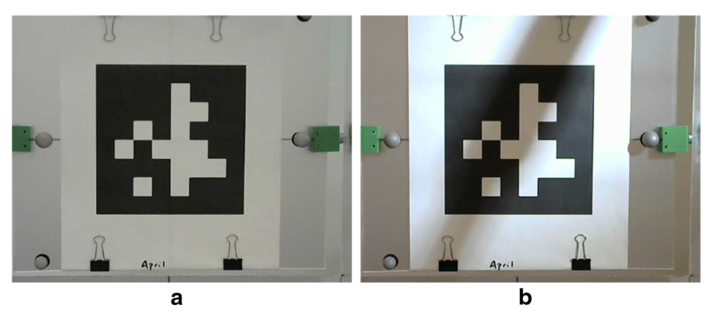
*그림 6 — Logitech 카메라에서 본, (a) 일반 조명 조건과 (b) 그림자가 드리운 조건에서 쓴 AprilTag 마커.*

여러 각도에서의 성능을 시험하기 위해, 카메라를 마커에서 1.0 m 떨어뜨린 상태로 짐벌을 종축을 따라 10°씩 80°까지 회전시킨다. 짐벌은 각 단계마다 15초 동안 마커 방향을 유지하므로, 각도마다 고해상도 영상 375장과 저해상도 영상 300장을 얻는다. 횡방향도 같은 양상일 것으로 예상되므로 이 시험은 종방향으로만 수행한다. 이 실험에는 앞의 거리 시험처럼 두 가지 조명 조건을 쓴다. 이 시험은 카메라 각도가 방향(orientation)·위치 측정 정확도와 검출률에 미치는 영향을 알아보는 데 쓰인다.

다음으로 고려하는 파라미터는 움직임 흐림에 대한 내성이다. 이 논문에서 고려하는 움직임 흐림은 회전 흐림과 평행이동 흐림의 두 가지다.

회전 흐림은 카메라 좌표계에서 평행이동 없이 마커가 빠르게 회전할 때 생기는 효과다. 서보로 카메라를 주축(principal axis) 둘레로 일정한 각속도로 회전시켜 회전 흐림을 일으킨다. 서보는 180° 범위에서 60, 90, 135, 180, 240, 300 도/초의 속도로 각각 15초 동안 회전한다.

평행이동 흐림은 물체가 카메라 프레임을 빠르게 가로지를 때 생긴다. 카메라를 주축에 수직으로 회전시켜 평행이동 흐림을 일으킨다. 카메라는 50° 범위 안에서 30, 60, 90, 135, 180, 240, 300 도/초의 속도로 각각 15초 동안 회전한다. 움직임 흐림이 영상에 미치는 효과는 그림 7에서 볼 수 있다.

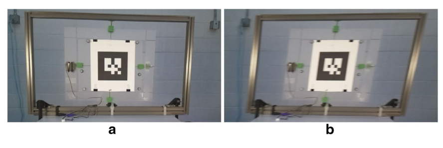
*그림 7 — 평행이동 움직임 흐림 실험에서 본 ARTag 마커. (a) 정지한 카메라 (b) 300 도/초로 움직이는 카메라.*

마지막으로 평가하는 파라미터는 계산 효율이다. 그림 5의 장치로 카메라에 수직인 두 축을 따라 연속적인 각도 왕복(sweep)을 수행한다. 첫 동작에서는 횡축을 고정한 채 종축이 ±45° 사이를 진동한다. 그다음 횡축이 ±45° 사이를 진동한다. 마지막 동작에서는 다양한 중간 각도를 만들기 위해 두 축을 동시에 ±30° 사이로 움직인다. 왕복 동작의 총 길이는 50초이며, 실험은 패키지마다 6번 반복한다.

### 3.2 마커 번들 실험 (Marker Bundle Experiments)

검출률과 계산 비용 결과의 차이를 조사하기 위해 2마커 번들에 대해 단일 마커 실험을 반복한다. 반복하지 않는 실험은 움직임 흐림 실험뿐이다. 평면 2마커 번들은 가장 흔한 구성이므로, 단일 마커 추적과 다중 마커 추적을 직접 비교할 수 있다.

크기가 다른 마커가 여러 거리에서 도움이 되는지 시험하기 위해 거리 실험을 반복하고 여러 고정 거리에서 데이터를 모은다. 고려한 거리는 카메라에 수직인 각도에서 0.5 m, 0.75 m, 1.0 m, 1.5 m, 1.75 m, 2.0 m다. 이 시험의 영상은 결과가 가장 좋은 카메라로, 그림자 없이 모은다. 이 시험은 크기가 다른 마커가 위치 정확도와 검출률에 유의한 영향을 주는지 보이는 것을 목표로 한다.

피듀셜 마커 자세 추정, 특히 저해상도 카메라에서의 흔한 문제는 마커가 카메라 프레임에서 평평할 때(정면을 볼 때) 방향 측정의 정확도가 떨어지는 것이다. 비평면 번들이 방향 측정에 주는 영향을 알아보기 위해 각도 실험을 비평면 번들로 다시 수행한다. 각진 번들은, 번들이 접힌 축에 수직인 회전축으로 회전시킨다. 각도는 −60°에서 60°까지 10°씩 늘리며, 충분한 표본을 얻도록 15초 간격을 둔다.

### 3.3 패키지 구성 (Package Configurations)

실험 데이터를 처리하기 위해 ARTag¹, AprilTag², ArUco³의 ROS 패키지를 세 컴퓨터 모두에서 카메라마다 같은 구성으로 쓴다. STag⁴의 ROS 패키지는 저자들의 그룹이 이전 연구[1]에서 개발했다. 그 뒤 이 패키지는 마커 번들을 지원하도록 확장되었고, 계산 효율 면의 개선도 포함한다.

Alvar[58]는 ARToolkit과 ARTag 위에 만들어졌지만 마커의 양식과 내용에 큰 유연성을 제공하는 프레임워크다. 일반적으로 32비트의 구성 가능 공간과 휴리스틱 정보를 주는 4비트를 추가로 제공하는 특정 양식을 쓴다. 이 프레임워크는 원래 더 넓은 AR 응용의 일부였다가, ROS에서 쓰도록 바뀌어 초기의 사실상(de-facto) 표준 피듀셜 마커 프레임워크가 되었다. 끝으로, 원래 ArUco ROS 패키지는 마커 번들을 지원하지 않으므로 OpenCV의 PnP(Perspective-n-Point) 알고리즘(solvePnP)을 써서 번들 지원을 추가했다. AprilTag와 STag는 모두 마커 번들에 solvePnP를 쓰고, Alvar는 번들 조정(bundle adjustment)을 쓴다.

> ¹ https://github.com/ros-perception/ar_track_alvar
> ² https://github.com/AprilRobotics/apriltag_ros
> ³ https://github.com/pal-robotics/aruco_ros
> ⁴ https://github.com/usrl-uofsc/stag_ros

## 4 결과 (Results)

이 절에서는 실험 연구의 결과를 제시하고 논의한다. 모든 실험 결과는 표로 제시하고, 특정 비교를 더 분명히 하기 위해 일부 결과는 그래프로 제시한다. 표에서 평균(mean)과 표준편차(std) 열의 단위는 거리의 경우 센티미터, 각도의 경우 도(degree)이며, 검출률(rate)의 단위는 백분율이다. 검출률이 가장 높은 패키지는 초록색으로, 오차가 가장 낮은 값은 파란색으로, 표준편차가 가장 낮은 값은 자홍색으로 표시했다. "ND"로 표시한 값은 어떤 프레임에서도 태그가 검출되지 않았음을 뜻하고, "—"로 표시한 값은 극단적 이상치가 있어 값을 계산하지 않았음을 뜻한다.

### 4.1 마커 거리에 따른 성능 (Performance with Varying Marker Distance)

거리에 따른 각 패키지의 자세 측정 정확도와 검출률은 개별 마커는 표 3, 2마커 번들은 표 4, 3마커 번들은 표 5에 요약했다. 개별 마커와 2마커 번들은 두 카메라와 두 조명 조건 모두로 전체 실험을 수행했다. 그러나 3마커 번들은 일반 조명 조건의 piCam만 썼다. 이는 대부분의 실험에서 piCam이 더 우수했고, 이어지는 논의에서 보이겠지만 데이터상 조명 조건이 마커 시스템에 미치는 영향이 미미했기 때문이다.

자세 측정 정확도의 지표는 실험에서 검출에 성공한 모든 영상에 대한 평균 오차와 오차의 표준편차다. 피듀셜 마커가 주는 자세 측정값을 MoCap이 주는 참값과 비교해 그림 8에 나타낸 오차와 표준편차를 얻는다.

**표 3. 단일 마커 — 거리 결과 (Single marker - Distance results)** (Distance 단위 cm)

| Camera | Distance | Light | ARTag mean | std | rate | AprilTag mean | std | rate | ArUco mean | std | rate | STag mean | std | rate |
|---|---|---|---|---|---|---|---|---|---|---|---|---|---|---|
| Logitech | 75 | normal | 2.262 | 0.046 | 42.899 | 3.850 | *0.017* | 96.914 | 2.067 | 0.021 | 97.072‡ | **1.863** | 0.024 | 93.577 |
| | | shadow | 2.204 | 0.024 | 43.130 | 3.900 | 0.021 | 96.997‡ | 2.034 | 0.027 | 95.976 | **1.859** | *0.017* | 93.090 |
| | 100 | normal | 2.183 | *0.017* | 43.699 | 4.721 | 0.021 | 96.402‡ | 2.204 | 0.028 | 95.926 | **1.671** | 0.067 | 89.325 |
| | | shadow | 2.224 | 0.051 | 44.260 | 4.723 | 0.021 | 96.163‡ | 2.184 | 0.028 | 96.030 | **1.716** | *0.007* | 91.958 |
| | 150 | normal | 2.484 | 0.442 | 43.375 | 5.981 | *0.073* | 96.644‡ | 2.242 | 0.112 | 96.165 | **1.450** | 0.249 | 95.562 |
| | | shadow | 1.909 | 0.212 | 43.634 | 6.052 | *0.106* | 97.068‡ | 2.443 | 0.315 | 96.071 | **1.425** | 0.108 | 95.007 |
| | 175 | normal | 2.668 | 0.344 | 43.546 | 6.559 | 0.146 | 96.074 | 2.315 | 0.229 | 96.103 | **1.012** | *0.107* | 96.112‡ |
| | | shadow | ND | ND | 0.0 | 6.639 | 0.121 | 96.554‡ | 2.620 | 0.197 | 95.994 | **1.131** | *0.059* | 96.036 |
| | 200 | normal | 3.155 | 0.220 | 43.611 | 7.236 | *0.191* | 96.012 | 3.050 | 0.315 | 96.083 | **0.648** | 0.257 | 96.511‡ |
| | | shadow | ND | ND | 0.0 | 7.273 | 0.251 | 96.473‡ | 3.615 | 0.200 | 96.473‡ | **0.680** | *0.192* | 96.054 |
| Pi camera | 75 | normal | 1.431 | *0.007* | 47.544 | 2.142 | 0.012 | 94.704‡ | 1.284 | 0.011 | 94.693 | **0.737** | 0.077 | 90.606 |
| | | shadow | 1.549 | *0.015* | 47.118 | 2.306 | 0.031 | 94.444 | 1.353 | 0.020 | 94.829‡ | **0.764** | 0.057 | 94.636 |
| | 100 | normal | 1.954 | 0.084 | 49.766 | 2.541 | 0.031 | 94.429 | 1.562 | 0.026 | 94.595 | **0.842** | *0.023* | 98.448‡ |
| | | shadow | 2.214 | 0.053 | 47.349 | 2.785 | 0.042 | 95.333‡ | 1.813 | 0.100 | 93.417 | **0.993** | *0.024* | 95.333‡ |
| | 150 | normal | 2.617 | 0.280 | 47.313 | 3.292 | 0.232 | 95.333‡ | 3.632 | *0.047* | 94.051 | **0.475** | 0.757 | 75.805 |
| | | shadow | 3.184 | 0.226 | 47.447 | 3.596 | 0.082 | 94.865‡ | 3.748 | *0.078* | 94.123 | **0.495** | 0.588 | 94.624 |
| | 175 | normal | 1.768 | *0.192* | 47.292 | 3.410 | 0.340 | 94.787 | 3.827 | 0.612 | 94.917‡ | **0.093** | 1.041 | 93.279 |
| | | shadow | 3.824 | *0.071* | 46.891 | 4.081 | 0.235 | 94.366‡ | 4.838 | 0.696 | 93.001 | **0.398** | 0.540 | 93.361 |
| | 200 | normal | 2.697 | 0.289 | 47.627 | 3.510 | 0.212 | 94.429 | 3.780 | 1.361 | 95.067 | **1.542** | *0.127* | 95.410‡ |
| | | shadow | 4.403 | 0.441 | 47.024 | 4.877 | 0.290 | 94.648 | 6.151 | 0.875 | 95.087‡ | **1.194** | *0.240* | 91.589 |

**표 4. 2마커 번들 — 거리 결과 (Two marker bundle - Distance results)** (Distance 단위 cm)

| Camera | Distance | Light | ARTag mean | std | rate | AprilTag mean | std | rate | ArUco mean | std | rate | STag mean | std | rate |
|---|---|---|---|---|---|---|---|---|---|---|---|---|---|---|
| Logitech | 75 | normal | 3.205 | 4.223 | 100.00‡ | 1.946 | *0.006* | 100.00‡ | 1.584 | 0.007 | 99.670 | **0.637** | 0.008 | 100.00‡ |
| | | shadow | 1.759 | 1.132 | 100.00‡ | 1.605 | 0.019 | 100.00‡ | 1.788 | *0.009* | 99.750 | **0.887** | 0.016 | 100.00‡ |
| | 100 | normal | 2.179 | 2.299 | 100.00‡ | 2.731 | *0.009* | 100.00‡ | 2.315 | 0.010 | 99.579 | **0.932** | 0.019 | 100.00‡ |
| | | shadow | 1.314 | 5.906 | 100.00‡ | 2.384 | 0.040 | 100.00‡ | 1.914 | *0.037* | 99.665 | **1.034** | 0.062 | 100.00‡ |
| | 150 | normal | **0.625** | *0.032* | 100.00‡ | 3.943 | 0.034 | 100.00‡ | 3.633 | 0.049 | 99.753 | 1.777 | 0.167 | 100.00‡ |
| | | shadow | – | – | 100.00‡ | 3.571 | *0.078* | 100.00‡ | 2.619 | 0.115 | 99.658 | **1.655** | 0.172 | 100.00‡ |
| | 175 | normal | **0.486** | *0.086* | 100.00‡ | 5.128 | 0.179 | 100.00‡ | 4.623 | 0.165 | 99.756 | 1.980 | 0.340 | 100.00‡ |
| | | shadow | **1.117** | 7.541 | 100.00‡ | 4.825 | *0.080* | 99.916 | 2.344 | 0.097 | 99.830 | 1.395 | 0.218 | 100.00‡ |
| | 200 | normal | **0.403** | 6.797 | 100.00‡ | 5.779 | *0.088* | 100.00‡ | 5.614 | 0.203 | 99.677 | 1.640 | 0.233 | 100.00‡ |
| | | shadow | **0.175** | 0.089 | 100.00‡ | 5.315 | 0.126 | 99.915 | 2.496 | *0.053* | 99.661 | 1.425 | 0.217 | 100.00‡ |
| Pi camera | 75 | normal | 1.017 | 3.639 | 100.00‡ | **0.642** | 0.020 | 99.633 | 1.043 | *0.007* | 99.637 | 1.790 | 0.008 | 100.00‡ |
| | | shadow | 1.911 | 5.934 | 100.00‡ | **0.358** | 0.015 | 100.00‡ | 0.460 | *0.009* | 99.727 | 2.069 | 0.048 | 99.816 |
| | 100 | normal | 0.946 | 2.963 | 100.00‡ | **0.792** | 0.009 | 99.363 | 1.994 | *0.000* | 99.727 | 2.036 | 0.009 | 99.813 |
| | | shadow | – | – | 100.00‡ | **0.445** | 0.032 | 99.320 | 1.003 | *0.027* | 99.819 | 2.611 | 0.615 | 100.00‡ |
| | 150 | normal | 1.708 | 4.687 | 100.00‡ | **1.425** | *0.044* | 99.415 | 3.075 | 0.262 | 99.633 | 2.235 | 0.196 | 99.908 |
| | | shadow | 1.148 | 2.251 | 100.00‡ | **1.300** | 0.087 | 98.948 | 2.816 | 0.716 | 99.728 | 2.459 | *0.068* | 100.00‡ |
| | 175 | normal | **0.345** | 0.294 | 100.00‡ | 1.417 | 0.243 | 99.813 | 4.318 | *0.008* | 99.638 | 4.575 | 1.316 | 100.00‡ |
| | | shadow | **0.217** | *0.131* | 100.00‡ | 1.523 | 0.267 | 99.546 | 4.393 | 1.507 | 99.632 | 3.444 | 0.329 | 100.00‡ |
| | 200 | normal | **0.892** | *0.015* | 100.00‡ | 2.327 | 0.072 | 99.909 | ND | ND | 0.000 | 5.593 | 0.499 | 99.909 |
| | | shadow | **2.086** | 8.158 | 100.00‡ | 2.125 | 0.744 | 99.818 | 9.808 | *0.329* | 99.819 | 2.429 | 2.226 | 67.854 |

AprilTag와 STag는 사용자가 검출할 마커 목록을 지정할 수 있지만, 다른 패키지는 검출된 모든 마커의 목록을 돌려준다. 때로 이 목록에는 오검출이 들어 있다. 표에 보고한 검출률은 마커가 성공적으로 검출된 영상의 백분율을 나타낸다. AprilTag와 STag는 지정하지 않은 마커에 대해서는 결과를 돌려주지 않으므로 오검출률을 측정하지 않았다. ARTag와 ArUco에서 성공한 검출은 올바른 ID의 마커를 포함한 영상을 뜻한다.

#### 4.1.1 개별 마커 (Individual Markers)

개별 마커의 경우 STag는 모든 경우에 가장 좋은 정확도를 주는 패키지이며, 모든 거리에서 성능이 일관된다. 또한 STag는 측정이 가장 정밀한(precise) 패키지이기도 하며, ARTag와 AprilTag가 종종 비슷한 성능을 보인다. 모든 패키지에서 거리가 멀어질수록 표준편차가 커져 결과의 정밀도가 떨어짐을 나타낸다. 끝으로 AprilTag와 ArUco는 특히 고해상도 영상에서 정확도가 일관되게 저하된다.

**표 5. 3마커 번들 — 거리 결과 (Three marker bundle - Distance results)**

| Distance (cm) | ARTag mean | std | rate | AprilTag mean | std | rate | ArUco mean | std | rate | STag mean | std | rate |
|---|---|---|---|---|---|---|---|---|---|---|---|---|
| 50 | **0.128** | *0.005* | 100.00‡ | 8.254 | *0.005* | 99.815 | 0.925 | *0.005* | 99.728 | 0.641 | 0.033 | 99.909 |
| 75 | **0.124** | 0.064 | 100.00‡ | 13.852 | 0.015 | 99.427 | 1.674 | *0.014* | 99.729 | 1.151 | 0.046 | 100.00‡ |
| 100 | **1.153** | 7.788 | 100.00‡ | 19.394 | *0.041* | 99.548 | 4.073 | 0.101 | 99.725 | 2.108 | 0.139 | 99.816 |
| 150 | **1.814** | 0.067 | 100.00‡ | 4.952 | *0.055* | 99.728 | 5.746 | 0.210 | 99.727 | 4.283 | 0.308 | 100.00‡ |
| 175 | 2.488 | 8.858 | 100.00‡ | 4.571 | 0.188 | 99.083 | 8.573 | *0.000* | 99.728 | **1.439** | 0.075 | 12.375 |
| 200 | **0.413** | 1.253 | 100.00‡ | 4.877 | *0.273* | 99.546 | ND | ND | 0.000 | 1.966 | 1.921 | 44.918 |

대부분의 경우 검출률이 가장 좋은 패키지는 AprilTag이고, ARTag는 검출률이 일관되게 낮다. ArUco와 STag도 AprilTag에 견줄 만큼 높은 검출률을 보인다. AprilTag, ArUco, STag는 고해상도 영상에서 검출률이 더 좋고, ARTag는 저해상도 영상에서 성능이 더 좋다.

일반적으로 대부분의 설정에서 저해상도 영상의 결과가 오차가 더 낮다. piCam은 대비가 더 높고, 웹캠으로서 더 부드러운 영상을 만들도록 설계된 Logitech 카메라보다 선명한 영상을 만든다. 에지에서의 이런 부드러운 전이는 기울기를 낮추어 코너 검출의 정확도와 강건성을 떨어뜨린다. 또한 대부분의 경우 일반 조명 조건의 영상과 그림자가 있는 영상 사이에 유의한 차이가 없다. 그림자 때문에 패키지가 어떤 영상도 검출하지 못한 경우는 ARTag 마커의 두 경우뿐이다.

#### 4.1.2 2마커 번들 (Two Marker Bundle)

2마커 번들의 경우 대부분의 설정에서 ARTag가 가장 정확도가 좋은 패키지이며, AprilTag와 STag가 바짝 뒤따른다. 이 구성에서 결과가 가장 정밀한 패키지는 ArUco다. ARTag는 가장 정확한 결과를 내지만, 대부분의 경우 정밀도가 가장 나쁜 패키지이기도 하다. ARTag는 오검출 비율이 높아 일부 경우 극단적 이상치가 생기기 때문이다. 이 극단적 이상치 때문에 나머지보다 몇 자릿수 큰 일부 항목은 표 4에서 뺐다. 이런 이상치 때문에 실제 응용에서는 데이터를 쓰기 전에 필터링할 필요가 생긴다. 끝으로 AprilTag와 ArUco는 이번에도 거리가 멀어질수록 정확도가 일관되게 저하된다.

2마커 번들의 검출률(표 4 참조)은 ARTag가 모든 경우에 완벽하다. 모든 패키지의 검출률이 높아졌고, 많은 경우 ARTag의 결과와 같다. 2 m 거리에서 어떤 마커도 검출하지 못한 유일한 패키지는 AprilTag이며, STag는 같은 거리에서 검출률이 크게 떨어진다. [역주: 원문 그대로 옮겼다. 표 4에서 2 m(200 cm)에서 검출률 0.000(ND)인 것은 Pi camera 일반 조명의 ArUco이며, AprilTag의 검출률은 99.8% 이상이다.]

#### 4.1.3 3마커 번들 (Three Marker Bundle)

3마커 번들의 결과는 2마커 번들과 비슷하다. ARTag가 가장 정확한 결과와 더 높은 검출률을 보이지만 정밀도는 가장 나쁘다. AprilTag 결과는 이 구성에서 예상치 못한 양상을 보이는데, 가까운 거리에서의 정확도가 먼 거리에서보다 나쁘다. STag는 이번에도 먼 거리에서 검출률이 떨어지고, ArUco는 2 m에서 실패한다.

그림 8은 사용한 세 구성의 거리 결과를 비교한다. 그림에 쓴 결과는 일반 조명 조건의 piCam으로 얻은 것이다. 결과에서 여러 번들을 쓰는 것이 가까운 거리에서는 어떤 패키지의 정확도에도 유의한 영향을 주지 않음이 분명하다. 반면 STag와 ArUco는 먼 거리에서 빠르게 나빠진다. 가까운 거리에서는 대부분의 패키지가 비슷한 정확도를 보이며, ARTag를 제외한 모든 패키지의 정밀도가 높아진다. 먼 거리에서는 정밀도와 정확도가 모두 나빠진다. 3절에서 설명했듯, 번들에 쓴 마커는 개별 패키지에 쓴 마커보다 작다. 이 크기 차이가 번들에서 성능이 떨어지는 이유를 설명할 수 있다. 또한 일부 패키지가 먼 거리에서, 특히 저해상도 영상에서 검출률이 떨어지는 이유도 설명한다. 마커 번들의 분명한 장점 하나는 검출률이 높아진다는 것이다. 특히 ARTag의 경우 번들을 쓰면 검출률이 두 배가 되었다.

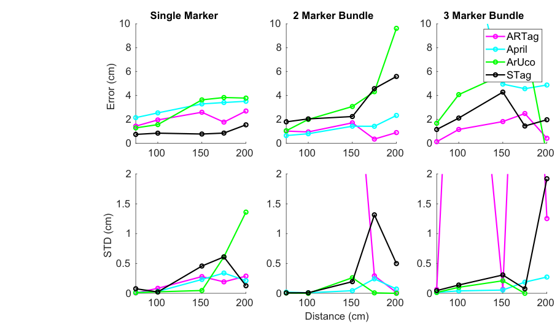
*그림 8 — 세 마커 구성 사이의 거리 결과 비교. (위: 오차(cm), 아래: 표준편차(cm), 가로축: 거리(cm). 왼쪽부터 단일 마커, 2마커 번들, 3마커 번들)*

### 4.2 마커 방향에 따른 성능 (Performance with Varying Marker Orientation)

표 6과 표 7은 각각 단일 마커와 2마커 번들에 대해, 마커 방향을 바꾸었을 때 추정한 방향 결과를 보여 준다. 마찬가지로 표 8과 표 9는 두 구성에 대해 마커 방향을 바꾸었을 때의 위치 결과를 보여 준다. 끝으로 비평면 마커의 결과는 표 10에 있다.

**표 6. 단일 마커 각도 단계 — 각도 결과 (Single marker angle step - Angle results)**

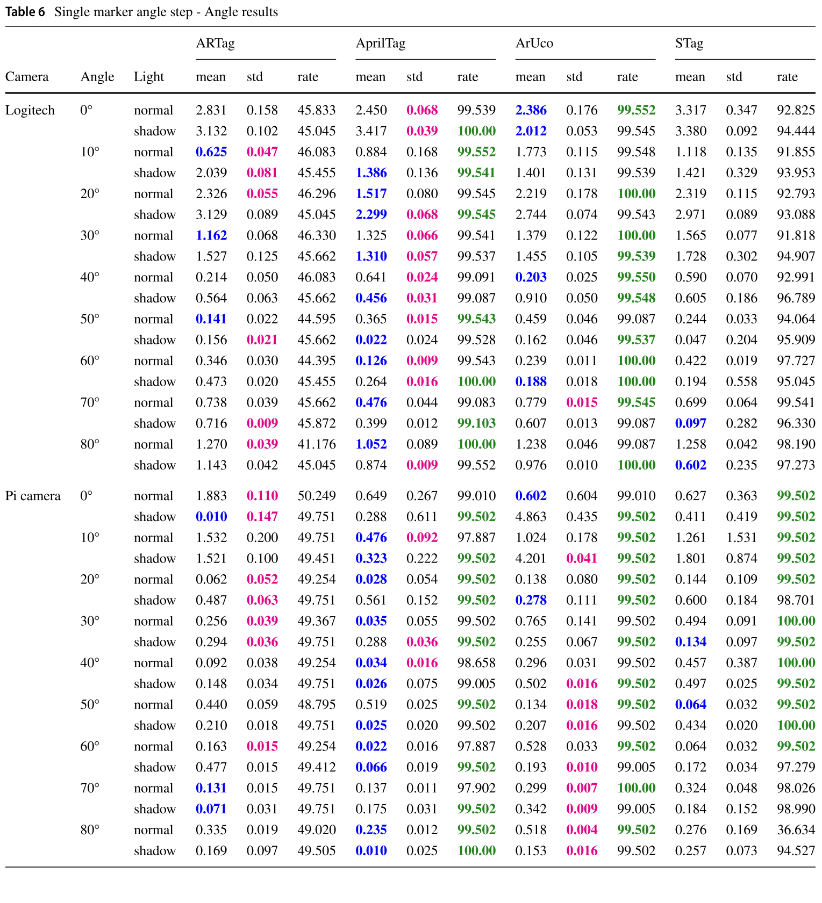

[역주] 표 6 요점: 행은 카메라(Logitech, Pi camera) × 각도(0°~80°, 10° 간격) × 조명(normal, shadow)의 36행, 열은 패키지별 mean·std(단위 °)와 rate(%)다. ARTag의 검출률은 Logitech에서 약 45%, Pi camera에서 약 49~50%로 다른 세 패키지(대체로 95~100%)보다 훨씬 낮다. 오차와 표준편차가 가장 낮은 값(파랑·자홍)은 AprilTag 열에 가장 많이 몰려 있다.

**표 7. 평면 2마커 번들 각도 단계 — 각도 결과 (Planar two marker bundle angle step - Angle results)**

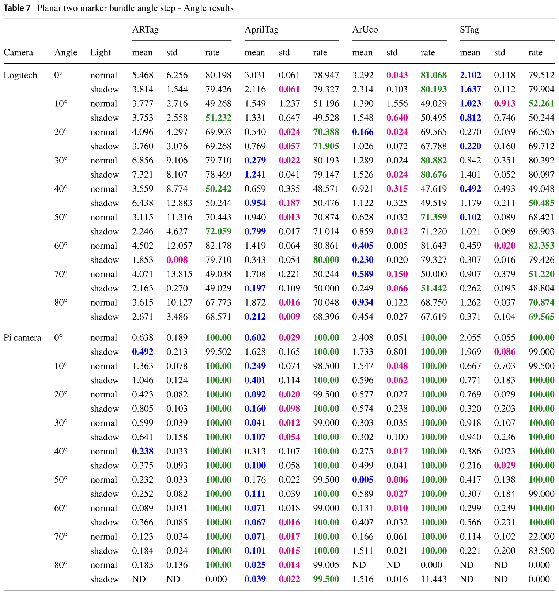

[역주] 표 7 요점: 표 6과 같은 형식이다. Pi camera에서는 대부분 패키지의 검출률이 100%에 이르지만, Logitech에서는 검출률이 약 20%p 낮고(대체로 50~80%대), ARTag의 표준편차가 매우 크다(수 °~10° 이상). 80°에서는 일부 패키지가 ND다.

개별 마커의 방향 결과는 AprilTag가 전반적으로 더 나은 성능을 가짐을 보여 준다. ArUco와 STag는 결과의 정확도와 정밀도, 그리고 검출률 면에서 비슷한 성능을 보인다. 이는 마커 방향과 상관없이 영상에서 마커를 검출하는 능력이 높음을 뜻한다. ARTag는 검출률이 일관되게 훨씬 낮아, Logitech 카메라 데이터에서 약 45%, piCam 데이터에서 약 49%를 맴돈다. ARTag 검출률의 큰 차이에도 불구하고, 평균 오차와 표준편차는 대체로 다른 세 플랫폼과 견줄 만하다. 전반적으로 고해상도 영상에서 모든 패키지는 40°와 70° 사이의 각도에서 가장 좋은 성능을 내는 경향이 있으며, 이때 추정 위치는 1° 이내로 정확하다. [역주: "추정 위치(estimated position)는 1° 이내"는 원문 그대로이며 추정 방향을 뜻하는 것으로 보인다.] 이 범위는 각 마커에서 가장 낮은 표준편차 일부가 일관되게 나타나는 범위이기도 하다.

표 8은 마커가 카메라에 수직일 때 거리 추정이 더 정확함을 나타낸다. 모든 패키지는 카메라와 마커 사이 각도가 커질수록 정확도가 저하되며, 70°와 80°에서 약간 개선된다. 대부분의 각도 오프셋에서 STag가 가장 정확한 거리 추정을 주지만, 드물게 ArUco나 ARTag가 앞선다. 각도를 바꾼 경우의 거리 추정에서 표준편차가 가장 낮은 것은 ARTag나 AprilTag다.

**표 8. 단일 마커 각도 단계 — 거리 결과 (검출률은 표 6과 같으므로 생략) (Single marker angle step - Distance results (Detection rate is omitted here since it is the same as in Table 6))**

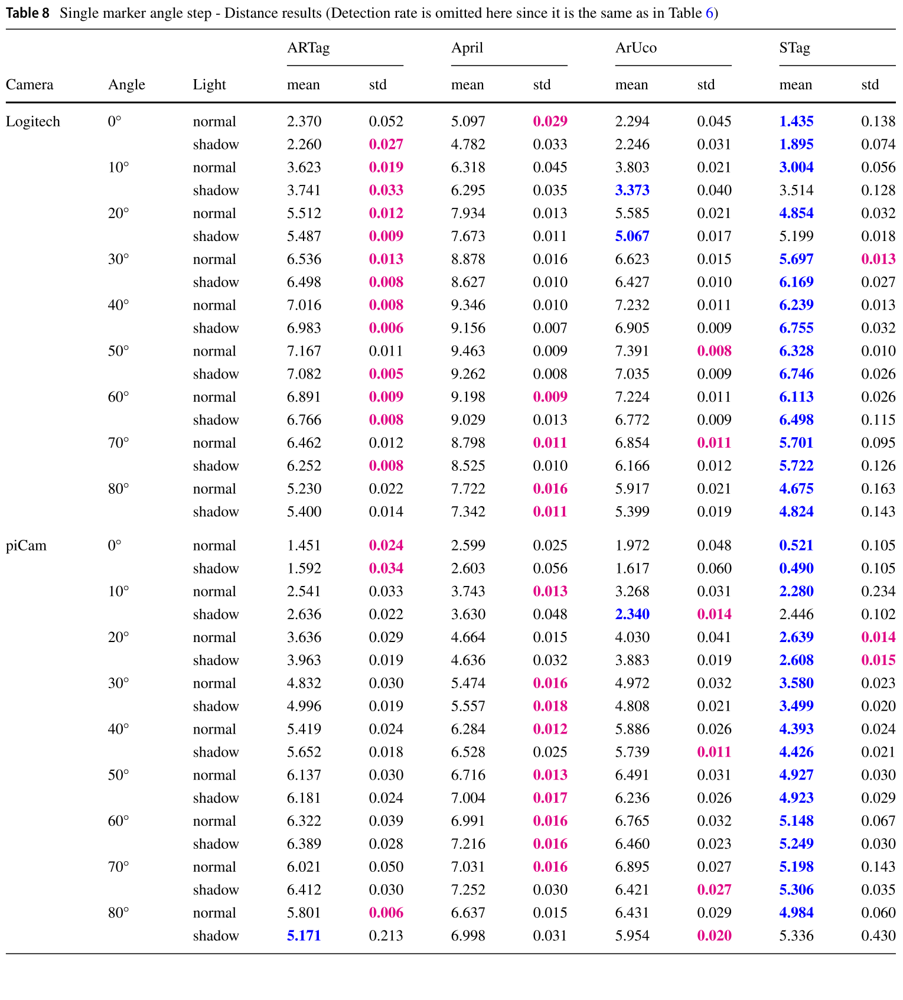

[역주] 표 8 요점: 행 구성은 표 6과 같고(카메라 이름은 Logitech, piCam), 열은 패키지별 mean·std(단위 cm)다. 오차가 가장 낮은 값(파랑)은 대부분 STag 열에 있고, 표준편차가 가장 낮은 값(자홍)은 주로 ARTag와 AprilTag 열에 있다.

2마커 번들의 경우 표 7의 결과는 단일 마커와 비슷한 성능을 나타낸다. AprilTag가 이번에도 전반적으로 더 나은 성능을 보이고, ArUco와 STag는 많은 경우 비슷한 결과를 보인다. 이 구성이 단일 태그 구성과 크게 다른 점은 사용한 두 카메라 사이의 결과 차이가 크다는 것이다. ARTag는 piCam에 비해 Logitech 카메라에서 표준편차가 크게 늘어나 측정의 정밀도가 나쁨을 보인다. 그림 9에서 보듯, ARTag 결과는 작은 각도에서 크게 벗어나고, 큰 각도에서는 이상치가 많다. 모든 패키지에서 Logitech 카메라의 검출률이 약 20% 낮지만, 방향 결과는 유의하게 영향을 받지 않는다.

**표 9. 2마커 번들 각도 단계 — 거리 결과 (Two marker bundle angle step - Distance results)**

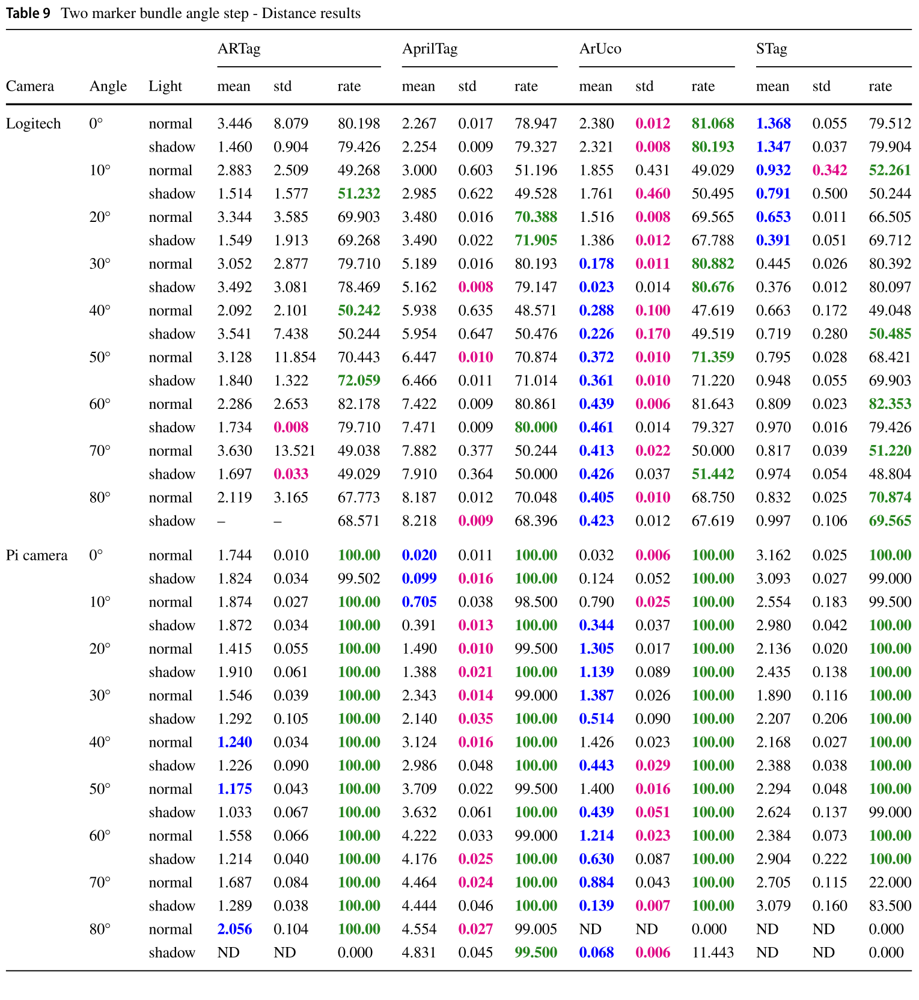

[역주] 표 9 요점: 표 7과 같은 형식이며 mean·std 단위는 cm다. 오차가 가장 낮은 값(파랑)은 ArUco 열에 가장 많고, Pi camera의 결과가 Logitech보다 전반적으로 좋다.

위치 결과의 경우, 표 9는 ArUco가 전반적으로 더 나은 성능을 가짐을 보여 준다. ARTag와 STag는 대부분의 경우 비슷한 결과를 보인다. 이 구성에서 각도가 커질수록 정확도가 일관되게 저하되는 패키지는 AprilTag뿐이다. 앞서와 마찬가지로 piCam 데이터가 Logitech 카메라의 결과보다 훨씬 좋다.

**표 10. 비평면 2마커 번들 각도 단계 — 각도 결과 (Non-Planar two marker bundle angle step - Angle results)**

| Angle (°) | ARTag mean | std | rate | AprilTag mean | std | rate | ArUco mean | std | rate | STag mean | std | rate |
|---|---|---|---|---|---|---|---|---|---|---|---|---|
| −60 | **0.255** | 0.046 | 100.00‡ | 0.474 | *0.033* | 99.500 | 0.991 | 0.395 | 100.00‡ | 1.158 | 0.065 | 96.000 |
| −50 | **0.038** | 0.025 | 100.00‡ | 2.925 | *0.020* | 99.000 | 0.055 | 0.026 | 100.00‡ | 0.420 | 0.206 | 100.00‡ |
| −40 | 0.207 | 0.030 | 100.00‡ | 2.999 | *0.024* | 100.00‡ | **0.110** | 0.033 | 100.00‡ | 0.473 | 0.229 | 100.00‡ |
| −30 | 0.387 | 0.022 | 100.00‡ | 3.832 | *0.020* | 100.00‡ | **0.234** | 0.028 | 100.00‡ | 0.408 | 0.045 | 100.00‡ |
| −20 | 0.238 | *0.026* | 100.00‡ | 3.112 | 0.044 | 99.500 | **0.153** | 0.053 | 100.00‡ | 0.371 | 0.113 | 100.00‡ |
| −10 | **0.053** | 0.044 | 100.00‡ | 1.863 | *0.023* | 99.500 | 0.538 | 0.028 | 100.00‡ | 0.726 | 0.078 | 100.00‡ |
| 0 | **0.090** | 0.032 | 100.00‡ | 0.422 | 0.025 | 99.500 | 0.285 | 0.106 | 100.00‡ | 0.298 | *0.022* | 100.00‡ |
| 10 | 0.456 | 0.027 | 100.00‡ | 0.385 | 0.039 | 100.00‡ | 0.272 | *0.020* | 100.00‡ | **0.042** | 0.045 | 100.00‡ |
| 20 | **0.085** | *0.010* | 100.00‡ | 1.823 | 0.034 | 99.500 | 0.492 | 0.026 | 100.00‡ | 0.694 | 0.077 | 99.502 |
| 30 | **0.020** | *0.014* | 99.502 | 2.021 | 0.019 | 99.500 | 0.284 | 0.033 | 100.00‡ | 0.095 | 0.045 | 100.00‡ |
| 40 | 0.762 | 9.488 | 100.00‡ | 1.703 | 0.045 | 99.500 | 0.257 | *0.020* | 100.00‡ | **0.115** | 0.111 | 100.00‡ |
| 50 | 0.475 | 2.309 | 100.00‡ | 0.944 | *0.024* | 100.00‡ | 1.022 | 0.026 | 100.00‡ | **0.193** | 0.053 | 99.500 |
| 60 | 0.716 | *0.031* | 100.00‡ | 8.745 | 0.033 | 100.00‡ | 0.494 | 0.033 | 100.00‡ | **0.333** | 0.147 | 97.000 |

제시한 결과에서, 방향 측정은 40°와 70° 사이의 각도에서 더 좋고 작은 각도에서는 모든 패키지가 가장 나쁜 결과를 냄이 분명하다. 이런 거동을 개선하는 한 가지 방법은 비평면 번들을 쓰는 것이다. 그림 10에서 보듯, 2마커 번들을 비평면 구성으로 쓰면 결과의 정밀도와 정확도가 모두 향상된다. AprilTag를 제외한 모든 패키지의 정확도가 더 좋아지고, 특정 경우의 ARTag를 제외한 모든 패키지의 정밀도도 더 좋아진다. 또한 표 10에서 검출률은 영향을 받지 않음을 볼 수 있다.

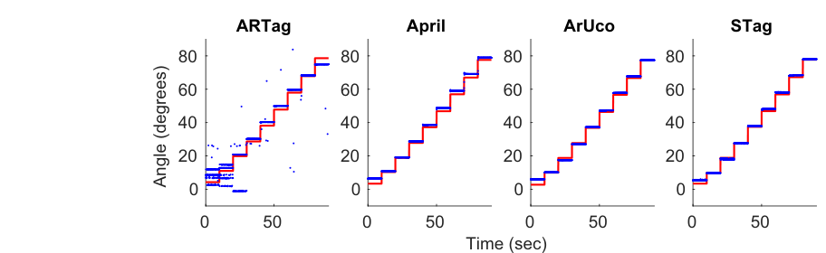
*그림 9 — 고해상도·저대비 카메라로 얻은 평면 2마커 번들의 각도 결과. (가로축: 시간(초), 세로축: 각도(°))*

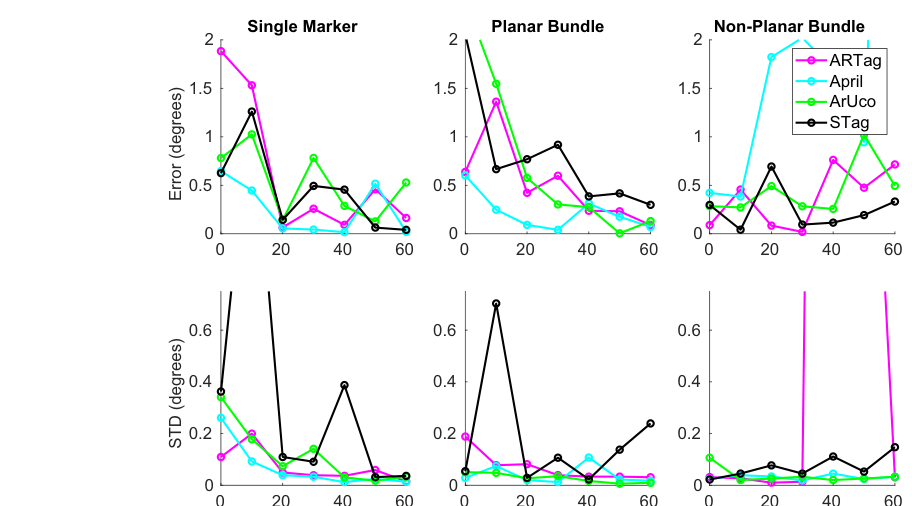
*그림 10 — 세 마커 구성 사이의 각도 결과 비교. (위: 오차(°), 아래: 표준편차(°), 가로축: 각도(°). 왼쪽부터 단일 마커, 평면 번들, 비평면 번들)*

### 4.3 움직임 흐림에서의 성능 (Performance with Motion Blur)

표 11과 표 12는 각각 회전 흐림과 평행이동 흐림의 결과를 보여 준다. 이 표에 나타낸 데이터는 각 경우에 가장 크게 영향을 받는 것이다. 회전 흐림의 경우 회전축 둘레로 측정한 마커 방향의 오차와 편차를 보여 준다. 평행이동 흐림의 경우 마커의 운동 축인 $x$축 위치의 오차와 편차를 보여 준다.

**표 11. 회전 흐림 — 각도 결과 (Rotation blur - Angle results)**

| Speed (degrees/sec) | ARTag mean | std | rate | AprilTag mean | std | rate | ArUco mean | std | rate | STag mean | std | rate |
|---|---|---|---|---|---|---|---|---|---|---|---|---|
| 60 | 4.621 | *5.138* | 49.727 | 4.290 | 5.561 | 79.769 | **4.116** | 8.715 | 100.00‡ | 4.503 | 6.546 | 81.356 |
| 90 | 8.064 | 11.844 | 46.286 | 6.239 | *7.633* | 78.667 | 6.504 | 13.214 | 98.246‡ | **6.228** | 11.689 | 89.941 |
| 135 | 9.440 | 12.314 | 45.000 | 10.220 | 15.281 | 75.342 | **6.062** | *7.841* | 100.00‡ | 6.339 | 9.142 | 92.045 |
| 180 | 11.369 | 16.046 | 50.289 | 11.427 | *14.881* | 88.235 | 11.647 | 23.267 | 98.286‡ | **10.603** | 14.937 | 94.413 |
| 240 | 13.393 | 15.556 | 48.023 | **12.711** | *14.890* | 86.538 | 16.370 | 26.482 | 100.00‡ | 14.655 | 21.766 | 98.780 |
| 300 | 14.998 | 17.467 | 48.295 | ND | ND | 0.000 | **10.834** | *13.247* | 100.00‡ | 12.003 | 14.653 | 100.00‡ |

**표 12. 평행이동 흐림 — X축 위치 결과 (Translation blur - X-axis position results)**

| Speed (degrees/sec) | ARTag mean | std | rate | AprilTag mean | std | rate | ArUco mean | std | rate | STag mean | std | rate |
|---|---|---|---|---|---|---|---|---|---|---|---|---|
| 30 | 5.540 | 6.756 | 49.189 | 5.330 | 6.254 | 88.525 | 9.994 | 11.481 | 87.647 | **4.772** | *5.202* | 92.350‡ |
| 60 | 6.022 | 7.438 | 49.718 | 5.993 | 7.155 | 94.972 | 10.318 | 12.133 | 89.326 | **5.100** | *5.658* | 100.00‡ |
| 90 | 5.865 | 7.213 | 46.067 | 5.955 | 7.029 | 96.089 | 10.093 | 11.675 | 100.00‡ | **5.770** | *6.944* | 98.315 |
| 135 | 7.246 | 8.772 | 51.124 | 8.047 | 9.739 | 84.746 | 10.407 | 11.800 | 100.00‡ | **6.074** | *7.229* | 94.241 |
| 180 | 8.009 | 9.712 | 50.595 | 8.679 | 10.173 | 86.127 | 10.239 | 11.841 | 96.703 | **7.645** | *9.343* | 100.00‡ |
| 240 | 11.075 | 12.105 | 47.126 | 10.574 | 12.686 | 83.333 | 11.749 | 12.756 | 100.00‡ | **7.964** | *9.550* | 100.00‡ |
| 300 | 10.000 | 11.473 | 48.634 | 9.918 | 11.819 | 87.791 | 10.164 | 12.019 | 100.00‡ | **7.668** | *9.882* | 99.471 |

두 경우 모두, 그리고 모든 패키지에서 오차와 표준편차가 상당히 크다. 또한 속도가 높아질수록 결과가 나빠진다. 그림 7에서 보듯, 고속에서 얻은 영상은 흐리고 일그러져 있다. 그러나 가장 나쁜 경우에도 마커는 보고된 수준의 오차를 정당화할 만큼 일그러져 있지 않다. 보고된 오차 수준의 또 다른 이유이자 결과가 일관되게 나빠지는 것도 설명하는 원인은, 영상을 찍은 시점부터 결과가 나오기까지의 지연이다. 또한 패키지들의 결과는 최대 360 Hz로 결과를 낼 수 있는 MoCap 시스템의 측정값과 비교된다. 두 시스템 사이의 지연 시간(latency) 차이가 크기 때문에, 표 11과 표 12에 보고한 정확도 결과는 네 패키지를 평가하는 데 쓸 수 없다.

그러나 지연 시간 차이에 영향을 받지 않는 측정값 하나는 검출률이다. 두 움직임 흐림 유형에 대한 각 검출률은 그림 11에 있다. AprilTag, ArUco, STag는 개별 마커의 정지 영상에서 평균 약 95%의 검출률을 보이고, ARTag는 약 47%다. 그러나 움직임 흐림이 있는 경우 AprilTag의 검출률은 떨어져 평행이동 흐림에서 평균 89%, 회전 흐림에서 평균 81%다. 또한 회전 흐림의 최고 속도에서 AprilTag는 어떤 번들도 검출하지 못한다. 나머지 패키지는 유의한 변화를 겪지 않는다.

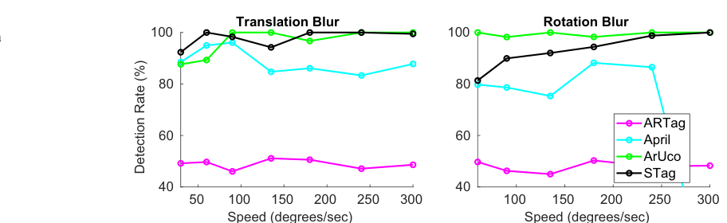
*그림 11 — 움직임 흐림이 각 패키지의 검출률에 미치는 영향. (왼쪽: 평행이동 흐림, 오른쪽: 회전 흐림, 가로축: 속도(도/초))*

### 4.4 계산 비용 (Computational Cost)

그림 12, 13, 14는 각각 NUC, TX2, Pi 플랫폼에서 단일 마커와 2마커 번들에 대한 각 패키지의 계산 비용을 상자 그림(box plot)으로 보여 준다. CPU 사용량은 플랫폼의 단일 CPU 코어에 대한 백분율로, 메모리 사용량은 전체 메모리 중 사용한 백분율로 나타낸다. NUC와 TX2 플랫폼에서는 고해상도 영상 처리의 계산 비용을, Raspberry Pi의 경우에는 저해상도 영상 처리의 비용을 보여 준다. NUC와 TX2에서 저해상도 영상을 처리하는 계산 비용은 저자들의 이전 연구에 있다.

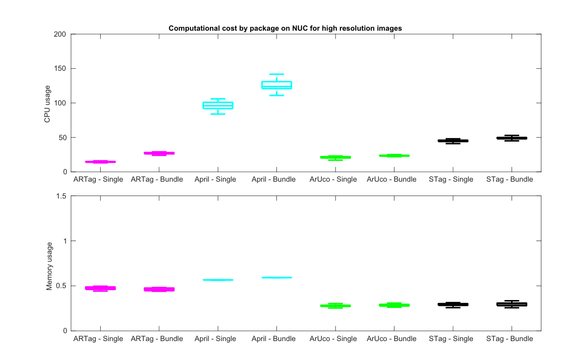
*그림 12 — 고해상도 영상(1280x720 pixel²)에 대한 Intel NUC 컴퓨터의 처리 비용. CPU 사용량은 플랫폼 단일 CPU 코어에 대한 백분율, 메모리 사용량은 전체 메모리에 대한 백분율로 나타냈다.*

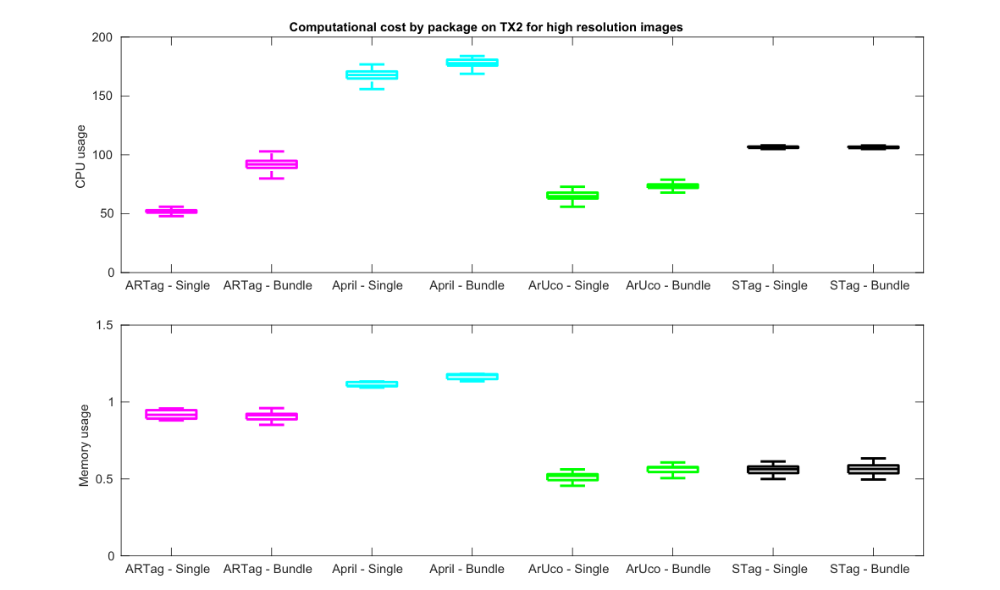
*그림 13 — 고해상도 영상(1280x720 pixel²)에 대한 NVidia TX2 컴퓨터의 처리 비용. CPU 사용량은 플랫폼 단일 CPU 코어에 대한 백분율, 메모리 사용량은 전체 메모리에 대한 백분율로 나타냈다.*

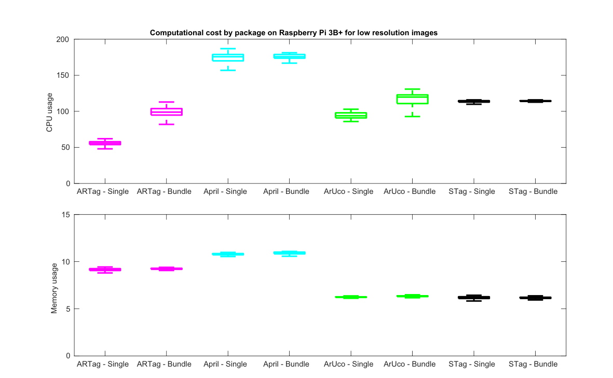
*그림 14 — 저해상도 영상(640x480 pixel²)에 대한 Raspberry Pi 3B+ 컴퓨터의 처리 비용. CPU 사용량은 플랫폼 단일 CPU 코어에 대한 백분율, 메모리 사용량은 전체 메모리에 대한 백분율로 나타냈다.*

단일 마커의 경우 AprilTag는 모든 경우에 계산 비용이 가장 큰 패키지다. ArUco와 ARTag는 일반적으로 CPU 사용량 면에서 가장 저렴한 패키지다. 이전 연구[1]에서는 STag가 더 많은 자원을 썼지만, 그 뒤의 개선으로 특히 NUC에서 크게 향상되었다. 또한 Raspberry Pi의 2마커 번들에서 STag의 성능은 ARTag 및 ArUco와 비슷하다.

메모리 요구량 면에서도 AprilTag가 가장 많은 자원을 필요로 하며 ARTag가 뒤따른다. STag와 ArUco는 모두 메모리 요구량이 낮다. 그러나 CPU 사용량과 달리 모든 패키지의 메모리 사용량은 미미하여, Raspberry Pi에서 최대 11%, 더 강력한 플랫폼에서는 1% 이하 수준이다.

번들 검출의 경우 계산 자원이 더 필요한 유일한 패키지는 ARTag다. 번들 검출에서 ARTag의 CPU 사용량은 ArUco, 때로는 STag와 같은 수준이다. NUC와 TX2에서는 AprilTag도 CPU 사용량이 늘고, Raspberry Pi에서는 ArUco도 그렇다. 메모리 사용량은 번들 검출에 쓸 때 어느 패키지에서도 유의한 변화가 없다.

## 5 결론 (Conclusions)

이 연구에서는 피듀셜 마커와 그 UAS 및 로봇 응용에서의 사용에 관한 문헌 조사를 제공한다. 이 조사를 통해 피듀셜 마커의 최신 기술 수준과 응용에서 흔히 쓰이는 여러 구성을 파악한다. 이어 네 가지 피듀셜 마커의 실험 데이터를 제시해 서로 다른 구성, 조명 조건, 움직임 흐림이 성능에 어떤 영향을 주는지 보인다. 해상도와 영상 품질이 결과에 미치는 영향을 조사하기 위해 두 카메라로 실험을 수행한다. 끝으로 로봇 응용에 흔히 쓰이는 세 컴퓨터에서 각 패키지의 계산 비용을 제시한다.

실험을 통한 첫 관찰은 사용한 카메라와 관련된다. piCam(640x480 pixel²)의 세 배 해상도를 가진 고해상도 카메라(1280x720 pixel²)가 처음에는 더 나은 결과를 낼 것으로 예상했다. 시야 차이 때문에 단일 마커가 차지하는 면적은 Logitech 카메라에서 훨씬 컸다(0.75 m에서 마커가 Logitech에서는 약 310x310 pixel², piCam에서는 약 110x110 pixel²를 차지했다). 그러나 시야가 더 넓은 저해상도 카메라의 영상이 대부분의 경우 더 나은 결과를 냈다. 저자들은 이 차이를 영상 품질 탓으로 본다. piCam은 대비가 더 높고 화이트 밸런스가 더 좋기 때문이다. 반면 Logitech 카메라는 에지가 더 부드러운 영상을 만들어 정확도, 특히 정밀도를 떨어뜨린다.

개별 마커의 경우, 결과는 AprilTag, ArUco, STag가 시험한 거의 모든 설정에서 높은 검출률을 보이는 반면 ARTag는 검출률이 크게 낮음을 보여 준다. AprilTag는 방향 측정에서 전반적으로 가장 좋은 결과를 내는 패키지이고, STag는 위치 측정에서 가장 좋은 성능을 내는 패키지다.

개별 마커의 결과를 여러 마커의 번들 결과와 비교하면, 주요 장점 중 하나는 검출률이 높아진다는 것이다. 모든 패키지의 검출률이 높아지며, 특히 ARTag는 여러 마커를 쓰면 검출률이 두 배가 된다. ARTag는 번들로 쓸 때 정확도도 높아지지만, 결과의 정밀도는 나빠지고 특히 방향 측정에서 극단적 이상치가 생기기 쉽다. 끝으로 번들에 쓴 마커는 단일 마커보다 작으므로, 모든 패키지의 결과와 검출률은 거리가 멀어질수록 빠르게 나빠진다.

크기가 다른 3마커 번들의 경우, 2마커 번들에 비해 결과나 검출률의 개선이 관찰되지 않았다. 이런 구성의 유일한 장점은 카메라가 번들에 아주 가까이 있을 때에도 작은 마커는 여전히 검출된다는 것이다. 반면 비평면 번들은 단일 마커 및 같은 크기의 평면 번들 모두와 비교해 방향 결과를 개선했다.

움직임 흐림 실험의 결과는 결론을 내리기 어렵다. 보고된 오차 수준 중 어느 부분이 움직임 흐림의 영향이고 어느 부분이 피듀셜 데이터와 MoCap 데이터 사이의 지연 때문인지 확신할 수 없기 때문이다. 그러나 검출률은 처리 지연과 무관하다. 두 유형의 움직임 흐림 모두에서 성능이 떨어지는 패키지는 AprilTag뿐이다.

계산 효율 면에서 AprilTag는 CPU와 메모리 사용량 모두에서 가장 많은 자원을 필요로 하는 패키지다. STag는 CPU 사용량이 두 번째로 높지만, 저자들의 효율 개선 뒤 비용이 ArUco 및 ARTag에 가까워졌고 일부 경우에는 더 좋다. ARTag와 ArUco가 계산 효율이 가장 좋은 패키지다. 모든 패키지가 메모리를 적게 필요로 하지만, AprilTag와 ARTag가 ArUco와 STag보다 더 많이 쓴다.

단일 마커와 2마커 번들의 계산 비용을 비교하면, CPU 사용량이 눈에 띄게 늘어나는 패키지는 AprilTag와 ARTag다. 메모리 사용량은 모든 패키지에서 같은 수준을 유지한다.

요약하면, 이 연구에서는 피듀셜 마커를 쓰는 자세 추정 프레임워크의 여러 설계 파라미터를 파악한다. 그런 다음 이 파라미터들이 네 패키지 결과의 정확도와 강건성에 어떻게 영향을 주는지 조사한다. 표 13은 각 패키지의 주요 장단점을 요약한다. 결과는 AprilTag와 STag가 전반적으로 가장 좋은 결과를 내는 패키지이고 ArUco가 경쟁력 있는 성능을 가짐을 시사한다. 다중 마커 번들을 쓰면 모든 패키지의 성능을 높일 수 있지만, 먼 거리에서는 작은 마커 여러 개보다 큰 마커 하나가 더 좋은 성능을 낸다. 또한 비평면 번들을 쓰는 것은 방향 측정을 개선하는 효과적인 방법이다. 번들로 쓸 때 ARTag는 편차가 커지고 일부 극단적 이상치가 생겨, 제어기에 직접 쓰면 불규칙한 거동을 일으킬 수 있다. 또 다른 중요한 파라미터는 사용하는 카메라 센서로, 실험은 해상도보다 대비가 더 중요함을 보여 준다. 마커에 그림자를 드리워 들인 잡음은 대부분의 경우 영향이 없어 다양한 조명 조건에 대한 강건성이 높음을 시사하며, 움직임 흐림의 영향을 받은 유일한 패키지는 AprilTag였다. 끝으로 AprilTag는 계산 비용이 가장 큰 패키지이므로 저전력 장치에는 적합하지 않은 선택이다.

**표 13. 실험 비교 요약: 평가한 네 패키지의 주요 장점과 단점 (Experimental comparison summary: Main advantages and disadvantages of the four evaluated packages)**

| 마커 (Marker) | 장점 (Pros) | 단점 (Cons) |
|---|---|---|
| ARTag | • 전반적으로 계산 비용이 가장 낮음 | • 단일 마커의 검출률이 낮음 • 마커 번들에서 극단적 이상치와 큰 표준편차 |
| April | • 방향 결과와 검출률이 매우 좋음 • 위치 결과가 좋음 | • 계산 비용이 가장 큼 • 움직임 흐림에 가장 민감함 • 비평면 구성에서 결과가 가장 나쁨 |
| ArUco | • 위치·방향 결과가 좋음 • 검출률이 매우 좋음 • 단일 마커의 계산 비용이 낮음 | • 작은 마커 크기와 먼 거리에 민감함 • 마커가 여러 개면 계산 비용이 늘어남 |
| STag | • 위치 결과와 검출률이 매우 좋음 • 방향 결과가 좋음 | • 작은 마커 크기와 먼 거리에 민감함 |

**저자 기여(Author Contributions)** 저자들은 논문에 대한 기여를 다음과 같이 확인한다. 연구 구상과 설계: M. Kalaitzakis, N. Vitzilaios. 데이터 수집: M. Kalaitzakis, B. Cain, S. Carroll, A. Ambrosi, C. Whitehead. 결과 분석과 해석: M. Kalaitzakis, B. Cain, S. Carroll, N. Vitzilaios. 원고 초안 작성: M. Kalaitzakis, B. Cain, S. Carroll, A. Ambrosi, C. Whitehead. 원고 수정: M. Kalaitzakis, N. Vitzilaios. 모든 저자가 결과를 검토하고 원고 최종본을 승인했다.

**출판사 고지(Publisher's Note)** Springer Nature는 출판된 지도와 기관 소속에 관한 관할권 주장에 대해 중립을 지킨다.

## 저자 소개 (원문 말미)

**Michail Kalaitzakis**는 그리스 아테네 국립공과대학교(National Technical University of Athens)에서 기계공학 학사/석사 학위를 받았고, 현재 미국 University of South Carolina 박사 과정생이다. 연구 관심사는 무인 시스템 개발, 자율 항법, 공중 로봇, 상태 추정이다.

**Brennan Cain**은 University of South Carolina에서 컴퓨터공학 우등(honors) 학위 과정을 밟고 있는 학부생이다. 학업과 연구는 로봇 제어와 인식에 집중한다.

**Sabrina Carroll**은 University of South Carolina에서 2019년과 2020년에 각각 기계공학 학사와 석사 학위를 받았다. University of South Carolina 학부 과정 중 미국 테네시주 Oak Ridge National Laboratory에서 연구를 수행했다.

**Anand Ambrosi**는 University of South Carolina 학부생이다. 현재 기계공학을 전공하고 수학을 부전공하고 있다. 연구는 1/10 축척 RC 자동차를 이용한 자율 경주에 집중한다.

**Camden Whitehead**는 South Carolina Honors College에서 기계공학을 공부하는 학부생이다. 연구 관심사는 공중 로봇과 제어다.

**Nikolaos Vitzilaios**는 미국 University of South Carolina(Columbia, SC) 기계공학과 조교수다. 그리스 Technical University of Crete에서 생산공학 및 경영(Production Engineering & Management) 박사 학위를 받았다. IEEE 선임회원(Senior Member)이자 영국 Higher Education Academy 펠로다. 연구 관심사는 무인항공시스템(UAS)을 중심으로 한 이동 로봇의 설계, 개발, 현장 배치다.

**소속(Affiliations)** Michail Kalaitzakis¹ (michailk@email.sc.edu) · Brennan Cain² (bscain@email.sc.edu) · Sabrina Carroll¹ (src2@email.sc.edu) · Anand Ambrosi¹ (aambrosi@email.sc.edu) · Camden Whitehead¹ (camdencw@email.sc.edu) · Nikolaos Vitzilaios¹
¹ Department of Mechanical Engineering, University of South Carolina, Columbia, SC, USA
² Department of Computer Science and Engineering, University of South Carolina, Columbia, SC, USA

## 참고문헌

1. Kalaitzakis, M., Carroll, S., Ambrosi, A., Whitehead, C., Vitzilaios, N.: Experimental comparison of fiducial markers for pose estimation. In: 2020 International Conference on Unmanned Aircraft Systems (ICUAS), pp. 781–789. Athens, Greece (2020). https://doi.org/10.1109/icuas48674.2020.9213977
2. Leonard, J.J., Durrant-Whyte, H.F.: Mobile robot localization by tracking geometric beacons. IEEE Trans. Robot. Autom. 7(3), 376–382 (1991)
3. Grupen, R.A., Henderson, T.C., McCammon, I.D.: A survey of general- purpose manipulation. Int. J. Robot. Res. 8(1), 38–62 (1989). https://doi.org/10.1177/027836498900800103
4. Delmerico, J., Scaramuzza, D.: A benchmark comparison of monocular visual-inertial Odometry algorithms for flying robots. In: 2018 IEEE International Conference on Robotics and Automation (ICRA). IEEE (2018). https://doi.org/10.1109/icra.2018.8460664
5. Scaramuzza, D., Fraundorfer, F.: Visual odometry [tutorial]. IEEE Robot. Automat. Magazine 18(4), 80–92 (2011). https://doi.org/10.1109/mra.2011.943233
6. Fraundorfer, F., Scaramuzza, D.: Visual odometry : Part II: Matching, robustness, optimization, and applications. IEEE Robot. Autom. Magazine 19(2), 78–90 (2012). https://doi.org/10.1109/mra.2012.2182810
7. Fuentes-Pacheco, J., Ruiz-Ascencio, J., Rendón-Mancha, J.M.: Visual simultaneous localization and mapping: A survey. Artif. Intell. Rev. 43(1), 55–81 (2012). https://doi.org/10.1007/s10462-012-9365-8
8. Cadena, C., Carlone, L., Carrillo, H., Latif, Y., Scaramuzza, D., Neira, J., Reid, I., Leonard, J.J.: Past, present, and future of simultaneous localization and mapping: Toward the robust-perception age. IEEE Trans. Robot. 32(6), 1309–1332 (2016). https://doi.org/10.1109/tro.2016.2624754
9. Chahine, G., Pradalier, C.: Survey of monocular SLAM algorithms in natural environments. In: 2018 15Th Conference on Computer and Robot Vision (CRV). IEEE (2018). https://doi.org/10.1109/crv.2018.00055
10. Joshi, B., Rahman, S., Kalaitzakis, M., Cain, B., Johnson, J., Xanthidis, M., Karapetyan, N., Hernandez, A., Li, A.Q., Vitzilaios, N., Rekleitis, I.: Experimental comparison of open source visual-inertial-based state estimation algorithms in the underwater domain. In: 2019 IEEE/RSJ International Conference on Intelligent Robots and Systems (IROS). IEEE (2019). https://doi.org/10.1109/iros40897.2019.8968049
11. Yu, G., Liu, Y., Han, X., Zhang, C.: Objects grasping of robotic arm with compliant grasper based on vision. In: Proceedings of the 2019 4th International Conference on Automation, Control and Robotics Engineering. ACM (2019). https://doi.org/10.1145/3351917.3351958
12. Quigley, M., Gerkey, B.P., Conley, K., Faust, J., Foote, T., Leibs, J., Berger, E., Wheeler, R., Ng, A.Y.: ROS: An open-source robot operating system. Tech rep (2009)
13. Shabalina, K., Sagitov, A., Sabirova, L., Li, H., Magid, E.: ARTag, AprilTag and CALTag fiducial systems comparison in a presence of partial rotation: Manual and automated approaches. In: Informatics in Control, Automation and Robotics, pp. 536–558. Springer International Publishing (2019). https://doi.org/10.1007/978-3-030-11292-9_27
14. dos Santos Cesar, D.B., Gaudig, C., Fritsche, M., dos Reis, M.A., Kirchner, F.: An evaluation of artificial fiducial markers in underwater environments. In: OCEANS 2015 - Genova. IEEE (2015). https://doi.org/10.1109/oceans-genova.2015.7271491
15. Babinec, A., Jurišica, L., Hubinský, P., Duchoň, F.: Visual localization of mobile robot using artificial markers. Procedia Eng. 96, 1–9 (2014). https://doi.org/10.1016/j.proeng.2014.12.091
16. Olson, E.: Apriltag: A robust and flexible visual fiducial system. In: 2011 IEEE International Conference on Robotics and Automation. IEEE (2011). https://doi.org/10.1109/icra.2011.5979561
17. Wang, J., Olson, E.: Apriltag 2: Efficient and robust fiducial detection. In: 2016 IEEE/RSJ International Conference on Intelligent Robots and Systems (IROS). IEEE (2016). https://doi.org/10.1109/iros.2016.7759617
18. Fiala, M.: ARTag, a Fiducial marker system using digital techniques. In: 2005 IEEE Computer Society Conference on Computer Vision and Pattern Recognition (CVPR'05). IEEE (2005). https://doi.org/10.1109/cvpr.2005.74
19. Fiala, M.: Designing highly reliable fiducial markers. IEEE Trans. Pattern Anal. Mach. Intell. 32(7), 1317–1324 (2010). https://doi.org/10.1109/tpami.2009.146
20. Kato, H., Billinghurst, M.: Marker tracking and HMD calibration for a video-based augmented reality conferencing system. In: Proceedings 2nd IEEE and ACM International Workshop on Augmented Reality (IWAR'99). IEEE Comput. Soc (1999). https://doi.org/10.1109/iwar.1999.803809
21. Garrido-Jurado, S., Muñoz-Salinas, R., Madrid-Cuevas, F., Marín-Jiménez, M.: Automatic generation and detection of highly reliable fiducial markers under occlusion. Pattern Recogn. 47(6), 2280–2292 (2014). https://doi.org/10.1016/j.patcog.2014.01.005
22. Flohr, D., Fischer, J.: A lightweight ID-based extension for marker tracking systems. In: Eurographics Symposium on Virtual Environments (EGVE) Short Paper Proceedings, pp. 59–64 (2007)
23. Klokmose, C.N., Kristensen, J.B., Bagge, R., Halskov, K.: Bullseye: High-precision fiducial tracking for table-based tangible interaction. In: Proceedings of the Ninth ACM International Conference on Interactive Tabletops and Surfaces - ITS. ACM Press (2014). https://doi.org/10.1145/2669485.2669503
24. Atcheson, B., Heide, F., Heidrich, W.: Caltag: High precision fiducial markers for camera calibration. Vision, Modeling and Visualization (2010). https://doi.org/10.2312/PE/VMV/VMV10/041-048 (2010)
25. Gatrell, L.B., Hoff, W.A., Sklair, C.W.: Robust image features: Concentric contrasting circles and their image extraction. In: Stoney, W.E. (ed.) Cooperative Intelligent Robotics in Space II. SPIE (1992). https://doi.org/10.1117/12.56761
26. Calvet, L., Gurdjos, P., Griwodz, C., Gasparini, S.: Detection and accurate localization of circular Fiducials under highly challenging conditions. In: 2016 IEEE Conference on Computer Vision and Pattern Recognition (CVPR). IEEE (2016). https://doi.org/10.1109/cvpr.2016.67
27. DeGol, J., Bretl, T., Hoiem, D.: Chromatag: A colored marker and fast detection algorithm. In: 2017 IEEE International Conference on Computer Vision (ICCV). IEEE (2017). https://doi.org/10.1109/iccv.2017.164
28. Sattar, J., Bourque, E., Giguere, P., Dudek, G.: Fourier Tags: Smoothly degradable Fiducial markers for use in human-robot interaction. In: Fourth Canadian Conference on Computer and Robot Vision (CRV '07). IEEE (2007). https://doi.org/10.1109/crv.2007.34
29. Xu, A., Dudek, G.: Fourier Tag: A smoothly degradable Fiducial marker system with configurable payload capacity. In: 2011 Canadian Conference on Computer and Robot Vision. IEEE (2011). https://doi.org/10.1109/crv.2011.13
30. Naimark, L., Foxlin, E.: Circular data matrix Fiducial system and robust image processing for a Wearable Vision-Inertial Self-Tracker. In: Proceedings. International Symposium on Mixed and Augmented Reality. IEEE Comput. Soc (2002). https://doi.org/10.1109/ismar.2002.1115065
31. Cho, Y., Lee, J., Neumann, U.: A multi-ring color fiducial system and an intensity-invariant detection method for scalable Fiducial-Tracking augmented reality. In: IWAR, pp. 1–15 (1998)
32. Bergamasco, F., Albarelli, A., Torsello, A.: Pi-tag: A fast image-space marker design based on projective invariants. Mach. Vis. Appl. 24(6), 1295–1310 (2012). https://doi.org/10.1007/s00138-012-0469-6
33. Bergamasco, F., Albarelli, A., Rodola, E., Torsello, A.: RUNE-Tag: A high accuracy Fiducial marker with strong occlusion resilience. In: CVPR 2011. IEEE (2011). https://doi.org/10.1109/cvpr.2011.5995544
34. Bergamasco, F., Albarelli, A., Cosmo, L., Rodola, E., Torsello, A.: An accurate and robust artificial marker based on cyclic codes. IEEE Trans. Pattern Anal. Mach. Intell. 38(12), 2359–2373 (2016). https://doi.org/10.1109/tpami.2016.2519024
35. Schweiger, F., Zeisl, B., Georgel, P., Schroth, G., Steinbach, E., Navab, N.: Maximum detector Response markers for SIFT and SURF. In: VMV 2009 - Proceedings of the Vision Modeling, and Visualization Workshop, vol. 2009, pp. 145–154 (2009)
36. Benligiray, B., Topal, C., Akinlar, C.: STAg: A stable fiducial marker system. Image Vis. Comput. 89, 158–169 (2019). https://doi.org/10.1016/j.imavis.2019.06.007
37. Yu, G., Hu, Y., Dai, J.: Topotag: A robust and scalable topological fiducial marker system. IEEE Trans. Vis. Comput. Graph. 1–1 https://doi.org/10.1109/tvcg.2020.2988466 (2020)
38. De Ipiña, D.L., Mendonça, P.R., Hopper, A.: TRIP: A low-cost vision-based location system for ubiquitous computing. Pers. Ubiquit. Comput. 6(3), 206–219 (2002). https://doi.org/10.1007/s007790200020
39. Rohs, M.: Real-world interaction with camera phones. In: Ubiquitous Computing Systems, pp. 74–89. Springer Berlin Heidelberg (2005). https://doi.org/10.1007/11526858_7
40. Lightbody, P., Krajník, T., Hanheide, M.: An efficient visual fiducial localisation system. ACM SIGAPP Appl. Comput. Rev. 17(3), 28–37 (2017). https://doi.org/10.1145/3161534.3161537
41. Abbas, S.M., Aslam, S., Berns, K., Muhammad, A.: Analysis and improvements in AprilTag based state estimation. Sensors 19(24), 5480 (2019). https://doi.org/10.3390/s19245480
42. Krajník, T., Nitsche, M., Faigl, J., Vaněk, P., Saska, M., Přeučil, L., Duckett, T., Mejail, M.: A practical multirobot localization system. J. Intell. Robot. Syst. 76(3-4), 539–562 (2014). https://doi.org/10.1007/s10846-014-0041-x
43. Tian, Z., Carver, C.J., Shao, Q., Roznere, M., Li, A.Q., Zhou, X.: Polartag: Invisible data with light polarization. In: Proceedings of the 21st International Workshop on Mobile Computing Systems and Applications. ACM (2020). https://doi.org/10.1145/3376897.3377854
44. Jayatilleke, L., Zhang, N.: Landmark-based localization for unmanned aerial vehicles. In: 2013 IEEE International Systems Conference (SysCon). IEEE (2013). https://doi.org/10.1109/syscon.2013.6549921
45. Vanegas, F., Gonzalez, F.: Enabling UAV navigation with sensor and environmental uncertainty in cluttered and GPS-denied environments. Sensors 16(5), 666 (2016). https://doi.org/10.3390/s16050666
46. Zhenglong, G., Qiang, F., Quan, Q.: Pose estimation for multicopters based on monocular vision and AprilTag. In: 2018 37th Chinese Control Conference (CCC). IEEE (2018). https://doi.org/10.23919/chicc.2018.8483685
47. Pickem, D., Glotfelter, P., Wang, L., Mote, M., Ames, A., Feron, E., Egerstedt, M.: The Robotarium: A remotely accessible swarm robotics research Testbed. In: 2017 IEEE International Conference on Robotics and Automation (ICRA). IEEE (2017). https://doi.org/10.1109/icra.2017.7989200
48. Tsoukalas, A., Tzes, A., Khorrami, F.: Relative pose estimation of unmanned aerial systems. In: 2018 26th Mediterranean Conference on Control and Automation (MED). IEEE (2018). https://doi.org/10.1109/med.2018.8442959
49. Heshmati-Alamdari, S., Bechlioulis, C.P., Karras, G.C., Nikou, A., Dimarogonas, D.V., Kyriakopoulos, K.J.: A robust interaction control approach for underwater vehicle manipulator systems. Annu. Rev. Control. 46, 315–325 (2018). https://doi.org/10.1016/j.arcontrol.2018.10.003
50. Bormann, R., Hampp, J., Hagele, M.: New brooms sweep clean - An autonomous robotic cleaning assistant for professional office cleaning. In: 2015 IEEE International Conference on Robotics and Automation (ICRA). IEEE (2015). https://doi.org/10.1109/icra.2015.7139818
51. Cantieri, A.R., Wehrmeister, M.A., Oliveira, A.S., Lima, J., Ferraz, M., Szekir, G.: Proposal of an augmented reality tag UAV positioning system for power line tower inspection. In: Advances in Intelligent Systems and Computing, pp. 87–98. Springer International Publishing (2019). https://doi.org/10.1007/978-3-030-35990-4_8
52. Kalaitzakis, M., Kattil, S.R., Vitzilaios, N., Rizos, D., Sutton, M.: Dynamic structural health monitoring using a DIC-Enabled Drone. In: 2019 International Conference on Unmanned Aircraft Systems (ICUAS). Atlanta, GA, USA, pp. 321–327 (2019). https://doi.org/10.1109/icuas.2019.8798270
53. Carroll, S.: Autonomous Drone-based sensor package deployment to the underside of structures. Master's thesis, University of South Carolina (2020)
54. Lim, H., Lee, Y.S.: Real-Time Single Camera SLAM Using Fiducial Markers. In: 2009 ICCAS-SICE. IEEE, Fukuoka, Japan, pp. 177–182 (2009)
55. Pfrommer, B., Daniilidis, K.: TagSLAM: Robust SLAM with fiducial markers. arXiv:1910.00679 (2019)
56. Bacik, J., Durovsky, F., Fedor, P., Perdukova, D.: Autonomous flying with quadrocopter using fuzzy control and ArUco markers. Intell. Serv. Robot. 10(3), 185–194 (2017). https://doi.org/10.1007/s11370-017-0219-8
57. Muñoz-Salinas, R., Marín-jimenez, M.J., Yeguas-Bolivar, E., Medina-Carnicer, R.: Mapping and localization from planar markers. Pattern Recognit. 73, 158–171 (2018). https://doi.org/10.1016/j.patcog.2017.08.010
58. VTT Technical Research Centre of Finland Ltd: A library for virtual and augmented reality. http://virtual.vtt.fi/virtual/proj2/multimedia/alvar/ (2019)
59. Wubben, J., Fabra, F., Calafate, C.T., Krzeszowski, T., Marquez-Barja, J.M., Cano, J.C., Manzoni, P.: Accurate landing of unmanned aerial vehicles using ground pattern recognition. Electronics 8(12), 1532 (2019). https://doi.org/10.3390/electronics8121532
60. Zhang, X., Jiang, J., Fang, Y., Zhang, X., Chen, X.: Enhanced Fiducial marker based precise landing for Quadrotors. In: 2019 IEEE/ASME International Conference on Advanced Intelligent Mechatronics (AIM). IEEE (2019). https://doi.org/10.1109/aim.2019.8868532
61. Sani, M.F., Karimian, G.: Automatic navigation and landing of an indoor AR. Drone Quadrotor using ArUco marker and inertial sensors. In: 2017 International Conference on Computer and Drone Applications (IConDA). IEEE (2017). https://doi.org/10.1109/iconda.2017.8270408
62. Chaves, S., Wolcott, R., Eustice, R.: NEEC Research: Toward GPS-denied landing of unmanned aerial vehicles on ships at sea. Nav. Eng. J. 127(1), 23–35 (2015)
63. Li, Z., Chen, Y., Lu, H., Wu, H., Cheng, L.: UAV autonomous landing technology based on AprilTags vision positioning algorithm. In: 2019 Chinese Control Conference (CCC). IEEE (2019). https://doi.org/10.23919/chicc.2019.8865757
64. Araar, O., Aouf, N., Vitanov, I.: Vision based autonomous landing of multirotor UAV on moving platform. J. Intell. Robot. Syst. 85(2), 369–384 (2016). https://doi.org/10.1007/s10846-016-0399-z
65. Vlantis, P., Marantos, P., Bechlioulis, C.P., Kyriakopoulos, K.J.: Quadrotor landing on an inclined platform of a moving ground vehicle. In: 2015 IEEE International Conference on Robotics and Automation (ICRA). IEEE (2015). https://doi.org/10.1109/icra.2015.7139490
66. Kyristsis, S., Antonopoulos, A., Chanialakis, T., Stefanakis, E., Linardos, C., Tripolitsiotis, A., Partsinevelos, P.: Towards autonomous modular UAV missions: the detection, geo-location and landing paradigm. Sensors 16(11), 1844 (2016). https://doi.org/10.3390/s16111844
67. Borowczyk, A., Nguyen, D.T., Nguyen, A.P.V., Nguyen, D.Q., Saussié, D., Ny, J.L.: Autonomous landing of a multirotor micro air vehicle on a high velocity ground vehicle. IFAC-PapersOnLine 50(1), 10488–10494 (2017). https://doi.org/10.1016/j.ifacol.2017.08.1980
68. Liang, X., Chen, G., Zhao, S., Xiu, Y.: Moving target tracking method for unmanned aerial vehicle/unmanned ground vehicle heterogeneous system based on AprilTags. Measurement Control 53(3-4), 427–440 (2020). https://doi.org/10.1177/0020294019889074
69. Chen, J., Liu, T., Shen, S.: Tracking a moving target in cluttered environments using a Quadrotor. In: 2016 IEEE/RSJ International Conference on Intelligent Robots and Systems (IROS). IEEE (2016). https://doi.org/10.1109/iros.2016.7759092
70. Hood, S., Benson, K., Hamod, P., Madison, D., O'Kane, J.M., Rekleitis, I.: Bird's Eye View: Cooperative exploration by UGV and UAV. In: 2017 International Conference on Unmanned Aircraft Systems (ICUAS). IEEE (2017). https://doi.org/10.1109/icuas.2017.7991513
71. Tweddle, B.E., Saenz-Otero, A.: Relative computer vision-based navigation for small inspection spacecraft. J. Guidance Control Dynam. 38(5), 969–978 (2015). https://doi.org/10.2514/1.g000687
72. Sattar, J., Dudek, G.: A vision-based control and interaction framework for a legged underwater robot. In: 2009 Canadian Conference on Computer and Robot Vision. IEEE (2009). https://doi.org/10.1109/crv.2009.18
73. Deeds, J., Engstrom, Z., Gill, C., Wood, Z., Wang, J., Ahn, I.S., Lu, Y.: Autonomous vision-based target detection using unmanned aerial vehicle. In: 2018 IEEE 61st International Midwest Symposium on Circuits and Systems (MWSCAS). IEEE (2018). https://doi.org/10.1109/mwscas.2018.8623940
74. Falanga, D., Zanchettin, A., Simovic, A., Delmerico, J., Scaramuzza, D.: Vision-based autonomous Quadrotor landing on a moving platform. In: 2017 IEEE International Symposium on Safety, Security and Rescue Robotics (SSRR). IEEE (2017). https://doi.org/10.1109/ssrr.2017.8088164
75. Kalaitzakis, M., Cain, B., Vitzilaios, N., Rekleitis, I., Moulton, J.: A marsupial robotic system for surveying and inspection of freshwater ecosystems. J. Field Robot. 38(1), 121–138 (2021). https://doi.org/10.1002/rob.21957
