# 정사각 기준 마커의 고속 검출 (Romero-Ramirez 2018)

- 원제: Speeded Up Detection of Squared Fiducial Markers
- 저자: Francisco J. Romero-Ramirez, Rafael Muñoz-Salinas, Rafael Medina-Carnicer (Universidad de Córdoba)
- 원문: 같은 폴더의 `RomeroRamirez2018_IVC_aruco3.pdf` (Image and Vision Computing 게재 승인 원고(Accepted Manuscript), doi:10.1016/j.imavis.2018.05.004, PDF 15쪽)
- 번역 범위: 전문(표지 안내문, 초록, 1~5절, 표 1~3, 각주, 감사의 글, 하이라이트). 참고문헌은 원문 그대로 옮겼다.
- 그림: 원문 그림 11개를 `그림/`에 넣고 본문에서 처음 언급되는 곳에 삽입했다. (원고 전체에 "ACCEPTED MANUSCRIPT" 워터마크가 있다.)

## 표지 (Accepted Manuscript 안내)

- PII: S0262-8856(18)30079-9
- DOI: doi:10.1016/j.imavis.2018.05.004
- Reference: IMAVIS 3693
- 게재 예정지: Image and Vision Computing
- 접수일: 2017년 11월 27일 / 수정일: 2018년 3월 22일 / 승인일: 2018년 5월 26일

이 논문은 다음과 같이 인용한다: Francisco J. Romero-Ramirez, Rafael Muñoz-Salinas, Rafael Medina-Carnicer, Speeded Up Detection of Squared Fiducial Markers. Imavis (2018), doi:10.1016/j.imavis.2018.05.004

이 PDF는 게재가 승인되었으나 편집되지 않은 원고다. 독자 서비스로 이 초기 버전을 제공한다. 원고는 최종 형태로 출판되기 전에 교열, 조판, 교정쇄 검토를 거친다. 제작 과정에서 내용에 영향을 줄 수 있는 오류가 발견될 수 있으며, 학술지에 적용되는 모든 법적 고지가 이 원고에도 적용된다.

(원고 하단 표기: Preprint submitted to Image and Vision Computing, June 9, 2018)

## 초록 (Abstract)

정사각 평면 마커(squared planar marker)는 자율 로봇, 무인 이동체, 가상 트레이너 같은 응용에서 자세(pose) 추정을 위한 인기 있는 방법이 되었다. 마커를 쓰면 최소 비용으로, 높은 강건성과 속도로 단안 카메라의 위치를 추정할 수 있다. 일반 프린터로 마커를 만들어, 작업 영역을 덮도록 원하는 환경에 배치한 다음, 일련의 영상으로 그 위치를 등록하기만 하면 된다.

그럼에도 마커 검출은 시간이 많이 드는 과정이며, 특히 영상 크기가 커질수록 그렇다. 최신 카메라는 고해상도 영상을 얻을 수 있지만, 기준 마커(fiducial marker) 시스템은 계산 속도 면에서 이에 맞춰져 있지 않다. 본 논문은 검출, 식별, 코너 추정에 가장 적합한 스케일을 현명하게 선택함으로써 비디오 시퀀스에서 마커 검출을 가속하는 다중 스케일(multi-scale) 전략을 제안한다. 수행한 실험은 제안 접근법이 정확도나 강건성을 희생하지 않고 최신 방법들을 능가함을 보여 준다. 우리 방법은 최신 방법보다 최대 40배 빠르며, 어떤 병렬화도 없이 4K 영상에서 1000 fps 이상을 달성한다.

주제어: 기준 마커(Fiducial Markers), 마커 지도화(Marker Mapping), SLAM.

## 1. 서론 (Introduction)

자세 추정은 자율 로봇[1, 2, 3], 무인 이동체[4, 5, 6, 7, 8], 가상 비서[9, 10, 11, 12] 등 많은 응용에서 흔한 과제다.

카메라는 이 과제에 효과적으로 쓸 수 있는 값싼 센서다. 이상적인 경우, 키포인트나 질감 같은 자연 특징[13, 14, 15, 16]을 써서[원문 "are be employed"] 환경 지도를 만든다. 이 과제를 위한 이전 방법들의 전통적 문제 일부는 최근 몇 년 사이 해결되었지만, 다른 문제들은 남아 있다. 예를 들어 필터 안정성 문제나 상당한 계산 요구에 시달린다.

어쨌든 인공 랜드마크는 카메라 자세 추정을 위한 인기 있는 접근법이다. 바깥쪽의 정사각 검은 테두리와 안쪽의 식별 코드로 이루어진 정사각 기준 마커는, 마커 하나의 네 코너로부터 카메라 자세를 추정할 수 있어 특히 매력적이다[17, 18, 19, 20]. 최근 연구 [21]은 이런 유형의 마커를 대규모 문제에 쓰는 방향으로 한 걸음 나아갔다. 일반 프린터로 마커 세트를 인쇄하고, 카메라가 움직여야 하는 영역에 배치한 뒤, 마커 사진 몇 장을 찍기만 하면 된다. 그러면 사진을 분석해 3차원 마커 위치를 자동으로 얻는다. 그 뒤에는 마커 하나가 보이는 영상 한 장으로 카메라 자세를 추정할 수 있다.

최근의 발전에도 불구하고 마커 검출은 시간이 많이 드는 과정일 수 있다. 위치 추정이 필요한 시스템은 휴대전화나 비행체처럼 자원이 제한된 경우가 많다는 점을 생각하면, 위치 추정의 계산 부담은 최소로 유지해야 한다. 마커 검출에 드는 계산 시간은 사용하는 영상 크기의 함수다. 영상이 클수록 과정이 느리다. 반면 고해상도 영상에서는 카메라에서 멀리 떨어진 마커도 높은 정확도로 검출할 수 있으므로 고해상도 영상이 바람직하다. 카메라 가격이 계속 내려가고 해상도가 높아지고 있으므로, 고해상도 영상에서 마커를 신뢰성 있게 검출할 수 있는 방법을 개발할 필요가 있다.

본 논문의 주된 기여는 비디오 시퀀스에서 정사각 기준 마커를 검출하는 새로운 방법이다. 제안 방법은 영상을 줄인 버전에서도 마커를 검출할 수 있다는 착안에 기반하며, 정밀도와 정확도를 유지하면서 계산을 가속하기 위해 다중 스케일 접근법을 쓴다. 또한 시스템은 분석하는 비디오 시퀀스에서 최대 성능을 내도록 매개변수를 동적으로 조정할 수 있다. 우리 접근법은 광범위하게 시험되었고 마커 검출의 최신 방법들과 비교되었다. 결과는 우리 방법이 강건성이나 정확도를 해치지 않고, 어떤 종류의 병렬화도 요구하지 않으면서 최신 접근법보다 한 자릿수 이상 빠름을 보여 준다.

이 논문의 나머지 구성은 다음과 같다. 2절은 우리 연구와 가장 관련된 연구들을 설명한다. 3절은 마커 검출을 가속하는 제안 방법을 자세히 설명한다. 끝으로 4절은 제안 방법을 철저히 분석하고, 5절은 결론을 내린다.

### 각주 (1쪽)

- ∗ 교신저자. 이메일: fj.romero@uco.es (Francisco J. Romero-Ramirez), in1musar@uco.es (Rafael Muñoz-Salinas), rmedina@uco.es (Rafael Medina-Carnicer)
- 1 Departamento de Informática y Análisis Numérico, Edificio Einstein. Campus de Rabanales, Universidad de Córdoba, 14071, Córdoba, Spain, Tlfn:(+34)957212289
- 2 Instituto Maimónides de Investigación en Biomedicina (IMIBIC). Avenida Menéndez Pidal s/n, 14004, Córdoba, Spain, Tlfn:(+34)957213861

## 2. 관련 연구 (Related works)

기준 마커 시스템은 강건성, 정밀도, 속도가 필요할 때 카메라 위치 추정과 추적에 흔히 쓰인다. 가장 단순한 경우, LED, 재귀반사 구, 평면 점 같은 점을 기준 마커로 쓴다[22, 23]. 그러나 주된 단점은 할당 문제, 즉 시간에 걸쳐 각 요소에 고유하고 일관된 식별자를 할당하는 문제를 푸는 방법이 필요하다는 것이다. 이 문제를 쉽게 하기 위해 흔히 쓰는 해법은 각 마커에 식별 코드를 추가하는 것이다. 그 예로는 평면 원형 마커[24, 25], 2D 바코드[26, 27]가 있고, 진화 알고리즘으로 설계한 마커를 제안한 저자들도 있다[28].

제안된 모든 접근법 가운데 정사각 평면 마커에 기반한 것들이 인기를 얻었다. 이 마커는 바깥쪽 검은 테두리와 각 마커를 고유하게 식별하는 안쪽 코드(대부분 이진)로 이루어진다(그림 1 참조). 주된 장점은 마커 하나로 카메라 자세를 추정할 수 있다는 것이다.

ARToolKit[29]는 선구적인 제안 중 하나다. 이들은 템플릿 정합으로 식별하는 사용자 정의 패턴의 마커를 썼다. 그러나 이 식별 방법은 오류가 나기 쉽고 조명 변화에 그다지 강건하지 않다. 또한 마커 수가 늘어날수록 방법의 민감도가 떨어진다. 그 결과 다른 저자들이 이진 BCH 부호[30](더 강건한 오류 검출을 허용한다)를 써서 그 연구를 개선했고, 이를 ARToolKit+[31]라 불렀다. 이 프로젝트는 중단되었고 비공개(privative)인 Studierstube Tracker 프로젝트[32]로 이어졌다. ARToolKit+ 프로젝트와 비슷한 것으로 중단된 프로젝트 ARTag[33]가 있다.

BinARyID[34]는 사용자 정의 가능한 마커 코드를 생성하는 방법을 제안한 최초의 시스템 중 하나다. 미리 정의된 코드 집합을 쓰는 대신, 각 응용에 필요한 수의 코드를 생성하는 방법을 제안했다. 그러나 오류 검출과 정정의 가능성은 고려하지 않았다. 반면 AprilTags[18]는 오류 검출과 정정 방법을 제안했으나, 그 접근법은 많은 수의 마커에는 적합하지 않았다.

ArUco[17]는 아마 오늘날 마커 검출에 가장 인기 있는 시스템일 것이다. 불균일 조명에 적응하며, 매우 강건하고, 구현된 이진 코드의 오류 검출과 정정을 할 수 있다. 또한 저자들은 혼합 정수 선형 계획법(Mixed Integer Linear Programming)을 써서 (마커 간 거리 측면에서) 최적의 이진 코드를 얻는 방법을 제안했다[35]. Chilitags[36]는 마커 이진 코드를 해독하는 데 더 단순한 방법을 쓰는 ArUco의 변형이다. 실험 절에서 보이겠지만, 이 방법은 고해상도 영상에서 성능이 나쁘다.

최근 연구 [21]은 환경에 자유롭게 배치한 마커 세트의 3차원 위치를 추정하는 방법을 제안하여, 이러한 방법을 넓은 영역에 적용하는 방향으로 한 걸음 나아갔다(그림 1). 일반 카메라(휴대전화 등)로 찍은 영상 세트가 주어지면 이 방법은 마커 위치를 자동으로 추정한다. 이는 기준 마커의 강건한 위치 추정을 매우 넓은 영역으로 확장할 수 있게 하는 중요한 단계다.

모든 기준 마커 시스템이 설계에서 최대 속도를 목표로 하지만, 검출 과정을 가속하기 위해 제안된 구체적 해법은 많지 않다. Johnston 등의 연구[37]는 영상 분할 과정을 병렬화하여 계산을 가속하는 방법을 제안한 흥미로운 예다. 그럼에도 속도와 계산 능력은 결정적인 측면이며, 특히 위치 추정 시스템을 자원이 제한된 장치에 내장해야 할 때 그렇다.

우리 연구는 ArUco 시스템의 개선으로 볼 수 있다. 우리 경험에 따르면 ArUco는 오늘날 가장 신뢰할 만한 기준 마커 시스템 중 하나다(자세한 내용은 4절 참조). 시간 정보를 현명하게 활용하고 다중 스케일 접근법을 적용하여, 비디오 시퀀스에서 계산 시간을 단축하는 새로운 마커 검출 및 식별 방법을 제안한다. 이전 연구들과 달리 우리 방법은 병렬화가 필요 없으므로, 계산 자원이 제한된 모바일 장치에 특히 매력적이다.

## 3. 마커 검출 가속 (Speeded up marker detection)

이 절은 정사각 평면 마커 검출을 가속하기 위해 제안한 방법을 자세히 설명한다. 먼저 3.1절은 이전 연구인 ArUco[17]가 마커 검출과 식별에 쓰는 파이프라인을 개관하면서, 가속할 수 있는 부분을 강조한다. 그다음 3.2절은 과정을 가속하는 제안 방법을 설명한다.

### 3.1. ArUco의 마커 검출과 식별 (Marker detection and identification in ArUco)

ArUco[17]에서 제안한 마커 검출과 식별의 주요 단계는 그림 1과 같다. 입력 영상 $I$(그림 1a)가 주어지면 다음 단계를 거친다.

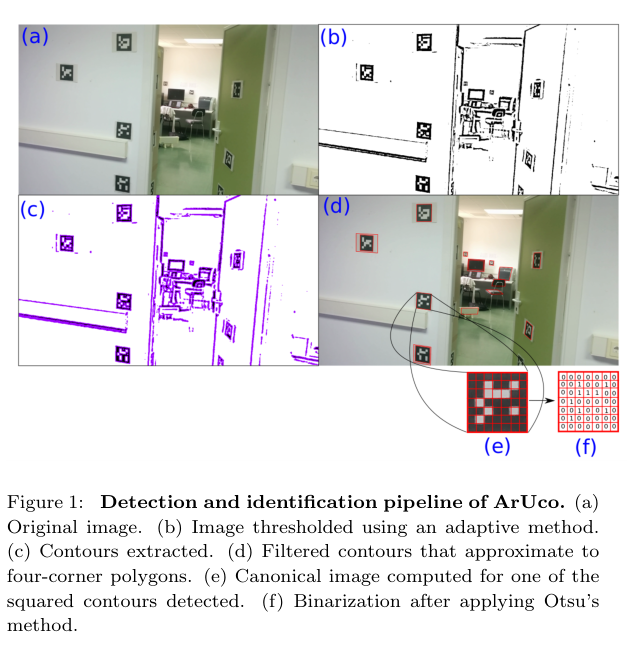
*그림 1 — **ArUco의 검출 및 식별 파이프라인.** (a) 원 영상. (b) 적응적 방법으로 이진화한 영상. (c) 추출한 윤곽선. (d) 네 코너 다각형으로 근사되는 윤곽선만 걸러 낸 결과. (e) 검출된 정사각 윤곽선 중 하나에 대해 계산한 정준(canonical) 영상. (f) Otsu 방법을 적용한 후의 이진화.*

- **영상 분할(Image segmentation)** (그림 1b). 설계된 마커는 흰 공간으로 둘러싸인 바깥쪽 검은 테두리를 가지므로, 분할로 테두리를 찾을 수 있다. 이들의 접근법에서는 국소 적응적 방법을 쓴다. 각 화소의 평균 밝기값 $m$을 창 크기 $w_t$로 계산한다. 화소 밝기가 $m-c$보다 크면 그 화소를 0으로 둔다. 여기서 $c$는 상수다. 이 방법은 강건하며, 매개변수 $w_t$와 $c$의 넓은 범위의 값에서 좋은 결과를 얻는다.
- **윤곽선 추출과 필터링(Contour extraction and filtering)** (그림 1(c,d)). Suzuki와 Abe의 윤곽선 추적 알고리즘[38]을 써서 이진화 영상으로부터 윤곽선 집합을 얻는다. 추출된 윤곽선 대부분은 관련 없는 배경 요소에 해당하므로 필터링 단계가 필요하다. 먼저 너무 작은 윤곽선을 버린다. 둘째, 남은 윤곽선을 Douglas와 Peucker 알고리즘[39]으로 가장 비슷한 다각형으로 근사한다. 네 코너 볼록 다각형으로 잘 근사되지 않는 것은 이후 처리에서 버린다.
- **마커 코드 추출(Marker code extraction)** (그림 1(e,f)). 다음 단계는 남은 윤곽선의 안쪽 영역을 분석하여 어느 것이 유효한 마커인지 판단하는 것이다. 이를 위해 먼저 호모그래피(homography) 행렬을 계산해 원근 투영을 제거하고, 그 결과인 정준 영상(그림 1e)을 Otsu 방법[40]으로 이진화한다. 이진화된 영상(그림 1f)을 규칙적인 격자로 나누고, 각 요소에 칸 안 화소의 다수결에 따라 이진값을 할당한다. 각 마커 후보에 대해, 그것이 유효 마커 집합에 속하는지 배경 요소인지 판단해야 한다. 각 후보에 대해 정준 영상의 가능한 네 회전에 해당하는 네 가지 식별자를 얻는다. 식별자 중 하나라도 유효 마커 집합에 속하면 후보를 받아들인다.
- **부화소 코너 정밀화(Subpixel corner refinement).** 마지막 단계는 코너 위치를 부화소(subpixel) 정확도로 추정하는 것이다. 이를 위해 이 방법은 마커 윤곽선 화소들의 선형 회귀를 쓴다. 다시 말해 모든 윤곽선 화소를 써서 마커 변의 직선을 추정하고 그 교점을 계산한다. 그러나 이 방법은 초점 거리가 짧은 렌즈를 쓴 보정되지 않은 카메라(어안 카메라 등)에는 신뢰할 수 없다. 이런 카메라는 보통 왜곡이 크기 때문이다.

이 파이프라인의 계산 시간을 분석해 보면, 영상 분할 단계와 마커 코드 추출 단계가 계산 시간 대부분을 차지함을 알 수 있다. 영상 분할 단계에 드는 시간은 영상 크기에 비례하며, 영상 크기는 추출되는 윤곽선 길이에도 영향을 주므로 윤곽선 추출과 필터링 단계의 계산 시간에도 영향을 준다. (마커 코드 추출 단계에서) 정준 영상 추출은 두 연산으로 이루어진다. 먼저 호모그래피 행렬을 계산하는데, 이는 비용이 적다. 그러나 그다음 각 윤곽선의 안쪽 영역을 워핑(warping)하여 정준 영상을 만들어야 한다. 이 단계는 정준 영상을 얻기 위해 윤곽선 영역의 영상 화소에 접근하여 보간을 수행해야 한다. 주된 문제는 정준 영상을 얻는 데 필요한 시간이 관측된 윤곽선의 크기에 의존한다는 것이다. 원 영상에서 윤곽선이 클수록 정준 영상을 얻는 데 시간이 더 걸린다. 게다가 얻은 윤곽선 대부분은 마커가 아니므로, 시스템은 나중에 기각될 정준 영상을 계산하는 데 많은 시간을 쓸 수 있다.

그 문제를 해결하는 더 단순한 접근법은 마커 안쪽 영역에서 몇몇 화소 집합을 직접 표본화하는 것이다. 이것이 ChiliTags가 쓰는 방법이다. 그러나 실험 절에서 보이겠지만, 이 방법은 거짓 음성(false negative)이 많이 생기기 쉽다.

### 3.2. 제안 방법 (Proposed method)

계산을 가속하기 위한 제안의 핵심 착안은 다음과 같다. 첫째, ArUco에서 쓰는 적응적 이진화 방법은 매개변수를 바꾸지 않고도 여러 조명 조건에 강건하지만, 합성곱이 필요한 시간 소모적 과정이다. 시간 정보를 활용하여 적응적 이진화 방법을 전역 이진화 접근법으로 대체한다.

둘째, 원 입력 영상 대신 더 작은 버전을 쓴다. 이는 대부분의 경우 카메라 자세 추정에 유용한 마커는 최소 크기를 가져야 한다는 사실에 근거한다. 1920×1080화소 영상에서 마커가 한 변 10화소의 작은 정사각형으로 검출된다고 상상해 보자. 사실 그렇게 작은 해상도에서는 카메라 자세 추정을 신뢰할 수 없다. 따라서 카메라 자세 추정에 쓰는 마커의 최소 길이를 정하고 싶을 수 있다. 예를 들어 한 변의 최소 길이가 $\dot\tau_i=100$화소, 즉 전체 면적 10.000화소인 마커만 쓴다고 하자. [역주: "10.000"은 원문 표기(유럽식 천 단위 구분)로 10,000을 뜻한다.] 마커 길이에 한계를 둘 수 있는 또 다른 상황은 비디오 시퀀스를 처리할 때다. 마커의 길이가 이전 프레임에서의 길이와 비슷해야 한다는 것은 분명하다.

이제 사용하는 정준 영상의 크기(그림 1e)도 생각해 보자. 영상이 작을수록 검출 과정은 빨라지지만 영상 품질은 나빠진다. 그러나 우리 경험에 따르면 32×32화소 같은 매우 작은 정준 영상으로도 이진 코드를 매우 신뢰성 있게 검출할 수 있다. 다시 말해, 영상에서 검출된 모든 사각형은 한 변의 길이와 상관없이 식별을 위해 한 변 $\tau_c=32$화소의 정준 영상으로 줄여진다.

그러므로 우리의 착안은 분할 단계를 가속하기 위해 축척 계수 $\frac{\tau_c}{\dot\tau_i}$를 써서 입력 영상을 줄인 버전을 쓰는 것이다. 줄인 영상에서, 원 영상에서 한 변 100화소인 허용 최소 마커는 한 변 32화소의 사각형으로 나타난다. 그 결과 정준 영상으로 변환할 때 품질 손실이 없다.

이 착안에는 한 가지 단점이 있다. 저해상도 영상에서 추출한 코너 위치는 원 영상에서 얻을 수 있는 것만큼 좋은 추정이 아니다. 따라서 이것으로 추정한 자세는 오차가 더 크다. 이 문제를 해결하기 위해 코너 업샘플링(corner upsampling) 단계를 넣어, 영상 피라미드를 써서 원 입력 영상에서 코너 정밀도를 부화소 정확도까지 정밀화한다.

끝으로, 정준 영상 생성은 (줄인 영상에서 처리하더라도) 윤곽선 길이에 비례하는 매우 시간 소모적인 연산임을 고려해야 한다. 영상 피라미드를 현명하게 써서, (윤곽선 길이와 무관하게) 거의 일정한 시간에 정준 영상을 추출하는 방법을 제안한다.

아래에서 그림 2를 이용해 제안 방법의 주요 단계를 자세히 설명한다.

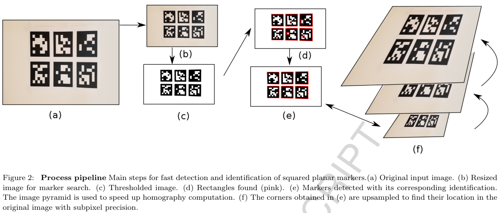
*그림 2 — **처리 파이프라인.** 정사각 평면 마커의 고속 검출 및 식별을 위한 주요 단계. (a) 원 입력 영상. (b) 마커 탐색을 위해 크기를 줄인 영상. (c) 이진화 영상. (d) 찾은 사각형(분홍색). (e) 검출된 마커와 그에 대응하는 식별. 호모그래피 계산을 가속하기 위해 영상 피라미드를 쓴다. (f) (e)에서 얻은 코너를 업샘플링하여 원 영상에서의 위치를 부화소 정밀도로 찾는다.*

1. *영상 크기 조정(Image Resize):* 입력 영상 $I$(그림 2a)가 주어지면, 첫 단계는 분할에 쓸 크기를 줄인 버전 $I^r$(그림 2b)를 얻는 것이다. 앞서 지적했듯이 줄인 영상의 크기는 다음과 같이 계산한다.

   $$I^r_w=\left\lfloor\frac{\tau_c}{\dot\tau_i}I_w\right\rfloor;\quad I^r_h=\left\lfloor\frac{\tau_c}{\dot\tau_i}I_h\right\rfloor, \tag{1}$$

   여기서 아래첨자 $w$와 $h$는 각각 너비와 높이를 뜻한다. 원하는 최소 마커 크기를 입력 영상 크기와 분리하기 위해 $\dot\tau_i$를 다음과 같이 정의한다.

   $$\dot\tau_i=\tau_c+\max(I_w,I_h)\,\tau_i\ \mid\ \tau_i\in[0,1], \tag{2}$$

   여기서 정규화 매개변수 $\tau_i$는 최소 마커 크기를 [0, 1] 범위의 값으로 나타낸다. $\tau_i=0$이면 줄인 영상은 원 영상과 크기가 같다. $\tau_i$가 1에 가까워질수록 영상 $I^r$은 작아지고, 그 결과 다음 단계에 필요한 계산 시간이 줄어든다. 이 매개변수가 최종 가속에 주는 영향은 실험 절에서 측정한다.

2. *영상 분할(Image Segmentation):* 이미 말했듯이 다음 정책에 따라 전역 이진화 방법을 쓴다. 이전 프레임에서 마커가 검출되지 않았다면 무작위 임계값 탐색을 수행한다. 무작위 과정은 임계값 범위 [10, 240]을 써서 최대 세 번까지 반복한다. 시험하는 각 임계값마다 아래에 설명하는 전체 파이프라인을 수행한다. 여러 번 시도한 후에도 마커를 찾지 못하면 그 프레임에는 마커가 보이지 않는다고 가정한다. 마커가 하나 이상 검출되면, 검출된 모든 마커의 화소값으로 히스토그램을 만든다. 그다음 Otsu 알고리즘[40]을 써서 다음 프레임의 최적 임계값을 선택한다. 계산된 임계값을 $I^r$에 적용하여 $I^t$(그림 2c)를 얻는다. 실험으로 보이겠지만, 제안 방법은 완만한 조명 변화와 급격한 조명 변화 모두에 적응할 수 있다.

3. *윤곽선 추출과 필터링(Contour Extraction and Filtering):* 먼저 Suzuki와 Abe 알고리즘[38]으로 영상 $I^t$에서 윤곽선을 추출한 다음, 작은 윤곽선을 제거한다. 추출된 윤곽선은 (원근 투영 때문에) 정사각형인 경우가 드물므로, 기각에는 둘레를 쓴다. 둘레가 $P(\tau_c)=4\times\tau_c$화소보다 작은 것은 기각한다. 남은 윤곽선에 대해 Douglas와 Peucker 알고리즘[39]으로 다각형 근사를 수행하고, 네 코너 볼록 다각형으로 근사되지 않는 것도 기각한다. 끝으로 남은 윤곽선이 마커 후보다(그림 2d).

4. *영상 피라미드 생성(Image Pyramid Creation):* $I$의 크기를 조정한 버전들의 집합인 영상 피라미드

   $$\mathcal I=(I^0,\ldots,I^n)$$

   를 만든다. $I^0$은 원 영상을 나타내고, 이후 영상 $I^i$는 $I^{i-1}$을 2배로 서브샘플링하여 만든다. 피라미드의 영상 수 $n$은 가장 작은 영상 크기가 $\tau_c\times\tau_c$에 가깝도록 정한다. 즉

   $$n=\operatorname*{argmin}_{v\mid I^v\in\mathcal I}\left|(I^v_wI^v_h)-\tau_c^2\right|. \tag{3}$$

5. *마커 코드 추출(Marker Code Extraction):* 이 단계에서는 남은 윤곽선의 정준 영상을 추출한 다음 이진화해야 한다. 우리 방법은 앞서 계산한 영상 피라미드 $\mathcal I$를 써서, 입력 영상과 윤곽선 크기에 무관하게 과정이 일정한 시간에 수행되도록 한다. 핵심 원리는 각 윤곽선에 대해, 윤곽선 길이가 정준 영상 길이 $P(\tau_c)$와 가장 비슷한 피라미드 영상을 선택하는 것이다. 이렇게 하면 워핑이 빨라진다.

   검출된 윤곽선 $\vartheta\in I^r$를 생각하고, 영상 $I^j\in\mathcal I$에서의 그 둘레를 $P(\vartheta)^j$로 나타내자. 그러면 호모그래피 계산에 가장 좋은 영상 $I^h\in\mathcal I$는 다음과 같이 선택한다.

   $$I^h\mid h=\operatorname*{argmin}_{j\in\{0,1,\ldots n\}}\left|P(\vartheta)^j-P(\tau_c)\right|. \tag{4}$$

   사용한 피라미드 워핑 방법은 그림 3을 보면 더 잘 이해할 수 있다. 그림 3은 서로 다른 거리에 있는 세 마커가 있는 장면을 보여 준다. 왼쪽 영상은 얻은 정준 영상을, 오른쪽 영상은 영상 피라미드를 나타낸다. 우리 방법에서 가장 작은 마커의 정준 영상은 피라미드에서 가장 큰 영상(그림 3의 맨 위 행)에서 추출한다. 마커 길이가 커질수록 정준 뷰를 얻는 데 피라미드의 더 작은 영상을 쓴다. 이렇게 하면 가능한 최소 계산으로 거의 일정한 시간에 정준 영상을 얻을 수 있다.

   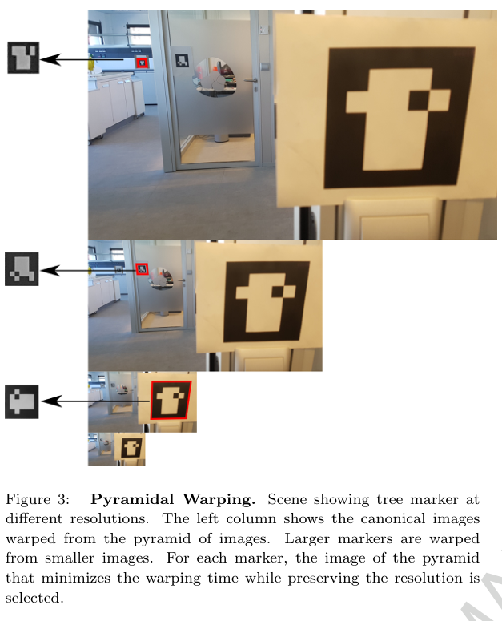
   *그림 3 — **피라미드 워핑.** 서로 다른 해상도의 세[원문 "tree"] 마커를 보여 주는 장면. 왼쪽 열은 영상 피라미드에서 워핑한 정준 영상을 보여 준다. 큰 마커일수록 작은 영상에서 워핑한다. 각 마커에 대해, 해상도를 유지하면서 워핑 시간을 최소화하는 피라미드 영상을 선택한다.*

   끝으로 각 정준 영상에 대해 Otsu 방법[40]으로 이진화하고, 안쪽 코드를 분석하여 유효한 마커인지 판단한다. 이는 매우 값싼 연산이다.

6. *코너 업샘플링(Corner Upsampling):* 지금까지 마커는 영상 $I^r$에서 검출되었다. 그러나 원 영상 $I$에서 코너를 정밀하게 위치시켜야 한다. 앞서 지적했듯이 추정 카메라 자세의 정밀도는 코너 위치 정밀도에 직접 영향을 받는다. 영상 $I$와 $I^r$의 크기 차이가 매우 클 수 있으므로, 직접 업샘플링하면 오차가 생길 수 있다. 대신 영상 $I$에 도달할 때까지 $I^r$보다 큰 버전의 영상들에서 단계적으로 코너를 찾는다.

   코너 업샘플링 작업에서는 먼저 피라미드에서 $I^r$와 크기가 가장 비슷한 영상 $I^i\in\mathcal I$를 선택한다. 즉

   $$I^i=\operatorname*{argmin}_{I^v\in\mathcal I}\left|(I^v_wI^v_h)-(I^r_wI^r_h)\right|. \tag{5}$$

   그다음 코너 위치를 단순히 업샘플링하여 영상 $I^i$에서 각 윤곽선 코너의 위치를 계산한다. 그러나 이는 영상 $I^i$에서 코너 위치를 정밀하게 가리키지 못하는 근사 추정이다. 따라서 선택한 영상 $I^i$에서 최적 위치를 찾기 위해 각 코너 부근에서 코너 정밀화 과정을 수행한다. 이를 위해 OpenCV 라이브러리[41]에 구현된 방법을 썼다. 모든 코너에 대해 $I^i$에서 탐색이 끝나면, $I^0$에 도달할 때까지 영상 $I^{i-1}$에 대해 연산을 반복한다. ArUco 접근법과 달리 이 방법은 렌즈 왜곡의 영향을 받지 않는다.

7. *$\tau_i$ 추정(Estimation of $\tau_i$):* 매개변수 $\tau_i$는 계산 시간에 직접 영향을 준다. 값이 클수록 계산이 빠르다. 단순한 접근법은 이 매개변수를 고정값으로 두는 것이다. 그러나 비디오 시퀀스를 처리할 때는 각 프레임 끝에서 매개변수를 자동으로 조정할 수 있다. 시퀀스의 첫 영상에서는 매개변수 $\tau_i$를 0으로 둔다. 그러면 모든 크기의 마커가 검출된다. 그다음 프레임에서는 $\tau_i$를 이전 프레임에서 검출된 가장 작은 마커의 크기보다 약간 작은 값으로 둔다. 이렇게 하면 카메라가 마커에서 멀어져도 마커를 검출할 수 있다. 따라서 매개변수 $\tau_i$는 다음과 같이 동적으로 갱신할 수 있다.

   $$\tau_i=(1-\tau_s)P(\vartheta_s)/4 \tag{6}$$

   여기서 $\vartheta_s$는 영상에서 찾은 둘레가 가장 작은 마커이고, $\tau_s$는 카메라 운동 속도를 반영하는 (0, 1] 범위의 계수다. 예를 들어 $\tau_s=0.1$이면, 다음 프레임에서 $\tau_i$는 현재 영상의 가장 작은 마커보다 10% 작은 마커를 찾도록 정해진다. 한 프레임에서 마커가 검출되지 않으면, 다음 프레임에서 모든 크기의 마커를 검출할 수 있도록 $\tau_i$를 0으로 둔다.

보다시피 제안 파이프라인은 원래 ArUco 파이프라인과 여러 가지 차이점을 가지며, 다음에 보이듯이 이 차이들로 처리 속도를 크게 높일 수 있다.

## 4. 실험과 결과 (Experiments and results)

이 절은 기준 마커 검출을 위해 제안한 방법론을 검증하기 위해 얻은 결과를 보여 준다.

먼저 4.1절에서는 제안 방법의 계산 시간을 문헌에서 찾은 가장 좋은 대안들, 즉 AprilTags[18], ChiliTags[36], ArToolKit+[31], 그리고 OpenCV 라이브러리³에 포함된 ArUco[17]와 비교한다. 그다음 4.2절은 제안 방법의 민감도(sensitivity)를 위에서 언급한 방법들과 분석·비교한다. 주된 목표는 우리 접근법이 넓은 범위의 마커 해상도에서 거짓 양성률을 0으로 유지하면서 매우 높은 참 양성률로 마커를 신뢰성 있게 검출할 수 있음을 입증하는 것이다. 이후 4.3절은 여러 시스템 매개변수가 속도와 민감도에 주는 영향을 연구하고, 4.4절은 코너 추정의 정밀도를 평가한다. 끝으로 4.5절은 가림, 조명, 스케일 변화가 있는 현실적인 비디오 시퀀스에서 제안 방법의 성능을 보여 준다.

처음 세 실험을 위해 우리 실험실에서 여러 비디오를 녹화했다. 그림 4(b-e)는 사용한 비디오 시퀀스의 영상 몇 장을 보여 준다. 이 시험을 위해 총 16개 마커가 있는 판을 인쇄했으며(그림 4a), 사용한 기준 마커 종류마다 네 개씩이다. 시퀀스는 Honor 5 휴대전화로 4K 해상도, 30 fps 프레임률로 여러 거리에서 녹화했다. 사용한 비디오는 평가 목적으로 공개되어 있다⁴.

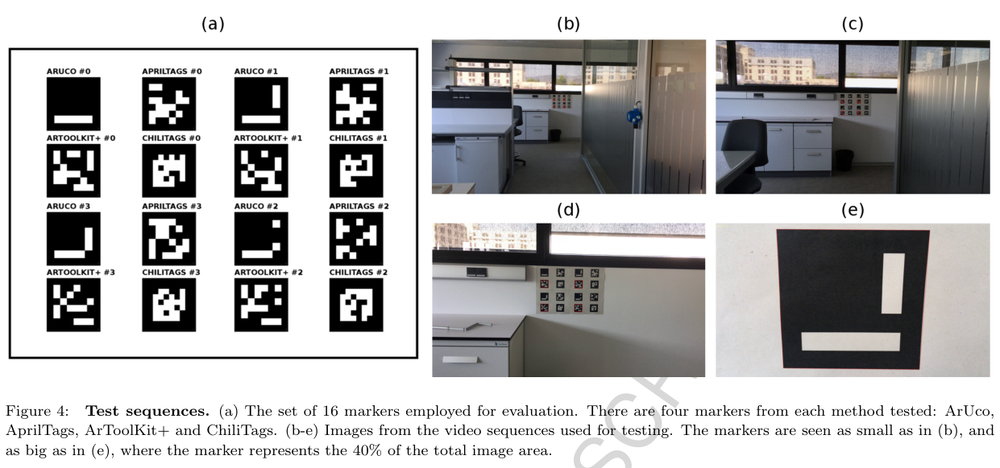
*그림 4 — **시험 시퀀스.** (a) 평가에 쓴 16개 마커 세트. 시험한 각 방법(ArUco, AprilTags, ArToolKit+, ChiliTags)의 마커가 네 개씩 있다. (b-e) 시험에 쓴 비디오 시퀀스의 영상. 마커는 (b)처럼 작게, (e)처럼 크게 보이는데, (e)에서 마커는 전체 영상 면적의 40%를 차지한다.*

비디오에는 그림 4b처럼 각 마커 면적이 영상의 0.5%만 차지할 정도로 마커가 작게 보이는 프레임과, 그림 4e처럼 마커가 전체 영상 면적의 40%를 차지할 정도로 크게 보이는 프레임이 있다. 녹화한 비디오 시퀀스는 모두 합쳐 10.666프레임이다. [역주: 원문 표기, 10,666프레임.] 영상 해상도가 계산 시간에 주는 영향을 분석할 수 있도록 비디오 프레임을 여러 해상도에서 처리했다. 구체적으로 다음 표준 영상 해상도를 썼다. 4K (3840×2160), 1080p (1920×1080), 720p (1280×720), 600p (800×600), 480p (640×480).

모든 시험은 8 GB RAM의 Intel® Core™ i7-4700HQ 8코어 프로세서와 운영체제 Ubuntu 16.04에서 수행했다. 다만 수행한 시험에서는 실행 스레드 하나만 썼다.

이 연구의 일부로 만든 코드는 널리 쓰이는 ArUco 라이브러리의 버전 3으로 공개되었다⁵. 그래서 실험 절에서는 이 논문의 제안 방법을 ArUco3이라 부른다.

### 4.1. 가속 (Speedup)

이 절은 제안 방법의 계산 시간을 가장 흔히 쓰이는 대안들인 AprilTags, ArToolKit+, ChiliTags, ArUco와 비교한다. 이를 위해 같은 영상을 처리할 때 대안의 계산 시간($t_1$)과 ArUco3의 계산 시간($t_2$)의 비로 우리 접근법의 가속비(speedup)를 계산한다.

$$\mathrm{SpeedUp}=t_1/t_2 \tag{7}$$

우리 방법에서는 모든 시퀀스에서 $\tau_c=32$를 썼고, $\tau_i$와 분할 임계값은 제안 방법(3.2절)의 단계 2와 7에서 설명한 대로 자동 계산했다.

그림 5는 여러 영상 해상도에서 우리 접근법의 가속비를 보여 준다. 가로축은 영상에서 마커가 차지하는 상대 면적, 세로축은 가속비를 나타낸다. 각 영상마다 속도 측정을 총 30회 수행하고, 평가에는 계산 시간의 중앙값을 썼다. 시험에서는 우리 접근법의 거동을 더 잘 이해하기 위해 관측된 마커 면적의 함수로 가속비를 평가한다.

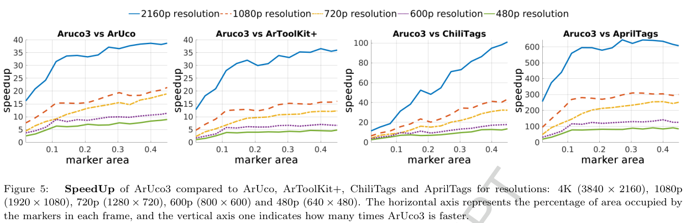
*그림 5 — 해상도 4K (3840×2160), 1080p (1920×1080), 720p (1280×720), 600p (800×600), 480p (640×480)에서 ArUco, ArToolKit+, ChiliTags, AprilTags에 대한 ArUco3의 **가속비**. 가로축은 각 프레임에서 마커가 차지하는 면적 비율, 세로축은 ArUco3이 몇 배 빠른지를 나타낸다.*

수행한 시험은 제안 방법(ArUco3)이 나머지 방법보다 빠르고, 가속비가 영상 해상도와 관측된 마커 면적에 따라 증가함을 분명히 보여 준다. OpenCV 라이브러리의 ArUco 구현과 비교하면 제안 방법은 상당히 빠르며, 4K 해상도에서 최소 17배, 가장 좋은 경우 최대 40배의 가속을 달성한다.

제안 방법(3.2절)의 각 단계 계산 시간을 제대로 분석하기 위해, 표 1에 여러 영상 해상도에 대한 요약을 보였다. 마찬가지로 그림 6은 각 단계가 차지하는 전체 시간의 비율을 보여 준다. 단계 7(식 6)은 계산 시간이 무시할 만하므로 생략했음에 유의하기 바란다.

**표 1:** 여러 해상도에서 제안 방법 각 단계의 평균 계산 시간(밀리초).

| 해상도 | 480p | 600p | 720p | 1080p | 2160p |
|---|---|---|---|---|---|
| 단계 1: 영상 크기 조정 | 0.037 | 0.050 | 0.057 | 0.068 | 0.101 |
| 단계 2: 영상 분할 | 0.044 | 0.048 | 0.059 | 0.084 | 0.351 |
| 단계 3: 윤곽선 추출과 필터링 | 0.219 | 0.250 | 0.301 | 0.403 | 1.109 |
| 단계 4: 영상 피라미드 생성 | 0.037 | 0.076 | 0.096 | 0.186 | 0.476 |
| 단계 5: 마커 코드 추출 | 0.510 | 0.519 | 0.542 | 0.547 | 0.583 |
| 단계 6: 코너 업샘플링 | 0.058 | 0.065 | 0.079 | 0.096 | 0.134 |
| 시간 (ms) | 0.903 | 1.009 | 1.133 | 1.384 | 2.755 |

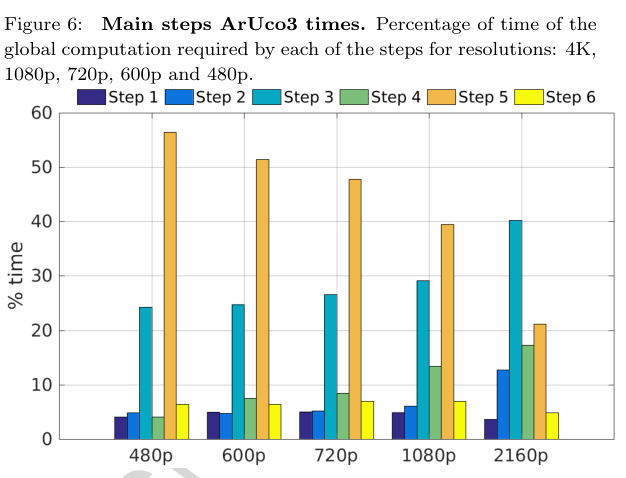
*그림 6 — **ArUco3 주요 단계의 시간.** 해상도 4K, 1080p, 720p, 600p, 480p에서 각 단계가 차지하는 전체 계산 시간의 비율.*

보다시피 가장 시간이 많이 드는 두 연산은 단계 3과 5다. 특히 단계 5는 마커 워핑을 위해 제안한 다중 스케일 방법의 타당성을 입증하므로 특별한 주의가 필요하다. 표에서 단계 5에 드는 시간이 모든 해상도에서 일정함을 볼 수 있다. 다시 말해 계산 시간이 영상 해상도에 따라 크게 늘지 않는다. 또한 2160p에서 단계 3의 시간이 어떻게 증가하는지 주목하라. 이 단계는 제곱으로 커지는 영상 크기에 의존하는 연산을 포함하기 때문이다. 고해상도 영상에서 윤곽선 추출과 필터링 시간을 줄이는 방법을 개발하는 것은 흥미로운 향후 과제다.

어쨌든 평균 총 계산 시간을 고려하면, 제안 방법은 어떤 병렬화도 없이 4K 해상도에서 평균 360 fps 이상, 가장 낮은 해상도에서 1000 fps 이상을 달성한다.

### 4.2. 민감도 분석 (Sensitivity analysis)

마커의 올바른 검출은, 제안 알고리즘이 장면에 있는 불필요한 정보를 배제하고 마커 정보만 추출할 수 있는지 검증하기 위해 분석해야 하는 결정적인 측면이다. 그림 7은 여러 영상 해상도에서, 영상에서 마커가 차지하는 면적의 함수로 제안 방법의 참 양성률(TPR, True Positive Rate)을 보여 준다.

보다시피 특정 마커 면적 아래에서는 검출을 신뢰할 수 없다. 관측된 마커 면적이 매우 작아 안쪽 이진 코드의 여러 비트를 구별하기 어렵기 때문이다. 관측된 마커 면적이 일정 한계에 이르면 제안 방법은 모든 해상도에서 완벽한 검출을 달성한다. 시험한 모든 경우에서 거짓 양성률(False Positive Rate)이 0이라는 점을 강조해야 한다. 이진 문제이므로 참 음성률(True Negative Rate)은 1이다(TNR=1-FPR).

ArUco3과 다른 방법들의 성능을 비교 평가하기 위해 TPR을 개별적으로 분석했으며 결과는 그림 7과 같다. 보다시피 ArUco는 ArUco3과 정확히 같게 거동한다. 그러나 AprilTags는 모든 해상도에서, 특히 마커나 영상 크기가 커질수록 매우 나쁜 거동을 보인다. 2절에서 이미 언급했듯이 AprilTags는 마커 영상의 워핑에 의존하지 않고, 이진 코드를 얻기 위해 영상에서 몇몇 화소를 서브샘플링한다. 이것이 성능이 나쁜 이유 중 하나일 수 있다. ArToolKit+는 모든 영상 해상도와 마커 면적에서 상당히 잘 거동하며, Chilitags는 480p를 제외한 모든 해상도에서 다소 신뢰할 수 없는 거동을 보인다.

결론적으로 제안 접근법은 이전 버전의 ArUco와 비슷하게 거동한다.

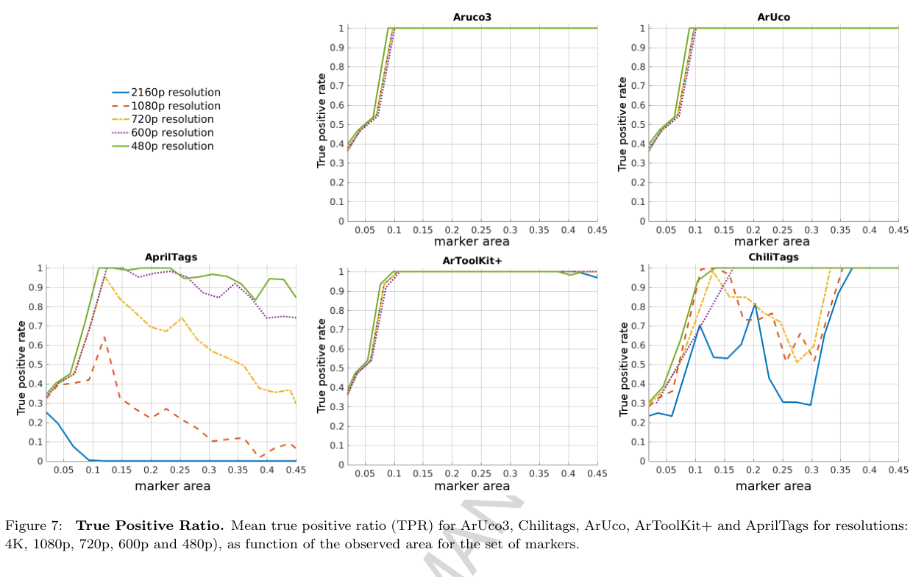
*그림 7 — **참 양성률.** 해상도 4K, 1080p, 720p, 600p, 480p)[원문 괄호 그대로]에서 마커 세트의 관측 면적에 대한 ArUco3, Chilitags, ArUco, ArToolKit+, AprilTags의 평균 참 양성률(TPR).*

### 4.3. 매개변수 분석 (Analysis of parameters)

제안 방법의 계산 시간과 강건성은 주로 두 매개변수, 즉 검출하는 마커의 최소 크기를 나타내는 $\tau_i$와 정준 영상의 크기 $\tau_c$에 의존한다.

매개변수 $\tau_i$는 크기를 줄인 영상 $I^r$의 크기를 정하므로(식 1) 계산 시간에 영향을 준다. 이 매개변수의 함수로 속도를 분석했으며 결과는 그림 8과 같다. 그림은 가로축에 $\tau_i$ 값을, 세로축에 관측된 마커 면적과 무관하게 분석한 시퀀스에서의 평균 속도(초당 프레임으로 측정)를 나타낸다. 영상 해상도마다 다른 선을 그렸다. 이 경우 매개변수 $\tau_c=32$로 고정했다.

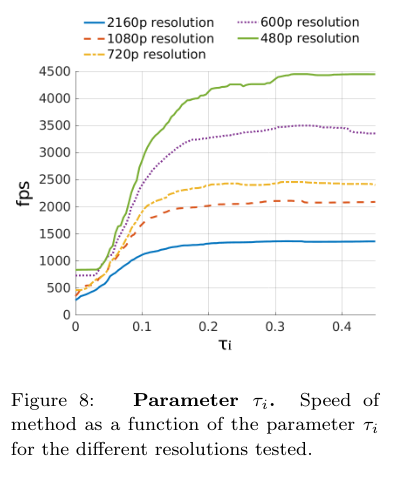
*그림 8 — **매개변수 $\tau_i$.** 시험한 여러 해상도에서 매개변수 $\tau_i$의 함수로 나타낸 방법의 속도.*

분석한 다섯 경우에서 곡선이 비슷한 양상을 따름을 볼 수 있다. 일반적으로 속도의 최대 증가는 $\tau_i=(0,0.2)$ 범위의 값에서 얻어진다. 그 지점을 넘으면 개선은 미미해진다. 이 매개변수의 영향을 더 잘 이해하기 위해 표 2에 여러 $\tau_i$ 값에 대한 입력 영상 크기 $I$의 감소를 보였다. 예를 들어 $\tau_i=0.02$이면 크기를 줄인 영상 $I^r$은 원 입력 영상 $I$보다 48% 작다(식 1 참조). $\tau_i=0.2$를 넘으면 크기를 줄인 영상이 너무 작아져 가속에 큰 영향을 주지 못한다. 단계 5(마커 코드 추출)처럼 계산 시간이 고정된 다른 단계들이 있기 때문이다.

**표 2:** 여러 $\tau_i$ 값에 대한 영상 크기 감소.

| $\tau_i$ | 0.01 | 0.015 | 0.02 | 0.1 | 0.2 |
|---|---|---|---|---|---|
| 크기 감소 | 0% | 31% | 48% | 82% | 90% |

어쨌든 제안 방법은 영상 면적의 10%($\tau_i=0.1$)보다 큰 마커를 검출할 때 4K 해상도에서 1000 fps를 달성할 수 있고, 1080p 해상도에서는 $\tau_i=0.05$에서 같은 1000 fps 한계를 달성함에 유의해야 한다.

매개변수 $\tau_c$는 크기를 줄인 영상의 크기를 정하므로(식 1) 간접적으로 속도에 영향을 준다. 값이 작을수록 크기를 줄인 영상 $I^r$이 작아진다. 그럼에도 이 매개변수는 마커의 올바른 검출에도 영향을 준다. 이 매개변수는 마커의 이진 코드를 식별하는 데 쓰는 정준 영상의 크기를 나타낸다. 정준 영상이 매우 작으면 화소가 뒤섞여 식별이 강건하지 않다. 따라서 목표는 가장 좋은 TPR을 달성하는 $\tau_c$의 최소값을 정하는 것이다. 그림 9는 매개변수 $\tau_c$의 여러 설정에서 얻은 TPR을 보여 준다. 보다시피 매개변수 $\tau_c$가 낮은 값(8과 32 사이)일 때 시스템은 마커 검출에 문제를 보인다. 그러나 $\tau_c\ge32$에서는 TPR이 개선되지 않는다. 따라서 $\tau_c=32$ 값이 가장 좋은 선택이라고 결론짓는다.

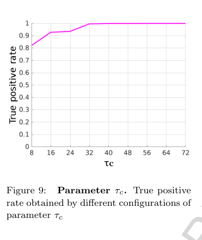
*그림 9 — **매개변수 $\tau_c$.** 매개변수 $\tau_c$의 여러 설정으로 얻은 참 양성률.*

### 4.4. 코너 검출의 정밀도 (Precision of corner detection)

마커 검출에서 고려할 중요한 측면은 꼭짓점 떨림(*vertex jitter*), 즉 코너 위치 추정의 잡음이다. 이 오차는 카메라 자세 추정으로 전파되므로 문제가 된다. 우리 방법에서는 크기를 줄인 영상 $I^r$에서 원 영상 $I$까지 코너 추정을 정밀화하기 위해 코너 업샘플링 단계(3.2절의 단계 6)를 제안했다. 이 절은 제안 방법을 분석하고 그 결과를 다른 마커 시스템과 비교한다.

실험을 수행하기 위해 카메라를 고정 위치에 두고, 그림 4a에서 이미 보인 마커 세트를 녹화했다. 카메라가 움직이지 않으므로 각 코너에 대해 추정한 평균 위치를 올바른 위치로 볼 수 있다(즉 가우스 오차 분포를 가정한다). 그러면 표준편차가 코너 위치 추정의 오차 척도가 된다. 이 과정을 거리를 바꿔 가며 총 여섯 번 반복했으며, 얻은 결과를 그림 10에 상자 그림으로 나타냈다. 표 3에는 각 방법의 평균 오차를 나타냈다.

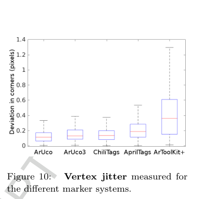
*그림 10 — 여러 마커 시스템에 대해 측정한 **꼭짓점 떨림**.*

**표 3:** 꼭짓점 떨림 분석: 마커 코너 추정에서 여러 방법의 표준편차.

| 방법 | ArUco | ArUco3 | Chilitags | AprilTags | ArToolKit+ |
|---|---|---|---|---|---|
| 평균 오차 (pix) | 0.140 | 0.161 | 0.174 | 0.225 | 0.432 |

보다시피 ArUco 시스템이 가장 좋은 결과를 얻고, 그다음이 제안 방법 ArUco3이다. 그러나 두 방법의 차이는 0.02화소에 불과하여 의미 있다고 보기에는 매우 작다. Chilitags는 ArUco 및 ArUco3과 비슷한 거동을 보이지만, AprilTags와 ArToolKit+는 더 나쁜 성능을 보인다.

### 4.5. 비디오 시퀀스 분석 (Video sequence analysis)

이 절은 현실적인 시나리오에서 제안 시스템의 거동을 보이는 것을 목표로 한다. 이를 위해 조명이 불규칙한 환경에 마커 네 개를 배치하고 4K 휴대전화 카메라로 비디오 시퀀스를 녹화했다. 그림 11(a-e)는 비디오 시퀀스의 1, 665, 1300, 1700, 2100번째 프레임을 보여 준다. 시퀀스 시작에서 카메라는 마커로부터 약 5미터 떨어져 있다. 카메라는 마커에 다가간 다음 다시 멀어진다. 보다시피 650번째 프레임 부근(그림 11b)에서 사용자가 마커를 일시적으로 가린다.

그림 11f는 시퀀스를 따라 자동으로 계산된 매개변수 $\tau_i$의 값을, 그림 11g는 처리 속도를 보여 준다. 보다시피 시스템은 관측된 마커 면적에 따라 $\tau_i$ 값을 자동으로 조정하여 시스템의 계산 속도를 적응시킬 수 있다. 최대 속도는 카메라가 마커에 가장 가까운 1300번째 프레임 부근에서 얻어진다.

또한 사용자가 손으로 마커를 가리는 650번째 프레임 부근에서는 시스템이 어떤 마커도 검출하지 못함을 볼 수 있다. 그래서 시스템은 전체 해상도 영상($\tau_i=0$)에서 탐색하고 속도가 떨어진다. 그러나 마커가 다시 관측되면 시스템은 속도를 회복한다.

끝으로 그림 11h는 각 프레임에서 분할에 쓴 임계값을 보여 준다. 보다시피 시스템은 조명 변화에 적응한다. 시퀀스 전체에서 시스템은 어떤 거짓 음성도 거짓 양성도 내지 않는다.

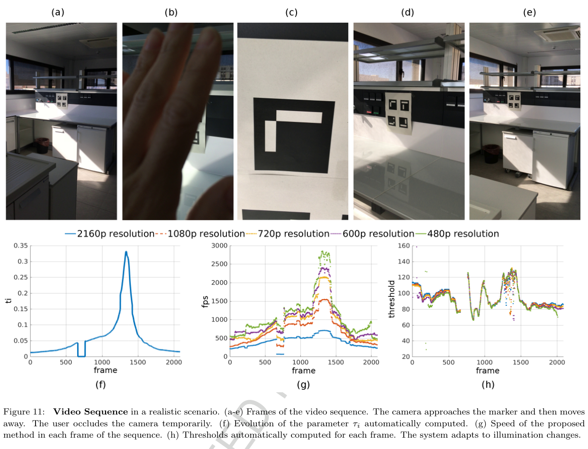
*그림 11 — **현실적 시나리오의 비디오 시퀀스.** (a-e) 비디오 시퀀스의 프레임. 카메라가 마커에 다가간 뒤 멀어진다. 사용자가 카메라를 일시적으로 가린다. (f) 자동 계산된 매개변수 $\tau_i$의 변화. (g) 시퀀스 각 프레임에서 제안 방법의 속도. (h) 각 프레임에 대해 자동 계산된 임계값. 시스템은 조명 변화에 적응한다.*

## 5. 결론 및 향후 과제 (Conclusions and future work)

본 논문은 정확도와 강건성을 유지하면서 속도를 최대화하는 것을 목표로 하는 새로운 기준 마커 검출 접근법을 제안했다. 제안 방법은 오늘날 점점 높아지는 카메라 해상도를 활용하도록 특별히 설계되었다. 원 영상에서 마커를 검출하는 대신 더 작은 버전의 영상을 써서 더 빠른 속도로 검출한다. 다중 스케일 영상 표현을 현명하게 써서, 제안 방법은 원 영상에서 마커 코너의 위치를 부화소 정확도로 찾을 수 있다. 처리하는 영상의 크기와 분할에 쓰는 임계값은 이전 프레임의 정보를 고려하여 각 프레임에서 동적으로 조정된다. 그 결과 시스템 속도가 동적으로 적응하여 최대 성능을 달성한다.

실험으로 보였듯이, 제안 방법은 민감도나 정밀도를 해치지 않으면서 계산 속도 면에서 최신 시스템들을 능가한다. 우리 방법은 OpenCV 라이브러리에 구현된 ArUco 접근법보다 17~40배 빠르다. Chilitags, AprilTags, ArToolKit+ 같은 다른 접근법과 비교하면 우리 방법은 더 큰 가속을 달성한다.

향후 과제로는 제안 방법을 어안 카메라에 쓰는 것을 조사하는 것을 생각한다. 착안은 보정(rectified)된 영상과 방법을 비교하는 것이다 if there is analyze the method's performance in presence of high distortion. Also, we as well as to characterize the performance when multiple fiducial markers with significantly different scales are present in the same image. [역주: 이 두 문장은 원문 자체가 문법적으로 깨져 있어 원문을 그대로 남긴다. 의미는 "강한 왜곡이 있을 때 방법의 성능을 분석하고, 스케일이 크게 다른 여러 기준 마커가 한 영상에 함께 있을 때의 성능을 특성화한다"로 보인다.]

오픈 소스 코드⁶로 공개된 우리 시스템은 로봇공학, 무인 이동체, 증강 현실 같은 응용에서 빠르고 정밀한 자기 위치 추정을 위한 비용 효율적인 도구다.

## 감사의 글 (Acknowledgments)

이 프로젝트는 스페인 경제산업경쟁력부(Spain Ministry of Economy, Industry and Competitiveness)의 과제 TIN2016-75279-P와 IFI16/00033 (ISCIII), 그리고 FEDER의 지원을 받았다.

## 각주 (본문)

3. https://opencv.org/
4. https://mega.nz/#F!DnA1wIAQ!6f6owb81G0E7Sw3EfddUXQ
5. http://www.uco.es/grupos/ava/node/25
6. http://www.uco.es/grupos/ava/node/25

## 하이라이트 (Highlights)

- 정사각 평면 마커의 검출을 가속하는 시스템
- 계산 시간을 줄이기 위해 다중 해상도 접근법을 쓴다
- 계산을 줄이기 위해 시간 정보도 고려한다
- 어떤 병렬화도 없이 최신 접근법보다 최대 40배 빠르다.

## 참고문헌

- [1] R. Sim, J. J. Little, Autonomous vision-based robotic exploration and mapping using hybrid maps and particle filters, Image and Vision Computing 27 (1) (2009) 167 – 177, canadian Robotic Vision 2005 and 2006.
- [2] A. Pichler, S. C. Akkaladevi, M. Ikeda, M. Hofmann, M. Plasch, C. Wögerer, G. Fritz, Towards shared autonomy for robotic tasks in manufacturing, Procedia Manufacturing 11 (Supplement C) (2017) 72 – 82, 27th International Conference on Flexible Automation and Intelligent Manufacturing, FAIM2017, 27-30 June 2017, Modena, Italy.
- [3] R. Valencia-Garcia, R. Martinez-Béjar, A. Gasparetto, An intelligent framework for simulating robot-assisted surgical operations, Expert Systems with Applications 28 (3) (2005) 425 – 433.
- [4] A. Broggi, E. Dickmanns, Applications of computer vision to intelligent vehicles, Image and Vision Computing 18 (5) (2000) 365 – 366.
- [5] T. Patterson, S. McClean, P. Morrow, G. Parr, C. Luo, Timely autonomous identification of uav safe landing zones, Image and Vision Computing 32 (9) (2014) 568 – 578.
- [6] D. González, J. Pérez, V. Milanés, Parametric-based path generation for automated vehicles at roundabouts, Expert Systems with Applications 71 (2017) 332 – 341.
- [7] J. L. Sanchez-Lopez, J. Pestana, P. de la Puente, P. Campoy, A reliable open-source system architecture for the fast designing and prototyping of autonomous multi-uav systems: Simulation and experimentation, Journal of Intelligent & Robotic Systems (2015) 1–19.
- [8] M. Olivares-Mendez, S. Kannan, H. Voos, Vision based fuzzy control autonomous landing with uavs: From v-rep to real experiments, in: Control and Automation (MED), 2015 23th Mediterranean Conference on, 2015, pp. 14–21.
- [9] S. Pflugi, R. Vasireddy, T. Lerch, T. M. Ecker, M. Tannast, N. Boemke, K. Siebenrock, G. Zheng, Augmented marker tracking for peri-acetabular osteotomy surgery, in: 2017 39th Annual International Conference of the IEEE Engineering in Medicine and Biology Society (EMBC), 2017, pp. 937–941.
- [10] J. P. Lima, R. Roberto, F. Simões, M. Almeida, L. Figueiredo, J. M. Teixeira, V. Teichrieb, Markerless tracking system for augmented reality in the automotive industry, Expert Systems with Applications 82 (2017) 100 – 114.
- [11] P. Chen, Z. Peng, D. Li, L. Yang, An improved augmented reality system based on andar, Journal of Visual Communication and Image Representation 37 (2016) 63 – 69, weakly supervised learning and its applications.
- [12] S. Khattak, B. Cowan, I. Chepurna, A. Hogue, A real-time reconstructed 3d environment augmented with virtual objects rendered with correct occlusion, in: Games Media Entertainment (GEM), 2014 IEEE, 2014, pp. 1–8.
- [13] J. Engel, T. Schöps, D. Cremers, LSD-SLAM: Large-scale direct monocular SLAM, 2014.
- [14] R. Mur-Artal, J. M. M. Montiel, J. D. Tardós, Orb-slam: A versatile and accurate monocular slam system, IEEE Transactions on Robotics 31 (5) (2015) 1147–1163.
- [15] Cooperative pose estimation of a fleet of robots based on interactive points alignment, Expert Systems with Applications 45 (2016) 150 – 160.
- [16] S.-h. Zhong, Y. Liu, Q.-c. Chen, Visual orientation inhomogeneity based scale-invariant feature transform, Expert Syst. Appl. 42 (13) (2015) 5658–5667.
- [17] S. Garrido-Jurado, R. Muñoz Salinas, F. J. Madrid-Cuevas, M. J. Marín-Jiménez, Automatic generation and detection of highly reliable fiducial markers under occlusion, Pattern Recognition 47 (6) (2014) 2280–2292.
- [18] E. Olson, Apriltag: A robust and flexible visual fiducial system, in: Robotics and Automation (ICRA), 2011 IEEE International Conference on, 2011, pp. 3400–3407.
- [19] F. Ababsa, M. Mallem, Robust camera pose estimation using 2d fiducials tracking for real-time augmented reality systems, in: Proceedings of the 2004 ACM SIGGRAPH International Conference on Virtual Reality Continuum and Its Applications in Industry, VRCAI '04, 2004, pp. 431–435.
- [20] V. Mondéjar-Guerra, S. Garrido-Jurado, R. Muñoz-Salinas, M.-J. Marín-Jiménez, R. Medina-Carnicer, Robust identification of fiducial markers in challenging conditions, Expert Systems with Applications 93 (1) (2018) 336–345.
- [21] R. Muñoz-Salinas, M. J. Marín-Jimenez, E. Yeguas-Bolivar, R. Medina-Carnicer, Mapping and localization from planar markers, Pattern Recognition 73 (January 2018) 158 – 171.
- [22] K. Dorfmüller, H. Wirth, Real-time hand and head tracking for virtual environments using infrared beacons, in: in Proceedings CAPTECH'98. 1998, Springer, 1998, pp. 113–127.
- [23] M. Ribo, A. Pinz, A. L. Fuhrmann, A new optical tracking system for virtual and augmented reality applications, in: In Proceedings of the IEEE Instrumentation and Measurement Technical Conference, 2001, pp. 1932–1936.
- [24] V. A. Knyaz, R. V. Sibiryakov, The development of new coded targets for automated point identification and non-contact surface measurements, in: 3D Surface Measurements, International Archives of Photogrammetry and Remote Sensing, Vol. XXXII, part 5, 1998, pp. 80–85.
- [25] L. Naimark, E. Foxlin, Circular data matrix fiducial system and robust image processing for a wearable vision-inertial self-tracker, in: Proceedings of the 1st International Symposium on Mixed and Augmented Reality, ISMAR '02, IEEE Computer Society, Washington, DC, USA, 2002, pp. 27–36.
- [26] J. Rekimoto, Y. Ayatsuka, Cybercode: designing augmented reality environments with visual tags, in: Proceedings of DARE 2000 on Designing augmented reality environments, DARE '00, ACM, New York, NY, USA, 2000, pp. 1–10.
- [27] M. Rohs, B. Gfeller, Using camera-equipped mobile phones for interacting with real-world objects, in: Advances in Pervasive Computing, 2004, pp. 265–271.
- [28] M. Kaltenbrunner, R. Bencina, reactivision: a computer-vision framework for table-based tangible interaction, in: Proceedings of the 1st international conference on Tangible and embedded interaction, TEI '07, ACM, New York, NY, USA, 2007, pp. 69–74.
- [29] H. Kato, M. Billinghurst, Marker tracking and hmd calibration for a video-based augmented reality conferencing system, in: Augmented Reality, 1999. (IWAR '99) Proceedings. 2nd IEEE and ACM International Workshop on, 1999, pp. 85–94.
- [30] S. Lin, D. J. Costello, Error Control Coding, Second Edition, Prentice-Hall, Inc., Upper Saddle River, NJ, USA, 2004.
- [31] D. Wagner, D. Schmalstieg, ARToolKitPlus for pose tracking on mobile devices, in: Computer Vision Winter Workshop, 2007, pp. 139–146.
- [32] D. Schmalstieg, A. Fuhrmann, G. Hesina, Z. Szalavári, L. M. Encarnação, M. Gervautz, W. Purgathofer, The studierstube augmented reality project, Presence: Teleoper. Virtual Environ. 11 (1) (2002) 33–54.
- [33] M. Fiala, Designing highly reliable fiducial markers, IEEE Transactions on Pattern Analysis and Machine Intelligence 32 (7) (2010) 1317–1324.
- [34] D. Flohr, J. Fischer, A Lightweight ID-Based Extension for Marker Tracking Systems, in: Eurographics Symposium on Virtual Environments (EGVE) Short Paper Proceedings, 2007, pp. 59–64.
- [35] S. Garrido-Jurado, R. Muñoz-Salinas, F. Madrid-Cuevas, R. Medina-Carnicer, Generation of fiducial marker dictionaries using mixed integer linear programming, Pattern Recognition 51 (2016) 481–491.
- [36] Q. Bonnard, S. Lemaignan, G. Zufferey, A. Mazzei, S. Cuendet, N. Li, A. Özgür, P. Dillenbourg, Chilitags 2: Robust fiducial markers for augmented reality and robotics. (2013). URL http://chili.epfl.ch/software
- [37] D. Johnston, M. Fleury, A. Downton, A. Clark, Real-time positioning for augmented reality on a custom parallel machine, Image and Vision Computing 23 (3) (2005) 271 – 286.
- [38] Topological structural analysis of digitized binary images by border following, Computer Vision, Graphics, and Image Processing 30 (1) (1985) 32 – 46.
- [39] D. H. Douglas, T. K. Peucker, Algorithms for the reduction of the number of points required to represent a digitized line or its caricature, Cartographica: The International Journal for Geographic Information and Geovisualization 2 (10) (1973) 112 – 122.
- [40] N. Otsu, A threshold selection method from gray-level histograms, IEEE Transactions on Systems, Man, and Cybernetics 9 (1) (1979) 62–66.
- [41] G. Bradski, A. Kaehler, Learning OpenCV: Computer Vision in C++ with the OpenCV Library, 2nd Edition, O'Reilly Media, Inc., 2013.
