# AprilTag 검출의 위치 정확도 측정과 개선 (Kallwies 2020)

- 원제: Determining and Improving the Localization Accuracy of AprilTag Detection
- 원문: 같은 폴더의 `Kallwies2020_ICRA_apriltag_accuracy.pdf` (2020 IEEE International Conference on Robotics and Automation (ICRA), 2020년 5월 31일–8월 31일, 프랑스 파리, pp. 8288–8294)
- 저자: Jan Kallwies, Bianca Forkel, Hans-Joachim Wuensche (Universität der Bundeswehr Munich, 자율시스템기술연구소 TAS)
- 번역 범위: 전문 (본문, 각주, 표, 그림 캡션. 참고문헌은 원문 그대로)
- 그림: 원문 그림 13개를 `그림/`에 넣고 본문에서 처음 언급되는 곳에 삽입

## 초록 (Abstract)

AprilTag 같은 피듀셜 마커(fiducial marker)는 카메라 보정(캘리브레이션)이나 로봇의 위치 추정(localization) 등 로봇공학에서 중요한 역할을 한다. 이러한 태그를 검출하는 알고리즘의 가장 중요한 성질 중 하나는 위치 정확도(localization accuracy)다.

이 논문에서는 AprilTag를 검출할 수 있는 무료 라이브러리 네 가지, 즉 독립 라이브러리인 AprilTag 3, AprilTags C++, ArUco와 ArUco 기반의 OpenCV 알고리즘을 폭넓게 비교한 결과를 제시한다. 비교의 초점은 위치 정확도이지만 처리 시간도 살펴본다. 순수한 태그뿐 아니라 태그를 체커보드 코너로 확장한 경우도 조사한다.

또한 두 가지 새로운 후처리(post-processing) 기법을 제시한다. 첫째는 테두리가 부분적으로 가려져 생기는 매우 부정확한 검출을 걸러 낼 수 있는 방법이고, 둘째는 매우 정확한 새 에지 정밀화(edge refinement) 방법이다. 이를 통해 표준 OpenCV 코너 정밀화의 0.17 px에 비해 0.017 px의 중앙값 화소 오차를 달성한다.

평가에 쓴 데이터셋과 개발한 후처리 기법을 공개해, 검출 라이브러리의 추가 비교와 개선을 장려한다.

## I. 서론 (Introduction)

AprilTag는 정사각형 흑백 태그다. 단일 회색조 카메라 영상에서 검출하기 쉬워 피듀셜 마커로 자주 쓰인다. 환경에 태그를 배치하면 실제 세계와 카메라 투영 사이의 대응점을 얻을 수 있다. 이는 물체나 카메라의 위치를 추정하는 매우 쉬운 방법이다.

한 가지 응용은 다른 카메라나 LiDAR 센서 같은 기준 센서에 대한 카메라의 내부(intrinsic)·외부(extrinsic) 보정이다[1], [2]. 여러 카메라에서 태그를 관측해 카메라 사이의 대응점을 모으고, 최적화로 문제를 푼다. 마커를 들고 다니며 임의 위치에 둘 수 있으므로 현장에서 유연하게 카메라를 보정할 수 있다.

보정된 카메라가 있으면 AprilTag는 로봇 작업에서 인공 랜드마크로 자주 쓰인다. 태그에는 내부 식별 코드가 들어 있으므로, 각 태그의 위치를 안다면 로봇 위치 추정[3], [4]과 항법에 쓸 수 있다. 그렇지 않은 경우에도 AprilTag로 마커를 부착한 정적[5]·동적[6], [7] 물체의 위치를 추정하고 식별할 수 있다.

이 모든 응용에 필수적인 것은 어려운 상황에서도 높은 검출률을 보이는 것뿐 아니라 검출의 정밀도가 높은 것이다. 따라서 이 연구에서는 AprilTag 검출의 정확도를 측정하고 개선한다.

(모든 저자는 독일 Neubiberg 소재 Universität der Bundeswehr Munich의 자율시스템기술연구소(Institute for Autonomous Systems Technology, TAS) 소속이다. 교신 저자 e-mail: jan.kallwies@unibw.de)

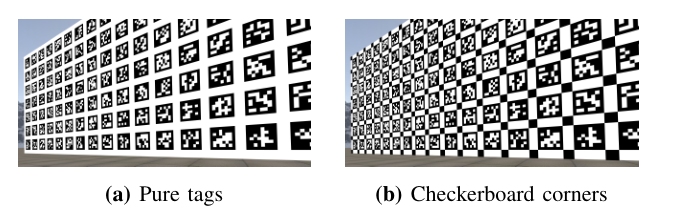
*그림 1 — 핀홀 카메라를 모사해 렌더링한 한 장면. 각 장면은 두 번 렌더링했다. 한 번은 순수 태그로(a), 한 번은 체커보드 코너로 확장한 태그로(b).*

### A. 관련 연구 (Related Work)

처음으로 널리 쓰인 정사각형 피듀셜 마커 시스템은 ARToolKit[8]이다. 검은 테두리 상자 안의 임의 패턴을 템플릿 매칭(template matching)으로 검출한다. 이어 ARTag[9]가 체크섬을 가진 이진 코드를 도입해 오류의 검출과 정정을 가능하게 했다.

이 논문에서 쓰는, 매우 널리 퍼진 AprilTag 라이브러리 및 시스템[10]은 ARTag를 바탕으로 한다. ArUco 라이브러리[11]도 마찬가지다. ArUco는 또 다른 정사각형 이진 코드 피듀셜 마커를 도입했지만, AprilTag와 같은 원리에 기반하므로 ArUco 라이브러리도 AprilTag를 검출할 수 있다. 덕분에 검출 시스템들을 직접 비교할 수 있다.

라이브러리들은 계속 발전하고 있다. 2016년에 나온 AprilTag 2[12]는 원래 AprilTag 시스템보다 강건성과 효율을 높였다. ArUco 3[13]는 속도에 초점을 맞추었고, 특히 큰 태그에서 AprilTag보다 빠름을 보였다. 검출률 면에서 AprilTag 2는 작은 마커에서 훨씬 나빴고 꼭짓점 떨림(vertex jitter)이 더 컸다. 그러나 이 평가는 실제 환경에서 이루어졌으므로 참값(ground truth)과의 비교가 없다. AprilTag 3[14]는 재현율(recall)을 더 높였고, AprilTag 2와 ArUco 3보다 더 먼 거리의 마커를 검출하는 점에서 두드러진다.

마커 시스템과 라이브러리의 개발·개선 외에, AprilTag의 강건성을 평가한 연구는 거의 없었다.

[15]의 저자들은 여러 피듀셜 마커 시스템의 회전과 가림(occlusion) 하에서의 검출률을 조사했다. AprilTag는 법선축과 측면축 둘레의 회전에 강하고 내부 가림은 어느 정도 처리할 수 있었지만, 마커 가장자리가 가려지면 검출에 실패했다.

[16]은 태그 검출로부터 PnP(Perspective-n-Point) 문제를 풀어 카메라 자세를 추정하고, 여러 태그 위치에서 그 오차를 연구한다. 요(yaw) 각에는 거의 의존하지 않았지만, 특정 롤(roll)·피치(pitch) 각이 먼 거리에서 위치 정확도를 크게 높였다. 영상 안 태그의 위치는 추정된 카메라 자세의 오차에 영향을 주지 않았다.

### B. 기여 (Contributions)

이 논문에서는 정사각형 피듀셜 마커의 위치 정확도를 영상 화소 단위의 검출 오차로 살펴본다. 이는 마커의 월드 좌표를 얻을 필요가 없는 카메라 보정 작업에서 특히 흥미롭다. AprilTag 검출용 여러 라이브러리를 비교하면서 태그 크기와 시야각(viewing angle)이 검출률과 정확도에 미치는 영향을 분석한다. 그 과정에서, 테두리가 부분적으로 가려지면 여전히 검출되는 마커의 추정 위치에 엄청난 영향을 준다는 것을 보인다. 나아가 위치 정확도를 높이는 여러 접근을 살펴본다. 따라서 이 논문의 기여는 다음과 같다.

1) 순수 AprilTag와 확장 AprilTag를 담은 합성 데이터셋,
2) 네 가지 AprilTag 검출 라이브러리의 계산 시간과 위치 정확도에 대한 심층 비교,
3) AprilTag에 체커보드 코너를 추가하는 것의 유용성 조사,
4) 보통 큰 위치 오차를 보이는, 부분적으로 가려진 태그를 식별하는 방법,
5) 그리고 최적화 기반의 새 에지 정밀화 방법.

## II. 합성 데이터셋 (The Synthetic Dataset)

재현 가능하고 신뢰할 수 있는 영상과 그에 대응하는 참값 데이터를 얻기 위해 OpenGL 기반 3D 카메라 시뮬레이션을 쓴다. 시뮬레이션 장면은 정적이며, 7 × 22 격자로 배열된 AprilTag 154개가 붙은 평판 하나로 이루어진다. 모든 AprilTag는 36h11 태그 패밀리이고 크기는 각 13 cm다. 임의의 내부 파라미터를 쓰고 가상 카메라를 임의 위치에 놓아 여러 시점의 영상을 렌더링할 수 있다. 카메라 파라미터와 태그 위치를 알기 때문에, 검출 결과와 비교할 영상 내 태그의 참값 위치를 얻을 수 있다. 이는 정확도 평가에 매우 중요하다. 시뮬레이션을 쓰면 그림 1b처럼 태그를 바꾸지 않고 보드를 확장하는 것, 예를 들어 체커보드 코너를 추가하는 것도 쉽다.

이 논문 전체의 평가에는 초점거리 1130 px, 해상도 2448 px × 2048 px의 핀홀 카메라를 썼다. 이 가상 카메라로 네 가지 카메라 위치 집합을 모사했다.

1) *forward*: 카메라가 AprilTag 격자를 향해 곧장 전진한다. 처음 거리 18 m에서 마지막 거리 2 m까지(영상 50장).
2) *circle*: 카메라가 3 m의 일정한 거리에서 AprilTag 격자 중심 둘레를 돌며, 시야각은 −90°에서 90°까지(영상 181장).
3) *random*: 카메라를 AprilTag 격자 앞 0.5 m에서 3 m 거리의 무작위 자세에 두고, 시선 방향은 항상 보드를 향한다(영상 400장).
4) *rotation*: 카메라를 보드에서 2.3 m 떨어진 고정 위치에 두고, 카메라 $z$축 둘레로 −180°에서 180°까지 회전시킨다(영상 361장).

그림 2는 여러 카메라 위치를 보여 준다.

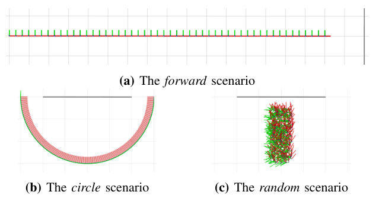
*그림 2 — 데이터셋 생성에 쓴 카메라 자세를 위에서 본 모습. 시선 방향은 빨간색, AprilTag 보드는 회색으로 나타냈다. 격자 칸의 크기는 1 m × 1 m다. (a) forward 시나리오 (b) circle 시나리오 (c) random 시나리오.*

전체 합성 데이터셋은 https://www.mucar3.de/icra2020-apriltags 에서 무료로 받을 수 있다.

## III. 비교 (Comparison)

이 절에서는 여러 태그 검출 알고리즘을 위치 정확도에 특히 초점을 맞추어 자세히 비교한다. 정사각형 피듀셜 마커 검출 시스템의 서로 다른 구현 네 가지를 고려한다.

1) **AprilTag 3**: AprilTag 검출 시스템의 최신 구현. 평가에는 https://github.com/AprilRobotics/apriltag 에서 받을 수 있는 버전 3.1.1을 썼다.
2) **AprilTags C++**: 원래 Michael Kaess 박사가 작성한¹ 이 알고리즘의 또 다른 C++ 구현. https://github.com/Humhu/apriltags 의 코드를 썼다.
3) **ArUco**: ArUco 검출 시스템도 AprilTag 마커 패밀리를 지원한다. https://sourceforge.net/projects/aruco 에서 받을 수 있다(버전 3.1.2를 썼다).
4) **ArUco OpenCV**: ArUco의 또 다른 구현이 OpenCV에도 포함되어 있다(버전 3.4.5를 썼다).

저자들이 아는 한, 무료로 쓸 수 있는 다른 AprilTag 라이브러리는 없다².

이 절에 제시하는 결과에는 정밀화를 쓰지 않았음에 유의한다. 모든 알고리즘에 대해 기본 파라미터로 원시(raw) 태그 검출을 얻고, 추가 후처리 없이 그대로 고려한다. 그런 다음 영상에서 검출된 태그 네 코너점의 위치를 참값과 비교한다.

> ¹ https://people.csail.mit.edu/kaess/apriltags/
> ² AprilTag 1의 또 다른 C++ 이식판이 https://github.com/swatbotics/apriltags-cpp 에 공개되어 있다. 그러나 폐기된(deprecated) 버전을 바탕으로 하므로 여기에는 포함하지 않았다.

### A. 화소 좌표계 규약 (Pixel Coordinate Frame Convention)

검출 알고리즘을 비교하기 전에, 검출기마다 화소 좌표계를 정의하는 규약이 다르다는 점을 언급해야 한다. AprilTags C++, ArUco, ArUco OpenCV는 모두 화소 원점을 화소의 중심으로 가정하는 반면, AprilTag 3는 화소 원점을 화소의 왼쪽 위 모서리에 둔다는 것을 발견했다. 따라서 AprilTag 3가 생성하는 영상 좌표는 다른 알고리즘의 결과에 비해 0.5 px의 오프셋을 가진다. 올바른 비교를 위해 실험에서는 이 오프셋을 보상했다.

### B. 검출률과 실행 시간 (Detection Rate and Runtime)

태그 검출 시스템 성능의 첫 개관으로, 처음 세 시나리오에서 각 알고리즘이 검출하는 태그 수와 그에 드는 시간을 비교한다. *rotation* 시나리오는 모든 알고리즘이 모든 태그를 검출하므로 여기 포함하지 않는다(III-F절 참조). 이 논문의 모든 계산 시간은 3.7 GHz로 동작하는 Intel Core i7-8700K에서 측정했다. 다만 실행 시간은 영상 해상도에도 크게 좌우된다는 점에 유의한다.

표 I에서 AprilTag 3와 AprilTags C++가 ArUco 기반 알고리즘보다 약 10 % 더 많은 태그를 검출할 수 있음을 볼 수 있다. 그러나 이는 처리 시간을 대가로 한다. 가장 느린 AprilTags C++는 매우 빠른 ArUco OpenCV의 10배가 넘는 처리 시간이 걸린다.

**표 I. 네 라이브러리의 기본 성능 비교: 평균 검출 태그 수와 소요 시간.**

| | 영상당 평균 검출 태그 수 (Avg. no. of detected tags per image) | 영상당 평균 시간 (Avg. time per image) |
|---|---|---|
| AprilTag 3 | 107 | 125 ms |
| AprilTags C++ | 104 | 351 ms |
| ArUco | 93 | 56 ms |
| ArUco OpenCV | 95 | 29 ms |

그림 3은 ArUco가 검출된 태그 수에 약간 선형적으로 의존하는 반면, 다른 검출기는 태그 수와 상관없음을 보여 준다. ArUco는 또한 마커를 하나도 검출하지 못할 때 검출 시간이 최대 800 ms에 이르는 이상치를 보인다.

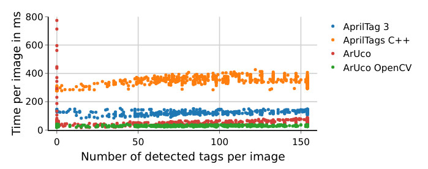
*그림 3 — 검출된 태그 수에 따른 검출 소요 계산 시간.*

### C. 위치 정확도 (Localization Accuracy)

태그 검출 라이브러리의 정확도를 평가하기 위해, 먼저 "완벽한" 조건, 즉 모든 태그가 항상 영상에 완전히 보이는 조건에서 위치 정확도를 평가한다. 그림 4는 네 시나리오 전체의 모든 태그 검출에 대한 오차 분포로, 각 알고리즘의 기본 위치 정확도를 잘 보여 준다.

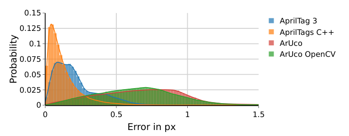
*그림 4 — 완벽한 조건에서 모든 시간 단계에 걸쳐 누적한, 오차 구간별 확률.*

AprilTags C++가 조금 더 정확하지만 AprilTag 3와 매우 비슷하다. 그러나 둘 다 ArUco 구현들보다 훨씬 정확하다. 이 차이는 ArUco 구현들이 추가 후처리 없이는 정수 화소 위치만 구한다는 사실로 설명할 수 있다.

### D. 태그 크기의 영향 (Influence of the Tag Size)

피듀셜 마커 검출에서 중요한 파라미터는 영상 속 마커의 크기다. 큰 태그일수록 인식하기가 훨씬 쉬워 검출률이 높아진다. 태그 크기의 영향을 평가하는 데 쓴 *forward* 시나리오에서는 카메라와 태그 사이 거리가 계속 줄어든다. 그 결과 태그 크기는 거리 18 m에서 9 px, 거리 2 m에서 74 px가 된다.

그림 5a에서 태그 크기가 충분히 크면 모든 검출 알고리즘이 모든 태그를 검출할 수 있음을 볼 수 있다. 태그 크기가 작으면 검출률이 크게 달라진다. AprilTag 3는 크기가 겨우 10 px인 태그도 일부 올바르게 검출할 수 있다. 반면 ArUco OpenCV는 최소 약 21 px의 태그 크기를 필요로 한다. 그림 5b는 위치 정확도가 태그 크기와 거의 무관함을 보여 준다. 태그 크기가 작으면 검출률은 크게 떨어지지만, 위치 정확도는 손상되지 않는다.

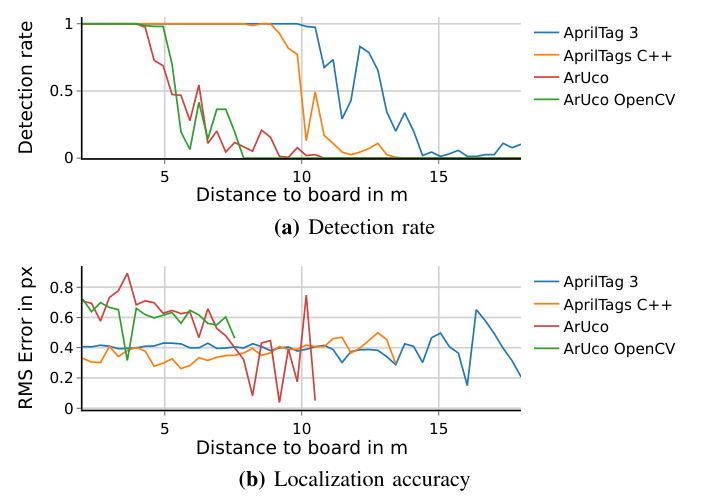
*그림 5 — 카메라와 마커 보드 사이 거리에 따른 검출률과 위치 정확도. (a) 검출률 (b) 위치 정확도.*

### E. 시야각의 영향 (Influence of the Viewing Angle)

*circle* 시나리오를 평가한 그림 6은 시야각이 AprilTag의 검출률과 위치 오차에 미치는 영향을 보여 준다. AprilTag 3와 AprilTags C++의 검출률은 −50°에서 50° 범위의 시야각에서는 떨어지지 않는다. 반면 ArUco와 ArUco OpenCV는 20°보다 큰 각도에서 이미 검출률이 떨어지기 시작한다.

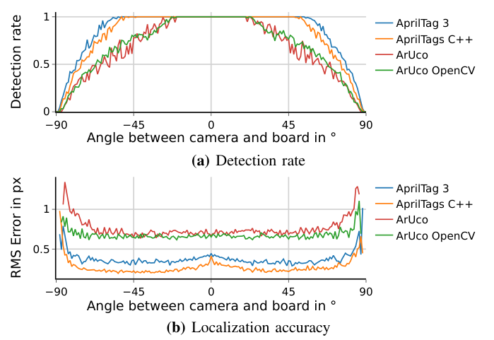
*그림 6 — 마커 보드에 대한 카메라 시야각에 따른 검출률과 위치 정확도. (a) 검출률 (b) 위치 정확도.*

예상대로, 태그를 큰 시야각에서 관측하면 모든 알고리즘의 위치 정확도가 크게 나빠진다³. 흥미롭게도 두 AprilTag 구현의 정확도는 시야각이 0°에 가까워질 때에도 원인을 알 수 없는 이유로 떨어진다.

> ³ 자세한 예는 https://www.mucar3.de/icra2020-apriltags 에서 볼 수 있다.

### F. 태그 회전의 영향 (Influence of Tag Rotations)

*rotation* 시나리오를 평가한 그림 7은 태그 회전이 위치 오차에 미치는 영향을 보여 준다. 모든 알고리즘이 모든 영상에서 모든 태그를 검출했다. 따라서 인식률은 영향을 받지 않으므로 나타내지 않았다.

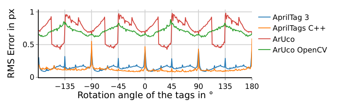
*그림 7 — 영상 속 태그 회전각에 따른 위치 정확도.*

두 AprilTag 구현은 회전각 $N \cdot 90°$, 즉 태그가 영상과 완벽히 정렬될 때 위치 오차에 피크를 보인다. AprilTag 3의 경우 이 효과는 정수 화소 위치로의 반올림에서 비롯되는 것으로 보인다³. 두 ArUco 구현은 회전각의 영향을 크게 받으며, 원래 알고리즘이 OpenCV 구현보다 더 크게 받는다.

### G. 테두리 가림 (Border Occlusion)

일반적으로 올바르게 검출·해독된 태그가 영상에 완전히 보였다는 보장은 없다. 특히 태그 테두리의 부분 가림이 치명적이다. 이런 경우 태그 윤곽은 올바른 해독에 충분할 만큼 정확히 검출되는 경우가 많지만, 측정된 영상 위치는 실제 위치에서 크게 벗어난다. 그림 8은 이 현상의 예를 보여 준다.

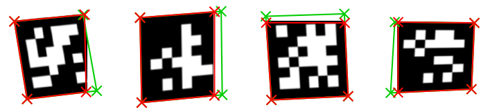
*그림 8 — 영상 경계에 가려진 AprilTag. 초록색은 참값 태그 경계, 빨간색은 태그 검출의 잘못된 결과다. 여기서는 예로 AprilTag 3를 골랐다.*

**표 II. 최대 위치 오차($e_{\max}$)와 검출된 태그 수($N$)의 비교. 평가는 세 가지 필터링 방식으로 했다: a) 필터링 전혀 없음('All'), b) 가려진 코너를 걸러 냄('Visible Corn.'), c) 네 코너가 모두 보이는 태그만('Fully Visible').**

| | All $e_{\max}$ | All $N$ | Visible Corn. $e_{\max}$ | Visible Corn. $N$ | Fully Visible $e_{\max}$ | Fully Visible $N$ |
|---|---|---|---|---|---|---|
| AprilTag 3 | 41.91 | 154948 | 8.64 | 154254 | 1.17 | 153200 |
| AprilTags C++ | 44.40 | 155056 | 29.28 | 154339 | 2.36 | 153196 |
| ArUco | 27.74 | 154412 | 2.34 | 153857 | 2.34 | 152952 |
| ArUco OpenCV | 38.89 | 154584 | 3.17 | 153970 | 3.17 | 153024 |
| Total | | 158940 | | 156336 | | 153200 |

부분적인 에지 가림은 영상 경계에서 생기거나, 태그와 카메라 사이에 다른 물체가 놓일 때 생길 수 있다. 효과는 같으므로, 간단히 하기 위해 여기서는 *random* 시나리오를 써서 영상 가장자리의 가림만 살펴본다.

표 II에서 보듯, 조사한 네 알고리즘 모두 가장자리가 부분적으로 가려진 태그에서 문제를 보인다. 완전히 보이는 태그만 고려하면 모든 알고리즘의 오차는 몇 화소에 불과하다(표 II의 'Fully Visible' 열). 그러나 모든 태그를 평가하면 최대 약 40 px의 오차가 생긴다(표 II의 'All' 열). 마커의 코너 하나만 가려져도 AprilTag 3, 특히 AprilTags C++에서 훨씬 큰 오차가 생긴다(표 II의 'Visible Corn.' 열). 이는 이 알고리즘들이 다른 알고리즘은 검출할 수 없는, 심하게 가려진 태그도 검출할 수 있기 때문이다.

검출 알고리즘이 주는 정보만으로는 테두리가 부분적으로 가려져 위치가 나쁘게 추정된 태그를 식별할 수 없다. 이 문제를 다루는 한 가지 방법을 IV-D절에서 제시한다.

## IV. 위치 정확도 개선 (Improving the Localization Accuracy)

위치 정확도를 높이는 여러 접근이 이미 제안되었다. 널리 쓰이는 두 가지는 에지 정밀화와 코너 정밀화다. 또 다른 가능성은 태그 자체를 확장하는 것이다. 이 절에서는 *random* 데이터셋을 써서 이 접근들의 이점을 자세히 살펴본다.

### A. 에지 정밀화 (Edge Refinement)

에지 정밀화 방법은 AprilTag 2의 저자들이 제안했다[12]. 아이디어는 검출된 사각형(quad)의 에지를 따라 영상 기울기(gradient)를 써서 새 에지를 맞추는 것이다. 각 에지를 따라, 에지의 법선 방향으로 고르게 떨어진 점들에서 영상 기울기를 샘플링한다. 이 점들을 기울기 크기로 가중 평균해 정밀화된 에지를 계산한다. 그런 다음 맞춘 사각형 직선들의 교점이 실제 사각형 코너를 결정한다.

에지 정밀화는 태그 검출에 관한 어떤 파라미터도 사용자에게 노출하지 않는 AprilTags C++를 제외한 모든 라이브러리에 구현되어 있다. 에지 정밀화를 켰을 때 처리 시간이 늘어나는 것은 관찰되지 않았다.

그림 9a에서 보듯, AprilTag 3의 에지 정밀화는 위치 오차를 중앙값 0.10 px, 최대 0.73 px로 크게 줄인다. 반면 두 ArUco 구현에서는 포함된 에지 정밀화가 오히려 위치 정확도를 나쁘게 할 수도 있다.

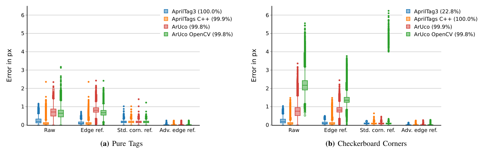
*그림 9 — 평가한 모든 검출 라이브러리의 정밀화 방법별 위치 정확도 개관. 괄호 안은 각 알고리즘의 검출률이다. 체커보드 코너의 경우 AprilTag 3의 검출률이 떨어진 것에 유의하라. (a) 순수 태그 (b) 체커보드 코너.*

### B. 코너 정밀화 (Corner Refinement)

AprilTag에서 관심점은 코너이므로, 검출 단계 뒤에 표준 코너 정밀화 알고리즘을 적용해 위치 정확도를 높일 수 있다. 이 작업에 흔히 쓰는 방법은 Förstner가 제안한 알고리즘[17]이다.

실험 평가에서는 모든 영상에 대해 창 크기를 5 px로 고정한 OpenCV의 `cornerSubPix`를 쓴다. 코너당 약 0.01 ms가 걸린다.

그림 9a에서 보듯, 이렇게 뒤이어 코너 정밀화를 적용하면 원시 검출보다 위치 정확도가 크게 향상된다. 또한 네 라이브러리의 결과 오차가 매우 비슷해지는데, 이제 오차가 코너 정밀화에만 좌우되기 때문이다. 이렇게 하면 중앙값 오차 0.17 px, 최대 오차 1 px을 얻을 수 있다. 그러나 AprilTag 3의 에지 정밀화를 넘어서지는 못한다.

### C. 체커보드 코너로의 확장 (Extension to Checkerboard Corners)

원시 태그에 코너 정밀화를 적용하는 것 외에, 영상에 체커보드 코너가 나타나도록 태그를 확장할 수도 있다.

OpenCV의 ChArUco처럼 태그를 체커보드의 흰 칸 안에 넣을 수도 있고(그림 10a 참조), 카메라 보정 도구 상자 kalibr⁴처럼 각 태그의 네 모서리에 검은 정사각형을 덧붙일 수도 있다(그림 10b). 후자를 쓰면 태그를 재배치할 필요가 없으므로 원시 태그와 확장 태그를 직접 비교할 수 있다.

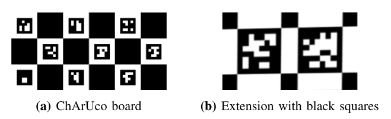
*그림 10 — AprilTag 보드에 체커보드 코너를 추가하는 흔한 두 방법. (a) ChArUco 보드 (b) 검은 정사각형으로 확장.*

> ⁴ https://github.com/ethz-asl/kalibr 에서 받을 수 있다.

합성 데이터로 평가하므로, 순수 태그와 확장 태그의 영상 데이터를 완전히 동일한 조건에서 생성할 수 있다. 따라서 그림 9a와 그림 9b를 비교하면 순수 AprilTag 대신 체커보드 코너를 쓰는 효과가 드러난다.

전반적으로 세 가지 효과를 관찰할 수 있다. 1) AprilTag 3의 검출률이 뚜렷이 떨어진다. 2) ArUco OpenCV의 원시 검출은 훨씬 부정확해지는 반면, ArUco는 약간만 영향을 받는다. 3) 코너 정밀화 뒤의 결과는 모든 알고리즘에서 순수 태그보다 우수하다. 이렇게 하면 중앙값 오차 0.08 px, 최대 오차 0.6 px(ArUco OpenCV의 이상치 제외)을 얻는다.

### D. 나쁜 태그 검출 걸러 내기 (Filtering out Bad Tag Detections)

지금까지 설명한 기법들은 완전히 보이는 태그의 위치 정확도를 높일 수 있지만, 테두리 가림 때문에 생길 수 있는 큰 오차에는 도움이 되지 않는다(III-G절 참조). 이를 위해 체커보드 코너를 써서 부분적으로 가려진 코너점을 검출하는, 간단하지만 매우 효과적인 알고리즘을 개발했다(그림 11 참조). 이 알고리즘은 체커보드 코너가 가려지는 순간 보통 코너로 바뀐다는 사실에 기반하며, 다음 단계로 요약할 수 있다.

1) 입력 영상을 임계처리(thresholding)해 이진 영상을 만든다.
2) 열림(opening)과 닫힘(closing)을 수행해 잡음 인공물을 없앤다.
3) 각 코너점에 대해:
   a) 검출된 코너점 둘레의 원을 따라 화소값을 읽는다.
   b) 1차원 신호에서 섹터(sector)를 분할한다.
   c) 식 (1)을 만족하지 않으면 코너를 걸러 낸다.

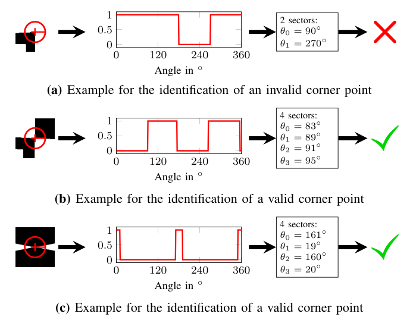
*그림 11 — 유효하지 않은 코너를 걸러 내는 단계. (a) 유효하지 않은 코너점을 식별하는 예 (b) 유효한 코너점을 식별하는 예 (c) 유효한 코너점을 식별하는 예.*

체커보드 코너는 섹터 네 개를 만들며, 마주 보는 섹터끼리는 크기가 거의 같다. 따라서 $\theta_0$에서 $\theta_3$를 섹터의 중심각이라 하면 다음이 성립해야 한다.

$$N = 4 \ \wedge\ |\theta_0 - \theta_2| < \Delta\theta_{\max.} \ \wedge\ |\theta_1 - \theta_3| < \Delta\theta_{\max.} \tag{1}$$

여기서 $\Delta\theta_{\max.}$는 설계 파라미터다. 실험에서는 30°를 썼다.

제안한 방법은 참값 정보를 쓰지 않고도 표 II에 나열된 큰 오차를 내는 태그를 걸러 낼 수 있다. 처리에는 코너당 0.04 ms가 걸린다.

### E. 고급 에지 정밀화 (Advanced Edge Refinement)

AprilTag 검출의 위치 정확도를 더 높이기 위해, 최적화 기반의 새 에지 정밀화를 개발했다.

태그의 네 에지 각각을 직선 $\boldsymbol{x} = [\boldsymbol{n}, d_0]^\top$으로 모델링하며, 직선 위의 모든 점 $\boldsymbol{p}$에 대해 다음이 성립한다.

$$\boldsymbol{n} \cdot \boldsymbol{p} + d_0 = 0. \tag{2}$$

각 직선의 파라미터는 검출된 코너점으로 초기화한 뒤, 다음 비용 함수를 최소화해 서로 독립적으로 정밀화한다.

$$\hat{\boldsymbol{x}}_i = \underset{\boldsymbol{x}_i}{\operatorname{argmin}} \sum_{\boldsymbol{p} \in \mathcal{M}} \left[\mathrm{I}(\boldsymbol{p}) - \mathrm{f}(\boldsymbol{p}, \boldsymbol{x}_i)\right]^2, \tag{3}$$

여기서 $\mathrm{I}(\boldsymbol{p})$와 $\mathrm{f}(\boldsymbol{p}, \boldsymbol{x}_i)$는 $\boldsymbol{x}_i$로 표현된 직선이 주어졌을 때 영상 위치 $\boldsymbol{p}$에서의 실제 밝기값과 예상 밝기값이다. 예측 밝기는 이상적 에지 모델(예: 그림 12에 나타낸 모델)로부터, 주어진 점 $\boldsymbol{p}$와 직선 사이의 거리 $\mathrm{d}(\boldsymbol{p}, \boldsymbol{x}_i)$를 써서 구한다.

$$\mathrm{d}(\boldsymbol{p}, \boldsymbol{x}_i) = \boldsymbol{n} \cdot \boldsymbol{p} + d_0. \tag{4}$$

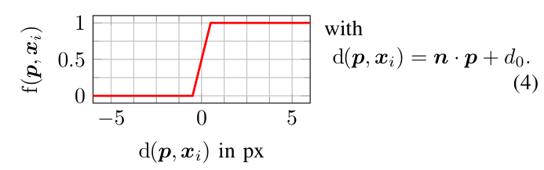
*그림 12 — 구간별 선형 함수(piece-wise linear function)를 쓴 이상적 에지 모델.*

쓰인 에지 모델은 그림 12의 구간별 선형 함수에 국한되지 않으며, 더 발전된 모델로 바꿀 수도 있음에 유의한다.

식 (3)의 비용 함수는 실제 에지 근처에 있는 화소들, 즉 집합 $\mathcal{M}$으로 나타낸 화소들만 고려한다. 해당 마스크의 예는 그림 13a에 있다.

실험에서는 식 (3)의 최적화 문제를 Ceres 라이브러리[18]로 모델링하고 풀었다. 그림 13은 정밀화 과정 전후의 실제 영상과 예측 밝기의 예를 보여 준다³.

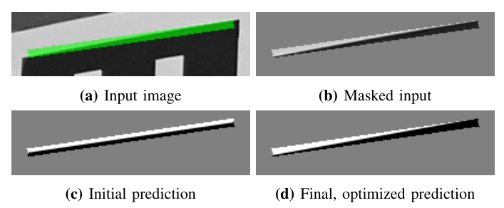
*그림 13 — 제안 방법으로 단일 에지를 정밀화한 실제 환경 예. 그림은 다음을 보여 준다: (a) 마스크를 초록색으로 강조한 원본 영상, (b) 마스크를 적용한 입력 영상, 최적화 전(c)과 후(d)의 예측 밝기값. 최적화 뒤의 예측 밝기값(d)이 원본 영상(d)의 값과 매우 잘 일치함에 유의하라.* [역주: 캡션 마지막의 "원본 영상 (d)"는 원문 그대로다. 문맥상 (a) 또는 (b)를 뜻하는 것으로 보인다.]

정밀화된 에지 직선 $\hat{\boldsymbol{x}}_i$를 찾은 뒤, 대응하는 에지 직선들의 교점으로 정밀화된 코너 위치를 구한다.

그림 9는 제안 방법의 효과를 보여 준다. 중앙값 위치 오차는 OpenCV의 코너 정밀화에 비해 10분의 1인 0.017 px로 줄고, 최대 오차 0.26 px을 달성한다. 표준 코너 정밀화와 달리 이 결과는 체커보드 코너의 유무와 무관하다. 또한 그림 9b에서 보듯 이 방법은 나쁜 초기 검출에 덜 민감하다. 이 덕분에 방법이 더 유연해진다. 저자들의 구현에서 코너당 처리 시간은 평균 1.1 ms다. 다만 설명한 에지 정밀화는 테두리의 부분 가림을 보상할 수 없음에 유의한다. 이를 위해서는 IV-D절에서 설명한 필터링을 추가로 써야 한다.

개발한 후처리 기법을 보여 주는 ROS 패키지는 https://github.com/UniBwTAS/apriltags_tas 에서 찾을 수 있다.

## V. 결론 및 전망 (Conclusion and Outlook)

이 논문에서는 흔히 쓰이는 AprilTag 검출 라이브러리 네 가지를 폭넓게 비교한 결과를 제시했다. 조사한 라이브러리의 성능은 계산 시간과 결과 정확도 면에서 크게 달랐다.

전반적인 권고는 다음과 같다. 매우 짧은 계산 시간이 필요하면 ArUco OpenCV를, 정확도가 가장 중요한 요구 사항이면 AprilTags C++를, 작은 태그에서도 매우 높은 검출률이 중요하면 AprilTag 3를 쓴다. 일반적으로 결과는 AprilTag 3가 계산 시간과 위치 정확도 사이의 전체 균형(tradeoff)이 가장 좋음을 보여 준다. 다만 현재는 체커보드 코너를 쓸 수 없다는 제약이 있다.

후처리에서의 추가 정밀화는 언제나 이롭다. 특히 새로 제안한 최적화 기반 에지 정밀화는 극히 정확한 결과를 낸다. 또한 태그를 체커보드 코너로 확장하면, 부분적으로 가려진 태그가 일으키는 이상치를 쉽게 검출해 걸러 낼 수 있음을 보였다.

저자들은 이 데이터셋과 이 논문에서 제시한 통찰이 기존 검출 라이브러리를, 주로 위치 정확도 면에서 더 개선하는 데 도움이 되기를 바란다.

## 참고문헌

- [1] D. Tang, T. Hu, L. Shen, Z. Ma, and C. Pan, "AprilTag array-aided extrinsic calibration of camera–laser multi-sensor system," Proceedings of IEEE International Conference on Robotics and Biomimetics (ROBIO), vol. 3, no. 1, p. 13, 2016.
- [2] A. Richardson, J. Strom, and E. Olson, "AprilCal: Assisted and repeatable camera calibration," in Proceedings of IEEE/RSJ International Conference on Intelligent Robots and Systems (IROS), 2013, p. 1814–1821.
- [3] C. Nissler, S. Büttner, Z. Marton, L. Beckmann, and U. Thomasy, "Evaluation and Improvement of Global Pose Estimation with Multiple AprilTags for Industrial Manipulators," in Proceedings of IEEE International Conference on Emerging Technologies and Factory Automation (ETFA), 2016.
- [4] E. Westman and M. Kaess, "Underwater AprilTag SLAM and calibration for high precision robot localization," Carnegie Mellon University, Pittsburgh, Tech. Rep., Oct. 2018.
- [5] C. Feng, Y. Xiao, A. Willette, W. McGee, and V. Kamat, "Towards Autonomous Robotic In-Situ Assembly on Unstructured Construction Sites Using Monocular Vision," in Proceedings of International Symposium on Automation and Robotics in Construction, 2014, p. 163–170.
- [6] J. Wang, C. Sadler, C. F. Montoya, and J. C. L. Liu, "Optimizing Ground Vehicle Tracking Using Unmanned Aerial Vehicle and Embedded Apriltag Design," in Proceedings of International Conference on Computational Science and Computational Intelligence (CSCI), Dec. 2016, p. 739–744.
- [7] C. Winkens and D. Paulus, "Long Range Optical Truck Tracking," in ICAART, 2017.
- [8] H. Kato and M. Billinghurst, "Marker Tracking and HMD Calibration for a Video-based Augmented Reality Conferencing System," in Proceedings of IEEE/ACM International Workshop on Augmented Reality (IWAR), 1999, p. 85–94.
- [9] M. Fiala, "Designing Highly Reliable Fiducial Markers," IEEE Transactions on Pattern Analysis and Machine Intelligence, vol. 32, no. 7, p. 1317–1324, 2009.
- [10] E. Olson, "AprilTag: A robust and flexible visual fiducial system," in Proceedings of IEEE International Conference on Robotics and Automation (ICRA), May 2011, p. 3400–3407.
- [11] S. Garrido-Jurado, R. Muñoz-Salinas, F. J. Madrid-Cuevas, and M. J. Marín-Jiménez, "Automatic generation and detection of highly reliable fiducial markers under occlusion," Pattern Recognition, vol. 47, no. 6, p. 2280–2292, 2014.
- [12] J. Wang and E. Olson, "AprilTag 2: Efficient and robust fiducial detection," in Proceedings of IEEE/RSJ International Conference on Intelligent Robots and Systems (IROS), Oct. 2016.
- [13] F. Romero Ramirez, R. Muñoz-Salinas, and R. Medina-Carnicer, "Speeded Up Detection of Squared Fiducial Markers," Image and Vision Computing, vol. 76, Jun. 2018.
- [14] M. Krogius, A. Haggenmiller, and E. Olson, "Flexible Layouts for Fiducial Tags," in Proceedings of IEEE/RSJ International Conference on Intelligent Robots and Systems (IROS), 2019.
- [15] K. Shabalina, A. Sagitov, L. Sabirova, H. Li, and E. Magid, "ARTag, AprilTag and CALTag Fiducial Systems Comparison in a Presence of Partial Rotation: Manual and Automated Approaches," in International Conference on Informatics in Control, Automation and Robotics. Springer, 2017, p. 536–558.
- [16] A. López-Cerón and J. M. Canas, "Accuracy analysis of marker-based 3D visual localization," in XXXVII Jornadas de Automatica Workshop, 2016.
- [17] W. Förstner and E. Gülch, "A Fast Operator for Detection and Precise Location of Distinct Points, Corners and Centres of Circular Features," in Proc. ISPRS intercommission conference on fast processing of photogrammetric data. Interlaken, 1987, p. 281–305.
- [18] S. Agarwal, K. Mierle, and Others, "Ceres Solver," http://ceres-solver.org.
