# ChArUco 보드 기반 온라인 핸드-아이 보정 방법 연구 (Lin 2022)

- 원제: Research of Online Hand–Eye Calibration Method Based on ChArUco Board
- 원문: 같은 폴더의 `Lin2022_Sensors.pdf` (Sensors 2022, 22, 3805, Communication. https://doi.org/10.3390/s22103805, MDPI, CC BY 4.0)
- 저자: Wenwei Lin†, Peidong Liang†, Guantai Luo, Ziyang Zhao, Chentao Zhang* (Fujian (Quanzhou)-HIT Research Institute of Engineering and Technology, 중국 취안저우). †공동 제1저자, *교신저자
- 번역 범위: 전문 (본문·수식·그림 캡션·표·기타 사항). 참고문헌은 원문 그대로 옮겼다.
- 그림: 원문 그림 13개를 `그림/`에 넣고 본문에서 처음 언급되는 곳에 삽입 (그림 10은 원문에서 두 쪽에 걸쳐 있어 한 장으로 이어 붙였다)
- 참고: PDF 안에 심사본(“FOR PEER REVIEW”) 텍스트 층이 겹쳐 있어 텍스트 추출이 깨지므로, 쪽 이미지를 직접 읽어 번역했다.

## 초록

“아이-인-핸드(eye-in-hand)” 방식에서 오프라인 핸드-아이 보정(hand–eye calibration)의 비유연성 문제를 해결하기 위해, 이 논문에서는 ChArUco 보드에 기반한 온라인 핸드-아이 보정 방법을 제안한다. 먼저 핸드-아이 보정의 수학적 모델과 ChArUco 보드의 영상 특징을 분석하여 ChArUco 보드 기반 핸드-아이 보정 모델을 수립한다. 체커보드와 ArUco 마커를 모두 갖춘 ChArUco 보드의 장점에 따라, ChArUco 보드 기반 온라인 핸드-아이 보정 알고리즘을 설계한다. 다음으로 ChArUco 보드 기반 온라인 핸드-아이 보정 알고리즘을 이용해 핸드-아이 위치 관계의 동적 조정을 실현한다. 마지막으로 핸드-아이 보정 실험을 수행하여 ChArUco 보드 기반 핸드-아이 보정의 정확도를 검증한다. 제안 방법의 강건성과 정확도는 온라인 핸드-아이 보정 실험으로 검증한다. 실험 결과, 이 논문에서 제안한 온라인 핸드-아이 보정 방법의 정확도는 0.4 mm에서 0.6 mm 사이로, 오프라인 핸드-아이 보정 정확도와 거의 같다. 이 논문의 방법은 ChArUco 보드의 장점을 활용해 온라인 핸드-아이 보정을 실현하며, 핸드-아이 보정의 유연성과 강건성을 향상한다.

키워드: 핸드-아이 보정(hand–eye calibration); ChArUco 보드(ChArUco board); 로봇(robot)

> 인용: Lin, W.; Liang, P.; Luo, G.; Zhao, Z.; Zhang, C. Research of Online Hand–Eye Calibration Method Based on ChArUco Board. Sensors 2022, 22, 3805. 학술 편집자: Charlie Yang. 접수: 2022년 4월 13일, 승인: 2022년 5월 15일, 게재: 2022년 5월 17일.
> 출판사 고지: MDPI는 출판된 지도와 기관 소속에 관한 관할권 주장에 대해 중립을 유지한다.
> 저작권: © 2022 저자들. 라이선스 MDPI(스위스 바젤). 이 논문은 크리에이티브 커먼즈 저작자 표시(CC BY) 라이선스(https://creativecommons.org/licenses/by/4.0/) 조건에 따라 배포되는 오픈 액세스 논문이다.

## 1. 서론 (Introduction)

산업용 로봇의 활용은 기업의 생산 효율과 제품 품질을 크게 향상하였다 [1,2]. 그러나 산업용 로봇의 전통적인 작업 방식은 늘어나는 생산 수요를 충족하지 못하게 되었다. 비전 센서를 장착한 산업용 로봇은 영상 처리 기술로 주변 환경을 인지하여 로봇 작업의 “유연성”을 높이고, 로봇이 더 복잡한 생산 작업을 완수할 수 있게 한다 [3–5]. 핸드-아이 보정은 로봇의 시각 서보(visual servo) 작업에서 없어서는 안 될 부분으로, 로봇과 비전 센서를 잇는 중요한 다리이다. 핸드-아이 보정은 카메라 좌표계와 로봇 좌표계 사이의 좌표 변환 관계를 구하는 과정이다. 핸드-아이 보정의 정확도는 로봇 작업의 정확도에 직접 영향을 준다. 핸드-아이 보정 연구를 위해 학자들은 많은 이론과 방법을 제안하였다. Wu 등 [6]과 Yang 등 [7]은 3D 카메라에서 보정용 구(calibration ball)의 위치와 로봇의 이동 궤적을 추적하여 핸드-아이 문제를 풀었다. Chen 등 [8]과 Wang 등 [9]는 3D 보정 물체의 특징점을 식별하여 카메라와 보정물(calibrator) 사이의 위치 관계를 보정하고, 로봇의 대응 자세를 통해 핸드-아이 행렬을 풀었다. 3D 보정물 기반 핸드-아이 보정 방법은 핸드-아이 행렬을 푸는 가장 효과적인 방법 중 하나이지만, 3D 데이터 처리에 많은 시간이 들고 3D 점군(point cloud)의 품질이 계산 결과에 절대적인 영향을 준다.

3D 보정물 기반 핸드-아이 보정 방법에 비해 2D 영상 기반 핸드-아이 보정 방법이 더 널리 쓰인다. 체커보드 패턴의 특징점은 검출하기 쉬우므로, 고전적인 핸드-아이 보정 이론 대부분이 이를 보정물로 사용한다 [10–12]. 최근에는 다른 학자들도 체커보드 기반 핸드-아이 보정 방법을 연구하였다. Deng 등 [13]은 단위 팔원수(unit octonion) 기반 핸드-아이 보정 방법을 제안하고, 카메라와 체커보드로 그 효과를 검증하였다. Lee 등 [14]는 체커보드 보정에 기반한 자동 핸드-아이 보정 시스템을 설계하였다. 또한 영상 부호화 기법으로서 ArUco 마커가 핸드-아이 보정에 자주 쓰인다. Huang 등 [15]는 ArUco 마커를 이용한 핸드-아이 보정 방법과 서포트 벡터 머신(SVM) 검출 방법으로 특정 물체를 식별하여 로봇의 유연한 파지를 실현하였다. Feng 등 [16]은 ArUco 마커 기반 핸드-아이 보정 방법을 이용해 비전 유도에 기반한 로봇의 자율 조립과 스캐닝을 실현하였다. 체커보드의 흑백 교차 패턴 특징은 특징점을 식별하기 쉽게 한다. 그러나 체커보드 타깃이 가려지거나 조명 조건이 나쁘면 보정 보드의 자세를 인식하기 어렵다. ArUco 마커는 검출이 빠르고 유연하다는 장점이 있다. 그러나 ArUco 마커의 코너 검출 정확도는 그다지 높지 않다. 게다가 대부분의 핸드-아이 보정 알고리즘은 오프라인으로 수행된다. 카메라와 로봇의 상대 위치가 바뀌면 핸드-아이 보정을 다시 수행해야 하는 경우가 많다.

이러한 문제를 해결하기 위해 이 논문에서는 ChArUco 보드 기반 온라인 핸드-아이 보정 방법을 제안한다. ChArUco 보드는 ArUco 마커와 체커보드를 결합한 것으로, 두 가지의 장점을 모두 갖는다. ChArUco 보드는 보정 보드의 체커보드 코너가 지닌 높은 부화소(sub-pixel) 검출 정확도를 이용해 ArUco 마커의 낮은 위치 정확도라는 단점을 보완하고, ArUco 마커의 고유한 부호화를 통해 체커보드의 약한 간섭 저항성 문제를 해결한다. ChArUco 보드의 검출 장점에 기반하여, 이 논문은 아이-인-핸드 방식의 온라인 핸드-아이 보정을 실현하기 위한 로봇의 폐루프 피드백 조정 시스템을 설계한다.

논문의 나머지 부분은 다음과 같이 구성된다. 2절은 핸드-아이 보정과 ChArUco 보드의 원리를 소개한다. 3절은 ChArUco 보드 기반 온라인 핸드-아이 보정 방법을 설명한다. 4절은 이 논문에서 제안한 방법의 정확도와 실현 가능성을 검증한다. 마지막으로 5절은 이 논문의 작업을 요약하고 향후 연구 과제를 살펴본다.

## 2. 핸드-아이 보정과 ChArUco 보드 (Hand–Eye Calibration and ChArUco Board)

핸드-아이 보정의 목적은 카메라 좌표계와 로봇 좌표계 사이의 좌표 변환 관계를 계산하는 것, 즉 회전 행렬 $\boldsymbol{R}$과 평행이동(병진) 벡터 $\boldsymbol{t}$를 구하는 것이었다. 핸드-아이 보정의 본질은 AX = XB 문제를 푸는 것이었다 [17–19]. 핸드-아이 보정은 그림 1과 같이 아이-인-핸드(eye-in-hand)와 아이-투-핸드(eye-to-hand) 방식으로 나뉘었다. 그림 1b와 같이 로봇 베이스와 보정 보드의 상대 위치는 변하지 않았고, 카메라와 로봇 끝단의 상대 위치도 변하지 않았다. 알려진 불변량 여러 세트에 따라 핸드-아이 보정 행렬을 풀 수 있었다.

식 (2)와 같이, 로봇 자세 변환과 카메라 외부 파라미터(extrinsic parameters)의 계산을 통해 핸드-아이 보정 행렬을 풀 수 있었다.

$${}^{b}T_g^{(1)} \cdot {}^{g}T_c \cdot {}^{c}T_t^{(1)} = {}^{b}T_g^{(2)} \cdot {}^{g}T_c \cdot {}^{c}T_t^{(2)} \tag{1}$$

$$\left({}^{b}T_g^{(2)}\right)^{-1} \cdot {}^{b}T_g^{(1)} \cdot {}^{g}T_c = {}^{g}T_c \cdot {}^{c}T_t^{(2)} \cdot \left({}^{c}T_t^{(1)}\right)^{-1} \tag{2}$$

$\left({}^{b}T_g^{(2)}\right)^{-1} \cdot {}^{b}T_g^{(1)} = A$, ${}^{c}T_t^{(2)} \cdot \left({}^{c}T_t^{(1)}\right)^{-1} = B$, ${}^{g}T_c = X$라 하면 다음이 된다.

$$AX = XB \tag{3}$$

여기서 ${}^{b}T_g$는 로봇 베이스 좌표계에 대한 로봇 끝단 좌표계의 동차 행렬, ${}^{c}T_t$는 카메라 좌표계에 대한 보정 보드 좌표계의 동차 행렬, ${}^{g}T_c$는 로봇 끝단 좌표계에 대한 카메라 좌표계의 동차 행렬을 나타낸다.

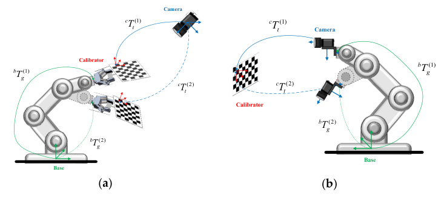
*그림 1 — 두 가지 핸드-아이 보정 방식: (a) 아이-투-핸드; (b) 아이-인-핸드. Base는 로봇의 베이스 좌표계, Camera는 카메라 좌표계, Calibrator는 보정 보드를 나타낸다.*

앞서 설명한 핸드-아이 보정의 수학적 모델에 따르면, 핸드-아이 보정의 풀이 과정에는 카메라 좌표계에 대한 보정 보드 좌표계의 동차 행렬 ${}^{c}T_t$를 구하는 것, 즉 카메라의 외부 파라미터를 계산하는 것이 필요했다. 이 논문에서는 ${}^{c}T_t$를 계산하기 위한 보정 물체로 ChArUco 보드를 선택하였다.

ArUco 마커는 유연하고 검출이 쉽다는 장점이 있다. 그러나 ArUco 마커는 가장자리 코너의 검출 정확도가 높지 않다는 문제가 있다. 코너에 부화소 처리를 수행해도 기대하는 정확도에 여전히 도달하지 못한다. 체커보드의 흑백 교차 패턴은 코너를 검출하기 쉽게 한다. 아쉽게도 체커보드의 유연성은 ArUco 마커만큼 넓지 않다. 체커보드를 보정 물체로 쓸 때는 체커보드가 완전히 보여야 했고, 가려져서는 안 되었다 [역주: 원문 “and could be blocked”는 문맥상 “could not be blocked”의 뜻으로 보인다]. ChArUco 보드는 체커보드와 ArUco 마커의 장점을 모두 지녔다. 또한 ChArUco 보드는 둘의 결점을 개선하였다. 그림 2는 세 보정 물체의 개략도를 보여 준다.

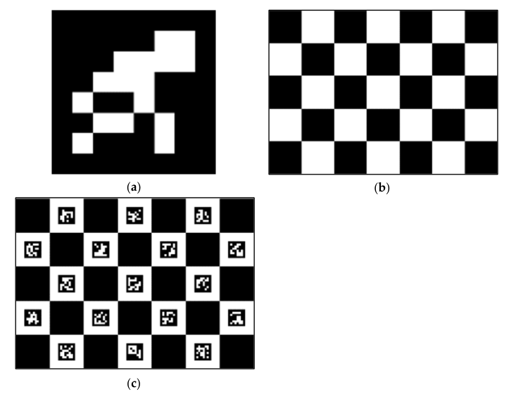
*그림 2 — (a) ArUco 마커; (b) 체커보드; (c) ChArUco 보드.*

## 3. ChArUco 보드 기반 온라인 핸드-아이 보정 (Online Hand–Eye Calibration Based on ChArUco Board)

그림 3과 같이, ChArUco 보드에서 코너 검출을 수행하면 체커보드의 코너와 부호화 패턴(coding pattern)이 식별되었다. 부호화 패턴의 복호 정보에 따라 보정 보드 각 코너의 위치를 순서대로 정렬할 수 있었다. ChArUco 보드가 부분적으로 가려져도 코너의 순서에는 영향이 없었다.

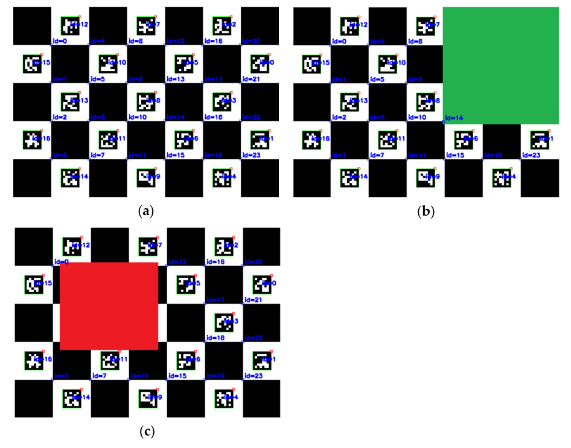
*그림 3 — 여러 상황에서의 ChArUco 보드 코너 검출: (a) 정상 상황에서의 코너 검출; (b) 코너가 가려졌을 때의 코너 검출; (c) 중간 부분이 가려졌을 때의 코너 검출.*

그림 4는 ChArUco 보드의 여러 가림(occlusion) 조건에서 카메라 외부 파라미터를 계산한 결과이다. ChArUco 보드의 가려진 면적이 작을 때는 카메라 외부 파라미터의 계산 결과에 영향이 없었다. ChArUco 보드의 가려진 면적이 너무 클 때는 카메라의 외부 파라미터를 계산할 수 없었다. 그러나 일부 부호화 패턴과 체커보드 위치는 여전히 인식할 수 있었다.

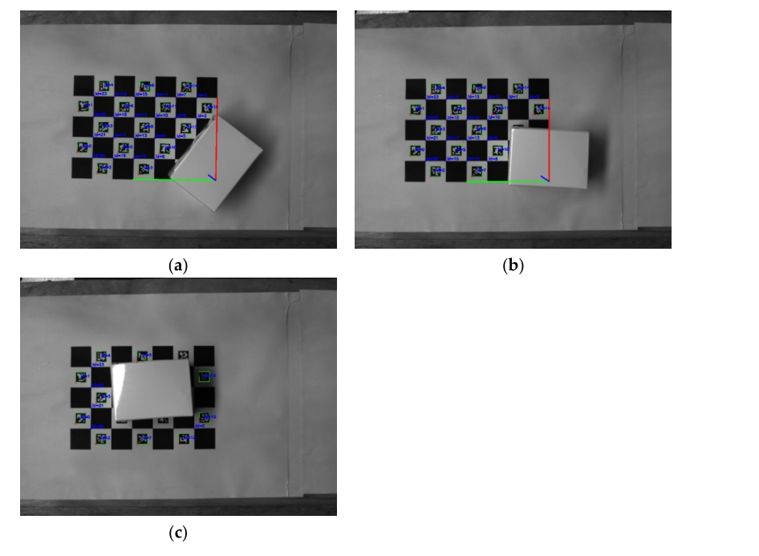
*그림 4 — 여러 가림 조건에서 ChArUco 보드에 기반한 카메라 외부 파라미터 계산 결과: (a,b) 작은 면적이 가려졌을 때의 카메라 외부 파라미터 계산 결과; (c) 큰 면적이 가려졌을 때의 카메라 외부 파라미터 계산 결과.*

또한 ChArUco 보드에서 인식 가능한 각 부호화 패턴의 자세는, 단일 ArUco 마커의 자세를 인식하듯이 계산할 수 있었다. 그림 5a는 카메라 좌표계에서 ArUco 마커의 자세를 보여 준다. 그림 5b는 카메라 좌표계에서 ChArUco의 인식 가능한 각 부호화 패턴의 자세를 보여 준다.

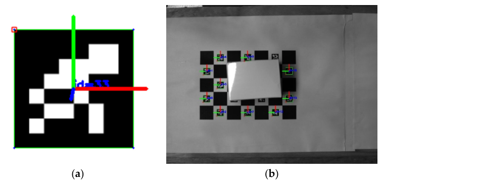
*그림 5 — (a) 카메라 좌표계에서 ArUco 마커의 자세; (b) 카메라 좌표계에서 ChArUco 보드의 인식 가능한 각 부호화 패턴의 자세.*

ChArUco 보드의 검출 장점에 기반하여, 이 논문은 온라인 핸드-아이 보정을 실현하기 위한 로봇의 폐루프 피드백 조정 시스템을 설계하였다. 그림 6과 같이 아이-인-핸드의 경우 카메라는 로봇 끝단에 부착된 “공구(tool)”로 볼 수 있었다. “부정확한” ${}^{g}T_c$는 로봇 기반 공구 보정(tool calibration) 방법 [20]으로 계산하였다. 또한 ${}^{c}T_t$는 ChArUco 보드의 검출로 계산할 수 있었다. ${}^{b}T_g$는 로봇 티치 펜던트(teach pendant)로 직접 얻을 수 있었다. 이 정보들로 ChArUco 보드와 로봇 사이의 대략적인 위치 관계를 계산할 수 있었다.

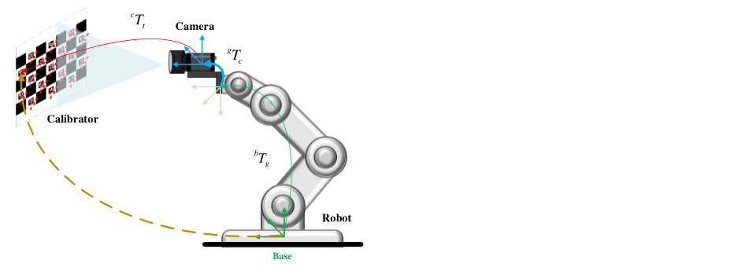
*그림 6 — ChArUco 보드와 로봇 사이의 위치 관계 개략도.*

그림 7은 ChArUco 보드 기반 온라인 핸드-아이 보정 과정을 보여 준다. 먼저 로봇이 티칭 자세로 이동한 뒤 카메라가 ChArUco 보드 보정 영상을 촬영하였다. 그다음 ChArUco 보드를 검출하여 보정 보드의 위치가 조건을 만족하는지 판단하였다. 만족하지 않으면 ChArUco 보드 위치 정보의 피드백에 따라 로봇 자세를 자동으로 조정하고 위 단계를 반복하였다. 만족하면 데이터를 저장하고 로봇 자세를 조정하여 다음 티칭 동작으로 넘어갔다. 수집한 핸드-아이 보정 데이터가 요구 조건을 충족하면 핸드-아이 보정 행렬을 풀었다.

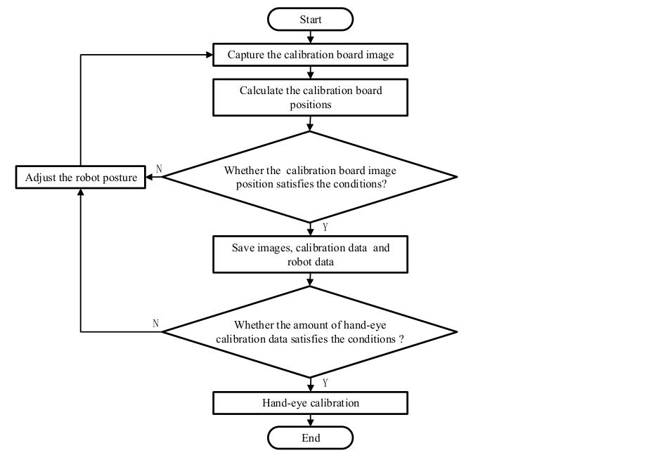
*그림 7 — ChArUco 보드 기반 온라인 핸드-아이 보정 과정. (흐름도: 시작 → 보정 보드 영상 촬영 → 보정 보드 위치 계산 → 보정 보드 영상 위치가 조건을 만족하는가? N이면 로봇 자세 조정 후 촬영으로 복귀, Y이면 영상·보정 데이터·로봇 데이터 저장 → 핸드-아이 보정 데이터의 양이 조건을 만족하는가? N이면 로봇 자세 조정 후 촬영으로 복귀, Y이면 핸드-아이 보정 → 끝)*

그림 8은 로봇 피드백 조정 전후의 영상 변화를 개략적으로 보여 준다.

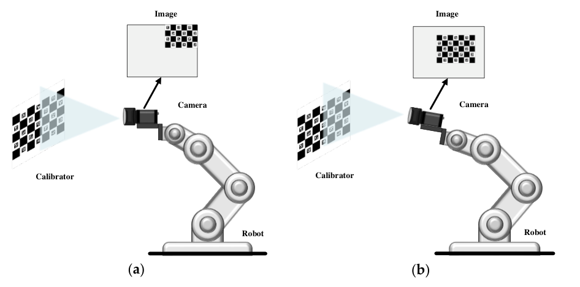
*그림 8 — (a) 로봇 조정 전 카메라가 촬영한 영상; (b) 로봇 조정 후 카메라가 촬영한 영상.*

## 4. 실험 및 분석 (Experiments and Analysis)

이 논문에서는 Hikvision의 MV-CE050-30GM 카메라, FUJINON의 CF8ZA-1S 렌즈, ABB의 IRB2600-20 로봇으로 실험 플랫폼을 구성하였다. 실험 플랫폼은 그림 9와 같다. 카메라는 로봇 끝단에 고정하고, 보정 보드는 실험대 위에 고정하였다. 이 실험 플랫폼을 바탕으로 이 논문은 ArUco 마커, 체커보드, ChArUco 보드의 세 가지 보정 방법의 정확도를 시험하고, ChArUco 보드 기반 온라인 핸드-아이 보정 실험을 수행하였다.

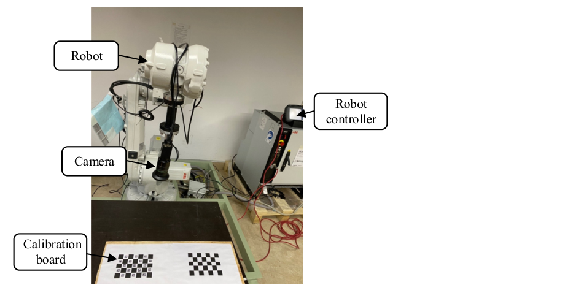
*그림 9 — 핸드-아이 보정 실험 플랫폼. (표기: Robot=로봇, Robot controller=로봇 제어기, Camera=카메라, Calibration board=보정 보드)*

실험 전에 실험에 쓴 카메라의 내부 파라미터(internal parameters)를 보정하였다. 카메라 내부 파라미터의 계산 결과는 다음과 같았다.

$$\text{CameraMatrix} = \begin{bmatrix} 3797.467 & 0 & 1310.649 \\ 0 & 3801.126 & 923.535 \\ 0 & 0 & 1 \end{bmatrix}$$

$$\text{DistCoeffs} = \begin{bmatrix} -0.1793 & 1.2373 & -0.0014 & 0.0008 & -7.1253 \end{bmatrix}$$

이 논문에서는 핸드-아이 보정 독립 실험을 10세트 수행하였고, 각 실험에서 ArUco 마커, 체커보드, ChArUco 보드에 기반한 핸드-아이 보정 데이터를 25세트씩 수집하였다. 세 보정 방법에 대한 카메라 외부 파라미터 계산 결과는 그림 10과 같다.

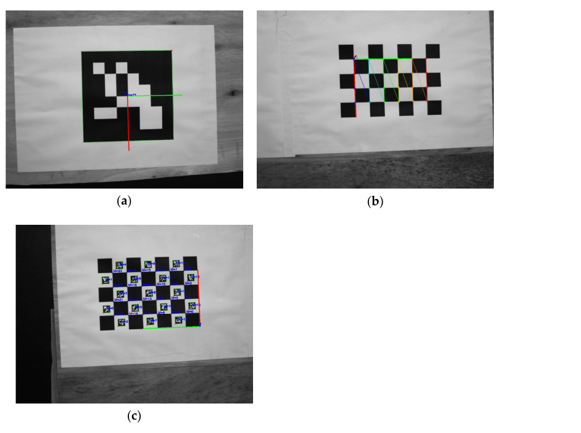
*그림 10 — (a) ArUco 마커 기반 카메라 외부 파라미터 계산; (b) 체커보드 기반 카메라 외부 파라미터 계산; (c) ChArUco 보드 기반 카메라 외부 파라미터 계산.*

그림 11은 ArUco 마커, 체커보드, ChArUco 보드에 기반한 핸드-아이 보정 불확도(uncertainty)를 보여 준다. 실험 데이터를 분석한 결과, ArUco 마커의 핸드-아이 보정 정확도가 가장 나빴고, 체커보드 및 ChArUco 보드와 비교한 최대 편차는 1.5 mm였다. 체커보드와 ChArUco 보드를 비교하면 둘의 보정 정확도는 거의 같았다.

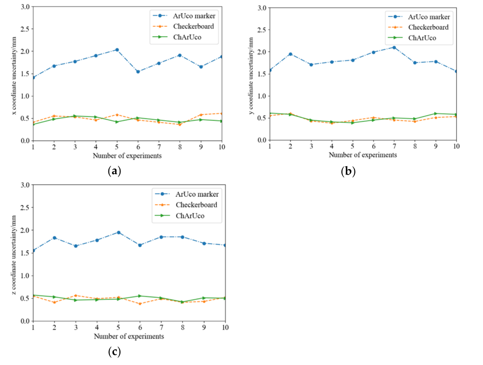
*그림 11 — 핸드-아이 보정 불확도: (a) x 좌표 재투영 불확도; (b) y 좌표 재투영 불확도; (c) z 좌표 재투영 불확도. (가로축: 실험 번호, 세로축: 좌표 불확도/mm. 범례: ArUco marker, Checkerboard, ChArUco)*

ChArUco 보드 기반 온라인 핸드-아이 보정 실험에서는 온라인 핸드-아이 보정 독립 실험을 10세트 수행하였다. 독립 실험 한 세트마다 로봇 티칭 동작을 25세트 설정하였고, ChArUco 보드는 카메라 시야 중심에서 벗어난 곳에 두었다. 그림 12는 ChArUco 보드 기반 온라인 핸드-아이 보정 실험 전후의 카메라 시야 변화를 보여 준다. ChArUco 보드 위 ArUco 마커의 코드 식별과 식별된 코드 개수의 통계를 통해, ChArUco 보드의 위치와 영상 안에서 차지하는 비율을 결정할 수 있었다. 그림에서 보듯이, 폐루프 피드백을 통한 로봇 조정 후 ChArUco 보드의 자세 인식이 실현될 수 있었다.

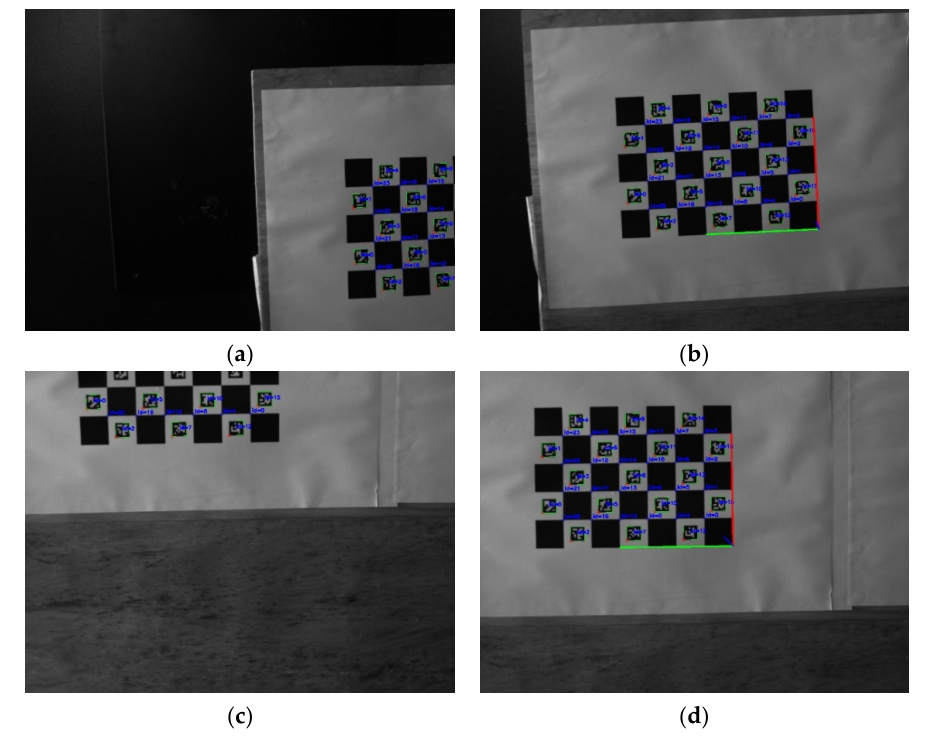
*그림 12 — ChArUco 보드 기반 온라인 핸드-아이 보정 실험: (a,c) 로봇 조정 전 카메라가 촬영한 영상; (b,d) 로봇 조정 후 카메라가 촬영한 영상.*

또한 그림 13과 같이, 이 논문은 온라인 핸드-아이 보정 실험 10세트에 대해 불확도 분석을 수행하였다. 그림에서 보듯이 ChArUco 보드 기반 온라인 핸드-아이 보정의 불확도는 0.4 mm에서 0.6 mm 사이로, 오프라인 핸드-아이 보정의 정확도와 거의 같다. 실험 결과는 이 논문의 방법이 온라인 핸드-아이 보정 문제를 효과적으로 해결하고, 보정 정확도의 안정성도 보장함을 보여 주었다.

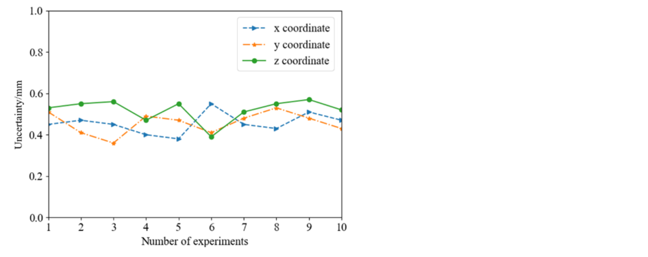
*그림 13 — 온라인 핸드-아이 보정 불확도 분석. (가로축: 실험 번호, 세로축: 불확도/mm. 범례: x 좌표, y 좌표, z 좌표)*

위 실험 결과로부터, 이 논문에서 제안한 온라인 핸드-아이 보정 방법이 온라인 핸드-아이 보정 문제를 효과적으로 해결할 수 있으며 강건성과 정확도 면에서 좋은 성능을 가졌음을 알 수 있다.

## 5. 결론 (Conclusions)

이 방법의 실용성을 보이기 위해 이 방법의 성능을 기존 방법과 비교하였으며, 결과는 표 1과 같다. [21,22]의 방법은 영상 안에서 보정판의 위치만 얻을 수 있었다. 핸드-아이 보정 과정에서 [21,22]의 방법은 보정판 전체가 보이도록 보장해야 했고, 체커보드 특징점과 원형 패턴이 가려져서는 안 되었다. 이 방법에서 쓴 ChArUco 보드는 보정 보드의 위치와 자세를 얻을 수 있었고, 가림 상황에 대해 어느 정도의 간섭 저항성을 가졌다 [역주: 원문은 “had certain interference to the occlusion situation”]. 따라서 이 논문의 방법은 로봇 조정에서 더 나은 유연성을 가졌다. 핸드-아이 보정 과정에서 이 논문의 방법은 더 나은 강건성을 가졌다. 이 논문에서 쓴 ChArUco 보드의 특징점 계산 과정은 시간이 더 걸렸지만, 이 논문의 방법은 보정 보드의 위치와 자세를 얻을 수 있어 로봇의 조정 횟수를 줄였다. 전체 소요 시간은 [21,22]의 방법보다 나았다. 이 논문의 방법은 유효한 핸드-아이 보정 데이터 하나를 완성하는 데 0.5–2 s만 필요했다. 또한 이 논문의 방법은 유연성과 강건성이 더 좋아서, 같은 외란 아래에서 더 많은 유효 핸드-아이 보정 데이터를 수집할 수 있었다. 따라서 핸드-아이 보정의 정확도도 더 좋을 것이다.

**표 1.** 온라인 핸드-아이 보정 알고리즘의 성능 비교.

| 방법 (Methods) | 유연성 (Flexibility) | 강건성 (Robustness) | 소요 시간 (Time Consumption) | 정확도 (Accuracy) |
|---|---|---|---|---|
| Reference [21] | Low | Bad | High | Low |
| Reference [22] | Low | Bad | High | Low |
| Our Method | High | Good | Low | High |

아이-인-핸드 방식에서 오프라인 핸드-아이 보정이 유연하지 않은 문제를 겨냥하여, 이 논문에서는 ChArUco 보드 기반 온라인 핸드-아이 보정 방법을 제안하였다. 이 논문의 방법은 체커보드 코너의 높은 부화소 인식 정확도와 ArUco 마커의 강한 유연성이라는 ChArUco 보드의 장점을 활용하여 보정 보드의 위치 결정을 실현하였다. 보정 보드와 로봇 사이의 위치 관계를 수립하였다. 그다음 영상 안에서 ChArUco 보드의 위치를 검출하여 폐루프 피드백으로 로봇을 자동 조정하였다. 로봇 자동 제어로 충분한 핸드-아이 보정 데이터를 수집하여 온라인 핸드-아이 보정을 완료하였다. 이 논문에서는 비교 실험으로 ChArUco 보드 기반 핸드-아이 보정의 정확도를 검증하였다. 방법의 강건성과 정확도는 온라인 핸드-아이 보정 실험으로 검증하였다.

이 논문의 현재 연구에서는 로봇 운동 오차로 인한 핸드-아이 보정에의 영향을 고려하지 않았다. 향후 연구에서는 로봇 운동 오차가 핸드-아이 보정 정확도에 미치는 영향을 연구하고, 로봇 운동 오차의 영향을 제거하는 방법을 고려할 것이다. 이는 흥미롭고 의미 있는 연구 방향이 될 것이다.

## 기타 사항

- 저자 기여(Author Contributions): 개념화, P.L., G.L.; 방법론, P.L.; 소프트웨어, W.L.; 검증, C.Z.; 형식 분석, P.L., Z.Z., C.Z.; 조사, W.L.; 자원, W.L., C.Z.; 데이터 관리, C.Z.; 원고 초안 작성, C.Z., P.L., G.L.; 원고 검토 및 편집, C.Z., W.L.; 시각화, Z.Z.; 감독, W.L., C.Z. 모든 저자는 출판본 원고를 읽고 동의하였다.
- 연구비(Funding): 이 연구는 중국 국가 중점 연구개발 계획(National Key Research and Development Program of China, 과제 번호 2018YFB1305703)과 취안저우시 과학기술 계획(Scientific and Technological Program of Quanzhou City, 과제 번호 2020FX02)의 지원을 받았다.
- 기관 윤리위원회 승인: 해당 없음.
- 연구 대상자 동의: 해당 없음.
- 데이터 가용성: 이 연구에서 제시한 데이터는 교신저자에게 요청하면 받을 수 있다. 데이터는 개인정보 보호 때문에 공개되지 않는다.
- 이해 상충: 저자들은 이해 상충이 없음을 밝힌다.

## 참고문헌

1. Anzolin, G.; Andreoni, A.; Zanfei, A. Robot adoption and FDI driven transformation in the automotive industry. Int. J. Automot. Technol. Manag. 2020, 20, 215–237.
2. Bjørlykhaug, E.; Egeland, O. Vision system for quality assessment of robotic cleaning of fish processing plants using CNN. IEEE Access 2019, 7, 71675–71685.
3. Li, C.; Chen, P.; Xu, X.; Wang, X.Y.; Yin, A.J. A Coarse-to-Fine Method for Estimating the Axis Pose Based on 3D Point Clouds in Robotic Cylindrical Shaft-in-Hole Assembly. Sensors 2021, 21, 4064.
4. Liu, S.; Xing, D.P.; Li, Y.F.; Zhang, J.W.; Xu, D. Robust insertion control for precision assembly with passive compliance combining vision and force information. IEEE/ASME Trans. Mechatron. 2019, 24, 1974–1985.
5. Jiang, T.; Cui, H.H.; Cheng, X.S. A calibration strategy for vision-guided robot assembly system of large cabin. Measurement 2020, 163, 107991.
6. Wu, H.Y.; Tizzano, W.; Andersen, T.T.; Andersen, N.A.; Ravn, O. Hand-Eye Calibration and Inverse Kinematics of Robot Arm using Neural Network. In Proceedings of the RITA 2013: The 2nd International Conference on Robot Technology and Appliactions, Denver, CO, USA, 18–20 December 2013; pp. 581–591.
7. Yang, L.X.; Cao, Q.X.; Lin, M.J.; Zhang, H.R.; Ma, Z.M. Robotic hand-eye calibration with depth camera: A sphere model approach. In Proceedings of the 2018 4th International Conference on Control, Automation and Robotics (ICCAR), Auckland, New Zealand, 20–23 April 2018; pp. 104–110.
8. Chen, Y.Y.; Qin, J.H.; Jiao, T.H.; Zhao, Q.F.; Gan, Y.Z.; Xia, Z.Y. A Simple and Generic Method for Real-time Accurate Hand-eye Calibration Using A 3D Vision Sensor. In Proceedings of the 2019 IEEE International Conference on Real-Time Computing and Robotics (RCAR), Irkutsk, Russia, 4–9 August 2019; pp. 186–191.
9. Wang, G.; Quan, W.L.; Li, Y.N.; Fang, S.W.; Chen, H.P.; Xi, N. Fast and Accurate 3D Eye-to-hand Calibration for Large-Scale Scene based on HALCON. In Proceedings of the 2021 IEEE 11th Annual International Conference on CYBER Technology in Automation, Control, and Intelligent Systems (CYBER), Jiaxing, China, 27–31 July 2021; pp. 230–234.
10. Tsai, R.Y.; Lenz, R.K. A new technique for fully autonomous and efficient 3 d robotics hand/eye calibration. IEEE Trans. Robot. Autom. 1989, 5, 345–358.
11. Horaud, R.; Dornaika, F. Hand-eye calibration. Int. J. Robot. Res. 1995, 14, 195–210.
12. Daniilidis, K. Hand-eye calibration using dual quaternions. Int. J. Robot. Res. 1999, 18, 286–298.
13. Deng, S.C.; Mei, F.; Yang, L.; Liang, C.G.; Jiang, Y.L.; Yu, G.X.; Chen, Y.H. Research on the hand-eye calibration method based on monocular robot. In Proceedings of the 2021 International Conference on Mechanical Engineering, Intelligent Manufacturing and Automation Technology (MEMAT), Guilin, China, 15–17 January 2021; p. 012007.
14. Lee, K.H.; Kim, H.S.; Lee, S.J.; Choo, S.W.; Lee, S.M.; Nam, K.T. High precision hand-eye self-calibration for industrial robots. In Proceedings of the 2018 International Conference on Electronics, Information, and Communication (ICEIC), Honolulu, HI, USA, 24–27 January 2018; pp. 1–2.
15. Huang, Y.; Zhang, J.; Zhang, X. Robotic grasping based on machine vision and SVM. In Proceedings of the 2019 IEEE 9th Annual International Conference on CYBER Technology in Automation, Control, and Intelligent Systems (CYBER), Suzhou, China, 29 July–2 August 2019; pp. 1027–1030.
16. Feng, C.; Xiao, Y.; Willette, A.; Mcgee, W.; Kamat, V.R. Vision guided autonomous robotic assembly and as-built scanning on unstructured construction sites. Autom. Constr. 2015, 59, 128–138.
17. Fassi, I.; Legnani, G. Hand to sensor calibration: A geometrical interpretation of the matrix equation AX = XB. J. Robot. Syst. 2005, 22, 497–506.
18. Li, H.Y.; Ma, Q.; Wang, T.M.; Chirikjian, G.S. Simultaneous hand-eye and robot-world calibration by solving the AX = XB problem without correspondence. IEEE Robot. Autom. Lett. 2015, 1, 145–152.
19. Condurache, D.; Burlacu, A. Orthogonal dual tensor method for solving the AX = XB sensor calibration problem. Mech. Mach. Theory 2016, 104, 382–404.
20. Wang, X.; Red, E. Robotic TCF and rigid-body calibration methods. Robotica 1997, 15, 633–644.
21. Du, S.; Zhang, J.; Lv, X. Automatic Analysis of Calibration Board Image Orientation for Online Hand-Eye Calibration. In Proceedings of the International Conference on Intelligent Robotics and Applications, Shenyang, China, 8–11 August 2019; pp. 577–589.
22. Antonello, M.; Gobbi, A.; Michieletto, S.; Ghidoni, S.; Menegatti, E. A fully automatic hand-eye calibration system. In Proceedings of the 2017 European Conference on Mobile Robots (ECMR), Paris, France, 6–8 September 2017; pp. 1–6.
