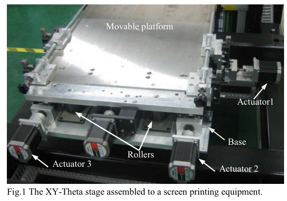
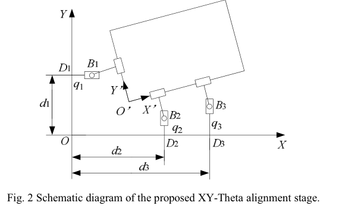
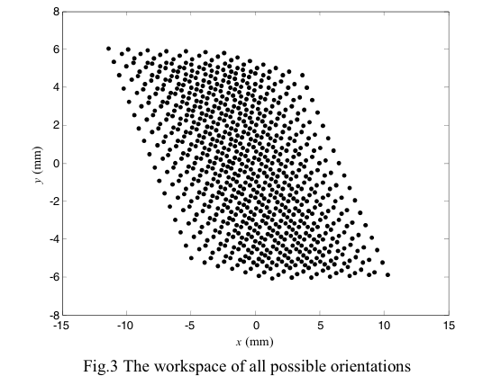
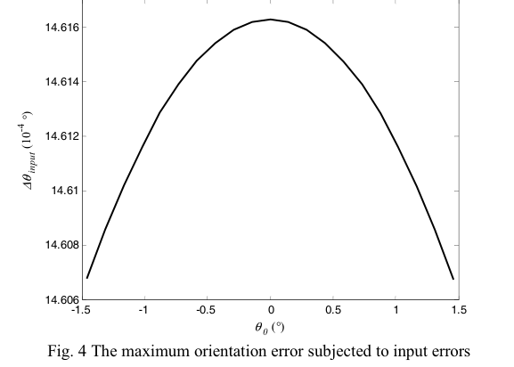
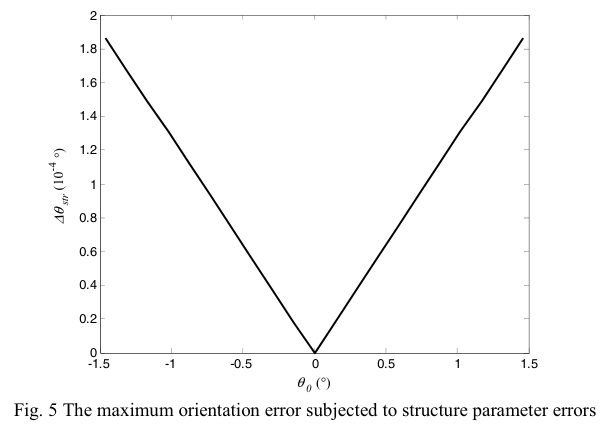
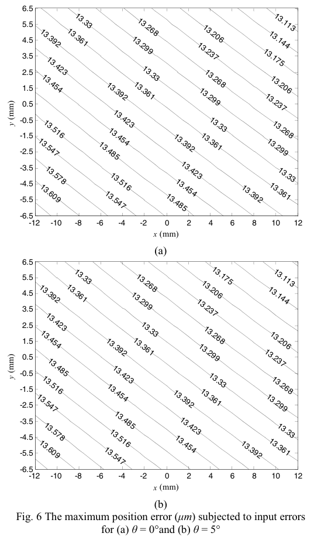
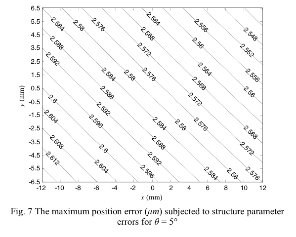
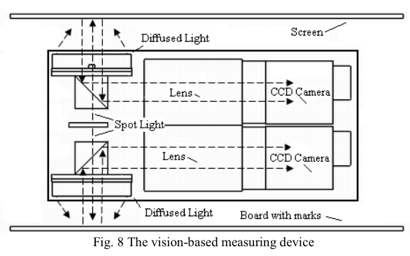
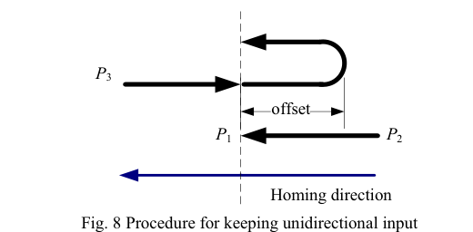
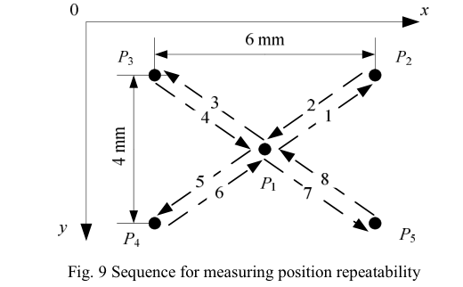

# 스크린 인쇄용 새로운 XY-θ 정렬 스테이지와 그 정확도 분석 (Liang 2012)

- 원제: A Novel XY-Theta Alignment Stage for Screen Printing and its Accuracy Analysis
- 원문: 같은 폴더의 `Liang2012_ICMA_XYtheta_accuracy.pdf` (Proceedings of 2012 IEEE International Conference on Mechatronics and Automation, August 5–8, Chengdu, China, pp. 1352–1357)
- 저자: Jinglun Liang, JiaZhao Chen, Qinghua Zhang, Yongcong Kuang, Xianmin Zhang (Key Laboratory of Precision Equipment and Manufacturing Technology of Guangdong Province, South China University of Technology)
- 번역 범위: 전문
- 그림: 원문 그림 10개(그림 1~9, 원문에 "Fig. 8"이 두 개 있어 `그림8_장치`, `그림8_절차`로 나눔)를 `그림/`에 넣고 본문에서 처음 언급되는 곳에 삽입

## 초록

스크린 인쇄(screen printing) 산업의 정밀 위치 결정을 위해 새로운 3자유도(3-DOF) 평면 병렬 정렬 스테이지를 개발하였다. 구동용 짧은 PRP 체인 세 개와 가동 플랫폼을 지지하는 롤러 네 개로 이루어진 이 스테이지는 실제로는 3-PRP 평면 병렬 로봇이며, 모든 크기의 웨이퍼와 인쇄회로기판(PCB)의 정밀 위치 결정에 이상적일 뿐 아니라 큰 스크린과 스텐실을 쉽게 지지하도록 개조할 수도 있다. 이 논문에서는 먼저 XY-θ 정렬 스테이지와 그 순기구학·역기구학(direct and inverse kinematic)을 제시한다. 과거에 쓰인 많은 성능 지수가 평행이동(병진) 자유도와 회전 자유도를 함께 가진 병렬 로봇에 적용될 때 완벽하게 작동하지 않는다는 점을 고려하여, 입력 오차와 구조 파라미터 오차에 따른 최대 위치 오차와 최대 방향 오차를 분석하는 간단하지만 유용한 방법을 제시한다. 이어서 입력 정확도를 높이기 위한 경험적 입력 방법(experiential input method)을 제안한다. 그리고 경험적 입력 방법과 일반 입력(normal input)을 비전 기반 측정 장치로 비교 실험하였으며, 그 결과 전자가 더 나은 위치 결정 정확도를 낼 수 있음을 보였다.

색인어 — XY-θ 정렬 스테이지, 기구학 모델, 정확도 분석, 최대 위치·방향 오차.

## I. 서론 (Introduction)

최근 몇 년 사이 반도체 산업이 빠르게 성장하면서 생산 라인 장비에 대한 정확도와 속도 요구가 높아졌다. 특히 결정질 실리콘 태양전지의 금속화(metallization)를 위해 핑거 선폭이 30 μm에 불과한 이중 스크린 인쇄(double screen printing)가 등장하면서[1] 스크린 인쇄 장비에 새로운 과제가 생겼다. 따라서 스크린 인쇄에서는 위치 결정 정확도가 더 중요하다.

병렬 로봇, 특히 3자유도 평면 정렬 스테이지는 정밀 위치 결정에 점점 더 많이 쓰이고 있다[2]. 고정된 기준 좌표계에 대해 요구된 위치와 방향에 도달하는 능력을 나타내는 병렬 매니퓰레이터의 정확도는 분명 정밀 위치 결정의 중요한 성능 지표이다. 그래서 병렬 기구 기계의 정확도 분석과 오차 보상에 많은 관심이 기울여져 왔다. Wang과 Masory[3]는 Denavit-Hartenberg 방법으로 Stewart 플랫폼의 기구학적 오차 모델을 세웠다. Kim과 Choi[4]는 로봇의 순방향·역방향 오차 한계를 분석하는 좋은 아이디어를 제시하였다. 최근 몇 년 동안에는 조건수(condition number), 전역 조건 지수(global conditioning index)[5], 손재주(dexterity)[6] 같은 여러 성능 지수가 병렬 로봇의 정확도를 직접 또는 간접적으로 최적화하는 데 널리 쓰였다. 그러나 Merlet[7]은 이 지수들을 검토하고, 평행이동 자유도와 회전 자유도를 함께 가진 병렬 로봇에 적용할 때 심각한 불일치가 있음을 논의하였다. 그래서 Yu[9]는 3자유도 평면 완전 병렬 로봇의 한 부류에 대해, 구동기 부정확성으로 생기는 정확한 국소 최대 위치 오차와 국소 최대 방향 오차를 계산하는 기하학적 방법을 제시하였다. Briot[2]는 3자유도 평면 병렬 로봇에서 입력 오차에 따른 국소 최대 위치·방향 오차를 상세히 연구하였다. 그리고 그 논문은 주어진 공칭 형상(nominal configuration)과 입력 오차 경계 상자(input error bounding box)로 국소 최대 방향·위치 오차를 계산하는 방법을 제안한다. 실제로 산업용 병렬 로봇의 정확도는 구동기 부정확성뿐 아니라 조립 오차, 구조 치수 오차, 제작 공차, 유격(clearance) 등 다른 많은 요인의 영향을 받는다. 이 논문에서는 입력 오차와 구조 파라미터 오차에 따른 최대 위치·방향 오차를 분석하고, 더 간단한 식으로 어떤 부류의 오차원이 출력 오차에 더 큰 영향을 주는지 평가하는, 더 간단하지만 매우 유용한 방법을 제안한다. 이어서 입력 정확도를 높이는 효과적이고 저렴한 입력 방법을 제시하고, 제안 방법의 효율을 검증하는 비교 실험을 수행한다.

이 논문의 구성은 다음과 같다. 구조 소개와 기구학 모델은 이어지는 II절에서 다룬다. 산업용 스크린 인쇄를 위한 이런 정밀 위치 결정 스테이지는 예비 위치 결정 과정이 있으므로 넓은 작업 공간이 필요하지 않지만, 높은 정확도와 빠른 속도를 갖추어야 한다. III절은 제안한 XY-θ 정렬 스테이지의 작업 공간 분석에 할애한다. IV절에서는 상세한 기구학적 정확도 분석을 제시한다. 더 간단하지만 유용한 방법으로, 입력 오차와 구조 파라미터 오차에 따른 위치 오차와 방향 오차를 직접 분석하였다. V절에서는 입력 정확도를 높이는 경험적 입력 방법을 제시하고, 비전 기반 측정 장치를 이용한 비교 실험 결과도 제시한다. 마지막으로 VI절에서 결론을 맺는다.

(각주) 이 연구는 중국 국가자연과학기금 우수청년학자기금(Grant No. 50825504), 중국 자연과학기금·광둥성 연합기금(Grant No. U0934004), GDUPS 프로젝트(2010)의 지원을 받았다.

## II. 기구학 해석 (Kinematic Analysis)

### A. 구조 소개 (Architecture Introduction)

제안한 병렬 스테이지는 그림 1과 같이 가동 플랫폼(movable platform), 베이스, 능동 체인 세 개, 롤러 네 개로 구성되며, 그 개략도는 그림 2와 같다. 가동 플랫폼은 네[역주: 원문 "for", four의 오기] 개의 롤러로 지지된다. 세 능동 체인은 짧다. 이런 구조는 더 강성이 높고 모든 크기의 웨이퍼나 인쇄회로기판에 적합하다. 또한 더 큰 스크린이나 스텐실을 지지하도록 쉽게 개조할 수 있다.

*그림 1 — 스크린 인쇄 장비에 조립된 XY-θ 스테이지. (사진 표기: Movable platform=가동 플랫폼, Actuator=구동기, Rollers=롤러, Base=베이스)*

*그림 2 — 제안한 XY-θ 정렬 스테이지의 개략도.*

세 능동 체인은 조인트로 가동 플랫폼에 연결되고, 역시 직동 조인트(prismatic joint)로 베이스에 결합된다. 구동기 세 개가 베이스에 결합된 직동 조인트를 구동한다. 수동 직동 조인트의 캐리지는 연결 로드의 한쪽 끝에 붙어 있고, 연결 로드의 다른 쪽 끝은 그림 2와 같이 구동되는 직동 조인트 위의 회전 조인트(revolute joint)에 연결된다. 구동되는 직동 조인트 두 개의 방향은 서로 평행하고, 세 번째는 그 둘에 수직이다. 분명히 제안한 병렬 스테이지는 3-PRP 평면 병렬 로봇의 일종이다(P와 R은 각각 직동 조인트와 회전 조인트를 뜻하며, 밑줄은 그 조인트가 구동됨을 나타낸다).

그림 2를 참고하면, 모든 능동 체인이 베이스에 부착되는 점을 $D_i$ ($i$ = 1, 2, 3)로 나타낸다. 회전 조인트의 부착점은 $B_i$로 표시한다. 이 논문에서 모든 부착점은 조인트의 중심이다. 기준 좌표계 $O$-$XY$는 점 $O$를 원점으로 하여 베이스에 고정된다. $X$축은 평행한 구동 직동 조인트들의 방향에 수직이며 $D_2$에서 $D_3$ 쪽을 향하고, $Y$축은 $O$에서 $D_1$ 쪽을 향한다. 점 $O$에서 점 $D_i$까지의 길이는 $d_i$이며, $d_1$, $d_2$, $d_3$은 각각 287 mm, 237 mm, 629 mm이다. 연결 로드의 유효 길이는 모두 같다. 세 능동 체인은 모두 같은 구동기를 쓰며, 행정(stroke)은 10 mm이다. 고정 기준 좌표계와 일치하는 기준 자세(reference position)는 각 구동기 행정의 중간 위치이다.

### B. 기구학 모델 (Kinematic Model)

$O$-$XY$ 좌표계에서 둘 이상의 목표점을 벡터 $\boldsymbol{M}_i$ ($i \ge 1$)로 주고, 기준 자세에서 목표 벡터에 대응하는 가동 플랫폼 위의 점을 벡터 $\boldsymbol{M}_i'$로 주면, 병렬 스테이지의 구동기들이 최소제곱법(least square method)으로 가동 플랫폼을 구동하여 3자유도 정렬을 실현한다. Merlet[8]이 지적했듯이, 이 부류의 3자유도 평면 병렬 로봇은 역기구학 모델을 얻는 서로 다른 해법이 두 가지 있다. 두 해법의 결과가 일치하므로, 이 논문에서는 병렬 스테이지의 기구학적 정확도를 분석하는 데 한 가지 해법만 제시한다. 가동 플랫폼의 공칭(목표) 자세는 좌표 변환으로 쉽게 얻을 수 있다.

$$\boldsymbol{M}_i' = \boldsymbol{R}\boldsymbol{M}_i + \boldsymbol{P} \tag{1}$$

여기서 $\boldsymbol{R}=\begin{pmatrix}\cos\theta & -\sin\theta\\ \sin\theta & \cos\theta\end{pmatrix}$, $\boldsymbol{P}=\begin{pmatrix}x\\ y\end{pmatrix}$이고, $\theta$는 방향각(orientation angle), $x$, $y$는 $O$-$XY$ 좌표계에서 가동 플랫폼의 위치로 정의된다. 가동 플랫폼의 위치와 방향이 주어지면 역기구학 모델은 다음과 같이 쉽게 얻어진다.

$$q_1 = x + (y - d_1)\tan\theta \tag{2}$$
$$q_2 = y + (d_2 - x)\tan\theta \tag{3}$$
$$q_3 = y + (d_3 - x)\tan\theta \tag{4}$$

순기구학은 더 쉽게 풀린다. (3)과 (4)로부터 방향각은 다음과 같다.

$$\theta = \arctan\frac{q_3 - q_2}{d_3 - d_2} \tag{5}$$

한편 가동 플랫폼의 위치 식은 다음과 같다.

$$x = \frac{q_1 d_{23}^2 - q_2 d_{23}(q_3 - q_2) + d_1 d_{23}(q_3 - q_2) + d_2 (q_3 - q_2)^2}{d_{23}^2 + (q_3 - q_2)^2} \tag{6}$$
$$y = \frac{q_1 d_{23}(q_3 - q_2) + q_2 d_{23}^2 + d_1 (q_3 - q_2)^2 - d_2 d_{23}(q_3 - q_2)}{d_{23}^2 + (q_3 - q_2)^2} \tag{7}$$

여기서 $d_{23} = d_3 - d_2$이다.

## III. 작업 공간 (Workspace)

이른바 일정 방향 작업 공간(constant-orientation workspace)은 가동 플랫폼의 방향을 고정했을 때 기준점이 도달할 수 있는 영역으로 정의된다. 위의 기구학 모델로부터, 물체 고정 좌표계(body-fixed frame)의 원점 $O'$(그림 2 참조)의 일정 방향 작업 공간은 구동기의 한계로 쉽게 계산할 수 있으며, 직사각형 모양이다. 나아가 더 의미 있는 작업 공간을 그림 3에 나타냈는데, 이는 주어진 구동기 한계 [$q_{min}$, $q_{max}$] 안에서 가능한 모든 방향에 대해 가동 플랫폼의 원점 $O'$이 도달할 수 있는 위치의 집합이다. 최대 위치·방향 오차는 이 작업 공간에서 평가한다.

*그림 3 — 가능한 모든 방향에 대한 작업 공간.*

## IV. 기구학적 정확도 분석 (Kinematic Accuracy Analysis)

산업용 병렬 로봇의 정확도는 고정된 기준 좌표계에 대해 요구된 위치와 방향에 도달하는 로봇의 능력으로 정의할 수 있다. 최대 위치·방향 오차는 작업 공간에서 로봇의 정확도를 측정하는 데 흔히 쓰인다. 이 연구에서는 구동기 부정확성, 제작 공차, 직동 조인트와 회전 조인트의 유격을 입력 오차로, 능동 체인의 설치 오차와 구조 치수 오차를 구조 파라미터 오차로 취급한다. 입력 오차와 구조 파라미터 오차 각각에 따른 최대 방향 오차와 최대 위치 오차를 찾는, 더 간단하지만 유용한 방법을 제안한다.

이 평면 병렬 스테이지의 각 입력의 오차 한계를 $\varepsilon_i$ ($i$=1, 2, 3) ∈ (−5, +5) μm로, $d_1$, $d_2$, $d_{23}$의 오차 한계를 각각 $\xi_i$ ($i$=1, 2, 3) ∈ (−50, +50) μm로 둔다($d_{23}$은 직접 측정할 수 있다). 실제 입력 변수는 $q_i+\varepsilon_i$이며, 실제 구조 파라미터 값도 마찬가지이다. 따라서 가동 플랫폼의 실제 위치와 방향은 공칭 플랫폼 자세와 다르다. 위치 오차 $\Delta P$와 방향 오차 $\Delta\theta$는 다음과 같이 정의할 수 있다[2].

$$\Delta P = \sqrt{(x - x_0)^2 + (y - y_0)^2} \tag{8}$$
$$\Delta\theta = \sqrt{(\theta - \theta_0)^2} \tag{9}$$

여기서 $x_0$, $y_0$, $\theta_0$는 공칭 플랫폼 자세이고, $x$, $y$, $\theta$는 실제 플랫폼 자세이다.

### A. 최대 방향 오차 (Maximum Orientation Error)

입력 오차와 구조 파라미터 오차가 방향 오차에 미치는 영향을 따로 평가하기 위해, 입력 오차에 따른 방향 오차를 구할 때는 구조 파라미터가 이상적으로 정확하다고 가정하고, 그 반대의 경우도 마찬가지로 가정한다. 다시 말해 두 종류의 오차 사이의 결합 오차는 일부러 무시하는데, 이는 더 간단한 식으로 어떤 오차원이 출력 오차에 더 큰 영향을 주는지 평가하기 위해서이다.

(5)에 따르면 방향 오차는 둘째·셋째 체인의 실제 입력과 구조 파라미터 $d_{23}$에 관계됨이 분명하다. 따라서 입력 오차와 구조 파라미터 오차 각각에 따른 방향 오차는 다음과 같다.

$$\Delta\theta_{input} = \left|\arctan\!\left(\tan\theta_0 + \frac{\varepsilon_3 - \varepsilon_2}{d_{23}}\right) - \theta_0\right| \tag{10}$$

$$\Delta\theta_{str} = \left|\arctan\!\left(\frac{d_{23}\tan\theta_0}{d_{23} + \xi_3}\right) - \theta_0\right| \tag{11}$$

(10)과 (11)로부터, 최대 방향 오차는 $\varepsilon_2$ = −5이고 $\varepsilon_3$ = +5일 때, 또는 $\varepsilon_2$ = +5이고 $\varepsilon_3$ = −5일 때 생김이 분명하다. $\Delta\theta_{str}$의 최댓값은 $\xi_3$ = +50일 때 얻어진다. 최대 방향 오차 $\Delta\theta_{input}$과 $\Delta\theta_{str}$을 공칭 방향각의 함수로 그린 그래프를 각각 그림 4와 그림 5에 나타냈다. 보듯이, 입력 오차에 따른 최대 방향 오차는 구조 파라미터 오차에 따른 것보다 한 자릿수 크지만, 둘 다 거의 0이다. 그러나 방향 오차는 큰 기판의 정밀 정렬에 큰 영향을 주므로 매우 중요하다.

*그림 4 — 입력 오차에 따른 최대 방향 오차.*

*그림 5 — 구조 파라미터 오차에 따른 최대 방향 오차.*

### B. 최대 위치 오차 (Maximum Position Error)

실제 입력 변수와 공칭 구조 파라미터를 (6)과 (7)에 대입하고, 이어서 공칭 입력 변수 (2-4)를 마지막 식에 대입하면 입력 오차에 따른 위치 오차를 얻는다.

$$\Delta P_{input}^2 = \frac{(\varepsilon_1^2 + \varepsilon_2^2)d_{23}^2 + (m^2 + n^2)\varepsilon_{23}^2 + 2d_{23}(m\varepsilon_1 - n\varepsilon_2)\varepsilon_{23}}{d_{23}^2 + (d_{23}\tan\theta_0 + \varepsilon_{23})^2} \tag{12}$$

여기서 $m=d_1-y_0$, $n=d_2-x_0$, $\varepsilon_{23}=\varepsilon_3-\varepsilon_2$이다.

함수의 최댓값을 구하는 방법은 미분 등 여러 가지가 있다. 그러나 (12)의 경우 $\Delta P_{input}$이 최대가 되려면 (12)의 분자가 함수의 최댓값을 취하고 분모가 최솟값을 취해야 함을 쉽게 알 수 있다. 따라서 $\varepsilon_{23}$을 먼저 정한다. 그러므로 두 가지 형상을 논의해야 한다. $\theta_0$가 양수이면 최대 위치 오차는 $\varepsilon_1$ = −5, $\varepsilon_3$ = −5, $\varepsilon_2$ = +5일 때 생기고, 그렇지 않으면 $\varepsilon_1$ = +5, $\varepsilon_3$ = +5, $\varepsilon_2$ = −5일 때 생긴다. 이 결과는 Matlab을 이용한 수치적 방법으로도 옳음이 증명되었다. 최대 위치 오차가 방향 오차가 최대일 때 생긴다는 점을 쉽게 알 수 있다. 또한 최대 위치 오차는 가동 플랫폼의 공칭 방향과 위치의 함수이다. 만약 $\theta_0$가 마침 arctangent $2\varepsilon_{max}/d_{23}$ 또는 $-2\varepsilon_{max}/d_{23}$이고 모든 능동 체인의 입력이 위에서 말한 두 경우와 일치하면, 입력 오차로 인한 최대 위치 오차의 값은 더 커진다. 그러나 이 논문에서는 $\varepsilon$이 구동기 2와 3 사이의 거리보다 훨씬 작으므로, 그 공칭 방향각은 거의 0과 같다.

일정 방향 두 가지에 대해 공칭 위치에 따른 최대 위치 오차 $\Delta P_{input}$의 등고선도를 그림 6에 나타냈다. 결과는 입력 오차에 따른 최대 위치 오차가 연구 대상 작업 공간의 최대 위치에서 최소 위치 쪽으로 갈수록 증가하지만, 그 값은 두 일정 방향 모두에서 사실상 일정(13 μm)하며, 입력 오차(10 μm)보다 약간 클 뿐임을 보여준다.

*그림 6 — 입력 오차에 따른 최대 위치 오차(μm). (a) $\theta$ = 0°, (b) $\theta$ = 5°.*

이제 실제 입력 변수가 공칭 값과 이상적으로 같다고 가정하면, 구조 파라미터 오차에 따른 위치 오차도 다음과 같이 쉽게 얻을 수 있다.

$$\Delta p_{str}^2 = \frac{\tan^2\theta_0\,(m^2 + n^2)\xi_3^2 + d_{23}^2(\xi_1^2 + \xi_2^2) - 2md_{23}\xi_1\xi_3 - 2nd_{23}\xi_2\xi_3}{(d_{23} + \xi_3)^2 + d_{23}^2\tan^2\theta_0} \tag{13}$$

여기서 $m$과 $n$은 (12)와 같다.

(13)에 따르면 최대 위치 오차 $\Delta P_{str}$은 $\xi_3$ = −50, $\xi_3$ = +50, $\xi_3$ = +50일 때[역주: 원문 그대로. 문맥상 $\xi_1$, $\xi_2$, $\xi_3$의 오기로 보인다] 생김이 분명하다. 이 결과는 이 병렬 스테이지의 설계와 최적화에 활용할 수 있다. 또한 $\theta_0$가 0이면 $\Delta P_{str}$이 0임을 알 수 있다. 가동 테이블이 기준 자세에서 X축이나 Y축을 따라 평행이동만 할 때는 구조 파라미터 오차가 위치 오차에 영향을 주지 않는다는 점은 쉽게 이해된다. 주어진 일정 방향에 대해 구조 파라미터 오차에 따른 최대 위치 오차의 등고선도를 얻을 수 있다(그림 7). 그림 7은 구조 파라미터 오차에 따른 최대 위치 오차가 작업 공간에서 약 2 μm로 작으며 50 μm보다 훨씬 작음을 분명히 보여준다.

*그림 7 — $\theta$ = 5°일 때 구조 파라미터 오차에 따른 최대 위치 오차(μm).*

분명히 제안한 구조에서는 구조 파라미터 오차가 가동 플랫폼의 자세 오차에 거의 영향을 주지 않으며, 입력 오차가 최대 위치·방향 오차를 이루는 주된 부분이다. 그러나 최대 위치 오차에 대해서는 입력 오차가 작업 공간에서 약간만 증폭된다. 그리고 최대 방향 오차는 거의 0이다. 따라서 입력 정확도를 개선하면 연구 대상 병렬 정렬 스테이지의 작업 공간 내 위치 결정 정확도가 높아질 것이다. 입력 정확도는 볼스크루의 백래시(backlash), 볼 베어링의 유격, 구동기의 부정확성 등 많은 요인의 영향을 받는다. 정밀도 요구가 높아질수록 그에 따른 비용 증가는 훨씬 가파르다는 것이 널리 알려져 있다. 따라서 비싼 정밀 조인트 개선이나 기계의 고정밀 설계·제작과 비교하면, 오차 보상이 훨씬 적은 비용으로 비슷한 정확도를 달성하는 더 나은 방법이다. 아래 실험에서는 입력 정확도를 높이기 위한 경험적 입력 방법을 제시한다.

## V. 실험 (Experiment)

그림 8과 같은 비전 기반 측정 장치로 우리의 스크린 인쇄 시제품에서 기구학적 정확도 분석 결과를 검증하는 실험을 수행하였다. [10]에서는 십자나 점 같은 특수 패턴을 쓰면 부화소(sub-pixel) 정확도 측정(2/100 화소)을 얻을 수 있음이 증명되었다. 시야(FOV) 10 mm × 8 mm인 비전 기반 측정 장치는 전용 보정판(calibration board)으로 충분히 평가되었으며, 마크(점)를 쓸 때 전체 시야에서 측정 정확도가 3 μm 미만이었다. 이는 우리 실험 검증의 요구를 충족한다[역주: 원문 "with the suppression of the need for our experimental validations"는 의미가 불분명하여 문맥에 따라 옮김]. 그리고 이 장치는 XY 직렬 운동 플랫폼 위에서 모터 두 개로 구동되었다. 그래서 XY-θ 정렬 스테이지와 스크린 위의 마크를 측정할 수 있었다. 비전 알고리즘은 National Instruments 비전 모듈을 갖춘 Labview 소프트웨어로 수행하였고, XY-θ 정렬 스테이지와 XY 직렬 운동 플랫폼의 운동 제어는 Omron의 PLC(programmable logic controller)로 수행하였다.

*그림 8 — 비전 기반 측정 장치. (표기: Screen=스크린, Diffused Light=확산광, Spot Light=스폿광, Lens=렌즈, CCD Camera=CCD 카메라, Board with marks=마크가 있는 보드)*

짝이 되는 스크린을, 측정 장치 위에서 기준 자세에 있는 가동 플랫폼에 고정된 보드와 정렬하였다. 한 마크의 모든 측정은 같은 시야 안에서 수행되었으므로, 스크린 위의 마크는 가동 플랫폼이 움직인 뒤 보드 위의 대응 마크의 새 실제 위치를 얻기 위한 기준 위치가 된다. 영상 화소 좌표계와 물체 고정 좌표계 $O'$-$X'Y'$ 사이의 관계도 보정하였다.

기구학 모델의 구조 파라미터를 수정하여(공칭 구조 파라미터에 0.05 mm를 더함) 구조 파라미터 오차에 따른 최대 방향·위치 오차를 실험적으로 쉽게 얻을 수 있었다. 그리고 그 결과를 공칭 구조 파라미터를 쓴 결과와 비교하였다. 그 결과 두 구조 파라미터 세트 사이에 최대 방향·위치 오차의 뚜렷한 차이가 없었다.

입력 오차에 대한 최대 방향·위치 오차를 평가하기 위해, 일반 입력과 단방향 입력(unidirectional input)으로 같은 측정을 수행하였다. 그림 8에 보인 경험적 방법인 이른바 단방향 입력이란, 구동기의 이동 방향이 원점 복귀 방향(homing direction)과 같으면 곧바로 뒤로 이동하고(P2에서 P1으로), 그렇지 않으면 오프셋만큼 더 앞으로 이동했다가 되돌아오는(P3에서 P1으로) 것이다. 그러나 구동기의 정확도나 부정확성을 측정하는 표준 절차는 없다. 그래서 이 연구에서는 가동 플랫폼의 방향을 0°로 유지한 채 가동 플랫폼의 위치 반복정밀도(repeatability)를 측정하여 입력 정확도를 평가하였다.

*그림 8 — 단방향 입력을 유지하는 절차. (표기: offset=오프셋, Homing direction=원점 복귀 방향)*

### A. 입력 정확도 평가 (Assessment of input accuracy)

제안한 정렬 스테이지는 산업용 로봇으로서 스크린 인쇄에 쓰일 것이므로, ISO 9283 규격[11]을 참고하여 다음 절차를 쓰기로 하였다. 이 절차는 그림 9와 같이 다섯 개의 측정 자세($P_1$, $P_2$, …, $P_5$)를 잇는 궤적으로 이루어지며 30회 반복한다. 이 절차로 다방향 반복정밀도($P_1$에서)와 단방향 반복정밀도($P_2$, $P_3$, $P_4$, $P_5$에서)를 모두 측정한다. $n$개 점 ($x_j$, $y_j$, $z_j$)로 이루어진 군집의 무게중심 ($\bar{x}$, $\bar{y}$, $\bar{z}$)에 대한 평균 위치 오차에 표준편차의 세 배를 더한 값을 위치 반복정밀도 평가에 썼다((14) 참조). 오프셋 값은 0.5 mm였다. 모든 변위는 5 mm/s의 일정 속도로 이루어졌으며, 탑재물(payload)은 없었다. 마지막으로 모든 측정은 영상 화소 좌표계에서 수행하였다.

*그림 9 — 위치 반복정밀도 측정 순서.*

$$RP_l = \bar{l} + 3\sigma_l \tag{14}$$

여기서

$$\bar{l} = \frac{1}{n}\sum_{j=1}^{n} l_j \tag{15}$$
$$l_j = \sqrt{(x_j - \bar{x})^2 + (y_j - \bar{y})^2 + (z_j - \bar{z})^2} \tag{16}$$
$$\sigma_l = \sqrt{\frac{\sum_{j=1}^{n}(l_i - \bar{l})^2}{n-1}} \tag{17}$$

[역주: (17)의 합 안 첨자 $l_i$는 원문 그대로이다.]

표 I에 최종 결과를 나타냈다. 일반 입력의 반복정밀도가 단방향 입력보다 나쁜 것이 분명한데, 이는 직렬 로봇과 비교해 수동 조인트 같은 많은 추가 부품의 기계적 결함(백래시, 유격 등) 때문이다. 결과적으로, 이 경험적 방법은 정렬에 시간이 더 걸리겠지만, 단방향 입력을 쓴 XY-θ 정렬 스테이지의 입력 정확도는 어느 정도 일반 입력보다 낫다.

**표 I. 위치 반복정밀도 (μm)**

| 자세 | 일반 입력 x, y | 일반 입력 x | 일반 입력 y | 단방향 입력 x, y | 단방향 입력 x | 단방향 입력 y |
|---|---|---|---|---|---|---|
| $P_1$ | 23.823 | 32.999 | 8.022 | 15.143 | 19.354 | 6.797 |
| $P_2$ | 14.597 | 18.145 | 7.589 | 12.752 | 17.185 | 5.031 |
| $P_3$ | 17.500 | 22.694 | 8.408 | 14.435 | 16.670 | 6.294 |
| $P_4$ | 16.635 | 18.083 | 8.790 | 11.319 | 13.245 | 6.192 |
| $P_5$ | 14.350 | 16.267 | 7.799 | 11.496 | 13.506 | 6.780 |

**표 II. 일반 입력의 자세 정확도** — 평균 위치 오차(μm)와 평균 방향 오차($10^{-3}$ 도)

| 명령 위치 (mm) | x | y | x, y | θ |
|---|---|---|---|---|
| (328.5, 185) → (328.5, 65) | 60.133 | −62.720 | 86.925 | −9.805 |
| (328.5, 65) → (178, 65) | 75.853 | −46.324 | 88.892 | −11.615 |
| (178, 65) → (178, 185) | 49.427 | −67.458 | 83.651 | −7.853 |
| (178, 185) → (328.5, 185) | 47.239 | −70.453 | 84.877 | −7.433 |

**표 III. 단방향 입력의 자세 정확도** — 평균 위치 오차(μm)와 평균 방향 오차($10^{-3}$ 도)

| 명령 위치 (mm) | x | y | x, y | θ |
|---|---|---|---|---|
| (328.5, 185) → (328.5, 65) | 45.363 | −46.089 | 64.711 | 6.305 |
| (328.5, 65) → (178, 65) | 39.659 | −42.330 | 58.020 | 7.730 |
| (178, 65) → (178, 185) | 36.268 | −45.340 | 58.120 | 5.273 |
| (178, 185) → (328.5, 185) | 35.826 | −51.842 | 63.131 | 10.164 |

(표 II·III의 명령 위치 칸은 원문에서 위아래 두 줄로 적힌 시작·끝 좌표를 "→"로 이어 옮겼다.)

### B. 실험적 검증 (Experimental validation)

일반 입력과 비교한 단방향 입력 방법의 효율을 검증하기 위해, 보드 위의 마크 네 개를 무작위 입력으로 측정하되 마크가 같은 시야 안에서 움직이도록 유지하였다. (1)에 따라 네 마크로 이루어진 직사각형의 네 변을 측정하여 가동 플랫폼의 자세를 얻었다. 물론 II절에서 설명한 것과 같은 베이스 좌표계를 썼다. 운동 파라미터는 반복정밀도 측정 때와 같았다. 마지막으로 모든 측정은 제안한 비전 기반 측정 장치로 수행하였다. 전체 절차도 30회 반복하였다. 평균 위치 오차와 평균 방향 오차를 표 II와 표 III에 나타냈다.

요약하면, 단방향 입력의 평균 위치 오차는 일반 입력보다 작으며, 최대 위치 오차는 86.925 μm에서 64.711 μm로 줄었다. 그에 비해 방향 오차는 뚜렷한 개선이 없었다. 이 결과는 IV절의 기구학적 정확도 분석과 일치한다.

## VI. 결론 (Conclusion)

이 논문에서는 웨이퍼 정렬에 유용한 새로운 3자유도 평면 병렬 정렬 스테이지를 소개하고 분석하였다. 순기구학·역기구학 모델을 유도하였다. 어떤 오차원이 출력 오차에 더 큰 영향을 주는지 평가하는 더 간단한 방법을 제시하였다. 입력 부정확성과 구조 파라미터 오차로 생기는 위치·방향 오차를 직접 상세히 분석하였다. 입력 오차가 출력 오차의 지배적인 영향원임이 증명되었다. 그러나 결과는 입력 오차가 약간만 증폭됨을 보여준다. 따라서 연구 대상 XY-θ 정렬 스테이지의 입력 정확도를 높이기 위해 단방향 입력을 유지하는 경험적 방법을 제시하였다. 이어서 스크린 인쇄 시제품 하나에서 비전 기반 측정 장치로 일반 입력과 비교한 단방향 입력 방법의 효율을 검증하는 실험을 수행하였다. 그런 경험적 방법이 더 나은 위치 결정 정확도로 이어질 수 있음이 분명히 입증되었다. 그러나 이 위치 결정 정확도는 폭 30 μm의 핑거 선을 이중 스크린 인쇄하기에는 턱없이 부족하다. 이 XY-θ 정렬 스테이지의 정확도를 더 높이려면 더 많은 오차를 고려하고 더 많은 설계 파라미터를 식별해야 한다.

## 감사의 글 (Acknowledgment)

저자들은 이 연구를 지원하기 위해 스크린 인쇄 시제품을 제공해 준 둥관(Dongguan)시의 Folungwin Automatic Equipment Company에 감사한다.

## 참고문헌

- [1] M. Ju, Y. Lee, J. Lee, et al, "Double screen printed metallization of crystalline silicon solar cells as low as 30 μm metal line width for mass production," Solar Energy Materials and solar cells, vol.100, May 2012, pp.204-208.
- [2] Sebastien Briot, Ilian A. Bonev, "Accuracy analysis of 3-DOF planar parallel robots," Mechanism and Machine Theory, vol.43, 2008, pp.445~458.
- [3] J.Wang, O.Masory, "On the accuracy of Stewart platform-Part I: the effect of manufacturing tolerances," In proc. IEEE international conference on robotics and automation, Atlanta, GA, USA. May 2-6, 1993, pp.114~120.
- [4] H.S.Kim, Y.J.Choi, "The kinematic error bound analysis of the Stewart platform," Journal of Robotic System, vol.17, no.1, 2000, pp.63-73.
- [5] C.M. Gosselin, J. Angeles. "A global performance index for the kinematic optimization of robotic manipulators," Journal of Mechanical Design, vol.113, no.3, 1991, pp. 220-226.
- [6] C.M. Gosselin, "The optimum design of robotic manipulators using dexterity indices," Robotics and Autonomous system, vol.9, no.4, 1992, pp.213-226.
- [7] J. P. Merlet, "Jacobian, Manipulability, condition number, and accuracy of parallel robots," Journal of Mechanical Design, vol.128, no.1, 2006, pp.199-205.
- [8] J. P. Merlet, "Direct kinematics of planar parallel manipulators," In proc. IEEE International Conference Robotics and Automation, Minneapolis, Minnesota, USA. 1996, pp.3744-3749.
- [9] A. Yu, I. A. Bonev and P. Zsombor-Murray, "Geometric approach to the accuracy analysis of a class of 3-DOF planar parallel robots," Mechanism and Machine Theory, vol.43, 2008, pp.364-375.
- [10] P. Brand and R. Mohr, "Accuracy in image measure," in Proc. SPIE Conference Videometrics III, vol.2350, Boston, MA, 1994, pp.218-228.
- [11] "Manipulating industrial robots-performance criteria and related test methods," ISO 9283, 1998.
