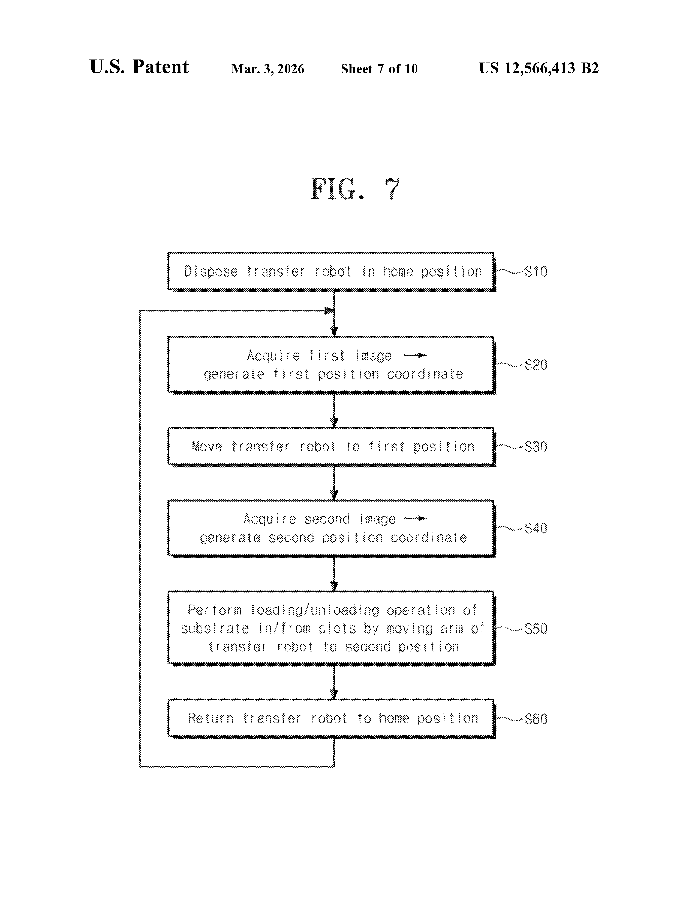
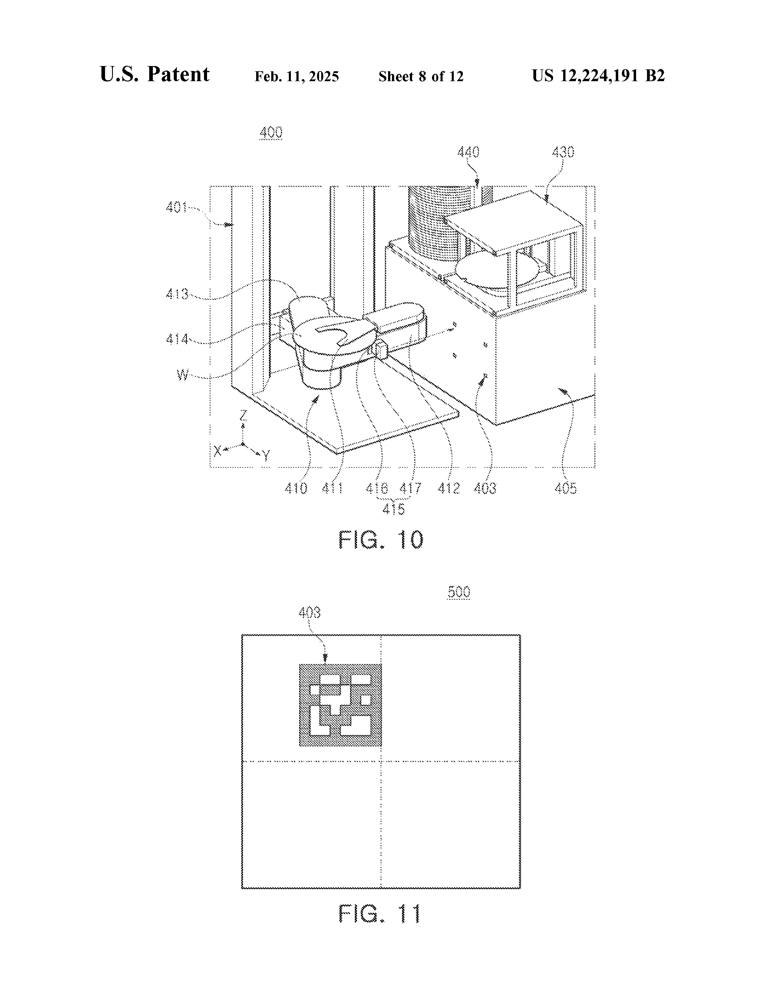
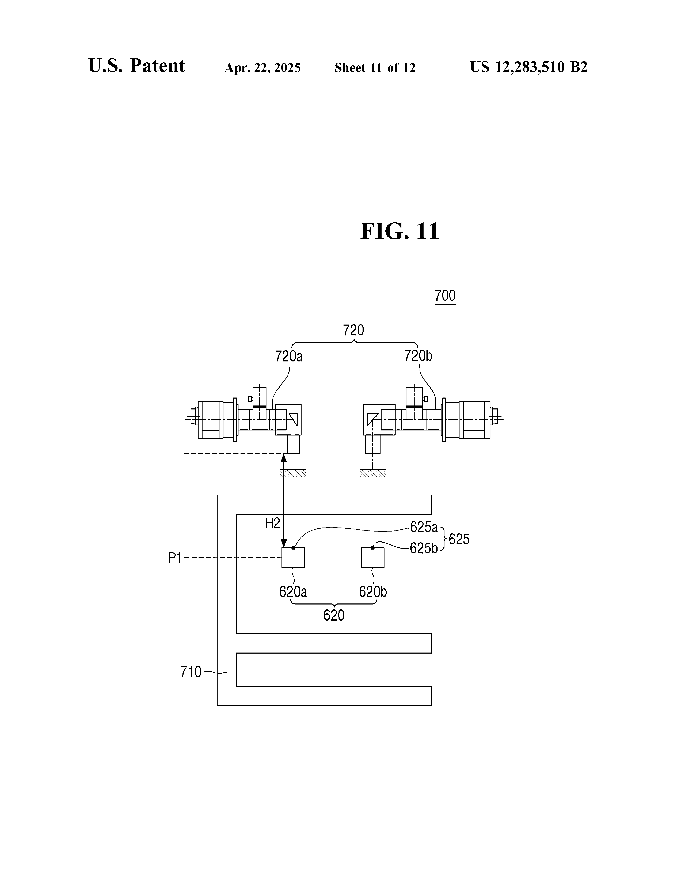

# 선행 특허 조사 결과 보고

**과제:** 비전 기반 2축(Y·Θ) 로봇 얼라인먼트 자동 보정 (SEMES 기업연계)
**조사일:** 2026-10-30 · **조사 대상:** 미국 등록·공개 특허 9건 (원문·국문 번역·도면 확보)

---

## 핵심 요약

1. **과제 방향이 업계 흐름과 일치한다.** 이송 로봇의 수동 티칭을 비전으로 자동화하는 특허를 SEMES(3건), Samsung(2건), Lam Research, Tokyo Electron, Yaskawa가 출원했다.
2. **QR 마커 방식의 한계가 SEMES 특허에 명시돼 있다.** SEMES US12472621은 배경기술에서 "로봇 비전 센서 + QR 마커" 방식을 종래기술로 들고 두 가지 한계를 짚는다. 하나는 사람이 로봇을 직접 움직여야 해 시간 단축에 한계가 있다는 점이고, 다른 하나는 영상 평면의 2축은 확인되지만 깊이(앞뒤) 축은 확인하기 어렵다는 점이다. 본 과제는 영상 한 장에서 Y·Θ 2축을 자동으로 구하는 것이 목표이므로 이 영역에 해당한다.
3. **회전(Θ) 보정을 다룬 특허는 적다.** 9건 중 회전 보정을 명시한 것은 3건이다(SEMES 고정 카메라 방식, Lam Research, Samsung 얼라이너 방식). 로봇에 단 카메라로 마커를 찍어 Θ까지 구하는 구성은 확인된 특허에 없었다. 다만 체계적인 특허 DB 검색 전이라 결론으로 보기는 이르다.
4. **가장 가까운 특허는 Samsung US12224191이다.** 로봇 암에 카메라를 달고 QR·ArUco 마커를 인식한다는 점은 본 과제와 같다. 그러나 이 특허는 마커를 영상 중앙에 맞추고 레이저로 거리를 재서 위치를 구하는 방식이고, Θ 보정값을 따로 산출하지 않는다.

---

## 1. 조사 목적

| 목적 | 활용처 |
|---|---|
| 같은 문제를 다룬 선행 기술 파악 | 과제 배경·필요성 근거 |
| 카메라 위치, 마커 종류, 보정 축 비교 | 설계 선택의 근거와 차별점 정리 |
| 수동 티칭의 문제를 다룬 공식 문헌 확보 | 보고서·발표의 문제 정의 인용 |

## 2. 조사 방법

| 단계 | 내용 |
|---|---|
| ① 후보 탐색 | 웹 검색 (영문 4종, 국문 1종 검색어) |
| ② 선정 | 기준 3가지를 적용: 카메라·비전 센서 사용 / 이송 로봇의 티칭·위치 보정 / 마커·기준 표식 인식 |
| ③ 원문 확보 | 미국 특허청(USPTO) 원문 PDF. 등록본과 공개본을 함께 받음 (총 17개 파일) |
| ④ 검토 | 특허 전문(요약·청구항·상세 설명)과 도면을 국문으로 번역해 비교 |

**사용 검색어**
- `vision-based wafer transfer robot teaching alignment camera fiducial marker`
- `SEMES wafer transfer robot auto teaching vision patent`
- `wafer handling robot automatic teaching camera position and orientation error estimation`
- `vision-based auto-teaching wafer transfer robot`
- `반도체 이송 로봇 비전 자동 티칭 위치 보정`

**한계:** 웹 검색으로 찾은 후보를 검토한 것이라, KIPRIS 같은 특허 DB에서 출원인·분류코드로 전수 검색하지는 않았다. 누락된 특허가 있을 수 있다.

---

## 3. 조사 결과

**관련도:** ◎ 본 과제와 방식이 거의 같음 · ○ 일부 요소(마커, 회전 보정 등)가 같음 · △ 참고

| No | 관련도 | 특허 번호 | 출원인 | 카메라 위치 | 인식 대상 | 보정 항목 | 회전(Θ) |
|:-:|:-:|---|---|---|---|---|:-:|
| 1 | ◎ | US12566413B2 | SEMES | 로봇 암 | 티칭 대상의 기준 마크 | 위치 좌표 (2단계 촬영) | – |
| 2 | ◎ | US12472621B2 | SEMES | 로봇 베이스 | FOUP 전면, 지지 핀 | 영상 2축 + 깊이축(거리 센서) | – |
| 3 | ◎ | US12224191B2 | Samsung | 로봇 링크 암 | **QR·ArUco 마커** | 위치·자세 (마커 중앙 정렬 + 레이저 거리) | – |
| 4 | ○ | US12283510B2 | SEMES | 티칭 버퍼 (고정) | 핸드 끝 얼라인 마크 | X·Y | **●** |
| 5 | ○ | US9966290B2 | Lam Research | 로봇 경로 위 (고정) | 웨이퍼 에지·노치, 기준 마킹 | 평행이동 | **●** |
| 6 | ○ | US12074051B2 | Samsung | 로봇 핸드 (센서 모듈) | 얼라이너 에지, 십자·원형 마커 | X·Y | **●** |
| 7 | △ | US6973370B2 | Tokyo Electron | 티칭 전용 암의 지그 | 위치 맞춤용 웨이퍼의 마크 | R·θ (극좌표) | ● |
| 8 | △ | US12536776B2 | Tokyo Electron | 반송 영역 천장·벽 | FOUP, 보트 (3D 형상) | 티칭 위치, 간극 | – |
| 9 | △ | US20240312821A1 | Yaskawa | 없음 (광센서) | 검출 핀 | X·Y·Z | – |

### 시사점

- **카메라 위치:** 로봇에 다는 방식(No.1·2·3·6)과 설비에 고정하는 방식(No.4·5)으로 나뉜다. 본 과제는 로봇에 다는 방식이다.
- **마커:** QR·ArUco처럼 이미 정해진 2D 마커를 쓰는 특허는 No.3 한 건이다. 나머지는 장비 형상(에지, 핀, 노치)이나 전용 마크를 쓴다.
- **2단계 측정:** No.1은 멀리서 1차로 찍어 대략 위치를 찾고, 가까이 가서 2차로 정밀 측정한다. 본 과제의 처리 흐름을 설계할 때 참고할 수 있다.
- **허용 오차:** No.7은 공정별 허용 오차를 0.1 mm(도포), 0.3 mm(현상), 0.5 mm(베이크)로 제시한다. 본 과제의 정확도 목표를 정할 때 비교 기준으로 쓸 수 있다.

---

## 4. 주요 특허

### No.1 SEMES US12566413B2 — 비전 카메라 2단계 티칭

- 홈 위치에서 로봇 암의 카메라로 1차 촬영해 티칭 대상과 그 앞 좌표를 구한다. 그 위치로 이동한 뒤 2차 촬영으로 정밀 좌표를 구한다.
- 등록 청구항은 1차·2차 촬영 때 카메라 방향이 서로 다를 것을 요구한다.
- 우선일 2021-12-29 · 등록 2026-03-03 · 대응 한국특허 KR102822459B1

*도 7 — 티칭 흐름도: 홈 위치 → 1차 영상 → 1차 위치로 이동 → 2차 영상 → 슬롯 작업*

### No.2 SEMES US12472621B2 — 라이다·비전·거리 센서 조합 티칭

- 라이다로 대상(FOUP, 스핀척)을 찾고, 카메라로 영상 평면의 2축을, 거리 센서로 깊이축을 구한다. 여기에 설계 오프셋을 더해 티칭 좌표를 계산한다.
- **배경기술(인용 가능):** "QR 마크의 2축 좌표는 확인할 수 있으나 3축 좌표는 확인하기 어렵다. … 비전 센서를 설치해도 사용자가 로봇을 수동으로 조작해야 하므로 작업 시간 단축에 한계가 있다."
- 우선일 2022-10-27 · 등록 2025-11-18 · 대응 한국특허 KR102767876B1

### No.3 Samsung US12224191B2 — QR·ArUco 마커 기반 자동 티칭

- 로봇 링크 암에 카메라와 레이저 센서를 단다. FOUP, 얼라이너, 버퍼에 붙인 QR·ArUco 마커를 영상 중앙에 맞추고, 레이저로 거리를 재서 각 구조물의 위치를 구한다.
- 청구항 9항에 마커가 "QR 코드 및 ArUco 마커 중 하나 이상"으로 명시돼 있다.
- 우선일 2022-07-12 · 등록 2025-02-11

*도 10·11 — 로봇 암 센서(415)가 구조물의 마커(403)를 촬영하고, 마커를 영상 중앙으로 맞추는 과정*

### No.4 SEMES US12283510B2 — 티칭 버퍼에서 핸드 얼라인 마크로 회전 보정

- 티칭 버퍼에 고정한 카메라로 핸드 끝 얼라인 마크와 티칭 플레이트 기준점을 맞추고, 핸드를 x·y 이동과 회전으로 보정한다.
- 카메라가 로봇이 아니라 설비에 고정돼 있다는 점이 본 과제와 다르다.
- 우선일 2021-11-23 · 등록 2025-04-22

*도 11 — 카메라 2대(720a·720b)로 핸드의 얼라인 마크(625a·625b)를 촬영해 정렬*

나머지 5건(No.5~9)의 상세 내용은 각 폴더의 `요약.md`와 `번역.md`에 정리돼 있다.

---

## 5. 후속 계획

| 항목 | 내용 |
|---|---|
| 특허 DB 전수 검색 | KIPRIS에서 출원인(세메스·삼성전자) × 키워드(티칭·비전·마커·회전)로 재검색해 누락 여부 확인 |
| 국문 원문 확보 | SEMES 대응 한국특허 KR102822459B1, KR102767876B1 |
| 차별점 정리 | No.3(QR·ArUco)과 본 과제의 Θ 산출 방식 비교표 작성 |

---

## 부록. 자료 위치

특허마다 폴더 하나에 원문 PDF(등록본·공개본), 국문 전문 번역(`번역.md`, 도면 포함), 요약(`요약.md`), 도면 이미지(`도면/`)를 넣었다.

| No | 폴더 | 원문 링크 |
|:-:|---|---|
| 1 | [01_US12566413_SEMES_비전카메라_2단계티칭](01_US12566413_SEMES_비전카메라_2단계티칭/) | [Google Patents](https://patents.google.com/patent/US12566413B2/en) |
| 2 | [02_US12472621_SEMES_라이다비전거리센서_티칭](02_US12472621_SEMES_라이다비전거리센서_티칭/) | [Google Patents](https://patents.google.com/patent/US12472621B2/en) |
| 3 | [03_US12224191_Samsung_QR_ArUco마커_이송장치](03_US12224191_Samsung_QR_ArUco마커_이송장치/) | [Google Patents](https://patents.google.com/patent/US12224191B2/en) |
| 4 | [04_US12283510_SEMES_티칭버퍼_핸드마크_회전보정](04_US12283510_SEMES_티칭버퍼_핸드마크_회전보정/) | [Google Patents](https://patents.google.com/patent/US12283510B2/en) |
| 5 | [05_US9966290_LamResearch_CCD_웨이퍼정렬](05_US9966290_LamResearch_CCD_웨이퍼정렬/) | [Google Patents](https://patents.google.com/patent/US9966290B2/en) |
| 6 | [06_US12074051_Samsung_핸드센서_얼라이너티칭](06_US12074051_Samsung_핸드센서_얼라이너티칭/) | [Google Patents](https://patents.google.com/patent/US12074051B2/en) |
| 7 | [07_US6973370_TEL_반송위치조정](07_US6973370_TEL_반송위치조정/) | [Google Patents](https://patents.google.com/patent/US6973370B2/en) |
| 8 | [08_US12536776_TEL_3D영상_티칭](08_US12536776_TEL_3D영상_티칭/) | [Google Patents](https://patents.google.com/patent/US12536776B2/en) |
| 9 | [09_US20240312821_Yaskawa_광센서_자동티칭](09_US20240312821_Yaskawa_광센서_자동티칭/) | [Google Patents](https://patents.google.com/patent/US20240312821A1/en) |
