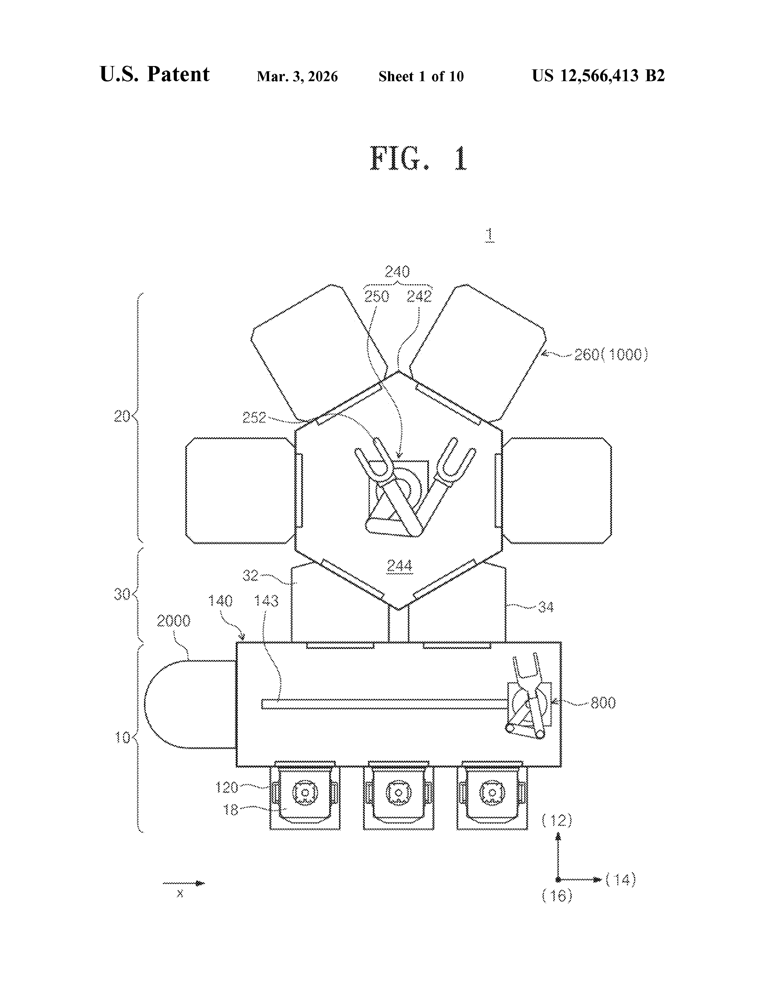
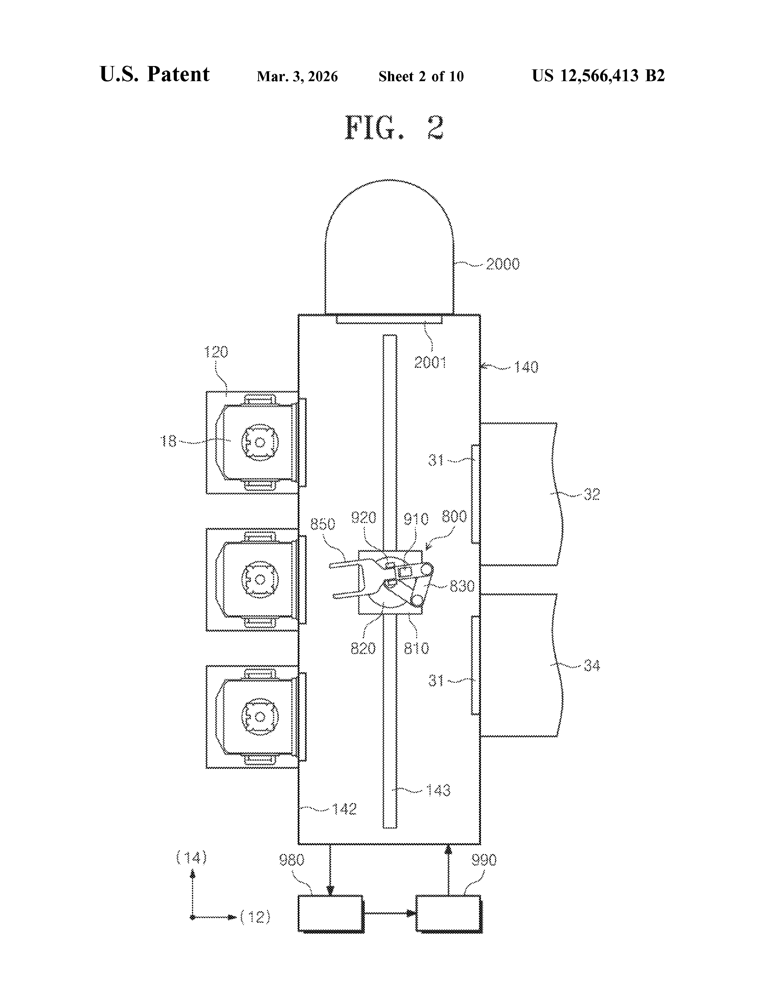
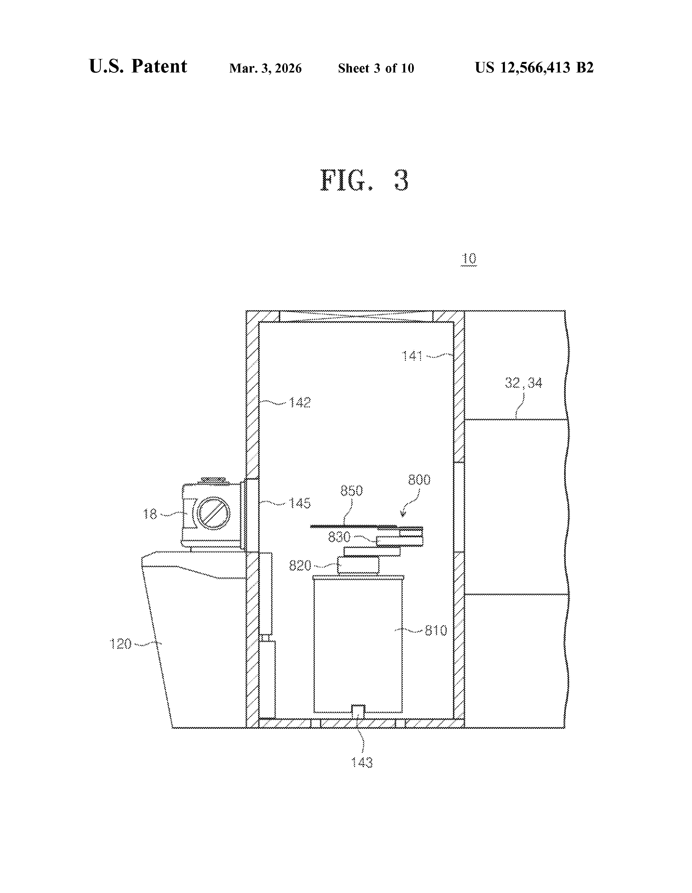
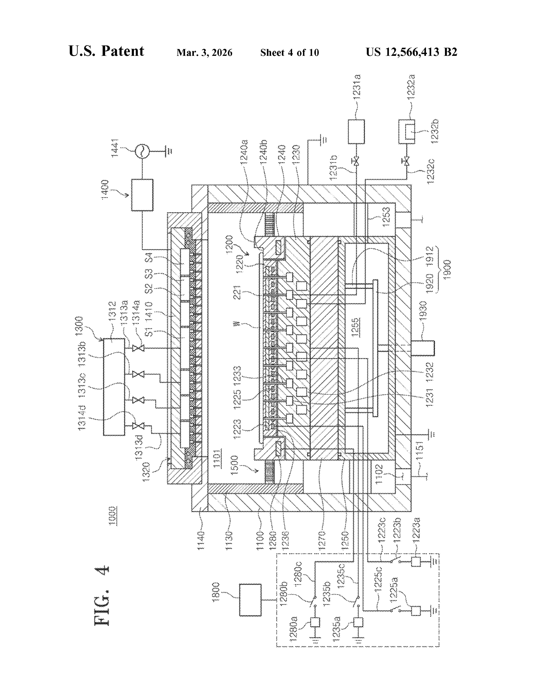
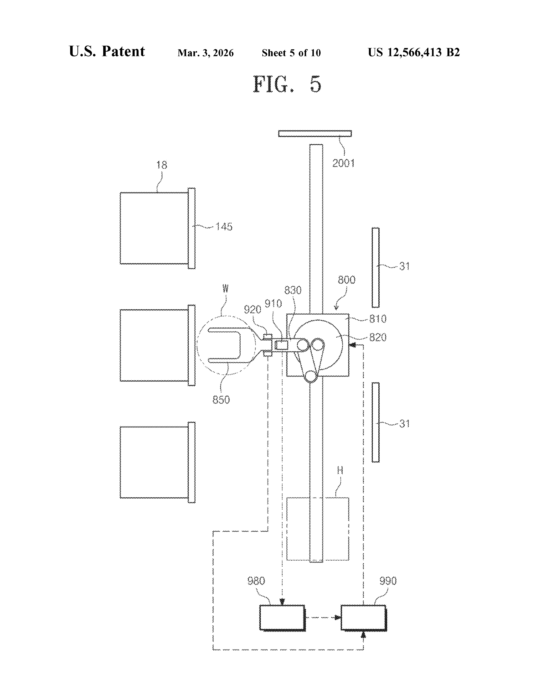
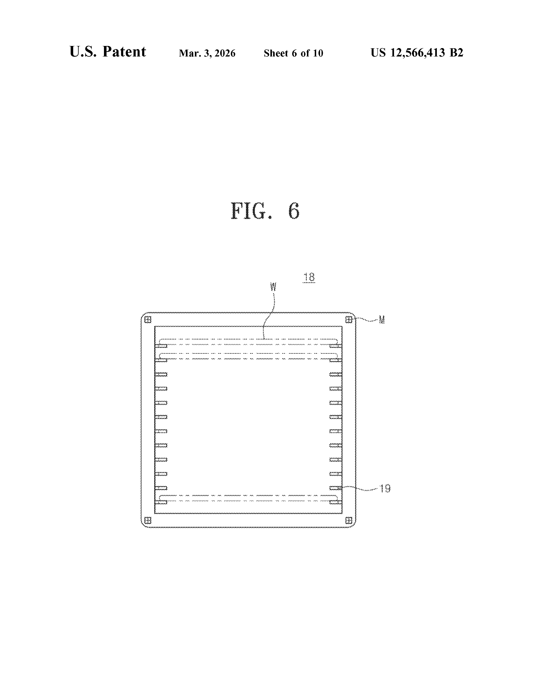
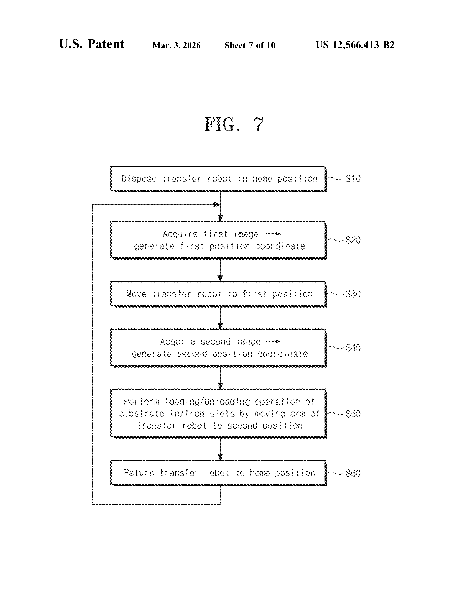
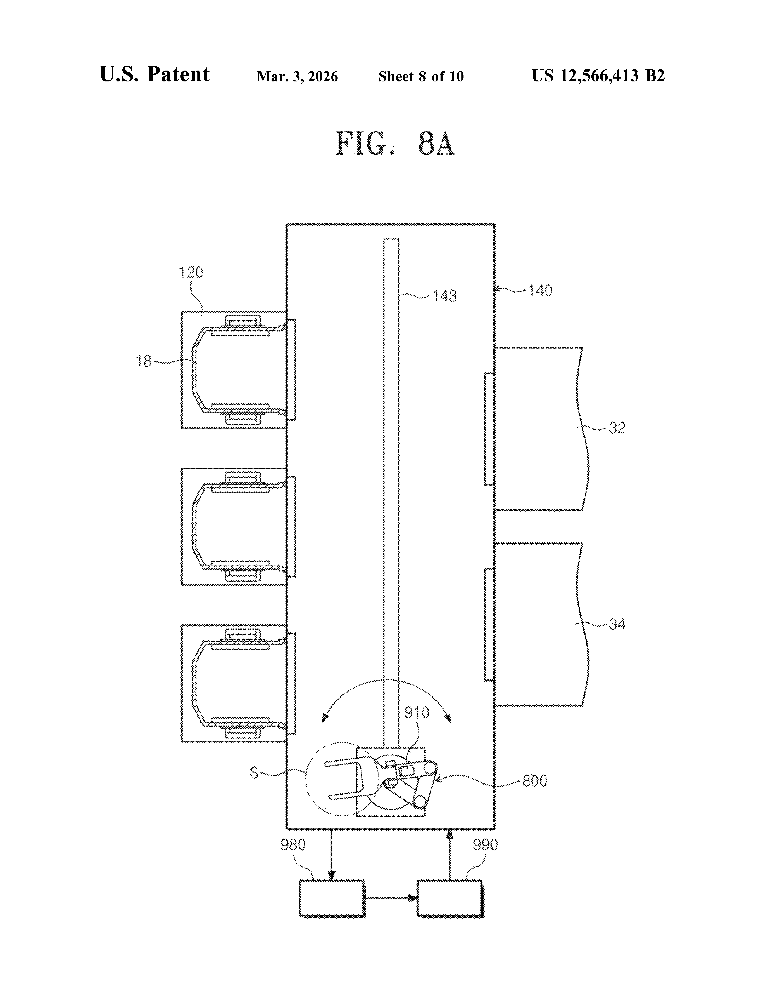
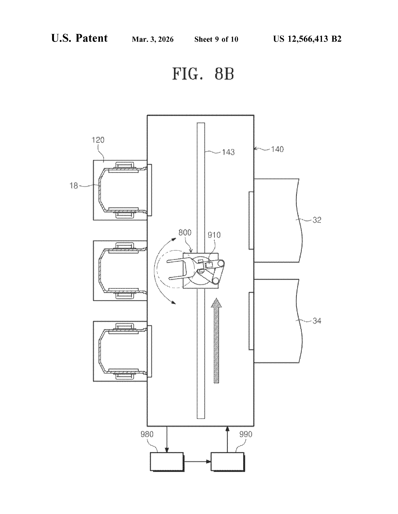
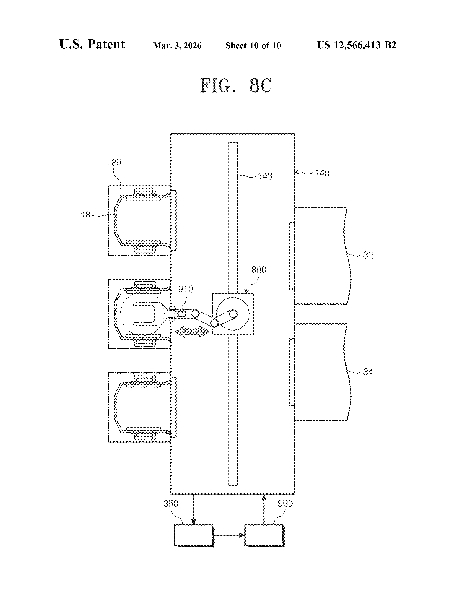

# 이송 설비의 티칭 방법 및 이송 설비의 티칭 처리 시스템 (US12566413B2)

- 원제: Teaching method of transfer equipment and teaching processing system of transfer equipment
- 원문: 같은 폴더의 PDF, https://patents.google.com/patent/US12566413B2/en
- 번역 기준: Google Patents 원문 텍스트를 한국어로 옮김. 도면은 PDF 참조.
- 도면: 원문 PDF 도면 시트 10장을 도면/ 폴더에 넣고 본문에서 처음 언급되는 곳에 삽입함

## 요약

본 발명은 이송 설비의 티칭(teaching) 방법을 제공한다. 이송 설비의 티칭 방법은, a) 피이송물(transferred object)이 이송되는 이송 대상물(transfer target object)들이 배치된 이송 챔버(transfer chamber)의 그루브 위치(groove position)에 이송 로봇(transfer robot)을 설치하는 단계; b) 홈 위치(home position)에서 이송 로봇에 설치된 비전 카메라(vision camera)를 통해 제1 영상을 획득하고, 획득된 영상 데이터를 판독하여 티칭 대상으로 미리 설정된 이송 대상물을 특정하고, 이송 대상물에 대한 제1 위치 좌표(position coordinate)를 도출하는 단계; c) 이송 로봇을 제1 위치 좌표에 대응하는 위치로 이동시키는 단계; 및 d) 제1 위치 좌표에서 비전 카메라를 통해 이송 대상물에 대한 제2 영상을 획득하고, 획득된 영상 데이터를 판독하여 제2 위치 좌표를 도출하는 단계를 포함한다.

## 청구범위

청구하는 것은 다음과 같다.

**1.** 이송 로봇의 이송 위치 티칭 시스템으로서,

이송 챔버의 홈 위치에 배치된 이송 로봇의 암(arm)에 설치되며, 주변 영역이 촬영된 제1 영상을 획득하여 출력하도록 구성되는 비전 카메라;

상기 비전 카메라로부터 획득된 상기 제1 영상을 판독하여 티칭 대상물로 미리 설정된 이송 대상물을 식별하고, 상기 이송 로봇이 식별된 상기 이송 대상물의 전방에 위치하는 제1 위치 좌표를 생성하도록 구성되는 영상 분석부(image analysis unit); 및

상기 홈 위치로부터 상기 영상 분석부로부터 수신된 상기 제1 위치 좌표로의 상기 이송 로봇의 제1 이동을 제어하도록 구성되는 제어기(controller)를 포함하고,

상기 비전 카메라는 상기 이송 로봇이 상기 제1 위치 좌표에 있는 것에 기초하여 상기 이송 대상물을 포함하는 제2 영상을 획득하여 출력하도록 추가로 구성되며, 상기 비전 카메라는 상기 제1 영상을 획득하는 동안에는 상기 이송 로봇의 베이스(base)에 대하여 제1 방향을 향하고 상기 제2 영상을 획득하는 동안에는 상기 이송 로봇의 상기 베이스에 대하여 제2 방향을 향하며, 상기 제1 방향과 상기 제2 방향은 서로 상이하고,

상기 영상 분석부는 상기 제2 영상을 판독하여 제2 위치 좌표를 생성하도록 추가로 구성되며,

상기 제어기는 상기 제1 위치 좌표로부터 상기 영상 분석부로부터 수신된 상기 제2 위치 좌표로의 상기 이송 로봇의 제2 이동을 제어하도록 구성되는, 이송 로봇의 이송 위치 티칭 시스템.

**2.** 청구항 1에 있어서, 상기 이송 대상물은 적어도 하나의 기준 마크(reference mark)를 포함하고,

상기 영상 분석부는 상기 제1 영상 및 상기 제2 영상을 판독할 때 상기 기준 마크에 기초하여 위치 좌표들을 도출하도록 구성되며, 상기 위치 좌표들은 상기 제1 위치 좌표 및 상기 제2 위치 좌표를 포함하는, 이송 로봇의 이송 위치 티칭 시스템.

**3.** 청구항 2에 있어서, 상기 영상 분석부는 첨단 운전자 보조 시스템(advanced driver assistance system, ADAS) 영상 기법을 통해 상기 위치 좌표들을 도출하도록 구성되는, 이송 로봇의 이송 위치 티칭 시스템.

**4.** 청구항 1에 있어서, 상기 이송 대상물은 기판(substrate)이 적재되는 슬롯(slot)들을 포함하고,

상기 제2 위치 좌표는 상기 슬롯들 각각에 대한 슬롯 위치 좌표들을 포함하는, 이송 로봇의 이송 위치 티칭 시스템.

**5.** 청구항 4에 있어서, 상기 제어기는, 상기 이송 로봇이 상기 슬롯들 각각에 대한 상기 슬롯 위치 좌표들을 따라 상기 이송 대상물의 상기 슬롯들에 상기 기판을 로딩하거나 상기 슬롯들로부터 상기 기판을 언로딩하는 동작을 수행하도록 상기 이송 로봇의 제3 이동을 제어하도록 구성되는, 이송 로봇의 이송 위치 티칭 시스템.

**6.** 청구항 2에 있어서, 상기 이송 로봇의 상기 암에 설치되며 상기 암과 주변 설비의 충돌을 사전에 감지하도록 구성되는 센서부를 더 포함하고,

상기 제어기는 상기 센서부로부터 충돌 감지 신호가 출력되면 상기 이송 로봇의 티칭 동작을 중단시키도록 구성되는, 이송 로봇의 이송 위치 티칭 시스템.

**7.** 청구항 6에 있어서, 상기 센서부는 라이다(lidar), 레이더(radar) 및 초음파 센서로 이루어진 군으로부터 선택된 적어도 하나를 포함하는, 이송 로봇의 이송 위치 티칭 시스템.

**8.** 청구항 1에 있어서,

상기 제1 이동은 상기 이송 로봇의 베이스를 제어하여 상기 이송 로봇을 이동시키는 것을 포함하고,

상기 제2 이동은 상기 이송 로봇의 상기 베이스의 위치를 유지한 채 상기 이송 로봇의 상기 암을 이동시키는 것을 포함하는, 이송 로봇의 이송 위치 티칭 시스템.

## 상세한 설명

### 관련 출원의 상호 참조 (CROSS-REFERENCE TO RELATED APPLICATIONS)

본 출원은 2021년 12월 29일 및 2022년 10월 4일에 대한민국 특허청에 출원된 대한민국 특허출원 제10-2021-0191555호 및 제10-2022-0126631호에 대한 우선권 및 그 이익을 주장하며, 각 출원의 전체 내용은 본 명세서에 참조로 포함된다.

### 기술분야 (TECHNICAL FIELD)

본 발명은 이송 설비의 티칭 방법 및 이송 설비의 티칭 처리 시스템에 관한 것이다.

### 배경기술 (BACKGROUND ART)

반도체 소자를 제조할 때에는 복수의 모듈에 대하여 기판을 이송하는 이송 장치를 포함하는 처리 시스템이 사용된다. 처리 시스템에서는 각 모듈 내에서 기판을 정밀하게 이송하기 위하여 이송 장치의 티칭 동작이 수행된다.

이송 장치의 티칭 동작으로는, 개략 정렬(rough alignment)을 실행한 후 작업자가 정렬 지그(alignment jig)를 이용하여 육안으로 관찰하면서 수동으로 티칭 위치를 지정하는 방법이 알려져 있다. 이러한 수동 티칭 방법은 작업자가 챔버 내부에서 작업을 수행해야 하므로 안전사고가 발생할 수 있고 작업 완료까지 오랜 시간이 걸릴 수 있다는 문제가 있다.

### 발명의 내용 (SUMMARY OF THE INVENTION)

본 발명은 비전 영상 처리를 통해 정밀한 티칭이 가능한 이송 설비의 티칭 방법 및 이송 설비의 티칭 처리 시스템을 제공하고자 한다.

또한, 본 발명은 티칭 작업 시간을 단축할 수 있는 이송 설비의 티칭 방법 및 이송 설비의 티칭 처리 시스템을 제공하고자 한다.

본 발명의 목적은 이에 한정되지 않으며, 언급되지 않은 다른 목적들은 아래의 기재로부터 당업자에게 명확하게 이해될 수 있을 것이다.

본 발명의 일 예시적 실시예(embodiment)는 이송 설비의 티칭 방법을 제공하며, 이는 a) 피이송물이 이송되는 이송 대상물들이 배치된 이송 챔버의 그루브 위치에 이송 로봇을 설치하는 단계; b) 홈 위치에서 이송 로봇에 설치된 비전 카메라를 통해 제1 영상을 획득하고, 획득된 영상 데이터를 판독하여 티칭 대상으로 미리 설정된 이송 대상물을 특정하고, 이송 대상물에 대한 제1 위치 좌표를 도출하는 단계; c) 이송 로봇을 제1 위치 좌표에 대응하는 위치로 이동시키는 단계; 및 d) 제1 위치 좌표에서 비전 카메라를 통해 이송 대상물에 대한 제2 영상을 획득하고, 획득된 영상 데이터를 판독하여 제2 위치 좌표를 도출하는 단계를 포함한다.

예시적 실시예에 따르면, 이송 대상물에는 적어도 하나의 기준 마크가 표시될 수 있고, 상기 단계 b) 및 단계 d)에서, 영상 데이터를 판독할 때 기준 마크에 기초하여 위치 좌표가 도출될 수 있다.

예시적 실시예에 따르면, 상기 단계 b) 및 단계 d)에서, 영상 데이터는 ADAS 영상 기법을 통해 위치 좌표를 도출할 수 있다.

예시적 실시예에 따르면, 이송 대상물은 피이송물이 적재되는 복수의 슬롯을 포함할 수 있고, 상기 단계 d)에서, 제2 위치 좌표는 각 슬롯에 대한 위치 좌표를 포함할 수 있다.

예시적 실시예에 따르면, 이송 대상물은 피이송물이 안착되는 엔드 이펙터(end effector)를 포함할 수 있고, 방법은 e) 상기 단계 d) 이후에, 엔드 이펙터에 의해 각 슬롯에 대한 위치 좌표를 따라 이송 대상물의 슬롯들에 피이송물을 로딩하거나 슬롯들로부터 피이송물을 언로딩하는 테스트 단계를 더 포함할 수 있다.

예시적 실시예에 따르면, 테스트 단계를 완료한 후, 이송 대상물은 홈 위치로 복귀될 수 있고, 이후 티칭 대상으로 설정된 이송 대상물이 특정되어 상기 단계 b) 내지 e)가 반복 수행될 수 있다.

예시적 실시예에 따르면, 이송 로봇의 엔드 이펙터에 피이송물 대신 더미 기판(dummy substrate)이 안착된 상태에서 엔드 이펙터에서 티칭 동작이 수행될 수 있다.

본 발명의 다른 예시적 실시예는 이송 로봇의 이송 위치 티칭 시스템을 제공하며, 이는 이송 챔버의 홈 위치에 배치된 이송 로봇의 암에 설치되며 주변 영역이 촬영된 제1 영상을 획득하여 출력하도록 구성되는 비전 카메라; 비전 카메라로부터 획득된 제1 영상을 판독하여 티칭 대상물로 미리 설정된 이송 대상물을 식별하고, 이송 로봇이 식별된 이송 대상물의 전방에 위치할 수 있는 제1 위치 좌표를 생성하도록 구성되는 영상 분석부; 및 영상 분석부로부터 수신된 제1 위치 좌표를 따라 이송 로봇의 이동을 제어하도록 구성되는 제어기를 포함한다.

예시적 실시예에 따르면, 비전 카메라는 이송 로봇이 제1 위치 좌표에 배치되었을 때 이송 대상물이 촬영된 제2 영상을 획득하여 출력할 수 있고, 영상 분석부는 제2 영상을 판독하여 제2 위치 좌표를 생성할 수 있으며, 제어기는 영상 분석부로부터 수신된 제2 위치 좌표를 따라 이송 로봇의 이동을 제어할 수 있다.

예시적 실시예에 따르면, 이송 대상물은 적어도 하나의 기준 마크를 포함할 수 있고, 영상 분석부는 영상을 판독할 때 기준 마크에 기초하여 위치 좌표를 도출할 수 있다.

예시적 실시예에 따르면, 영상 분석부는 첨단 운전자 보조 시스템(ADAS) 영상 기법을 통해 위치 좌표를 도출할 수 있다.

예시적 실시예에 따르면, 이송 대상물은 기판이 적재되는 복수의 슬롯을 포함할 수 있고, 제2 위치 좌표는 각 슬롯에 대한 위치 좌표를 포함할 수 있다.

예시적 실시예에 따르면, 제어기는 이송 로봇이 각 슬롯에 대한 위치 좌표를 따라 이송 대상물의 슬롯들에 기판을 로딩하거나 슬롯들로부터 기판을 언로딩하는 동작을 수행하도록 이송 로봇의 이동을 제어할 수 있다.

예시적 실시예에 따르면, 이송 로봇의 이송 위치 티칭 시스템은 이송 로봇의 암에 설치되며 암과 주변 설비의 충돌을 사전에 감지하도록 구성되는 센서부를 더 포함할 수 있고, 제어기는 센서부로부터 충돌 감지 신호가 출력되면 이송 로봇의 티칭 동작을 중단시킬 수 있다.

예시적 실시예에 따르면, 센서부는 라이다, 레이더 및 초음파 센서로 이루어진 군으로부터 선택된 적어도 하나를 포함할 수 있다.

본 발명의 또 다른 예시적 실시예는 이송 용기에 대한 이송 로봇의 이송 위치 티칭 방법을 제공하며, 이는 a) 이송 용기들이 로드 포트(load port)에 안착된 이송 챔버 내의 홈 위치에 이송 로봇을 위치시키는 단계; b) 홈 위치에서 이송 로봇에 설치된 비전 카메라를 통해 제1 영상을 획득하고, 획득된 영상 데이터를 판독하여 티칭 대상물로 미리 설정된 이송 용기를 특정하고, 이송 용기에 대한 제1 위치 좌표를 도출하는 단계; c) 이송 로봇을 제1 위치 좌표에 대응하는 위치로 이동시키는 단계; d) 제1 위치 좌표에서 비전 카메라를 통해 이송 용기에 대한 정밀 영상을 획득하고, 획득된 영상 데이터를 판독하여 이송 용기 내의 슬롯별 위치 좌표를 포함하는 제2 위치 좌표를 도출하는 단계; e) 이송 로봇에 의해 슬롯별 위치 좌표를 따라 이송 용기의 슬롯들에 기판을 로딩하거나 슬롯들로부터 기판을 언로딩하는 단계; 및 f) 이송 용기의 티칭 동작을 완료한 이송 로봇을 홈 위치로 복귀시키고, 다음 티칭 대상물로 설정된 이송 대상물을 특정하여 상기 단계 b) 내지 e)를 반복 수행하는 단계를 포함한다.

예시적 실시예에 따르면, 이송 용기는 적어도 하나의 기준 마크를 포함할 수 있고, 상기 단계 b) 및 단계 d)에서, 영상 데이터를 판독할 때 기준 마크에 기초하여 위치 좌표가 도출될 수 있다.

예시적 실시예에 따르면, 상기 단계 b) 및 단계 d)에서, 영상 데이터는 ADAS 영상 기법을 통해 위치 좌표를 도출할 수 있다.

예시적 실시예에 따르면, 이송 로봇은 이송 로봇의 엔드 이펙터에 더미 기판이 안착된 상태에서 티칭 동작을 수행할 수 있다.

예시적 실시예에 따르면, 상기 단계 e)에서, 이송 로봇의 엔드 이펙터에 장착된 센서부가 주변 설비와의 충돌을 사전에 감지할 수 있다.

본 발명의 예시적 실시예에 따르면, 인덱스 로봇(index robot)의 이동 목표를 위치 결정(즉, 티칭)할 때, ADAS 기법을 이용한 비전 영상 처리를 통해 고정밀 위치 결정이 자동으로 수행될 수 있어, 설비 내 유인 작업에서 발생할 수 있는 안전사고를 방지하고 작업 시간을 최소화할 수 있다.

### 도면의 간단한 설명 (BRIEF DESCRIPTION OF THE DRAWINGS)

도 1은 본 발명의 일 실시예에 따른 기판 처리 장치를 개략적으로 도시한 평면도이다.

도 2 및 도 3은 도 1에 도시된 인덱스 모듈의 평면도 및 측단면도이다.

도 4는 도 1에 도시된 기판 처리 장치의 측단면도이다.

도 5는 인덱스 로봇의 이송 위치 티칭 시스템을 도시한 구성도이다.

도 6은 캐리어를 설명하기 위한 도면이다.

도 7은 이송 위치 티칭 시스템을 이용한 인덱스 로봇의 티칭 방법을 도시한 흐름도이다.

도 8a 내지 도 8c는 도 7의 티칭 방법에 따른 인덱스 로봇의 위치를 도시한 도면이다.

### 발명을 실시하기 위한 구체적인 내용 (DETAILED DESCRIPTION)

이하, 첨부한 도면을 참조하여 본 발명이 속하는 기술분야에서 통상의 지식을 가진 자가 용이하게 실시할 수 있도록 본 발명의 예시적 실시예를 상세히 설명한다. 그러나 본 발명은 여러 가지 상이한 형태로 구현될 수 있으며 여기에서 설명하는 예시적 실시예에 한정되지 않는다. 본 발명을 설명함에 있어서, 공지 기능 및 구성에 대한 상세한 설명이 본 발명의 요지를 흐릴 수 있는 경우에는 그 상세한 설명을 생략한다. 도면의 설명 전체에 걸쳐 동일한 번호는 동일한 요소를 지칭한다.

명백히 반대되는 기재가 없는 한, 명세서 전체에서 사용되는 "포함하다", "포함한다" 또는 "포함하는"이라는 단어는 다른 구성요소를 제외하는 것이 아니라 다른 구성요소를 더 포함할 수 있는 것으로 이해될 것이다. 구체적으로, "포함하다", "구비하다", "포함하는" 또는 "구비하는"이라는 용어는 특성, 영역, 정수, 공정, 요소 및/또는 성분을 특정하는 것이며, 다른 특성, 영역, 정수, 공정, 요소 및/또는 성분을 배제하지 않는다.

본 명세서에서 단수형은 문구에서 특별히 달리 언급하지 않는 한 복수형도 포함한다. 도면에서 요소의 형상 및 치수는 명확성을 위하여 과장될 수 있다.

제1, 제2 등의 용어가 본 명세서에서 다양한 요소를 설명하기 위해 사용될 수 있으나, 이들 요소는 이들 용어에 의해 한정되어서는 안 된다는 것이 이해될 것이다. 이들 용어는 하나의 요소를 다른 요소와 구별하기 위해서만 사용된다. 예를 들어, 본 발명의 범위를 벗어나지 않으면서 제1 요소는 제2 요소로 명명될 수 있고, 유사하게 제2 요소도 제1 요소로 명명될 수 있다.

어떤 요소가 다른 요소에 "연결되어" 있다거나 "결합되어" 있다고 언급될 때에는, 그 다른 요소에 직접 연결되거나 결합되어 있을 수도 있고, 중간에 다른 요소가 존재할 수도 있다고 이해될 것이다. 반면에, 어떤 요소가 다른 요소에 "직접 연결되어" 있다거나 "직접 결합되어" 있다고 언급될 때에는, 중간에 다른 요소가 존재하지 않는다. 요소들 간의 관계를 설명하는 다른 표현들(즉, "~사이에"와 "바로 ~사이에", "~에 인접한"과 "~에 바로 인접한" 등)도 마찬가지로 해석되어야 한다.

달리 정의되지 않는 한, 본 명세서에서 사용되는 모든 용어(기술 및 과학 용어 포함)는 본 발명이 속하는 기술분야에서 통상의 지식을 가진 자에 의해 일반적으로 이해되는 것과 동일한 의미를 갖는다. 또한, 일반적으로 사용되는 사전에 정의된 용어들은 관련 기술의 맥락에서의 의미와 일치하는 의미를 갖는 것으로 해석되어야 하며, 본 명세서에서 명시적으로 그렇게 정의되지 않는 한 이상적이거나 지나치게 형식적인 의미로 해석되지 않는다는 것이 이해될 것이다.

앞서 기재한 상세한 설명은 본 개시를 예시하는 것이다. 또한, 전술한 내용은 본 개시의 바람직한 실시예를 예시하고 설명하기 위한 것이며, 본 개시는 다양한 다른 조합, 변경 및 환경에서 사용될 수 있다. 즉, 전술한 개시의 개념의 범위 내에서, 전술한 개시와 균등한 범위 내에서, 및/또는 당업계의 기술 또는 지식의 범위 내에서 변경 또는 수정이 가능하다. 전술한 실시예는 본 개시의 기술적 사상을 구현하기 위한 최선의 형태를 설명하는 것이며, 본 개시의 구체적인 적용 분야 및 용도에서 요구되는 다양한 변경도 가능하다. 따라서 본 개시의 상세한 설명은 개시된 실시예로 본 개시를 한정하려는 의도가 아니다. 또한, 첨부된 청구범위는 다른 실시예도 포함하는 것으로 해석되어야 한다.

본 발명의 예시적 실시예에서는 플라즈마를 이용하여 기판을 식각하는 기판 처리 장치에 대해 설명한다. 그러나 본 발명은 이에 한정되지 않으며, 챔버 내에 이송 로봇이 설치되는 다양한 종류의 장치에 적용될 수 있다.

도 1은 본 발명의 일 실시예에 따른 기판 처리 장치를 개략적으로 도시한 평면도이고, 도 2 및 도 3은 도 1에 도시된 인덱스 모듈의 평면도 및 측단면도이다.

*도 1 — 기판 처리 장치의 개략 평면도*

*도 2 — 인덱스 모듈의 평면도*

*도 3 — 인덱스 모듈의 측단면도*

도 1 내지 도 3을 참조하면, 기판 처리 장치(1)는 인덱스 모듈(10), 로드락 모듈(30) 및 공정 모듈(20)을 포함한다.

인덱스 모듈(10)은 로드 포트(120), 인덱스 챔버(140) 및 버퍼 유닛(2000)을 포함할 수 있으며, 로드 포트(120), 인덱스 챔버(140) 및 공정 모듈(20)은 순차적으로 일렬로 배치될 수 있다.

이하, 로드 포트(120), 인덱스 챔버(140), 로드락 모듈(30) 및 공정 모듈(20)이 배열된 방향을 제1 방향(12)이라 하고, 상부에서 바라볼 때 제1 방향(12)과 수직한 방향을 제2 방향(14)이라 하며, 제1 방향(12)과 제2 방향(14)을 포함하는 평면에 수직한 방향을 제3 방향(16)이라 한다.

로드 포트(120)에는 복수의 기판(W)이 수용된 캐리어(18)가 안착된다. 로드 포트(120)는 복수 개 제공되며 제2 방향(14)을 따라 일렬로 배치된다. 캐리어(18)에는 기판의 가장자리를 지지하도록 제공되는 슬롯(도 6 참조)이 형성된다. 슬롯은 제3 방향(16)으로 복수 개 제공되며, 기판들은 제3 방향(16)으로 서로 이격된 상태로 캐리어 내에 적층된다. 캐리어(18)로는 전면 개방 일체형 포드(front opening unified pod, FOUP)가 사용될 수 있다.

인덱스 챔버(140)는 평면에서 바라볼 때 대체로 직사각형 형상을 갖는다. 인덱스 챔버(140)는 그 내부에 인덱스 로봇(800)을 갖는다. 인덱스 로봇(800)은 로드 포트(120)에 안착된 캐리어(18), 버퍼 유닛(2000) 및 로드락 모듈(30) 사이에서 기판(w)에 접근하도록 굽힘, 승강 및 회전이 가능한 다관절 암을 포함한다. 다관절 암의 선단에는 엔드 이펙터(850)가 제공된다. 기판은 엔드 이펙터(850)에 안착될 수 있다.

인덱스 챔버(140)에는 인덱스 레일(142)이 제공된다. 인덱스 레일(142)은 그 길이 방향이 제2 방향(14)과 평행하게 제공된다. 인덱스 로봇(800)은 인덱스 레일(142) 상에 설치되며, 인덱스 레일(143)을 따라 제2 방향(14)으로 직선 이동한다. 인덱스 로봇(800)은 베이스(810), 몸체(820) 및 다관절 암(830)을 포함한다. 베이스(810)는 인덱스 레일(142)을 따라 이동 가능하도록 설치된다. 몸체(820)는 베이스(810)에 결합된다. 몸체(820)는 베이스(810) 상에서 제3 방향(16)을 따라 이동 가능하도록 제공된다.

또한, 몸체(820)는 베이스(810) 상에서 회전 가능하도록 제공된다. 다관절 암(830)은 몸체(820)에 결합되며, 기판(W)에 접근하도록 굽힘, 승강 및 회전이 가능하다. 인덱스 로봇은 캐리어(18), 버퍼 유닛(2000) 및 로드락 모듈(30) 사이에서 기판을 이송하며, 본 발명은 도 3에 도시된 구성에 한정되지 않는다.

인덱스 챔버(140)의 일 측면(141)에는 두 개의 로드락 챔버(32, 34)가 연결되고, 그 타 측면(142)에는 기판을 반입하기 위한 복수의 출입구(145)가 제공된다. 본 실시예에서는 세 개의 출입구(145)가 제공된다. 각 출입구(145)에는 개폐 가능한 개폐 도어가 제공될 수 있다. 로드 포트(120)는 각 출입구(145)에 대응하도록 제공된다. 로드 포트(120)에는 기판을 수용하여 이송하는 캐리어(18)가 안착된다.

버퍼 유닛(2000)은 기판(W)을 임시로 보관한다. 버퍼 유닛(2000)은 기판(W)에 잔류하는 공정 부산물을 제거하는 공정을 수행한다. 버퍼 유닛(2000)은 공정 모듈(20)에서 처리된 기판(W)을 후처리하는 후처리 공정을 수행한다. 후처리 공정은 기판(W)에 퍼지 가스를 퍼징하는 공정일 수 있다. 버퍼 유닛(2000)은 복수 개 제공된다. 각 버퍼 유닛(2000)은 인덱스 챔버(140)를 사이에 두고 서로 마주보도록 배치된다. 버퍼 유닛(2000)들은 제2 방향(14)으로 배열된다. 버퍼 유닛(2000)들은 인덱스 챔버(140)의 양 측에 각각 배치된다. 선택적으로, 버퍼 유닛(2000)은 단일로 제공되어 인덱스 챔버(140)의 일 측에 배치될 수도 있다.

로드락 모듈(30)은 인덱스 챔버(140)와 이송 유닛(240) 사이에 배치된다. 로드락 모듈(30)은 공정 모듈(20)로 반입되는 기판(W)에 대하여 인덱스 모듈(10)의 상압 분위기를 공정 모듈(20)의 진공 분위기로 치환하거나, 인덱스 모듈(10)로 반출되는 기판(W)에 대하여 공정 모듈(20)의 진공 분위기를 인덱스 모듈(10)의 상압 분위기로 치환한다. 로드락 모듈(30)은 기판(W)을 이송하기 전에 이송 유닛(240)과 인덱스 챔버(140) 사이에서 기판(W)이 머무르는 공간을 제공한다. 로드락 모듈(30)은 로드락 챔버(32) 및 언로드락 챔버(34)를 포함한다.

로드락 챔버(32)에는 인덱스 모듈(10)에서 공정 모듈(20)로 이송되는 기판(W)이 일시적으로 머무른다. 로드락 챔버(32)는 대기 상태에서 상압 분위기를 유지하며 공정 모듈(20)에 대해서는 차단되고 인덱스 모듈(10)에 대해서는 개방 상태를 유지한다. 기판(W)이 로드락 챔버(32)로 반입되면, 그 내부 공간은 인덱스 모듈(10) 및 공정 모듈(20) 각각에 대해 밀폐된다. 이후, 로드락 챔버(32)의 내부 공간은 상압 분위기에서 진공 분위기로 치환되고, 인덱스 모듈(10)에 대해서는 차단된 상태에서 공정 모듈(20)에 대해 개방된다.

언로드락 챔버(34)에는 공정 모듈(20)에서 인덱스 모듈(10)로 이송되는 기판(W)이 일시적으로 머무른다. 언로드락 챔버(34)는 대기 상태에서 진공 분위기를 유지하며 인덱스 모듈(10)에 대해서는 차단되고 공정 모듈(20)에 대해서는 개방 상태를 유지한다. 기판(W)이 언로드락 챔버(34)로 반입되면, 내부 공간은 인덱스 모듈(10) 및 공정 모듈(20) 각각에 대해 밀폐된다. 이후, 언로드락 챔버(34)의 내부 공간은 진공 분위기에서 상압 분위기로 치환되고, 공정 모듈(20)에 대해서는 차단된 상태에서 인덱스 모듈(10)에 대해 개방된다.

공정 모듈(20)은 이송 유닛(240) 및 복수의 공정 챔버(260)를 포함할 수 있다.

이송 유닛(240)은 로드락 챔버(32), 언로드락 챔버(34) 및 복수의 공정 챔버(260) 사이에서 기판(W)을 이송한다. 이송 유닛(240)은 이송 챔버(242) 및 이송 로봇(250)을 포함한다. 이송 챔버(242)는 육각형 형상으로 제공될 수 있다. 선택적으로, 이송 챔버(242)는 직사각형 또는 오각형 형상으로 제공될 수도 있다. 이송 챔버(242)의 둘레에는 로드락 챔버(32), 언로드락 챔버(34) 및 복수의 공정 챔버(260)가 배치된다. 이송 챔버(242)의 내부에는 기판(W)을 이송하기 위한 이송 공간(244)이 제공된다.

이송 로봇(250)은 이송 공간(244)에서 기판(W)을 이송한다. 이송 로봇(250)은 이송 챔버(240)의 중앙부에 배치될 수 있다. 이송 로봇(250)은 수평 방향 또는 수직 방향으로 이동할 수 있고 전진 또는 후진하거나 수평면 상에서 회전할 수 있는 복수의 핸드(252)를 가질 수 있다. 각 핸드(252)는 독립적으로 동작 가능하며, 기판(W)은 수평 상태로 핸드(252)에 안착될 수 있다.

이하, 공정 챔버(260)에 제공되는 플라즈마 처리 장치(1000)에 대해 설명한다. 플라즈마 처리 장치(1000)는 기판(W)을 식각하는 장치로 설명한다. 그러나 본 실시예의 플라즈마 처리 장치(1000)는 식각 처리 장치에 한정되지 않으며, 다양하게 적용될 수 있다.

도 4는 본 발명의 예시적 실시예에 따른 공정 모듈을 도시한 단면도이다.

*도 4 — 기판 처리 장치(공정 모듈)의 측단면도*

도 4를 참조하면, 플라즈마 처리 장치(1000)는 플라즈마를 이용하여 웨이퍼(W)를 처리한다. 기판의 일 예로서 반도체 웨이퍼(이하, 간단히 '웨이퍼(W)'라 한다)가 제공된다. 플라즈마 처리 장치(1000)는 공정 챔버(1100), 기판 지지 유닛(1200), 플라즈마 발생 유닛(1400), 가스 공급 유닛(1300), 배플 유닛(1500) 및 제어기(1800)를 포함할 수 있다.

공정 챔버(1100)는 기판 처리 공정이 수행되는 처리 공간(1101)을 제공한다. 처리 공간(1101)은 대기압보다 낮은 공정 압력으로 유지될 수 있으며, 밀폐된 공간으로 제공될 수 있다. 공정 챔버(1100)는 금속 재질로 이루어질 수 있다. 예를 들어, 공정 챔버(1100)는 알루미늄 재질로 이루어질 수 있다. 공정 챔버(1100)의 표면은 양극 산화 처리될 수 있다. 공정 챔버(1100)는 전기적으로 접지될 수 있다. 공정 챔버(1100)의 바닥면에는 배기홀(1102)이 형성될 수 있다. 배기홀(1102)은 배기 라인(1151)과 연결될 수 있다. 공정 중에 발생한 반응 부산물 및 챔버 내부 공간에 잔류하는 가스는 배기 라인(1151)을 통해 외부로 배출될 수 있다. 공정 챔버(1100)의 내부는 배기 과정에 의해 소정 압력으로 감압될 수 있다.

예시적 실시예에 따르면, 공정 챔버(1100)의 내부에는 라이너(1130)가 제공될 수 있다. 라이너(1130)는 상면 및 하면이 개방된 원통 형상을 가질 수 있다. 라이너(1130)는 챔버(1100)의 내측면과 접촉하도록 제공될 수 있다. 라이너(1130)는 챔버(1100)의 내벽을 보호하여 아크 방전에 의해 챔버(1100)의 내벽이 손상되는 것을 방지할 수 있다. 또한, 라이너(1130)는 기판 처리 공정 중에 발생한 부산물이 챔버(1100)의 내벽에 증착되는 것을 방지할 수 있다. 라이너(1130)는 공정 챔버(1100) 내부의 처리 공간에 노출되어 세정 가스와 반응할 수 있으며, 이트리아(Y2O3) 재질을 포함할 수 있다.

공정 챔버(1100)의 상부에는 윈도우(1140)가 제공된다. 윈도우(1140)는 판 형상으로 제공된다. 윈도우(1140)는 공정 챔버(1100)의 개방된 상면을 덮어 처리 공간(1101)을 밀폐한다. 윈도우(1140)는 유전체를 포함할 수 있다.

기판 지지 유닛(1200)은 공정 챔버(1100)의 내부에 제공된다. 일 실시예에서, 기판 지지 유닛(1200)은 챔버(1100) 내부에서 챔버(1100)의 바닥면으로부터 상방으로 소정 거리 이격되어 배치될 수 있다. 기판 지지 유닛(1200)은 웨이퍼(W)를 지지할 수 있다. 기판 지지 유닛(1200)은 정전기력을 이용하여 웨이퍼(W)를 흡착하는 정전 전극(1223)을 포함하는 정전 척(ESC)을 포함할 수 있다. 이와 달리, 기판 지지 유닛(1200)은 기계적 클램핑 등 다양한 방식으로 웨이퍼(W)를 지지할 수 있다. 이하에서는 정전 척(ESC)을 포함하는 기판 지지 유닛(1200)을 예로 들어 설명한다.

기판 지지 유닛(1200)은 서셉터, 베이스 플레이트(1250) 및 리프트 핀 유닛(1900)을 포함할 수 있다. 서셉터는 지지판에 해당하는 유전판(1220), 하부 전극에 해당하는 전극판(1230) 및 절연판(1270)을 포함하는 모듈 형태로 제공될 수 있다.

유전판(1220)은 웨이퍼(W)를 지지할 수 있다. 유전판(1220)의 둘레는 포커스 링(1240)에 의해 둘러싸일 수 있다. 유전판(1220)은 전극판(1230)의 상단에 배치될 수 있다. 유전판(1220)은 원판 형상의 유전체 기판으로 제공될 수 있다. 유전판(1220)의 상면에는 웨이퍼(W)가 놓일 수 있다. 유전판(1220)의 상면은 웨이퍼(W)보다 작은 반경을 가질 수 있다. 따라서 웨이퍼(W)의 가장자리 영역은 유전판(1220)의 외측에 위치할 수 있다. 웨이퍼(W)의 가장자리는 포커스 링(1240)의 상면에 놓일 수 있다.

유전판(1220)은 정전 전극(1223), 히터(1225) 및 제1 공급 유로(1221)를 포함할 수 있다. 제1 공급 유로(1221)는 유전판(1220)의 상면에서 하면까지 관통하도록 형성될 수 있다. 제1 공급 유로(1221)는 복수 개가 서로 이격되어 형성되며, 웨이퍼(W)의 바닥면으로 열전달 매체가 공급되는 통로로 제공될 수 있다.

정전 전극(1223)은 제1 전원(1223a)과 전기적으로 연결될 수 있다. 제1 전원(1223a)은 직류 전원을 포함할 수 있다. 정전 전극(1223)과 제1 전원(1223a) 사이에는 스위치(1223b)가 설치될 수 있다. 정전 전극(1223)은 스위치(1223b)의 온/오프 동작에 의해 제1 전원(1223a)과 전기적으로 연결되거나 차단될 수 있다. 스위치(1223b)가 온(on)되면 정전 전극(1223)에 직류 전류가 인가될 수 있다. 정전 전극(1223)에 인가된 전류에 의해 정전 전극(1223)과 웨이퍼(W) 사이에 정전기력이 작용하며, 웨이퍼(W)는 정전기력에 의해 유전판(1220)에 흡착될 수 있다.

히터(1225)는 정전 전극(1223)의 하부에 배치될 수 있다. 히터(1225)는 제2 전원(1225a)과 전기적으로 연결될 수 있다. 히터(1225)는 제2 전원(1225a)으로부터 인가된 전류에 저항하여 열을 발생시킬 수 있다. 발생된 열은 유전판(1220)을 통해 웨이퍼(W)로 전달될 수 있다. 웨이퍼(W)는 히터(1225)에서 발생된 열에 의해 소정 온도로 유지될 수 있다. 히터(1225)는 나선 형상의 코일을 포함할 수 있다.

전극판(1230)은 유전판(1220)의 하부에 배치될 수 있다. 유전판(1220)의 바닥면은 접착제(1236)에 의해 전극판(1230)의 상면에 접착될 수 있다. 전극판(1230)은 알루미늄 재질로 이루어질 수 있다. 전극판(1230)의 상면은 중앙 영역이 가장자리 영역보다 높게 위치하도록 단차질 수 있다. 전극판(1230)의 상부 중앙부는 유전판(1220)의 바닥면에 대응하는 면적을 가지며, 유전판(1220)의 바닥면에 접착될 수 있다. 전극판(1230)의 내부에는 제1 순환 유로(1231), 제2 순환 유로(1232) 및 제2 공급 유로(1233)가 형성될 수 있다.

제1 순환 유로(1231)는 열전달 매체가 순환하는 통로로 구현될 수 있다. 제1 순환 유로(1231)는 전극판(1230) 내부에 나선 형상으로 형성될 수 있다. 이와 달리, 제1 순환 유로(1231)는 서로 다른 반경을 갖는 링 형상의 유로들이 동일한 중심을 갖도록 배치될 수 있다. 각각의 제1 순환 유로(1231)는 서로 연통될 수 있다. 제1 순환 유로(1231)들은 동일한 높이에 형성될 수 있다.

제2 순환 유로(1232)는 냉매가 순환하는 통로로 구현될 수 있다. 제2 순환 유로(1232)는 전극판(1230) 내부에 나선 형상으로 형성될 수 있다. 이와 달리, 제2 순환 유로(1232)는 서로 다른 반경을 갖는 링 형상의 유로들이 동일한 중심을 갖도록 배치될 수 있다. 각각의 제2 순환 유로(1232)는 서로 연통될 수 있다. 제2 순환 유로(1232)는 제1 순환 유로(1231)보다 큰 단면적을 가질 수 있다. 제2 순환 유로(1232)들은 동일한 높이에 형성될 수 있다. 제2 순환 유로(1232)는 제1 순환 유로(1231)의 하부에 형성될 수 있다.

제2 공급 유로(1233)는 제1 순환 유로(1231)로부터 상방으로 연장되어 전극판(1230)의 상면에 제공될 수 있다. 제2 공급 유로(1243)는 제1 공급 유로(1221)에 대응하는 개수로 제공될 수 있으며, 제1 순환 유로(1231)와 제1 공급 유로(1221)를 연결할 수 있다.

제1 순환 유로(1231)는 열전달 매체 공급 라인(1231b)을 통해 열전달 매체 저장부(1231a)와 연결될 수 있다. 열전달 매체 저장부(1231a)에는 열전달 매체가 저장될 수 있다. 열전달 매체는 불활성 가스를 포함할 수 있다. 예시적 실시예에 따르면, 열전달 매체는 헬륨(He) 가스를 포함할 수 있다. 헬륨 가스는 공급 라인(1231b)을 통해 제1 순환 유로(1231)로 공급될 수 있으며, 제2 공급 유로(1233) 및 제1 공급 유로(1221)를 거쳐 웨이퍼(W)의 바닥면으로 공급될 수 있다. 헬륨 가스는 플라즈마로부터 웨이퍼(W)로 전달된 열이 유전판(1220)으로 전달되는 매개체 역할을 할 수 있다.

제2 순환 유로(1232)는 냉매 공급 라인(1232c)을 통해 냉매 저장부(1232a)와 연결될 수 있다. 냉매 저장부(1232a)에는 냉매가 저장될 수 있다. 냉매 저장부(1232a)에는 냉각기(1232b)가 제공될 수 있다. 냉각기(1232b)는 냉매를 소정 온도로 냉각시킬 수 있다. 이와 달리, 냉각기(1232b)는 냉매 공급 라인(1232c) 상에 설치될 수도 있다. 냉매 공급 라인(1232c)을 통해 제2 순환 유로(1232)로 공급된 냉매는 제2 순환 유로(1232)를 따라 순환하며 전극판(1230)을 냉각시킬 수 있다. 전극판(1230)이 냉각되면서 유전판(1220)과 웨이퍼(W)가 함께 냉각되어 웨이퍼(W)가 소정 온도로 유지될 수 있다. 예시적 실시예에서, 냉매는 0°C 이하(저온)로 냉각된 후 공급될 수 있다. 바람직한 실시예에서, 냉매는 −30°C 이하(극저온)로 냉각될 수 있다. 예시적 실시예에서, 냉매는 전극판(230)을 −30°C 내지 −100°C 범위, 보다 바람직하게는 −30°C 내지 −60°C 범위의 극저온으로 냉각시킨다.

전극판(1230)은 금속판을 포함할 수 있다. 예를 들어, 전극판(1230) 전체가 금속판으로 형성될 수 있다. 전극판(1230)은 제3 전원(1235a)과 전기적으로 연결될 수 있다. 제3 전원(1235a)은 고주파 전력을 발생시키는 고주파 전원으로 제공될 수 있다. 고주파 전원은 RF 전원을 포함할 수 있다. 전극판(1230)은 제3 전원(1235a)으로부터 고주파 전력을 인가받을 수 있다. 이에 따라 전극판(1230)은 전극, 즉 하부 전극으로 기능할 수 있다.

포커스 링(1240)은 유전판(1220)의 가장자리 영역에 배치될 수 있다. 포커스 링(1240)은 링 형상을 가지며, 유전판(1220)의 둘레를 따라 배치될 수 있다. 포커스 링(1240)의 상면은 외측부(1240a)가 내측부(1240b)보다 높게 형성되도록 단차질 수 있다. 포커스 링(1240) 상면의 내측부(1240b)는 유전판(1220)의 상면과 동일한 높이에 위치할 수 있다. 포커스 링(1240) 상면의 내측부(1240b)는 유전판(1220)의 외측에 위치하는 웨이퍼(W)의 가장자리 영역을 지지할 수 있다. 포커스 링(1240)의 외측부(1240a)는 웨이퍼(W)의 가장자리 영역을 둘러싸도록 제공될 수 있다.

포커스 링(1240)은 웨이퍼(W)의 전체 영역에서 플라즈마의 밀도가 균일하게 분포되도록 전자기장을 제어할 수 있다. 이에 따라 웨이퍼(W)의 전체 영역에 걸쳐 플라즈마가 균일하게 형성되므로, 웨이퍼(W)의 각 영역이 균일하게 식각될 수 있다.

포커스 링(1240)에는 측면 전극(1280)이 제공될 수 있다. 측면 전극(1280)은 챔버(1100)의 세정 공정에 사용되는 전극이다. 측면 전극(1280)은 링 형상을 갖는다.

측면 전극(1280)은 제4 전원(1280a)과 전기적으로 연결될 수 있다. 제4 전원(1280a)은 고주파 전원일 수 있다. 그러나 본 발명은 이에 한정되지 않으며, 세정 가스를 플라즈마로 전환할 수 있는 어떠한 전원이라도 사용될 수 있다.

측면 전극(1280)은 제4 전원(1280a)으로부터 고주파 전력을 인가받을 수 있다. 이에 따라 포커스 링(1240)의 상부에만 국부적으로 플라즈마가 발생될 수 있다.

제4 전원(1235a)과 측면 전극(1280)은 제4 전력 라인(1280c)을 통해 연결될 수 있으며, 제4 전력 라인(1280c)에는 스위치(1280b)가 설치될 수 있다. 측면 전극(1280)은 스위치(1280b)의 온/오프 동작에 의해 제4 전원(1280a)과 전기적으로 연결되거나 차단될 수 있다. 챔버의 세정 공정에서 처리 공간으로 세정 가스가 공급되는 동안 스위치(1280b)가 온되면, 측면 전극(1280)에 전류가 인가될 수 있으며, 측면 전극(1280)에 인가된 전류에 의해 포커스 링(1240)의 상부에 국부 플라즈마가 발생될 수 있다. 스위치의 동작은 제어기(1800)에 의해 제어될 수 있다.

예시적 실시예에서는 측면 전극(1280)이 포커스 링(1240)에 제공되는 것으로 도시하였으나, 본 발명은 이에 한정되지 않는다. 도 7에 도시된 바와 같이, 측면 전극(1280)은 포커스 링(1240)과 전극판(1230) 사이에 제공될 수도 있다.

베이스 플레이트(1250)는 기판 지지 유닛(1200)의 하단에 배치될 수 있다. 베이스 플레이트(1250)는 챔버(1100)의 바닥면으로부터 상방으로 이격될 수 있다. 베이스 플레이트(1250)의 내부에는 공간(1255)이 형성될 수 있다. 베이스 플레이트(1250)에 의해 형성된 공간(1255)에서는 기류가 공간(1255)의 외부와 연통될 수 있다. 베이스 플레이트(1250)의 외측 반경은 전극판(1230)의 외측 반경과 동일한 길이를 갖도록 제공될 수 있다.

유전판(1220)과 베이스 플레이트(1250) 사이에는 절연판(1270)이 배치될 수 있다. 절연판(1270)은 베이스 플레이트(1250)의 상면을 덮을 수 있다. 절연판(1270)은 전극판(1230)에 대응하는 단면적으로 제공될 수 있다. 절연판(1270)은 절연체를 포함할 수 있다. 절연판(1270)은 전극판(1230)과 베이스 플레이트(1250) 사이의 전기적 거리를 증가시키는 역할을 할 수 있다.

베이스 플레이트(1250)는 연결 부재(1253)를 가질 수 있다. 연결 부재(1253)는 베이스 플레이트(1250)의 외측면과 챔버(1100)의 내측벽을 연결할 수 있다. 연결 부재(1253)는 베이스 플레이트(1250)의 외측면에 일정한 간격으로 복수 개 제공될 수 있다. 연결 부재(1253)는 챔버(1100) 내부에서 기판 지지 유닛(1200)을 지지할 수 있다. 또한, 연결 부재(1253)는 챔버(1100)의 내벽과 연결되어 베이스 플레이트(1250)가 전기적으로 접지되도록 할 수 있다.

제1 전원(1223a)과 연결된 제1 전력 라인(1223c), 제2 전원(1225a)과 연결된 제2 전력 라인(1225c), 제3 전원(1235a)과 연결된 제3 전력 라인(1235c), 제4 전원(1280a)과 연결된 제4 전력 라인(1280c), 열전달 매체 저장부(1231a)와 연결된 열전달 매체 공급 라인(1231b), 냉매 저장부(1232a)와 연결된 냉매 공급 라인(1232c)은 연결 부재(1253)의 내부 공간(1255)을 통해 베이스 플레이트(1250)의 내부로 연장될 수 있다.

플라즈마 발생 유닛(1400)은 챔버(1100) 내의 공정 가스를 플라즈마 상태로 여기시킬 수 있다.

플라즈마 발생 유닛(1400)은 용량 결합형 플라즈마(capacitively coupled plasma, CCP) 방식의 플라즈마 소스를 사용할 수 있다. CCP 방식의 플라즈마 소스가 사용되는 경우, 챔버(1100)의 상부는 상부 전극(1410) 및 상부 전극(1410)에 전력을 공급하는 상부 전원(1441)을 포함할 수 있다.

상부 전극(1410)은 원판 형상으로 제공될 수 있으며, 기판 지지 유닛의 상부에 위치한다. 상부 전극(1410)은 상부 전원(1441)과 전기적으로 연결된다. 상부 전극(1410)은 상부 전원(1441)에서 발생된 RF 전력을 챔버(1100) 내부에 잔류하는 공정 가스에 인가하여 공정 가스를 여기시킨다. 공정 가스는 여기되어 플라즈마 상태로 전환된다. 상부 전극은 샤워 헤드를 포함할 수 있다.

상부 전극(1410)과 전극판(1230)은 처리 공간(1101)을 사이에 두고 서로 평행하게 상하로 배치될 수 있다. 전극판(1230)뿐만 아니라 상부 전극(1410)에도 전력이 제공되면, 두 전극 사이의 공간에 전기장이 형성되고, 이 공간에 공급된 공정 가스가 플라즈마 상태로 여기될 수 있다. 이 플라즈마를 이용하여 기판 처리 공정이 수행된다. 상부 전극(1410) 및 전극판(1230)에 인가되는 RF 신호는 제어기(1800)에 의해 제어될 수 있다.

본 발명에서는 예시적 실시예에 도시된 CCP 방식의 플라즈마 소스뿐만 아니라 유도 결합형 플라즈마(inductively coupled plasma) 방식의 플라즈마 소스도 플라즈마 발생 유닛에 적용될 수 있다.

가스 공급 유닛(1300)은 챔버(1100) 내로 공정 가스 또는 세정 가스를 공급할 수 있다. 가스 공급 유닛(1300)은 샤워 헤드(1320), 가스 공급 라인(1313a 내지 1313d) 및 가스 공급원(1312)을 포함할 수 있다. 가스 공급 유닛(1300)은 기판에 대한 공정 처리 시에는 공정 가스를 공급하고, 챔버에 대한 세정 처리 시에는 세정 가스를 공급할 수 있다.

가스 공급 유닛(1300)에 의해 공급되는 공정 가스는 CF4(메탄), H2(수소), HBr(브롬화수소), NF3(삼불화질소), CH2F2(디플루오로메탄), O2(산소), F2(불소) 및 HF(불화수소) 중 적어도 하나 또는 이들의 조합일 수 있다. 한편, 제시된 공정 가스는 예시적 실시예와 무관하게 필요에 따라 다르게 선택될 수 있다. 본 발명의 예시적 실시예에 따른 공정 가스는 플라즈마 상태로 여기되어 기판을 식각한다.

가스 공급 유닛(1300)에 의해 공급되는 세정 가스는 챔버(1100)에 부착된 증착물을 제거하기에 적합한 가스이다. 공급되는 세정 가스는 예를 들어 산소(O2), 불활성 가스(예: 아르곤 가스), 불소(F), 질소(N2) 및 수소(H) 중 어느 하나를 포함하는 가스일 수 있다.

배플 유닛(1500)은 챔버(1100)의 내벽과 기판 지지 유닛(1200) 사이에 배치될 수 있다. 배플(1510)은 링 형상으로 제공될 수 있다. 배플(1510)에는 복수의 관통홀(1511)이 형성될 수 있다. 공정 챔버(1100) 내로 공급된 공정 가스는 배플(1510)의 관통홀(1511)을 통과하여 배기홀(1102)로 배기될 수 있다. 공정 가스의 흐름은 배플(1510)의 형상 및 관통홀(1511)의 형상에 따라 제어될 수 있다.

제어기(1800)는 기판 처리 장치(1000)의 전체 동작을 제어할 수 있다. 제어기(1800)는 중앙 처리 장치(CPU), 읽기 전용 메모리(ROM) 및 랜덤 액세스 메모리(RAM)를 포함할 수 있다. CPU는 그 저장 영역에 저장된 각종 레시피에 따라 후술하는 식각 처리 등 원하는 처리를 실행한다. 레시피에는 공정 조건에 대한 장치 제어 정보인 공정 시간, 공정 압력, 고주파 전력 또는 전압, 각종 가스 유량, 챔버 내 온도(상부 전극의 온도, 챔버 측벽의 온도, 정전 척 온도 등) 및 냉각기(1232b)의 온도가 입력된다. 한편, 이러한 프로그램이나 처리 조건을 나타내는 레시피는 하드 디스크나 반도체 메모리에 저장될 수 있다. 또한, 레시피는 CD-ROM, DVD 등 휴대용 컴퓨터로 판독 가능한 저장 매체에 수용된 상태로 저장 영역의 소정 위치에 세팅될 수도 있다.

한편, 리프트 핀 유닛(1900)은 승강 및 하강 동작을 통해 유전판(1220)에 기판(W)을 로딩하거나 유전판(1220)으로부터 기판(W)을 언로딩한다.

상기와 같은 구성을 갖는 기판 처리 장치를 세팅하는 과정에서, 각 모듈 내에서 기판을 정확하게 이송하기 위해서는 인덱스 로봇의 티칭 동작이 매우 결정적이다. 본 발명에서는 인덱스 로봇의 이동 목표를 위치 결정(티칭)할 때, ADAS 기법을 이용한 비전 영상 처리를 통해 고정밀 위치 결정이 자동으로 수행될 수 있어, 설비 내 유인 작업에서 발생할 수 있는 안전사고를 방지하고 작업 시간을 최소화할 수 있다.

이하의 실시예에서는 인덱스 로봇의 티칭 동작에 대해 설명하지만, 본 발명은 이에 한정되지 않으며, 공정 모듈 내의 이송 로봇(250)에도 동일하게 적용될 수 있다.

인덱스 로봇(800)은 로드 포트(120)에 안착된 캐리어(18), 버퍼 유닛(2000) 및 로드락 모듈(30) 사이에서 기판(W)에 접근하도록 굽힘, 승강 및 회전이 가능한 다관절 암을 포함한다. 다관절 암의 선단에는 엔드 이펙터(850)가 제공된다. 기판은 엔드 이펙터(850)에 안착될 수 있다.

인덱스 챔버(140)에는 인덱스 레일(142)이 제공된다. 인덱스 레일(142)은 그 길이 방향이 제2 방향(14)과 평행하게 제공된다. 인덱스 로봇(800)은 인덱스 레일(142) 상에 설치되며, 인덱스 레일(143)을 따라 제2 방향(14)으로 직선 이동한다. 인덱스 로봇(800)은 베이스(810), 몸체(820) 및 다관절 암(830)을 포함한다. 베이스(810)는 인덱스 레일(142)을 따라 이동 가능하도록 설치된다. 몸체(820)는 베이스(810)에 결합된다. 몸체(820)는 베이스(810) 상에서 제3 방향(16)으로 이동 가능하도록 제공된다.

도 5는 인덱스 로봇의 이송 위치 티칭 시스템을 도시한 구성도이다.

*도 5 — 인덱스 로봇의 이송 위치 티칭 시스템 구성도*

이송 위치 티칭 시스템은 비전 카메라(910), 센서부(920), 영상 분석부(980) 및 로봇 제어기(990)를 포함할 수 있다.

비전 카메라(910) 및 센서부(920)는 이송 로봇(800)의 다관절 암(830)에 설치될 수 있다. 비전 카메라(910)는 주변 영역을 촬영하여 영상을 획득하고, 그 영상을 영상 분석부(980)로 제공할 수 있다.

영상 분석부(980)는 비전 카메라(910)로부터 획득된 영상을 판독하여 객체까지의 거리, 객체 간 거리 및 그 좌표를 산출할 수 있다. 예를 들어, 영상 분석부(980)는 인덱스 챔버 내의 객체를 인식하고 객체까지의 거리 및 객체 간 거리를 측정하는 첨단 운전자 보조 시스템(ADAS) 영상 기법을 통해 위치 좌표를 생성할 수 있다. 여기서 객체는 인덱스 로봇이 기판을 이송하는 이송 대상물 또는 이송 대상물의 출입구를 포함할 수 있으며, 예시적 실시예에서 객체는 캐리어(18) 또는 개구(145), 버퍼 유닛(2000)의 출입구(2001), 및 로드락 챔버(32, 34)의 기판 출입구(31)를 포함할 수 있다.

센서부(920)는 주변 객체에 대한 근접을 감지하고, 티칭 과정 중 인덱스 로봇(800)의 엔드 이펙터(850)가 주변 객체와 충돌하는 위험 상황을 사전에 감지할 수 있다. 센서부(920)에서 감지된 정보는 로봇 제어기(990)로 제공될 수 있다. 센서부(920)는 라이다, 레이더 및 초음파 센서로 이루어진 군으로부터 선택된 적어도 하나를 포함할 수 있다.

로봇 제어기(990)는 영상 분석부(980)로부터 수신된 좌표를 따라 인덱스 로봇(800)의 이동을 제어한다.

도 6은 캐리어를 설명하기 위한 도면이다.

*도 6 — 캐리어(슬롯·기준 마크 M)*

도 6에 도시된 바와 같이, 캐리어(18)는 복수(예: 25매)의 기판이 소정 간격으로 다단 적층될 수 있도록 슬롯(19)을 포함하며, 그 전면에 적어도 하나의 기준 마크(M)를 표시한다. 기준 마크(M)는 영상 분석부(980)가 영상 데이터를 판독할 때 위치 좌표를 용이하게 산출할 수 있도록 돕는다. 바람직하게는, 기준 마크(M)는 캐리어(18)가 로드 포트(120)에 안착되고 캐리어 도어가 개방되었을 때 인덱스 챔버(140)에서 식별될 수 있는 위치에 표시된다. 다른 예로서, 기준 마크(M)는 인덱스 챔버(140)의 출입구(145)에 인접한 위치에 제공될 수도 있다.

상기와 같은 구성을 갖는 이송 위치 티칭 시스템을 이용한 인덱스 로봇의 티칭 동작은 다음과 같다. 여기서는 가운데에 배치된 캐리어(이송 대상물)의 티칭 동작을 예로 들어 설명한다.

도 7 내지 도 8c를 참조하면, (S10) 티칭 동작을 위해 인덱스 로봇(800)을 인덱스 챔버(140)의 홈 위치(H)에 위치시킨다. 여기서 홈 위치(H)는 인덱스 로봇(800)이 안전하게 대기할 수 있는 위치로서, 일반적으로 인덱스 챔버(140)의 일단이 홈 위치로 지정된다(도 8a 참조).

*도 7 — 이송 위치 티칭 시스템을 이용한 인덱스 로봇 티칭 방법 흐름도*

*도 8a — 티칭 방법에 따른 인덱스 로봇 위치 (홈 위치에서 제1 영상 획득)*

(S20) 인덱스 로봇(800)이 홈 위치(H)에서 대기하는 동안, 비전 카메라(910)는 주변 영상을 촬영하고, 촬영된 제1 영상은 영상 분석부(980)로 제공된다. 주변 영상을 촬영할 때, 비전 카메라(910)는 객체들을 향하도록 배치될 수 있으며, 필요에 따라 다관절 암(830)이 소정 각도로 회전될 수 있다. 영상 분석부(980)는 획득된 영상 데이터를 판독하여 티칭 대상으로 미리 설정된 이송 대상물(두 번째 캐리어(18))을 특정하고, 이송 대상물에 대한 제1 위치 좌표를 도출한다(도 8a 참조).

(S30) 로봇 제어기(990)에 의해 인덱스 로봇(800)이 제1 위치 좌표(두 번째 캐리어의 전방)로 이동된다(도 8b 참조).

*도 8b — 티칭 방법에 따른 인덱스 로봇 위치 (제1 위치 좌표로 이동)*

(S40) 인덱스 로봇(800)이 제1 위치 좌표로 이동되면, 비전 카메라(910)는 캐리어(18)에 대한 제2 영상(정밀 영상)을 획득하고, 영상 분석부(980)는 획득된 영상 데이터를 판독하여 제2 위치 좌표를 도출한다. 제2 위치 좌표는 캐리어(18)의 각 슬롯에 대한 위치 좌표를 포함할 수 있다. 이 경우, 인덱스 로봇(800)의 위치가 정밀하게 보정된다(도 8b 참조).

(S50) 로봇 제어기(990)는 인덱스 로봇(800)이 각 슬롯에 대한 위치 좌표를 따라 캐리어(18)의 슬롯들에 기판을 로딩하거나 슬롯들로부터 기판을 언로딩하는 동작을 수행하도록 인덱스 로봇(800)을 제어한다(도 8c 참조).

*도 8c — 티칭 방법에 따른 인덱스 로봇 위치 (슬롯 로딩/언로딩)*

(S60) 이송 대상물(두 번째 캐리어)에 대한 티칭 동작이 완료되면, 인덱스 로봇(800)은 홈 위치(H)로 복귀한다.

이후, 다음 티칭 대상으로 설정된 새로운 캐리어를 특정하여 단계 S20 내지 S60이 반복 수행된다.

한편, 상술한 티칭 과정에서 인덱스 로봇(800)의 엔드 이펙터에는 더미 기판이 안착될 수 있다.

이상의 상세한 설명은 본 발명을 예시하는 것이다. 또한, 전술한 내용은 본 발명의 예시적 실시예를 나타내어 설명하는 것이며, 본 발명은 다양한 다른 조합, 변경 및 환경에서 사용될 수 있다. 즉, 본 명세서에 개시된 발명의 개념의 범위, 기술된 개시 내용과 균등한 범위 및/또는 당업계의 기술 또는 지식의 범위 내에서 변경 또는 수정이 가능하다. 전술한 예시적 실시예는 본 발명의 기술적 사상을 구현하기 위한 최선의 상태를 설명하는 것이며, 본 발명의 구체적인 적용 분야 및 용도에서 요구되는 다양한 변경도 가능하다. 따라서 이상의 발명의 상세한 설명은 개시된 예시적 실시예로 본 발명을 제한하려는 의도가 아니다. 또한, 첨부된 청구범위는 다른 예시적 실시예도 포함하는 것으로 해석되어야 한다.
