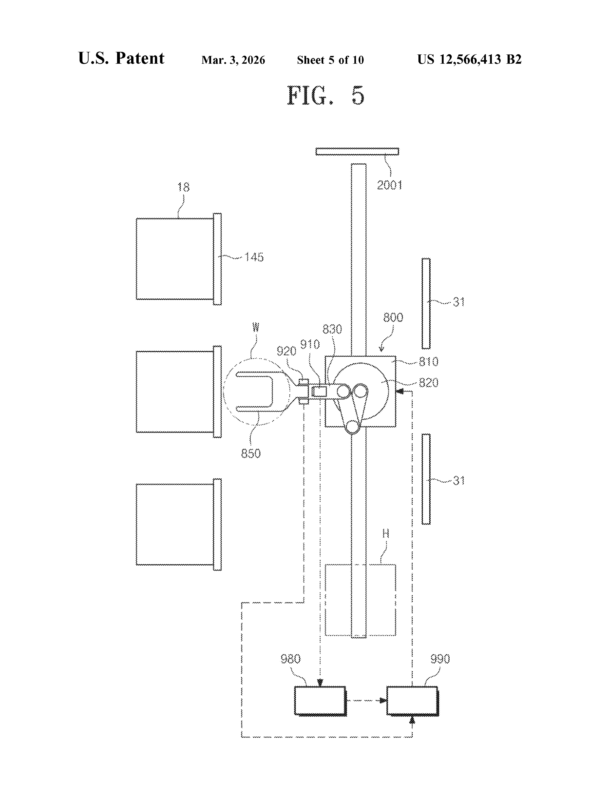
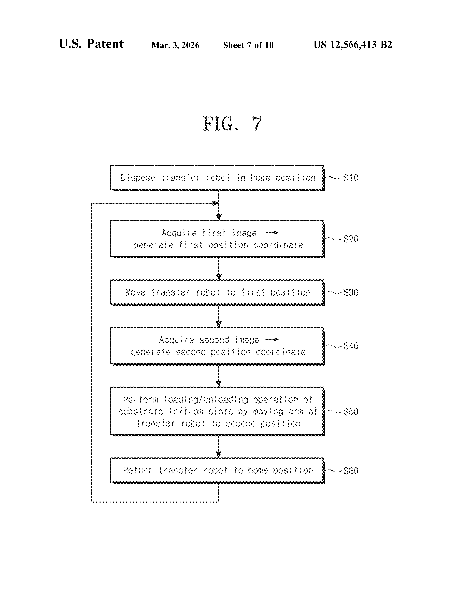

# US12566413B2 — 이송 설비의 티칭 방법 및 티칭 처리 시스템 (SEMES)

| 항목 | 내용 |
|---|---|
| 원문 | `US12566413.pdf`(등록, 2026-03-03) · `US20230205147.pdf`(공개, 2023-06-29) · 번역: `번역.md` |
| 출원인 | SEMES |
| 우선일 | 2021-12-29(KR 10-2021-0191555), 2022-10-04(KR 10-2022-0126631) |
| 패밀리 | KR102822459B1, CN116364624A |
| 핵심 | 로봇 암의 비전 카메라로 홈 위치에서 1차 촬영해 대상(캐리어) 앞 좌표를 구하고, 그 위치로 이동해 2차(정밀) 촬영으로 슬롯별 좌표를 구한다. 대상 전면에 기준 마크(M)를 둔다(종속항). |
| 관련도 | ◎ 방식이 거의 같음 |
| 본 과제와의 관계 | 로봇 장착 카메라 + 마크 인식 + 2단계 측정. 보정 축(Y·Θ), 좌표 계산식, 허용 오차는 본문에 없다. |
| 링크 | [Google Patents](https://patents.google.com/patent/US12566413B2/en) |

---

## 상세 요약 (번역본 기준)

### 1. 해결하려는 문제

- 종래 티칭: 개략 정렬(rough alignment) 후 작업자가 정렬 지그로 육안 관찰하며 티칭 위치를 수동 지정.
- 작업자가 챔버 내부에서 작업 → 안전사고 위험.
- 작업 완료까지 오랜 시간 소요.
- 목표: 비전 영상 처리로 정밀 티칭 자동화, 티칭 시간 단축.

### 2. 핵심 구성

| 구성 | 부호 | 위치·역할 |
|---|---|---|
| 비전 카메라 | 910 | 인덱스 로봇(800)의 다관절 암(830)에 설치. 주변 촬영 후 영상을 영상 분석부로 전달 |
| 센서부 | 920 | 다관절 암(830)에 설치. 라이다·레이더·초음파 중 하나 이상. 엔드 이펙터(850)의 충돌 위험 사전 감지 |
| 영상 분석부 | 980 | 영상 판독 → 객체까지 거리, 객체 간 거리, 좌표 산출 (ADAS 영상 기법) |
| 로봇 제어기 | 990 | 영상 분석부에서 받은 좌표를 따라 로봇 이동 제어 |
| 기준 마크 | M | 캐리어(18) 전면. 도어 개방 시 인덱스 챔버(140)에서 보이는 위치. 또는 출입구(145) 인접 위치 |

- 인덱스 로봇(800): 베이스(810, 인덱스 레일(142)을 따라 제2 방향(14) 직선 이동), 몸체(820, 베이스 위 승강·회전), 다관절 암(830), 엔드 이펙터(850)로 구성 (도 2, 도 3).
- 인식 대상 객체: 캐리어(18) 또는 개구(145), 버퍼 유닛(2000)의 출입구(2001), 로드락 챔버(32, 34)의 기판 출입구(31).
- 캐리어(18): FOUP, 슬롯(19)에 기판 다단 적층(예: 25매) (도 6).
- 시스템 구성도는 도 5. 공정 모듈 내 이송 로봇(250)에도 동일 적용 가능.

### 3. 동작 순서 (도 7, 도 8a~8c)

1. S10: 인덱스 로봇(800)을 홈 위치(H)에 배치. 홈 위치는 안전 대기 위치로 보통 인덱스 챔버(140)의 일단 (도 8a).
2. S20: 홈 위치에서 비전 카메라(910)로 주변 촬영(제1 영상). 필요시 다관절 암(830)을 소정 각도로 회전해 카메라를 객체 쪽으로 향함. 영상 분석부(980)가 티칭 대상(두 번째 캐리어)을 특정하고 제1 위치 좌표 도출.
3. S30: 로봇 제어기(990)가 로봇을 제1 위치 좌표(대상 캐리어 전방)로 이동 (도 8b).
4. S40: 제1 위치 좌표에서 제2 영상(정밀 영상) 획득 → 제2 위치 좌표(슬롯별 좌표 포함) 도출. 이 단계에서 로봇 위치를 정밀 보정.
5. S50: 슬롯별 좌표를 따라 기판 로딩/언로딩 테스트 (도 8c).
6. S60: 홈 위치(H)로 복귀 → 다음 캐리어를 특정해 S20~S60 반복.

- 좌표 계산: 기준 마크(M)를 기준으로 위치 좌표 도출, ADAS 기법(객체 인식 + 거리 측정) 사용이라는 기재만 있음. 구체적 수식, 회전각 계산, 카메라 캘리브레이션, 허용 오차 값은 없음.
- 티칭 중 엔드 이펙터(850)에 실제 기판 대신 더미 기판 안착 가능.
- 센서부(920)가 충돌 감지 신호를 내면 제어기가 티칭 동작 중단.

### 4. 청구항 요지

- 청구항 1 (유일한 독립항, 시스템):
  - 홈 위치 이송 로봇의 암에 설치된 비전 카메라가 제1 영상 획득.
  - 영상 분석부가 제1 영상에서 미리 설정된 이송 대상물을 식별하고, 로봇이 대상물 전방에 위치하는 제1 위치 좌표 생성.
  - 제어기가 홈 위치 → 제1 위치 좌표로 제1 이동 제어.
  - 제1 위치 좌표에서 대상물을 포함한 제2 영상 획득 → 제2 위치 좌표 생성 → 제2 이동 제어.
  - 제1 영상 촬영 시와 제2 영상 촬영 시 카메라가 로봇 베이스에 대해 서로 다른 방향을 향함.
- 종속항:
  - 청구항 2·3: 이송 대상물의 기준 마크에 기초해 좌표 도출, ADAS 영상 기법 사용.
  - 청구항 4·5: 제2 위치 좌표가 슬롯별 좌표 포함, 슬롯별 로딩/언로딩(제3 이동).
  - 청구항 6·7: 암에 충돌 감지 센서부(라이다·레이더·초음파), 감지 시 티칭 중단.
  - 청구항 8: 제1 이동은 베이스 이동, 제2 이동은 베이스 위치를 유지한 채 암만 이동.
- 본문의 방법 실시예(a~f 단계)는 등록 청구항에는 들어가지 않음.

### 5. 대표 도면

*도 5 — 비전 카메라(910)·센서부(920)·영상 분석부(980)·로봇 제어기(990)로 된 티칭 시스템 구성*

*도 7 — S10~S60 티칭 흐름(홈 촬영 → 전방 이동 → 정밀 촬영 → 슬롯 테스트 → 복귀)*

### 6. 본 과제(Y·Θ 얼라인먼트)와 비교

- 같은 점:
  - 로봇 암에 카메라를 달고 대상의 마크를 찍어 로봇 위치를 정하는 구조.
  - 사람의 육안·지그 작업을 영상 처리로 대체하는 목적.
- 다른 점:
  - 이 특허는 설치 시 1회성 티칭(목표 좌표 저장)이 목적. 우리는 실시간 보정값(Y, Θ) 출력.
  - 보정 축을 Y·Θ로 나누지 않고 "위치 좌표"로만 기술. 회전(Θ) 보정 언급 없음.
  - 마크 형태(QR 등)·크기·개수 규정 없음("적어도 하나의 기준 마크").
  - 좌표 계산 방법이 ADAS 기법이라는 수준으로만 기재. 수식·정밀도 수치 없음.
- 참고할 점:
  - 2단계 측정: 먼 위치에서 대략 위치(coarse) → 대상 앞으로 이동 후 정밀 측정(fine). 우리도 큰 오차일 때 coarse 검출 후 근접 재측정하는 구조로 응용 가능.
  - 청구항 8처럼 coarse 단계는 큰 축(베이스 이동), fine 단계는 작은 축(암 이동)으로 나누는 방식 → Y 이동과 Θ 회전 보정 단계 분리 설계에 참고.
  - 마크 위치 기준: 도어 개방 시 카메라에서 보이는 대상 전면 또는 출입구 인접 위치(도 6). 우리 마커 부착 위치 선정 기준으로 활용.
  - 측정 실패·충돌 대비 안전 정지(센서부 920) 개념 → 마커 미검출 시 보정 중단·경고 로직.
  - 더미 기판으로 로딩 테스트(S50)해 결과 검증 → 우리 보정값 검증 절차에 참고.
  - 특허 회피 관점: 청구항 1은 "홈에서 1차 촬영 → 대상 전방 이동 → 2차 촬영, 촬영 방향이 서로 다름"이 필수 요소. 고정 위치 단일 촬영 방식이면 구성이 다름.
