# 티칭 방법, 그 티칭 방법을 실행하기 위한 매체에 저장된 프로그램 및 이송 시스템 (US12472621B2)

- 원제: Teaching method, program stored in the medium for executing the teaching method and transfer system
- 원문: 같은 폴더의 PDF, https://patents.google.com/patent/US12472621B2/en
- 번역 기준: Google Patents 원문 텍스트를 한국어로 옮김. 도면은 PDF 참조.
- 도면: 원문 PDF 도면 시트 15장을 도면/ 폴더에 넣고 본문에서 처음 언급되는 곳에 삽입함

## 요약

본 발명의 개념은 이송 로봇(transfer robot)의 이송 위치를 티칭(teaching)하기 위한 티칭 방법을 제공한다. 티칭 방법은, 제1 센서에 의해 획득된 3D 위치 정보에 기초하여, 이송 로봇에 의해 이송되는 이송 대상물이 놓이는 대상체(object)를 탐색하는 단계; 및 제1 센서와 다른 종류인 제2 센서로부터 획득된 데이터에 기초하여 대상체의 제2 방향 좌표 및 제3 방향 좌표를 획득하는 단계를 포함한다.

## 청구범위

청구되는 것은 다음과 같다.

1. 이송 로봇의 이송 위치를 티칭하기 위한 티칭 방법으로서,

제1 센서에 의해 획득된 3차원(3D) 위치 정보에 기초하여, 상기 이송 로봇에 의해 이송되는 이송 대상물이 놓이는 대상체를 탐색하는 단계;

상기 제1 센서와 다른 종류인 제2 센서로부터 획득된 데이터에 기초하여 상기 대상체의 제1 방향 좌표 및 제2 방향 좌표를 획득하는 단계;

상기 제1 센서 및 상기 제2 센서와 다른 종류의 센서인 제3 센서로부터 획득된 데이터에 기초하여, 상기 대상체의 제3 방향 좌표를 도출하는 단계; 및

상기 제1 방향 좌표, 상기 제2 방향 좌표 및 상기 제3 방향 좌표를 포함하는 상기 대상체의 좌표와, 미리 저장된 상기 대상체의 정보에 기초하여, 상기 이송 위치의 좌표인 티칭 좌표를 산출하는 단계를 포함하고,

상기 대상체가 상기 이송 대상물을 보관하는 FOUP(front-opening unified pod)인 것에 대응하여, 상기 대상체 좌표는 상기 대상체의 면 중 상기 이송 로봇을 향하는 면의 특정 지점의 좌표인, 티칭 방법.

2. 제1항에 있어서, 상기 대상체의 정보는 상기 대상체의 좌표로부터 상기 티칭 좌표까지의 거리값을 포함하는, 티칭 방법.

3. 제2항에 있어서, 상기 거리값은 상기 제1 방향의 거리값, 상기 제2 방향의 거리값 및 상기 제3 방향의 거리값을 포함하는, 티칭 방법.

4. 제1항에 있어서, 상기 제1 센서는 라이다(lidar) 센서를 포함하고, 상기 제2 센서는 비전 센서를 포함하며, 상기 제3 센서는 거리 센서를 포함하는, 티칭 방법.

5. 이송 로봇의 이송 위치를 티칭하기 위한 티칭 방법으로서,

제1 센서에 의해 획득된 3차원(3D) 위치 정보에 기초하여, 상기 이송 로봇에 의해 이송되는 이송 대상물이 놓이는 대상체를 탐색하는 단계; 및

상기 제1 센서와 다른 종류인 제2 센서로부터 획득된 데이터에 기초하여 상기 대상체의 제1 방향 좌표 및 제2 방향 좌표를 획득하는 단계를 포함하고,

상기 제1 센서는 라이다 센서이고, 상기 제2 센서는 비전 센서이며, 제3 센서는 거리 센서이고,

상기 방법은,

상기 제1 센서에 의해 획득된 상기 3D 위치 정보에 기초하여 상기 대상체의 좌표를 도출하는 단계; 및

상기 제1 센서에 의해 도출된 상기 대상체의 좌표와, 상기 제2 센서 및 상기 제3 센서에 의해 도출된 상기 대상체의 제1, 제2 및 제3 방향 좌표 사이의 차이가 임계값을 초과하는지 여부를 확인하는 단계를 더 포함하는, 티칭 방법.

6. 제1항에 있어서, 상기 대상체가 상기 이송 대상물이 놓이는 지지 유닛인 것에 대응하여, 상기 대상체 좌표는 상기 대상체의 지지 핀들 중 적어도 하나의 지지 핀의 좌표인, 티칭 방법.

7. 제6항에 있어서, 상기 대상체 좌표는 복수의 지지 핀의 좌표를 포함하고,

상기 티칭 방법은 상기 지지 핀들의 복수의 좌표로부터 상기 티칭 좌표를 산출하는 단계를 더 포함하는, 티칭 방법.

8. 이송 로봇의 이송 위치를 티칭하기 위한 티칭 방법으로서,

제1 센서에 의해 획득된 3차원(3D) 위치 정보에 기초하여, 상기 이송 로봇에 의해 이송되는 이송 대상물이 놓이는 대상체를 탐색하는 단계; 및

상기 제1 센서와 다른 종류인 제2 센서로부터 획득된 데이터에 기초하여 상기 대상체의 제1 방향 좌표 및 제2 방향 좌표를 획득하는 단계,

상기 제1 센서 및 상기 제2 센서와 다른 종류의 센서인 제3 센서로부터 획득된 데이터에 기초하여, 상기 대상체의 제3 방향 좌표를 도출하는 단계,

상기 제1 방향 좌표, 상기 제2 방향 좌표 및 상기 제3 방향 좌표를 포함하는 상기 대상체의 좌표와, 미리 저장된 상기 대상체의 정보에 기초하여, 상기 이송 위치의 좌표인 티칭 좌표를 산출하는 단계를 포함하고,

상기 대상체가 상기 이송 대상물이 놓이는 척(chuck) 및 상기 척 상에 놓이는 티칭 지그(jig)를 포함하는 것에 대응하여, 상기 대상체 좌표는 상기 티칭 지그의 티칭 핀들 중 적어도 하나의 티칭 핀의 좌표인, 티칭 방법.

9. 제8항에 있어서,

상기 대상체 좌표는 복수의 티칭 핀의 좌표를 포함하고,

상기 티칭 방법은 상기 티칭 핀들의 복수의 좌표로부터 상기 티칭 좌표를 산출하는 단계를 더 포함하는, 티칭 방법.

10. 프로세서에 의해 실행될 때 상기 프로세서로 하여금 제1항의 티칭 방법을 수행하게 하는 기계 판독 가능한 명령어들을 포함하는 비일시적(non-transitory) 매체.

11. 제1항에 있어서, 상기 대상체의 정보는 상기 대상체의 좌표로부터 상기 티칭 좌표까지의 거리값을 포함하는, 티칭 방법.

## 상세한 설명

### 관련 출원의 상호 참조 (CROSS-REFERENCE TO RELATED APPLICATIONS)

본 출원은 2022년 10월 27일 대한민국 특허청에 출원된 대한민국 특허출원 제10-2022-0140432호에 대하여 35 U.S.C. § 119에 따른 우선권을 주장하며, 그 전체 내용은 참조로서 본 명세서에 포함된다.

### 배경기술 (BACKGROUND)

본 명세서에 기재된 본 발명의 개념의 실시예들은 티칭 방법, 그 티칭 방법을 실행하기 위한 매체에 저장된 프로그램 및 이송 시스템에 관한 것이다.

반도체 소자를 제조하는 기판 처리 장치에서는, 웨이퍼와 같은 기판에 대하여 사진(photolithography) 공정, 식각(etching) 공정, 애싱(ashing) 공정, 박막 증착 공정, 세정 공정 등 다양한 공정이 수행된다. 기판 처리 장치에서 웨이퍼는 이송 로봇에 의해 기판 처리 장치 내에서 이송된다. 이송 로봇은 기판 처리 장치가 구비하는 스핀 척, 가열 플레이트, 지지 선반 등 웨이퍼를 지지하는 지지 기구로 웨이퍼를 이송한다. 웨이퍼에 대한 공정이 적절히 수행되기 위해서는, 이송 로봇이 이들 지지 기구 상의 정확한 위치로 웨이퍼를 이송할 수 있어야 한다.

이송 로봇이 기판 처리 장치 내 지지 기구의 정확한 위치에 웨이퍼를 로딩할 수 있도록, 이송 로봇의 웨이퍼 이송 위치(예컨대, 웨이퍼 이송 좌표)를 확인하고 조정하는 티칭이 수행된다. 이 티칭 작업은 웨이퍼에 대한 공정이 수행되기 전에, 보다 구체적으로는 이송 로봇이 설치될 때 사용자에 의해 수행된다.

일반적으로 티칭 작업은 제어 장치 등을 이용하여 이송 로봇을 수동으로 조작함으로써 수행된다. 구체적으로, 사용자가 이송 로봇을 수동으로 조작하여 웨이퍼를 지지 기구에 로딩하고, 이때 웨이퍼의 이송 좌표를 확인한다. 그러나 이 방법은 사용자의 숙련도와 피로도에 따라 티칭 작업의 정밀도가 달라지고, 작업에 오랜 시간이 소요되는 문제가 있다.

이러한 문제를 보완하기 위하여, 이송 로봇에 카메라와 같은 비전 센서를 설치하고 티칭 위치에 QR 마크와 같은 마커를 부착하는 방법이 사용될 수 있다. 이 경우, 사용자가 이송 로봇을 수동으로 조작하여 웨이퍼를 이송 위치로 대략적으로 이송하고, 이송 로봇에 설치된 비전 센서가 QR 마크를 인식하면, QR 마크를 인식한 위치 정보에 기초하여 웨이퍼의 이송 좌표가 확인된다. 그러나 이송 로봇에 비전 센서가 설치되더라도, 티칭 작업을 수행하기 위해 사용자가 이송 로봇을 수동으로 조작해야 하므로 작업 시간을 단축하는 데에는 한계가 있다. 또한, 비전 센서의 경우 QR 마크의 2개 축의 좌표는 확인할 수 있으나 3개 축의 좌표는 확인하기 어렵다. 예를 들어, 지지 기구가 비전 센서의 전방에 위치하는 경우, 비전 센서가 촬상한 이미지로부터 i) 좌우 축 및 ii) 상하 축의 좌표값은 확인할 수 있으나, 비전 센서로부터 지지 기구까지의 거리인 전후 축의 좌표값은 확인하기 어렵다. 전후 축의 좌표값을 이송 로봇에 저장하기 위해서는, 작업자가 설계 정보(예컨대, 이송 로봇으로부터 지지 기구까지의 거리값)를 직접 입력하거나, 웨이퍼형 센서의 도움을 받아 후속 보정 작업을 하여야 한다.

### 발명의 내용 (SUMMARY)

본 발명의 개념의 실시예들은 티칭 작업의 정밀도를 높일 수 있는 티칭 방법, 그 티칭 방법을 실행하기 위한 매체에 저장된 프로그램 및 이송 시스템을 제공한다.

본 발명의 개념의 실시예들은 사용자의 수동 조작 없이(원문: which a manual operation of a user) 티칭 작업을 자동으로 수행하기 위한 티칭 방법, 매체에 저장된 프로그램을 제공한다.

본 발명의 개념의 실시예들은 웨이퍼형 센서 등을 이용한 후속 작업 없이 티칭 작업을 완료하기 위한 티칭 방법, 그 티칭 방법을 실행하기 위한 매체에 저장된 프로그램 및 이송 시스템을 제공한다.

본 발명의 개념의 기술적 과제는 이상에서 언급한 것들로 제한되지 않으며, 언급되지 않은 다른 기술적 과제들은 아래의 기재로부터 통상의 기술자에게 명확하게 이해될 것이다.

본 발명의 개념은 이송 로봇의 이송 위치를 티칭하기 위한 티칭 방법을 제공한다. 티칭 방법은, 제1 센서에 의해 획득된 3D 위치 정보에 기초하여, 이송 로봇에 의해 이송되는 이송 대상물이 놓이는 대상체를 탐색하는 단계; 및 제1 센서와 다른 종류인 제2 센서로부터 획득된 데이터에 기초하여 대상체의 제2 방향 좌표 및 제3 방향 좌표를 획득하는 단계를 포함한다.

일 실시예에서, 티칭 방법은 제1 센서 및 제2 센서와 다른 제3 센서로부터 획득된 데이터에 기초하여, 대상체의 제1 방향 좌표를 도출하는 단계를 더 포함한다.

일 실시예에서, 티칭 방법은 제1 방향 좌표, 제2 방향 좌표 및 제3 방향 좌표를 포함하는 대상체의 좌표와, 미리 저장된 대상체의 정보에 기초하여, 이송 위치의 좌표인 티칭 좌표를 산출하는 단계를 더 포함한다.

일 실시예에서, 대상체의 정보는 대상체 좌표로부터 티칭 좌표까지의 거리값을 포함한다.

일 실시예에서, 거리값은 제1 방향의 거리값, 제2 방향의 거리값 및 제3 방향의 거리값을 포함한다.

일 실시예에서, 제1 센서는 라이다 센서이고, 제2 센서는 비전 센서이며, 제3 센서는 거리 센서이다.

일 실시예에서, 티칭 방법은, 제1 센서에 의해 획득된 3D 위치 정보에 기초하여 대상체의 좌표를 도출하는 단계; 및 제1 센서에 의해 도출된 대상체의 좌표와, 제2 센서 및 제3 센서에 의해 도출된 대상체의 제1, 제2 및 제3 방향 좌표 사이의 차이가 임계값을 초과하는지 여부를 확인하는 단계를 더 포함한다.

일 실시예에서, 대상체가 이송 대상물을 보관하는 보관 기구인 경우, 대상체 좌표는 대상체의 면 중 이송 로봇을 향하는 면의 특정 지점의 좌표이다.

일 실시예에서, 대상체가 이송 대상물이 놓이는 지지 유닛인 경우, 대상체 좌표는 대상체의 지지 핀들 중 적어도 하나의 지지 핀의 좌표이다.

일 실시예에서, 대상체 좌표는 복수의 지지 핀의 좌표를 포함하고, 티칭 방법은 지지 핀들의 복수의 좌표로부터 티칭 좌표를 산출하는 단계를 더 포함한다.

일 실시예에서, 대상체가 이송 대상물이 놓이는 지지 유닛 및 지지 유닛 상에 놓이는 티칭 지그를 포함하는 경우, 대상체 좌표는 티칭 지그의 티칭 핀들 중 적어도 하나의 티칭 핀의 좌표이다.

일 실시예에서, 대상체 좌표는 복수의 티칭 핀의 좌표를 포함하고, 티칭 방법은 티칭 핀들의 복수의 좌표로부터 티칭 좌표를 산출하는 단계를 더 포함한다.

본 발명의 개념은 상기 티칭 방법을 실행하기 위한 매체에 저장된 프로그램을 제공한다.

본 발명의 개념은 기판을 이송하는 이송 시스템을 제공한다. 이송 시스템은 기판을 이송하는 이송 로봇; 및 이송 로봇의 동작을 제어하도록 구성된 제어기를 포함하고, 이송 로봇은, 기판이 놓이는 핸드; 핸드를 제1 방향, 제2 방향 및 제3 방향으로 이동시키는 이동 어셈블리로서, 제2 방향은 제1 방향에 수직이고 제3 방향은 제1 방향 및 제2 방향 모두에 수직인, 이동 어셈블리; 이송 로봇 주변의 3D 위치 정보를 획득하기 위한 라이다 센서; 이송 로봇에 의해 이송되는 기판이 놓이는 대상체의 이미지를 획득하여 대상체의 제2 방향 및 제3 방향 좌표를 획득하기 위한 비전 센서; 및 이송 로봇과 대상체 사이의 직선 거리를 획득하기 위한 거리 센서를 포함한다.

일 실시예에서, 제어기는 이송 로봇을 제어하여, 라이다 센서를 이용하여 대상체를 탐색하고, 탐색된 대상체를 향하는 방향으로 핸드를 이동시킨다.

일 실시예에서, 제어기는 이송 로봇을 제어하여 비전 센서를 이용해 대상체의 이미지를 획득하고, 비전 센서에 의해 획득된 이미지에 기초하여 대상체의 제1 및 제2 방향 좌표를 산출한다.

일 실시예에서, 제어기는 이송 로봇을 제어하여 거리 센서로 대상체와 이송 로봇 사이의 직선 거리를 측정하고, 거리 센서에 의해 획득된 직선 거리에 기초하여 대상체의 제3 방향 좌표를 산출한다.

일 실시예에서, 제어기는 라이다 센서에 의해 획득된 3D 위치 정보에 기초하여 대상체의 좌표를 도출하고, 라이다 센서에 의해 도출된 대상체의 좌표와, 비전 센서 및 거리 센서에 의해 도출된 대상체의 제1, 제2 및 제3 방향 좌표 사이의 차이가 임계값을 초과하는지 여부를 확인한다.

일 실시예에서, 제어기는 제1, 제2 및 제3 방향 좌표를 포함하는 대상체 좌표와, 미리 저장된 대상체의 정보에 기초하여, 이송 위치의 좌표인 티칭 좌표를 산출한다.

일 실시예에서, 제어기는 대상체 좌표로부터 티칭 좌표까지의 거리값을 저장한다.

본 발명의 개념의 일 실시예에 따르면, 티칭 작업의 정밀도가 높아질 수 있다.

본 발명의 개념의 일 실시예에 따르면, 사용자의 수동 조작 없이 티칭 작업이 자동으로 수행될 수 있다.

본 발명의 개념의 일 실시예에 따르면, 웨이퍼형 센서 등을 이용한 후속 작업 없이 티칭 작업이 완료될 수 있다. (원문 표현은 "using a wafer-type sensor and the like without a follow-up operation"이나, 앞의 과제 기재에 비추어 위와 같이 옮김)

본 발명의 개념의 일 실시예에 따르면, (원문에서 이 문장은 여기서 끊겨 있음)

본 발명의 개념의 효과는 이상에서 언급한 것들로 제한되지 않으며, 언급되지 않은 다른 효과들은 아래의 기재로부터 통상의 기술자에게 명확하게 이해될 것이다.

### 도면의 간단한 설명 (BRIEF DESCRIPTION OF THE FIGURES)

상기 및 기타 목적과 특징은 다음의 도면을 참조한 아래의 설명으로부터 명확해질 것이며, 별도로 명시하지 않는 한 여러 도면에 걸쳐 동일한 참조 부호는 동일한 부분을 가리킨다.

도 1은 본 발명의 개념의 일 실시예에 따른 이송 시스템을 개략적으로 도시한다.

도 2는 본 발명의 개념의 일 실시예에 따른 티칭 방법을 나타내는 흐름도이다.

도 3은 도 2의 대상체 탐색 단계를 수행하는 이송 시스템을 도시한다.

도 4는 도 2의 핸드 이동 단계를 수행하는 이송 시스템을 도시한다.

도 5는 도 2의 이미지 획득 단계 및 대상체 좌표 산출 단계를 도시한다.

도 6은 도 2의 거리 측정 단계를 수행하는 이송 시스템을 도시한다.

도 7은 기판이 놓이는 대상체의 다른 실시예를 도시한다.

도 8은 기판이 놓이는 대상체의 또 다른 실시예를 도시한다.

도 9는 본 발명의 개념의 이송 시스템에 의해 획득된 스핀 척의 이미지를 도시한다.

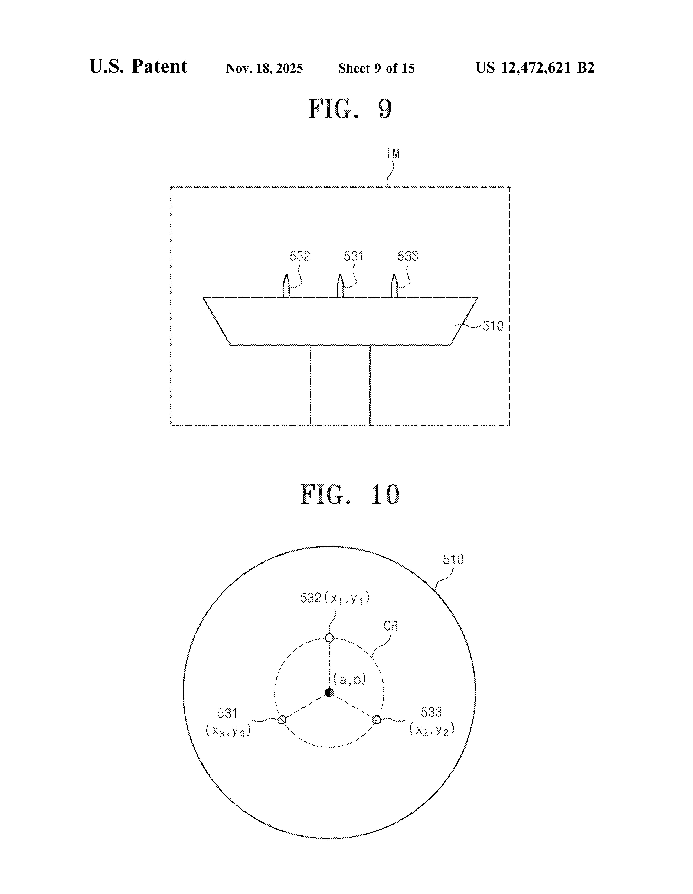
*도 9, 도 10 — 이송 시스템이 획득한 스핀 척 이미지 / 그 이미지로부터 티칭 좌표를 산출하는 단계*

도 10은 도 9의 스핀 척 이미지로부터 티칭 좌표를 산출하는 단계를 도시한다.

도 11은 기판이 놓이는 대상체의 또 다른 실시예를 도시한다.

도 12는 도 11의 스핀 척 상에 티칭 지그가 안착된 상태를 도시한다.

도 13은 본 발명의 개념의 다른 실시예에 따른 이송 시스템을 개략적으로 도시한다.

도 14는 본 발명의 개념의 또 다른 실시예에 따른 이송 시스템을 개략적으로 도시한다.

도 15는 본 발명의 개념의 또 다른 실시예에 따른 이송 시스템을 개략적으로 도시한다.

도 16은 본 발명의 개념의 다른 실시예에 따른 이송 로봇을 개략적으로 도시한다.

### 발명을 실시하기 위한 구체적인 내용 (DETAILED DESCRIPTION)

본 발명의 개념은 다양한 변경을 가할 수 있고 여러 가지 형태를 가질 수 있는바, 특정 실시예들을 도면에 예시하고 상세히 설명한다. 그러나 이는 본 발명의 개념에 따른 실시예들을 특정한 개시 형태로 한정하려는 것이 아니며, 본 발명의 개념의 사상 및 기술 범위에 포함되는 모든 변환, 균등물 및 대체물을 포함하는 것으로 이해되어야 한다. 본 발명의 개념을 설명함에 있어서, 관련된 공지 기술에 대한 구체적인 설명이 본 발명의 개념의 요지를 흐릴 수 있다고 판단되는 경우 그 상세한 설명을 생략할 수 있다.

본 명세서에서 사용한 용어는 단지 특정한 실시예를 설명하기 위해 사용된 것으로, 본 발명의 개념을 한정하려는 의도가 아니다. 본 명세서에서 사용된 단수 형태 "a", "an" 및 "the"는 문맥상 명백히 다르게 뜻하지 않는 한 복수 형태도 포함하는 것으로 의도된다. 또한, 본 명세서에서 사용될 때 "포함한다(comprises)" 및/또는 "포함하는(comprising)"이라는 용어는 기재된 특징, 정수, 단계, 동작, 요소 및/또는 구성요소의 존재를 명시하는 것이며, 하나 이상의 다른 특징, 정수, 단계, 동작, 요소, 구성요소 및/또는 이들의 그룹의 존재 또는 부가를 배제하지 않는 것으로 이해될 것이다. 본 명세서에서 사용된 "및/또는"이라는 용어는 관련되어 나열된 항목들 중 하나 이상의 모든 조합을 포함한다. 또한, "예시적인(exemplary)"이라는 용어는 예 또는 예시를 가리키는 것으로 의도된다.

본 명세서에서 "제1", "제2", "제3" 등의 용어가 다양한 요소, 구성요소, 영역, 층 및/또는 섹션을 설명하기 위해 사용될 수 있으나, 이들 요소, 구성요소, 영역, 층 및/또는 섹션은 이들 용어에 의해 한정되어서는 안 된다는 것이 이해될 것이다. 이들 용어는 하나의 요소, 구성요소, 영역, 층 또는 섹션을 다른 영역, 층 또는 섹션과 구별하기 위해서만 사용된다. 따라서, 아래에서 논의되는 제1 요소, 구성요소, 영역, 층 또는 섹션은 본 발명의 개념의 교시를 벗어나지 않고 제2 요소, 구성요소, 영역, 층 또는 섹션으로 지칭될 수 있다.

본 명세서에서 단수형은 특별히 언급하지 않는 한 복수형을 포함한다. 또한, 도면에서 요소들의 형상이나 크기 등은 보다 명확한 설명을 위해 과장될 수 있다.

이하, 도 1 내지 도 15를 참조하여 본 발명의 개념의 실시예를 설명한다.

이하에서 설명하는 이송 시스템(10)은 웨이퍼와 같은 기판에 대한 처리 공정을 수행하는 기판 처리 장치에 제공될 수 있다. 이와 달리, 이송 시스템(10)은 반도체 제조 라인에 설치되어, 웨이퍼와 같은 기판을 이송하는 물류 장치에 제공될 수도 있다.

도 1은 본 발명의 개념의 일 실시예에 따른 이송 시스템을 개략적으로 나타낸 도면이다. 도 1을 참조하면, 이송 시스템(10)은 이송 로봇(100) 및 제어기(200)를 포함할 수 있다.

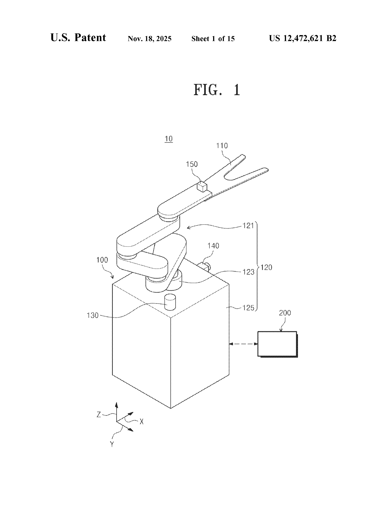
*도 1 — 일 실시예에 따른 이송 시스템 개략도*

이송 로봇(100)은 물품을 이송할 수 있다. 이송 로봇(100)에 의해 이송되는 이송 대상물은 웨이퍼 또는 글라스와 같은 기판일 수 있다. 상술한 바와 같이, 이송 로봇(100)은 웨이퍼와 같은 기판에 대한 처리 공정을 수행하는 기판 처리 장치에 제공될 수 있다. 예를 들어, 이송 로봇(100)은 반도체 소자를 제조하기 위해 사진 공정, 식각 공정, 애싱 공정, 박막 증착 공정 또는 세정 공정을 수행하는 기판 처리 장치에 설치될 수 있다. 이송 로봇(100)은 기판 처리 장치의 인덱스부, 처리부 또는 인터페이스부에 설치될 수 있다. 여기서, 인덱스부는 카세트 또는 FOUP와 같은 용기가 놓이는 로드 포트를 갖는 부분이고, 처리부는 기판을 처리하는 처리 챔버를 갖는 부분이며, 인터페이스부는 외부의 노광 장치와 연결되는 부분일 수 있다.

이송 로봇(100)은 핸드(110), 구동부(120), 제1 센서(130), 제2 센서(140) 및 제3 센서(150)를 포함할 수 있다.

핸드(110)는 웨이퍼와 같은 기판을 이송할 수 있다. 핸드(110)는 기판이 놓일 수 있는 형상을 가질 수 있다. 핸드(110)는 한 쌍의 핑거를 갖는 형상을 가질 수 있다.

구동부(120)는 핸드(110)의 위치를 변경할 수 있다. 구동부(120)는 핸드(110)의 위치를 변경함으로써 핸드(110)에 놓인 기판을 이송할 수 있다. 구동부(120)는 핸드(110)의 위치를 제1 방향(X), 제2 방향(Y) 및/또는 제3 방향(Z)으로 변경할 수 있다. 제1 방향(X)은 수평 방향이고, 제2 방향(Y)은 수평 방향이면서 제1 방향(X)에 수직한 방향이며, 제3 방향(Z)은 수직 방향으로서 제1 방향(X) 및 제2 방향(Y)에 수직한 방향일 수 있다. 구동부(120)는 암 어셈블리(121), 승강축(lifting/lowering shaft)(123) 및 베이스(125)를 포함할 수 있다. 암 어셈블리(121)는 복수의 암을 포함할 수 있다.

암 어셈블리(121)는 복수의 암을 포함할 수 있고, 암들은 서로 회전 가능하게 결합될 수 있다. 즉, 암 어셈블리(121)는 다관절 암 어셈블리일 수 있다. 암 어셈블리(121)의 암들에 의해 핸드(110)의 위치가 제1 방향(X) 및/또는 제2 방향(Y)을 따라 변경될 수 있다.

승강축(123)은 핸드(110)를 제3 방향(Z)으로 이동시킬 수 있다. 승강축(123)은 복수의 암으로 구성된 암 어셈블리(121)와 결합되어 암 어셈블리(121)를 상하 방향으로 이동시킬 수 있다. 또한, 복수의 암 중 승강축(123)에 직접 체결되는 암은 승강축(123)에 회전 가능하게 결합될 수 있다.

베이스(125)는 구동기(미도시)를 포함할 수 있다. 베이스(125)는 적어도 하나의 구동기를 포함할 수 있다. 베이스(125)는 승강축(123) 및/또는 암 어셈블리(121)를 구동할 수 있는 모터 등의 모터를 포함할 수 있다. 또한, 베이스(125)는 암 어셈블리(121) 및 승강축(123)이 고정될 수 있는 몸체로서 기능할 수 있다.

또한, 이송 로봇(100)이 기판 처리 장치에 설치되는 경우, 이송 로봇(100)은 고정된 상태로 설치될 수 있다. 예를 들어, 이송 로봇(100)이 기판에 대한 식각 공정을 수행하는 플라즈마 장치에 제공되는 경우, 이송 로봇(100)의 위치는 고정될 수 있다. 그러나 본 발명의 개념은 이에 한정되지 않으며, 이송 로봇(100)이 로드 포트를 갖는 인덱스부에 설치되는 경우, 베이스(125)는 인덱스부에 설치된 주행 레일을 따라 수평 방향으로 이동 가능하게 설치될 수 있다.

제1 센서(130)는 위치 정보를 획득할 수 있다. 제1 센서(130)는 3D 위치 정보를 획득할 수 있다. 3D 위치 정보는 이송 로봇(100)의 주변 구조물의 형상에 관한 정보 및 주변 구조물의 좌표에 관한 정보를 포함할 수 있다. 제1 센서(130)는 라이다(LiDAR, Light Detection and Ranging) 센서일 수 있다. 제1 센서(130)는 초당 수백만 개의 레이저 펄스를 방출하여 복귀 시간을 측정하고 스캔함으로써, 이송 로봇(100)이 설치된 주변 구조물의 위치 및 형상에 관한 정보를 수집할 수 있다. 제1 센서(130)는 수집된 주변 구조물에 관한 3D 위치 정보를 후술하는 제어기(200)로 전송할 수 있다. 제어기(200)는 제1 센서(130)가 전송한 3D 위치 정보를 통해 이송 로봇(100) 주변에 어떤 구조물이 존재하는지, 그리고 그 구조물의 좌표가 무엇인지를 확인할 수 있다. 제1 센서(130)는 베이스(125)에 설치될 수 있다. 그러나 본 발명의 개념은 이에 한정되지 않으며, 제1 센서(130)는 이송 로봇(100)의 주변 구조물의 3D 위치 정보를 얻을 수 있도록 다양한 위치에 설치될 수 있다. 또한, 주변 구조물에는 후술하는 대상체가 포함될 수 있다.

제2 센서(140)는 대상체의 이미지를 획득할 수 있다. 제2 센서(140)는 카메라와 같은 비전 센서일 수 있다. 제2 센서(140)는 베이스(125)에 설치될 수 있다. 제2 센서(140)는 에어리어 카메라(area camera)일 수 있다. 제2 센서(140)는 이송 대상물이 놓이는 대상체의 이미지를 촬상하고, 대상체의 이미지를 제어기(200)로 전송할 수 있다. 제어기(200)는 제2 센서(140)가 전송한 대상체에 관한 데이터, 예컨대 이미지 데이터로부터 대상체의 제2 방향(Y) 및 제3 방향(Z) 좌표를 도출할 수 있다. 즉, 제어기(200)는 제2 센서(140)가 획득한 이미지로부터 대상체의 제2 방향(Y) 및 제3 방향(Z) 좌표인 2D 위치 정보를 획득할 수 있다. 예를 들어, 제어기(200)는 제2 센서(140)가 전송한 대상체의 이미지로부터 대상체의 특정 위치의 제2 방향(Y) 및 제3 방향(Z) 좌표를 산출하여 도출할 수 있다. 제2 센서(140)는 대상체와 마주하는 위치에 설치될 수 있다. 제2 센서(140)는 베이스(125)에 설치되되, 대상체와 마주하는 위치에 설치될 수 있다.

제3 센서(150)는 대상체와 핸드(110) 사이의 거리를 측정할 수 있다. 제3 센서(150)는 암 어셈블리(121)에 설치될 수 있다. 제3 센서(150)는 암 어셈블리(121)의 복수의 암 중 핸드(110)에 직접 체결되는 암에 설치될 수 있다. 이와 달리, 제3 센서(150)는 핸드(110)에 직접 설치될 수도 있고, 필요한 경우 대상체를 향하도록 베이스(125)에 설치될 수도 있다. 제3 센서(150)는 거리 센서일 수 있다. 제3 센서(150)는 초음파 거리 센서 또는 레이저 거리 센서일 수 있다. 제3 센서(150)는 핸드(110)와 대상체 사이의 거리를 측정하고, 측정된 거리값을 제어기(200)로 전송할 수 있다. 제어기(200)는 수신된 거리값에 기초하여 대상체의 특정 위치의 제1 방향(X) 좌표를 산출하여 도출할 수 있다.

제어기(200)는 이송 로봇(100)을 제어할 수 있다. 제어기(200)는 데이터를 연산할 수 있는 프로세서, 제1 센서(130), 제2 센서(140) 및 제3 센서(150)가 전송한 데이터를 저장하는 저장 매체인 메모리를 포함할 수 있다. 또한, 메모리에는 이송 로봇(100)을 동작시키기 위한 프로그램이 저장될 수 있다. 또한, 메모리에는 이송 로봇(100)의 티칭 방법을 수행하기 위한 프로그램이 저장될 수 있다. 또한, 메모리에는 이송 로봇(100) 및 이송 로봇(100)이 설치되는 기판 처리 장치의 크기를 포함하는 설계 정보가 미리 저장될 수 있다. 또한, 메모리에는 기판 처리 장치에 놓이는 보관 장치일 수 있는 FOUP와 같은 용기의 크기를 포함하는 설계 정보가 저장될 수 있다. 또한, 제어기(200)는 사용자로부터 명령, 데이터 등을 입력받을 수 있는 인터페이스 장치를 포함할 수 있다. 인터페이스 장치는 키보드, 마우스 등을 포함할 수 있다. 제어기(200)는 기판 처리 장치에 포함되어 기판 처리 장치를 제어하는 컴퓨터일 수 있다.

이하, 본 발명의 개념의 일 실시예에 따른 티칭 방법을 설명한다. 이하에서 설명하는 티칭 방법은 상술한 다관절 암을 갖는 이송 로봇(100)뿐 아니라, 티칭이 필요한 모든 이송 로봇에 동일하거나 유사하게 적용될 수 있다. 이하에서는, 이송 로봇(100)에 의해 이송되는 이송 대상물인 기판이 놓이는 대상을 대상체라 하고, 대상체의 위치에 관한 좌표(보다 구체적으로는 대상체의 특정 위치에 관한 좌표)를 대상체 좌표라 하며, 이송 위치의 좌표를 티칭 좌표로 정의한다. (원문 문장은 "a coordinate on the position of the object ... is defined as a teaching coordinate of the transfer position"이나, 뒤의 문장 및 단계 S50의 기재에 비추어 위와 같이 옮김) 대상체 좌표 및 티칭 좌표는 이송 로봇(100)의 중심 위치를 원점으로 하는 제1 방향(X), 제2 방향(Y) 및 제3 방향(Z)의 좌표를 의미할 수 있다.

도 2는 본 발명의 개념의 일 실시예에 따른 티칭 방법을 나타내는 흐름도이다. 도 2를 참조하면, 본 발명의 개념의 일 실시예에 따른 티칭 방법은 대상체 탐색 단계(S10), 핸드 이동 단계(S20), 이미지 획득 단계(S30), 거리 측정 단계(S40), 티칭 좌표 산출 단계(S50) 및 티칭 좌표 검증 단계(S60)를 포함할 수 있다.

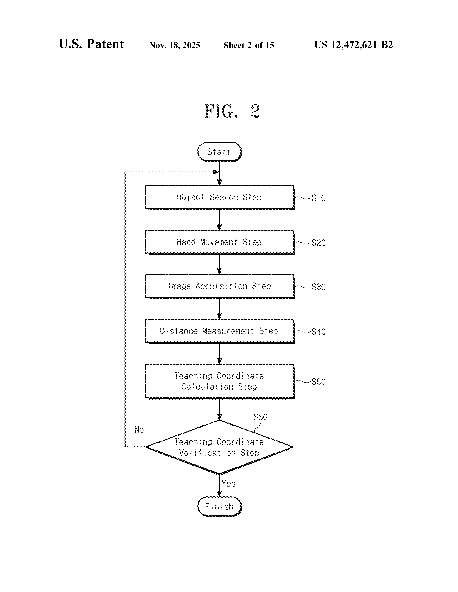
*도 2 — 일 실시예에 따른 티칭 방법 흐름도*

대상체 탐색 단계(S10)는 이송 로봇(100)에 의해 이송되는 기판이 놓이는 대상체를 탐색하는 단계(S10)일 수 있다(도 3 참조). 대상체 탐색 단계(S10)에서, 제1 센서(130)는 이송 로봇(100) 주변에 위치하는 구조물들의 형상 및 위치에 관한 정보를 획득하여 제어기(200)로 전송할 수 있다. 제어기(200)는 미리 기억된 구조물 형상 정보에 기초하여 이송 로봇(100) 주변에 어떤 종류의 구조물이 위치하는지를 판단하고, 그 구조물들 중 티칭 좌표가 필요한 구조물을 선별할 수 있다.

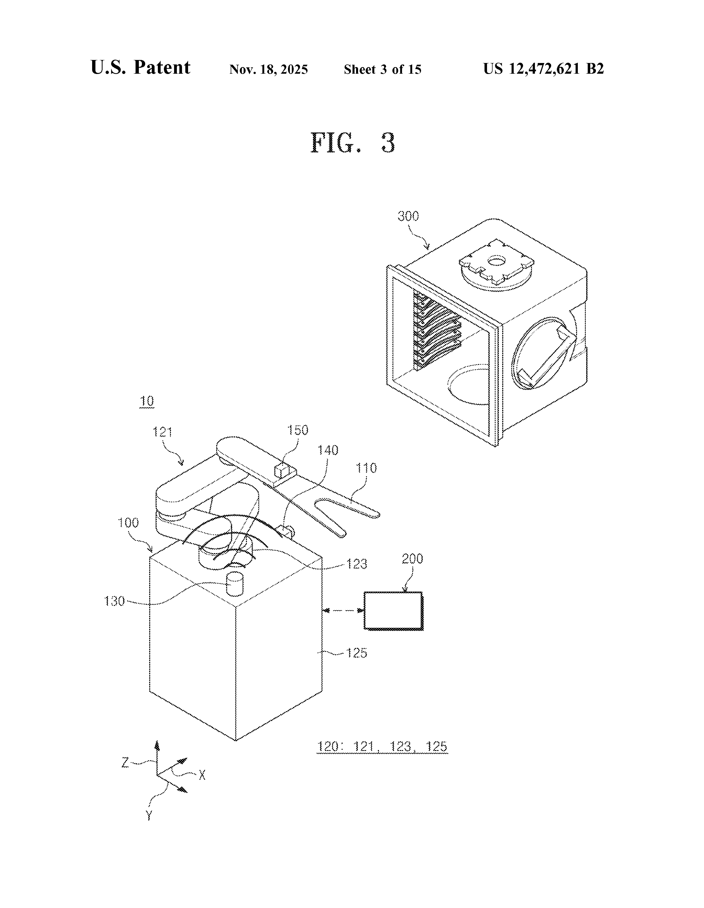
*도 3 — 대상체 탐색 단계를 수행하는 이송 시스템*

예를 들어, 이송 로봇(100) 주변에는 FOUP와 같이 기판을 수용하는 보관 기구인 용기(300)가 위치할 수 있다. 제1 센서(130)는 이송 로봇(100) 주변 구조물의 형상 및 위치에 관한 정보를 제어기(200)로 전송할 수 있다. 제어기(200)는 이송 로봇(100)의 주변 구조물들 중 티칭 작업이 필요한 구조물을 선별할 수 있다. 예를 들어, 주변 구조물들 중에는 기판 처리 장치의 내벽이나 레일과 같이 티칭 작업이 필요하지 않은 구조물과, 용기(300)와 같이 티칭 작업이 필요한 구조물이 있을 수 있다. 제어기(200)는 티칭 작업이 필요한 구조물의 대략적인 좌표를 도출할 수 있다.

핸드 이동 단계(S20)에서, 이송 로봇(100)의 핸드(110)는 티칭 작업이 필요한 구조물일 수 있는 용기(300)를 향하는 방향으로 이동될 수 있다(도 4 참조). 즉, 핸드 이동 단계(S20)에서 핸드(110)는 대상체인 용기(300)에 가까워지는 방향으로 이동될 수 있다.

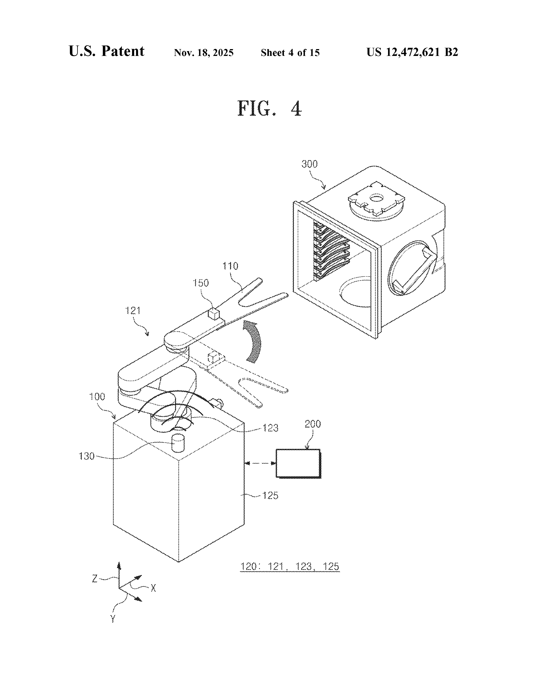
*도 4 — 핸드 이동 단계를 수행하는 이송 시스템*

이미지 획득 단계(S30)에서, 제2 센서(140)는 대상체로서의 용기(300)를 촬상하여 대상체의 이미지(IM)를 획득할 수 있다(도 5 참조). 대상체 탐색 단계(S10)에서 제어기(200)가 대상체인 용기(300)의 대략적인 위치를 파악한 경우, 제2 센서(140)는 대상체로서의 용기(300)의 위치에 초점을 맞추어 용기(300)의 이미지(IM)를 획득할 수 있다. 제어기(200)는 용기(300)의 이미지(IM)로부터 용기(300)의 제2 방향(Y) 및 제3 방향(Z) 좌표값을 산출하여 도출할 수 있다. 예를 들어, 제어기(200)는 이미지 처리를 통해, 용기(300)의 면들 중 해당 면(원문: the surface of the container 300)에 속하는 특정 지점(PP)의 좌표인 제2 방향(Y) 및 제3 방향(Z) 좌표를 도출할 수 있다.

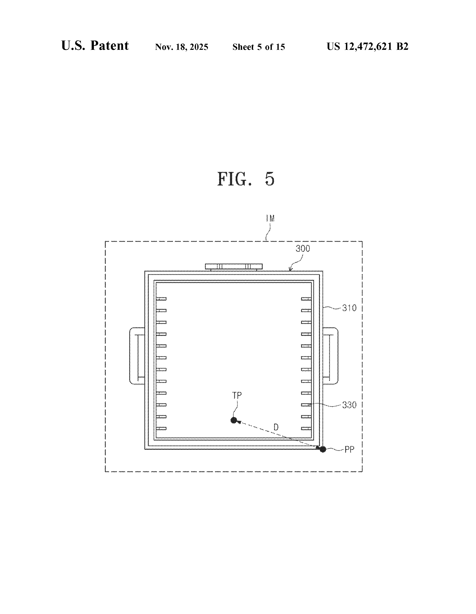
*도 5 — 이미지 획득 단계 및 대상체 좌표 산출 단계*

거리 측정 단계(S40)에서, 제3 센서(150)를 통해 대상체와 핸드(110) 사이의 거리가 측정될 수 있다(도 6 참조). 거리 측정 단계(S40)에서, 이미지 획득 단계(S30)에서 얻은 특정 지점(PP)의 좌표값을 이용하여 핸드(110)를 특정 지점(PP)과 마주하는 위치로 이동시킬 수 있다. 제3 센서(150)는 특정 지점(PP)과 이송 로봇(100) 사이의 거리를 측정할 수 있다. 예를 들어, 제3 센서(150)는 핸드(110)와 용기(300) 사이의 거리를 측정할 수 있다. 제어기(200)는 제3 센서(150)가 용기(300)와의 거리를 측정할 때의 핸드(110)의 좌표와, 제3 센서(150)가 측정한 용기(300)와 핸드(110) 사이의 거리에 기초하여, 특정 지점(PP)의 제1 방향(X) 좌표를 산출하여 도출할 수 있다.

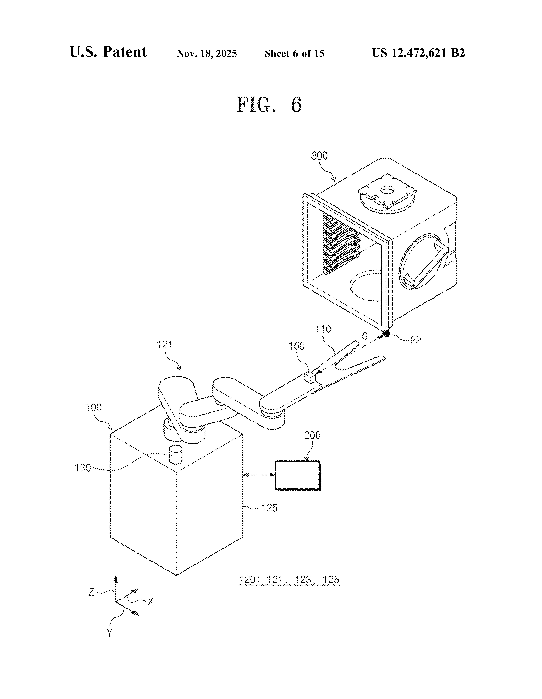
*도 6 — 거리 측정 단계를 수행하는 이송 시스템*

티칭 좌표 산출 단계(S50)에서, 이송 위치(TP)의 좌표인 티칭 좌표가 산출될 수 있다. 제어기(200)는 대상체의 특정 지점(PP)의 좌표인 대상체 좌표로부터 티칭 좌표를 산출할 수 있다. 상술한 바와 같이, 제어기(200)에는 대상체의 설계 정보가 저장될 수 있다. 제어기(200)는 대상체 좌표와, 미리 저장된 대상체인 용기(300)의 정보에 기초하여, 이송 위치(TP)의 좌표인 티칭 좌표를 산출할 수 있다. 제어기(200)에 저장된 정보는 대상체 좌표로부터 티칭 좌표까지의 거리값을 포함할 수 있다. 거리값은 제1 방향(X)의 거리값, 제2 방향(Y)의 거리값 및 제3 방향(Z)의 거리값을 포함할 수 있다.

티칭 좌표 검증 단계(S60)에서, 티칭 좌표 산출 단계(S50)에서 도출된 티칭 좌표가 검증될 수 있다. 티칭 좌표 검증 단계(S60)에서, 제1 센서(130)는 다시 3D 위치 정보를 추출할 수 있다. 예를 들어, 제1 센서(130)는 용기(300)의 위치 정보에 기초하여 용기(300)의 좌표를 도출할 수 있다. 이때, 제1 센서(130)에 의해 도출된 대상체의 좌표와, 제2 센서(140) 및 제3 센서(150)에 의해 도출된 대상체의 좌표를 서로 비교하여 그 차이가 임계값을 초과하는지 여부를 판단할 수 있다. 차이가 임계값을 초과하는 경우, 상술한 티칭 방법이 다시 수행될 수 있다.

제1 센서(130)로 고성능 라이다 센서를 사용하면, 대상체에 대한 좌표를 즉시 정확하게 도출할 수 있다. 그러나 고성능 라이다 센서는 매우 고가일 수 있다. 따라서 상대적으로 저렴한 라이다 센서를 사용하는 경우, 대상체에 대한 좌표를 정확하게 도출하기 어렵다. 이에, 본 발명의 개념의 일 실시예에 따르면, 제1 센서(130)를 통해 대상체의 대략적인 위치를 찾고, 제2 센서(140) 및 제3 센서(150)를 통해 티칭 좌표를 정확하게 도출한 뒤, 제1 센서(130)를 이용하여 티칭 좌표를 검증함으로써 티칭 작업의 정확도가 향상된다. 또한, 제2 센서(140) 및 제3 센서(150)를 통해 티칭 좌표를 완전히 도출할 수 있으므로, 웨이퍼형 센서 등을 이용한 후속 작업 없이 티칭 작업을 완료할 수 있다.

상술한 예에서는 대상체가 용기(300)인 것을 예로 들었으나, 본 발명의 개념은 이에 한정되지 않는다. 예를 들어, 도 7에 도시된 바와 같이, 대상체는 이송되는 기판을 보관하는 보관 장치 중 하나인 버퍼 장치일 수 있다. 버퍼 장치는 기판을 지지하는 지지 선반들과, 기판의 온도를 조절하는 온도 조절 플레이트를 포함할 수 있다.

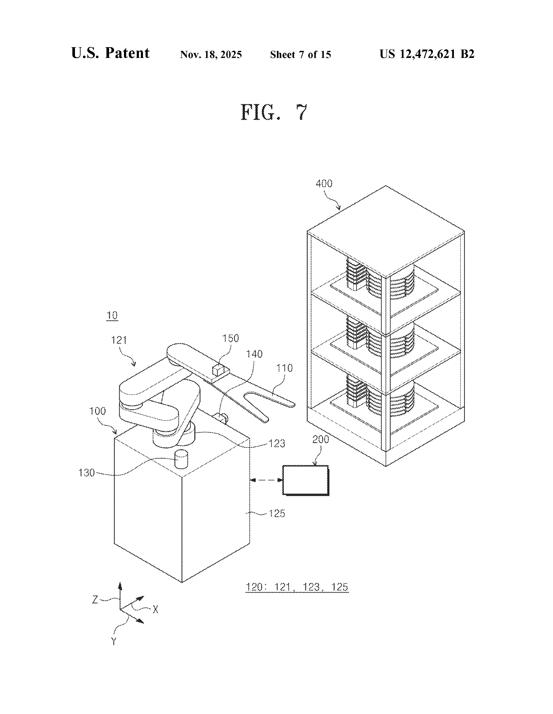
*도 7 — 기판이 놓이는 대상체의 다른 실시예(버퍼 장치)*

상술한 예에서는 대상체가 용기(300)인 것을 예로 들었으나, 본 발명의 개념은 이에 한정되지 않는다. 예를 들어, 도 8에 도시된 바와 같이, 대상체는 기판을 지지하고 회전시키는 기구인 스핀 척(500)일 수 있다. 스핀 척(500)은 척 몸체(510) 및 척 몸체(510)에 설치된 지지 핀(530)을 포함할 수 있다. 대상체가 스핀 척(500)인 경우, 상술한 방법과 유사하게 척 몸체(510)의 특정 지점에 대한 좌표를 도출하고 이를 통해 티칭 좌표를 도출할 수 있으나, 지지 핀(530)을 이용하여 티칭 좌표를 도출할 수도 있다.

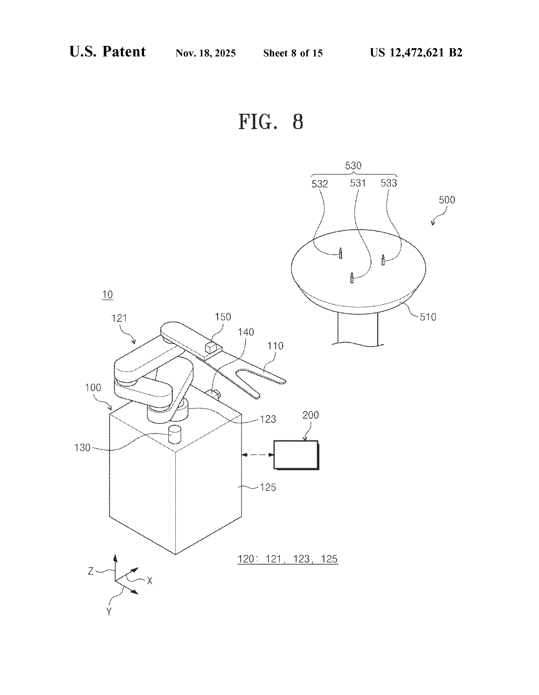
*도 8 — 기판이 놓이는 대상체의 또 다른 실시예(스핀 척)*

예를 들어, 이송 위치가 지지 핀(530)들의 중심이자 지지 핀(530)들의 상단 높이인 경우, 제1 지지 핀(531) 상단의 제1 방향(X) 좌표 x1 및 제2 방향(Y) 좌표 y1, 제2 지지 핀(532) 상단의 제1 방향(X) 좌표 x2 및 제2 방향(Y) 좌표 y2, 제3 지지 핀(533) 상단의 제1 방향(X) 좌표 x3 및 제2 방향(Y) 좌표 y3가 도출될 수 있다(원문 표기는 "second first support pin", "third first support pin"). 제어기(200)는 (x1, y1), (x2, y2) 및 (x3, y3)를 지나는 가상의 원(CR)의 반지름 값을 미리 저장할 수 있다. 가상의 원(CR)의 원의 방정식은 다음과 같다.

(x−a)2−+(y−b)2 =r 2(a,b는 원의 중심이고, r은 원의 반지름이다)

(참고: 원문 텍스트 추출본의 표기를 그대로 옮김. 의도된 식은 (x−a)² + (y−b)² = r² 이다.)

이때, (x1, y1), (x2, y2) 및 (x3, y3)의 좌표값을 알고 있으므로, 이들 중 적어도 둘의 좌표값을 통해 a 및 b의 값을 도출할 수 있다. 즉, 티칭 좌표로부터(원문: from the teaching coordinates) 제1 방향(X) 좌표 및 제2 방향(Y) 좌표가 도출될 수 있다.

경우에 따라서는, 도 11에 도시된 바와 같이, 척(600)의 척 몸체(610)에 설치된 핀(620)의 길이가 매우 짧아 핀(620)의 상단을 인식하기 어렵거나, 경우에 따라 척 몸체(610)에 핀(620)이 설치되지 않을 수도 있다. 이 경우, 도 12에 도시된 바와 같이, 척(600) 상에 놓이며 복수의 티칭 핀(631)이 설치된 티칭 지그(630)를 안착시키고, 티칭 지그(630)가 안착된 척(600)에 대하여 티칭 작업을 수행할 수 있다.

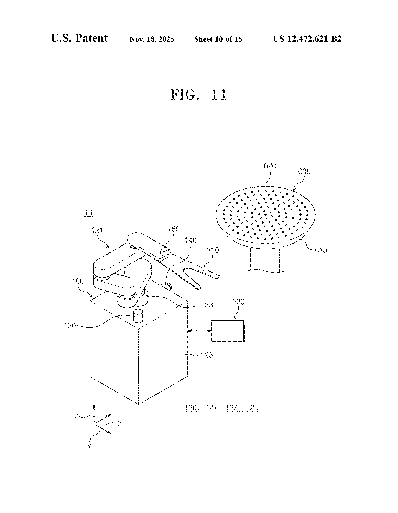
*도 11 — 기판이 놓이는 대상체의 또 다른 실시예(척)*

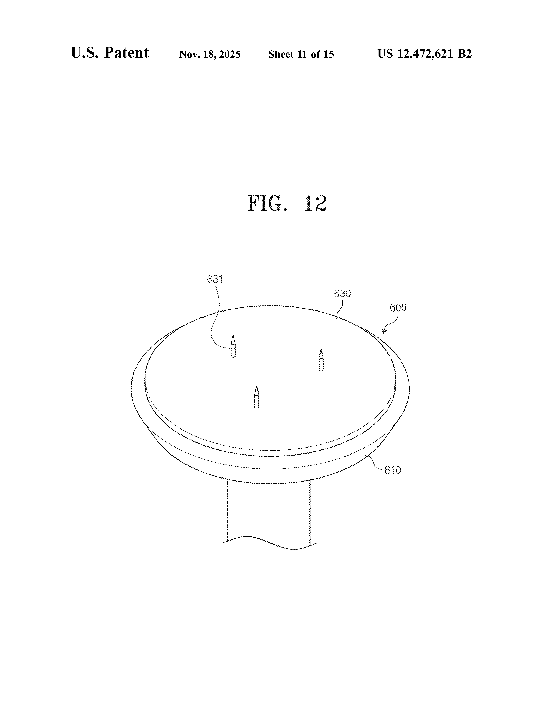
*도 12 — 도 11의 스핀 척 상에 티칭 지그가 안착된 상태*

상술한 예에서는 제2 센서(140)가 베이스(125)에 설치되는 예를 설명하였으나, 본 발명의 개념은 이에 한정되지 않는다. 예를 들어, 도 13에 도시된 바와 같이, 제2 센서(140)는 제3 센서(150)의 측부에, 암 어셈블리(121) 상에 설치될 수 있다. 경우에 따라서, 제2 센서(140)는 핸드(110)에 설치될 수도 있다.

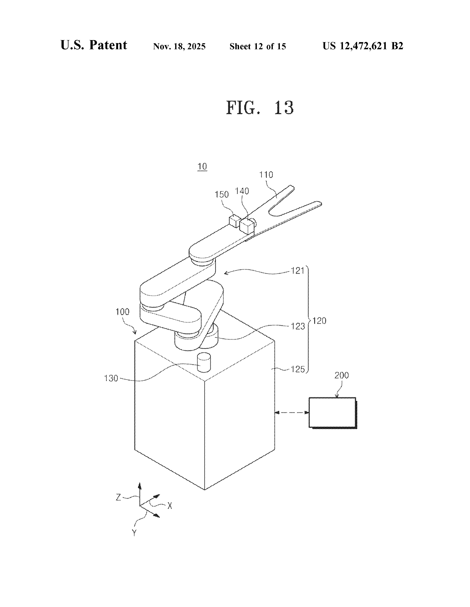
*도 13 — 다른 실시예에 따른 이송 시스템 개략도*

상술한 예에서는 제2 센서(140)가 하나만 제공되는 것으로 설명하였으나, 본 발명의 개념은 이에 한정되지 않는다. 예를 들어, 도 14에 도시된 바와 같이, 베이스(125)에 복수의 비전 센서(141, 142, 143, 144)가 설치될 수 있다. 비전 센서(141, 142, 143, 144) 각각은 서로 다른 방향에 위치하는 대상체를 촬상하도록 배치될 수 있다. 이송 로봇(100)이 복수의 비전 센서(141, 142, 143, 144)를 구비하는 경우, 제어기(200)는 대상체 탐색 단계(S10)에서 탐색된 대상체의 위치에 따라 촬상에 사용할 비전 센서를 선택하여 대상체를 촬상할 수 있다.

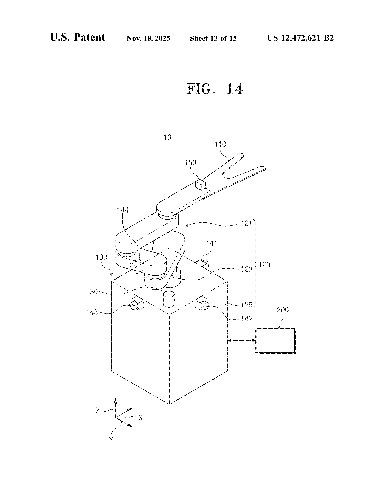
*도 14 — 또 다른 실시예에 따른 이송 시스템 개략도(복수의 비전 센서)*

상술한 예에서는 제2 센서(140)가 고정 설치되는 것을 예로 들어 설명하였으나, 본 발명의 개념은 이에 한정되지 않는다. 예를 들어, 도 15에 도시된 바와 같이, 비전 센서(141, 142, 143, 144)는 베이스(125)에 설치된 이동 레일(R1, R2, R3, R4) 각각에 설치되어 제1 방향(X) 또는 제2 방향(Y)으로 이동하도록 구성될 수 있다. 이송 로봇(100)이 이동 가능한 비전 센서(141, 142, 143, 143, 144)를 구비하는 경우, 제어기(200)는 대상체 탐색 단계(S10)에서 탐색된 대상체의 위치에 따라 촬상에 사용할 비전 센서의 위치를 변경함으로써 대상체를 보다 효과적으로 촬상할 수 있다.

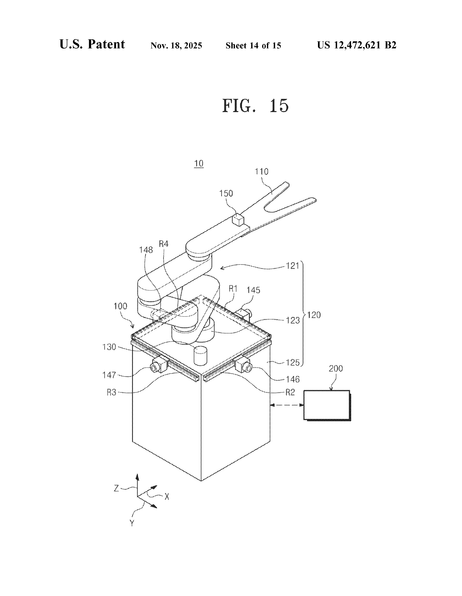
*도 15 — 또 다른 실시예에 따른 이송 시스템 개략도(이동 레일 위 비전 센서)*

또한, 상술한 예에서는 이송 로봇(100)이 다관절 암을 갖는 로봇인 것을 예로 들어 설명하였으나, 이에 한정되지 않는다. 예를 들어, 도 16에 도시된 바와 같이, 이송 로봇(700)은 다관절 암을 갖지 않는 로봇으로 제공될 수 있다. 예를 들어, 이송 로봇(700)은 핸드(710), 구동부(720), 라이다 센서(730), 비전 센서(740) 및 거리 센서(750)를 포함할 수 있다. 라이다 센서(730), 비전 센서(740) 및 거리 센서(750)는 각각 제1 센서(130), 제2 센서(140) 및 제3 센서(150)와 동일하거나 유사할 수 있다.

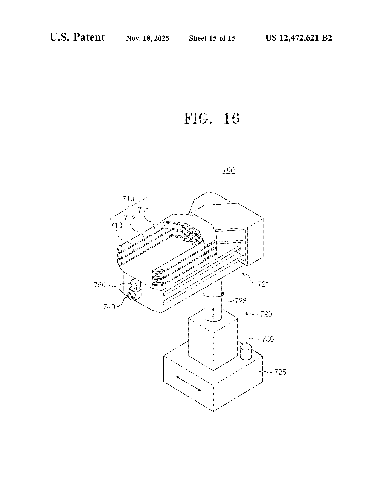
*도 16 — 다른 실시예에 따른 이송 로봇 개략도(다관절 암 없음)*

핸드(710)는 복수의 핸드(711, 712, 713)를 포함할 수 있다. 구동부(720)는 복수의 핸드(711, 712, 713) 각각을 전후 방향 및/또는 상하 방향으로 이동시키도록 구성될 수 있다. 예를 들어, 구동부(720)는 핸드(711, 712, 713) 각각을 전후 방향으로 이동시키는 직선 어셈블리(linear assembly)(721), 직선 어셈블리(721)를 상하 방향으로 이동시키는 승강축(723), 그리고 기판 처리 장치에 설치될 수 있는 레일을 따라 이동 가능하며 구동기를 포함하는 베이스(725)를 포함할 수 있다. 라이다 센서(730)는 베이스(725)에 설치될 수 있고, 비전 센서(740) 및 거리 센서(750)는 직선 어셈블리(721)의 전방에 설치될 수 있다.

본 발명의 개념의 효과는 상술한 효과들로 제한되지 않으며, 언급되지 않은 효과들은 본 명세서 및 첨부된 도면으로부터 본 발명의 개념이 속하는 기술분야에서 통상의 지식을 가진 자에게 명확하게 이해될 수 있을 것이다.

이상에서는 본 발명의 개념의 바람직한 실시예에 대하여 도시하고 설명하였으나, 본 발명의 개념은 상술한 특정의 실시예에 한정되지 아니하며, 청구범위에서 청구하는 본 발명의 개념의 요지를 벗어남이 없이 당해 발명이 속하는 기술분야에서 통상의 지식을 가진 자에 의해 다양한 변형 실시가 가능한 것은 물론이고, 이러한 변형 실시들은 본 발명의 개념의 기술적 사상이나 전망으로부터 개별적으로 이해되어서는 안 될 것이다.
