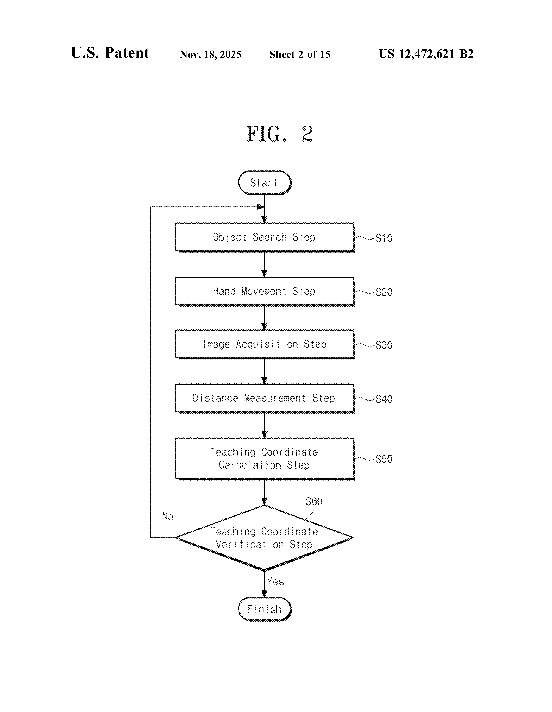
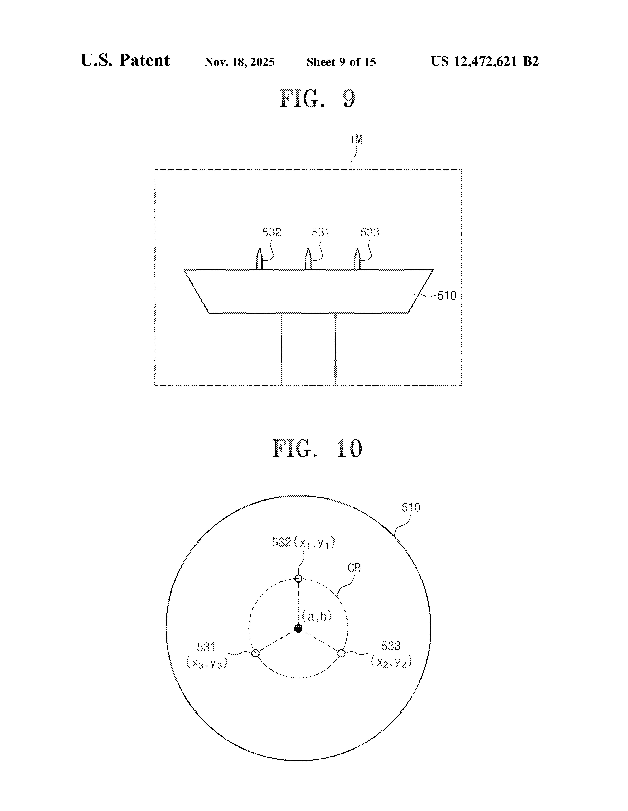

# US12472621B2 — 티칭 방법·이송 시스템 (SEMES)

| 항목 | 내용 |
|---|---|
| 원문 | `US12472621.pdf`(등록, 2025-11-18) · `US20240139934.pdf`(공개, 2024-05-02) |
| 출원인 | SEMES |
| 우선일 | 2022-10-27 (KR 10-2022-0140432) |
| 패밀리 | KR102767876B1 외 |
| 핵심 | 라이다로 대상(FOUP, 버퍼, 스핀척)을 찾고, 에어리어 카메라로 Y·Z 좌표, 거리 센서로 X 좌표를 구한 뒤 미리 저장한 대상→이송 위치 거리값을 더해 티칭 좌표를 만든다. 끝으로 라이다 좌표와 비교해 임계값으로 검증한다. |
| 배경기술 인용 포인트 | QR 마커 비전 방식은 2축(좌우·상하)은 확인되지만 전후(깊이) 축은 확인하기 어렵고, 로봇 수동 조작이 여전히 필요하다. |
| 관련도 | ◎ 방식이 거의 같음 |
| 본 과제와의 관계 | 비전으로 로봇 이송 위치를 맞추는 SEMES 특허(설치 시 티칭 자동화). Θ(회전) 보정은 다루지 않는다. |
| 링크 | [Google Patents](https://patents.google.com/patent/US12472621B2/en) |

---

## 상세 요약 (번역본 기준)

### 1. 해결하려는 문제
- 수동 티칭: 사용자가 이송 로봇을 직접 조작해 웨이퍼를 지지 기구에 올리고 좌표를 확인. 숙련도·피로도에 따라 정밀도가 달라지고 시간이 오래 걸림.
- QR 마크 + 비전 센서 방식: 대략적 이송은 여전히 수동 조작이라 시간 단축에 한계.
- 비전 센서는 이미지에서 좌우·상하 2축만 확인 가능, 전후 축(센서~지지 기구 거리)은 확인 어려움 → 설계값 직접 입력이나 웨이퍼형 센서로 후속 보정 필요.
- 고성능 라이다만 쓰면 정확하지만 고가, 저가 라이다는 좌표 정확도 부족.

### 2. 핵심 구성
| 구성 | 부호 | 역할 | 설치 위치 |
|---|---|---|---|
| 이송 로봇 | 100 | 기판(웨이퍼·글라스) 이송 | 인덱스부·처리부·인터페이스부 |
| 핸드 | 110 | 기판 적재(한 쌍의 핑거) | 암 끝 |
| 구동부 | 120 | 암 어셈블리(121, 다관절, X·Y) + 승강축(123, Z) + 베이스(125, 구동기) | — |
| 제1 센서(라이다) | 130 | 주변 구조물 3D 형상·좌표 획득 | 베이스(125) |
| 제2 센서(비전, 에어리어 카메라) | 140 | 대상체 이미지 → Y·Z 좌표(2D) | 베이스(125), 대상체와 마주하는 위치 |
| 제3 센서(거리, 초음파/레이저) | 150 | 핸드~대상체 거리 → X 좌표 | 핸드에 직결되는 암, 또는 핸드·베이스 |
| 제어기 | 200 | 프로세서·메모리(장치·FOUP 설계 정보, 티칭 프로그램)·인터페이스 | 기판 처리 장치 컴퓨터 |

- 좌표계: 로봇(100) 중심이 원점, X·Y 수평(서로 수직), Z 수직.
- 대상체 예: 용기(300, FOUP)(도 3–6), 버퍼 장치(지지 선반·온도 조절 플레이트)(도 7), 스핀 척(500: 척 몸체 510, 지지 핀 530)(도 8), 핀이 짧거나 없는 척(600: 척 몸체 610, 핀 620) + 티칭 지그(630, 티칭 핀 631)(도 11–12).
- 변형예: 비전 센서를 제3 센서 옆 암 어셈블리 위나 핸드에 설치(도 13), 베이스에 복수 비전 센서(141–144)를 방향별로 배치(도 14), 이동 레일(R1–R4) 위에서 X/Y 이동(도 15), 다관절 없는 직선형 로봇(700: 핸드 711–713, 직선 어셈블리 721, 승강축 723, 베이스 725, 라이다 730, 비전 740·거리 750은 직선 어셈블리 전방)(도 16).

### 3. 동작 순서 (도 2)
1. S10 대상체 탐색(도 3): 라이다(130)가 주변 구조물 형상·위치 전송 → 제어기가 미리 기억된 형상 정보로 구조물 종류 판단, 내벽·레일 등은 제외하고 티칭이 필요한 구조물(용기 300) 선별, 대략 좌표 도출.
2. S20 핸드 이동(도 4): 핸드(110)를 대상체에 가까워지는 방향으로 이동.
3. S30 이미지 획득(도 5): 비전 센서(140)가 대략 위치에 초점을 맞춰 이미지(IM) 촬상 → 이미지 처리로 용기 면의 특정 지점(PP)의 Y·Z 좌표 산출.
4. S40 거리 측정(도 6): PP 좌표로 핸드를 PP와 마주하는 위치로 이동 → 거리 센서(150)로 핸드~용기 거리 측정 → (측정 시 핸드 좌표 + 측정 거리)로 PP의 X 좌표 산출.
5. S50 티칭 좌표 산출: 대상체 좌표(PP의 X·Y·Z) + 미리 저장된 대상체 정보(대상체 좌표→티칭 좌표까지 X·Y·Z 거리값) → 이송 위치(TP) 좌표.
6. S60 검증: 라이다(130)로 3D 위치 정보 재추출, 라이다 좌표와 비전·거리 센서 좌표의 차이가 임계값 초과 시 티칭 방법 재수행. 임계값 수치는 명시 없음.
- 스핀 척(도 8–10): 이송 위치가 지지 핀들 중심·상단 높이인 경우, 지지 핀(531, 532, 533) 상단 좌표 (x1,y1),(x2,y2),(x3,y3) 도출. 세 점을 지나는 가상 원(CR)의 반지름 r을 미리 저장, (x−a)²+(y−b)²=r²에서 두 점 이상으로 중심 (a,b) 계산 → 티칭 X·Y 좌표.
- 핀 인식이 어려운 척(도 11–12): 티칭 지그(630)를 올리고 티칭 핀(631) 좌표로 동일 처리.

### 4. 청구항 요지
- 청구항 1(독립): 라이다류 제1 센서의 3D 정보로 대상체 탐색 → 다른 종류의 제2 센서로 제1·제2 방향 좌표 → 또 다른 종류의 제3 센서로 제3 방향 좌표 → 3방향 좌표 + 미리 저장된 대상체 정보로 티칭 좌표 산출. 대상체가 FOUP이면 대상체 좌표는 로봇을 향하는 면의 특정 지점.
- 청구항 5(독립): 탐색 + 제2 센서 좌표 획득, 센서 종류를 라이다·비전·거리로 한정, 라이다 좌표와 비전·거리 센서 좌표 차이의 임계값 초과 여부 확인 단계 포함.
- 청구항 8(독립): 청구항 1과 같은 4단계, 대상체가 척 + 티칭 지그이면 대상체 좌표는 티칭 핀 중 적어도 하나의 좌표.
- 청구항 10: 청구항 1 방법을 실행하는 명령어를 담은 비일시적 매체.
- 종속항: 대상체 정보 = 대상체 좌표→티칭 좌표 거리값(2, 11), 3방향 거리값(3), 센서 = 라이다·비전·거리(4), 지지 유닛이면 지지 핀 좌표(6), 복수 핀 좌표로 티칭 좌표 산출(7, 9).
- 참고: 청구항은 비전 → "제1·제2 방향", 거리 → "제3 방향"으로 쓰고, 상세한 설명은 비전 → Y·Z, 거리 → X로 씀. 축 이름만 다르고 구조는 같음.

### 5. 대표 도면

*도 2 — 탐색(S10)→핸드 이동(S20)→이미지(S30)→거리(S40)→티칭 좌표(S50)→검증(S60) 흐름*

*도 9, 도 10 — 스핀 척 이미지와 지지 핀 3점을 지나는 가상 원(CR)의 중심으로 티칭 좌표 산출*

### 6. 본 과제(Y·Θ 얼라인먼트)와 비교
- 같은 점:
  - SEMES 반도체 이송 로봇의 이송 위치를 카메라 이미지로 정하는 문제.
  - 비전 센서(에어리어 카메라)로 이미지 평면 2축 좌표를 얻고, 이를 로봇 좌표계(로봇 중심 원점)로 변환해 사용.
  - 이송 로봇의 위치 정밀도와 수동 작업 제거가 목표.
- 다른 점:
  - 본 특허는 설치 시 1회 하는 티칭(좌표 등록), 우리는 실시간 Y·Θ 보정값 출력.
  - 본 특허는 X·Y·Z 3축 위치만 다루고 Θ(회전)는 다루지 않음.
  - 마커 없이 대상체 자체(용기 면 특정 지점 PP, 지지 핀, 티칭 지그 핀)를 이미지 처리로 인식, 우리는 QR형 마커 사용.
  - 라이다·거리 센서까지 쓰는 다중 센서 구성, 우리는 카메라 단독.
- 참고할 점:
  - 2단계 측정: 거친 탐색(라이다 대략 위치) → 초점 맞춘 정밀 측정(비전) 구조를 마커 검출 ROI 축소 → 정밀 측정으로 응용 가능.
  - 검증 단계(S60): 독립된 두 측정값의 차이를 임계값과 비교해 초과 시 재측정. 보정값 신뢰도 판정·재촬영 로직으로 사용 가능(임계값 수치는 특허에 없음).
  - 원 중심 계산(도 9–10): 3점과 알려진 반지름으로 중심 산출 → 마커 여러 특징점에서 중심을 robust하게 구하는 방식으로 응용, 두 점 이상의 위치로 회전각 계산도 가능.
  - 대상체 좌표 + 미리 저장된 설계 오프셋(X·Y·Z 거리값) = 목표 좌표 구조. 마커 중심→실제 이송 기준점 오프셋을 설정값으로 두는 설계에 그대로 사용 가능.
  - 배경기술의 "비전은 2축만, 깊이 축 불가" 지적은 우리 과제 범위(Y·Θ, 깊이 제외)의 근거로 인용 가능.
  - 티칭 지그(630): 특징점이 없거나 약한 대상에 인식용 지그를 올리는 발상 → 마커 부착 지그 설계 근거.
