# 얼라이너를 구비한 웨이퍼 이송 장치 (US12224191B2)
- 원제: Wafer transfer apparatus with aligner
- 원문: 같은 폴더의 PDF, https://patents.google.com/patent/US12224191B2/en
- 번역 기준: Google Patents 원문 텍스트를 한국어로 옮김. 도면은 PDF 참조.
- 도면: 원문 PDF 도면 시트 12장을 도면/ 폴더에 넣고 본문에서 처음 언급되는 곳에 삽입함

## 요약

웨이퍼 이송 장치는 제어기, 웨이퍼 이송 로봇(wafer transfer robot), 및 복수의 이송 구조물(transfer structure)을 포함한다. 웨이퍼 이송 로봇은 웨이퍼를 파지하도록 구성되는 핸드부(hand unit), 핸드부에 연결되어 웨이퍼를 이동시키도록 구성되는 구동부(driving unit), 및 구동부에 제공되는 센서부(sensor unit)를 포함한다. 복수의 이송 구조물은 웨이퍼 이송 로봇과 웨이퍼를 주고받도록 구성되며, 복수의 이송 구조물 각각은 센서부가 인식할 수 있는 복수의 마커(marker)를 포함한다. 센서부는 복수의 마커를 인식하는 카메라 센서, 및 복수의 마커에 레이저를 조사하고 복수의 마커로부터 반사된 레이저를 수신하여 복수의 마커까지의 거리를 측정하도록 구성되는 레이저 센서를 포함한다.

## 청구범위

청구하는 것은 다음과 같다.

1. 웨이퍼 이송 장치로서,

제어기;

웨이퍼 이송 로봇으로서,

웨이퍼를 파지하도록 구성되는 핸드부,

상기 핸드부에 연결되어 상기 웨이퍼를 이동시키도록 구성되는 구동부로서, 링크 암부(link arm unit) 및 상기 링크 암부에 연결되는 베이스부(base unit)를 포함하는 구동부, 및

상기 구동부에 제공되는 센서부를 포함하는 웨이퍼 이송 로봇; 및

상기 웨이퍼 이송 로봇과 상기 웨이퍼를 주고받도록 구성되는 복수의 이송 구조물로서, 상기 복수의 이송 구조물 각각은 상기 센서부가 인식할 수 있는 복수의 마커를 포함하는 복수의 이송 구조물을 포함하고,

상기 센서부는,

상기 복수의 마커를 인식하는 카메라 센서, 및

상기 복수의 마커에 레이저를 조사하고 상기 복수의 마커로부터 반사된 상기 레이저를 수신하여 상기 복수의 마커까지의 거리를 측정하도록 구성되는 레이저 센서를 포함하며,

상기 제어기는,

상기 센서부에 의해 인식된 상기 복수의 마커의 위치 및 상기 센서부에 의해 측정된 상기 복수의 마커까지의 상기 거리에 기초하여, 상기 웨이퍼 이송 로봇에 대한 상기 복수의 이송 구조물의 위치 정보를 획득하고,

상기 위치 정보에 기초하여 상기 웨이퍼 이송 로봇을 제어하도록 구성되며,

상기 베이스부는 상기 복수의 이송 구조물 중 적어도 하나의 이송 구조물에서 웨이퍼가 적층되는 방향으로 이동하도록 구성되는, 웨이퍼 이송 장치.

2. 제1항에 있어서, 상기 복수의 마커는 3개 이상의 마커를 포함하는, 웨이퍼 이송 장치.

3. 제2항에 있어서, 상기 제어기는,

상기 복수의 마커 중 대상 이송 구조물에 부착된 여러 개의 마커까지의 거리를 순차적으로 측정하고,

상기 복수의 마커 중 상기 여러 개의 마커까지의 상기 거리에 기초하여 상기 대상 이송 구조물의 위치 정보를 결정하도록 더 구성되는, 웨이퍼 이송 장치.

4. 제3항에 있어서, 상기 제어기는,

상기 웨이퍼 이송 로봇의 위치를 조정함으로써, 상기 복수의 마커 중 하나의 마커를 상기 카메라 센서가 상기 하나의 마커를 촬영하여 얻은 마커 이미지의 중앙 영역에 위치시키고,

상기 레이저 센서에 의해 상기 하나의 마커의 중앙부에 레이저를 조사하도록 더 구성되는, 웨이퍼 이송 장치.

5. 제1항에 있어서, 상기 복수의 마커 각각은 상기 웨이퍼 이송 장치 내부의 3차원 공간에서 하나의 평면 상에 위치하는, 웨이퍼 이송 장치.

6. 제1항에 있어서, 상기 복수의 이송 구조물은 FOUP(front opening unified pod), 얼라이너, 및 버퍼 중 적어도 일부를 포함하고,

상기 복수의 마커는, 상기 복수의 이송 구조물 각각에서 상기 웨이퍼 이송 로봇에 의해 상기 웨이퍼가 투입 및 반출되는 이송 방향에 수직한 평면 상에 위치하는, 웨이퍼 이송 장치.

7. 제6항에 있어서, 상기 제어기는, 상기 복수의 이송 구조물 각각에 대하여,

상기 복수의 마커가 위치하는 상기 평면에 관한 위치 정보, 및 상기 웨이퍼가 이송 방향으로 이동하도록 구성되는 이송 거리에 기초하여 상기 웨이퍼 이송 로봇을 제어하도록 더 구성되는, 웨이퍼 이송 장치.

8. 제7항에 있어서, 상기 이송 거리는 상기 이송 방향에서 상기 웨이퍼의 중심 위치와 상기 복수의 마커가 위치하는 상기 평면 사이의 거리인, 웨이퍼 이송 장치.

9. 제1항에 있어서, 상기 복수의 마커 각각은 QR 코드 및 ArUco 마커 중 적어도 하나를 포함하는, 웨이퍼 이송 장치.

10. 제1항에 있어서,

상기 복수의 이송 구조물이 제공되는 본체를 더 포함하고,

상기 제어기는 상기 본체에 제공되는, 웨이퍼 이송 장치.

11. 제10항에 있어서, 상기 본체에는 복수의 기준 마커(reference marker)가 제공되고,

상기 제어기는,

상기 센서부로 상기 복수의 기준 마커의 위치를 인식하고,

상기 복수의 기준 마커까지의 거리를 측정함으로써,

상기 웨이퍼 이송 로봇의 기준 위치를 결정하도록 더 구성되는, 웨이퍼 이송 장치.

12. 웨이퍼 이송 장치로서,

웨이퍼가 담긴 FOUP(front opening unified pod)가 제공되는 본체;

상기 웨이퍼를 이송하도록 구성되는 제1 웨이퍼 이송 로봇; 및

상기 본체에 제공되며, 로드락 챔버(load-lock chamber)로 투입될 상기 웨이퍼가 수용되는 얼라이너를 포함하고,

상기 웨이퍼 이송 장치는,

상기 제1 웨이퍼 이송 로봇에 제공되는 제1 센서부로, 상기 본체, 상기 FOUP, 상기 얼라이너, 및 상기 로드락 챔버의 웨이퍼 투입구(wafer inlet)에 제공되는 복수의 마커를 인식함으로써, 상기 본체, 상기 FOUP, 상기 얼라이너, 및 상기 웨이퍼 투입구에 관한 위치 정보를 획득하고,

상기 위치 정보에 기초하여 상기 웨이퍼를 이송하도록 구성되는, 웨이퍼 이송 장치.

13. 제12항에 있어서, 상기 웨이퍼 이송 장치는 EFEM(equipment front end module)을 포함하는, 웨이퍼 이송 장치.

14. 제12항에 있어서, 상기 복수의 마커의 개수는 3개 이상이고,

상기 웨이퍼 이송 장치는,

상기 제1 센서부로 상기 복수의 마커 각각에 대한 좌표 정보 및 상기 복수의 마커 각각에 대한 거리 정보를 생성하고,

상기 좌표 정보 및 상기 거리 정보에 기초하여 상기 위치 정보를 획득하도록 더 구성되는, 웨이퍼 이송 장치.

15. 제14항에 있어서, 상기 제1 센서부는,

상기 좌표 정보를 생성하도록 구성되는 카메라 센서, 및

상기 거리 정보를 생성하도록 구성되는 레이저 센서를 포함하는, 웨이퍼 이송 장치.

16. 제14항에 있어서, 상기 제1 웨이퍼 이송 로봇은,

상기 웨이퍼를 파지하도록 구성되는 핸드부, 및

상기 핸드부에 연결되는 구동부를 더 포함하고,

상기 구동부는,

상기 핸드부에 연결되는 제1 구동부, 및

상기 제1 구동부를 통해 상기 핸드부에 연결되는 제2 구동부를 포함하며,

상기 제1 센서부는 상기 제1 구동부에 제공되는, 웨이퍼 이송 장치.

17. 제12항에 있어서,

상기 로드락 챔버로부터 상기 웨이퍼를 받는 공정 챔버에 의해 수행되는 반도체 공정이 완료된 후, 상기 로드락 챔버를 통해 이송된 상기 웨이퍼가 소정의 대기 시간 동안 배치되는 버퍼를 더 포함하는, 웨이퍼 이송 장치.

18. 제17항에 있어서,

상기 공정 챔버와 상기 로드락 챔버 사이에서 상기 웨이퍼를 이송하도록 구성되는 제2 웨이퍼 이송 로봇을 더 포함하고,

상기 제2 웨이퍼 이송 로봇은 상기 로드락 챔버의 상기 웨이퍼 투입구 및 상기 공정 챔버의 웨이퍼 투입구 각각에 제공되는 챔버 마커를 인식하도록 구성되는 제2 센서부를 포함하는, 웨이퍼 이송 장치.

19. 웨이퍼 이송 장치로서,

복수의 제1 마커를 포함하고, 웨이퍼가 보관되는 공간을 제공하도록 구성되는 복수의 이송 구조물;

상기 복수의 이송 구조물이 제공되는 본체로서, 상기 복수의 제1 마커와 상이한 복수의 기준 마커를 포함하는 본체;

상기 복수의 이송 구조물 사이에서 상기 웨이퍼를 이송하도록 구성되는 웨이퍼 이송 로봇으로서, 웨이퍼를 파지하도록 구성되는 핸드부, 상기 핸드부에 연결되어 상기 웨이퍼를 이동시키도록 구성되는 구동부, 및 상기 복수의 제1 마커 및 상기 복수의 기준 마커를 인식하도록 구성되는 카메라 센서를 포함하는 센서부를 포함하는 웨이퍼 이송 로봇; 및

상기 본체에 제공되며, 상기 웨이퍼 이송 로봇의 티칭 동작(teaching operation)을 실행하도록 구성되는 제어기를 포함하고,

상기 티칭 동작에서, 상기 제어기는,

상기 센서부의 상기 카메라 센서로 상기 복수의 기준 마커 각각에 대한 좌표 정보를 획득함으로써, 상기 본체에 대한 상기 웨이퍼 이송 로봇의 기준 위치 및 상대 위치를 결정하고,

상기 센서부의 상기 카메라 센서로 상기 복수의 제1 마커 각각에 대한 좌표 정보를 획득함으로써, 상기 복수의 이송 구조물 각각에 대한 상기 웨이퍼 이송 로봇의 위치 및 자세(attitude)를 포함하는 위치 정보를 결정하도록 구성되는, 웨이퍼 이송 장치.

## 상세한 설명

### 관련 출원의 상호 참조 (CROSS-REFERENCE TO RELATED APPLICATION(S))

본 출원은 2022년 7월 12일 대한민국 특허청에 출원된 대한민국 특허출원 제10-2022-0085622호에 기초하며 이에 대한 우선권을 주장하고, 그 개시 내용 전체는 본 명세서에 참조로서 포함된다.

### 배경기술 (BACKGROUND)

본 개시의 예시적 실시예들은 웨이퍼 이송 장치 및 이를 포함하는 반도체 공정 시스템에 관한 것이다.

반도체 공정을 수행하는 공정 시스템은 웨이퍼를 이송하는 웨이퍼 이송 로봇을 포함할 수 있으며, 웨이퍼 이송 로봇은 웨이퍼를 이송 및/또는 보관하기 위한 다양한 이송 구조물과 공정 챔버 사이에서 웨이퍼를 이송할 수 있다. 웨이퍼 이송 로봇은 반도체 공정을 진행하기 위해 웨이퍼를 자동으로 이동시킬 수 있으나, 반도체 공정을 시작하기 전에 또는 소정 주기마다 이송 구조물들의 위치 및 웨이퍼 이송 로봇의 위치를 정의하는 티칭 동작을 수행할 필요가 있다. 티칭 동작은 수동으로 수행되거나 별도의 티칭 스테이션을 이용하여 수행될 수 있다. 이에 따라 작업자의 숙련도에 따른 편차 발생, 별도의 티칭 스테이션으로 인한 웨이퍼 이송 장치의 제조 비용 증가 등의 문제가 있다.

예를 들어, 웨이퍼 이송 로봇은 FOUP(front opening unified pod)와 얼라이너, 버퍼, 및 로드락 챔버 사이에서 웨이퍼를 이동시키는 장치일 수 있다. 웨이퍼 이송 로봇이 웨이퍼를 이동시키기 전에, 웨이퍼 이송 로봇, FOUP, 얼라이너, 버퍼, 및 로드락 챔버의 위치를 특정하는 티칭 동작이 수행될 수 있다. 티칭 동작은 일반적으로 수동으로 수행될 수 있다. 따라서, 작업자의 숙련도에 따라 티칭 동작에 소요되는 시간이 달라지거나, 티칭 동작의 정확도가 저하되는 등의 문제가 발생할 수 있다.

본 배경기술 항목에 개시된 정보는 본 출원의 실시예들을 달성하기 전 또는 그 과정에서 발명자들이 이미 알고 있었거나 도출한 것이거나, 실시예들을 달성하는 과정에서 획득한 기술 정보이다. 따라서 이미 공중에 알려진 종래기술을 구성하지 않는 정보를 포함할 수 있다.

### 발명의 내용 (SUMMARY)

웨이퍼 이송 로봇, FOUP(front opening unified pod), 버퍼, 및 얼라이너의 위치를 특정하는 티칭 동작을 자동으로 실행할 수 있는 웨이퍼 이송 장치, 및 이를 포함하는 반도체 공정 시스템이 제공된다.

추가적인 양태들은 이하의 설명에서 일부 제시될 것이며, 일부는 설명으로부터 명백해지거나 제시된 실시예들의 실시를 통해 습득될 수 있을 것이다.

예시적 실시예의 일 양태에 따르면, 웨이퍼 이송 장치는 제어기, 웨이퍼 이송 로봇, 및 복수의 이송 구조물을 포함할 수 있다. 웨이퍼 이송 로봇은 웨이퍼를 파지하도록 구성되는 핸드부, 핸드부에 연결되어 웨이퍼를 이동시키도록 구성되는 구동부, 및 구동부에 제공되는 센서부를 포함하고, 복수의 이송 구조물은 웨이퍼 이송 로봇과 웨이퍼를 주고받도록 구성되며, 복수의 이송 구조물 각각은 센서부가 인식할 수 있는 복수의 마커를 포함한다. 여기서 센서부는 복수의 마커를 인식하는 카메라 센서, 및 복수의 마커에 레이저를 조사하고 복수의 마커로부터 반사된 레이저를 수신하여 복수의 마커까지의 거리를 측정하도록 구성되는 레이저 센서를 포함할 수 있고, 제어기는 센서부에 의해 인식된 복수의 마커의 위치 및 센서부에 의해 측정된 복수의 마커까지의 거리에 기초하여 웨이퍼 이송 로봇에 대한 복수의 이송 구조물의 위치 정보를 획득하고, 위치 정보에 기초하여 웨이퍼 이송 로봇을 제어하도록 구성될 수 있다.

예시적 실시예의 일 양태에 따르면, 반도체 공정 시스템은 웨이퍼에 대한 반도체 공정을 수행하도록 구성되는 적어도 하나의 공정 챔버, FOUP에 의해 웨이퍼를 이송하도록 구성되는 제1 웨이퍼 이송 로봇을 포함하는 웨이퍼 이송 장치, 및 적어도 하나의 공정 챔버와 웨이퍼 이송 장치 사이에서 웨이퍼를 이송하도록 구성되는 로드락 챔버를 포함할 수 있다. 여기서 웨이퍼 이송 장치는 FOUP가 제공되는 본체, 및 본체에 제공되며 웨이퍼가 수용되는 얼라이너를 포함할 수 있고, 웨이퍼 이송 장치는 제1 웨이퍼 이송 로봇에 제공되는 제1 센서부로 본체, FOUP, 얼라이너, 및 웨이퍼 투입구에 제공되는 복수의 마커를 인식함으로써 본체, FOUP, 얼라이너, 및 웨이퍼 투입구에 관한 위치 정보를 획득하고, 위치 정보에 기초하여 웨이퍼를 이송하도록 구성될 수 있다.

예시적 실시예의 일 양태에 따르면, 웨이퍼 이송 장치는 복수의 제1 마커를 포함하고 웨이퍼가 보관되는 공간을 제공하도록 구성되는 복수의 이송 구조물, 복수의 이송 구조물이 제공되며 복수의 제1 마커와 상이한 복수의 기준 마커를 포함하는 본체, 복수의 이송 구조물 사이에서 웨이퍼를 이송하도록 구성되며 복수의 제1 마커 및 복수의 기준 마커를 인식하도록 구성되는 센서부를 포함하는 웨이퍼 이송 로봇, 및 본체에 제공되며 웨이퍼 이송 로봇의 티칭 동작을 실행하도록 구성되는 제어기를 포함할 수 있다. 여기서, 티칭 동작에서 제어기는 센서부로 복수의 기준 마커 각각에 대한 좌표 정보를 획득함으로써 본체에 대한 웨이퍼 이송 로봇의 기준 위치 및 상대 위치를 결정하고, 센서부로 복수의 제1 마커 각각에 대한 좌표 정보를 획득함으로써 복수의 이송 구조물 각각에 대한 웨이퍼 이송 로봇의 위치 및 자세를 포함하는 위치 정보를 결정하도록 구성된다.

### 도면의 간단한 설명 (BRIEF DESCRIPTION OF DRAWINGS)

본 개시의 특정 예시적 실시예들의 상기 및 기타 양태, 특징, 및 이점은 첨부 도면과 함께 이하의 설명으로부터 더욱 명백해질 것이다.

도 1은 본 개시의 예시적 실시예에 따른 반도체 공정 시스템을 나타내는 도면이다.

도 2는 본 개시의 예시적 실시예에 따른 웨이퍼 이송 장치를 나타내는 도면이다.

도 3은 본 개시의 예시적 실시예에 따른 웨이퍼 이송 장치를 나타내는 도면이다.

도 4는 본 개시의 예시적 실시예에 따른 웨이퍼 이송 로봇을 나타내는 도면이다.

도 5, 도 6, 도 7 및 도 8은 본 개시의 예시적 실시예에 따른 이송 구조물들을 나타내는 도면들이다.

도 9는 본 개시의 예시적 실시예에 따른 웨이퍼 이송 장치의 동작을 나타내는 흐름도이다.

도 10, 도 11, 도 12 및 도 13은 본 개시의 예시적 실시예에 따른 웨이퍼 이송 장치의 동작을 나타내는 도면들이다.

도 14, 도 15, 도 16 및 도 17은 본 개시의 예시적 실시예에 따른 웨이퍼 이송 장치의 동작을 나타내는 도면들이다.

도 18 및 도 19는 본 개시의 예시적 실시예에 따른 웨이퍼 이송 장치의 동작을 나타내는 도면들이다.

### 발명을 실시하기 위한 구체적인 내용 (DETAILED DESCRIPTION)

이하, 첨부된 도면을 참조하여 본 개시의 예시적 실시예들을 상세히 설명한다. 도면에서 동일한 구성요소에 대해서는 동일한 참조 부호를 사용하며, 이에 대한 중복 설명은 생략한다. 본 명세서에 기술된 실시예들은 예시적 실시예들이며, 따라서 본 개시는 이에 한정되지 않고 다양한 다른 형태로 구현될 수 있다.

본 명세서에서 사용되는 "~ 중 적어도 하나"와 같은 표현은, 요소들의 목록 앞에 올 때 요소들의 목록 전체를 수식하며 목록의 개별 요소를 수식하지 않는다. 예를 들어, "a, b, 및 c 중 적어도 하나"라는 표현은 a만, b만, c만, a와 b 모두, a와 c 모두, b와 c 모두, 또는 a, b, 및 c 전부를 포함하는 것으로 이해되어야 한다.

도 1은 본 개시의 예시적 실시예에 따른 반도체 공정 시스템을 나타내는 도면이다.

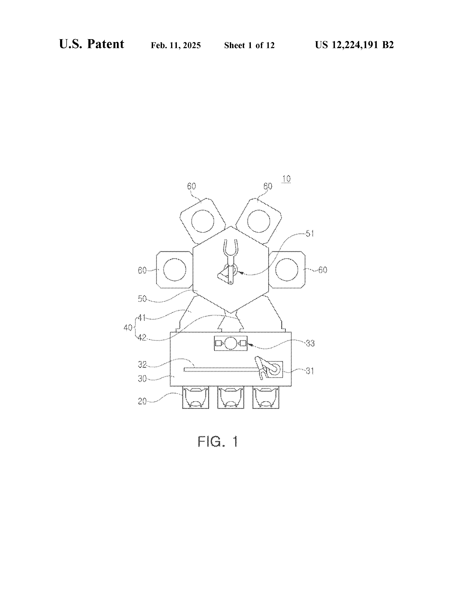
*도 1 — 반도체 공정 시스템*

도 1을 참조하면, 본 개시의 예시적 실시예에 따른 반도체 공정 시스템(10)은 웨이퍼 이송 장치(30), 로드락 챔버(40), 이송 챔버(50), 및 복수의 공정 챔버(60)를 포함할 수 있다. 예를 들어, 웨이퍼 이송 장치(30)는 반도체 공정 시스템(10)이 배치된 라인 상에서 FOUP(front opening unified pod)(20)와 같은 용기를 통해 웨이퍼를 받을 수 있다. 웨이퍼 이송 장치(30)는 FOUP(20)를 통해 받은 웨이퍼를 로드락 챔버(40)로 이송하거나, 공정 챔버(60)에서 반도체 공정이 완료된 웨이퍼를 로드락 챔버(40)로부터 받아 FOUP(20)에 수용할 수 있다.

웨이퍼 이송 장치(30)는 웨이퍼를 파지하는 암을 갖는 웨이퍼 이송 로봇(31), 웨이퍼 이송 로봇(31)을 이동시키는 레일부(32), 및 웨이퍼를 정렬하는 얼라이너(33)를 포함할 수 있다. FOUP(20)로부터 로드락 챔버(40)로 웨이퍼를 이송하는 동작에서, 웨이퍼 이송 로봇(31)은 FOUP(20)에 수용된 웨이퍼를 꺼내어 얼라이너(33) 상에 배치할 수 있다. 얼라이너(33)는 웨이퍼를 회전시켜 웨이퍼를 소정의 한 방향으로 정렬할 수 있다. 얼라이너(33)가 웨이퍼의 정렬을 완료하면, 웨이퍼 이송 로봇(31)은 얼라이너(33)로부터 웨이퍼를 꺼내어 로드락 챔버(40)로 이동시킬 수 있다.

로드락 챔버(40)는, 웨이퍼 이송 장치(30)에 연결되며 반도체 공정을 실행하기 위해 공정 챔버(60)로 투입되는 웨이퍼들이 일시적으로 머무르는 로딩 챔버(41), 및 공정을 완료한 후 공정 챔버(60)로부터 반출된 웨이퍼들이 일시적으로 머무르는 언로딩 챔버(42)를 포함할 수 있다. 얼라이너(33)에서 정렬된 웨이퍼가 로딩 챔버(41)에 로딩되면, 외부 오염물질의 유입을 방지하기 위해 로딩 챔버(41)의 내부 공간이 감압될 수 있다.

로드락 챔버(40)는 이송 챔버(50)에 연결될 수 있고, 복수의 공정 챔버(60)는 이송 챔버(50) 주위에 연결될 수 있다. 이송 챔버(50)에는 로드락 챔버(40)와 복수의 공정 챔버(60) 사이에서 웨이퍼를 이송하기 위한 웨이퍼 이송 로봇(51)이 배치될 수 있다. 웨이퍼 이송 장치(30)의 웨이퍼 이송 로봇(31)은 제1 웨이퍼 이송 로봇으로, 이송 챔버(50)의 웨이퍼 이송 로봇(51)은 제2 웨이퍼 이송 로봇으로 지칭될 수 있다.

복수의 공정 챔버(60) 각각은 웨이퍼에 대해 반도체 공정을 수행할 수 있다. 예를 들어, 복수의 공정 챔버(60)에서 수행되는 반도체 공정은 증착 공정, 식각 공정, 노광 공정, 어닐링 공정, 연마 공정, 이온 주입 공정 등을 포함할 수 있다.

반도체 공정 시스템(10)에서, FOUP(20)를 통해 이송된 웨이퍼는 로드락 챔버(40)로 이동될 수 있고, 반도체 공정을 수행하기 위해 복수의 공정 챔버(60) 중 적어도 하나에 투입될 수 있다. 반도체 공정이 완료된 후, 반출된 웨이퍼를 다시 FOUP(20)에 수용하는 이송 동작이 자동으로 수행될 수 있다. 상기와 같은 이송 동작을 자동으로 수행하기 위해, 웨이퍼 이송 장치(30)의 제1 웨이퍼 이송 로봇(31) 및 이송 챔버(50)의 제2 웨이퍼 이송 로봇(51)은, 웨이퍼가 이송되는 대상 이송 구조물이 될 수 있는 이송 구조물들 각각의 정확한 위치를 알아야 할 필요가 있다. 예를 들어, 웨이퍼 이송 장치(30)에서 이송 구조물들은 FOUP(20), 얼라이너(33), 및 로드락 챔버(40)의 웨이퍼 출입구(entrance/exit)를 포함할 수 있다. 이송 챔버(50)에서 이송 구조물들은 로드락 챔버(40), 및 복수의 공정 챔버(60)의 웨이퍼 출입구들을 포함할 수 있다.

예를 들어, 제1 및 제2 웨이퍼 이송 로봇(31, 51)의 위치 및 이송 구조물들의 위치를 보정하는 티칭 동작은 반도체 공정 전 또는 반도체 공정 중에 주기적으로 수행될 수 있다. 본 개시의 예시적 실시예에서, 제1 및 제2 웨이퍼 이송 로봇(31, 51)에는 각각 센서부가 장착될 수 있고, 이송 구조물들 각각에는 복수의 마커가 부착될 수 있다.

티칭 동작에서, 제1 및 제2 웨이퍼 이송 로봇(31, 51)의 센서부들은 이송 구조물들 중 하나에 부착된 복수의 마커를 인식하고, 복수의 마커까지의 거리를 측정할 수 있다. 반도체 공정 시스템(10)의 제어기는 센서부에 의해 인식된 복수의 마커의 위치 및 복수의 마커까지의 거리에 기초하여 이송 구조물들에 관한 위치 정보를 생성하고, 이에 기초하여 웨이퍼 이송 로봇의 동작을 제어할 수 있다. 따라서 티칭 동작에 수작업이 필요하지 않으므로, 작업자의 숙련도와 관계없이 일정한 품질로 티칭 동작이 완료될 수 있다. 또한 티칭 스테이션과 같은 추가 장비가 필요하지 않을 수 있으므로, 티칭 동작을 자동으로 완료하는 반도체 공정 시스템(10)은 티칭 스테이션을 제공함에 따라 발생하는 추가 비용 없이 구현될 수 있다.

도 2는 본 개시의 예시적 실시예에 따른 웨이퍼 이송 장치를 나타내는 도면이다.

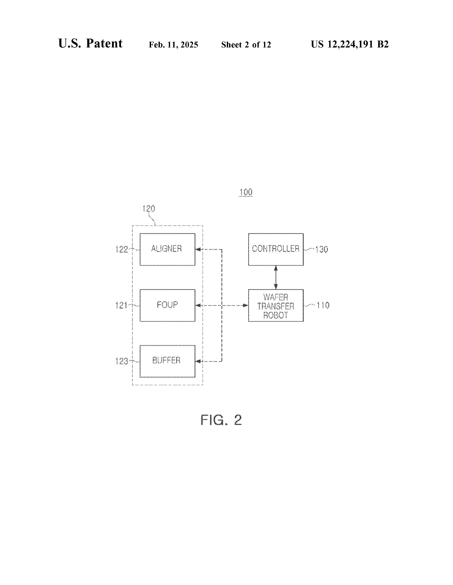
*도 2 — 웨이퍼 이송 장치*

도 2를 참조하면, 본 개시의 예시적 실시예에 따른 웨이퍼 이송 장치(100)는 웨이퍼 이송 로봇(110), 복수의 이송 구조물(120), 및 제어기(130)를 포함할 수 있다. 웨이퍼 이송 로봇(110)은 복수의 이송 구조물(120) 사이에서 웨이퍼를 이동시킬 수 있고, 제어기(130)는 웨이퍼 이송 로봇(110)의 이동을 제어할 수 있다.

도 2에 도시된 예시적 실시예에서, 웨이퍼 이송 장치(100)는 도 1을 참조하여 앞서 설명한 바와 같이, FOUP(20)에 연결되어 웨이퍼를 로드락 챔버(40)로 이송하거나 로드락 챔버(40)로부터 웨이퍼를 받는 설비일 수 있다. 따라서, 복수의 이송 구조물(120)은 FOUP(121) 및 얼라이너(122)를 포함할 수 있다. 예시적 실시예에 따르면, 복수의 이송 구조물(120)은 버퍼(123)를 더 포함할 수 있다. 반도체 공정이 완료된 후 웨이퍼를 FOUP(121)로 다시 이동시키기 전에 소정의 대기 시간이 필요한 경우, 버퍼(123)는 웨이퍼를 일시적으로 보관하기 위한 구조물일 수 있다.

제어기(130)는 웨이퍼 이송 로봇(110)의 동작을 제어할 수 있다. 예를 들어, 제어기(130)는 웨이퍼 이송 로봇(110)이 복수의 이송 구조물(120) 사이에서 웨이퍼를 이송하도록 웨이퍼 이송 로봇(110)의 움직임, 위치 이동 등을 제어할 수 있다. 또한, 제어기(130)는 웨이퍼 이송 로봇(110)이 복수의 이송 구조물(120) 각각에 대해 웨이퍼를 정확하게 투입 및 반출하도록, 복수의 이송 구조물(120)에 관한 위치 정보를 조정하는 티칭 동작을 수행할 수 있다.

예를 들어, 복수의 이송 구조물(120)에는 각각 복수의 마커가 부착될 수 있고, 웨이퍼 이송 로봇(110)에는 복수의 마커를 인식할 수 있는 센서부가 장착될 수 있다. 제어기(130)는 센서부로 복수의 마커 각각을 인식하도록 웨이퍼 이송 로봇(110)을 이동시킬 수 있다. 예를 들어, 제어기(130)는 웨이퍼 이송 로봇(110)에 장착된 센서부를 통해 복수의 이송 구조물(120)에 각각 부착된 복수의 마커를 인식할 수 있다.

복수의 마커 각각은 2차원 평면 상에 구현된 마커일 수 있으며, QR 코드, ArUco 마커, 또는 특정 형상의 도형을 포함할 수 있다. 센서부는 마커를 인식하기 위해 마커가 표시된 이미지를 생성할 수 있는 카메라 센서, 및 마커까지의 거리를 측정할 수 있는 레이저 센서를 포함할 수 있다.

티칭 동작이 시작되면, 제어기(130)는 카메라 센서를 이용하여 마커가 표시된 이미지를 획득할 수 있고, 마커가 이미지의 중앙부에 표시되도록 웨이퍼 이송 로봇(110)의 위치 및 자세를 조정할 수 있다. 마커가 중앙부에 표시된 이미지가 생성되면, 제어기(130)는 마커의 위치를 인식하고, 레이저 센서를 이용하여 마커까지의 거리를 측정할 수 있다.

예를 들어, 복수의 이송 구조물(120) 각각에 부착된 복수의 마커는 3차원 공간에 정의되는 하나의 평면 상에 위치할 수 있다. 제어기(130)는 복수의 마커 각각에 관한 치수 정보를 미리 저장할 수 있다. 제어기(130)는 마커의 위치 및 마커까지의 거리를 치수 정보와 결합하여, 웨이퍼 이송 로봇(110)에 대한 복수의 이송 구조물(120) 각각의 위치를 나타내는 위치 정보를 획득할 수 있다. 제어기(130)는 상기와 같이 티칭 동작에서 위치 정보를 자동으로 획득할 수 있고, 위치 정보에 기초하여 티칭 동작 이후 수행되는 공정에서 웨이퍼 이송 로봇(110)의 이동을 제어할 수 있다.

도 3은 본 개시의 예시적 실시예에 따른 웨이퍼 이송 장치를 나타내는 도면이다.

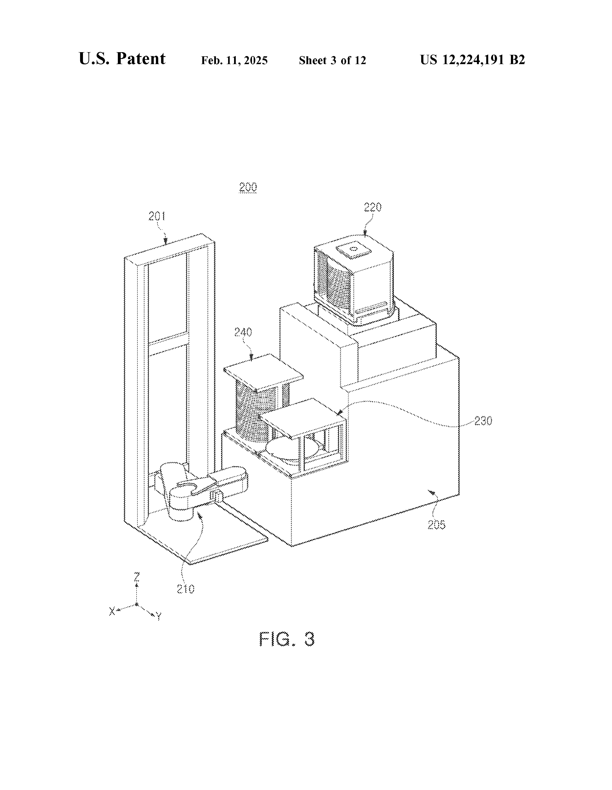
*도 3 — 웨이퍼 이송 장치*

도 3을 참조하면, 본 개시의 예시적 실시예에 따른 웨이퍼 이송 장치(200)는, 반도체 공정이 수행될 웨이퍼를 로드락 챔버로 투입하고 반도체 공정이 완료된 웨이퍼를 로드락 챔버로부터 반출하는 EFEM(equipment front end module)일 수 있다. 도 3에 도시된 바와 같이, 웨이퍼 이송 장치(200)는 웨이퍼 이송 로봇(210), FOUP(220), 얼라이너(230), 및 버퍼(240)를 포함할 수 있다. 웨이퍼 이송 장치(200)의 구조는 도 3에 도시된 것으로 한정되지 않으며, 예시적 실시예들에 따라 다양하게 변형될 수 있다.

웨이퍼 이송 로봇(210)은 로봇 프레임(201)에 장착되어 웨이퍼를 이동 및 이송할 수 있다. 도 3에 도시된 예시적 실시예에서, 웨이퍼 이송 로봇(210)은 로봇 프레임(201)에 장착된 레일을 따라 수직 방향(Z축 방향)으로 이동할 수 있으나, 웨이퍼 이송 로봇(210)이 이동하는 방향은 로봇 프레임(201)의 형상에 따라 변경될 수 있다.

이송 구조물들(예를 들어, FOUP(220), 얼라이너(230), 및 버퍼(240))은 본체(205)에 장착될 수 있다. 예시적 실시예에 따르면, 본체(205)의 내부 공간에 제어기가 장착될 수 있고, 제어기는 웨이퍼 이송 로봇(210), FOUP(220), 얼라이너(230), 및 버퍼(240)를 제어할 수 있다. 예를 들어, 제어기는 웨이퍼를 이동시키도록 웨이퍼 이송 로봇(210)을 제어할 수 있고, 웨이퍼 이송 로봇(210)에 대한 FOUP(220), 얼라이너(230), 또는 버퍼(240)에 관한 위치 정보를 조정하는 티칭 동작을 실행할 수 있다. 또한, 제어기는 얼라이너(230) 상에 배치된 웨이퍼를 X축 방향 및 Y축 방향에 평행한 평면 상에서 회전시켜, 웨이퍼를 소정 방향으로 정렬할 수 있다.

FOUP(220)는 전면이 개방될 수 있고 복수의 웨이퍼가 수용될 수 있는 용기일 수 있으며, 라인에 설치된 레일을 따라 이동하여 웨이퍼 이송 장치(200)로 이송될 수 있다. 웨이퍼 이송 장치(200)에 도착한 후, FOUP(220)의 전면이 개방되어 내부에 수용된 웨이퍼들이 노출되면, 웨이퍼 이송 로봇(210)은 웨이퍼를 반출하여 얼라이너(230)로 이동시킬 수 있다. 얼라이너(230)에서 그 방향이 정렬되면, 웨이퍼 이송 로봇(210)은 웨이퍼를 반출하여 공정 챔버에 연결된 로드락 챔버로 웨이퍼를 투입할 수 있다.

반도체 공정이 완료된 웨이퍼가 공정 챔버로부터 로드락 챔버 쪽으로 반출되면, 웨이퍼 이송 로봇(210)은 로드락 챔버로부터 웨이퍼를 인출하여, 반도체 공정의 종류에 따라 웨이퍼를 버퍼(240) 또는 FOUP(220)에 수용할 수 있다. 예를 들어, 반도체 공정이 완료된 후 소정의 대기 시간이 필요한 식각 공정이 수행되는 공정 챔버로부터 웨이퍼가 반출되는 경우, 웨이퍼 이송 로봇(210)은 웨이퍼를 먼저 버퍼(240)에 수용한 후 FOUP(220)로 이송할 수 있다.

도 4는 본 개시의 예시적 실시예에 따른 웨이퍼 이송 로봇을 나타내는 도면이다.

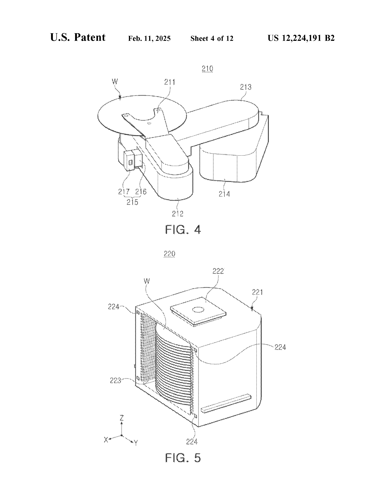
*도 4, 도 5 — 웨이퍼 이송 로봇(도 4), 이송 구조물(도 5)*

도 4는 앞서 도 3을 참조하여 설명한 바와 같이 웨이퍼 이송 장치(200)에 장착된 웨이퍼 이송 로봇(210)을 도시한다. 도 4를 참조하면, 웨이퍼 이송 로봇(210)은 웨이퍼(W)를 파지하기 위한 핸드부(211), 핸드부(211)에 연결되어 웨이퍼(W)를 이동시키는 구동부(예를 들어, 212 내지 214), 및 구동부(예를 들어, 212 내지 214)에 장착되는 센서부(215)를 포함할 수 있다.

핸드부(211)는 적어도 2개의 핑거를 포함할 수 있으며, 핑거에는 웨이퍼(W)를 고정하기 위한 진공 흡착구가 형성될 수 있다. 예를 들어, 하나의 웨이퍼 이송 로봇(210)은 수직 방향으로 서로 인접한 복수의 핸드부(211)를 포함할 수 있다. 이 경우, 이송 구조물들 중 하나로 투입될 웨이퍼(W)와 같은 웨이퍼(W)에 대한 이송 동작이 동시에 수행될 수 있다.

구동부(예를 들어, 212 내지 214)는 링크 암부(212, 213) 및 베이스부(214)를 포함할 수 있다. 제1 링크 암부(212)는 핸드부(211)에 직접 연결될 수 있고, 제2 링크 암부(213)는 베이스부(214)와 제1 링크 암부(212) 사이에 연결될 수 있다. 도 4에 도시된 예시적 실시예에서, 웨이퍼 이송 로봇(210)은 스카라(SCARA) 로봇을 형성하는 것으로 도시되었으나, 웨이퍼 이송 로봇(210)은 직교 로봇, 다관절 로봇 등 다양한 형태로 구현될 수 있다.

센서부(215)는 구동부(예를 들어, 212 내지 214)에 장착될 수 있으며, 센서부(215)는 카메라 센서(216) 및 레이저 센서(217)를 포함할 수 있다. 예를 들어, 센서부(215)는 웨이퍼 이송 로봇(210)이 웨이퍼(W)를 이송하는 이송 구조물에 부착된 마커를 인식하고, 마커까지의 거리를 측정할 수 있다. 센서부(215)는 마커를 인식할 수 있고, 마커에 대해 측정된 거리 등의 정보는 이송 구조물에 관한 위치 정보를 생성하는 데 이용될 수 있다. 이송 구조물에 관한 위치 정보는 웨이퍼 이송 로봇(210)의 구성요소들 중 웨이퍼(W)를 파지하는 핸드부(211)를 기준으로 가장 정확하게 조정되어야 하므로, 센서부(215)는 핸드부(211)에 가능한 한 가까운 인접 위치에 부착될 수 있다. 도 4에 도시된 예시적 실시예에서, 센서부(215)는 핸드부(211)에 직접 연결된 제1 링크 암부(212)에 장착될 수 있다.

도 5, 도 6, 도 7 및 도 8은 본 개시의 예시적 실시예에 따른 이송 구조물들을 나타내는 도면들이다.

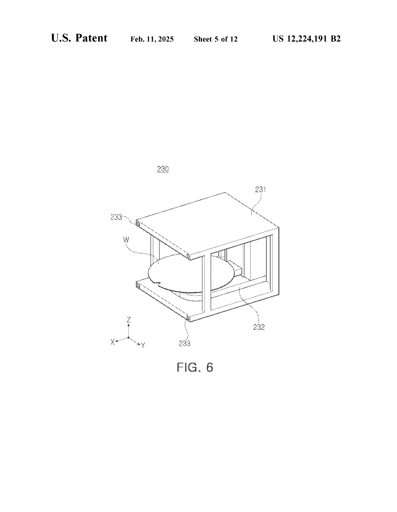
*도 6 — 이송 구조물*

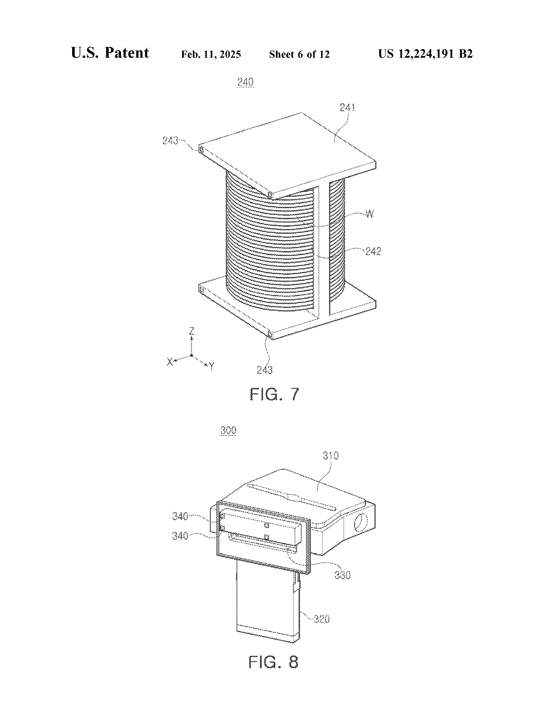
*도 7, 도 8 — 이송 구조물들*

도 5는 도 3을 참조하여 설명한 바와 같이, 웨이퍼 이송 장치(200)로 웨이퍼(W)를 이송하거나 웨이퍼 이송 장치(200)로부터 웨이퍼(W)를 받는 FOUP(220)를 도시한다. 도 5를 참조하면, FOUP(220)는 케이스(221), 웨이퍼(W)를 이송하기 위해 FOUP(220)를 이동시키는 레일에 고정되는 고정부(222), 웨이퍼(W)가 보관되는 보관 홈(223), 및 케이스(221)의 일면에 부착되는 복수의 마커(224)를 포함할 수 있다.

도 5에 도시된 예시적 실시예에서, 웨이퍼(W)는 케이스(221)의 내부 공간에 Z축 방향으로 적층될 수 있으며, 웨이퍼(W)의 X축 및 Y축 방향에 평행한 상면이 케이스(221)에 수용될 수 있다. 또한, 복수의 마커(224)는 케이스(221)로부터 웨이퍼(W)를 반출하거나 케이스(221)로 웨이퍼(W)를 투입하기 위해 개방될 수 있는 케이스(221)의 전면에 부착될 수 있다. 예를 들어, 복수의 마커는 Y축 및 Z축 방향에 평행한 평면 상에 위치할 수 있다. 복수의 마커가 부착되는 평면은, 웨이퍼 이송 로봇(210)에 의해 웨이퍼(W)가 FOUP(220)로 투입되고 FOUP(220)로부터 반출되는 이송 방향에 수직한 평면일 수 있다.

복수의 마커(224)는 웨이퍼 이송 장치(200)의 제어기가 FOUP(220)에 관한 위치 정보를 조정하는 티칭 동작에 활용될 수 있으며, 도 4를 참조하여 설명한 바와 같이 웨이퍼 이송 로봇(210)의 센서부(215)에 의해 식별될 수 있다. 센서부(215)가 카메라 센서(216) 및 레이저 센서(217)를 포함한다고 가정하면, 제어기는 카메라 센서(216)가 생성한 이미지를 이용하여 복수의 마커(224) 각각을 인식할 수 있고, 레이저 센서(217)에 의해 복수의 마커(224) 각각까지의 거리가 측정될 수 있다. 제어기는 복수의 마커(224) 각각의 형상 정보, 치수 정보 등을 미리 저장할 수 있으며, 이를 참조하여 FOUP(220)에 관한 위치 정보를 조정하는 티칭 동작이 완료될 수 있다. 센서부(215)가 복수의 마커(224)를 인식하여 FOUP(220)에 관한 위치 정보를 생성할 수 있도록, FOUP(220)에 부착되는 복수의 마커(224)의 개수는 적어도 3개일 수 있다.

도 6은 앞서 도 3을 참조하여 설명한 바와 같이, 웨이퍼 이송 장치(200)에서 웨이퍼(W)를 소정 방향으로 정렬하기 위한 얼라이너(230)를 도시한다. 도 6을 참조하면, 얼라이너(230)는 케이스(231), 웨이퍼(W)의 방향을 조정하기 위한 정렬부(232), 및 케이스(231)의 일면에 부착되는 복수의 마커(233)를 포함할 수 있다.

도 6을 참조하면, 웨이퍼(W)는 그 방향을 결정하기 위한 홈을 포함할 수 있다. 웨이퍼(W)가 얼라이너(230)로 투입되면, 정렬부(232)는 홈이 소정 방향에 위치하도록 Z축 방향을 기준으로 웨이퍼(W)를 회전시킬 수 있다.

복수의 마커(233)는 웨이퍼 이송 장치(200)의 제어기가 얼라이너(230)에 관한 위치 정보를 조정하는 티칭 동작에 이용될 수 있으며, 도 4를 참조하여 설명한 바와 같이 웨이퍼 이송 로봇(210)의 센서부(215)에 의해 식별될 수 있다. 예를 들어, 얼라이너(230)에 부착되는 복수의 마커(233)는 앞서 설명한 FOUP(220)에 부착되는 복수의 마커(224)의 형상과 상이한 형상을 가질 수 있다. 복수의 마커(233)를 인식하여 얼라이너(230)에 관한 위치 정보를 조정하는 티칭 동작은 FOUP(220)에 대한 티칭 동작과 유사한 방식으로 수행될 수 있다.

도 7은 앞서 도 3을 참조하여 설명한 바와 같이, 웨이퍼 이송 장치(200)에서 웨이퍼(W)를 일시적으로 보관하기 위한 버퍼(240)를 도시한다. 도 7을 참조하면, 버퍼(240)는 케이스(241), 웨이퍼(W)를 보관하기 위한 보관 홈(242), 및 복수의 마커(243)를 포함할 수 있다. 보관 홈(242)에 삽입된 웨이퍼(W)는 Z축 방향으로 적층될 수 있다.

복수의 마커(243)는 웨이퍼 이송 장치(200)의 제어기가 버퍼(240)에 관한 위치 정보를 조정하는 티칭 동작에 이용될 수 있으며, 도 4를 참조하여 설명한 바와 같이 웨이퍼 이송 로봇(210)의 센서부(215)에 의해 식별될 수 있다. 버퍼(240)에 부착되는 복수의 마커(243)는 FOUP(220)에 부착되는 복수의 마커(224)의 형상 및 얼라이너(230)에 부착되는 복수의 마커(233)의 형상과 상이한 형상을 가질 수 있다. 따라서, 제어기는 센서부(215)를 이용하여 버퍼(240), 얼라이너(230), 및 FOUP(220)를 서로 구별하고, 각각의 위치 정보를 정확하게 조정할 수 있다. 복수의 마커(243)를 인식하여 버퍼(240)에 관한 위치 정보를 조정하는 티칭 동작은 FOUP(220)에 대한 티칭 동작과 유사한 방식으로 수행될 수 있다.

도 5 내지 도 7을 참조하여 설명한 예시적 실시예들에서, FOUP(220), 얼라이너(230), 및 버퍼(240) 각각에 관한 위치 정보는 3차원 좌표축에서 정의될 수 있다. 예를 들어, 웨이퍼 이송 장치(200)의 제어기는 FOUP(220), 얼라이너(230), 및 버퍼(240) 각각에 부착된 복수의 마커(224, 233, 243)의 위치를 3차원 좌표로 정의할 수 있다. 따라서, 제어기는 FOUP(220), 얼라이너(230), 및 버퍼(240) 각각에 대해 웨이퍼(W)를 정확하게 반출 및 투입하기 위해 웨이퍼 이송 로봇(210)의 핸드부(211)가 위치해야 하는 목표 좌표를 정확하게 결정할 수 있다.

또한, FOUP(220), 얼라이너(230), 및 버퍼(240) 각각에 대해 웨이퍼(W)를 올바른 위치에 투입하고, 수용된 웨이퍼(W)를 정확하게 파지하여 반출하기 위해, 제어기는 목표 좌표에서 웨이퍼 이송 로봇(210)의 핸드부(211)가 어느 방향으로 얼마나 이동해야 하는지에 관한 이송 거리 정보를 생성할 수 있다. 예를 들어, 이송 거리 정보는 FOUP(220), 얼라이너(230), 및 버퍼(240) 각각의 크기, 웨이퍼(W)의 직경 등에 따라 결정될 수 있다.

웨이퍼 이송 장치(200)의 제어기는 웨이퍼 이송 로봇(210)에 대한 목표 좌표 및 이송 거리 정보를 참조하여 웨이퍼(W)를 이동시키는 동작을 수행하도록 웨이퍼 이송 로봇(210)을 제어할 수 있다. 또한, 웨이퍼 이송 장치(200)의 동작이 시작되는 시점 및/또는 소정 주기가 도래하는 시점에 상기와 같은 티칭 동작을 자동으로 실행함으로써 반도체 공정의 효율이 향상될 수 있다.

웨이퍼 이송 로봇(210)은 앞서 도 1을 참조하여 설명한 바와 같이, FOUP(220), 얼라이너(230), 및 버퍼(240) 외에 로드락 챔버로도 웨이퍼를 이송할 수 있다. 도 8은 본 개시의 예시적 실시예에 따라 웨이퍼 이송 로봇(210)으로부터 웨이퍼를 받거나 웨이퍼 이송 로봇(210)으로 웨이퍼를 이송하는 로드락 챔버(300)를 도시한다. 도 8을 참조하면, 로드락 챔버(300)는 하우징(310), 도어(320), 웨이퍼 출입구(330), 및 복수의 챔버 마커(340)를 포함할 수 있다.

로드락 챔버(300)는 웨이퍼 이송 로봇(210)이 파지한 웨이퍼를 받아 공정 챔버들로 이송할 수 있다. 이 경우, 공정 챔버로 이물질이 유입되지 않도록 로드락 챔버(300)의 내부 공간이 감압된 상태에서 웨이퍼가 공정 챔버로 이송될 수 있다. 예를 들어, 웨이퍼가 웨이퍼 출입구(330)로 삽입되면, 도어(320)가 상승하여 웨이퍼 출입구(330)가 차단된 상태에서 로드락 챔버(300)의 내부 기압을 조정하고, 이후 웨이퍼가 공정 챔버 쪽으로 이송될 수 있다.

앞서 도 5 내지 도 7을 참조하여 설명한 바와 같이, 웨이퍼 이송 장치의 제어기는 로드락 챔버(300)에 부착된 복수의 챔버 마커(340)를 식별하여, 로드락 챔버(300)에 관한 위치 정보(예를 들어, 로드락 챔버(300)에 제공된 웨이퍼 출입구(330)의 위치)를 획득할 수 있다. 이를 위해, 복수의 챔버 마커(340)는 도 8에 도시된 바와 같이 웨이퍼 출입구(330)에 인접하도록 부착될 수 있다. 웨이퍼 이송 장치의 제어기는 FOUP(220), 얼라이너(230), 및 버퍼(240)에 관한 위치 정보를 결정하는 티칭 동작을 로드락 챔버(300)에 대해서도 자동으로 실행할 수 있으며, 이에 따라 웨이퍼 이송 로봇(210)은 오류 없이 로드락 챔버(300)와 웨이퍼를 정확하게 주고받을 수 있다.

도 9는 본 개시의 예시적 실시예에 따른 웨이퍼 이송 장치의 동작을 나타내는 흐름도이다.

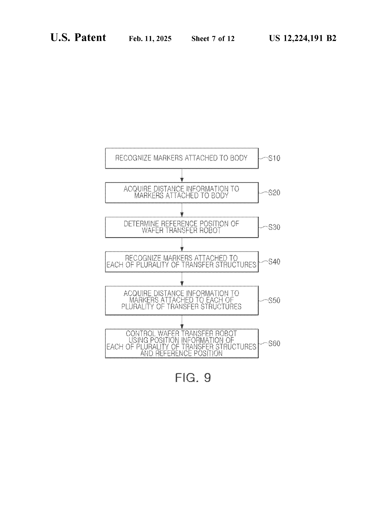
*도 9 — 웨이퍼 이송 장치의 동작 흐름도*

도 9를 참조하여, 본 개시의 예시적 실시예에 따른 웨이퍼 이송 장치의 동작을 설명한다. 단계 S10에서, 웨이퍼 이송 장치의 제어기는 본체에 부착된 마커들을 인식할 수 있다. 본체는 웨이퍼 이송 장치에 포함되는 웨이퍼 이송 로봇, 얼라이너, 버퍼 등이 장착되고, 외부에서 레일과 같은 이송 장치에 의해 이송된 FOUP가 연결되는 메인 프레임일 수 있다. 본체에 부착된 마커들은 웨이퍼 이송 로봇에 장착된 센서부에 포함되는 카메라 센서, 2차원 코드 리더 등에 의해 인식될 수 있다.

제어기는 센서부가 본체에 부착된 마커들을 정확하게 인식하도록 웨이퍼 이송 로봇의 위치 및/또는 자세를 조정할 수 있다. 예시적 실시예에서, 본체에 부착된 마커들이 2차원 코드 또는 특정 형상을 포함하고 웨이퍼 이송 로봇에 카메라 센서가 장착된 경우, 카메라 센서가 촬영한 이미지 내에서 마커가 이미지의 정중앙에 위치하도록 웨이퍼 이송 로봇의 위치 및/또는 자세가 조정될 수 있다.

단계 S20에서, 웨이퍼 이송 로봇이 본체의 마커들 중 하나를 정확하게 인식할 수 있는 위치 및/또는 자세를 갖도록 조정되면, 제어기는 해당 마커까지의 거리 정보를 획득할 수 있다. 예를 들어, 제어기는 웨이퍼 이송 로봇에 장착된 레이저 센서를 이용하여 마커에 레이저를 조사하여 마커까지의 거리 정보를 획득할 수 있다.

제어기는 본체에 부착된 마커의 개수만큼 단계 S10 및 S20을 반복함으로써, 본체에 부착된 마커들 각각에 관한 위치 정보를 획득할 수 있다. 예시적 실시예에서, 본체에 부착된 마커들 각각에 관한 위치 정보는 3차원 좌표로 생성될 수 있으며, 단계 S30에서 제어기는 이 정보를 이용하여 웨이퍼 이송 로봇의 기준 위치를 결정할 수 있다. 단계 S30에서 결정되는 기준 위치는 웨이퍼 이송 장치의 본체에 대한 웨이퍼 이송 로봇의 상대 위치를 결정하기 위한 원점 좌표일 수 있다.

단계 S40에서, 기준 위치가 결정되면, 제어기는 웨이퍼 이송 장치에 배치된 복수의 이송 구조물에 각각 부착된 마커들을 인식하도록 웨이퍼 이송 로봇을 이동시킬 수 있다. 예를 들어, 제어기는 복수의 이송 구조물 중 하나의 이송 구조물을 선택하고, 선택된 이송 구조물에 부착된 복수의 마커 중 하나를 정확하게 인식할 수 있는 위치 및 자세로 웨이퍼 이송 로봇을 조정할 수 있다. 앞서 설명한 바와 같이, 웨이퍼 이송 로봇에 장착된 카메라 센서가 촬영한 이미지의 정중앙에 마커가 위치하도록 웨이퍼 이송 로봇의 위치 및 자세가 조정될 수 있다.

단계 S50에서, 제어기는 복수의 이송 구조물 각각에 부착되어 카메라 센서에 의해 인식된 마커까지의 거리에 관한 정보를 획득할 수 있다. 거리 정보는 카메라 센서와 함께 웨이퍼 이송 로봇에 부착된 레이저 센서를 이용하여 생성될 수 있다. 제어기는 선택된 이송 구조물에 부착된 복수의 마커 각각에 대해 단계 S40 및 S50을 반복 수행함으로써, 선택된 이송 구조물에 대한 웨이퍼 이송 로봇의 위치 및/또는 자세 정보를 포함하는 위치 정보를 획득할 수 있다. 또한, 제어기는 복수의 이송 구조물 각각에 대해 단계 S40 및 S50을 반복 수행하여, 복수의 이송 구조물 각각에 대한 위치 정보를 획득할 수 있다.

복수의 이송 구조물 각각에 관한 위치 정보가 확보되면, 제어기는 티칭 동작을 종료할 수 있다. 이후, 웨이퍼 이송 장치에 의해 웨이퍼들이 투입 및 반출되면서 반도체 공정이 수행될 수 있다. 반도체 공정이 진행되는 동안, 단계 S60에서 웨이퍼 이송 장치의 제어기는 복수의 이송 구조물 각각에 관한 위치 정보 및 단계 S30에서 결정된 기준 위치를 이용하여 웨이퍼 이송 로봇을 제어할 수 있다. 예를 들어, 제어기는 기준 위치를 오프셋 좌표로 사용하여, 복수의 이송 구조물 각각에 관한 위치 정보를 나타내는 좌표에서 기준 위치를 빼는 방식으로 웨이퍼 이송 로봇을 제어할 수 있다.

예시적 실시예에 따르면, 복수의 이송 구조물 각각에 관한 위치 정보 및 기준 위치를 이용하여, 반도체 공정에서의 티칭 동작에 대한 검증 동작이 수행될 수 있다. 검증 동작은 복수의 이송 구조물 각각의 위치 정보 및 기준 위치를 이용하여 웨이퍼 이송 로봇의 위치 및/또는 자세를 제어하면서 더미 웨이퍼를 실제로 이송하는 동작을 포함할 수 있다. 예를 들어, FOUP, 얼라이너, 버퍼 등의 사이에서 더미 웨이퍼를 실제로 이송한 후, 더미 웨이퍼에 손상이 발생했는지 여부를 확인하여 복수의 이송 구조물 각각의 위치 정보 및 기준 위치가 정확하게 생성되었는지를 확인할 수 있다.

도 10, 도 11, 도 12 및 도 13은 본 개시의 예시적 실시예에 따른 웨이퍼 이송 장치의 동작을 나타내는 도면들이다.

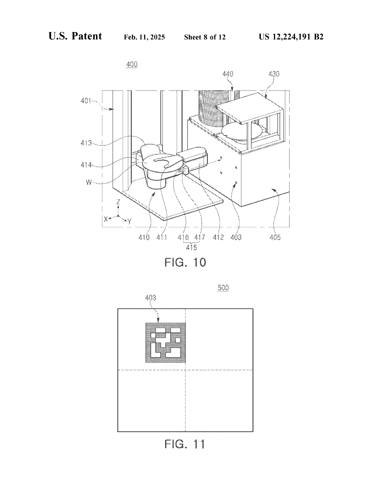
*도 10, 도 11 — 웨이퍼 이송 장치의 동작*

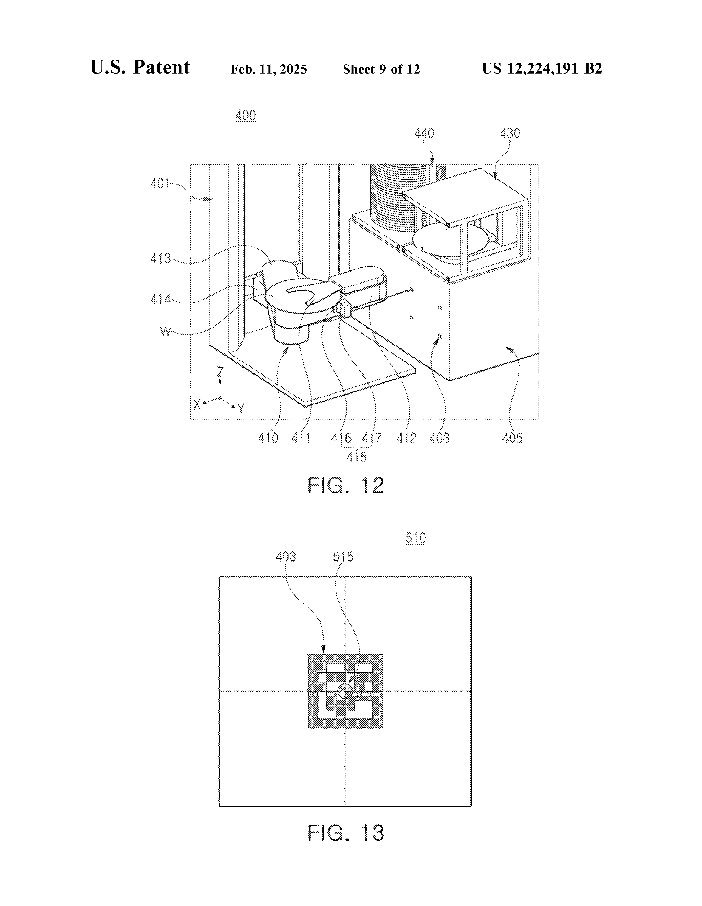
*도 12, 도 13 — 웨이퍼 이송 장치의 동작*

도 10 내지 도 13은 본 개시의 예시적 실시예에 따른 웨이퍼 이송 장치(400)의 일부 영역을 확대한 도면들이다. 먼저 도 10을 참조하면, 웨이퍼 이송 장치(400)는 웨이퍼 이송 로봇(410), 얼라이너(430), 및 버퍼(440)를 포함할 수 있다. 웨이퍼 이송 로봇(410)은 로봇 프레임(401)에 장착되어 수직인 Z축 방향으로 이동할 수 있다.

웨이퍼 이송 로봇(410)은 웨이퍼를 파지하는 핸드부(411), 구동부(예를 들어, 412 내지 414), 및 센서부(415)를 포함할 수 있다. 핸드부(411) 및 구동부(예를 들어, 412 내지 414)는 각각 그 사이의 관절에서 Z축 방향에 평행한 회전축을 기준으로 회전 운동할 수 있다. 핸드부(411)는 각 관절에서의 회전 운동에 의해 X축 및 Y축 방향으로 이동할 수 있으며, 웨이퍼는 얼라이너(430)와 버퍼(440) 사이에서 이송될 수 있다. 센서부(415)는 구동부(예를 들어, 412 내지 414) 중 하나에 부착될 수 있으며, 예를 들어 이미지를 촬영할 수 있는 카메라 센서(416), 및 레이저 광을 조사하여 특정 물체까지의 거리를 측정할 수 있는 레이저 센서(417)를 포함할 수 있다.

얼라이너(430) 및 버퍼(440)와 같은 이송 구조물들은 본체(405)에 장착될 수 있다. 본체(405)에는 복수의 기준 마커(403)가 부착될 수 있다. 웨이퍼 이송 로봇(410), 얼라이너(430), 및 버퍼(440)에 관한 위치 정보를 조정하기 위한 티칭 동작은, 웨이퍼 이송 장치(400)의 초기 동작 시 또는 웨이퍼 이송 장치(400)의 동작 중 소정 시간이 경과할 때마다 주기적으로 실행될 수 있다. 예를 들어, 티칭 동작은 별도의 티칭 스테이션을 사용하지 않고, 본체(405)의 내부 공간에 장착된 제어기에 의해 자동으로 실행될 수 있다.

티칭 동작에서, 제어기는 센서부(415)를 이용하여 본체(405)에 부착된 복수의 기준 마커(403) 각각에 관한 좌표 정보를 획득할 수 있으며, 본체(405)에 부착된 웨이퍼 이송 로봇(410)의 기준 위치를 결정하는 것으로 시작할 수 있다. 도 10 및 도 11에 도시된 바와 같이, 제어기는 센서부(415)에 장착된 카메라 센서(416)를 이용하여 복수의 기준 마커(403) 중 하나의 마커를 이미지(500)로 촬영할 수 있다. 도 11에 도시된 바와 같이, 웨이퍼 이송 로봇(410)의 위치 및 자세에 따라 기준 마커(403)가 이미지(500)의 중앙 영역에 표시되지 않을 수 있다.

기준 마커(403)가 이미지(500)의 중앙 영역에 표시되지 않는 경우, 제어기는 도 12에 도시된 바와 같이 웨이퍼 이송 로봇(410)을 이동시키면서 기준 마커(403)를 다시 촬영할 수 있다. 웨이퍼 이송 로봇(410)을 이동시킨 후 촬영된 이미지(510)의 중앙에 기준 마커(403)가 위치하면, 제어기는 이미지(510)를 이용하여 Z축 방향에서의 기준 마커(403)에 관한 제1 좌표 정보, 및 Y축 방향에서의 기준 마커(403)에 관한 제2 좌표 정보를 생성할 수 있다.

기준 마커(403)가 이미지(510)의 중앙 영역에 표시되면, 제어기는 웨이퍼 이송 로봇(410)의 위치 및 자세를 고정한 후, 레이저 센서(417)를 이용하여 기준 마커(403)에 레이저 광(515)을 조사할 수 있다. 도 13을 참조하면, 레이저 센서(417)로부터 조사된 레이저 광(515)은 기준 마커(403)의 중앙에 조사되어 반사되고, 레이저 센서(417)에 의해 다시 검출될 수 있다. 따라서, 제어기는 레이저 광을 반사시켜 레이저 센서(417)가 측정한 정보를 이용하여 센서부(415)로부터 기준 마커(403)까지의 거리 정보를 획득할 수 있다. 3차원 공간에서 이 거리 정보는 X축 방향에서의 기준 마커(403)에 관한 제3 좌표 정보에 대응할 수 있다.

이와 같이, 제어기는 카메라 센서(416) 및 레이저 센서(417)를 이용하여 3차원 공간에서 복수의 기준 마커(403) 각각의 위치를 나타내는 좌표 정보를 획득할 수 있다. 예시적 실시예에서, 제어기는 복수의 기준 마커(403) 각각에 대해 획득된 좌표 정보를 이용하여 3차원(3D) 변환 행렬을 생성할 수 있고, 이에 기초하여 웨이퍼 이송 로봇(410)의 기준 위치를 결정할 수 있다.

기준 위치가 결정되면, 제어기는 이송 구조물들 각각에 부착된 마커들을 인식하여, 이송 구조물들 사이에서 웨이퍼를 이동시키기 위한 이송 구조물들 각각에 관한 위치 정보를 획득할 수 있다. 이하, 도 14 내지 도 17을 참조하여 이를 설명한다.

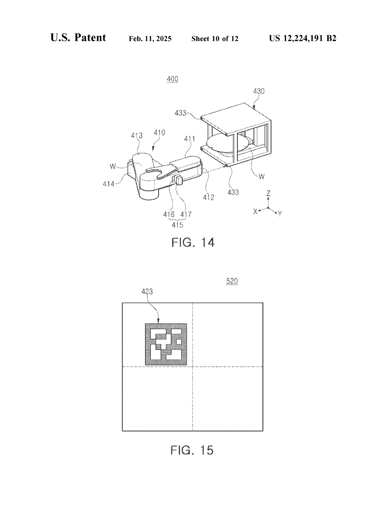
*도 14, 도 15 — 웨이퍼 이송 장치의 동작*

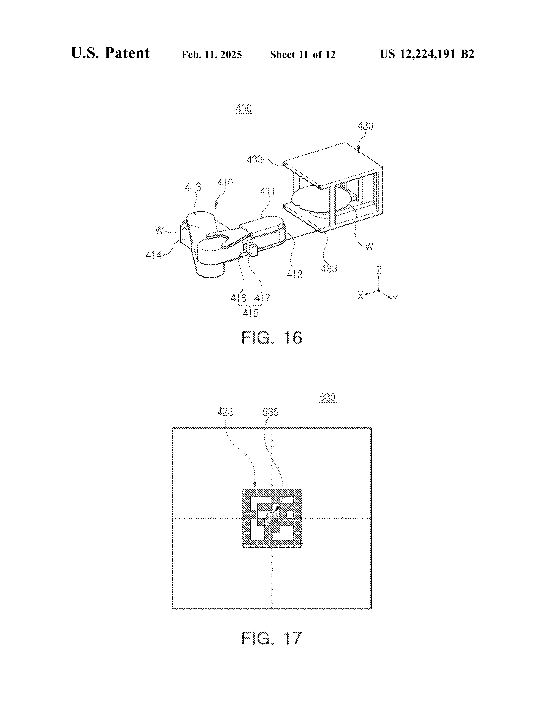
*도 16, 도 17 — 웨이퍼 이송 장치의 동작*

도 14, 도 15, 도 16 및 도 17은 본 개시의 예시적 실시예에 따른 웨이퍼 이송 장치의 동작을 나타내는 도면들이다.

도 14를 참조하면, 제어기는 얼라이너(430)에 부착된 복수의 마커(433)에 대한 좌표 정보를 얻기 위해 웨이퍼 이송 로봇(410)을 이동시킬 수 있다. 먼저, 제어기는 복수의 마커(433) 중 하나가 카메라 센서(416)가 출력하는 이미지에 표시될 때까지 웨이퍼 이송 로봇(410)의 위치 및 자세를 조정할 수 있다. 예시적 실시예에서, 얼라이너(430)에 부착된 복수의 마커(433)의 형상은 기준 마커(403)의 형상과 상이할 수 있다.

도 15를 참조하면, 카메라 센서(416)가 출력하는 이미지(520)에 마커(433)가 표시될 수 있다. 마커(433)가 이미지(520)의 중앙 영역에 표시되지 않는 경우, 제어기는 웨이퍼 이송 로봇(410)의 위치 및 자세를 재조정할 수 있다. 도 16에 도시된 바와 같이, 웨이퍼 이송 로봇(410)의 위치 및 자세가 다시 조정되면, 제어기는 카메라 센서(416)를 이용하여 마커(433)를 포함하는 이미지(530)를 다시 촬영할 수 있다.

도 17에 도시된 바와 같이, 카메라 센서(416)가 출력하는 이미지(530)의 중앙 영역에 마커(433)가 표시되도록 웨이퍼 이송 로봇(410)의 위치 및 자세가 보정되면, 제어기는 레이저 센서(417)를 이용하여 마커(433)의 중앙부에 레이저 광(535)을 조사할 수 있다. 마커(433)의 중앙부에 조사된 레이저 광(535)은 반사되어 레이저 센서(417)로 다시 입사될 수 있다. 제어기는 레이저 광(535)이 마커(433)에서 반사되어 돌아올 때까지 걸리는 시간을 이용하여 마커(433)까지의 거리를 측정할 수 있다.

앞서 도 10 내지 도 13을 참조하여 설명한 것과 유사하게, 제어기는 이미지(530)에 표시된 마커(433)의 위치를 참조하여 Z축 방향의 제1 좌표 정보 및 Y축 방향의 제2 좌표 정보를 획득할 수 있다. 또한, 제어기는 마커(433)까지의 거리에 기초하여 X축 방향의 제3 좌표 정보를 획득할 수 있다. 제어기는 얼라이너(430)에 부착된 복수의 마커(433) 각각에 대해 얻은 좌표 정보를 이용하여 3D 변환 행렬을 생성할 수 있고, 이에 기초하여 얼라이너(430)로 웨이퍼를 투입하거나 얼라이너(430)로부터 웨이퍼를 반출하기 위한 웨이퍼 이송 로봇(410)에 관한 위치 정보를 결정할 수 있다.

도 18 및 도 19는 본 개시의 예시적 실시예에 따른 웨이퍼 이송 장치의 동작을 나타내는 도면들이다.

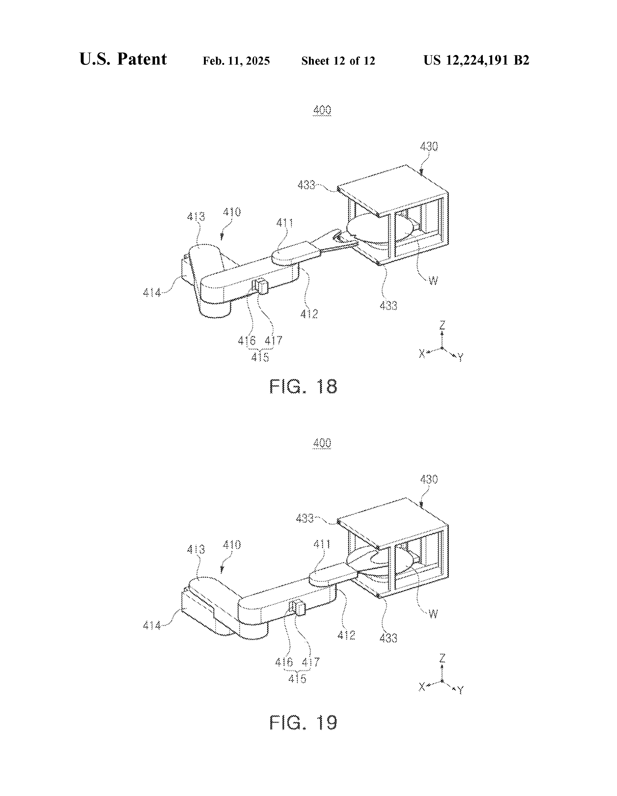
*도 18, 도 19 — 웨이퍼 이송 장치의 동작*

도 18 및 도 19를 참조하여 설명하는 웨이퍼 이송 장치(400)의 동작에서, 웨이퍼 이송 로봇(410)은 얼라이너(430)로부터 웨이퍼(W)를 반출할 수 있다. 앞서 설명한 바와 같이, 웨이퍼 이송 장치(400)의 제어기는 티칭 동작에서 얼라이너(430)에 부착된 복수의 마커(433)에 관한 좌표 정보를 획득할 수 있고, 이에 기초하여 얼라이너(430)로부터 웨이퍼를 반출하기 위한 웨이퍼 이송 로봇(410)에 관한 위치 정보를 생성할 수 있다.

도 18을 참조하면, 제어기는 티칭 동작에서 생성된 웨이퍼 이송 로봇(410)에 관한 위치 정보에 기초하여, 웨이퍼 이송 로봇(410)을 얼라이너(430)의 전면에 위치시킬 수 있다. 이후, 도 19에 도시된 바와 같이, 웨이퍼 이송 로봇(410)의 핸드부(411)는 얼라이너(430)에 보관된 웨이퍼(W)를 파지하기 위해 이송 방향일 수 있는 X축 방향으로 이동할 수 있다.

제어기가 웨이퍼(W)를 파지하기 위해 핸드부(411)를 이동시키는 거리는 얼라이너(430)에 관한 치수 정보에 따라 결정될 수 있다. 예를 들어, 제어기는 얼라이너(430)에 관한 치수 정보, 및 티칭 동작에서 결정된 얼라이너(430)에 대한 웨이퍼 이송 로봇(410)의 위치 정보를 이용하여, 핸드부(411)를 이동시키고 웨이퍼(W)를 파지할 수 있다. 얼라이너(430)에 관한 치수 정보는 복수의 마커(433)가 부착된 평면으로부터 얼라이너(430)에 수용된 웨이퍼(W)의 중심까지의 거리 정보를 포함할 수 있다.

제어기는 앞서 완료된 티칭 동작에서 얼라이너(430)에 대한 웨이퍼 이송 로봇(410)의 위치 정보를 결정할 수 있다. 제어기는, 얼라이너(430)에 보관된 웨이퍼(W)를 반출하거나 얼라이너(430)로 웨이퍼(W)를 투입하기 위해, 웨이퍼(W)가 이송되어야 하는 방향으로, 복수의 마커(433)가 부착된 평면과 얼라이너(430)에 보관된 웨이퍼(W)의 중심 위치 사이의 거리일 수 있는 이송 거리만큼 웨이퍼 이송 로봇(410)의 핸드부(411)를 이동시킬 수 있다.

본 개시의 예시적 실시예에 따르면, FOUP, 얼라이너, 및 로드락 챔버를 포함하는 이송 구조물들에 관한 위치 정보가 웨이퍼 이송 로봇에 부착된 센서부에 의해 획득될 수 있고, 웨이퍼 이송 로봇은 위치 정보에 기초하여 웨이퍼를 이송하도록 제어될 수 있다. 따라서, 이송 구조물들에 관한 위치 정보를 갱신하는 티칭 동작이 작업자의 개입 없이 자동으로 완료될 수 있으므로, 작업자의 숙련도와 관계없이 웨이퍼 이송 장치가 운용될 수 있고, 웨이퍼 이송의 정확도가 향상될 수 있으며, 반도체 공정의 효율이 향상될 수 있다. 또한, 별도의 티칭 스테이션 없이 웨이퍼 이송 로봇에 부착된 센서부와 이송 구조물들에 부착된 마커들만으로 구현될 수 있으므로, 비용을 크게 증가시키지 않으면서 웨이퍼 이송 장치의 티칭 동작을 자동화할 수 있다. 종래기술과 달리, 이송 구조물의 형상에 제한이 없고, 작업자가 웨이퍼 또는 티칭 지그를 이송 구조물의 정확한 위치에 세팅하는 것과 같은 일련의 수작업을 필요로 하지 않으므로, 웨이퍼 이송 장치의 티칭 동작이 완전히 자동화될 수 있다.

지금까지 다양한 예시적 실시예들은, 도면에 도시된 바와 같이 설명된 기능 또는 기능들을 수행하는 블록들의 관점에서 설명 및 도시되었다. 본 명세서에서 유닛, 모듈 등으로 지칭될 수 있는 이러한 블록들은 논리 게이트, 집적 회로, 마이크로프로세서, 마이크로컨트롤러, 메모리 회로, 수동 전자 부품, 능동 전자 부품, 광학 부품, 하드와이어드 회로 등과 같은 아날로그 및/또는 디지털 회로에 의해 물리적으로 구현될 수 있으며, 펌웨어 및 소프트웨어에 의해 구동될 수 있다. 회로들은 예를 들어 하나 이상의 반도체 칩에, 또는 인쇄 회로 기판 등과 같은 기판 지지체 상에 구현될 수 있다. 블록에 포함되는 회로들은 전용 하드웨어에 의해, 또는 프로세서(예를 들어, 하나 이상의 프로그래밍된 마이크로프로세서 및 관련 회로)에 의해, 또는 블록의 일부 기능을 수행하는 전용 하드웨어와 블록의 다른 기능을 수행하는 프로세서의 조합에 의해 구현될 수 있다. 실시예들의 각 블록은 물리적으로 상호 작용하는 둘 이상의 개별 블록으로 분리될 수 있다. 마찬가지로, 실시예들의 블록들은 물리적으로 더 복잡한 블록으로 결합될 수 있다.

본 개시의 다양한 이점 및 효과는 상술한 것에 한정되지 않으며, 본 개시의 구체적인 실시예들을 설명하는 과정에서 보다 쉽게 이해될 것이다.

상기 설명에서 제공된 실시예들 각각은, 본 명세서에서 함께 제공되거나 제공되지 않았으나 본 개시와 부합하는 다른 예 또는 다른 실시예의 하나 이상의 특징과 결부되는 것이 배제되지 않는다.

이상에서 예시적 실시예들을 도시하고 설명하였으나, 첨부된 청구범위에 의해 정의되는 본 개시의 범위를 벗어나지 않고 수정 및 변형이 이루어질 수 있음은 당업자에게 명백할 것이다.
