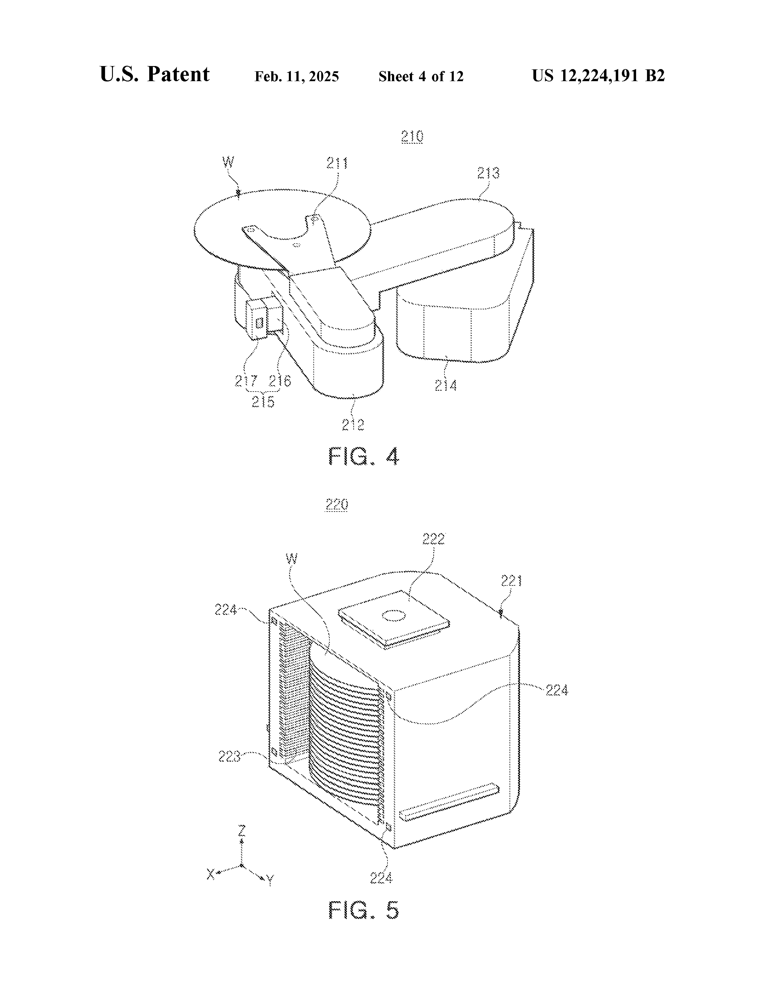
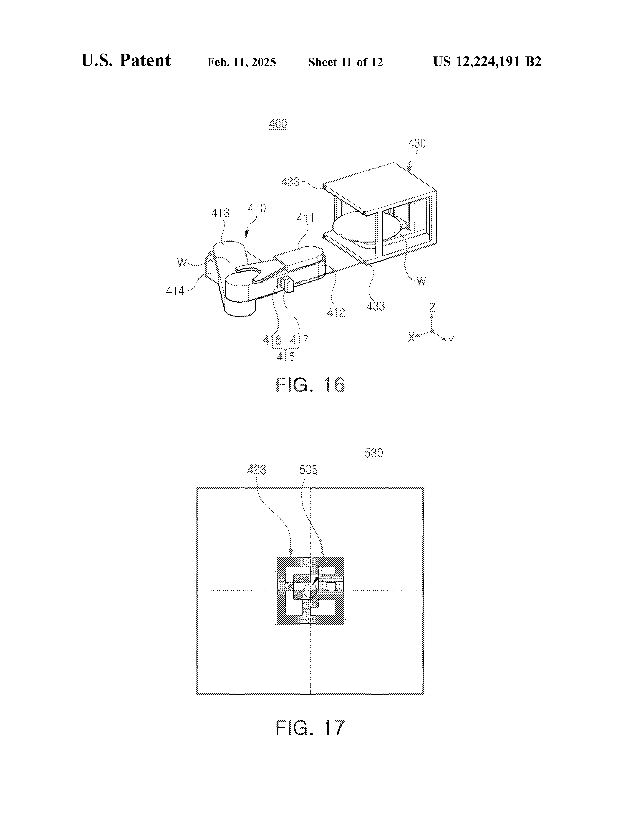

# US12224191B2 — 얼라이너를 가진 웨이퍼 이송 장치 (Samsung)

| 항목 | 내용 |
|---|---|
| 원문 | `US12224191.pdf`(등록, 2025-02-11) · `US20240021452.pdf`(공개, 2024-01-18) |
| 출원인 | Samsung Electronics |
| 우선일 | 2022-07-12 |
| 핵심 | 핸드에 바로 붙은 링크 암의 카메라로 본체·FOUP·얼라이너·버퍼·로드락에 붙인 2D 마커(QR, ArUco, 도형)를 영상 중앙에 맞추고, 레이저 거리와 합쳐 구조물 위치를 구한다. 티칭 스테이션 없이 티칭을 자동화한다. |
| 관련도 | ◎ 방식이 거의 같음 |
| 본 과제와의 관계 | 카메라 위치와 마커 종류가 가장 비슷하다. 자세(attitude)는 마커 3개 이상의 좌표로 만든 3D 변환 행렬로 구한다고만 하고, 회전각 계산식은 없다. |
| 링크 | [Google Patents](https://patents.google.com/patent/US12224191B2/en) |

---

## 상세 요약 (번역본 기준)

### 1. 해결하려는 문제
- 공정 전 또는 주기마다 로봇·이송 구조물(FOUP, 얼라이너, 버퍼, 로드락) 위치를 정의하는 티칭 동작이 필요함.
- 종래 티칭은 수작업 또는 별도 티칭 스테이션 사용 → 작업자 숙련도에 따라 소요 시간·정확도 편차 발생.
- 별도 티칭 스테이션은 장치 제조 비용 증가 요인.
- 종래에는 작업자가 웨이퍼나 티칭 지그를 구조물의 정확한 위치에 세팅하는 수작업이 필요했고, 구조물 형상에도 제한이 있었음.

### 2. 핵심 구성
| 구성 | 부호 | 위치·역할 |
|---|---|---|
| 웨이퍼 이송 로봇 | 210 / 410 | 로봇 프레임(201/401) 레일 따라 Z축 이동, SCARA 예시(직교·다관절도 가능) |
| 핸드부 | 211 / 411 | 핑거 2개 이상, 진공 흡착구 |
| 구동부 | 212~214 / 412~414 | 제1 링크 암부(212, 핸드에 직결), 제2 링크 암부(213), 베이스부(214) |
| 센서부 | 215 / 415 | 핸드에 최대한 가깝게, 제1 링크 암부(212)에 장착 |
| 카메라 센서 | 216 / 416 | 마커 이미지 촬영 → Y·Z 좌표 |
| 레이저 센서 | 217 / 417 | 마커 중앙에 레이저 조사, 반사 시간으로 거리 → X 좌표 |
| 기준 마커 | 403 | 본체(405)에 부착, 로봇 기준 위치(원점) 결정용 |
| 구조물 마커 | 224, 233, 243 | FOUP(220)·얼라이너(230)·버퍼(240) 전면(Y–Z 평면, 이송 방향에 수직)에 3개 이상 |
| 챔버 마커 | 340 | 로드락 챔버(300) 웨이퍼 출입구(330) 인접 |
| 제어기 | 130 | 본체(205/405) 내부 공간에 장착, 티칭 자동 실행 |

- 마커 종류: 2차원 평면 마커 — QR 코드, ArUco 마커, 특정 형상 도형.
- 구조물마다 마커 형상을 다르게 하여 FOUP·얼라이너·버퍼를 서로 구별(도 5~7).
- 제어기는 마커별 형상·치수 정보를 미리 저장.

### 3. 동작 순서 (도 9)
1. S10: 본체 기준 마커 인식. 카메라 이미지의 정중앙에 마커가 오도록 로봇 위치·자세 조정(도 10~12, 이미지 500 → 510).
2. S20: 로봇 위치·자세 고정 후 레이저 광(515)을 마커 중앙에 조사해 거리 획득(도 13).
   - 이미지 중앙 마커 위치 → Z축 제1 좌표, Y축 제2 좌표.
   - 레이저 거리 → X축 제3 좌표.
   - 마커 개수만큼 S10·S20 반복.
3. S30: 기준 마커들의 3D 좌표로 3D 변환 행렬 생성 → 로봇 기준 위치(본체에 대한 원점 좌표) 결정.
4. S40: 이송 구조물 하나를 골라 그 마커가 이미지 중앙에 오도록 로봇 위치·자세 조정(도 14~16, 이미지 520 → 530).
5. S50: 레이저 광(535)을 마커(433) 중앙부에 조사, 반사 왕복 시간으로 거리 측정(도 17).
   - 구조물의 마커마다, 구조물마다 S40·S50 반복.
   - 마커별 좌표로 3D 변환 행렬 생성 → 구조물에 대한 로봇 위치·자세 결정.
6. 티칭 종료 후 S60: 공정 중 로봇 제어. 기준 위치를 오프셋으로 사용 — 구조물 위치 좌표에서 기준 위치를 빼는 방식.
7. 웨이퍼 반출·투입(도 18, 19): 구조물 전면에 로봇 위치 → 핸드부(411)를 X축(이송 방향)으로 "이송 거리"만큼 이동.
   - 이송 거리 = 마커 부착 평면 ~ 수용된 웨이퍼 중심 사이 거리(구조물 치수 정보).
- 선택 검증: 더미 웨이퍼를 실제로 이송한 뒤 손상 여부로 위치 정보·기준 위치 정확성 확인.
- 실행 시점: 장치 초기 동작 시 또는 소정 시간마다 주기적으로.

### 4. 청구항 요지
- 청구항 1: 핸드부·구동부(링크 암부+베이스부)·센서부를 갖는 로봇, 마커 붙은 복수 이송 구조물, 카메라(마커 인식)+레이저(마커까지 거리) 센서부, 마커 위치·거리로 구조물 위치 정보 획득 후 로봇 제어하는 제어기. 베이스부는 웨이퍼 적층 방향으로 이동.
- 청구항 12: FOUP 본체, 제1 로봇, 로드락으로 갈 웨이퍼를 받는 얼라이너. 제1 센서부로 본체·FOUP·얼라이너·로드락 웨이퍼 투입구의 마커를 인식해 위치 정보 획득 후 이송.
- 청구항 19: 구조물 마커와 다른 본체 기준 마커. 티칭에서 카메라로 기준 마커 좌표 → 로봇 기준·상대 위치 결정, 구조물 마커 좌표 → 구조물별 로봇 위치 및 자세(attitude) 결정. (레이저는 필수 아님)
- 주요 종속항
  - 2·14: 마커 3개 이상. 3: 마커까지 거리를 순차 측정.
  - 4: 로봇을 움직여 마커를 이미지 중앙 영역에 두고 레이저를 마커 중앙부에 조사.
  - 5·6: 마커는 한 평면 위, 이송 방향에 수직한 평면.
  - 7·8: 마커 평면 위치 + 이송 거리(웨이퍼 중심~마커 평면)로 로봇 제어.
  - 9: QR 코드 및/또는 ArUco 마커.
  - 11: 본체 기준 마커로 로봇 기준 위치 결정.
  - 16: 센서부는 핸드에 연결된 제1 구동부에 장착.
  - 18: 제2 로봇(이송 챔버)도 로드락·공정 챔버 투입구의 챔버 마커를 인식.

### 5. 대표 도면

*도 4 — 링크 암부(212)에 붙은 센서부(215: 카메라 216, 레이저 217), 도 5 — FOUP 전면의 마커(224)*

*도 16, 도 17 — 마커(433)를 이미지(530) 중앙에 맞춘 뒤 레이저 광(535)으로 거리 측정*

### 6. 본 과제(Y·Θ 얼라인먼트)와 비교
- 같은 점:
  - 로봇 암(핸드 인접 링크)에 카메라 장착, QR·ArUco 계열 2D 마커 촬영.
  - 마커 인식 결과로 로봇의 위치 보정값을 만들어 이송 정확도 확보.
  - 작업자 수작업·전용 지그 없이 자동 보정 지향.
- 다른 점:
  - 목적이 오프라인 티칭(초기·주기 실행)이며 실시간 보정이 아님.
  - 3축 위치(X·Y·Z) + 자세를 다룸. X(깊이)는 레이저 센서로 측정, 우리는 카메라만으로 Y·Θ.
  - 마커를 영상 중앙에 오도록 로봇을 반복 이동(시각 서보 방식) — 영상 내 오프셋을 직접 보정값으로 환산하는 계산식은 없음.
  - 회전(자세)은 마커 3개 이상의 좌표로 만든 3D 변환 행렬에서 구한다고만 기재, 각도 계산식·허용 오차 수치 없음.
- 참고할 점:
  - 기준 마커(본체 고정)와 대상 마커(구조물)를 나눈 2단계 측정: 먼저 기준 위치(원점) 결정 → 대상 좌표에서 기준을 빼 오프셋 보정(S30, S60).
  - 마커 3개 이상을 한 평면(이송 방향에 수직)에 두고 점들로 강체 변환 추정 → 우리도 다중 마커/코너 기반 Θ 추정 시 참고.
  - 구조물별로 마커 형상을 달리해 대상 식별 — 마커 ID로 스테이션 구분 가능.
  - 마커 형상·치수를 미리 저장해 측정값과 결합 → 마커 실치수 기반 픽셀–mm 환산 근거.
  - 검증 단계(더미 웨이퍼 이송) 아이디어 — 보정 결과 검증 시나리오로 활용 가능.
