# 기판 처리 장치 및 이를 이용한 기판 처리 방법 (US12283510B2)

- 원제: Substrate treating apparatus and substrate treating method using the same
- 원문: 같은 폴더의 PDF, https://patents.google.com/patent/US12283510B2/en
- 번역 기준: Google Patents 원문 텍스트를 한국어로 옮김. 도면은 PDF 참조.
- 도면: 원문 PDF 도면 시트 12장을 도면/ 폴더에 넣고 본문에서 처음 언급되는 곳에 삽입함

## 요약

본 개시는 효율 및 생산성이 향상된 기판 처리 장치를 제공한다. 본 개시의 기판 처리 장치는, 내부에 처리 공간을 갖는 공정 챔버(process chamber), 처리 공간으로 기판을 로딩 및 언로딩하고 기판을 파지하는 로봇 핸드(robot hand)를 포함하는 이송 로봇(transfer robot), 및 로봇 핸드를 정렬하기 위한 티칭 버퍼(teaching buffer)를 포함하되, 티칭 버퍼는 기준점(reference point)을 제공하는 티칭 플레이트(teaching plate)와, 티칭 플레이트를 바라보는 적어도 하나의 카메라를 포함하고, 카메라는 티칭 플레이트의 기준점을 촬영하며, 이송 로봇은 카메라를 이용하여 로봇 핸드를 기준점에 정렬한다.

## 청구범위

청구하는 바는 다음과 같다.

1. 기판을 처리하는 장치로서,

내부에 처리 공간을 갖는 공정 챔버;

처리 공간으로 기판을 로딩 및 언로딩하고 기판을 파지하는 로봇 핸드를 포함하는 이송 로봇; 및

로봇 핸드를 정렬하기 위한 티칭 버퍼를 포함하되,

티칭 버퍼는 기준점을 제공하는 티칭 플레이트와, 티칭 플레이트를 바라보는 적어도 하나의 카메라를 포함하고,

카메라는 티칭 플레이트의 기준점을 촬영하며,

이송 로봇은 카메라를 이용하여 로봇 핸드를 기준점과 티칭 플레이트에 수직인 동일 선상에 정렬하고,

기준점은 제1 위치에서 촬영되고, 로봇 핸드는 상기 제1 위치에서 정렬되는, 장치.

2. 제1항에 있어서, 로봇 핸드는 로봇 핸드의 말단(distal end)에 배치된 얼라인 마크(alignment mark)를 포함하고,

티칭 버퍼는 얼라인 마크를 기준점과 비교하여 로봇 핸드를 정렬하는, 장치.

3. 제2항에 있어서, 얼라인 마크는 기판의 중심점과 정렬되는, 장치.

4. 제1항에 있어서, 티칭 플레이트와 카메라 사이의 거리는 로봇 핸드와 카메라 사이의 거리와 동일한, 장치.

5. 제1항에 있어서, 카메라는 프리즘 방식(prism method)을 포함하는, 장치.

6. 제1항에 있어서, 카메라는 서로 이격된 제1 카메라 및 제2 카메라를 포함하는, 장치.

7. 제6항에 있어서, 기준점은 서로 이격된 제1 기준점 및 제2 기준점을 포함하고,

제1 카메라는 제1 기준점을 촬영하고, 제2 카메라는 제2 기준점을 촬영하는, 장치.

8. 제7항에 있어서, 로봇 핸드는 서로 이격된 제1 핸드 및 제2 핸드를 포함하고,

제1 핸드는 제1 기준점과 정렬되고 제2 핸드는 제2 기준점과 정렬되는, 장치.

9. 기판을 처리하는 장치로서,

내부에 처리 공간을 갖는 공정 챔버;

처리 공간으로 기판을 로딩 및 언로딩하고 기판을 파지하는 제1 핸드 및 제2 핸드를 포함하는 이송 로봇; 및

제1 핸드 및 제2 핸드를 정렬하기 위한 티칭 버퍼를 포함하되,

티칭 버퍼는 제1 기준점 및 제2 기준점을 제공하는 티칭 플레이트, 제1 기준점을 촬영하는 제1 카메라, 및 제2 기준점을 촬영하는 제2 카메라를 포함하고,

이송 로봇은, 티칭 플레이트의 제1 및 제2 기준점과 이송 로봇의 제1 및 제2 핸드가 각각 티칭 플레이트에 수직인 동일 선상에 정렬되도록, 제1 기준점을 이용하여 제1 핸드를 정렬하고 제2 기준점을 이용하여 제2 핸드를 정렬하는, 장치.

10. 제9항에 있어서, 제1 핸드는 제1 핸드의 말단에 배치된 제1 얼라인 마크를 포함하고,

제1 핸드는 제1 얼라인 마크를 제1 기준점과 비교함으로써 정렬되는, 장치.

11. 제9항에 있어서, 제1 카메라와 제1 기준점 사이의 거리는 제1 핸드와 제1 카메라 사이의 거리와 동일하고,

제2 카메라와 제2 기준점 사이의 거리는 제2 카메라와 제2 핸드 사이의 거리와 동일한, 장치.

12. 제9항에 있어서, 제1 및 제2 기준점이 촬영되는 제1 수직 위치와, 제1 및 제2 핸드가 정렬되는 제2 수직 위치는 서로 동일한, 장치.

13. 제9항에 있어서, 카메라는 프리즘 방식을 포함하는, 장치.

14. 기판을 처리하는 방법으로서,

기준점을 포함하는 티칭 플레이트를 티칭 버퍼에 로딩하는 단계;

티칭 플레이트의 상부에 배치된 카메라를 이용하여 기준점을 촬영하는 단계;

얼라인 마크를 포함하는 로봇 핸드를 티칭 버퍼에 로딩하는 단계; 및

티칭 플레이트의 기준점과 로봇 핸드의 얼라인 마크가 티칭 플레이트에 수직인 동일 선상에 정렬되도록, 기준점과 얼라인 마크를 비교하여 로봇 핸드를 정렬하는 단계를 포함하되,

로봇 핸드는 기판을 파지하여 공정 챔버로 기판을 로딩 및 언로딩하고,

티칭 플레이트가 로딩되는 위치와 로봇 핸드가 로딩되는 위치는 서로 동일한, 방법.

15. 제14항에 있어서, 얼라인 마크는 기판의 중심점과 정렬되는, 방법.

16. 제14항에 있어서, 카메라는 서로 이격된 제1 카메라 및 제2 카메라를 포함하고,

기준점은 서로 이격된 제1 기준점 및 제2 기준점을 포함하며,

제1 카메라는 제1 기준점을 촬영하고, 제2 카메라는 제2 기준점을 촬영하는, 방법.

17. 제16항에 있어서, 로봇 핸드는 서로 이격된 제1 핸드 및 제2 핸드를 포함하고,

제1 핸드는 제1 기준점과 정렬되고 제2 핸드는 제2 기준점과 정렬되는, 방법.

18. 제14항에 있어서, 카메라는 프리즘 방식을 포함하는, 방법.

## 상세한 설명

본 출원은 2021년 11월 23일 대한민국 특허청에 출원된 대한민국 특허출원 제10-2021-0162028호의 우선권을 주장하며, 그 개시 내용 전체는 본 명세서에 참조로 통합된다.

### 배경기술 (BACKGROUND)

#### 1. 기술분야 (Field)

본 개시는 기판 처리 장치 및 이를 이용한 기판 처리 방법에 관한 것이다.

#### 2. 관련 기술의 설명 (Description of the Related Art)

반도체 소자를 제조하기 위해, 기판 상에 원하는 패턴을 형성하도록 사진(photolithography), 식각(etching), 애싱(ashing), 이온 주입(ion implantation), 박막 증착(thin film deposition), 세정(cleaning) 등 다양한 공정을 통해 기판을 처리한다.

위 공정을 수행하기 위해서는 기판이 각 공정 챔버로 이송되어야 한다. 구체적으로, 기판을 이송할 수 있는 이송 로봇이 기판을 각 챔버로 이송한다. 이때 기판을 원하는 위치로 정밀하게 옮기려면 이송 로봇이 정렬되어 있어야 한다. 육안으로 로봇 핸드를 제어하고 정렬하는 것은 시간이 많이 소요될 수 있다.

### 발명의 내용 (SUMMARY)

본 개시가 해결하고자 하는 기술적 과제는 효율 및 생산성이 향상된 기판 처리 장치를 제공하는 것이다.

본 개시가 해결하고자 하는 다른 기술적 과제는 효율 및 생산성이 향상된 기판 처리 방법을 제공하는 것이다.

본 개시의 과제들은 이상에서 언급한 과제들로 제한되지 않으며, 언급되지 않은 또 다른 과제들은 아래의 기재로부터 당업자에게 명확하게 이해될 수 있을 것이다.

상기 기술적 과제를 달성하기 위한 본 개시의 일 측면에 따른 기판 처리 장치는, 내부에 처리 공간을 갖는 공정 챔버, 처리 공간으로 기판을 로딩 및 언로딩하고 기판을 파지하는 로봇 핸드를 포함하는 이송 로봇, 및 로봇 핸드를 정렬하기 위한 티칭 버퍼를 포함하되, 티칭 버퍼는 기준점을 제공하는 티칭 플레이트와, 티칭 플레이트를 바라보는 적어도 하나의 카메라를 포함하고, 카메라는 티칭 플레이트의 기준점을 촬영하며, 이송 로봇은 카메라를 이용하여 로봇 핸드를 기준점에 정렬한다.

일부 실시예에서, 로봇 핸드는 로봇 핸드의 말단에 배치된 얼라인 마크를 포함하고, 티칭 버퍼는 얼라인 마크를 기준점과 비교하여 로봇 핸드를 정렬한다.

일부 실시예에서, 얼라인 마크는 기판의 중심점과 정렬된다.

일부 실시예에서, 기준점은 제1 위치에서 촬영되고, 로봇 핸드는 상기 제1 위치에서 정렬된다.

일부 실시예에서, 티칭 플레이트와 카메라 사이의 높이는 로봇 핸드와 카메라 사이의 높이와 동일하다.

일부 실시예에서, 카메라는 프리즘 방식을 포함한다.

일부 실시예에서, 카메라는 서로 이격된 제1 카메라 및 제2 카메라를 포함한다.

일부 실시예에서, 기준점은 서로 이격된 제1 기준점 및 제2 기준점을 포함하고, 제1 카메라는 제1 기준점을 촬영하고, 제2 카메라는 제2 기준점을 촬영한다.

일부 실시예에서, 로봇 핸드는 서로 이격된 제1 핸드 및 제2 핸드를 포함하고, 제1 핸드는 제1 기준점과 정렬되고 제2 핸드는 제2 기준점과 정렬된다.

상기 기술적 과제를 달성하기 위한 본 개시의 다른 측면에 따른 기판 처리 장치는, 내부에 처리 공간을 갖는 공정 챔버, 처리 공간으로 기판을 로딩 및 언로딩하고 기판을 파지하는 로봇 핸드를 포함하는 이송 로봇, 및 제1 핸드 및 제2 핸드를 정렬하기 위한 티칭 버퍼를 포함하되, 티칭 버퍼는 제1 기준점 및 제2 기준점을 제공하는 티칭 플레이트, 제1 기준점을 촬영하는 제1 카메라, 및 제2 기준점을 촬영하는 제2 카메라를 포함하고, 이송 로봇은 제1 기준점을 이용하여 제1 핸드를 정렬하고 제2 기준점을 이용하여 제2 핸드를 정렬한다.

일부 실시예에서, 제1 핸드는 제1 핸드의 말단에 배치된 제1 얼라인 마크를 포함하고, 제1 핸드는 제1 얼라인 마크를 제1 기준점과 비교함으로써 정렬된다.

일부 실시예에서, 제1 카메라와 제1 기준점 사이의 높이는 제1 핸드와 제1 카메라 사이의 높이와 동일하고, 제2 카메라와 제2 기준점 사이의 높이는 제2 카메라와 제2 핸드 사이의 높이와 동일하다.

일부 실시예에서, 제1 및 제2 기준점이 촬영되는 제1 수직 위치와, 제1 및 제2 핸드가 정렬되는 제2 수직 위치는 서로 동일하다.

일부 실시예에서, 카메라는 프리즘 방식을 포함한다.

상기 기술적 과제를 달성하기 위한 본 개시의 일 측면에 따른 기판 처리 방법은, 기준점을 포함하는 티칭 플레이트를 티칭 버퍼에 로딩하는 단계, 티칭 플레이트의 상부에 배치된 카메라를 이용하여 기준점을 촬영하는 단계, 얼라인 마크를 포함하는 로봇 핸드를 티칭 버퍼에 로딩하는 단계, 및 기준점과 얼라인 마크를 비교하여 로봇 핸드를 정렬하는 단계를 포함하되, 로봇 핸드는 기판을 파지하여 공정 챔버로 기판을 로딩 및 언로딩한다.

일부 실시예에서, 얼라인 마크는 기판의 중심점과 정렬된다.

일부 실시예에서, 티칭 플레이트가 로딩되는 위치와 로봇 핸드가 로딩되는 위치는 서로 동일하다.

일부 실시예에서, 카메라는 서로 이격된 제1 카메라 및 제2 카메라를 포함하고, 기준점은 서로 이격된 제1 기준점 및 제2 기준점을 포함하며, 제1 카메라는 제1 기준점을 촬영하고, 제2 카메라는 제2 기준점을 촬영한다.

일부 실시예에서, 로봇 핸드는 서로 이격된 제1 핸드 및 제2 핸드를 포함하고, 제1 핸드는 제1 기준점과 정렬되고 제2 핸드는 제2 기준점과 정렬된다.

일부 실시예에서, 카메라는 프리즘 방식을 포함한다.

기타 실시예들의 구체적인 사항들은 상세한 설명 및 도면들에 포함되어 있다.

### 도면의 간단한 설명 (BRIEF DESCRIPTION OF THE DRAWINGS)

이들 및/또는 다른 측면들은 첨부된 도면과 함께 다음의 실시예 설명으로부터 명백해지고 보다 쉽게 이해될 것이다.

도 1은 본 개시의 일부 실시예에 따른 기판 처리 장치를 개략적으로 도시한 평면도이다.

도 2는 도 1의 티칭 버퍼를 설명하기 위한 예시적인 도면이다.

도 3은 도 2의 티칭 플레이트를 설명하기 위한 예시적인 평면도이다.

도 4는 도 1의 작업 로봇(work robot)을 설명하기 위한 예시적인 도면이다.

도 5는 일부 실시예에 따른 기판 처리 방법을 설명하기 위한 예시적인 순서도이다.

도 6은 도 5의 단계 S100을 설명하기 위한 도면이다.

도 7 및 도 8은 도 5의 단계 S200을 설명하기 위한 도면이다.

도 9는 도 5의 단계 S300을 설명하기 위한 도면이다.

도 10은 도 5의 단계 S400을 설명하기 위한 도면이다.

도 11 및 도 12는 도 5의 단계 S500을 설명하기 위한 도면이다.

### 발명을 실시하기 위한 구체적인 내용 (DETAILED DESCRIPTION)

이하, 첨부된 도면을 참조하여 본 개시의 바람직한 실시예들을 상세히 설명한다. 본 개시의 이점 및 특징, 그리고 그것들을 달성하는 방법은 첨부되는 도면과 함께 상세하게 후술되어 있는 실시예들을 참조하면 명확해질 것이다. 그러나 본 개시는 이하에서 개시되는 실시예들에 한정되는 것이 아니라 서로 다른 다양한 형태로 구현될 수 있으며, 단지 본 실시예들은 본 개시의 설명이 완전하도록 하고, 본 개시가 속하는 기술분야에서 통상의 지식을 가진 자에게 본 개시의 범주를 완전하게 알려주기 위해 제공되는 것이며, 본 개시는 청구항의 범주에 의해 정의될 뿐이다. 명세서 전체에 걸쳐 동일 참조 부호는 동일 구성 요소를 지칭한다.

소자(element) 또는 층이 다른 소자 또는 층의 "위(on)"에 위치한다고 지칭되는 것은 다른 소자 또는 층의 바로 위에 위치하는 경우뿐만 아니라 중간에 다른 층 또는 다른 소자가 개재된 경우를 모두 포함한다. 반면, 소자가 "직접 위(directly on)" 또는 "바로 위(immediately on)"로 지칭되는 것은 중간에 다른 소자 또는 층이 개재되지 않은 것을 나타낸다.

공간적으로 상대적인 용어인 "아래(below)", "아래(beneath)", "하부(lower)", "위(above)", "상부(upper)" 등은 하나의 소자 또는 구성 요소들과 다른 소자 또는 구성 요소들과의 상관관계를 용이하게 기술하기 위해 사용될 수 있다. 공간적으로 상대적인 용어는 도면에 도시되어 있는 방향에 더하여 사용 시 또는 동작 시 소자의 서로 다른 방향을 포함하는 용어로 이해되어야 한다. 예를 들면, 도면에 도시되어 있는 소자를 뒤집을 경우, 다른 소자의 "아래(below)" 또는 "아래(beneath)"로 기술된 소자는 다른 소자의 "위(above)"에 놓여질 수 있다. 따라서, 예시적인 용어인 "아래"는 아래와 위의 방향을 모두 포함할 수 있다. 소자는 다른 방향으로도 배향될 수 있고, 이에 따라 공간적으로 상대적인 용어들은 배향에 따라 해석될 수 있다.

비록 제1, 제2 등이 다양한 소자, 구성 요소 및/또는 섹션들을 서술하기 위해서 사용되나, 이들 소자, 구성 요소 및/또는 섹션들은 이들 용어에 의해 제한되지 않음은 물론이다. 이들 용어들은 단지 하나의 소자, 구성 요소 또는 섹션들을 다른 소자, 구성 요소 또는 섹션들과 구별하기 위하여 사용하는 것이다. 따라서, 이하에서 언급되는 제1 소자, 제1 구성 요소 또는 제1 섹션은 본 개시의 기술적 사상 내에서 제2 소자, 제2 구성 요소 또는 제2 섹션일 수도 있음은 물론이다.

본 명세서에서 사용된 용어는 실시예들을 설명하기 위한 것이며 본 개시를 제한하고자 하는 것은 아니다. 본 명세서에서, 단수형은 문구에서 특별히 언급하지 않는 한 복수형도 포함한다. 명세서에서 사용되는 "포함한다(comprises)" 및/또는 "포함하는(comprising)"은 언급된 구성 요소, 단계, 동작 및/또는 소자가 하나 이상의 다른 구성 요소, 단계, 동작 및/또는 소자의 존재 또는 추가를 배제하지 않는다.

다른 정의가 없다면, 본 명세서에서 사용되는 모든 용어(기술 및 과학적 용어를 포함)는 본 발명이 속하는 기술분야에서 통상의 지식을 가진 자에게 공통적으로 이해될 수 있는 의미로 사용될 수 있을 것이다. 또한, 일반적으로 사용되는 사전에 정의되어 있는 용어들은 명백하게 특별히 정의되어 있지 않는 한 이상적으로 또는 과도하게 해석되지 않는다.

이하, 첨부한 도면들을 참조하여 본 개시의 실시예들을 상세히 설명하기로 하며, 첨부 도면을 참조하여 설명함에 있어 도면 부호에 상관없이 동일하거나 대응하는 구성 요소는 동일한 참조 번호를 부여하고 이에 대한 중복되는 설명은 생략하기로 한다.

이하, 도 1 내지 도 4를 참조하여 본 개시의 일부 실시예에 따른 기판 처리 장치를 설명한다.

도 1은 본 개시의 일부 실시예에 따른 기판 처리 장치를 개략적으로 도시한 평면도이다.

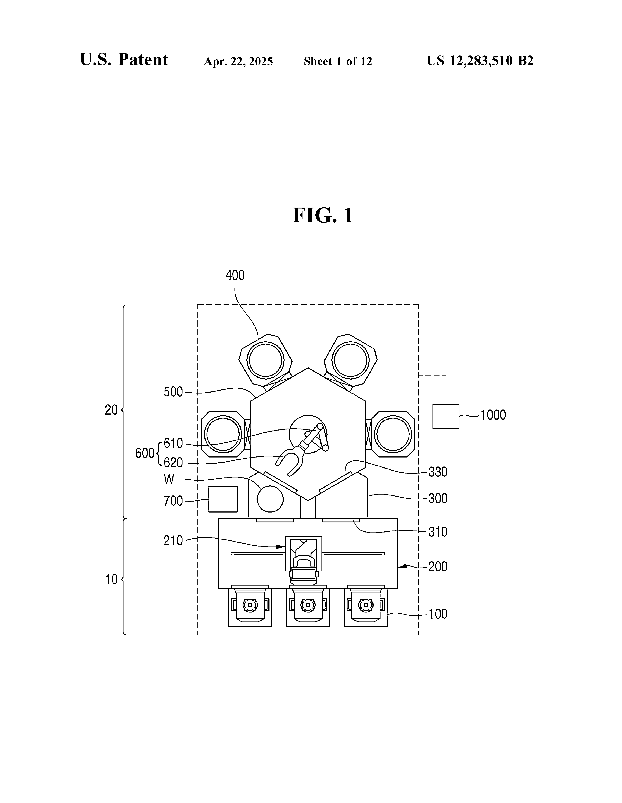
*도 1 — 기판 처리 장치 개략 평면도*

도 1을 참조하면, 일부 실시예에 따른 기판 처리 장치는 설비 전방 단부 모듈(equipment front end module, EFEM) 10 및 공정 모듈(process module) 20을 포함한다. 설비 전방 단부 모듈 10은 공정 모듈 20의 일측에 배치될 수 있다. 예를 들어, 설비 전방 단부 모듈 10은 공정 모듈 20의 전방에 배치될 수 있다. 설비 전방 단부 모듈 10은 복수의 로드 포트(load port) 100 및 인덱스 모듈(index module) 200을 포함할 수 있다. 공정 모듈 20은 로드락 챔버(load lock chamber) 300, 공정 챔버 400, 이송 챔버(transfer chamber) 500, 이송 로봇 600, 및 티칭 버퍼 700을 포함할 수 있다.

인덱스 모듈 200은 로드 포트 100과 공정 모듈 20 사이에 배치된다. 인덱스 모듈 200은 로드 포트 100과 공정 모듈 20 사이에서 기판 W를 이송한다. 각 로드 포트 100은 기판 W가 수납된 용기(FOUP)가 놓이는 공간을 제공한다. 인덱스 모듈 200은 인덱스 로봇 210을 포함할 수 있다. 인덱스 로봇 210은 로드 포트 100에 놓인 용기(FOUP)로부터 처리 전의 기판 W를 언로딩하여 공정 모듈 20으로 이송할 수 있다. 또한, 인덱스 로봇 210은 처리된 기판 W를 공정 모듈 20으로부터 용기(FOUP)에 로딩할 수 있다.

공정 모듈 20은 이송 챔버 500, 복수의 로드락 챔버 300, 및 복수의 공정 챔버 400을 포함할 수 있다. 이송 챔버 500은 평면에서 볼 때 다각형 형상을 가질 수 있다. 이송 챔버 500의 각 모서리에는 로드락 챔버 300 및 공정 챔버 400이 배치될 수 있다. 로드락 챔버 300은 이송 챔버 500의 모서리들 중 설비 전방 단부 모듈 10에 가장 가까운 위치에 배치될 수 있다.

예를 들어, 이송 챔버 500은 평면에서 볼 때 육각형 형상을 가질 수 있다. 이송 챔버 500은 6개의 모서리를 가질 수 있다. 각 모서리에는 4개의 공정 챔버 400과 2개의 로드락 챔버 300이 배치될 수 있다. 다만, 본 개시의 기술적 사상은 이에 제한되는 것은 아니다. 이송 챔버 500의 형상, 및 이송 챔버 500에 인접하여 배치되는 공정 챔버 400과 로드락 챔버 300의 개수는 변경될 수 있음은 물론이다.

이송 로봇 600은 이송 챔버 500 내부에 배치될 수 있다. 이송 로봇 600은 로드락 챔버 300과 공정 챔버 400 사이에서 기판 W를 이송한다. 이송 로봇 600은 로봇 암(robot arm) 610 및 로봇 핸드 620을 포함할 수 있다. 로봇 핸드 620은 기판 W를 파지할 수 있다. 로봇 암 610은 x축, y축 및 z축으로 이동할 수 있다. 일부 실시예에서, 이송 로봇 600은 티칭 버퍼 700의 카메라 720을 이용하여 로봇 핸드 620을 정렬할 수 있다.

로드락 챔버 300은 공정 모듈 20으로 로딩되거나 공정 모듈 20으로부터 언로딩되는 기판 W를 일시적으로 보관하는 공간을 제공한다. 로드락 챔버 300의 내부는 진공과 대기압으로 전환 가능할 수 있다. 이에 따라, 이송 챔버 500 및 공정 챔버 400의 내부는 진공으로 유지되고, 설비 전방 단부 모듈 10의 내부는 대기압으로 유지될 수 있다. 로드락 챔버 300과 설비 전방 단부 모듈 10 사이에는 제1 게이트 밸브(gate valve) 310이 설치된다. 로드락 챔버 300과 이송 챔버 500 사이에는 제2 게이트 밸브 330이 설치된다. 이송 챔버 500 및 공정 챔버 400 내부의 진공이 유지되도록, 제1 게이트 밸브 310과 제2 게이트 밸브 330 중 어느 하나가 개방될 수 있다.

공정 챔버 400은 기판 W를 처리하는 공정을 수행한다. 공정 챔버 400은 내부에 처리 공간을 포함할 수 있다. 예를 들어, 공정 챔버 400은 식각 공정, 사진(photo) 공정 및 현상(developing) 공정 중 적어도 하나를 수행할 수 있으나, 이에 제한되는 것은 아니다.

일부 실시예에서, 기판 처리 장치는 제어 모듈(control module) 1000을 더 포함할 수 있다. 제어 모듈 1000은 이송 챔버 500, 로드락 챔버 300, 공정 챔버 400, 이송 로봇 600 및 티칭 버퍼 700을 제어할 수 있다. 또한, 제어 모듈 1000은 기판 W를 이송하도록 이송 로봇 600을 제어할 수 있다. 제어 모듈 1000은 티칭 버퍼 700을 이용하여 이송 로봇 600을 정렬하는 것을 제어할 수 있으나, 이에 제한되는 것은 아니다.

티칭 버퍼 700은 이송 챔버 500의 외부에 배치되거나 이송 챔버 500의 내부에 배치될 수 있다. 티칭 버퍼 700은 이송 로봇 600의 로봇 핸드 620을 자동으로 정렬하는 데 사용될 수 있다. 티칭 버퍼 700에 대한 상세한 설명은 도 2를 참조하여 설명한다.

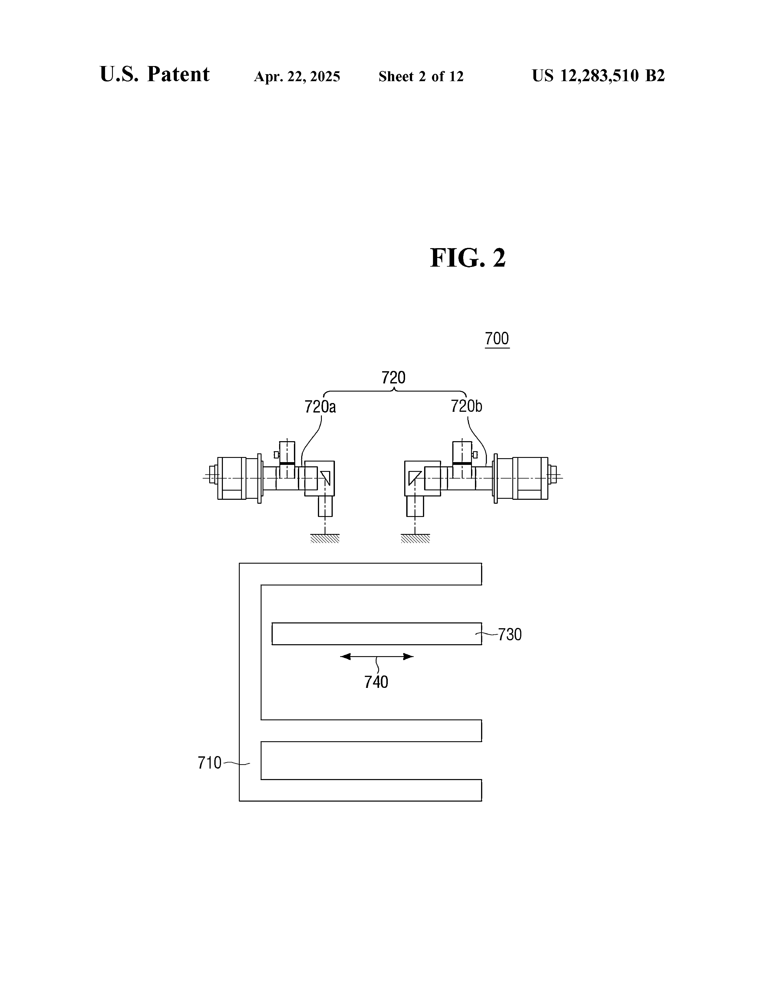
*도 2 — 도 1의 티칭 버퍼*

도 2는 도 1의 티칭 버퍼를 설명하기 위한 예시적인 도면이다. 도 3은 도 2의 티칭 플레이트를 설명하기 위한 예시적인 평면도이다.

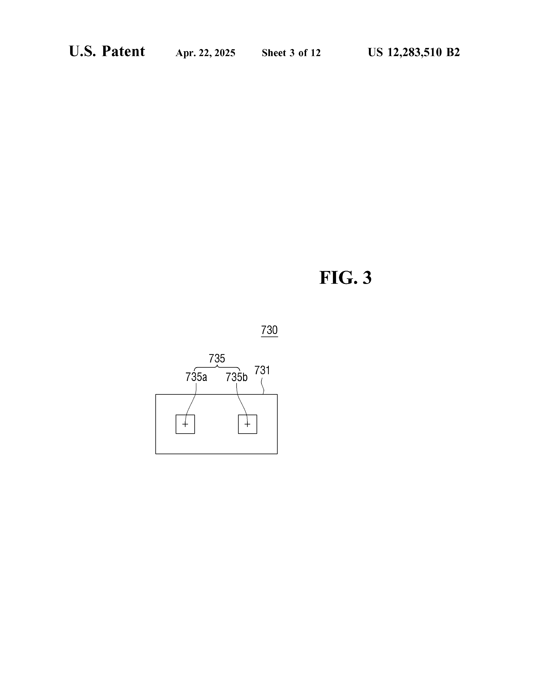
*도 3 — 도 2의 티칭 플레이트 평면도*

도 2 및 도 3을 참조하면, 티칭 버퍼 700은 버퍼 바디(buffer body) 710, 카메라 720 및 티칭 플레이트 730을 포함할 수 있다.

카메라 720은 버퍼 바디 710 상에 배치될 수 있다. 카메라 720은 티칭 플레이트 730을 바라볼 수 있다. 카메라 720은 티칭 플레이트 730의 기준점 735를 촬영할 수 있다. 카메라 720은 프리즘 방식을 포함할 수 있으나, 이에 제한되는 것은 아니다.

일부 실시예에서, 카메라 720은 적어도 하나 이상 포함될 수 있다. 카메라 720은 예를 들어 제1 카메라 720a 및 제2 카메라 720b를 포함할 수 있다. 제1 카메라 720a와 제2 카메라 720b는 서로 이격될 수 있다. 제1 카메라 720a와 제2 카메라 720b는 각각 제1 기준점 735a와 제2 기준점 735b를 촬영할 수 있다. 카메라 720은 티칭 플레이트 730의 기준점 735를 촬영하여 영상(image)을 생성할 수 있다. 카메라 720은 기준점 735를 촬영하여 기준 좌표(reference coordinates)를 생성할 수 있다.

티칭 플레이트 730은 버퍼 바디 710 내부에 배치될 수 있다. 티칭 플레이트 730은 버퍼 바디 710으로 로딩되고 언로딩될 수 있다(참조 부호 740 참조). 예를 들어, 카메라 720이 티칭 플레이트 730을 촬영할 때 티칭 플레이트 730은 버퍼 바디 710에 로딩될 수 있다. 카메라 720이 로봇 핸드(도 1의 620)를 정렬할 때 티칭 플레이트 730은 버퍼 바디 710으로부터 언로딩될 수 있다.

티칭 플레이트 730은 플레이트 731 및 기준점 735를 포함할 수 있다. 기준점 735는 플레이트 731 상에 위치할 수 있다. 기준점 735는 로봇 핸드(도 1의 620)를 정렬할 때 사용되는 기준점일 수 있다. 기준점 735는 적어도 하나 이상 포함될 수 있다. 예를 들어, 기준점 735는 제1 기준점 735a 및 제2 기준점 735b를 포함할 수 있다. 다만, 본 개시의 기술적 사상은 이에 제한되는 것은 아니다.

일부 실시예에서, 제1 기준점 735a는 제1 핸드(도 4의 620a)를 정렬하는 데 사용될 수 있다. 제2 기준점 735b는 제2 핸드(도 4의 620b)를 정렬하는 데 사용될 수 있다. 제1 기준점 735a는 제1 얼라인 마크(도 4의 625a)에 대응될 수 있다. 제2 기준점 735b는 제2 얼라인 마크(도 4의 625b)에 대응될 수 있다.

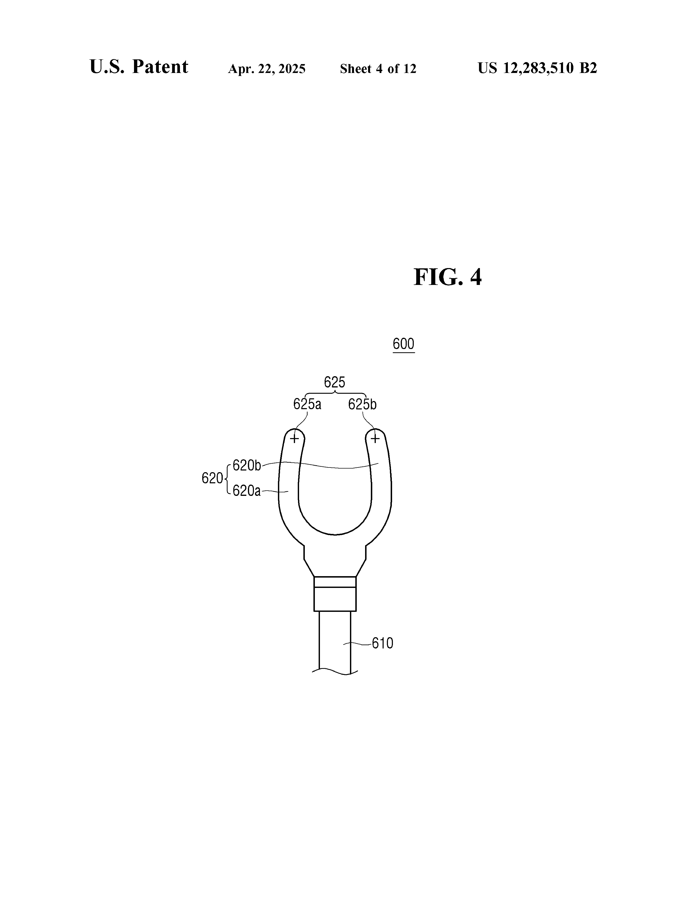
*도 4 — 도 1의 작업 로봇(이송 로봇)*

도 4는 도 1의 작업 로봇을 설명하기 위한 예시적인 도면이다. 도 4를 참조하여 이송 로봇 600을 보다 상세히 설명한다.

도 4를 참조하면, 이송 로봇 600은 로봇 암 610 및 로봇 핸드 620을 포함한다. 로봇 핸드 620은 기판(도 1의 W)을 파지하는 부분일 수 있다. 로봇 암 610은 로봇 핸드 620 및 기판 W를 이동시키는 암일 수 있다.

로봇 핸드 620은 예를 들어 제1 핸드 620a 및 제2 핸드 620b를 포함할 수 있다. 제1 핸드 620a와 제2 핸드 620b는 서로 이격될 수 있다. 로봇 핸드 620 각각은 얼라인 마크 625를 포함한다. 얼라인 마크 625는 로봇 핸드 620을 정렬하는 데 사용되는 마크일 수 있다. 예를 들어, 티칭 버퍼의 카메라(도 2의 720)가 티칭 플레이트의 기준점(도 3의 735)을 촬영하고, 촬영된 기준점을 얼라인 마크 625와 비교하여 로봇 핸드 620을 정렬한다. 로봇 핸드 620의 정렬 방법은 도 5 내지 도 12를 참조하여 상세히 후술한다.

얼라인 마크 625는 제1 얼라인 마크 625a 및 제2 얼라인 마크 625b를 포함한다. 제1 얼라인 마크 625a는 제1 핸드 620a에 형성된다. 제2 얼라인 마크 625b는 제2 핸드 620b에 형성된다. 제1 얼라인 마크 625a는 제1 핸드 620a를 정렬하는 데 사용될 수 있다. 제2 얼라인 마크 625b는 제2 핸드 620b를 정렬하는 데 사용될 수 있다. 다만, 본 개시의 기술적 사상은 이에 제한되는 것은 아니다.

일부 실시예에서, 얼라인 마크 625는 기판의 중심점과 정렬될 수 있으나, 이에 제한되는 것은 아니다. 일부 실시예에서, 얼라인 마크 625는 십자(cross) 형상을 갖는 것으로 도시되었으나, 이에 제한되는 것은 아니다.

이하, 일부 예시적인 실시예에 따른 기판 처리 장치의 동작 방법 및 기판 처리 방법을 설명한다.

도 5는 일부 실시예에 따른 기판 처리 방법을 설명하기 위한 예시적인 순서도이다.

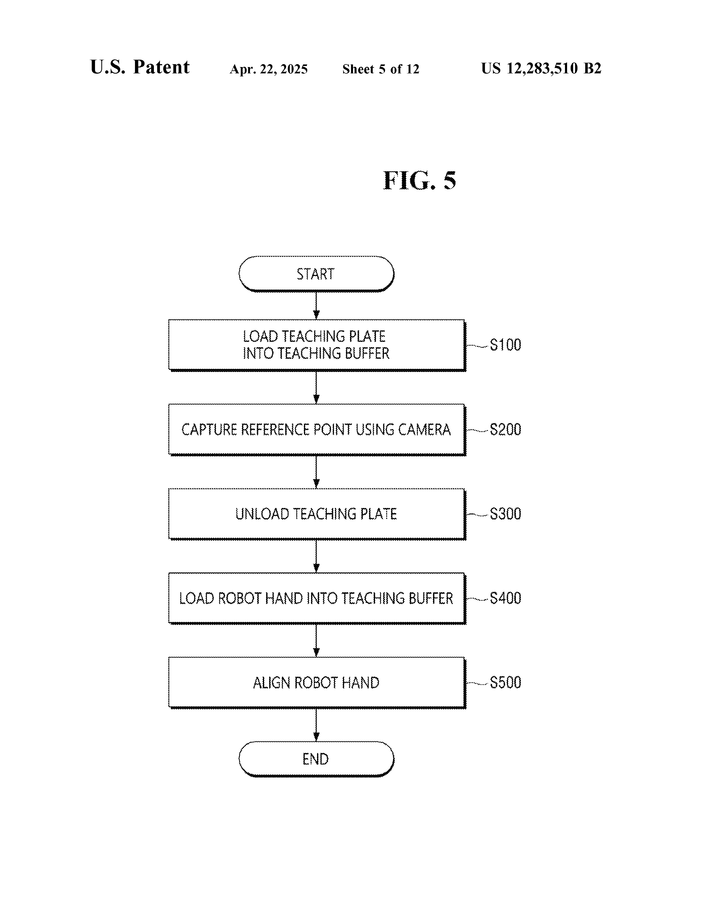
*도 5 — 기판 처리 방법 순서도*

도 5를 참조하면, 일부 실시예에 따른 기판 처리 방법은 티칭 플레이트를 티칭 버퍼에 로딩하는 단계(S100), 카메라를 이용하여 기준점을 촬영하는 단계(S200), 티칭 플레이트를 언로딩하는 단계(S300), 로봇 핸드를 티칭 버퍼에 로딩하는 단계(S400), 및 로봇 핸드를 정렬하는 단계(S500)를 포함한다. 각 단계는 도 6 내지 도 12를 참조하여 설명한다.

도 6은 도 5의 단계 S100을 설명하기 위한 도면이다.

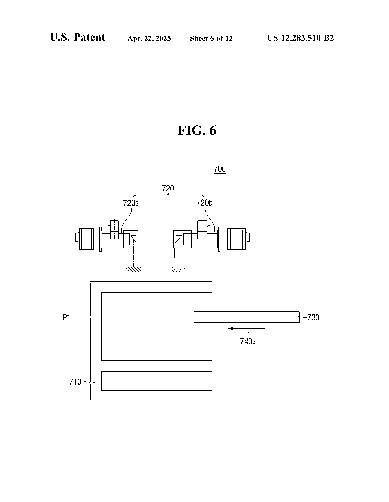
*도 6 — 단계 S100(티칭 플레이트 로딩)*

도 5 및 도 6을 참조하면, 티칭 플레이트 730은 버퍼 바디 710에 로딩될 수 있다(참조 부호 740a 참조). 티칭 플레이트 730은 수직 방향으로 카메라 720과 중첩되는 위치로 로딩될 수 있다. 티칭 플레이트 730은 제1 수직 위치 P1에 로딩될 수 있다.

도 7 및 도 8은 도 5의 단계 S200을 설명하기 위한 도면이다.

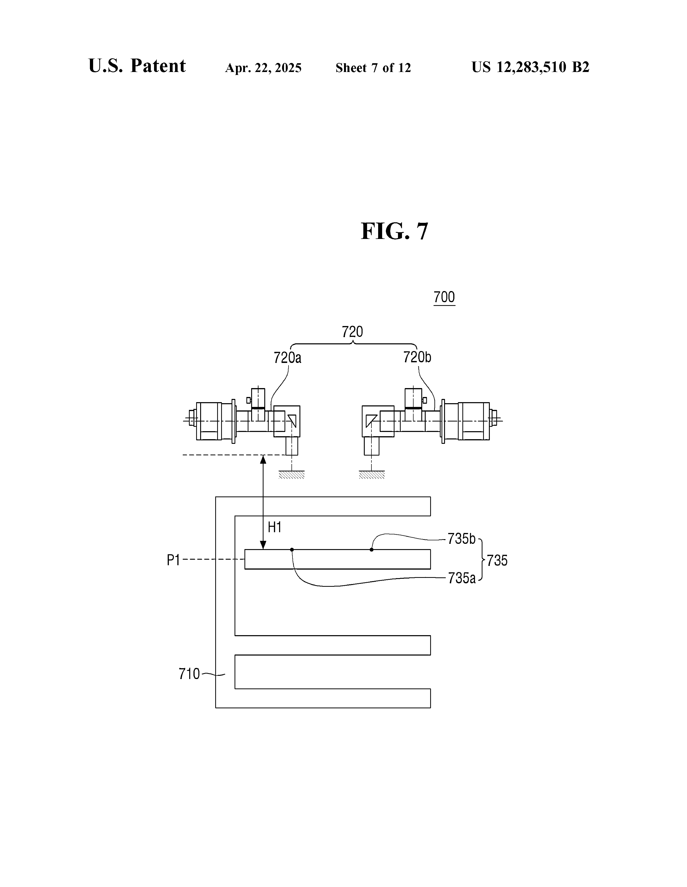
*도 7 — 단계 S200(카메라로 기준점 촬영)*

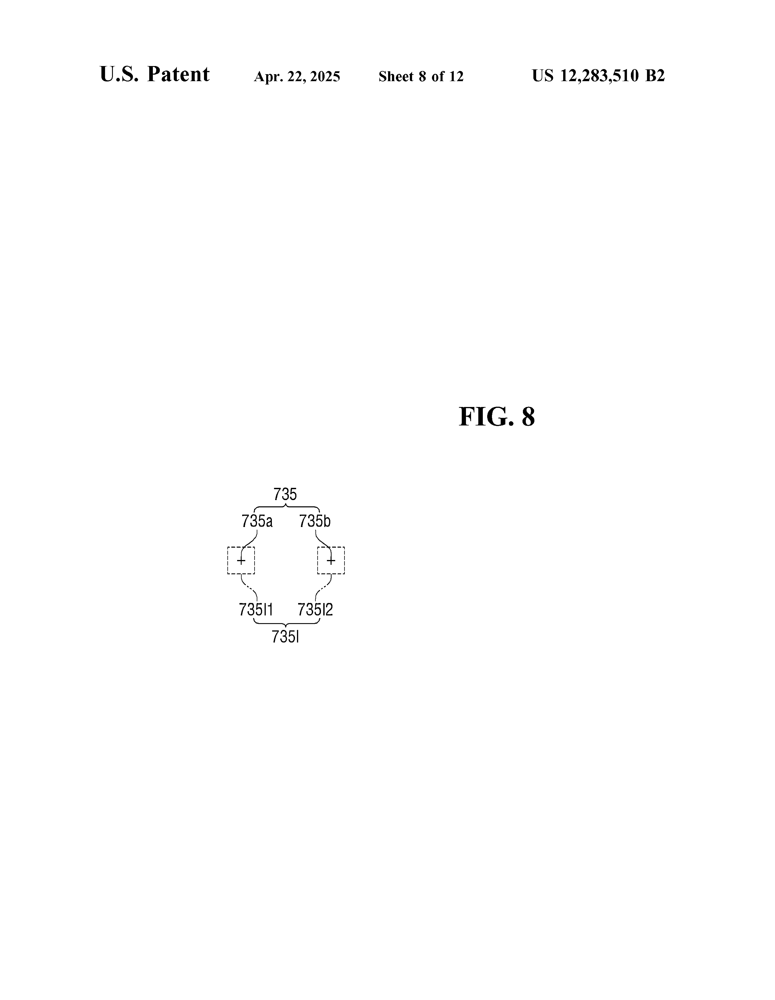
*도 8 — 단계 S200(카메라로 기준점 촬영)*

도 5 및 도 7을 참조하면, 티칭 플레이트 730은 수직 방향으로 카메라 720과 중첩되는 위치에 로딩될 수 있다. 티칭 플레이트 730의 기준점 735는 카메라 720과 수직으로 중첩될 수 있다. 예를 들어, 제1 카메라 720a는 제1 기준점 735a와 수직으로 중첩되고, 제2 카메라 720b는 제2 기준점 735b와 수직으로 중첩될 수 있다.

티칭 플레이트 730은 제1 수직 위치 P1에 로딩될 수 있다. 카메라 720과 티칭 플레이트 730 사이의 수직 높이는 제1 높이 H1일 수 있다. 제1 카메라 720a와 제1 기준점 735a 사이의 수직 높이는 제1 높이 H1일 수 있다. 제2 카메라 720b와 제2 기준점 735b 사이의 수직 높이는 제1 높이 H1일 수 있다.

이어서, 도 5 및 도 8을 참조하면, 카메라 720은 티칭 플레이트 730의 기준점 735를 촬영할 수 있다(S200).

카메라 720은 기준점 735를 촬영하여 영상 7351을 생성할 수 있다. 예를 들어, 제1 카메라 720a는 제1 기준점 735a를 촬영하여 제1 영상 735I1을 생성할 수 있다. 제2 카메라 720b는 제2 기준점 735b를 촬영하여 제2 영상 735I2를 생성할 수 있다.

카메라 720은 기준점 735를 촬영하여 기준 좌표를 생성할 수 있다. 예를 들어, 제1 카메라 720a는 제1 기준점 735a를 촬영하여 제1 기준 좌표를 생성할 수 있다. 제2 카메라 720b는 제2 기준점 735b를 촬영하여 제2 기준 좌표를 생성할 수 있다. 예를 들어, 제1 기준 좌표는 (0,0)일 수 있다. 제2 기준 좌표는 (1,0)일 수 있다.

도 9는 도 5의 단계 S300을 설명하기 위한 도면이다.

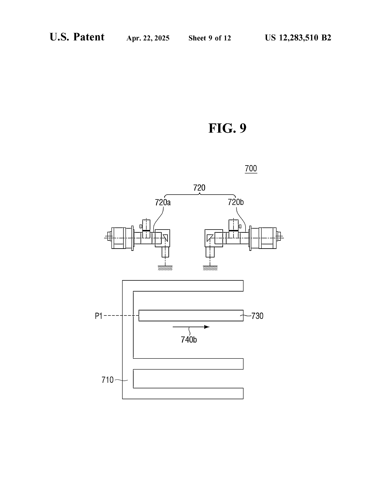
*도 9 — 단계 S300(티칭 플레이트 언로딩)*

도 5 및 도 9를 참조하면, 티칭 플레이트 730은 버퍼 바디 710으로부터 언로딩될 수 있다(S300). 티칭 플레이트 730은 로딩된 방향과 반대 방향으로 언로딩될 수 있다(참조 부호 740b 참조). 다만, 본 개시의 기술적 사상은 이에 제한되는 것은 아니다.

도 10은 도 5의 단계 S400을 설명하기 위한 도면이다.

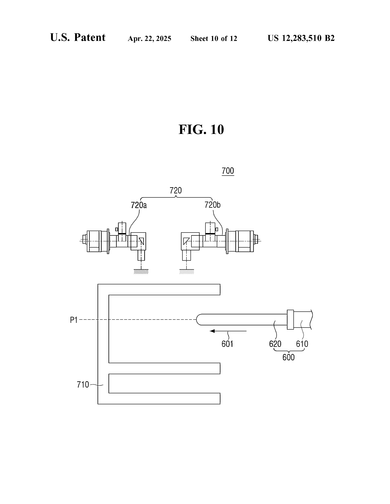
*도 10 — 단계 S400(로봇 핸드를 티칭 버퍼에 로딩)*

도 5 및 도 10을 참조하면, 로봇 핸드 620은 티칭 버퍼 700에 로딩될 수 있다(S400).

로봇 핸드 620은 제1 수직 위치 P1에 로딩될 수 있다(참조 부호 601 참조). 로봇 핸드 620이 티칭 버퍼 700에 로딩되는 수직 위치는 티칭 플레이트 730이 버퍼 바디 710에 로딩되는 수직 위치와 동일할 수 있다. 즉, 기준점 735를 촬영하여 기준 좌표를 형성하는 위치와 로봇 핸드 620을 정렬하는 위치가 동일할 수 있다. 이로 인해, 로봇 핸드 620을 보다 정확하게 정렬할 수 있다.

도 11 및 도 12는 도 5의 단계 S500을 설명하기 위한 도면이다.

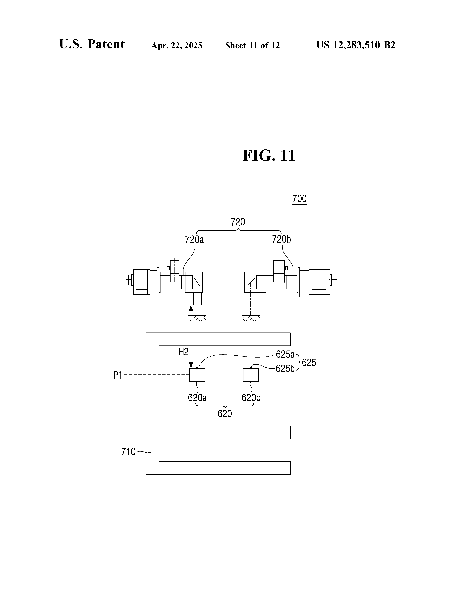
*도 11 — 단계 S500(로봇 핸드 정렬)*

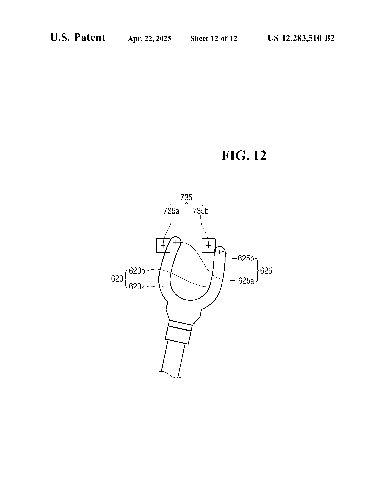
*도 12 — 단계 S500(로봇 핸드 정렬, 회전 어긋남 예)*

도 5, 도 11 및 도 12를 참조하면, 로봇 핸드 620은 정렬될 수 있다(S500).

"정렬된다"는 것은 티칭 플레이트 730의 기준점 735의 좌표와 로봇 핸드 620의 얼라인 마크 625의 좌표가 일치하는 것을 의미할 수 있다. 예를 들어, 티칭 플레이트 730의 기준점 735의 좌표가 (0,0)이면, 로봇 핸드 620의 얼라인 마크 625의 좌표가 (0,0)일 때 로봇 핸드 620이 정렬된 것으로 볼 수 있다.

구체적으로, 로봇 핸드 620은 카메라 720을 이용하여 정렬될 수 있다. 예를 들어, 제1 카메라 720a는 제1 기준점 735a와 제1 얼라인 마크 625a를 비교하여 제1 핸드 620a를 정렬할 수 있다. 제2 카메라 720b는 제2 기준점 735b와 제2 얼라인 마크 625b를 비교하여 제2 핸드 620b를 정렬할 수 있다.

일부 실시예에서, 카메라 720과 로봇 핸드 620 사이의 수직 높이는 제2 높이 H2일 수 있다. 제2 높이 H2는 제1 높이 H1과 동일할 수 있다. 즉, 카메라 720이 기준점 735를 촬영할 때의 제1 높이 H1과 카메라 720이 로봇 핸드 620을 정렬할 때의 제2 높이 H2가 동일하므로, 로봇 핸드 620을 보다 정밀하게 정렬할 수 있다.

도 12에서, 기준점 735와 로봇 핸드 620은 정렬되어 있지 않다. 제1 핸드 620a는 제1 기준점 735a와 제1 얼라인 마크 625a를 비교하여 정렬될 수 있다. 제2 핸드 620b는 제2 기준점 735b와 제2 얼라인 마크 625b를 비교하여 정렬될 수 있다. 로봇 핸드 620은 제1 핸드 620a와 제2 핸드 620b를 정렬함으로써 정렬될 수 있다. 이 경우, 로봇 핸드 620을 반시계 방향으로 회전시키면 로봇 핸드 620이 정렬될 수 있다. 다만, 본 개시의 기술적 사상은 이에 제한되는 것은 아니다. 로봇 핸드 620은 x 방향 또는 y 방향으로 이동함으로써 정렬될 수 있음은 물론이다.

일부 실시예에 따른 기판 처리 장치를 이용하면, 자동화된 공정을 이용하여 로봇 핸드 620을 정렬할 수 있다. 이로 인해, 로봇 핸드 620을 보다 효율적이고 정확하게 정렬할 수 있다.

이상 첨부된 도면 및 상기 내용을 참조하여 본 개시의 실시예들을 설명하였지만, 본 개시가 속하는 기술분야에서 통상의 지식을 가진 자는 본 개시가 그 기술적 사상이나 필수적인 특징을 변경하지 않고서 다른 구체적인 형태로 실시될 수 있다는 것을 이해할 수 있을 것이다. 그러므로 이상에서 기술한 실시예들은 모든 면에서 예시적인 것이며 한정적이 아닌 것으로 이해되어야 한다.
