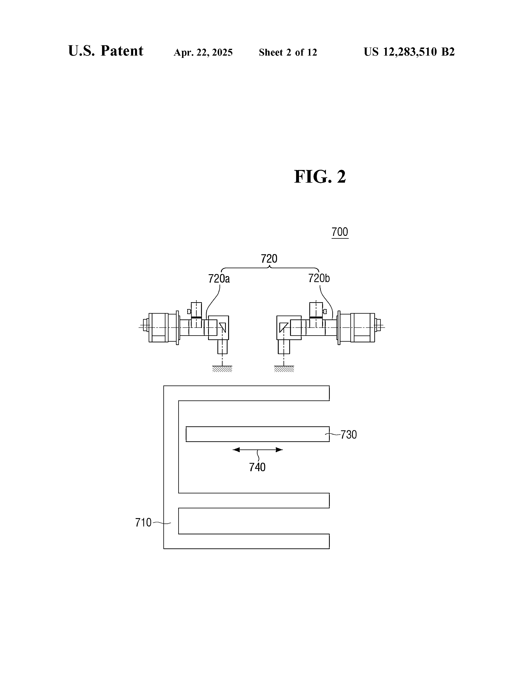
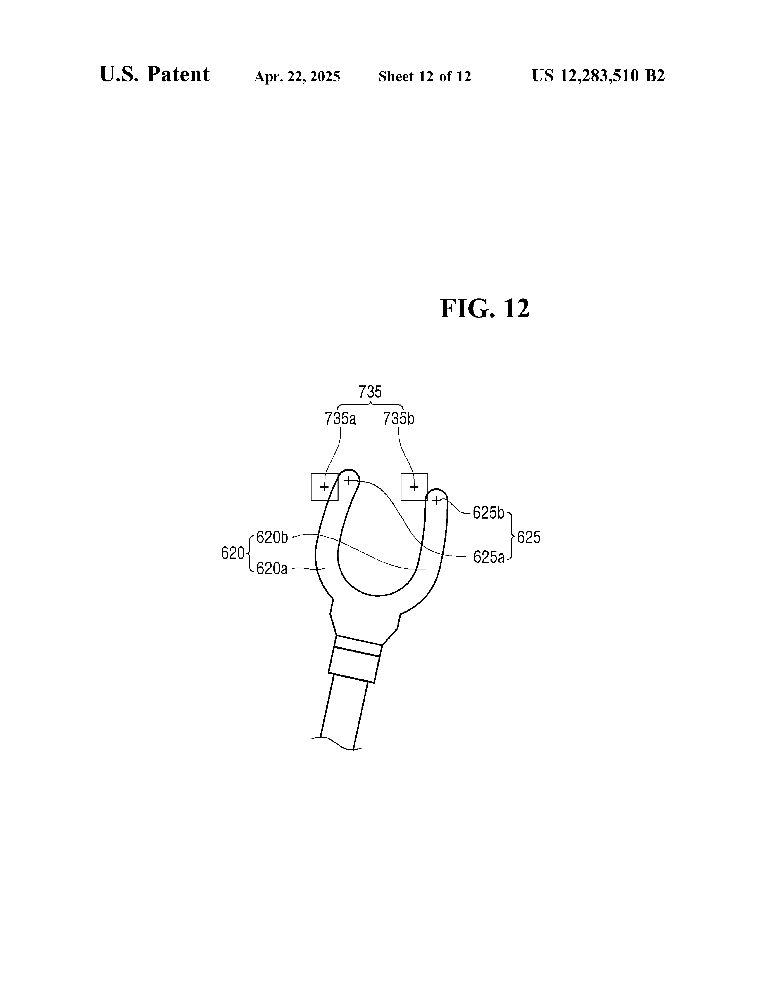

# US12283510B2 — 티칭 버퍼를 쓰는 기판 처리 장치 (SEMES)

| 항목 | 내용 |
|---|---|
| 원문 | `US12283510.pdf`(등록, 2025-04-22) · `US20230163009.pdf`(공개, 2023-05-25) |
| 출원인 | SEMES |
| 우선일 | 2021-11-23 (KR 10-2021-0162028) |
| 핵심 | 티칭 버퍼에 고정된 카메라 2대로 티칭 플레이트의 기준점 2개를 먼저 찍어 기준 좌표를 만들고, 플레이트를 빼낸 같은 높이에 핸드를 넣어 핸드 끝 십자 얼라인 마크를 기준 좌표와 비교한다. 어긋나면 x·y 이동이나 회전으로 맞춘다. |
| 관련도 | ○ 일부 요소가 같음 |
| 본 과제와의 관계 | 마크 2점 비교로 회전 어긋남까지 보정하는 SEMES 특허. 카메라는 로봇이 아니라 버퍼에 고정되어 있고, 회전량 계산식은 나오지 않는다. |
| 링크 | [Google Patents](https://patents.google.com/patent/US12283510B2/en) |

---

## 상세 요약 (번역본 기준)

### 1. 해결하려는 문제
- 기판을 원하는 위치로 정밀하게 옮기려면 이송 로봇이 정렬되어 있어야 함
- 종래에는 육안으로 로봇 핸드를 제어·정렬하여 시간이 많이 소요됨
- 목표: 로봇 핸드 정렬을 자동화하여 효율·생산성 향상

### 2. 핵심 구성
| 구성 | 부호 | 위치·역할 |
|---|---|---|
| 이송 로봇 | 600 | 이송 챔버(500) 내부, 로드락 챔버(300)와 공정 챔버(400) 사이 기판 W 이송 |
| 로봇 암 / 로봇 핸드 | 610 / 620 | 암은 x·y·z축 이동, 핸드는 기판 파지. 제1 핸드(620a)·제2 핸드(620b)로 서로 이격 |
| 얼라인 마크 | 625 (625a, 625b) | 각 핸드 말단에 형성, 십자 형상(도시 기준), 기판 중심점과 정렬될 수 있음 |
| 티칭 버퍼 | 700 | 이송 챔버(500) 외부 또는 내부에 배치, 로봇 핸드 자동 정렬용 |
| 버퍼 바디 | 710 | 카메라와 티칭 플레이트를 수용 |
| 카메라 | 720 (720a, 720b) | 버퍼 바디(710) 상에 고정, 아래의 티칭 플레이트를 바라봄. 서로 이격된 2대, 프리즘 방식 가능 |
| 티칭 플레이트 | 730 | 플레이트(731) 위에 기준점(735a, 735b) 제공, 버퍼 바디에 로딩·언로딩(740) |
| 제어 모듈 | 1000 | 이송 로봇·티칭 버퍼 등을 제어, 정렬 동작 제어 |

- 제1 기준점(735a) ↔ 제1 얼라인 마크(625a) ↔ 제1 카메라(720a), 제2도 같은 방식의 1:1 대응

### 3. 동작 순서 (도 5)
1. S100 티칭 플레이트 로딩 (도 6): 티칭 플레이트(730)를 카메라(720)와 수직으로 겹치는 제1 수직 위치 P1에 로딩(740a)
2. S200 기준점 촬영 (도 7, 도 8): 카메라–플레이트 수직 높이는 제1 높이 H1
   - 제1 카메라(720a)가 제1 기준점(735a)을 찍어 제1 영상(735I1), 제2 카메라(720b)가 제2 기준점(735b)을 찍어 제2 영상(735I2) 생성
   - 각 영상에서 기준 좌표 생성. 예: 제1 기준 좌표 (0,0), 제2 기준 좌표 (1,0)
3. S300 티칭 플레이트 언로딩 (도 9): 로딩 방향과 반대 방향으로 빼냄(740b)
4. S400 로봇 핸드 로딩 (도 10): 로봇 핸드(620)를 같은 제1 수직 위치 P1에 로딩(601)
   - 기준 좌표를 만든 위치와 핸드를 정렬하는 위치가 같아 더 정확하게 정렬
5. S500 로봇 핸드 정렬 (도 11, 도 12)
   - 정렬 판정: 기준점(735) 좌표와 얼라인 마크(625) 좌표의 일치. 예: 기준점 (0,0)이면 마크도 (0,0)일 때 정렬
   - 제1 카메라가 735a와 625a를, 제2 카메라가 735b와 625b를 비교하여 각 핸드를 정렬
   - 카메라–핸드 높이 H2 = H1 이므로 더 정밀하게 정렬
   - 도 12: 두 마크가 기준점에서 어긋난 예. 로봇 핸드를 반시계 방향으로 회전시켜 정렬하며, x 또는 y 방향 이동으로도 정렬 가능
- 회전량·이동량의 구체적 계산식, 허용 오차 수치는 기재 없음

### 4. 청구항 요지
- 제1항(장치): 공정 챔버 + 로봇 핸드를 가진 이송 로봇 + 티칭 플레이트(기준점)와 이를 바라보는 카메라를 가진 티칭 버퍼. 카메라로 기준점을 찍고, 핸드를 기준점과 플레이트에 수직인 동일 선상에 정렬. 기준점 촬영 위치와 핸드 정렬 위치가 같은 제1 위치
- 제9항(장치): 제1·제2 핸드, 제1·제2 기준점, 제1·제2 카메라를 각각 대응시켜, 두 기준점과 두 핸드가 각각 플레이트에 수직인 동일 선상에 오도록 정렬
- 제14항(방법): 플레이트 로딩 → 플레이트 상부 카메라로 기준점 촬영 → 얼라인 마크 가진 핸드 로딩 → 기준점과 마크 비교로 수직 동일 선상 정렬. 플레이트 로딩 위치 = 핸드 로딩 위치
- 주요 종속항: 핸드 말단 얼라인 마크(제2·10항), 마크와 기판 중심점 정렬(제3·15항), 카메라–플레이트 거리 = 카메라–핸드 거리(제4·11항), 촬영·정렬 수직 위치 동일(제12항), 프리즘 방식 카메라(제5·13·18항), 2카메라·2기준점·2핸드(제6–8·16–17항)

### 5. 대표 도면

*도 2 — 티칭 버퍼(700): 버퍼 바디(710) 위 카메라 2대(720a, 720b)와 아래 티칭 플레이트(730)*

*도 12 — 두 얼라인 마크(625a, 625b)가 기준점(735a, 735b)에서 어긋난 상태, 반시계 회전으로 정렬*

### 6. 본 과제(Y·Θ 얼라인먼트)와 비교
- 같은 점:
  - 카메라 영상에서 마크 좌표를 얻어 이송 로봇 핸드의 위치 오차를 자동 보정
  - 이동(x·y)과 회전을 함께 보정 대상으로 다룸
  - 떨어진 두 점(마크 2개)을 비교하여 회전 어긋남을 판단
- 다른 점:
  - 카메라가 로봇이 아니라 티칭 버퍼에 고정, 핸드를 버퍼 안으로 가져와 측정
  - 마크는 단순 십자형(도시 기준)이고 QR형 마커가 아님
  - 기준 좌표를 별도 티칭 플레이트 촬영으로 먼저 만드는 2단계 방식
  - 보정량 계산식·허용 오차·실시간 처리에 대한 기재 없음, 정렬 판정은 "좌표 일치"로만 정의
- 참고할 점:
  - 기준 영상 먼저 촬영 → 같은 높이(H1 = H2)에서 측정하는 구조: 마커 기준 이미지와 측정 이미지의 촬영 거리를 같게 유지하면 배율 차이에 따른 오차를 줄일 수 있음
  - 두 점 좌표 비교로 회전 판단: 마커 내 두 특징점(또는 두 코너) 좌표 차이에서 Θ를 구하고, 중심 좌표 차이에서 Y를 구하는 설계와 대응
  - 기준 좌표를 (0,0), (1,0)처럼 두 점 기준축으로 두는 방식: 측정 두 점이 이루는 벡터와 기준 벡터의 각도 차를 Θ로 쓰는 구현에 활용 가능(계산식은 특허에 없으므로 직접 정의 필요)
  - 마크를 기판 중심점과 정렬해 두는 설정: 마커 기준점을 핸드의 기판 중심에 맞추어 두면 보정값을 그대로 로봇 좌표로 쓰기 쉬움
  - 선행기술 회피 관점: 버퍼 고정 카메라·별도 티칭 플레이트·수직 동일 선상 정렬이 청구항 핵심이므로, 로봇 장착 카메라·QR 마커 단일 촬영 방식과 구분됨
