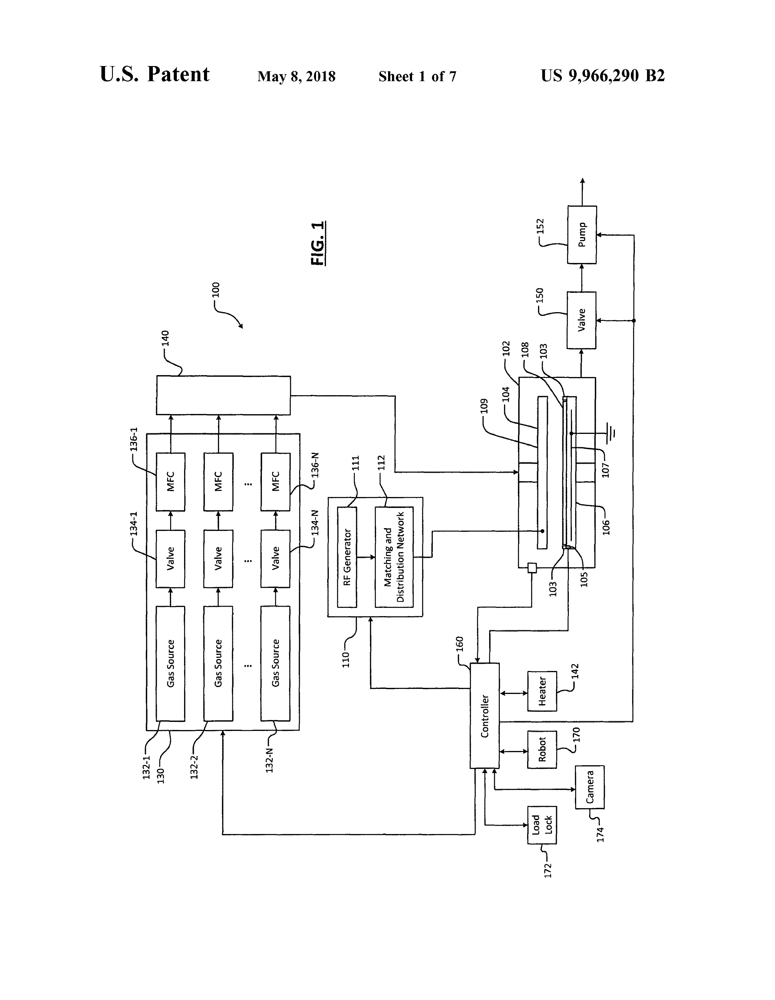
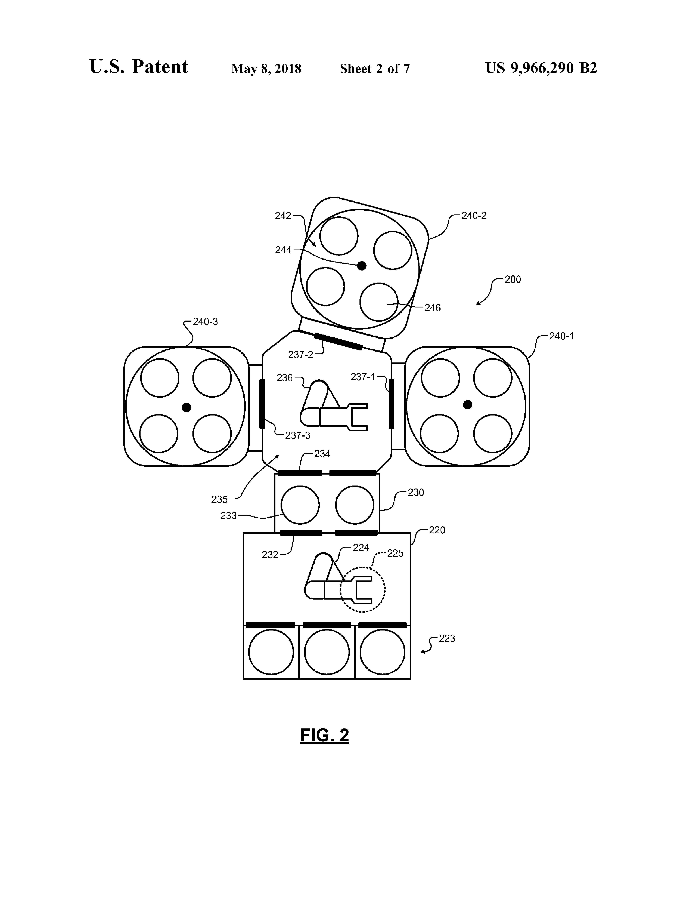
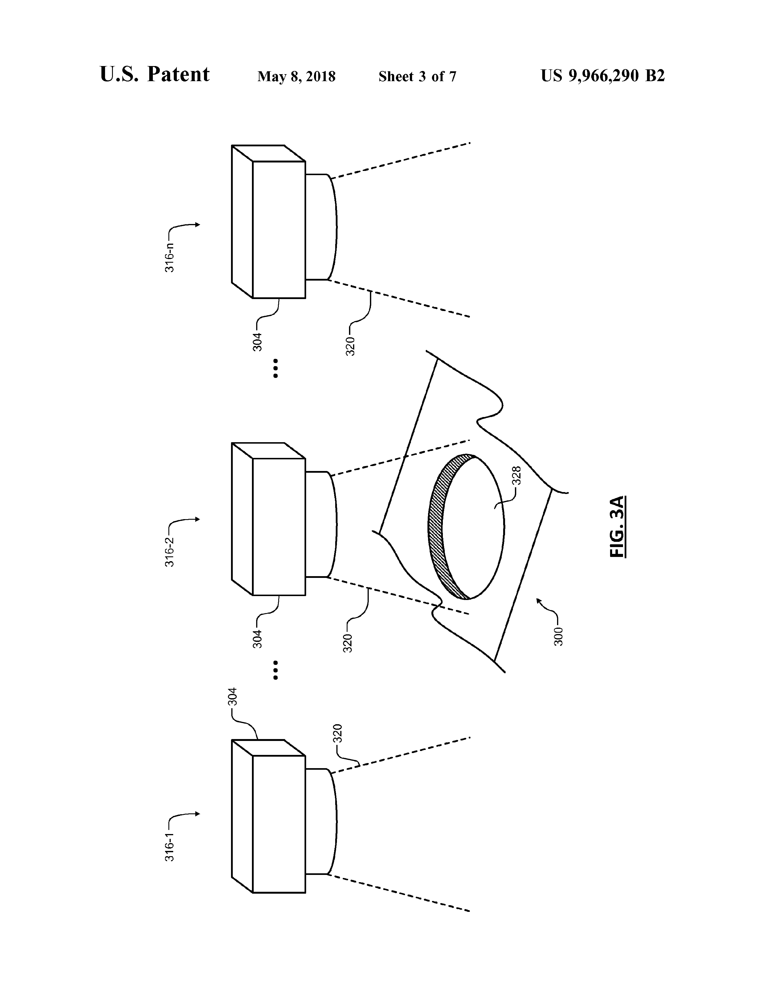
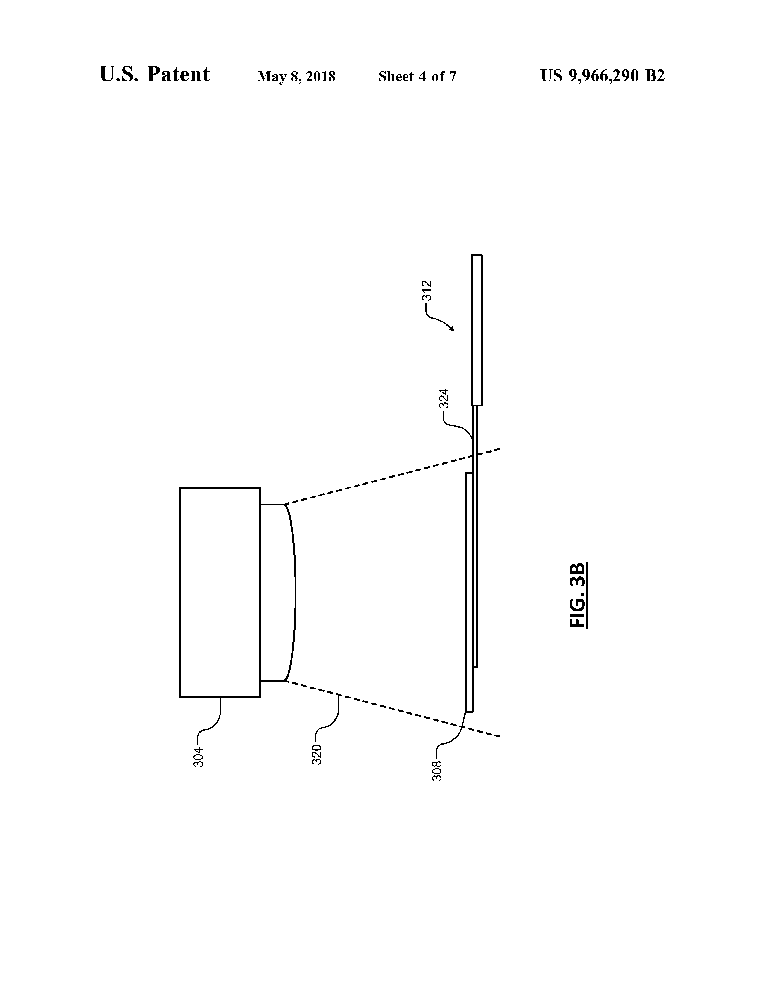
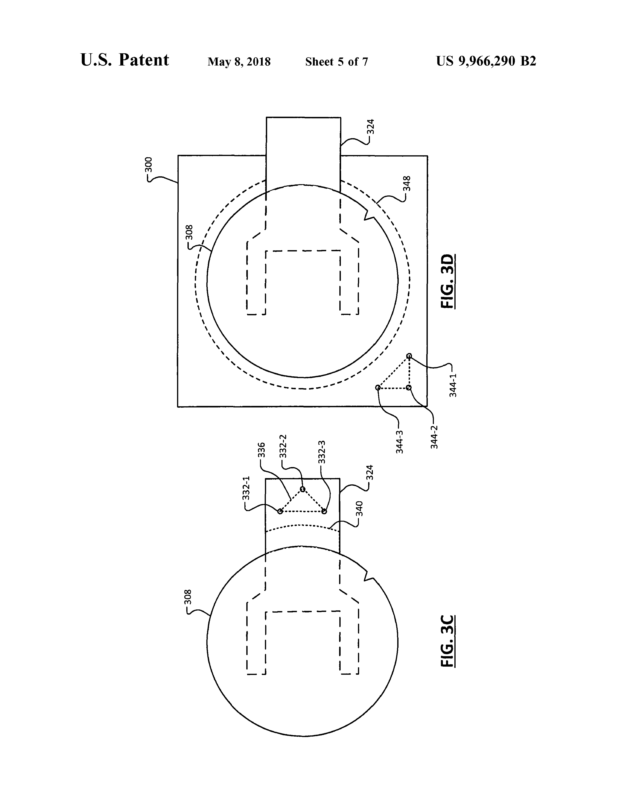
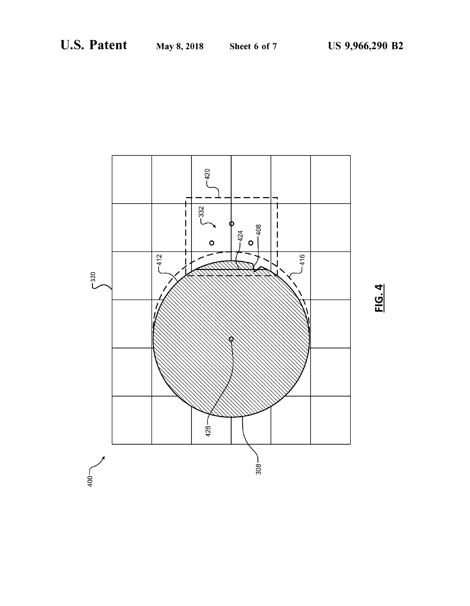
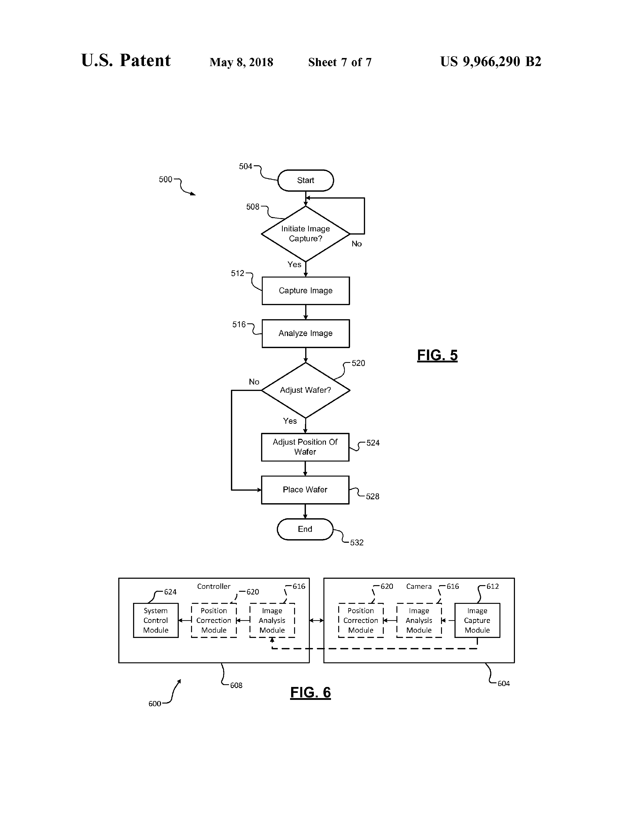

# CCD 카메라와 로봇을 이용한 웨이퍼 정렬 및 센터링 시스템과 방법 (US9966290B2)

- 원제: System and method for wafer alignment and centering with CCD camera and robot
- 원문: 같은 폴더의 PDF, https://patents.google.com/patent/US9966290B2/en
- 번역 기준: Google Patents 원문 텍스트를 한국어로 옮김. 도면은 PDF 참조.
- 도면: 원문 PDF 도면 시트 7장을 도면/ 폴더에 넣고 본문에서 처음 언급되는 곳에 삽입함

## 요약

웨이퍼 정렬 시스템은 로봇 위에 놓인 웨이퍼의 영상을 촬영하는 영상 촬영 모듈(image capture module)을 포함한다. 영상 분석 모듈(image analysis module)은 그 영상을 분석하여 로봇 위 웨이퍼의 위치를 결정한다. 위치 보정 모듈(position correction module)은 결정된 로봇 위 웨이퍼의 위치에 기초하여 조정 데이터(adjustment data)를 계산한다. 시스템 제어 모듈(system control module)은 계산된 조정 데이터 및 로봇 위 웨이퍼의 공칭 위치(nominal position)에 기초하여, 웨이퍼를 내려놓는 것과 웨이퍼를 회수하는 것 중 적어도 하나를 수행하도록 로봇을 제어한다.

## 청구범위

청구되는 것은 다음과 같다.

1. 웨이퍼 정렬 시스템으로서,

로봇 위에 놓인 웨이퍼의 영상을 촬영하는 영상 촬영 모듈;

웨이퍼가 로봇 위에 놓여 있는 동안 상기 영상을 분석하여 로봇 위 웨이퍼의 위치를 결정하는 영상 분석 모듈 - 상기 결정된 위치는 로봇에 대한 웨이퍼의 횡방향 위치(lateral position)와 로봇에 대한 웨이퍼의 회전 위치(rotational position)를 모두 포함하고, 웨이퍼의 회전 위치는 웨이퍼의 중심에 의해 정의되는 축을 중심으로 한 웨이퍼의 회전에 대응하며,

상기 로봇은 로봇에 대한 웨이퍼의 회전 위치를 결정하기 위한 기준 마킹(reference markings)을 포함하고, 상기 기준 마킹은 로봇 위에 비선형 배열(non-linear arrangement)로 배치되며, 상기 영상 분석 모듈은 상기 기준 마킹의 위치를 찾고 (i) 기준 마킹의 비선형 배열의 파라미터 및 (ii) 웨이퍼의 하나 이상의 특징(feature)에 따라 로봇에 대한 웨이퍼의 회전 위치를 결정함 -;

결정된 로봇 위 웨이퍼의 위치에 기초하여 조정 데이터를 계산하는 위치 보정 모듈 - 상기 조정 데이터는 로봇에 대한 웨이퍼의 횡방향 위치 및 로봇에 대한 웨이퍼의 회전 위치 각각에 대한 조정에 대응함 -; 및

계산된 조정 데이터 및 로봇 위의 공칭 웨이퍼 위치에 기초하여, 웨이퍼를 내려놓는 것과 웨이퍼를 회수하는 것 중 적어도 하나를 수행하도록 로봇을 제어하는 시스템 제어 모듈
을 포함하는 웨이퍼 정렬 시스템.

2. 청구항 1에 있어서, 상기 영상 촬영 모듈은 웨이퍼의 회수 위치로부터 웨이퍼의 목적지까지의 로봇의 경로를 따라 있는 위치에 배치되는, 웨이퍼 정렬 시스템.

3. 청구항 1에 있어서, 상기 영상 촬영 모듈은 로드락의 페데스탈(pedestal) 위쪽에 위치하는, 웨이퍼 정렬 시스템.

4. 청구항 1에 있어서, 웨이퍼의 영상을 촬영하기 위해, 상기 영상 촬영 모듈은 로봇이 미리 정해진 위치에 있다는 표시(indication)에 응답하여 웨이퍼의 영상을 촬영하는, 웨이퍼 정렬 시스템.

5. 청구항 1에 있어서, 상기 기준 마킹은 적어도 3개의 마킹을 포함하는, 웨이퍼 정렬 시스템.

6. 청구항 5에 있어서, 상기 적어도 3개의 마킹은 삼각형으로 배열되는, 웨이퍼 정렬 시스템.

7. 청구항 1에 있어서, 상기 웨이퍼의 하나 이상의 특징은 웨이퍼의 에지(edge), 웨이퍼의 에지에 형성된 노치, 및 웨이퍼의 중심 중 적어도 하나를 포함하는, 웨이퍼 정렬 시스템.

8. 청구항 1에 있어서, 조정 데이터를 계산하기 위해, 상기 위치 보정 모듈은 로봇 위의 공칭 웨이퍼 위치에 더 기초하여 조정 데이터를 계산하는, 웨이퍼 정렬 시스템.

9. 청구항 1에 있어서, 상기 웨이퍼의 하나 이상의 특징은 웨이퍼의 현(chord line)을 포함하는, 웨이퍼 정렬 시스템.

10. 청구항 1에 있어서, 상기 파라미터는 기준 마킹의 비선형 배열의 각도를 포함하는, 웨이퍼 정렬 시스템.

11. 웨이퍼 정렬 방법으로서,

웨이퍼가 로봇 위에 놓여 있는 동안 로봇 위에 놓인 웨이퍼의 영상을 촬영하는 단계;

상기 영상을 분석하여 로봇 위 웨이퍼의 위치를 결정하는 단계 - 상기 결정된 위치는 로봇에 대한 웨이퍼의 횡방향 위치와 로봇에 대한 웨이퍼의 회전 위치를 모두 포함하고, 웨이퍼의 회전 위치는 웨이퍼의 중심에 의해 정의되는 축을 중심으로 한 웨이퍼의 회전에 대응하며,

상기 로봇은 로봇에 대한 웨이퍼의 회전 위치를 결정하기 위한 기준 마킹을 포함하고, 상기 기준 마킹은 로봇 위에 비선형 배열로 배치되며, 상기 영상을 분석하는 단계는 기준 마킹의 위치를 찾는 단계 및 (i) 기준 마킹의 비선형 배열의 파라미터 및 (ii) 웨이퍼의 하나 이상의 특징에 따라 로봇에 대한 웨이퍼의 회전 위치를 결정하는 단계를 포함함 -;

결정된 로봇 위 웨이퍼의 위치에 기초하여 조정 데이터를 계산하는 단계 - 상기 조정 데이터는 로봇에 대한 웨이퍼의 횡방향 위치 및 로봇에 대한 웨이퍼의 회전 위치 각각에 대한 조정에 대응함 -; 및

계산된 조정 데이터 및 로봇 위의 공칭 웨이퍼 위치에 기초하여, 웨이퍼를 내려놓는 것과 웨이퍼를 회수하는 것 중 적어도 하나를 수행하도록 로봇을 제어하는 단계
를 포함하는 웨이퍼 정렬 방법.

12. 청구항 11에 있어서, 상기 웨이퍼의 영상을 촬영하는 단계는 웨이퍼의 회수 위치로부터 웨이퍼의 목적지까지의 로봇의 경로를 따라 있는 위치에서 웨이퍼의 영상을 촬영하는 단계를 포함하는, 웨이퍼 정렬 방법.

13. 청구항 11에 있어서, 상기 웨이퍼의 영상을 촬영하는 단계는 로드락의 페데스탈 위쪽 위치에서 웨이퍼의 영상을 촬영하는 단계를 포함하는, 웨이퍼 정렬 방법.

14. 청구항 11에 있어서, 상기 웨이퍼의 영상을 촬영하는 단계는 로봇이 미리 정해진 위치에 있다는 표시에 응답하여 웨이퍼의 영상을 촬영하는 단계를 포함하는, 웨이퍼 정렬 방법.

15. 청구항 11에 있어서, 상기 기준 마킹은 적어도 3개의 마킹을 포함하는, 웨이퍼 정렬 방법.

16. 청구항 15에 있어서, 상기 적어도 3개의 마킹은 삼각형으로 배열되는, 웨이퍼 정렬 방법.

17. 청구항 11에 있어서, 상기 웨이퍼의 하나 이상의 특징은 웨이퍼의 에지, 웨이퍼의 에지에 형성된 노치, 및 웨이퍼의 중심 중 적어도 하나를 포함하는, 웨이퍼 정렬 방법.

18. 청구항 11에 있어서, 상기 조정 데이터를 계산하는 단계는 로봇 위의 공칭 웨이퍼 위치에 더 기초하여 조정 데이터를 계산하는 단계를 포함하는, 웨이퍼 정렬 방법.

19. 청구항 11에 있어서, 상기 웨이퍼의 하나 이상의 특징은 웨이퍼의 현을 포함하는, 방법.

20. 청구항 11에 있어서, 상기 파라미터는 기준 마킹의 비선형 배열의 각도를 포함하는, 방법.

## 상세한 설명

### 기술분야 (FIELD)

본 개시는 기판 처리 시스템에 관한 것으로, 보다 상세하게는 기판 처리 시스템에서 반도체 웨이퍼를 위치시키는 시스템 및 방법에 관한 것이다.

### 배경기술 (BACKGROUND)

여기에 제공되는 배경 설명은 본 개시의 맥락을 개괄적으로 제시하기 위한 것이다. 본 배경기술 부분에 기재된 범위 내에서의 현재 명명된 발명자들의 작업, 그리고 출원 시점에 달리 종래기술로 인정되지 않을 수 있는 설명의 측면들은, 본 개시에 대한 종래기술로 명시적으로든 묵시적으로든 인정되지 않는다.

기판 처리 시스템은 반도체 웨이퍼와 같은 기판의 식각 및/또는 기타 처리를 수행하는 데 사용될 수 있다. 기판에 수행될 수 있는 예시적인 공정으로는 플라즈마 강화 화학 기상 증착(PECVD) 공정, 화학 강화 플라즈마 기상 증착(CEPVD) 공정, 스퍼터링 물리 기상 증착(PVD) 공정, 이온 주입 공정, 및/또는 기타 식각(예: 화학 식각, 플라즈마 식각, 반응성 이온 식각 등), 증착, 세정 공정이 있으나, 이에 한정되지 않는다. 기판은 기판 처리 시스템의 처리 챔버 내 페데스탈과 같은 기판 지지대 위에 배치될 수 있다. 단지 예로서, 식각 중에는 하나 이상의 전구체를 포함하는 가스 혼합물이 처리 챔버로 도입되고 플라즈마가 점화되어 기판을 식각한다.

로드락(예: 인바운드 또는 아웃바운드 로드락) 또는 기타 이송 툴은 반도체 웨이퍼를 대기 환경에서 진공 환경으로(즉, 처리 챔버 외부에서 처리 챔버 내부로), 또는 그 반대로 이송하는 데 사용될 수 있다. 로드락 자체는 페데스탈을 수용하는 진공 챔버를 포함할 수 있다. 웨이퍼는 페데스탈 위에 배치된다(그리고 페데스탈로/페데스탈로부터 이송된다). 예를 들어, 웨이퍼는 증착, 식각 등을 위해 페데스탈로부터 기판 처리 시스템 내 처리 챔버의 도금(plating) 셀 또는 기타 공정 셀로 이송될 수 있다. 페데스탈은 로드락과 공정 셀 사이에서 웨이퍼를 이송하는 데 사용되는 로봇(예: 로봇의 엔드 이펙터) 위로 웨이퍼를 들어 올려 얹거나 로봇에서 들어 올려 내린다.

### 발명의 내용 (SUMMARY)

웨이퍼 정렬 시스템은 로봇 위에 놓인 웨이퍼의 영상을 촬영하는 영상 촬영 모듈을 포함한다. 영상 분석 모듈은 그 영상을 분석하여 로봇 위 웨이퍼의 위치를 결정한다. 위치 보정 모듈은 결정된 로봇 위 웨이퍼의 위치에 기초하여 조정 데이터를 계산한다. 시스템 제어 모듈은 계산된 조정 데이터 및 로봇 위 웨이퍼의 공칭 위치에 기초하여, 웨이퍼를 내려놓는 것과 웨이퍼를 회수하는 것 중 적어도 하나를 수행하도록 로봇을 제어한다.

웨이퍼 정렬 방법은, 로봇 위에 놓인 웨이퍼의 영상을 촬영하는 단계, 영상을 분석하여 로봇 위 웨이퍼의 위치를 결정하는 단계, 결정된 로봇 위 웨이퍼의 위치에 기초하여 조정 데이터를 계산하는 단계, 및 계산된 조정 데이터 및 로봇 위 웨이퍼의 공칭 위치에 기초하여 웨이퍼를 내려놓는 것과 웨이퍼를 회수하는 것 중 적어도 하나를 수행하도록 로봇을 제어하는 단계를 포함한다.

본 개시의 추가적인 적용 분야는 상세한 설명, 청구범위 및 도면으로부터 명백해질 것이다. 상세한 설명 및 구체적인 예들은 단지 예시의 목적으로 의도된 것이며 본 개시의 범위를 한정하려는 것이 아니다.

### 도면의 간단한 설명 (BRIEF DESCRIPTION OF THE DRAWINGS)

본 개시는 상세한 설명 및 첨부 도면으로부터 보다 완전히 이해될 것이며, 도면에서:

도 1은 본 개시의 원리에 따른 예시적인 기판 처리 시스템의 기능 블록도이다;

도 2는 본 개시의 원리에 따른 기판 처리 툴의 예의 기능 블록도이다;

도 3A는 본 개시의 원리에 따른 카메라 및 로드락의 예시적인 배치를 도시한다;

도 3B는 본 개시의 원리에 따라 웨이퍼 위쪽에 위치한 카메라의 예시적인 배치이다;

도 3C는 본 개시의 원리에 따라 로봇의 엔드 이펙터 위에 위치한 예시적인 기준 마킹을 도시한다;

도 3D는 본 개시의 원리에 따라 로드락 위에 위치한 예시적인 기준 마킹을 도시한다;

도 4는 본 개시의 원리에 따라 촬영된 웨이퍼 및 기준 마킹의 예시적인 영상이다;

도 5는 본 개시의 원리에 따른 예시적인 웨이퍼 정렬 방법의 단계들을 도시한다; 그리고

도 6은 본 개시의 원리에 따른 예시적인 웨이퍼 정렬 시스템의 기능 블록도이다.

도면에서, 참조 번호는 유사한 및/또는 동일한 요소를 식별하기 위해 재사용될 수 있다.

### 발명을 실시하기 위한 구체적인 내용 (DETAILED DESCRIPTION)

반도체 웨이퍼(예: 300 mm 웨이퍼)는 처리 챔버 안팎으로 이송되기 위해 로드락의 페데스탈 위에 놓인다. 웨이퍼는 로봇 또는 기타 툴을 이용하여 웨이퍼를 정확하게 포착(capture) 및/또는 이송(예: 공정 셀로)할 수 있도록 페데스탈 위에서 정렬된다. 웨이퍼의 정렬은 웨이퍼의 외측 에지에 형성된 노치를 이용하여 달성될 수 있다. 웨이퍼가 회전되는 동안 노치의 위치를 검출하기 위해 다양한 유형의 웨이퍼 얼라이너가 사용될 수 있다. 예를 들어, 척(chuck)을 이용하여 웨이퍼를 천천히 회전시키는 동안 센서가 노치를 검출할 수 있다. 검출된 노치에 기초하여 노치 위치 및 웨이퍼 오프셋이 계산되어 로봇에 제공된다.

본 개시의 원리에 따른 웨이퍼 정렬 시스템 및 방법은 웨이퍼의 경로 위쪽에 배치된 영상 촬영 장치(예: 고해상도 전하 결합 소자(charge-coupled device, CCD) 카메라 어레이와 같은 카메라)를 구현한다. 카메라는 로봇에 의해 페데스탈로 및/또는 페데스탈로부터 이송되는 웨이퍼의 영상을 촬영한다. 본 명세서의 설명은 로드락의 페데스탈을 언급하지만, 본 개시의 원리는 기판 처리 시스템 내의 임의의 웨이퍼 하역(drop-off) 위치를 이용하여 구현될 수 있다. 예를 들어, 카메라는 로봇이 페데스탈에 대해 미리 정해진 위치에 도달하는 것에 응답하여 영상을 촬영할 수 있다(즉, 카메라는 그에 의해 트리거될 수 있다). 예를 들어, 촬영된 영상은 비트맵 영상에 해당할 수 있다. 영상 분석 모듈은 촬영된 영상을 분석하여 로봇(예: 로봇의 엔드 이펙터)에 대한 웨이퍼의 위치(예: 위치 및 방향, 예컨대 회전 위치)를 결정한다. 본 명세서에서 사용되는 웨이퍼의 "위치"는 웨이퍼의 횡방향 변위(예: 웨이퍼 중심의 변위)와 웨이퍼의 회전 변위(예: 웨이퍼의 중심에 의해 정의되는 축을 중심으로 한 웨이퍼의 회전)를 모두 포함한다.

그런 다음 결정된 위치는 웨이퍼의 원하는 위치 또는 공칭 위치와 비교될 수 있다. 예를 들어, 로봇은 로봇에 대한 웨이퍼의 위치를 결정하기 위한 하나 이상의 기준 마킹을 포함할 수 있다. 시스템은 또한 공칭 위치를 나타내는 공칭 위치 데이터(예: 공칭 위치에 있는 웨이퍼를 이전에 촬영한 영상의 위치)를 저장할 수 있다. 예를 들어, 웨이퍼를 지지하는 로봇의 표면은 공칭 위치를 나타내는 부분 윤곽선(예: 웨이퍼 둘레의 부분 윤곽선) 또는 기타 기준 마킹을 포함할 수 있다. 영상 분석 모듈은 촬영된 영상의 결정된 위치를 기준 마킹 및/또는 공칭 위치 데이터와 비교하여 위치 조정량(즉, 위치 오차, 또는 결정된 위치와 공칭 위치 사이의 차이에 대응하는 값)을 계산할 수 있다.

로봇은 웨이퍼를 페데스탈로 이송한다. 위치 조정량이 임계값(예: 오차 임계값)보다 작으면, 시스템은 곧바로 다음 웨이퍼 처리 단계(예: 웨이퍼를 페데스탈로부터 공정 셀로 이송하는 단계)로 진행할 수 있다. 오차가 임계값보다 크면, 로봇은 위치 조정량에 기초하여 웨이퍼의 위치를 조정하도록 제어된다. 로봇의 위치(예: 페데스탈에 대한 로봇의 방향)는 계산된 조정량에 따라 조정될 수 있다. 예를 들어, 로봇의 위치는 로봇이 페데스탈로부터 웨이퍼를 회수한 다음 웨이퍼를 다시 페데스탈로 이송하기 전에 조정될 수 있고, 및/또는 로봇이 페데스탈로부터 웨이퍼를 회수한 후이지만 웨이퍼를 다시 페데스탈로 이송하기 전에 조정될 수 있다. 다시 말해, 로봇 자체의 위치는 계산된 조정량에 따라 페데스탈로부터 웨이퍼를 회수하기 전과 후 중 하나 또는 둘 모두에서 조정될 수 있으며, 이에 따라 웨이퍼를 페데스탈 위에 다시 놓을 때 원하는 위치가 달성된다. 예들에서, 계산된 조정량이 임계값(예: 오프셋 및/또는 회전 거리)을 초과하면, 원하는 위치를 달성하기 위해 로봇이 웨이퍼를 여러 번 회수하고 다시 놓도록 제어될 수 있다.

따라서, 페데스탈 자체는 영상 촬영, 위치 결정/측정, 및 조정 동안 정지 상태를 유지할 수 있으며, 회전하도록 구성된 페데스탈이 필요하지 않다.

이제 도 1을 참조하면, RF 플라즈마를 이용하여 식각을 수행하기 위한 기판 처리 시스템 100의 예가 도시되어 있다. 기판 처리 시스템 100은 기판 처리 시스템 100의 다른 구성요소들을 둘러싸고 RF 플라즈마를 담는 처리 챔버 102를 포함한다. 기판 처리 챔버 100은 상부 전극 104와, 하부 전극 107을 포함하는 페데스탈 106을 포함한다. 에지 커플링 링 103은 페데스탈 106에 의해 지지되며 기판 108 둘레에 배치된다. 하나 이상의 액추에이터 105가 에지 커플링 링 103을 이동시키는 데 사용될 수 있다. 동작 중에, 기판 108은 상부 전극 104와 하부 전극 107 사이의 페데스탈 106 위에 배치된다.

*도 1 — 예시적인 기판 처리 시스템의 기능 블록도*

단지 예로서, 상부 전극 104는 공정 가스를 도입하고 분배하는 샤워헤드 109를 포함할 수 있다. 샤워헤드 109는 한쪽 끝이 처리 챔버의 상면에 연결된 스템(stem) 부분을 포함할 수 있다. 베이스 부분은 대체로 원통형이며, 처리 챔버의 상면으로부터 이격된 위치에서 스템 부분의 반대쪽 끝으로부터 반경 방향 바깥쪽으로 연장된다. 샤워헤드 베이스 부분의 기판 대향면 또는 페이스플레이트는 공정 가스 또는 퍼지 가스가 흐르는 복수의 구멍을 포함한다. 대안적으로, 상부 전극 104는 도전성 플레이트를 포함할 수 있고 공정 가스는 다른 방식으로 도입될 수 있다. 하부 전극 107은 비도전성 페데스탈 내에 배치될 수 있다. 대안적으로, 페데스탈 106은 하부 전극 107로 작용하는 도전성 플레이트를 포함하는 정전 척을 포함할 수 있다.

RF 발생 시스템 110은 RF 전압을 생성하여 상부 전극 104와 하부 전극 107 중 하나로 출력한다. 상부 전극 104와 하부 전극 107 중 다른 하나는 DC 접지, AC 접지 또는 플로팅될 수 있다. 단지 예로서, RF 발생 시스템 110은 RF 전압을 생성하는 RF 전압 발생기 111을 포함할 수 있으며, 이 RF 전압은 정합 및 분배 네트워크 112에 의해 상부 전극 104 또는 하부 전극 107로 공급된다. 다른 예들에서, 플라즈마는 유도 방식으로 또는 원격으로 생성될 수 있다.

가스 전달 시스템 130은 하나 이상의 가스 소스 132-1, 132-2, . . . , 132-N(총칭하여 가스 소스 132)을 포함하며, 여기서 N은 0보다 큰 정수이다. 가스 소스는 하나 이상의 전구체 및 그 혼합물을 공급한다. 가스 소스는 퍼지 가스도 공급할 수 있다. 기화된 전구체도 사용될 수 있다. 가스 소스 132는 밸브 134-1, 134-2, . . . , 134-N(총칭하여 밸브 134) 및 질량 유량 제어기 136-1, 136-2, . . . , 136-N(총칭하여 질량 유량 제어기 136)에 의해 매니폴드 140에 연결된다. 매니폴드 140의 출력은 처리 챔버 102로 공급된다. 단지 예로서, 매니폴드 140의 출력은 샤워헤드 109로 공급된다.

히터 142는 페데스탈 106 내에 배치된 히터 코일(도시되지 않음)에 연결될 수 있다. 히터 142는 페데스탈 106 및 기판 108의 온도를 제어하는 데 사용될 수 있다. 밸브 150 및 펌프 152는 처리 챔버 102로부터 반응물을 배기하는 데 사용될 수 있다. 제어기 160은 기판 처리 시스템 100의 구성요소들을 제어하는 데 사용될 수 있다. 제어기 160은 또한 에지 커플링 링 103의 하나 이상의 부분의 위치를 조정하도록 액추에이터 105를 제어하는 데 사용될 수 있다.

로봇 170은 기판을 페데스탈 106 위로 전달하고 페데스탈 106으로부터 제거하는 데 사용될 수 있다. 예를 들어, 로봇 170은 페데스탈 106과 로드락 172 사이에서 기판을 이송할 수 있다. 본 개시의 원리에 따라, 카메라 174는 로봇 170에 의해 이송되는 기판의 영상을 촬영하도록 배치된다.

이제 도 2를 참조하면, 비한정적인 예시 기판 처리 툴 200(예: 기판 처리 시스템 100 내에 구현된 것)은 이송 핸들링 챔버(transport handling chamber) 220과, 각각 하나 이상의 기판 처리 챔버를 갖는 복수의 반응기(reactor)를 포함한다. 기판 225는 FOUP(front opening unified pod)와 같은 카세트 및/또는 포드 223으로부터 기판 처리 툴 200으로 들어간다. 로봇 224는 기판 225를 취급하기 위한 하나 이상의 엔드 이펙터를 포함한다. 이송 핸들링 챔버 220의 압력은 대기압일 수 있다. 대안적으로, 이송 핸들링 챔버 220은 진공 압력일 수 있다(포트가 슬롯 밸브로 작용함).

*도 2 — 기판 처리 툴의 예의 기능 블록도*

로봇 224는 기판 225를 카세트 및/또는 포드로부터 로드락 230으로 이동시킨다. 예를 들어, 기판 225는 포트 232(또는 격리 밸브)를 통해 로드락 230으로 들어가 로드락 페데스탈 233 위에 놓인다. 이송 핸들링 챔버 220으로 통하는 포트 232가 닫히고 로드락 230은 이송에 적합한 압력으로 펌프 다운된다. 그런 다음 포트 234가 열리고, 처리 핸들링 챔버(processing handling chamber) 235 내의 다른 로봇 236(역시 하나 이상의 엔드 이펙터를 가짐)이 선택된 반응기 240-1, 240-2, 240-3(총칭하여 반응기 240)에 대응하는 포트 237-1, 237-2, 237-3(총칭하여 포트 237) 중 하나를 통해 기판을 놓는다. 로드락 230은 복수의 페데스탈 및 관련 포트를 갖는 것으로 도시되어 있지만, 예들에서 로드락 230은 단일 페데스탈 및 해당 포트만을 포함할 수 있다.

기판 인덱싱 메커니즘 242는 기판 처리 챔버에 대해 기판을 추가로 위치시키는 데 사용될 수 있다. 일부 예에서, 인덱싱 메커니즘 242는 스핀들 244 및 이송 플레이트 246을 포함한다.

일부 예에서, 반응기 240의 처리 챔버 또는 스테이션 중 적어도 하나는 재료 증착 또는 식각과 같은 반도체 처리 작업을 다른 스테이션과 순차적으로 또는 동시에 수행할 수 있다. 일부 예에서, 스테이션 중 적어도 하나 이상은 RF 기반 반도체 처리 작업을 수행할 수 있다.

기판은 기판 인덱싱 메커니즘 242를 이용하여 반응기 240 내에서 한 스테이션에서 다음 스테이션으로 이동된다. 반응기 240의 스테이션 중 하나 이상은, 단지 예로서, 기판 처리 툴 200의 구체적인 구현에 따라 RF 플라즈마 증착, 식각, 또는 기타 공정 단계를 수행할 수 있다. 사용 중에, 기판은 반응기 240 중 하나 이상으로 이동되어 처리된 다음 되돌아온다. 이해할 수 있는 바와 같이, 각 기판의 취급 시간을 줄이면 생산성과 처리량이 향상된다.

로봇 224 및 236은 본 개시의 원리에 따라 제어기(예: 도 1에 도시된 제어기 160)의 안내 하에 로드락 230으로 및 로드락 230으로부터 기판을 이송한다. 특히, 영상 촬영 장치는 각 기판(즉, 웨이퍼)의 영상을 촬영하는 데 사용되어, 로봇(예: 224 또는 236)에 대한, 그리고 궁극적으로는 로드락 230의 페데스탈 233에 대한 웨이퍼의 위치(예: 정렬)를 결정하는 것을 용이하게 한다. 웨이퍼 위치의 정확한 결정은 결국 웨이퍼의 정확한 포착, 회수 및 이송(예: 로드락 230에서 반응기 240으로 이송하기 위한 로봇 236에 의한 웨이퍼 포착, 반응기 240에서 로드락 230으로 이송하기 위한 로봇 224에 의한 웨이퍼 포착 등)을 용이하게 한다.

이제 도 3A, 3B, 3C 및 3D를 참조하면, 본 개시의 원리에 따라 로드락 300의 예시적인 일부 및 카메라 304가 로봇 312에 의해 로드락 300으로 이송되는 웨이퍼 308의 영상을 촬영하도록 배치되어 있다. 로드락 300의 구성은 도 2에 도시된 예시적인 로드락에 대응하지만, 로드락 300은 다른 구성을 가질 수 있다. 도 3A는 카메라 304가 다양한 예시적 위치 316-1, 316-2, . . . , 316-n(총칭하여 위치 316)에 있는 로드락 300을 도시한다. 위치 316-2는 로드락 300 위쪽의 위치(예: 로드락 300의 페데스탈 328 바로 위)에 해당한다. 반대로, 위치 316-1 및 316-n은 로드락 300에 인접한 위치 또는 툴 200 내 및/또는 그 부근의 다른 곳에 해당한다. 예를 들어, 위치 316-1 및 316-n은 로드락 300으로 이동 중 및/또는 로드락 300으로부터 이동 중인 로봇 312의 경로 내 위치에 해당한다.

*도 3A — 카메라 및 로드락의 예시적인 배치*

*도 3B — 웨이퍼 위쪽에 위치한 카메라의 예시적인 배치*

*도 3C, 도 3D — 로봇 엔드 이펙터 위(3C) 및 로드락 위(3D)의 예시적인 기준 마킹*

도 3B는 로드락 300, 카메라 304, 그리고 카메라 304의 시야(field of view) 320 안에 배치된 웨이퍼 308의 측면도를 도시한다. 도 3C는 로드락 300으로 또는 로드락 300으로부터 이동 중인 로봇 312의 엔드 이펙터 324 위에 배치된 웨이퍼 308의 평면도를 도시한다. 도 3D는 로봇 312의 엔드 이펙터 324 위에 배치되어 로드락 300 위에 위치한 웨이퍼 308의 평면도를 도시한다.

웨이퍼 308은 로드락 300 내의 페데스탈 328(예: 냉각 페데스탈)로 이송되기 위해 로봇 312의 엔드 이펙터 324 위에 배치된다. 카메라 304는 웨이퍼 308의 영상을 촬영하기 위해 로봇 312의 경로 위쪽에(예: 카메라 304의 렌즈가 아래를 향하도록) 위치한다. 예를 들어, 카메라 304는 로봇 312에 대한(예: 엔드 이펙터 324에 대한) 웨이퍼 308의 위치를 나타내는 웨이퍼 308의 영상을 촬영한다. 카메라 304가 로드락 300 위쪽에 배치되는 예들에서, 촬영된 영상은 또한(또는 대안적으로) 로드락 300 또는 페데스탈 328에 대한 웨이퍼 308의 위치를 나타낼 수 있다.

예를 들어, 엔드 이펙터 324 및/또는 로드락 300은 하나 이상의 기준 마킹을 포함할 수 있다. 따라서 촬영된 웨이퍼 308의 영상은 기준 마킹에 대한 웨이퍼 308의 위치(예: 병진 또는 횡방향 위치와 회전 방향 모두)를 나타내며, 그에 따라 로봇 312, 로드락 300 등에 대한 위치를 나타낸다.

이제 도 3C를 참조하면, 엔드 이펙터 324는 예시적인 기준 마킹 332-1, 332-2, 332-3(총칭하여 기준 마킹 332)을 포함한다. 단지 예로서, 기준 마킹 332는 원 또는 점으로 도시되어 있으나, 다른 기준 마킹(예: "x", "+" 등)이 사용될 수 있다. 도시된 바와 같이, 기준 마킹 332는 점선 336으로 표시된 바와 같이 직각삼각형으로 배열된다. 또한, 기준 마킹 332는 평면을 정의하도록 적어도 2차원적이다(즉, 단일 직선 위에 배열되지 않는다). 기준 마킹 332에 의해 정의되는 평면은 웨이퍼 308에 의해 정의되는 평면과 대략 동일 평면에 있거나 그에 평행한 평면에 있을 수 있다. 본 명세서에서 기준 마킹 332는 직각삼각형으로 배열된 마킹으로 설명되지만, 본 개시의 원리는 다른 기준 마킹 배열, 예컨대 알려진 파라미터(예: 크기, 형상, 방향, 상대 각도 등)를 갖는 임의의 다른 형상의 기준 마킹으로 구현될 수 있다. 다시 말해, 특정 기하학적 배열의 파라미터가 알려져 있는 한, 기준 마킹 332는 웨이퍼 308의 상대 위치를 결정하는 데 사용될 수 있다.

예들에서, 엔드 이펙터 324는 대안적으로 또는 추가적으로 기준 마킹 340을 포함할 수 있다. 기준 마킹 340은, 예를 들어, 웨이퍼 308을 둘러싸는 원의 둘레/원주의 일부에 해당한다. 기준 마킹 340은 웨이퍼 308에 의해 정의되는 평면과 대략 동일 평면에 있거나 그에 평행한 평면에 있을 수 있다.

이제 도 3D를 참조하면, 카메라 304가 로드락 300 위쪽에 위치하는 실시예가 도시되어 있다. 로드락 300은 엔드 이펙터 324 위에 위치한 기준 마킹 332 및/또는 340에 더하여(또는 그 대신에) 기준 마킹 344-1, 344-2, 344-3(총칭하여 기준 마킹 344) 및/또는 기준 마킹 348을 포함할 수 있다. 기준 마킹 344는 기준 마킹 332와 유사한 방식으로 직각삼각형으로 배열된 원, 점 등을 포함한다. 기준 마킹 344에 의해 정의되는 평면은 웨이퍼 308에 의해 정의되는 평면과 대략 동일 평면에 있거나 그에 평행한 평면에 있을 수 있다. 반면, 기준 마킹 348은, 예를 들어, 웨이퍼 308을 둘러싸는 원의 둘레/원주에 해당한다. 기준 마킹 344 및/또는 348은 웨이퍼 308에 의해 정의되는 평면과 대략 동일 평면에 있거나 그에 평행한 평면에 있을 수 있다.

따라서, 카메라 304의 위치에 따라, 촬영된 웨이퍼 308의 영상은 도 3C에 도시된 기준 마킹 332 및/또는 기준 마킹 340, 또는 도 3D에 도시된 기준 마킹 344 및/또는 348도 포함한다. 그런 다음, 아래에서 더 상세히 설명되는 바와 같이, 촬영된 영상 내 웨이퍼 308의 특징을 기준 마킹 332, 340, 344 및/또는 348과 비교함으로써 촬영된 영상을 이용하여 웨이퍼 308의 위치를 계산할 수 있다.

도 4는 카메라 304에 의해 촬영된 예시적인 영상 400을 도시한다. 영상 400은 카메라 304의 시야 320 내의 웨이퍼 308을 포함한다. 예들에서, 웨이퍼 308은 웨이퍼 308의 에지에 형성된 노치 408을 포함할 수 있다. 카메라 304(및/또는 도 1에 도시된 제어기 160, 또는 아래에서 더 상세히 설명되는 다른 장치나 모듈)는 촬영된 영상 400을 분석하여 웨이퍼 308의 위치를 결정한다. 예를 들어, 영상 400은 기준 마킹 332도 포함할 수 있다. 설명의 목적상, 도 3C의 엔드 이펙터 324 위에 위치한 기준 마킹 332만 도시되어 있다. 그러나 설명된 다른 예들은 촬영된 영상 400 내에 기준 마킹 340, 344 및/또는 348을 포함할 수 있다.

*도 4 — 촬영된 웨이퍼 및 기준 마킹의 예시적인 영상*

카메라 304는 웨이퍼 308의 특징을 기준 마킹 332와 비교함으로써 촬영된 영상 400을 분석하여 웨이퍼 308의 위치를 결정한다. 예를 들어, 카메라 304는 기준 마킹 332에 근접한 웨이퍼 308의 에지 412를 검출하고 기준 마킹 332에 대한 웨이퍼 308의 위치를 결정할 수 있다. 예들에서, 카메라 304는 노치 408을 검출하고, 기준 마킹 332에 대한 노치 408의 위치에 더 기초하여 웨이퍼 308의 위치를 결정할 수 있다. 결정된 위치는 기준 마킹 332에 대한 병진 위치(예: 횡방향 및/또는 종방향의 오프셋) 및/또는 기준 마킹 332에 대한 방향(예: 회전 위치)을 포함할 수 있다. 단지 예로서, 참고를 위해 공칭 위치 416이 표시되어 있다.

예들에서, 카메라 304의 시야 320은 축소된 시야 420으로 도시된 바와 같이 웨이퍼 308보다 작을 수 있다. 그러나 축소된 시야 420은 여전히 웨이퍼 308의 에지 412, 노치 408, 및 기준 마킹 332를 포함한다. 따라서 카메라 304는 축소된 시야 420에서 촬영된 특징을 이용하여 웨이퍼 308의 위치를 결정하도록 촬영된 영상 400을 분석하도록 구성된다. 로봇은 또한 축소된 시야 420 내에서 웨이퍼 308을 회전시키도록 구성될 수 있다. 카메라 304는 웨이퍼 308의 원주 전체를 촬영하기 위해, 웨이퍼 308이 축소된 시야 내에서 회전되는 동안 일련의 영상을 촬영할 수 있다. 예를 들어, 노치 408이 축소된 시야 420 내에 위치하지 않도록(또는 에지 412의 불충분한 부분만 축소된 시야 420 내에 위치하도록) 웨이퍼 308이 놓인 경우, 로봇으로 웨이퍼 308을 회전시키면 카메라 304가 웨이퍼 308의 위치를 결정하는 데 사용되는 웨이퍼 308의 특징을 촬영할 수 있다.

예들에서, 카메라 304는 촬영된 영상 400을 분석하여 현 424와 같은 웨이퍼 308의 특징을 결정한다. 예를 들어, 카메라 304는 영상 400을 분석하여 웨이퍼 308의 에지 412의 위치를 찾고, 에지 412에 기초하여 현 424의 위치를 계산한다. 그런 다음 카메라 304는 현 424 및 에지 412의 곡률을 이용하여 웨이퍼 308의 중심 위치 428을 계산할 수 있다. 카메라 304는 기준 마킹 332에 대한, 계산된 중심 위치 428(및, 일부 구현에서는 노치 408)에 기초하여 웨이퍼 308의 위치(병진 및 회전)를 결정한다. 이 예에서는 중심 위치 428을 결정하는 데 현 424가 사용되는 것으로 설명되지만, 현 424 대신에 또는 그에 더하여 웨이퍼 308의 다른 특징(예: 접선, 웨이퍼 308의 반지름 및/또는 지름 등)이 사용될 수 있다.

카메라 304는 공칭 위치 데이터(예: 공칭 위치에 있는 웨이퍼를 이전에 촬영한 영상의 위치에 기초한 데이터)를 저장하고, 공칭 위치 데이터에 더 기초하여 웨이퍼 308의 촬영된 영상 400을 분석할 수 있다. 공칭 위치 데이터는 공칭 위치에 대한 카메라 304의 위치에 해당하는 캘리브레이션 데이터를 포함할 수 있으며, 여기에는 공칭 위치로부터 카메라 304까지의 거리(예: 위쪽 거리와 횡방향 거리 모두), 공칭 위치에 있는 웨이퍼의 평면에 대한 카메라 304의 각도, 원근(perspective), 기준 마킹 332의 알려진 파라미터(예: 기준 마킹 사이의 거리와 각도) 등이 포함되나, 이에 한정되지 않는다. 따라서 카메라 304가 촬영된 영상 400을 분석할 때, 웨이퍼 308의 위치와 웨이퍼 308의 위치에 필요한 조정을 정확하게 결정하기 위해, 웨이퍼 308 및 기준 마킹 332의 위치에 더하여 공칭 위치에 있는 웨이퍼를 포함하는 영상의 특성이 고려된다.

또한, 기준 마킹 332의 특정 배열의 파라미터가 알려져 있으므로, 카메라 304의 이미지 센서(예: 렌즈)가 웨이퍼 308의 평면과 평행한 평면 위에 배치될 필요가 없다. 예를 들어, 촬영된 영상 내 기준 마킹 332의 스큐(skew)(즉, 웨이퍼 308에 대한 카메라 304의 위치로 인해 발생하는 원근, 스케일 등의 불일치)를 기준 마킹 332의 알려진 파라미터와 비교할 수 있다. 그러면 카메라 304는 웨이퍼 308의 위치를 계산할 때 이 스큐를 보상할 수 있다.

이제 도 5를 참조하면, 본 개시의 원리에 따른 예시적인 웨이퍼 정렬 방법 500이 504에서 시작한다. 방법 500은 아래에서 설명되는 바와 같이 도 1~4의 다양한 구성요소를 이용하여 구현된다. 508에서, 방법 500은 웨이퍼의 영상 촬영을 개시할지 여부를 결정한다. 예를 들어, 카메라(또는 기타 제어기, 모듈 등)는 웨이퍼를 로드락 또는 기타 구조물로 또는 그로부터 운반하는 로봇의 위치를 나타내는 정보를 수신할 수 있다. 참(true)이면, 방법 500은 512로 진행한다. 거짓(false)이면, 방법 500은 508로 진행하여 영상 촬영을 개시할지 여부를 다시 결정한다.

*도 5, 도 6 — 예시적인 웨이퍼 정렬 방법의 단계(5) 및 웨이퍼 정렬 시스템의 기능 블록도(6)*

> 역자 주: Google Patents 원문 텍스트에는 이 위치에 아래 문단(도 6 설명 중 시스템 제어 모듈 624 문단과 동일한 내용)이 한 번 더 들어 있다. 원문 순서대로 그대로 옮긴다.

조정량은 제어기 608의 시스템 제어 모듈 624에 제공된다. 단일 모듈로 도시되어 있지만, 시스템 제어 모듈 624는 도금 로봇의 제어, 도금 셀 로드 위치의 제어 등과 같이 기판 처리 시스템의 제어와 관련된 하나 이상의 모듈을 나타낼 수 있다. 본 예의 목적상, 시스템 제어 모듈 624는 웨이퍼를 로드락에 놓고 로드락으로부터 웨이퍼를 회수하며, 웨이퍼를 공정 셀 위에 놓는 등의 동작을 하도록 로봇을 제어한다. 시스템 제어 모듈 624는 조정 데이터를 이용하여, 도 5에서 위에 설명한 바와 같이 웨이퍼가 로봇 위의 공칭 위치에 있게 될 때까지, 웨이퍼를 페데스탈 위에 놓고, 로봇을 조정하고, 웨이퍼를 회수하는 동작을 1회 이상 수행하도록 로봇을 제어한다.

512에서, 카메라는 로봇 위에 놓인 웨이퍼의 영상을 촬영한다. 516에서, 카메라는 영상을 분석하여 로봇에 대한 웨이퍼의 위치를 결정한다. 예를 들어, 카메라는 웨이퍼의 위치를 결정하기 위해 웨이퍼의 하나 이상의 특징(예: 에지, 노치, 현, 중심 위치 등), 로봇 및/또는 로드락 위의 기준 마킹, 및/또는 공칭 위치에 있는 웨이퍼를 이전에 촬영한 영상에 해당하는 공칭 위치 데이터를 검출한다.

520에서, 카메라는 웨이퍼의 위치를 조정할지 여부를 결정한다. 예를 들어, 카메라는 웨이퍼의 조정이 필요한지 여부를 결정할 수 있다. 예들에서, 카메라는 웨이퍼의 위치와 공칭 위치 사이의 차이가 하나 이상의 임계값(예: 병진 변위 임계값, 회전 변위 임계값 등)보다 큰지 여부를 결정한다. 차이가 임계값 중 어느 하나보다 크면, 카메라는 조정이 필요하다고 결정하고 524로 진행한다. 차이가 임계값보다 작으면, 카메라는 조정이 필요하지 않다고 결정하고 528 및 다음 기판 처리 단계(예: 웨이퍼를 로드락에 놓는 단계, 웨이퍼를 처리 챔버로 이송하는 단계 등)로 진행할 수 있다.

524에서, 로봇 위 웨이퍼의 위치가 조정된다. 예를 들어, 로봇의 위치는 웨이퍼의 위치와 공칭 위치 사이의 계산된 차이에 기초하여, 웨이퍼를 (예: 로드락의 페데스탈 등에) 놓기 전 및/또는 후에 조정될 수 있다. 일 예에서, 로봇의 위치는 기준 마킹에 대한 웨이퍼의 위치에 기초하여, 웨이퍼를 페데스탈 위에 놓기 전에 조정된다. 예를 들어, 로봇의 제1 위치는 웨이퍼의 목적지에 대한 로봇의 기본 접근 경로 또는 위치에 해당할 수 있다. 특히, 제1 위치는 웨이퍼가 로봇 위의 공칭 위치에 있을 때 웨이퍼의 목적지로 접근하는 경로에 해당할 수 있다. 로봇은 위에서 설명한 바와 같이 실제로 결정된 웨이퍼의 위치와 공칭 위치 사이의 차이에 기초하여 제1 위치로부터 오프셋된 제2 위치로 조정될 수 있다. 결과적으로, 로봇이 조정된 제2 위치에서 웨이퍼를 페데스탈에 놓으면, 웨이퍼는 페데스탈 위의 공칭 위치에 놓일 수 있다.

다른 예에서, 로봇은 어떠한 조정도 하기 전에 웨이퍼를 페데스탈 위에 놓고, 그런 다음 기준 마킹에 대해 결정된 웨이퍼의 위치에 기초하여, 페데스탈로부터 웨이퍼를 회수하기 전에 로봇의 위치가 조정된다. 다시 말해, 웨이퍼는 비공칭 위치로 페데스탈 위에 놓이고, 그런 다음 로봇이 조정되어 로봇이 웨이퍼를 회수할 때 웨이퍼가 로봇 위의 공칭 위치에 있게 된다. 그런 다음 로봇은 웨이퍼를 페데스탈 위의 공칭 위치에 놓는다.

방법 500은 웨이퍼의 위치를 추가로 조정하기 위해, 로봇의 위치를 조정하고, 웨이퍼를 회수하고, 웨이퍼를 페데스탈로 되돌려 놓는 과정을 반복할 수 있다. 단지 예로서, 로봇은 웨이퍼를 회수하여 카메라에 대응하는 위치로 돌아가 카메라가 웨이퍼의 다른 영상을 촬영하도록 트리거할 수 있으며, 로봇은 원하는 위치를 달성하기 위해 웨이퍼를 여러 번 회수하고 다시 놓도록 제어될 수 있다. 웨이퍼가 로봇 위의 원하는 위치에 있게 되면, 528에서 웨이퍼는 페데스탈, 공정 셀 등에 놓인다. 방법은 532에서 종료된다.

이제 도 6을 참조하면, 본 개시의 원리에 따른 간략화된 예시적인 웨이퍼 정렬 시스템 600이 도시되어 있다. 웨이퍼 정렬 시스템 600은 카메라 604 및 제어기 608(단지 예로서, 카메라 304 및 제어기 160에 해당함)을 포함한다. 카메라 604는 영상 촬영 모듈 612를 포함하고, 선택적으로 영상 분석 모듈 616 및 위치 보정 모듈 620을 포함한다. 영상 촬영 모듈 612는 도 1~5에서 설명한 바와 같이 로봇 위에 놓인 웨이퍼의 영상 촬영을 제어한다. 예를 들어, 영상 촬영 모듈 612는 로봇이 카메라의 위치에 대응하는 위치에 있을 때(예: 웨이퍼가 카메라의 시야 내에 있을 때) 웨이퍼의 영상 촬영을 개시하라는 제어기 608로부터의 명령에 응답한다.

영상 촬영 모듈 612는 촬영된 영상을 영상 분석 모듈 616에 제공한다. 도시된 바와 같이, 영상 분석 모듈 616은 카메라 604 및/또는 제어기 608 내에 위치할 수 있다. 영상 분석 모듈 616은 영상을 분석하여 기준 마킹에 대한 로봇 위 웨이퍼의 위치를 결정한다. 예를 들어, 영상 분석 모듈 616은 기준 마킹, 웨이퍼의 에지, 및/또는 웨이퍼 에지의 노치의 위치를 찾고, 웨이퍼의 다양한 특징(예: 현, 중심 위치 등)의 위치를 계산하며, 도 1~5에서 위에 설명한 바와 같이 그에 따라 웨이퍼의 위치를 결정한다. 영상 분석 모듈 616은 결정된 웨이퍼의 위치를 위치 보정 모듈 620에 제공하고, 위치 보정 모듈 620은 결정된 위치에 기초하여(예: 결정된 위치와 공칭 위치에 기초하여) 로봇의 위치에 대한 보정 조정량(즉, 조정 데이터)을 계산한다. 도시된 바와 같이, 위치 보정 모듈 620은 카메라 604 및/또는 제어기 608 내에 위치할 수 있다.

조정량은 제어기 608의 시스템 제어 모듈 624에 제공된다. 단일 모듈로 도시되어 있지만, 시스템 제어 모듈 624는 도금 로봇의 제어, 도금 셀 로드 위치의 제어 등과 같이 기판 처리 시스템의 제어와 관련된 하나 이상의 모듈을 나타낼 수 있다. 본 예의 목적상, 시스템 제어 모듈 624는 웨이퍼를 로드락에 놓고 로드락으로부터 웨이퍼를 회수하며, 웨이퍼를 공정 셀 위에 놓는 등의 동작을 하도록 로봇을 제어한다. 시스템 제어 모듈 624는 조정 데이터를 이용하여, 도 5에서 위에 설명한 바와 같이 웨이퍼가 로봇 위의 공칭 위치에 있게 될 때까지, 웨이퍼를 페데스탈 위에 놓고, 로봇을 조정하고, 웨이퍼를 회수하는 동작을 1회 이상 수행하도록 로봇을 제어한다.

전술한 설명은 본질적으로 예시적일 뿐이며 본 개시, 그 응용 또는 용도를 한정하려는 것이 결코 아니다. 본 개시의 광범위한 교시는 다양한 형태로 구현될 수 있다. 따라서 본 개시가 특정 예들을 포함하지만, 도면, 명세서 및 이하의 청구범위를 검토하면 다른 변형들이 명백해질 것이므로 본 개시의 진정한 범위는 그렇게 한정되어서는 안 된다. 본 명세서에서 사용되는 "A, B 및 C 중 적어도 하나"라는 문구는 비배타적 논리합(OR)을 사용한 논리적 (A OR B OR C)를 의미하는 것으로 해석되어야 하며, "A 중 적어도 하나, B 중 적어도 하나, 및 C 중 적어도 하나"를 의미하는 것으로 해석되어서는 안 된다. 방법 내의 하나 이상의 단계는 본 개시의 원리를 변경하지 않고 다른 순서로(또는 동시에) 실행될 수 있음을 이해해야 한다.

아래의 정의를 포함하여 본 출원에서, 용어 '제어기'는 용어 '회로'로 대체될 수 있다. 용어 '제어기'는 다음을 지칭하거나, 그 일부이거나, 다음을 포함할 수 있다: 주문형 집적 회로(ASIC); 디지털, 아날로그, 또는 아날로그/디지털 혼합 이산 회로; 디지털, 아날로그, 또는 아날로그/디지털 혼합 집적 회로; 조합 논리 회로; 필드 프로그래머블 게이트 어레이(FPGA); 코드를 실행하는 프로세서 회로(공유, 전용 또는 그룹); 프로세서 회로에 의해 실행되는 코드를 저장하는 메모리 회로(공유, 전용 또는 그룹); 설명된 기능을 제공하는 기타 적합한 하드웨어 구성요소; 또는 시스템 온 칩과 같이 상기한 것의 일부 또는 전부의 조합.

제어기는 하나 이상의 인터페이스 회로를 포함할 수 있다. 일부 예에서, 인터페이스 회로는 근거리 통신망(LAN), 인터넷, 광역 통신망(WAN), 또는 이들의 조합에 연결되는 유선 또는 무선 인터페이스를 포함할 수 있다. 본 개시의 임의의 주어진 제어기의 기능은 인터페이스 회로를 통해 연결된 복수의 제어기에 분산될 수 있다. 예를 들어, 복수의 제어기는 부하 분산을 가능하게 할 수 있다. 다른 예에서, 서버(원격 또는 클라우드라고도 함) 제어기는 클라이언트 제어기를 대신하여 일부 기능을 수행할 수 있다.

위에서 사용된 용어 코드는 소프트웨어, 펌웨어 및/또는 마이크로코드를 포함할 수 있으며, 프로그램, 루틴, 함수, 클래스, 데이터 구조 및/또는 객체를 지칭할 수 있다. 용어 공유 프로세서 회로는 복수의 제어기로부터의 코드의 일부 또는 전부를 실행하는 단일 프로세서 회로를 포괄한다. 용어 그룹 프로세서 회로는 추가 프로세서 회로와 함께 하나 이상의 제어기로부터의 코드의 일부 또는 전부를 실행하는 프로세서 회로를 포괄한다. 복수의 프로세서 회로에 대한 언급은 개별 다이 상의 복수의 프로세서 회로, 단일 다이 상의 복수의 프로세서 회로, 단일 프로세서 회로의 복수 코어, 단일 프로세서 회로의 복수 스레드, 또는 이들의 조합을 포괄한다. 용어 공유 메모리 회로는 복수의 제어기로부터의 코드의 일부 또는 전부를 저장하는 단일 메모리 회로를 포괄한다. 용어 그룹 메모리 회로는 추가 메모리와 함께 하나 이상의 제어기로부터의 코드의 일부 또는 전부를 저장하는 메모리 회로를 포괄한다.

용어 메모리 회로는 용어 컴퓨터 판독 가능 매체의 하위 집합이다. 본 명세서에서 사용되는 용어 컴퓨터 판독 가능 매체는 매체를 통해(예컨대 반송파 상에서) 전파되는 일시적인 전기 또는 전자기 신호를 포괄하지 않으며, 따라서 용어 컴퓨터 판독 가능 매체는 유형(tangible)이며 비일시적인 것으로 간주될 수 있다. 비일시적이고 유형인 컴퓨터 판독 가능 매체의 비한정적인 예로는 비휘발성 메모리 회로(예: 플래시 메모리 회로, 소거 가능 프로그래머블 읽기 전용 메모리 회로, 또는 마스크 읽기 전용 메모리 회로), 휘발성 메모리 회로(예: 정적 랜덤 액세스 메모리 회로 또는 동적 랜덤 액세스 메모리 회로), 자기 저장 매체(예: 아날로그 또는 디지털 자기 테이프 또는 하드 디스크 드라이브), 및 광학 저장 매체(예: CD, DVD, 또는 블루레이 디스크)가 있다.

본 출원에서 설명된 장치 및 방법은 범용 컴퓨터가 컴퓨터 프로그램에 구현된 하나 이상의 특정 기능을 실행하도록 구성함으로써 만들어지는 특수 목적 컴퓨터에 의해 부분적으로 또는 완전히 구현될 수 있다. 위에서 설명한 기능 블록 및 순서도 요소는 소프트웨어 사양으로서 기능하며, 숙련된 기술자 또는 프로그래머의 일상적인 작업에 의해 컴퓨터 프로그램으로 변환될 수 있다.

컴퓨터 프로그램은 적어도 하나의 비일시적이고 유형인 컴퓨터 판독 가능 매체에 저장된 프로세서 실행 가능 명령어를 포함한다. 컴퓨터 프로그램은 또한 저장된 데이터를 포함하거나 그에 의존할 수 있다. 컴퓨터 프로그램은 특수 목적 컴퓨터의 하드웨어와 상호 작용하는 기본 입출력 시스템(BIOS), 특수 목적 컴퓨터의 특정 장치와 상호 작용하는 장치 드라이버, 하나 이상의 운영 체제, 사용자 애플리케이션, 백그라운드 서비스, 백그라운드 애플리케이션 등을 포괄할 수 있다.

컴퓨터 프로그램은 다음을 포함할 수 있다: (i) HTML(hypertext markup language) 또는 XML(extensible markup language)과 같이 구문 분석될 기술 텍스트, (ii) 어셈블리 코드, (iii) 컴파일러에 의해 소스 코드로부터 생성된 오브젝트 코드, (iv) 인터프리터에 의해 실행되는 소스 코드, (v) JIT(just-in-time) 컴파일러에 의해 컴파일 및 실행되는 소스 코드 등. 단지 예로서, 소스 코드는 C, C++, C#, Objective-C, Haskell, Go, SQL, R, Lisp, Java®, Fortran, Perl, Pascal, Curl, OCaml, Javascript®, HTML5, Ada, ASP(active server pages), PHP, Scala, Eiffel, Smalltalk, Erlang, Ruby, Flash®, Visual Basic®, Lua, 및 Python®을 포함하는 언어의 구문을 사용하여 작성될 수 있다.

청구범위에 기재된 요소 중 어느 것도, 요소가 "~하기 위한 수단(means for)"이라는 문구를 사용하여, 또는 방법 청구항의 경우 "~하기 위한 동작(operation for)" 또는 "~하기 위한 단계(step for)"라는 문구를 사용하여 명시적으로 기재되지 않는 한, 35 U.S.C. § 112(f)의 의미 내에서의 수단-기능식(means-plus-function) 요소로 의도되지 않는다.

일부 구현에서, 제어기는 시스템의 일부이며, 이 시스템은 위에서 설명한 예들의 일부일 수 있다. 이러한 시스템은 처리 툴 또는 툴들, 챔버 또는 챔버들, 처리용 플랫폼 또는 플랫폼들, 및/또는 특정 처리 구성요소(웨이퍼 페데스탈, 가스 흐름 시스템 등)를 포함하는 반도체 처리 장비를 포함할 수 있다. 이러한 시스템은 반도체 웨이퍼 또는 기판의 처리 전, 처리 중, 처리 후의 동작을 제어하기 위한 전자 장치와 통합될 수 있다. 이 전자 장치는 "제어기"로 지칭될 수 있으며, 시스템 또는 시스템들의 다양한 구성요소 또는 하위 부품을 제어할 수 있다. 제어기는 처리 요건 및/또는 시스템의 유형에 따라, 처리 가스의 전달, 온도 설정(예: 가열 및/또는 냉각), 압력 설정, 진공 설정, 전력 설정, 무선 주파수(RF) 발생기 설정, RF 정합 회로 설정, 주파수 설정, 유량 설정, 유체 전달 설정, 위치 및 동작 설정, 특정 시스템에 연결되거나 인터페이스된 툴 및 기타 이송 툴 및/또는 로드락 안팎으로의 웨이퍼 이송을 포함하여 본 명세서에 개시된 임의의 공정을 제어하도록 프로그래밍될 수 있다.

넓게 말하면, 제어기는 명령을 수신하고, 명령을 발행하고, 동작을 제어하고, 세정 작업을 가능하게 하고, 종료점 측정을 가능하게 하는 등의 기능을 하는 다양한 집적 회로, 로직, 메모리 및/또는 소프트웨어를 갖는 전자 장치로 정의될 수 있다. 집적 회로는 프로그램 명령을 저장하는 펌웨어 형태의 칩, 디지털 신호 프로세서(DSP), 주문형 집적 회로(ASIC)로 정의된 칩, 및/또는 프로그램 명령(예: 소프트웨어)을 실행하는 하나 이상의 마이크로프로세서 또는 마이크로컨트롤러를 포함할 수 있다. 프로그램 명령은 다양한 개별 설정(또는 프로그램 파일)의 형태로 제어기에 전달되는 명령일 수 있으며, 반도체 웨이퍼 상에서 또는 반도체 웨이퍼를 위해 또는 시스템에 대해 특정 공정을 수행하기 위한 동작 파라미터를 정의한다. 동작 파라미터는, 일부 예에서, 웨이퍼의 하나 이상의 층, 재료, 금속, 산화물, 실리콘, 이산화규소, 표면, 회로 및/또는 다이의 제조 중 하나 이상의 처리 단계를 달성하기 위해 공정 엔지니어가 정의한 레시피의 일부일 수 있다.

제어기는, 일부 구현에서, 시스템과 통합되거나, 시스템에 결합되거나, 달리 시스템에 네트워크로 연결되거나, 또는 이들의 조합인 컴퓨터의 일부이거나 그에 결합될 수 있다. 예를 들어, 제어기는 "클라우드"에 있거나 팹(fab) 호스트 컴퓨터 시스템의 전부 또는 일부일 수 있으며, 이는 웨이퍼 처리에 대한 원격 접근을 허용할 수 있다. 컴퓨터는 시스템에 대한 원격 접근을 가능하게 하여 제조 작업의 현재 진행 상황을 모니터링하고, 과거 제조 작업의 이력을 검토하고, 복수의 제조 작업으로부터 추세 또는 성능 지표를 검토하고, 현재 처리의 파라미터를 변경하고, 현재 처리에 이어질 처리 단계를 설정하거나, 새로운 공정을 시작할 수 있다. 일부 예에서, 원격 컴퓨터(예: 서버)는 로컬 네트워크 또는 인터넷을 포함할 수 있는 네트워크를 통해 시스템에 공정 레시피를 제공할 수 있다. 원격 컴퓨터는 파라미터 및/또는 설정의 입력 또는 프로그래밍을 가능하게 하는 사용자 인터페이스를 포함할 수 있으며, 이 파라미터 및/또는 설정은 원격 컴퓨터로부터 시스템으로 전달된다. 일부 예에서, 제어기는 하나 이상의 작업 중에 수행될 각 처리 단계에 대한 파라미터를 지정하는 데이터 형태의 명령을 수신한다. 파라미터는 수행될 공정의 유형 및 제어기가 인터페이스하거나 제어하도록 구성된 툴의 유형에 특정될 수 있음을 이해해야 한다. 따라서 위에서 설명한 바와 같이, 제어기는, 예컨대 함께 네트워크로 연결되어 본 명세서에 설명된 공정 및 제어와 같은 공통의 목적을 향해 동작하는 하나 이상의 개별 제어기를 포함함으로써 분산될 수 있다. 이러한 목적을 위한 분산 제어기의 예는, 원격에 위치한(예컨대 플랫폼 수준에 또는 원격 컴퓨터의 일부로서) 하나 이상의 집적 회로와 통신하는 챔버 상의 하나 이상의 집적 회로로서, 이들이 결합하여 챔버 상의 공정을 제어하는 것이다.

제한 없이, 예시적인 시스템은 플라즈마 식각 챔버 또는 모듈, 증착 챔버 또는 모듈, 스핀-린스 챔버 또는 모듈, 금속 도금 챔버 또는 모듈, 세정 챔버 또는 모듈, 베벨 에지 식각 챔버 또는 모듈, 물리 기상 증착(PVD) 챔버 또는 모듈, 화학 기상 증착(CVD) 챔버 또는 모듈, 원자층 증착(ALD) 챔버 또는 모듈, 원자층 식각(ALE) 챔버 또는 모듈, 이온 주입 챔버 또는 모듈, 트랙 챔버 또는 모듈, 그리고 반도체 웨이퍼의 제작 및/또는 제조와 관련되거나 그에 사용될 수 있는 기타 모든 반도체 처리 시스템을 포함할 수 있다.

위에서 언급한 바와 같이, 툴에 의해 수행될 공정 단계 또는 단계들에 따라, 제어기는 다른 툴 회로 또는 모듈, 다른 툴 구성요소, 클러스터 툴, 다른 툴 인터페이스, 인접 툴, 이웃 툴, 공장 전체에 위치한 툴, 메인 컴퓨터, 다른 제어기, 또는 반도체 제조 공장 내에서 웨이퍼 용기를 툴 위치 및/또는 로드 포트로 또는 그로부터 운반하는 자재 운송에 사용되는 툴 중 하나 이상과 통신할 수 있다.
