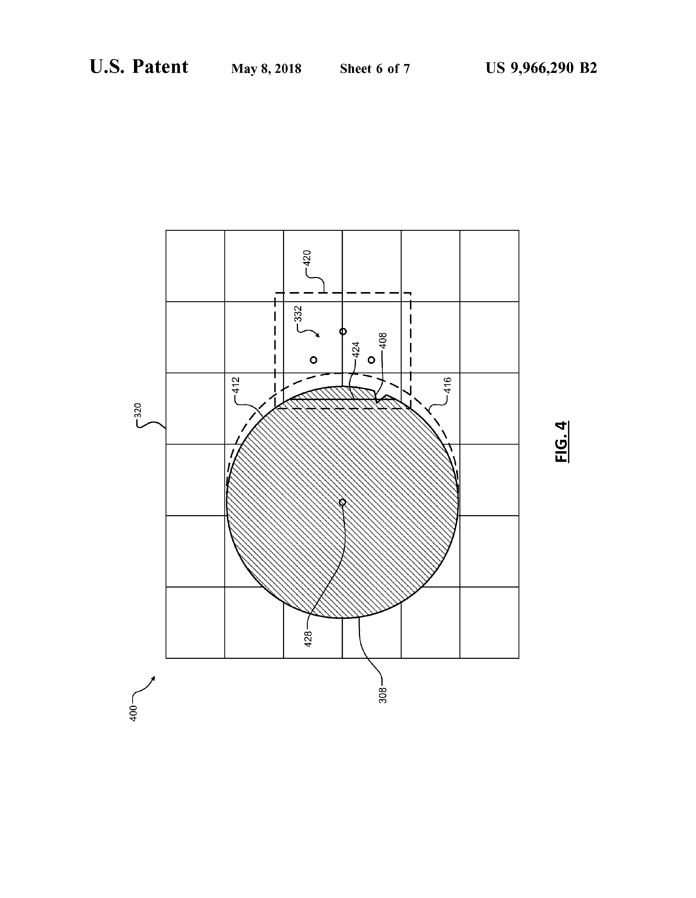
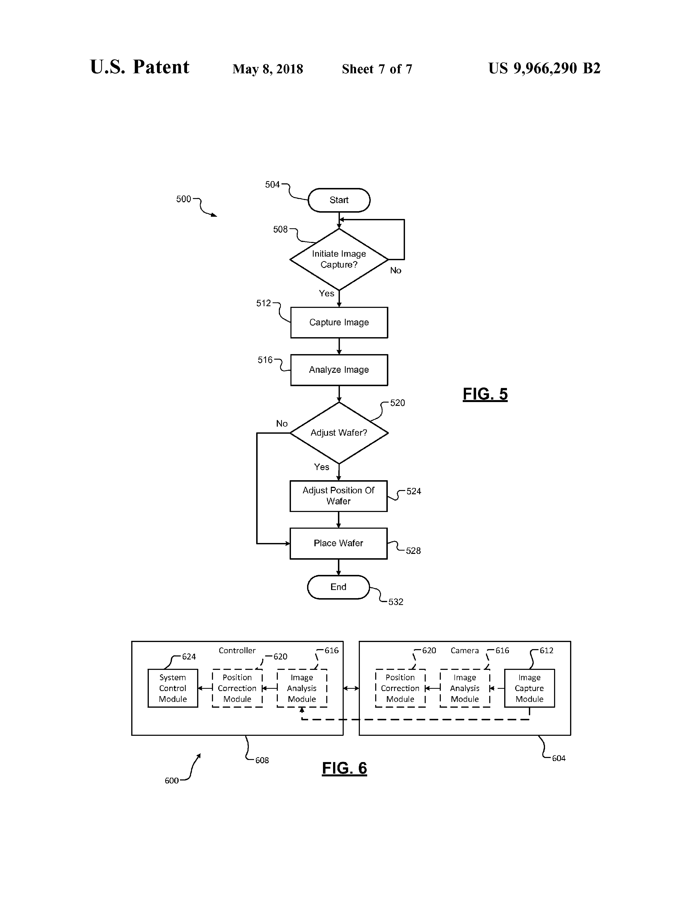

# US9966290B2 — CCD 카메라로 웨이퍼 정렬·센터링 (Lam Research)

| 항목 | 내용 |
|---|---|
| 원문 | `US9966290.pdf`(등록, 2018-05-08) · `US20170028560.pdf`(공개, 2017-02-02) |
| 출원인 | Lam Research |
| 출원일 | 2015-07-30 |
| 핵심 | 로봇 경로 위에서 내려다보는 고정 카메라(예: CCD)로 엔드이펙터 위 웨이퍼의 에지·노치·중심을 엔드이펙터의 비선형(직각삼각형) 기준 마킹과 비교해 평행이동과 회전 오프셋을 구하고, 임계값을 넘으면 로봇 위치를 보정해 다시 놓는다. |
| 관련도 | ○ 일부 요소가 같음 |
| 본 과제와의 관계 | 위치 + 회전 보정. 카메라는 고정형이다. |
| 링크 | [Google Patents](https://patents.google.com/patent/US9966290B2/en) |

---

## 상세 요약 (번역본 기준)

### 1. 해결하려는 문제
- 웨이퍼를 로드락 페데스탈에서 정확히 포착·이송하려면 페데스탈 위 웨이퍼 정렬이 필요함.
- 종래 얼라이너는 척으로 웨이퍼를 천천히 회전시키며 센서로 노치를 검출한 뒤 노치 위치·오프셋을 계산해 로봇에 제공하는 방식.
- 즉 정렬을 위해 웨이퍼(또는 페데스탈)를 회전시키는 별도 동작·장치가 필요함. 본 발명은 페데스탈이 정지한 채로 측정·조정이 가능하도록 함.

### 2. 핵심 구성

| 구성 | 참조번호 | 위치·역할 |
|---|---|---|
| 카메라(영상 촬영 장치) | 174, 304, 604 | 로봇 경로 위쪽, 렌즈 아래 방향. 로드락 위(316-2) 또는 경로상 인접 위치(316-1, 316-n) (도 3A) |
| 시야 / 축소된 시야 | 320 / 420 | 축소된 시야(420)도 에지·노치·기준 마킹만 들어오면 충분 (도 4) |
| 로봇·엔드이펙터 | 312, 324 | 웨이퍼(308)를 싣고 로드락(300) 페데스탈(328)로 이송 |
| 기준 마킹(엔드이펙터) | 332-1~3, 340 | 332: 원/점 3개를 직각삼각형(336)으로 배치, 340: 웨이퍼를 둘러싼 원의 일부 윤곽 (도 3C) |
| 기준 마킹(로드락) | 344-1~3, 348 | 344: 직각삼각형 배치, 348: 웨이퍼 둘레 원 (도 3D) |
| 웨이퍼 특징 | 408, 412, 424, 428 | 노치(408), 에지(412), 현(424), 중심(428) (도 4) |
| 공칭 위치 | 416 | 참조용 기준 위치 (도 4) |
| 모듈 | 612, 616, 620, 624 | 영상 촬영(612), 영상 분석(616), 위치 보정(620), 시스템 제어(624). 616·620은 카메라(604) 또는 제어기(608)에 위치 가능 (도 6) |

- 기준 마킹은 한 직선 위에 있지 않아야 하며(평면 정의), 웨이퍼 평면과 대략 동일 또는 평행한 평면에 배치.
- 마킹 모양은 원·점 외에 "x", "+" 등도 가능. 배열 파라미터(크기, 형상, 방향, 상대 각도)만 알려져 있으면 됨.

### 3. 동작 순서 (도 5, 방법 500)
1. 504 시작 → 508: 로봇 위치 정보로 촬영 개시 여부 판단(로봇이 미리 정해진 위치에 도달하면 트리거).
2. 512: 로봇 위 웨이퍼 영상 촬영(예: 비트맵).
3. 516: 영상 분석으로 로봇에 대한 웨이퍼 위치 결정.
   - 기준 마킹(332) 근처의 에지(412) 검출 → 에지로 현(424) 계산 → 현과 에지 곡률로 중심(428) 계산.
   - 기준 마킹(332)에 대한 중심(428)(및 노치(408))으로 병진·회전 위치 결정. 현 대신 접선·반지름·지름 사용 가능.
   - 공칭 위치 데이터(공칭 위치 웨이퍼의 이전 촬영 영상, 카메라 거리·각도·원근, 마킹 간 거리·각도 등 캘리브레이션 데이터) 함께 사용.
   - 촬영된 기준 마킹의 스큐(원근·스케일 불일치)를 알려진 파라미터와 비교해 보상 → 카메라 센서가 웨이퍼 평면과 평행할 필요 없음.
   - 시야가 작아 노치·에지가 부족하면 로봇이 시야 안에서 웨이퍼를 회전시키며 연속 촬영.
4. 520: 공칭 위치와의 차이를 병진 변위 임계값·회전 변위 임계값과 비교. 어느 하나라도 초과하면 524, 아니면 528.
5. 524: 로봇 위치 조정.
   - 방식 A: 놓기 전 조정. 기본 접근 경로(제1 위치)에서 차이만큼 오프셋된 제2 위치로 이동해 놓음 → 페데스탈 위 공칭 위치.
   - 방식 B: 그대로 놓은 뒤, 회수 전에 로봇을 조정해 회수 시 로봇 위 공칭 위치가 되게 하고 다시 놓음.
   - 필요 시 회수 → 카메라 위치로 복귀 → 재촬영 → 재배치를 여러 번 반복.
6. 528: 페데스탈·공정 셀 등에 웨이퍼를 놓음 → 532 종료.
- 구체적 수식·수치 임계값은 제시되지 않음.

### 4. 청구항 요지
- 청구항 1(시스템): 로봇 위 웨이퍼 영상 촬영 모듈 + 영상 분석 모듈(횡방향 위치와 웨이퍼 중심축 기준 회전 위치 모두 결정) + 로봇 위 비선형 배열 기준 마킹, (i) 배열 파라미터와 (ii) 웨이퍼 특징으로 회전 위치 결정 + 횡방향·회전 각각의 조정 데이터 계산 모듈 + 조정 데이터와 공칭 위치로 놓기/회수를 제어하는 시스템 제어 모듈.
- 청구항 11(방법): 청구항 1과 같은 한정을 단계로 기재.
- 주요 종속항: 촬영 위치가 로봇 경로상(2, 12) 또는 로드락 페데스탈 위(3, 13), 로봇이 미리 정해진 위치일 때 촬영(4, 14), 마킹 3개 이상(5, 15)·삼각형 배열(6, 16), 특징=에지·노치·중심(7, 17) 또는 현(9, 19), 파라미터=배열 각도(10, 20).

### 5. 대표 도면

*도 4 — 엔드이펙터 기준 마킹(332)과 웨이퍼 에지(412)·노치(408)·현(424)·중심(428), 공칭 위치(416), 축소된 시야(420)*

*도 5, 도 6 — 촬영→분석→임계값 판정→로봇 조정 흐름(500)과 모듈 구성(600)*

### 6. 본 과제(Y·Θ 얼라인먼트)와 비교
- 같은 점:
  - 카메라 영상으로 병진(횡방향)과 회전 오차를 함께 구해 이송 로봇 위치를 보정.
  - 알려진 기하 배열의 기준 마킹을 영상에서 찾아 기준 좌표로 사용.
  - 공칭(기준) 상태 영상·캘리브레이션 데이터와 비교해 보정량 산출.
- 다른 점:
  - 측정 대상이 웨이퍼 자체(에지·노치·중심)이고, 마커는 엔드이펙터/로드락의 단순 점 3개(직각삼각형). 본 과제는 QR형 마커 자체를 측정.
  - 카메라는 경로 위 고정형, 로봇이 정해진 위치에 오면 촬영 트리거.
  - 병진은 2축(횡·종) 오프셋 개념이며 Y 단일축 한정 아님.
  - 보정 후 놓기·회수 반복으로 수렴시키는 방식, 실시간 연속 보정은 아님. 수식·정밀도 수치 없음.
- 참고할 점:
  - 비선형(삼각형) 3점 이상 배열로 회전각을 정의하는 구조 → QR 파인더 패턴 3개 배치와 같은 원리, 각도 파라미터로 Θ 계산 근거.
  - 마킹의 알려진 거리·각도와 촬영 결과를 비교해 스큐(원근·스케일) 보상 → 카메라 비평행 설치 허용.
  - 병진·회전 임계값을 따로 두고 어느 하나라도 넘으면 보정하는 판정 구조.
  - 기본 경로(제1 위치)에 측정 오프셋을 더한 제2 위치로 이동하는 보정 적용 방식.
  - 보정 후 재촬영으로 검증·반복하는 폐루프 구조.
  - 현·곡률로 원 중심을 구하는 방식은 원형 마커/대상 중심 추정에 응용 가능.
