# 티칭 장치 및 이를 이용한 기판 정렬 장치 (US12074051B2)
- 원제: Teaching apparatus and substrate alignment apparatus using the same
- 원문: 같은 폴더의 PDF, https://patents.google.com/patent/US12074051B2/en
- 번역 기준: Google Patents 원문 텍스트를 한국어로 옮김. 도면은 PDF 참조.
- 도면: 원문 PDF 도면 시트 16장을 도면/ 폴더에 넣고 본문에서 처음 언급되는 곳에 삽입함

## 요약

티칭(teaching) 장치는 챔버; 챔버 내의 정전 척(electrostatic chuck)으로서, 로딩 영역을 둘러싸는 측벽을 포함하는 정전 척; 정전 척의 로딩 영역 상에 로딩되도록 구성되는 얼라이너(aligner); 얼라이너와 정전 척의 측벽 사이의 이격 영역들의 이격 거리들을 측정하여 측정 데이터를 획득하고 상기 측정 데이터를 전송하도록 구성되는 비전 센서(vision sensor); 얼라이너를 로딩 영역의 기준 위치 상에 로딩하고 비전 센서를 정전 척 위에 위치시키도록 구성되는 이송 로봇(transfer robot); 및 비전 센서로부터 전송된 측정 데이터에 기초하여 기준 위치를 재설정하고 이격 거리들을 균등화하도록 구성되는 제어기(controller)를 포함한다.

## 청구범위

청구된 것은 다음과 같다:

1. 티칭 장치로서,

챔버;

상기 챔버 내의 정전 척으로서, 로딩 영역을 둘러싸는 측벽을 포함하는 상기 정전 척;

상기 정전 척의 상기 로딩 영역 상에 로딩되도록 구성되는 얼라이너;

상기 얼라이너와 상기 정전 척의 상기 측벽 사이의 이격 영역들의 이격 거리들을 측정하여 측정 데이터를 획득하고 상기 측정 데이터를 전송하도록 구성되는 비전 센서;

상기 얼라이너를 상기 로딩 영역의 기준 위치 상에 로딩하고 상기 비전 센서를 상기 정전 척 위에 위치시키도록 구성되는 이송 로봇; 및

상기 비전 센서로부터 전송된 상기 측정 데이터에 기초하여 상기 기준 위치를 재설정하고 상기 이격 거리들을 균등화하도록 구성되는 제어기를 포함하는, 티칭 장치.

2. 청구항 1에 있어서, 상기 비전 센서는 각각 상기 이격 영역들에 패턴을 투영하고, 투영된 상기 패턴들에 기초하여 타겟 이미지들을 획득하며, 상기 타겟 이미지들에 기초하여 상기 이격 거리들을 산출하도록 더 구성되는, 티칭 장치.

3. 청구항 2에 있어서, 상기 비전 센서는,

지지 부재;

상기 지지 부재 상의 복수의 이미지 스캐닝 어셈블리들로서, 상기 타겟 이미지들을 획득하도록 구성되는 상기 복수의 이미지 스캐닝 어셈블리들; 및

상기 지지 부재 상의 제어 시스템을 포함하는, 티칭 장치.

4. 청구항 3에 있어서, 상기 제어 시스템은,

상기 복수의 이미지 스캐닝 어셈블리들로부터 상기 타겟 이미지들을 수신하고 상기 타겟 이미지들에 기초하여 상기 측정 데이터를 생성하도록 구성되는 프로세서; 및

상기 프로세서에 의해 생성된 상기 측정 데이터를 상기 제어기로 전송하도록 구성되는 무선 통신 인터페이스를 포함하는, 티칭 장치.

5. 청구항 3에 있어서, 상기 복수의 이미지 스캐닝 어셈블리들 각각은,

타겟들 상에 상기 패턴을 투영하도록 구성되는 제1 조명기; 및

상기 패턴이 투영된 상기 타겟들을 스캐닝하여 상기 타겟 이미지들을 획득하도록 구성되는 카메라를 포함하는, 티칭 장치.

6. 청구항 5에 있어서, 상기 제1 조명기는,

레이저 광을 방출하도록 구성되는 레이저 광원; 및

상기 레이저 광의 광 경로를 제어하도록 구성되는 광학 부재를 포함하고,

상기 패턴은 상기 레이저 광에 의해 상기 타겟들 상에 투영되는, 티칭 장치.

7. 청구항 3에 있어서,

타겟들 상에 광을 조사하도록 구성되는 제2 조명기를 더 포함하는, 티칭 장치.

8. 청구항 1에 있어서, 상기 얼라이너는 웨이퍼 형상을 갖는, 티칭 장치.

9. 청구항 8에 있어서, 상기 얼라이너의 상면은 블라스팅(blasting) 처리된, 티칭 장치.

10. 청구항 8에 있어서,

상기 얼라이너의 상면은 마커를 포함하고,

상기 마커는 상기 상면의 반사율보다 낮은 반사율을 갖는, 티칭 장치.

11. 청구항 1에 있어서,

상기 제어기는 상기 비전 센서로부터 전송된 상기 측정 데이터에 기초하여 오프셋 값을 산출하도록 더 구성되고,

상기 이송 로봇의 상기 기준 위치의 상기 재설정은 상기 오프셋 값에 기초하는, 티칭 장치.

12. 티칭 장치로서,

기판 지지 어셈블리로서, 로딩 영역을 둘러싸는 측벽을 포함하는 상기 기판 지지 어셈블리;

상기 로딩 영역 상에 로딩되도록 구성되는 얼라이너;

상기 얼라이너와 상기 기판 지지 어셈블리의 상기 측벽 사이의 이격 거리들을 측정하여 측정 데이터를 획득하고 상기 측정 데이터를 전송하도록 구성되는 비전 센서;

상기 얼라이너를 상기 로딩 영역 내로 로딩하고 상기 비전 센서를 상기 로딩 영역 위에 위치시키도록 구성되는 이송 로봇; 및

상기 비전 센서로부터 전송된 상기 측정 데이터에 기초하여 상기 이송 로봇의 기준 위치를 보정하도록 구성되는 제어기를 포함하는, 티칭 장치.

13. 청구항 12에 있어서, 상기 기판 지지 어셈블리는 정전 척인, 티칭 장치.

14. 청구항 13에 있어서, 상기 정전 척은,

플레이트로서, 상기 로딩 영역을 포함하는 상기 플레이트; 및

상기 플레이트의 둘레 상의 포커스 링으로서, 상기 측벽을 포함하는 상기 포커스 링을 포함하는, 티칭 장치.

15. 청구항 14에 있어서, 상기 포커스 링의 상면은,

상기 얼라이너의 상면보다 높은 제1 레벨의 제1 상면; 및

상기 얼라이너의 상기 상면보다 낮은 제2 레벨의 제2 상면을 포함하는, 티칭 장치.

16. 청구항 12에 있어서, 상기 이송 로봇은 상기 얼라이너의 중심과 상기 비전 센서의 중심이 서로 중첩되도록 상기 얼라이너를 로딩하도록 구성되는, 티칭 장치.

17. 기판 정렬 장치로서,

내부 공간을 포함하는 챔버로서, 상기 내부 공간에서 기판을 처리하도록 구성되는 상기 챔버;

상기 내부 공간 내의 기판 지지 어셈블리로서, 로딩 영역을 둘러싸는 측벽을 포함하는 상기 기판 지지 어셈블리;

상기 로딩 영역 상에 로딩되도록 구성되는 얼라이너;

상기 얼라이너와 상기 측벽 사이의 이격 거리들을 측정하여 측정 데이터를 획득하고 상기 측정 데이터를 전송하도록 구성되는 비전 센서;

상기 얼라이너, 상기 비전 센서 및 상기 기판을 상기 내부 공간 내로 로딩하고 상기 내부 공간 밖으로 언로딩하도록 구성되는 이송 로봇; 및

상기 비전 센서로부터 전송된 상기 측정 데이터에 기초하여 상기 이송 로봇을 티칭함으로써 상기 로딩 영역 내로의 상기 기판의 로딩을 위한 기준 위치를 보정하도록 구성되는 제어기를 포함하는, 기판 정렬 장치.

18. 청구항 17에 있어서, 상기 얼라이너는 상기 기판과 동일한 형상 및 무게를 갖는, 기판 정렬 장치.

19. 청구항 18에 있어서, 상기 기판은 웨이퍼인, 기판 정렬 장치.

20. 청구항 17에 있어서, 상기 얼라이너, 상기 비전 센서 및 상기 기판을 상기 내부 공간 내로 로딩하고 상기 내부 공간 밖으로 언로딩하는 것은,

상기 얼라이너를 상기 로딩 영역 내로 로딩하는 것,

상기 비전 센서를 상기 얼라이너 위에 배치하는 것,

상기 얼라이너 및 상기 비전 센서를 순차적으로 언로딩하는 것, 및

상기 비전 센서가 언로딩된 후 상기 기판을 상기 로딩 영역 내로 로딩하는 것을 포함하는, 기판 정렬 장치.

## 상세한 설명

### 관련 출원의 상호 참조 (CROSS-REFERENCE TO RELATED APPLICATION(S))

본 출원은 2021년 8월 27일 대한민국 특허청에 출원된 대한민국 특허출원 제10-2021-0114082호에 대해 35 USC 119(a)에 따른 우선권의 이익을 주장하며, 그 전체 개시 내용은 모든 목적을 위해 본 명세서에 참조로 포함된다.

### 배경기술 (BACKGROUND)

본 발명의 개념은 티칭 장치 및 이를 이용한 기판 정렬 장치에 관한 것이다.

반도체 소자는 소형화, 다기능화 및/또는 낮은 제조 비용과 같은 반도체 소자의 특성으로 인해 전자 산업에서 널리 사용된다. 반도체 소자는 포토리소그래피 공정, 식각 공정, 증착 공정, 이온 주입 공정 및 세정 공정과 같은 다양한 제조 공정에 의해 제조될 수 있다.

이러한 제조 공정들은 기판을 공정 챔버(process chamber) 내에 배치함으로써 수행될 수 있다. 그러나, 공정 챔버를 준비하는 과정에서(예를 들어, 제조 공정들을 수행하기 전에) 공정 챔버 내부 부품들의 위치가 변경될 수 있다. 부품들의 위치 변동은 제조 공정들의 공정 조건에 영향을 줄 수 있다. 따라서, 공정 챔버 내의 타겟 위치에 기판을 안착시키기 위하여, 공정 챔버 내 부품들의 미세한 위치 변화를 정밀하게 검사하고 그 검사 결과를 반영하기 위한 다양한 연구가 진행되고 있다.

### 발명의 내용 (SUMMARY)

일부 예시적인 실시예들은 공정 챔버 내 부품들의 위치의 미세한 변화를 반영하여 이송 로봇의 기준 위치를 재조정하도록 구성되는 티칭 장치를 제공한다.

일부 예시적인 실시예들은 공정 챔버 내의 타겟 위치에 기판을 안착시키도록 구성되는 기판 정렬 장치를 제공한다.

일부 예시적인 실시예들에 따르면, 티칭 장치는 챔버; 챔버 내의 정전 척으로서, 로딩 영역을 둘러싸는 측벽을 포함하는 정전 척; 정전 척의 로딩 영역 상에 로딩되도록 구성되는 얼라이너; 얼라이너와 정전 척의 측벽 사이의 이격 영역들의 이격 거리들을 측정하여 측정 데이터를 획득하고 상기 측정 데이터를 전송하도록 구성되는 비전 센서; 얼라이너를 로딩 영역의 기준 위치 상에 로딩하고 비전 센서를 정전 척 위에 위치시키도록 구성되는 이송 로봇; 및 비전 센서로부터 전송된 측정 데이터에 기초하여 기준 위치를 재설정하고 이격 거리들을 균등화하도록 구성되는 제어기를 포함한다.

일부 예시적인 실시예들에 따르면, 티칭 장치는 기판 지지 어셈블리로서, 로딩 영역을 둘러싸는 측벽을 포함하는 기판 지지 어셈블리; 로딩 영역 상에 로딩되도록 구성되는 얼라이너; 얼라이너와 기판 지지 어셈블리의 측벽 사이의 이격 거리들을 측정하여 측정 데이터를 획득하고 상기 측정 데이터를 전송하도록 구성되는 비전 센서; 얼라이너를 로딩 영역 내로 로딩하고 비전 센서를 로딩 영역 위에 위치시키도록 구성되는 이송 로봇; 및 비전 센서로부터 전송된 측정 데이터에 기초하여 이송 로봇의 기준 위치를 보정하도록 구성되는 제어기를 포함한다.

예시적인 실시예들에 따르면, 기판 정렬 장치는 내부 공간을 포함하는 챔버로서, 내부 공간에서 기판을 처리하도록 구성되는 챔버; 내부 공간 내의 기판 지지 어셈블리로서, 로딩 영역을 둘러싸는 측벽을 포함하는 기판 지지 어셈블리; 로딩 영역 상에 로딩되도록 구성되는 얼라이너; 얼라이너와 측벽 사이의 이격 거리들을 측정하여 측정 데이터를 획득하고 상기 측정 데이터를 전송하도록 구성되는 비전 센서; 얼라이너, 비전 센서 및 기판을 내부 공간 내로 로딩하고 내부 공간 밖으로 언로딩하도록 구성되는 이송 로봇; 및 비전 센서로부터 전송된 측정 데이터에 기초하여 이송 로봇을 티칭함으로써 로딩 영역 내로의 기판의 로딩을 위한 기준 위치를 보정하도록 구성되는 제어기를 포함한다.

### 도면의 간단한 설명 (BRIEF DESCRIPTION OF DRAWINGS)

본 발명의 개념의 상기 및 기타 양태, 특징 및 이점은 첨부 도면과 함께 다음의 상세한 설명으로부터 보다 명확하게 이해될 것이다:

도 1은 일부 예시적인 실시예들에 따른 티칭 장치의 개략적인 측면도이다;

도 2는 도 1의 이송 장치에 비전 센서가 로딩된 상태를 도 1의 I 방향에서 본 평면도이다;

도 3은 도 2의 비전 센서의 정면도이다;

도 4는 도 2의 비전 센서의 배면도이다;

도 5는 도 3의 II-II′ 선을 따라 취한 단면도이다;

도 6은 도 3의 회로부 및 도 2의 제어부의 개념도들을 제공한다;

도 7a 내지 도 7c는 도 1의 얼라이너의 일부 예시적인 실시예들을 도시한다;

도 8은 이미지 스캐닝 모듈의 동작을 설명하는 개념도이다;

도 9는 비전 센서가 타겟의 타겟 이미지를 획득하는 방법을 설명하는 개념도이다;

도 10은 도 9에서 비전 센서에 의해 획득된 타겟 이미지이다;

도 11은 예시적인 실시예에 따른 기판 정렬 장치를 이용하여 기판을 정렬하는 과정을 설명하는 흐름도이다;

도 12는 도 11의 동작 S40 및 S50을 상세히 설명하는 흐름도이다;

도 13은 도 1의 티칭 장치가 채용된 기판 정렬 장치의 일 예를 설명하는 개략적인 측면도이다; 그리고

도 14 내지 도 19는 도 13의 기판 정렬 장치에 의해 기판이 정렬되는 과정을 설명하는 개략적인 평면도들이다.

### 발명을 실시하기 위한 구체적인 내용 (DETAILED DESCRIPTION)

이하, 첨부된 도면을 참조하여 일부 예시적인 실시예들을 설명하며, 전체에 걸쳐 동일한 참조 부호는 동일한 구성요소를 지칭한다.

본 명세서에서 "약" 또는 "실질적으로"라는 용어가 수치 값과 관련하여 사용되는 경우, 관련 수치 값은 명시된 수치 값 주변의 제조 또는 작동 공차(예를 들어, ±10%)를 포함하는 것으로 의도된다. 또한, "실질적으로"가 기하학적 형상과 관련하여 사용되는 경우, 기하학적 형상의 정밀성이 요구되는 것이 아니라 형상에 대한 허용 범위가 본 개시의 범위 내에 있음을 의도한다. 나아가, 수치 값 또는 형상이 "약" 또는 "실질적으로"로 수식되는지 여부와 관계없이, 이러한 값과 형상은 명시된 수치 값 또는 형상 주변의 제조 또는 작동 공차(예를 들어, ±10%)를 포함하는 것으로 해석되어야 함이 이해될 것이다.

도 1은 일부 예시적인 실시예들에 따른 티칭 장치의 개략적인 측면도이고, 도 2는 도 1의 이송 장치에 비전 센서가 로딩된 상태를 도 1의 I 방향에서 본 평면도이다. 도 3은 도 2의 비전 센서의 정면도이고, 도 4는 도 2의 비전 센서의 배면도이다. 도 5는 도 3의 II-II′ 선을 따라 취한 단면도이고, 도 6은 도 3의 회로부 및 도 2의 제어부의 개념도들을 제공한다. 도 7a 내지 도 7c는 도 1의 얼라이너(20)의 다양한 실시예들을 도시한다. 도 3에서는 도 5에 도시된 커버 부재(500)의 도시가 생략되어 있다.

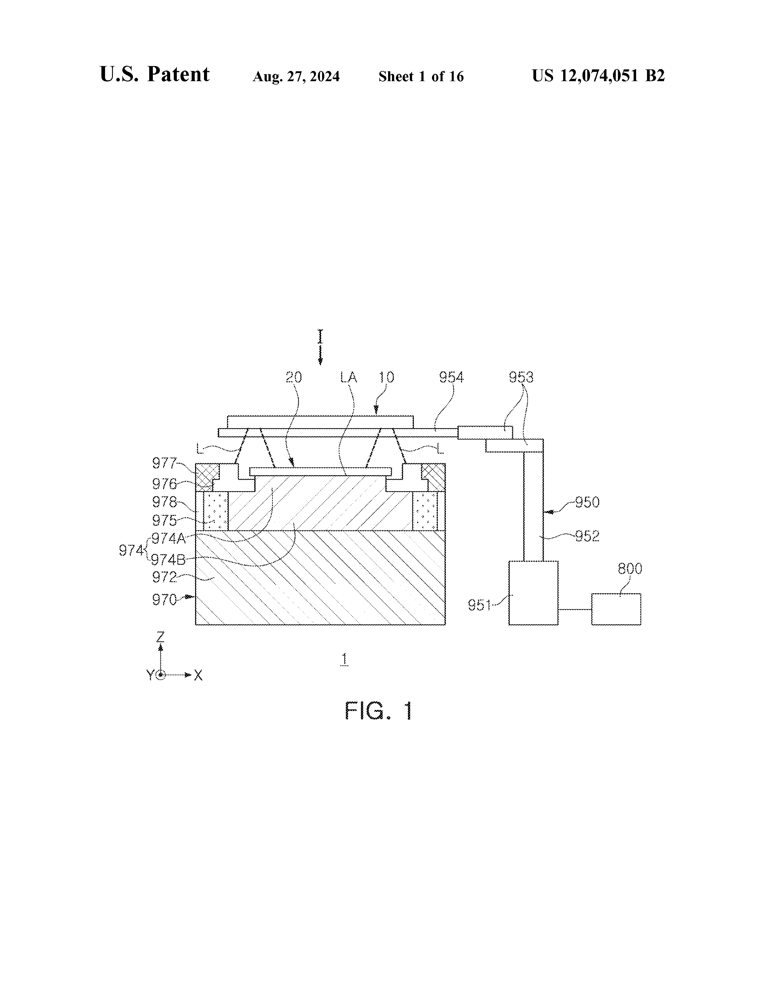
*도 1 — 티칭 장치의 개략적인 측면도*

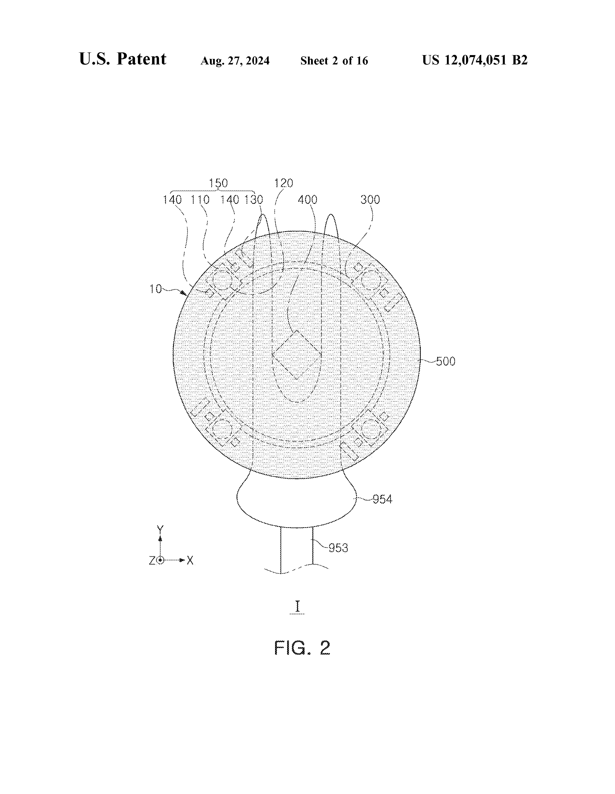
*도 2 — 이송 장치에 비전 센서가 로딩된 상태를 도 1의 I 방향에서 본 평면도*

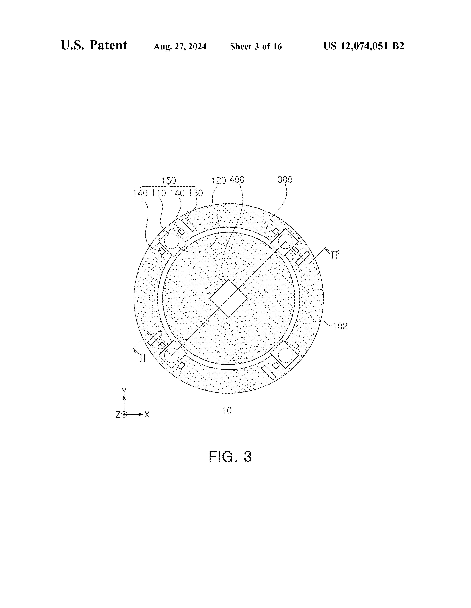
*도 3 — 비전 센서의 정면도*

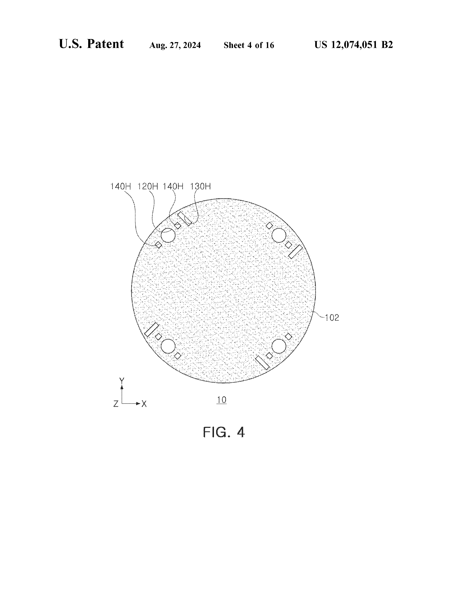
*도 4 — 비전 센서의 배면도*

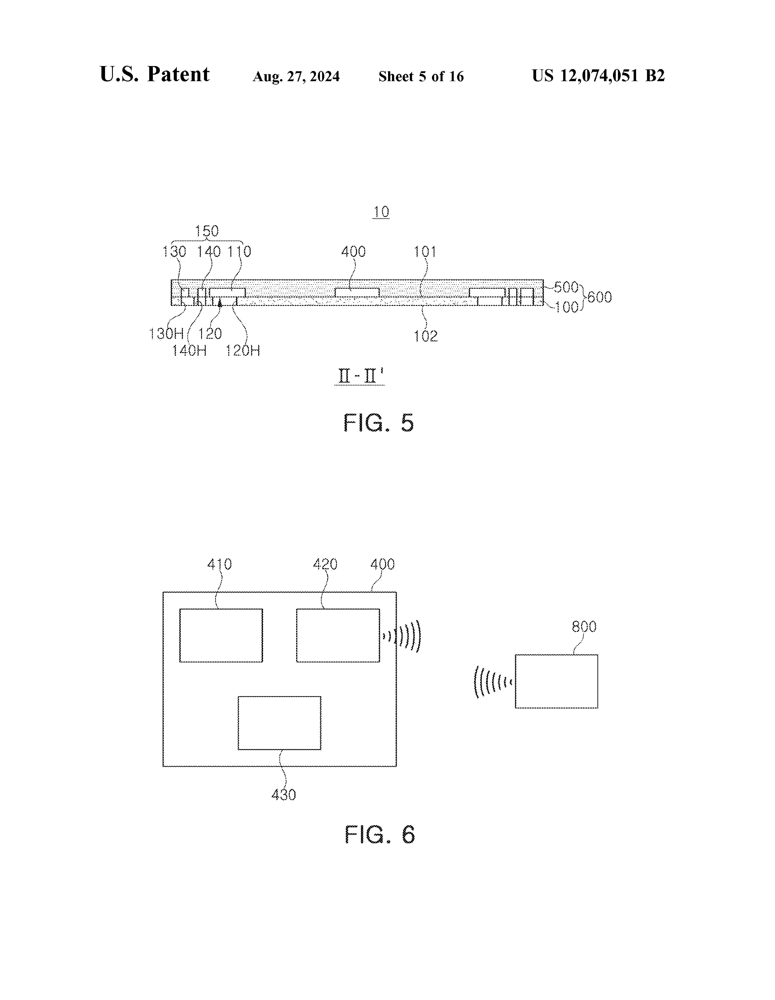
*도 5, 도 6 — 도 3의 II-II′ 단면도 / 회로부 및 제어부의 개념도*

도 1을 참조하면, 일부 예시적인 실시예들에 따른 티칭 장치(1)는 정전 척(970), 이송 로봇(950), 얼라이너(20), 비전 센서(10) 및 제어부(control unit)(800)를 포함할 수 있다. 후술하는 바와 같이, 얼라이너(20)는 정전 척(970) 상에 로딩될 수 있다. 비전 센서(10)는 정전 척(970) 상에 로딩된 얼라이너(20) 위에 배치되도록 구성될 수 있으며, 정전 척(970)의 측벽과 얼라이너(20)의 에지 사이의 이격 거리가 비전 센서(10)를 통해 측정될 수 있다. 후술하는 바와 같이, 측정된 이격 거리에 기초하여 이송 로봇(950)의 동작이 보정될 수 있으며, 이에 따라 이송 로봇(950)은 예를 들어 후속 공정에서 반도체 기판이 정전 척(970)의 타겟 위치에 배치되도록 할 수 있다.

정전 척(970)은 하부 전극으로 기능하는 베이스 바디(972), 베이스 바디(972)의 상면에 부착되며 내부에 전극을 포함하는 플레이트(974), 플레이트(974)의 외주면을 둘러싸는 에지 링(975), 에지 링(975) 상에 배치되는 포커스 링(focus ring)(976), 및 포커스 링(976)을 둘러싸는 절연 링(977)을 포함할 수 있다.

플레이트(974)는 얼라이너(20)가 안착될 수 있는 로딩 영역(LA)을 포함한다. 로딩 영역(LA)은 예를 들어 플레이트의 상면 상에 있을 수 있으며, 플레이트(974)의 로딩 영역(LA)은 원형 형상을 갖도록 형성될 수 있다. 플레이트(974)의 상부(974A)와 하부(974B)의 형상은 서로 다를 수 있다. 예를 들어, 플레이트(974)의 하부(974B)의 직경은 상부(974A)의 직경보다 클 수 있다. 이 경우, 플레이트(974)의 측면은 단차를 가질 수 있다. 그러나 예시적인 실시예들은 이에 한정되지 않으며, 예를 들어 플레이트(974)의 상부(974A)와 하부(974B)의 직경은 동일할 수 있다.

포커스 링(976)은 플레이트(974)의 상부(974A)를 둘러싸는 링 형상을 가질 수 있다. 포커스 링(976)의 일부는 얼라이너(20)가 배치되는 플레이트(974)의 상부(974A)를 둘러쌀 수 있다.

포커스 링(976)의 일부는 얼라이너(20)의 에지 아래에 배치될 수 있으며, 플레이트(974)의 상부(974A)의 측면을 덮을 수 있다. 이는 도 8을 참조하여 설명될 것이다. 포커스 링(976)의 내측면에는 단차가 형성될 수 있다. 내측면은 플레이트(974)의 상부(974A)의 측면에 가장 가까운 포커스 링(976)의 면을 지칭할 수 있다. 예를 들어, 포커스 링(976)의 상면은 제1 상면(976U1) 및 제2 상면(976U2)을 포함할 수 있다. 제1 상면(976U1)은 얼라이너(20)의 상면(21)보다 높은 레벨에 배치될 수 있고, 제2 상면(976U2)은 얼라이너(20)의 상면(21)보다 낮은 레벨에 배치될 수 있다. 제1 상면(976U1)과 제2 상면(976U2)을 연결하는 측벽(976S)은 얼라이너(20)의 에지로부터 거리 D만큼 이격되도록 배치될 수 있다.

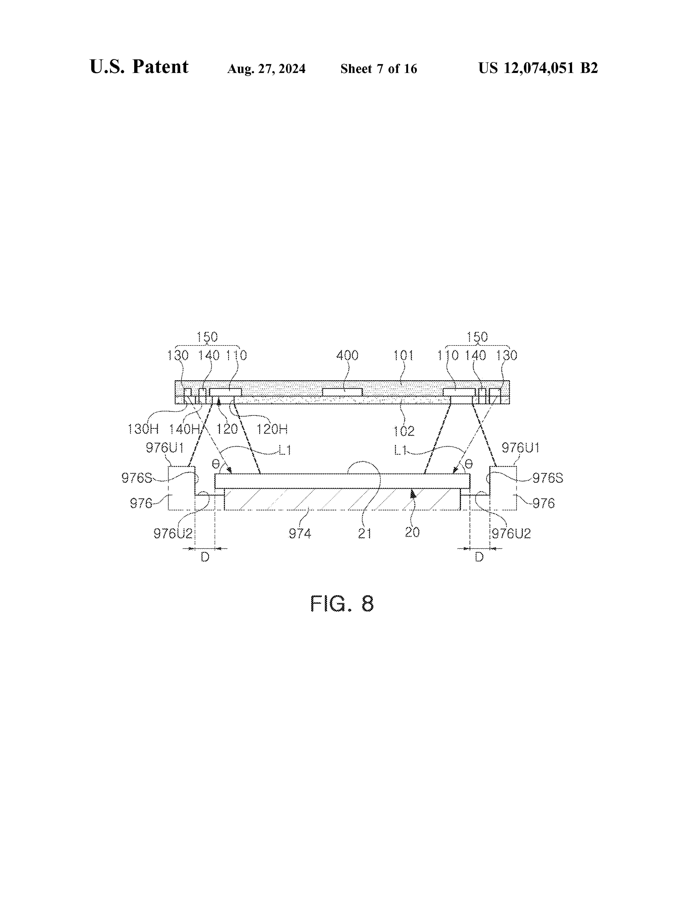
*도 8 — 이미지 스캐닝 모듈의 동작을 설명하는 개념도*

다시 도 1을 참조하면, 포커스 링(976)은 플레이트(974)의 하부(974B)의 상면의 적어도 일부를 덮을 수 있다. 포커스 링(976)은 예를 들어 실리콘(Si), 실리콘 카바이드(SiC) 및/또는 석영(SiO2) 중 적어도 하나로 형성될 수 있다.

에지 링(975)은 플레이트(974)의 하부(974B)를 둘러싸는 링 형상을 가질 수 있다. 에지 링(975)은 포커스 링(976) 및 절연 링(977) 아래에 배치될 수 있으며, 포커스 링(976) 및 절연 링(977)을 지지할 수 있다. 에지 링(975)은 금속성 물질을 포함할 수 있다. 예를 들어, 에지 링(975)은 알루미늄을 포함할 수 있다.

절연 링(977)은 포커스 링(976)의 외측 에지를 둘러싸는 링 형상을 가질 수 있다. 절연 링(977)은 에지 링(975)의 상면 중 포커스 링(976)에 의해 덮이지 않은 나머지 부분을 덮도록 구성될 수 있다. 절연 링(977)은 절연 물질을 포함할 수 있다. 예를 들어, 절연 링(977)은 세라믹, Si, SiC 및/또는 석영 중 적어도 하나를 포함할 수 있다.

절연 링(977)은 지지 링(978)에 의해 지지될 수 있다. 지지 링(978)은 절연 링(977)의 하면의 일부와 접촉할 수 있다. 도 1에 도시된 바와 같이, 지지 링(978)은 에지 링(975)의 외주면을 둘러싸도록 배치될 수 있다.

베이스 바디(972)는 플레이트(974), 에지 링(975) 및 지지 링(978) 아래에 배치될 수 있다. 베이스 바디(972)는 절연 물질, 예를 들어 세라믹을 포함할 수 있다.

이송 로봇(950)은 얼라이너(20)를 정전 척(970)의 로딩 영역(LA) 내로 로딩하거나 및/또는 정전 척(970) 상에 로딩된 얼라이너(20)를 언로딩할 수 있다. 이송 로봇(950)은 또한 후속 제조 공정에서 예를 들어 반도체 웨이퍼를 정전 척(970) 상에 로딩 및/또는 언로딩할 수 있다. 또한, 일부 예시적인 실시예들에서, 이송 로봇(950)은 비전 센서(10)를 얼라이너(20) 위에 위치시킬 수 있다.

이송 로봇(950)은 다단 암(arm)(953), 및 적재물이 적재되는 핸드(hand)(954)를 가질 수 있다. 핸드(954)는 암(953)의 단부에 배치될 수 있다. 암(953)은 구동 샤프트(952)에 의해 상하로 이동될 수 있거나, 및/또는 구동부(951)의 회전에 의해 구동 샤프트(952)를 중심으로 회전 이동될 수 있다. 이송 로봇(950)의 동작은 제어부(800)에 의해 제어될 수 있다. 제어부(800)는 제어기로 지칭될 수도 있다. 일부 예시적인 실시예들에서, 이송 로봇(950)의 핸드(954) 상의 적재물은 얼라이너(20) 및 비전 센서(10)일 수 있다. 이송 로봇(950)은 예를 들어 제어부(800)의 제어 하에, 적재물을 로딩 영역(LA)의 기준 위치 상에(및/또는 기준 위치에) 반복적으로 위치시키거나 및/또는 적재물을 기준 위치 위에 배치할 수 있다. 예를 들어, 이송 로봇(950)은 얼라이너(20)를 로딩 영역(LA)의 기준 위치에 반복적으로 로딩 및/또는 언로딩할 수 있으며, 비전 센서(10)를 기준 위치 위에 배치할 수 있다.

얼라이너(20)는 비전 센서(10)에 의해 획득되는 타겟 이미지의 식별성을 향상시키기 위해 제공된다. 얼라이너(20)는 플레이트(974)의 상부(974A)의 로딩 영역(LA) 상에 안착될 수 있다. 얼라이너(20)는 집적 회로 형성에 사용되는 반도체 기판과 실질적으로 동일한 형상 및 재질로 형성될 수 있다. 예를 들어, 일부 실시예들에 따르면, 얼라이너(20)는 웨이퍼 형상을 가질 수 있다. 예를 들어, 얼라이너(20)는 200 mm 내지 300 mm 사이의 직경(예를 들어, 200 mm 또는 300 mm)을 갖는 웨이퍼 형상을 가질 수 있다. 일부 예시적인 실시예들에 따르면, 얼라이너(20)의 상면은 비전 센서(10)에 의해 투영되는 패턴들을 쉽게 인식할 수 있도록 표면 처리되거나 그 위에 배치되는 마커가 제공될 수 있다.

얼라이너(20)의 상면(21)의 일부 예들을 도 7a 내지 도 7c를 참조하여 설명하나, 예시적인 실시예들은 이에 한정되지 않는다.

도 7a를 참조하면, 얼라이너(20A)의 상면(21A)은 블라스팅 공정을 거칠 수 있다. 예를 들어, 얼라이너(20A)의 상면(21A)의 반사율이 상대적으로 지나치게 높으면, 비전 센서(10)로부터 조사된 레이저 광이 얼라이너(20A)의 상면(21A)에서 반사되어, 얼라이너(20)의 위치를 식별하기 어려울 수 있다. 예를 들어, 얼라이너(20A)의 상면(21A)의 반사율이 지나치게 높으면 레이저 광이 비전 센서(10)에 대해 비스듬한 각도로 대부분 반사될 수 있다. 얼라이너(20A)의 상면(21A)이 블라스팅되면 상면(21A)의 반사율이 감소될 수 있으며, 이에 따라 비전 센서(10)를 통해 얼라이너(20)의 위치가 쉽게 식별될 수 있다.

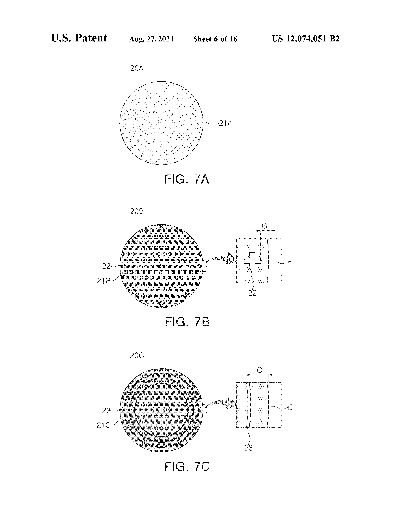
*도 7a, 도 7b, 도 7c — 도 1의 얼라이너의 예시적인 실시예들 (블라스팅 상면 / 십자 마커 / 원형 마커)*

도 7b를 참조하면, 얼라이너(20B)의 상면(21B) 상에 십자 형상의 마커(22)가 형성될 수 있다. 도 7c를 참조하면, 얼라이너(20C)의 상면(21C) 상에 원형 마커(23)가 형성될 수 있다. 이 경우, 마커(22, 23)와 얼라이너(20)의 에지(E) 사이의 간격(G)의 값이 제어부(800)에 (예를 들어, 미리) 저장될 수 있다. 따라서, 제어부(800)는 마커(22, 23)의 위치를 식별하고, 식별된 마커(22, 23)의 위치로부터 얼라이너(20)의 에지(E)의 위치를 산출할 수 있다.

다시 도 1 및 도 2를 참조하면, 비전 센서(10)는 이송 로봇(950)의 핸드(954) 상에 로딩되어 얼라이너(20) 위에 배치될 수 있다. 도 3, 도 4 및 도 5를 참조하면, 비전 센서(10)는 지지 부재(100)를 포함할 수 있다. 지지 부재(100)는 웨이퍼 형상을 가질 수 있으나, 그 형상은 이에 한정되지 않는다. 예를 들어, 지지 부재(100)는 웨이퍼 형상 및/또는 십자 형상과 같은 다양한 형상을 가질 수 있다. 지지 부재(100)는 서로 대향하는 제1 면(101) 및 제2 면(102)을 가질 수 있으며, 이를 관통하는 복수의 홀(120H, 130H, 140H)을 포함할 수 있다.

도 5 및 도 9를 참조하면, 비전 센서(10)는 얼라이너(20)의 에지(E)와 포커스 링(976)의 측벽(976S) 사이의 이격 거리(D)를 식별하기 위한 것이다. 비전 센서(10)는 지지 부재(100)의 제1 면(101) 상에 배치되는 이미지 스캐닝 모듈(150)을 포함할 수 있다. 이미지 스캐닝 모듈(150)은 타겟(TG)의 이미지를 획득하기 위한 것이다. 타겟(TG)은 예를 들어 얼라이너(20)의 일부 영역, 포커스 링(976)의 일부 영역, 및 얼라이너(20)의 에지(E)와 포커스 링(976)의 측벽(976S) 사이의 이격 영역(SA)을 포함할 수 있다.

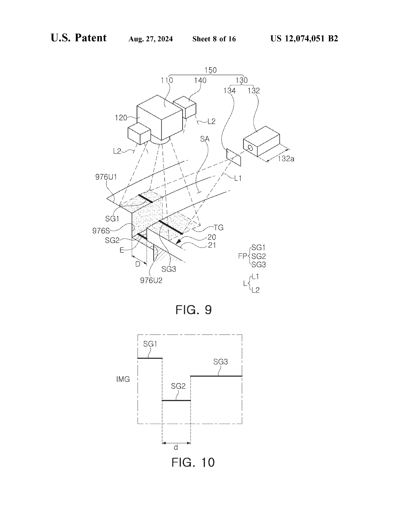
*도 9, 도 10 — 비전 센서가 타겟 이미지를 획득하는 방법의 개념도 / 도 9에서 획득된 타겟 이미지*

이미지 스캐닝 모듈(150)은 이미지 스캐닝 어셈블리로 지칭될 수도 있으며, 카메라(110), 제1 조명기(130) 및/또는 제2 조명기(140)를 포함할 수 있다. 카메라(110)는 카메라(110)의 렌즈부(120)가 (예를 들어, 복수의 홀(120H, 130H, 140H) 중) 대응하는 홀(120H)과 중첩되도록 지지 부재(100) 상에 배치될 수 있다. 렌즈부(120)는 렌즈 어셈블리로 지칭될 수도 있다. 카메라(110)는 대응하는 홀(120H)을 통해 타겟(TG)의 이미지를 스캐닝하도록 구성될 수 있다. 제1 조명기(130)는 (예를 들어, 복수의 홀(120H, 130H, 140H) 중) 대응하는 홀(130H)과 중첩되도록 지지 부재(100) 상에 배치될 수 있다. 제1 조명기(130)는 대응하는 홀(130H)을 통해 타겟(TG) 상에 패턴(예를 들어, 프린지 패턴(fringe pattern))을 투영하도록 구성될 수 있다. 제2 조명기(140)는 (예를 들어, 복수의 홀(120H, 130H, 140H) 중) 대응하는 홀(140H)과 중첩되도록 지지 부재(100) 상에 배치될 수 있다. 제2 조명기(140)는 대응하는 홀(140H)을 통해 타겟(TG) 상에 가시광을 조사하도록 구성될 수 있다. 일부 예시적인 실시예들에 따르면, 제2 조명기(140)는 생략될 수 있다.

도 3을 참조하면, 이미지 스캐닝 모듈(150)은 복수의 이미지 스캐닝 모듈로 제공될 수 있다. 이 경우, 복수의 이미지 스캐닝 모듈(150)은 지지 부재(100)의 제1 면(101) 상에 서로 이격되어 배치될 수 있다. 예를 들어, 복수의 이미지 스캐닝 모듈(150)은 지지 부재(100)의 에지를 따라 등간격으로 서로 이격되어 배열될 수 있다. 지지 부재(100)의 제1 면(101) 상에 고정 부재(300)가 제공될 수 있으며, 복수의 이미지 스캐닝 모듈(150)은 고정 부재(300)에 결합될 수 있다. 복수의 이미지 스캐닝 모듈(150)은 고정 부재(300)에 의해 지지 부재(100) 상에 고정될 수 있으나, 예시적인 실시예들은 이에 한정되지 않는다. 일부 예시적인 실시예에 따르면, 고정 부재(300)는 생략될 수 있다. 도 3은 네 개의 이미지 스캐닝 모듈(150)이 지지 부재(100) 상에 등간격으로 배치된 것을 도시하나, 예시적인 실시예들은 이에 한정되지 않는다. 일부 예시적인 실시예들에 따르면, 세 개, 다섯 개 및/또는 그 이상의 이미지 스캐닝 모듈(150)이 지지 부재(100) 상에 등간격으로 배치될 수 있다.

도 3, 도 5 및 도 6을 참조하면, 비전 센서(10)는 지지 부재(100)의 제1 면(101) 상에 배치되는 회로부(400)를 포함할 수 있다. 예를 들어, 회로부(400)는 지지 부재(100)의 중앙부 상에 배치될 수 있으나, 그 위치는 이에 한정되지 않는다. 회로부(400)는 다양한 데이터를 처리하는 프로세서(410), 프로세서(410)에 의해 처리된 다양한 데이터를 외부 장치(예컨대 제어부(800))로 전송하고 외부 장치로부터 제공된 다양한 데이터를 프로세서(410)로 전달하는 무선 통신 모듈(420), 및/또는 비전 센서(10)에 전력을 공급하는 배터리 모듈(430)을 포함할 수 있다. 회로부(400)는 제어 시스템으로 지칭될 수도 있다. 프로세서(410), 무선 통신 모듈(420) 및 배터리 모듈(430)은 데이터 버스를 통해 서로 연결될 수 있다. 프로세서(410)는 이미지 스캐닝 모듈(150)로부터 타겟(TG)의 이미지를 수신할 수 있으며, 수신된 이미지에 기초하여 데이터를 생성할 수 있다. 무선 통신 모듈(420)은 프로세서(410)에 의해 생성된 데이터를 제어부(800)로 전송할 수 있다. 무선 통신 모듈(420)은 예를 들어 근거리 통신 방식을 이용하여 제어부(800)와 통신하도록 구성될 수 있다. 예를 들어, 근거리 통신 방식은 블루투스(Bluetooth), 와이파이 다이렉트(WiFi direct) 및 적외선 통신(IrDA) 등 중 적어도 하나를 포함할 수 있다. 무선 통신 모듈(420)은 무선 통신 인터페이스로 지칭될 수도 있다. 단일 유닛에 통합된 것으로 도시되었으나, 예시적인 실시예들은 이에 한정되지 않으며, 프로세서(410), 무선 통신 모듈(420) 및 배터리 모듈(430)은 예를 들어 함께 및/또는 별개로 구성될 수 있다.

다시 도 3, 도 4 및 도 5를 참조하면, 비전 센서(10)는 지지 부재(100)의 제1 면(101) 상에 배치되는 커버 부재(500)를 포함할 수 있다. 커버 부재(500)는 지지 부재(100)의 제1 면(101)을 덮을 수 있으며, 이미지 스캐닝 모듈(150), 고정 부재(300) 및 회로부(400)를 덮을 수 있다. 지지 부재(100)와 커버 부재(500)는 하우징(600)을 구성할 수 있으며, 이미지 스캐닝 모듈(150), 고정 부재(300) 및 회로부(400)는 하우징(600)의 내부에 제공될 수 있다. 하우징(600)은 웨이퍼 형상을 가질 수 있으나, 예시적인 실시예들은 이에 한정되지 않는다. 예를 들어, 하우징(600)은 웨이퍼 형상 및/또는 십자 형상과 같은 다양한 형상을 가질 수 있다. 일부 예시적인 실시예들에 따르면, 하우징(600)은 반도체 집적 회로 형성에 사용되는 반도체 기판의 직경보다 큰 직경을 갖는 웨이퍼 형상을 가질 수 있다.

도 8은 이미지 스캐닝 모듈의 동작을 설명하는 개념도이고, 도 9는 비전 센서가 타겟(TG)의 타겟 이미지를 획득하는 방법을 설명하는 개념도이다. 도 10은 도 9에서 비전 센서에 의해 획득된 타겟 이미지이다.

도 8 및 도 9를 참조하면, 비전 센서(10)는 얼라이너(20) 위에 배치될 수 있다. 이미지 스캐닝 모듈(150)의 제1 조명기(130)는 대응하는 홀(130H)을 통해 얼라이너(20)의 에지에 제1 광(L1)을 조사할 수 있다. 제1 광(L1)은 타겟(TG)에 대해 각도 θ로 경사지게 조사될 수 있으며, 제1 광(L1)에 의해 타겟(TG) 상에 패턴(예를 들어, 프린지 패턴)이 투영될 수 있다. 제1 광(L1)은 예를 들어 레이저 광일 수 있다. 이미지 스캐닝 모듈(150)의 카메라(110)는 패턴(예를 들어, 프린지 패턴)이 투영된 타겟(TG)의 이미지를 스캐닝할 수 있다. 이에 따라, 이미지 스캐닝 모듈(150)에 의해 타겟의 제1 타겟 이미지가 획득될 수 있다.

이미지 스캐닝 모듈(150)에 의해 획득된 제1 타겟 이미지는 회로부(400)로 전송될 수 있다. 예를 들어, 도 6의 프로세서(410)는 이미지 스캐닝 모듈(150)로부터 제1 타겟 이미지를 수신할 수 있으며, 제1 타겟 이미지를 처리하여 제1 타겟 이미지에 기초한 데이터(이하, '측정 데이터')를 생성할 수 있다. 프로세서(410)는 제1 타겟 이미지에 기초하여 타겟(TG)의 3차원 모델을 생성할 수 있으며, 생성된 3차원 모델에 기초하여 얼라이너(20)의 에지(E)와 포커스 링(976)의 측벽(976S) 사이의 이격 거리(D)를 포함하는 측정 데이터를 생성할 수 있다. 프로세서(410)에 의해 생성된 측정 데이터는 도 6의 무선 통신 모듈(420)을 통해 제어부(800)로 전송될 수 있다.

도 8, 도 9 및 도 10을 참조하면, 이미지 스캐닝 모듈(150)의 제1 조명기(130)는 레이저 광원(132), 및 레이저 광원(132)으로부터 방출된 제1 광(L1)(예를 들어, 레이저 광)의 광 경로를 제어하는 광학 부재(134)를 포함할 수 있다. 레이저 광원(132)은 그 장축(132a)이 지지 부재(100)의 제1 면(101)과 평행하도록 배치될 수 있다. 광학 부재(134)는 제1 광(L1)이 대응하는 홀(130H)을 통해 타겟(TG)의 표면에 대해 각도 θ로 경사지게 조사되도록 제1 광(L1)의 광 경로를 제어할 수 있다. 일부 예시적인 실시예들에서, 예를 들어, 광학 부재(134)는 각도 θ를 조절하도록 구성되는 미러 및/또는 프리즘을 포함할 수 있다. 일부 예시적인 실시예에서, 광학 부재는 각도 θ를 조절하기 위해 예를 들어 액추에이터에 연결될 수 있다. 제1 광(L1)에 의해 타겟(TG) 상에 패턴(FP)(예를 들어, 프린지 패턴)이 투영될 수 있다. 이미지 스캐닝 모듈(150)의 카메라(110)는 패턴(FP)이 투영된 타겟(TG)의 이미지를 스캐닝(예를 들어, 촬영)할 수 있으며, 이에 따라 타겟(TG)의 제1 타겟 이미지(IMG)가 획득될 수 있다. 패턴(FP)은 예를 들어 라인 형상을 갖는 프린지 패턴일 수 있다. 이하, 패턴(FP)이 라인 형상을 갖는 프린지 패턴인 경우를 예로 들어 설명하나, 예시적인 실시예들은 이에 한정되지 않는다. 예를 들어, 패턴(FP)은 다양한 형상을 갖는 프린지 패턴일 수 있다.

타겟(TG)의 표면이 평면인 경우, 패턴(FP)은 타겟(TG)의 표면 상에 단일 라인의 형태로 투영될 수 있다. 따라서, 제1 타겟 이미지에서 단일 라인의 형태로 나타난 부분은 평면임을 알 수 있다.

또한, 도 9 및 도 10에 도시된 바와 같이, 타겟(TG)의 표면이 서로 다른 레벨을 갖는 평면들로 형성된 경우, 패턴(FP)은 표면의 레벨에 따라 복수의 세그먼트로 분할되어 도 10에 도시된 바와 같이 투영될 수 있다. 예를 들어, 제1 세그먼트(SG1)는 포커스 링(976)의 제1 상면(976U1)의 일부 상에 투영될 수 있고, 제2 세그먼트(SG2)는 포커스 링(976)의 제2 상면(976U2)의 일부 상에 투영될 수 있으며, 제3 세그먼트(SG3)는 얼라이너(20)의 상면(21)의 일부 상에 투영될 수 있다. 따라서, 도 10에 도시된 제2 세그먼트(SG2)의 길이 d를 측정하면, 포커스 링(976)의 측벽(976S)과 얼라이너(20)의 에지(E) 사이의 이격 거리(D)를 산출할 수 있다. 프로세서(도 6의 410)는 상술한 방법에 따라 제1 타겟 이미지(IMG)에 포함된 패턴(FP)의 형상을 분석함으로써, 포커스 링(976)의 측벽(976S)과 얼라이너(20)의 에지(E) 사이의 이격 거리(D)를 산출한다. 프로세서(410)는 산출된 이격 거리(D)를 포함하는 측정 데이터를 생성할 수 있다. 이미지 스캐닝 모듈(150)이 복수의 이미지 스캐닝 모듈(150)에 포함되는 경우, 이미지 스캐닝 모듈(150)의 개수에 대응하는 개수의 측정 데이터가 생성될 수 있다. 프로세서(410)에 의해 생성된 측정 데이터는 도 6의 무선 통신 모듈(420)을 통해 제어부(800)로 전송될 수 있다.

이미지 스캐닝 모듈(150)의 제2 조명기(140)는 LED 광원을 포함할 수 있다. 예를 들어, LED 광원은 예컨대 가시광을 포함하는 제2 광(L2)을 방출할 수 있다. 제2 조명기(140)는 대응하는 홀(140H)을 통해 얼라이너(20)의 타겟(TG)에 제2 광(L2)을 조사할 수 있다. 제2 광(L2)은 타겟(TG)을 전체적으로 비추도록 넓은 빔 각도로 조사될 수 있다.

이미지 스캐닝 모듈(150)의 카메라(110)는 제2 광(L2)이 조사된 타겟(TG)의 이미지를 스캐닝할 수 있다. 이에 따라, 이미지 스캐닝 모듈(150)에 의해 타겟의 제2 타겟 이미지가 획득될 수 있다. 제1 타겟 이미지와 달리, 제2 타겟 이미지는 타겟(TG)의 전체 표면을 스캐닝하여 얻은 이미지로 나타날 수 있다. 예를 들어, 제2 타겟 이미지는 타겟의 표면을 촬영하여 얻은 이미지일 수 있다.

제2 타겟 이미지는 제1 타겟 이미지만을 이용해서는 포커스 링(976)의 측벽(976S)과 얼라이너(20)의 에지(E) 사이의 이격 거리(D)를 산출할 수 없는 경우에 이격 거리(D)를 보조적으로 산출하기 위해 획득될 수 있다. 예를 들어, 포커스 링(976)이 상대적으로 높은 반사율을 갖는 물질(예컨대 실리콘(Si))로 형성된 경우, (예를 들어, 제1 조명기(130)로부터 방출된 라인 형태의) 레이저 광이 포커스 링(976)의 표면에서 반사되어(예를 들어, 이미지에서 벗어나는 방향으로 반사되어), 제1 타겟 이미지만을 이용해서는 식별이 어려울 수 있다. 따라서, 제1 타겟 이미지만으로는 포커스 링(976)의 측벽(976S)의 위치를 식별할 수 없으며, 포커스 링(976)의 측벽(976S)과 얼라이너(20)의 에지(E) 사이의 이격 거리(D)를 산출하기 어려울 수 있다. 이러한 경우, 제2 타겟 이미지를 통해 포커스 링(976)의 측벽(976S)의 위치를 식별하고 제1 타겟 이미지에서 식별된 얼라이너(20)의 에지(E)를 참조함으로써, 포커스 링(976)의 측벽(976S)과 얼라이너(20)의 에지(E) 사이의 이격 거리(D)를 산출할 수 있다.

이미지 스캐닝 모듈(150)에 의해 획득된 제2 타겟 이미지는 회로부(400)로 전송될 수 있다. 예를 들어, 도 6의 프로세서(410)는 이미지 스캐닝 모듈(150)로부터 제2 타겟 이미지를 수신할 수 있으며, 제2 타겟 이미지를 이미지 처리하여 얼라이너(20)의 측벽(976S)에 대응하는 라인 에지를 추출할 수 있다.

프로세서(410)는 추출된 라인 에지로부터 포커스 링(976)의 측벽(976S)의 위치를 식별할 수 있으며, (예를 들어, 제1 타겟 이미지에서 식별된 얼라이너(20)의 에지(E) 데이터에 기초하여) 포커스 링(976)의 측벽(976S)과 얼라이너(20)의 에지(E) 사이의 이격 거리(D)를 산출할 수 있다.

프로세서(410)는 산출된 이격 거리(D)를 포함하는 측정 데이터를 생성할 수 있다. 이미지 스캐닝 모듈(150)이 복수의 이미지 스캐닝 모듈로 제공되는 경우, 이미지 스캐닝 모듈(150)의 개수에 대응하는 개수의 측정 데이터가 생성될 수 있다. 프로세서(410)에 의해 생성된 측정 데이터는 도 6의 무선 통신 모듈(420)을 통해 제어부(800)로 전송될 수 있다.

제어부(800)는 티칭 장치(1)의 전체 동작을 제어하도록 구성되며, 중앙 처리 장치(CPU), 그래픽 처리 장치(GPU), 마이크로프로세서, 주문형 반도체(ASIC), FPGA(Field Programmable Gate Arrays) 등과 같은 프로세서를 포함(및/또는 이에 포함)할 수 있고, 티칭 장치(1)의 동작에 사용 및/또는 필요한 다양한 데이터를 저장하기 위한 메모리를 포함할 수 있다.

제어부(800)는 비전 센서(10)의 회로부(400)에 포함된 무선 통신 모듈(420)로부터 전송된 측정 데이터에 기초하여, 로딩 영역(LA)의 기준 위치를 타겟 위치로 보정하기 위한 오프셋 값을 산출할 수 있으며, 산출된 오프셋 값에 기초하여 이송 로봇(950)의 기준 위치를 재설정할 수 있다. 예를 들어, 복수의 측정 데이터가 전송되는 경우, 오프셋 값은 포커스 링(976)의 측벽(976S)과 얼라이너(20)의 에지(E) 사이의 복수의 이격 거리(D)가 모두 동일해지도록 이송 로봇(950)의 핸드(954)를 이동시키기 위한 제어 값을 포함할 수 있다. 제어부(800)는 산출된 오프셋 값에 따라 이송 로봇(950)의 구동부(951)를 제어하여, 핸드(954)가 로딩 영역(LA) 상에 적재물을 위치시키는 기준 위치를 타겟 위치로 보정한다.

도 11 내지 도 19를 참조하여, 도 1의 티칭 장치(1)가 채용된 기판 정렬 장치(2)를 이용하여 기판이 정렬되는 과정을 설명한다.

도 11은 일부 예시적인 실시예들에 따른 기판 정렬 장치를 이용하여 기판을 정렬하는 과정을 설명하는 흐름도이고, 도 12는 도 11의 동작 S40 및 S50을 상세히 설명하는 흐름도이다. 도 13은 도 1의 티칭 장치를 채용한 기판 정렬 장치의 일 예를 설명하는 개략적인 측면도이고, 도 14 내지 도 19는 도 13의 기판 정렬 장치에 의해 기판이 정렬되는 과정을 설명하는 개략적인 평면도들이다. 도 1 내지 도 10과 동일한 참조 부호는 동일한 구성을 가지므로, 간결함을 위해 그 상세한 설명의 반복은 생략한다.

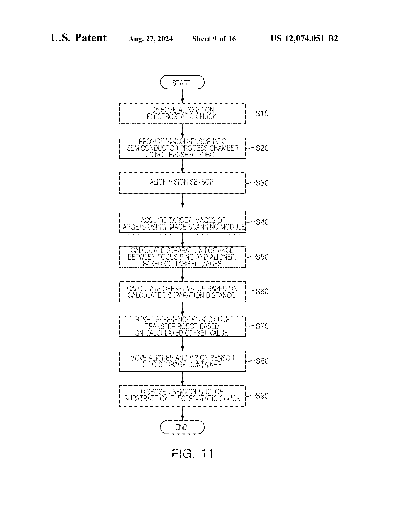
*도 11 — 기판 정렬 장치를 이용하여 기판을 정렬하는 과정의 흐름도*

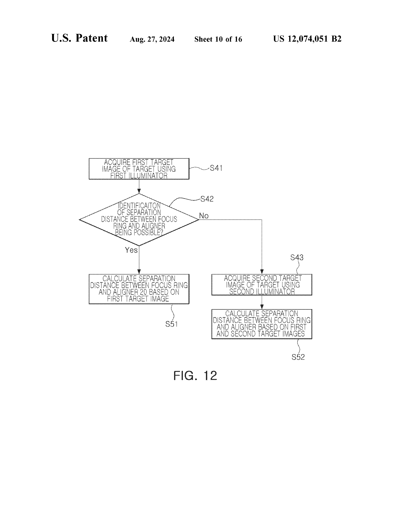
*도 12 — 도 11의 동작 S40 및 S50의 상세 흐름도*

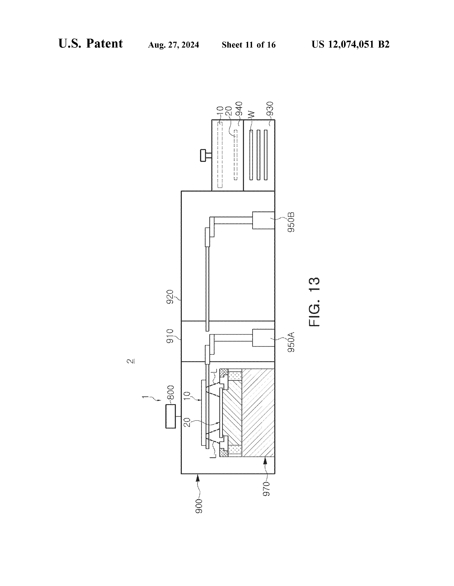
*도 13 — 도 1의 티칭 장치가 채용된 기판 정렬 장치의 개략적인 측면도*

먼저, 도 14를 참조하면, 반도체 공정 챔버(900)를 유지보수하기 위한 예방 정비(preventive maintenance)가 수행될 수 있다. 예방 정비를 수행하는 과정에서, 반도체 공정 챔버(900)의 부품들의 위치가 미세하게 변경될 수 있다. C1은 플레이트(974)의 상부에 위치하는 로딩 영역(LA)의 중심을 나타낸다.

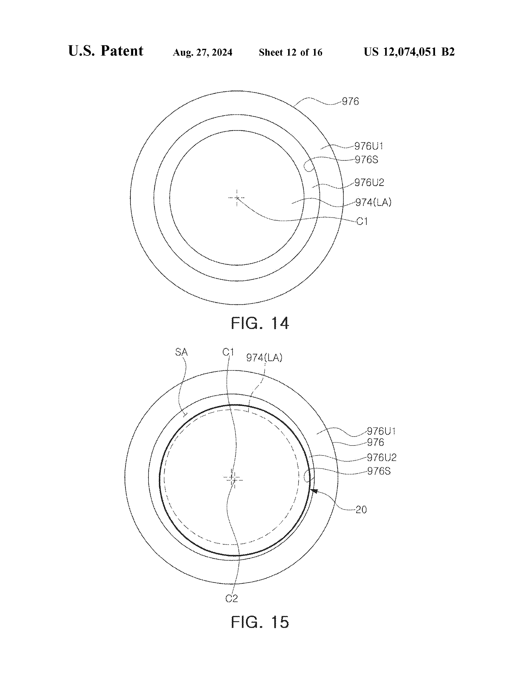
*도 14, 도 15 — 기판 정렬 과정의 개략적인 평면도 (예방 정비 후 로딩 영역 중심 C1 / 얼라이너 배치, 중심 C2 어긋남)*

도 11, 도 13 및 도 15를 참조하면, 얼라이너(20)는 이송 로봇(950)에 의해 기판 정렬 장치(2)의 반도체 공정 챔버(900) 내부에 배치된 정전 척(970) 상에 배치될 수 있다(S10). 예방 정비 중에 발생한 반도체 공정 챔버(900)의 부품들의 위치의 미세한 변화로 인해, 얼라이너(20)의 중심(C2)은 로딩 영역(LA)의 중심(C1)과 일치하지 않을 수 있다. 따라서, 얼라이너(20)의 에지와 포커스 링(976)의 측벽(976S) 사이의 이격 영역(SA)이 전체적으로 균일하지 않음을 알 수 있다.

기판 정렬 장치(2)는 반도체 공정 챔버(900), 반도체 공정 챔버(900)에 연결된 제1 버퍼 챔버(910), 제1 버퍼 챔버(910)에 연결된 제2 버퍼 챔버(920), 및 제2 버퍼 챔버(920)에 연결된 로드 포트(load port)(930)를 포함할 수 있다. 반도체 공정 챔버(900)는 그 내부에서 반도체 소자를 제조하기 위한 단위 공정(예를 들어, 식각 공정)이 수행되도록 구성될 수 있다. 예를 들어, 반도체 공정 챔버(900)는 그 내부에 배치된 정전 척(970)을 포함할 수 있다. 정전 척(970)은 반도체 소자 제조에 사용되는 반도체 기판(예를 들어, 웨이퍼, W)을 지지하는 기판 지지 유닛의 일 예이다. 정전 척(970)은 도 1을 참조하여 상술한 정전 척(970)과 동일한 구성을 가지므로, 간결함을 위해 그 상세한 설명은 생략한다. 반도체 기판(W)은 정전 척(970)의 플레이트(974) 상에 안착될 수 있다. 반도체 공정 챔버(900)의 내부는 그 안에서 단위 공정을 수행하기 위해 진공 및/또는 고온 상태일 수 있다. 제1 버퍼 챔버(910) 및 제2 버퍼 챔버(920)는 반도체 기판을 이송하도록 구성되는 제1 이송 로봇(950A) 및 제2 이송 로봇(950B)을 각각 포함할 수 있다. 예를 들어, 제1 이송 로봇(950A) 및 제2 이송 로봇(950B)은 도 1에서 설명한 이송 로봇(950)과 동일한 구성을 가질 수 있다. 간결함을 위해, 제1 이송 로봇(950A) 및 제2 이송 로봇(950B)에 대한 상세한 설명은 생략한다. 제1 이송 로봇(950A)의 동작은 상술한 정렬 과정 및/또는 그 실시예들의 결과에 기초하여 조정될 수 있다. 반도체 기판(W)이 적재되는 로드 포트(930)는 외부로 노출될 수 있다.

로드 포트(930) 상에는 비전 센서(10) 및 얼라이너(20)가 적재된 저장 용기(940)가 제공될 수 있다.

도 11, 도 13 및 도 16을 참조하면, 비전 센서(10)는 이송 로봇(950)에 의해 기판 정렬 장치(2)의 반도체 공정 챔버(900)의 내부로 제공될 수 있다(S20). 비전 센서(10)는 제2 이송 로봇(950B)에 의해 저장 용기(940)로부터 제2 버퍼 챔버(920)로, 그리고 제2 버퍼 챔버(920)로부터 제1 버퍼 챔버(910)로 이동될 수 있다. 제1 버퍼 챔버(910)의 내부는 저압 및/또는 진공 상태일 수 있다. 비전 센서(10)는 제1 이송 로봇(950A)에 의해 제1 버퍼 챔버(910)로부터 반도체 공정 챔버(900) 내로 제공될 수 있다. 반도체 공정 챔버(900)는 진공 및/또는 고온 상태로 유지될 수 있다. 비전 센서(10)는 예를 들어 정전 척(970) 위에 배치될 수 있다.

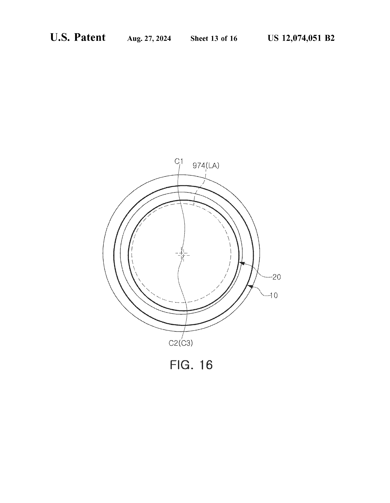
*도 16 — 기판 정렬 과정의 개략적인 평면도 (비전 센서 투입, S20)*

반도체 공정 챔버(900) 내에 제공된 비전 센서(10)는 기준 위치 상에 정렬될 수 있다(S30). 비전 센서(10)의 정렬은 제어부(800)에 미리 저장된 기준 위치에 따라 정렬될 수 있다. 이에 따라, 비전 센서(10)의 중심(C3)은 얼라이너(20)의 중심(C2)과 일치할 수 있다. 비전 센서(10)를 정렬하는 것은 예를 들어 반도체 공정 챔버(900) 내에서 비전 센서(10)의 수평 위치 및/또는 수직 위치를 조정하는 것, 및 비전 센서(10)의 기울기(tilt)를 조정하는 것을 포함할 수 있다.

도 11, 도 13, 도 17 및 도 18을 참조하면, 비전 센서(10)의 이미지 스캐닝 모듈(150)을 이용하여 타겟들(TG1-TG4)의 제1 타겟 이미지들(IMG1-IMG4)이 획득될 수 있다(S40). 예를 들어, 타겟(TG)은 얼라이너(20)의 일부 영역, 포커스 링(976)의 일부 영역, 및 얼라이너(20)의 에지(E)와 포커스 링(976)의 측벽(976S) 사이의 이격 영역(SA)을 포함할 수 있다. 제1 타겟 이미지들(IMG1-IMG4)을 획득하는 것은 이미지 스캐닝 모듈(150)의 제1 조명기(130)를 이용하여 얼라이너(20) 및 포커스 링(976) 상에 패턴(FP)(예를 들어, 프린지 패턴)을 투영하는 것, 및 이미지 스캐닝 모듈(150)의 카메라(110)를 이용하여 패턴(FP)이 투영된 얼라이너(20) 및 포커스 링(976)의 이미지를 스캐닝하는 것을 포함할 수 있다. 예를 들어, 패턴(FP)은 복수의 세그먼트로 분할되어 포커스 링(976)의 제1 상면(976U1) 및 제2 상면(976U2), 그리고 얼라이너(20)의 상면(21) 상에 투영될 수 있다. 예를 들어, 제1 타겟 이미지들(IMG1-IMG4)은 각각 제1 세그먼트(SG11, SG21, SG31, SG41), 제2 세그먼트(SG12, SG22, SG32, SG42) 및 제3 세그먼트(SG13, SG23, SG33, SG43)로 분할된 형태의 프린지 패턴을 포함할 수 있다(도 18 참조).

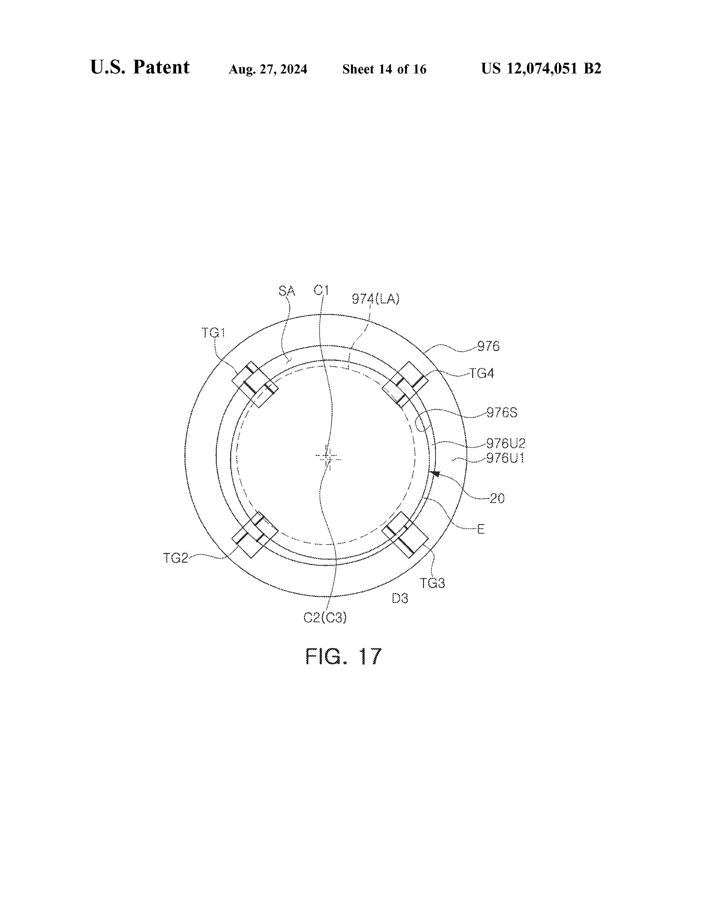
*도 17 — 기판 정렬 과정의 개략적인 평면도 (타겟 TG1-TG4)*

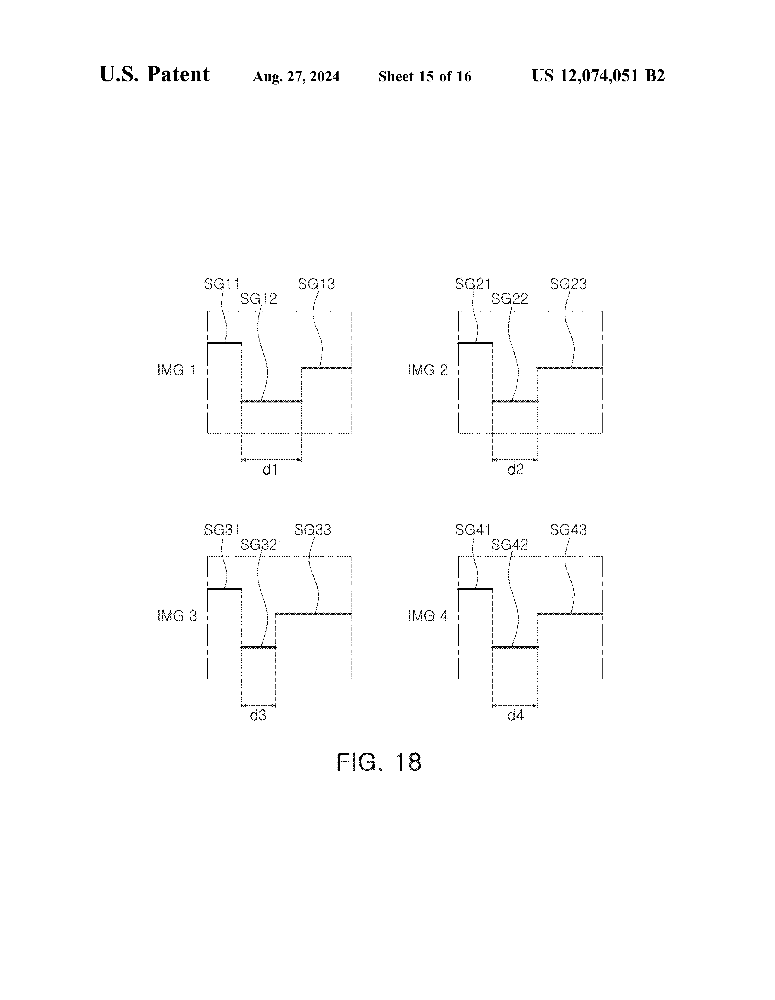
*도 18 — 기판 정렬 과정에서 획득된 타겟 이미지 IMG1-IMG4*

제어부(800)는 제1 타겟 이미지들(IMG1-IMG4)에 기초하여 포커스 링(976)과 얼라이너(20) 사이의 이격 거리(D)를 산출할 수 있다(S50). 예를 들어, 비전 센서(10)의 프로세서(410)는 제1 타겟 이미지들(IMG1-IMG4)에 포함된 패턴(FP)의 형상을 분석함으로써, 포커스 링(976)과 얼라이너(20) 사이의 이격 거리(D)를 산출한다.

제어부(800)는 산출된 이격 거리(D)에 기초하여 이송 로봇(950)의 기준 위치를 보정하기 위한 오프셋 값을 산출할 수 있다(S60). 오프셋 값은 포커스 링(976)의 측벽(976S)과 얼라이너(20)의 에지 사이의 복수의 이격 거리(D)가 모두 동일해지도록 이송 로봇(950)의 핸드(954)를 이동시키기 위한 제어 값을 포함할 수 있다. 예를 들어, 오프셋 값은 핸드(954)를 제1 방향(예를 들어, 도 1의 X축 방향), 제2 방향(예를 들어, 도 1의 Y축 방향)으로, 및/또는 얼라이너(20)의 중심(C2) 및/또는 비전 센서(10)의 중심(C3)을 중심으로 조정하기 위한 값들을 포함할 수 있다.

도 11, 도 13 및 도 19를 참조하면, 산출된 오프셋 값에 기초하여 이송 로봇(950)의 기준 위치가 재설정될 수 있다(S70). 제어부(800)는 비전 센서(10)의 중심(C3)이 로딩 영역(LA)의 중심(C1)과 일치하도록 이송 로봇(950)의 기준 위치를 재설정할 수 있다.

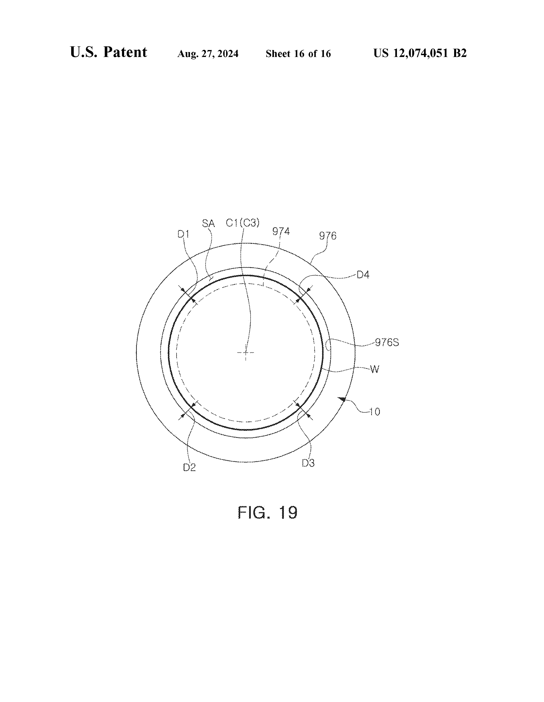
*도 19 — 기판 정렬 과정의 개략적인 평면도 (기준 위치 재설정 후, S70)*

다음으로, 도 11 및 도 13을 참조하면, 얼라이너(20) 및 비전 센서(10)는 이송 로봇(950)에 의해 저장 용기에 적재되고(S80), 반도체 기판(W)이 정전 척(970)의 타겟 위치 상에 배치될 수 있다(S90).

다음으로, 반도체 공정 챔버(900) 내에서 반도체 기판(W)에 대해 반도체 소자의 제조 공정이 수행될 수 있다.

도 12를 참조하면, 일부 예시적인 실시예들에 따르면, 포커스 링(976)이 상대적으로 높은 반사율을 갖는 물질(예컨대 실리콘(Si))로 형성된 경우, 제2 타겟 이미지를 획득하는 과정이 추가될 수 있다.

먼저, 제1 조명기(130)를 이용하여 타겟(TG)의 제1 타겟 이미지가 획득될 수 있다(S41). 다음으로, 포커스 링(976)과 얼라이너(20) 사이의 이격 거리가 식별되는지 여부가 확인될 수 있다(S42). 예를 들어, 포커스 링(976)의 반사율이 상대적으로 높지 않아 포커스 링(976)의 측벽(976S)의 위치가 식별될 수 있는 경우, 포커스 링(976)의 측벽(976S)과 얼라이너(20)의 에지(E) 사이의 이격 거리(D)가 산출될 수 있다(S51). 반면, 포커스 링(976)의 반사율이 상대적으로 높아 포커스 링(976)의 측벽(976S)의 위치를 식별할 수 없는(및/또는 불분명한) 경우, 제2 조명기(140)를 이용하여 제2 타겟 이미지가 획득될 수 있다(S43).

제어부(800)는 제1 및 제2 타겟 이미지에 기초하여 포커스 링(976)의 측벽(976S)과 얼라이너(20)의 에지(E) 사이의 이격 거리(D)를 산출할 수 있다(S52). 예를 들어, 제2 타겟 이미지를 통해 포커스 링(976)의 측벽(976S)의 위치를 식별하고 제1 타겟 이미지에서 식별된 얼라이너(20)의 에지(E)를 참조하여, 포커스 링(976)의 측벽(976S)과 얼라이너(20)의 에지(E) 사이의 이격 거리(D)가 산출될 수 있다.

이상에서 설명한 바와 같이, 일부 예시적인 실시예들에 따른 티칭 장치는 공정 챔버 내 부품들의 미세한 위치 변화를 반영하여 이송 로봇의 기준 위치를 조정(및/또는 재조정)할 수 있다.

일부 예시적인 실시예들에 따른 기판 정렬 장치는 공정 챔버 내 부품들의 위치의 미세한 변화를 반영하여 공정 챔버 내의 타겟 위치에 기판을 안착시킬 수 있다.

이상에서 일부 예시적인 실시예들을 도시하고 설명하였으나, 첨부된 청구범위에 의해 정의되는 본 발명의 개념의 범위를 벗어나지 않고 수정 및 변형이 이루어질 수 있음은 당업자에게 자명할 것이다.
