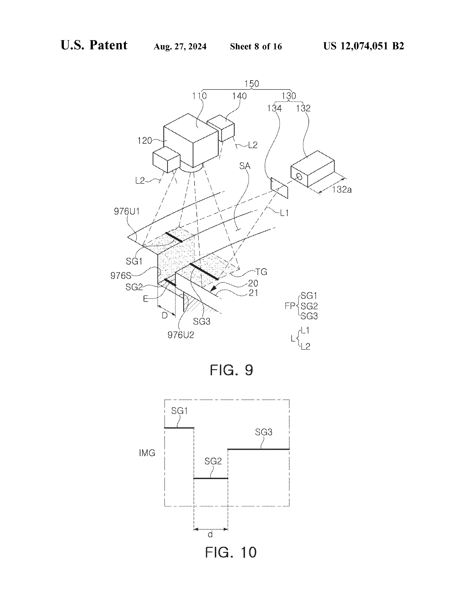
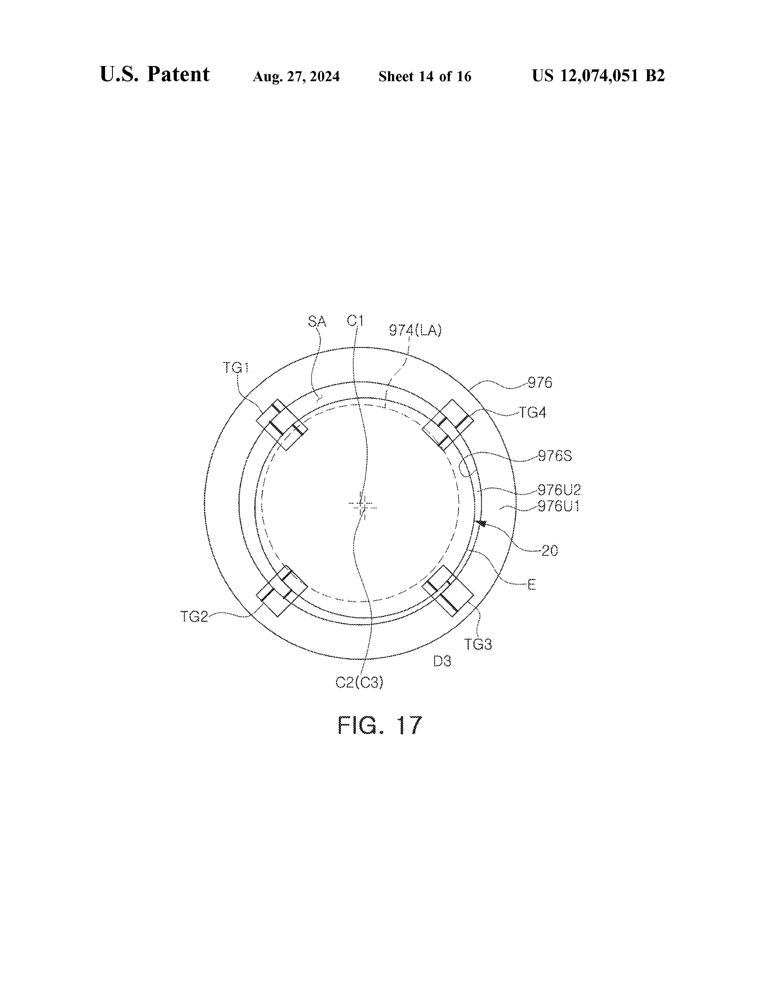

# US12074051B2 — 티칭 장치와 기판 정렬 장치 (Samsung)

| 항목 | 내용 |
|---|---|
| 원문 | `US12074051.pdf`(등록, 2024-08-27) · `US20230064941.pdf`(공개, 2023-03-02) |
| 출원인 | Samsung Electronics |
| 우선일 | 2021-08-27 (KR 10-2021-0114082) |
| 핵심 | 웨이퍼 모양 비전 센서(카메라·레이저 패턴 조명기 4세트)를 이송 로봇 핸드로 정전 척 위에 올리고, 얼라이너 에지와 포커스 링 측벽 사이 간격 4곳을 재서 간격이 모두 같아지도록 로봇 기준 위치를 다시 설정한다. 얼라이너 상면은 블라스팅 또는 십자·원형 마커. |
| 관련도 | ○ 일부 요소가 같음 |
| 본 과제와의 관계 | 로봇이 옮기는 비전 + 마커. 회전 보정은 상세 설명(S60)에만 "중심(C2/C3) 기준 조정 값"으로 언급되고, 청구항은 "이격 거리 균등화·오프셋 값"까지만 한정하며 회전 계산식은 없다. |
| 링크 | [Google Patents](https://patents.google.com/patent/US12074051B2/en) |

---

## 상세 요약 (번역본 기준)

### 1. 해결하려는 문제
- 공정 챔버 준비(예방 정비) 과정에서 챔버 내부 부품 위치가 미세하게 변경됨.
- 부품 위치 변동이 공정 조건에 영향 → 기판을 타겟 위치에 안착시키려면 미세 위치 변화를 정밀 검사·반영할 필요.
- 목표: 부품 위치 변화를 반영해 이송 로봇의 기준 위치를 재조정하는 티칭 장치, 및 이를 쓰는 기판 정렬 장치.

### 2. 핵심 구성
| 구성 | 참조부호 | 위치·역할 |
|---|---|---|
| 정전 척 | 970 | 플레이트(974, 로딩 영역 LA), 에지 링(975), 포커스 링(976), 절연 링(977) |
| 포커스 링 측벽 | 976S | 제1 상면(976U1, 얼라이너보다 높음)과 제2 상면(976U2, 낮음) 사이 단차 측벽 |
| 얼라이너 | 20 | 웨이퍼 형상(200~300 mm), LA에 안착. 상면 블라스팅(20A) / 십자 마커(22) / 원형 마커(23) (도 7a~7c) |
| 비전 센서 | 10 | 웨이퍼(또는 십자) 형상 지지 부재(100)·커버(500)로 된 하우징(600). 핸드(954)에 실려 얼라이너 위에 배치 |
| 이미지 스캐닝 모듈 | 150 | 카메라(110)+렌즈부(120), 제1 조명기(130: 레이저 광원 132 + 광학 부재 134), 제2 조명기(140: LED). 지지 부재 에지를 따라 등간격 4개(3·5개 이상도 가능) |
| 회로부 | 400 | 프로세서(410), 무선 통신 모듈(420: 블루투스·WiFi direct·IrDA), 배터리(430) |
| 이송 로봇 | 950 | 구동부(951), 구동 샤프트(952), 다단 암(953), 핸드(954) |
| 제어부 | 800 | 측정 데이터 → 오프셋 값 산출 → 기준 위치 재설정 |

- 기판 정렬 장치(2, 도 13): 공정 챔버(900) – 제1 버퍼 챔버(910, 로봇 950A) – 제2 버퍼 챔버(920, 로봇 950B) – 로드 포트(930). 비전 센서·얼라이너는 저장 용기(940)에 보관.

### 3. 동작 순서
1. 예방 정비 후 로딩 영역 중심 C1 (도 14).
2. S10: 이송 로봇이 얼라이너(20)를 정전 척에 배치. 얼라이너 중심 C2가 C1과 어긋나 이격 영역(SA)이 불균일 (도 15).
3. S20: 비전 센서를 저장 용기 → 920 → 910 → 공정 챔버(진공·고온)로 투입 (도 16).
4. S30: 제어부에 저장된 기준 위치로 비전 센서 정렬 → 센서 중심 C3 = 얼라이너 중심 C2. 수평·수직 위치와 기울기(tilt) 조정 포함.
5. S40: 4개 타겟(TG1~TG4)의 제1 타겟 이미지(IMG1~IMG4) 획득 (도 17, 18).
   - 제1 광(L1, 레이저)을 타겟 표면에 각도 θ로 경사 조사 → 라인형 프린지 패턴(FP) 투영. 광학 부재(미러·프리즘, 액추에이터)로 θ 조절.
   - 평면이면 한 줄, 높이가 다르면 세그먼트로 분할: SG1(976U1), SG2(976U2), SG3(얼라이너 상면 21) (도 10).
6. S50: 제2 세그먼트(SG2) 길이 d 측정 → 측벽(976S)~에지(E) 이격 거리 D 산출. 프로세서(410)가 이미지로 타겟의 3차원 모델 생성 후 D 포함 측정 데이터 생성, 모듈 수만큼(4개) 무선 전송.
7. S60: 제어부가 오프셋 값 산출. 복수의 D가 모두 같아지도록 핸드를 X·Y 방향 및 C2/C3 중심 기준으로 조정하는 제어 값 포함.
8. S70: C3가 C1과 일치하도록 기준 위치 재설정 (도 19).
9. S80: 얼라이너·비전 센서를 저장 용기로 회수. S90: 기판(W)을 타겟 위치에 배치 후 공정 수행.

- 도 12 분기(S40·S50 상세): S41 제1 타겟 이미지 → S42 측벽 식별 가능 여부 → 가능하면 S51 D 산출 / 불가(포커스 링이 Si 등 고반사)면 S43 제2 조명기(LED 가시광, 넓은 빔)로 제2 타겟 이미지 → 라인 에지 추출로 측벽 위치, 제1 이미지의 에지(E) 참조 → S52 D 산출.
- 마커 실시예: 마커~에지 간격(G)을 제어부에 미리 저장, 마커 위치에서 에지(E) 위치 계산.
- 구체적 오프셋 계산식·허용 오차 수치는 번역본에 없음.

### 4. 청구항 요지
- 청구항 1(티칭 장치): 챔버, 측벽 있는 정전 척, 얼라이너, 얼라이너–측벽 이격 거리를 측정·전송하는 비전 센서, 얼라이너 로딩·센서 배치 이송 로봇, 측정 데이터로 기준 위치를 재설정하고 이격 거리를 균등화하는 제어기.
- 청구항 12(티칭 장치): 정전 척 대신 기판 지지 어셈블리, 제어기는 이송 로봇 기준 위치 보정(균등화 한정 없음).
- 청구항 17(기판 정렬 장치): 기판 처리 챔버 + 로봇이 얼라이너·비전 센서·기판을 로딩/언로딩, 제어기가 로봇 티칭으로 기판 로딩 기준 위치 보정.
- 주요 종속항: 2(패턴 투영 → 타겟 이미지 → 거리), 3~4(지지 부재·복수 모듈·프로세서·무선 인터페이스), 5~6(레이저 조명기+카메라), 7(제2 조명기), 9(블라스팅), 10(상면보다 반사율 낮은 마커), 11(오프셋 값), 15(포커스 링 2단 상면), 16(얼라이너·센서 중심 중첩), 18(기판과 같은 형상·무게), 20(얼라이너→센서→순차 언로딩→기판 로딩).

### 5. 대표 도면

*도 9, 10 — 경사 레이저 라인이 높이별 세그먼트(SG1~SG3)로 갈라지고, SG2 길이 d로 이격 거리 D를 구함*

*도 17 — 얼라이너 둘레 4개 타겟(TG1~TG4)에서 간격을 동시에 측정*

### 6. 본 과제(Y·Θ 얼라인먼트)와 비교
- 같은 점:
  - 카메라 영상으로 이송 로봇의 기준 위치(티칭 값)를 보정.
  - 위치 식별용 마커 사용 가능(십자·원형 마커, 반사율 낮춤).
- 다른 점:
  - 본 특허는 둘레 4곳의 간격 D를 "같게" 만드는 방식, 우리는 마커 한 장면에서 Y·Θ 보정값을 직접 출력.
  - 센서가 웨이퍼형 무선 지그(배터리 구동)로 정비 후 1회 티칭용, 우리는 실시간 보정.
  - 측정은 레이저 프린지 패턴의 3차원(높이 단차) 해석 중심, QR형 마커 디코딩 없음.
  - 회전은 "중심 기준 조정"이라는 언급만 있고 계산식 없음.
- 참고할 점:
  - 둘레 등간격 다점 측정(4점)의 차이로 병진·회전 분리 → 우리도 마커 내 여러 기준점 거리 차로 Θ 산출 검토.
  - 측정 실패 시 조명 전환 분기(S42→S43): 고반사 표면 대비 보조 조명·보조 이미지 경로 설계.
  - 마커~기준 에지 간격(G)을 미리 저장해 마커 위치로 실제 기준 위치를 환산하는 방식.
  - 마커 반사율을 바탕보다 낮게(블라스팅) → 마커 재질·표면 처리 요구사항으로 반영.
  - 측정 전 센서 자체의 위치·기울기 정렬(S30) 단계 → 카메라 기울기 보정 단계 필요성.
