# 기판 처리 장치 및 기판 이송 위치 조정 방법 (US6973370B2)

- 원제: Substrate processing apparatus and method for adjusting a substrate transfer position
- 원문: 같은 폴더의 PDF, https://patents.google.com/patent/US6973370B2/en
- 번역 기준: Google Patents 원문 텍스트를 한국어로 옮김. 도면은 PDF 참조.
- 도면: 원문 PDF 도면 시트 19장을 도면/ 폴더에 넣고 본문에서 처음 언급되는 곳에 삽입함

## 요약

기판 처리 장치는, 기판의 표면에 형성된 마크(mark)를 모니터링하고, 기판의 중심과 기판 지지 부재(substrate support member)의 회전 중심 사이의 틀어짐(오정렬, misalignment) 양을 연산하며, 틀어짐의 유무를 판정하고, 기판의 중심이 기판 지지 부재의 회전 중심과 일치하도록 기판을 조정함으로써, 기판을 고정밀·고속으로 정렬할 수 있다.

## 청구범위

1. 수직축을 중심으로 회전 가능한 기판 지지 부재 상에 수평으로 지지된 기판을 처리하는 처리 유닛을 포함하고, 상기 기판 지지 부재에 대한 기판 이송 기구(substrate transfer mechanism)의 기판 이송 위치 데이터를 사전에 취득하는 기판 처리 장치로서,

상기 기판 이송 기구에 의해 상기 기판 지지 부재 상에 놓인 위치 정렬용 기판(position aligning substrate)의 표면에 형성된 마크를 촬영하는 카메라 유닛;

상기 기판 지지 부재를 180도 회전시키기 전과 후에 각각 촬영된 마크의 위치들의 중심의 위치 데이터를 이용하여, 상기 위치 정렬용 기판의 중심과 상기 기판 지지 부재의 회전 중심 사이의 틀어짐 양을 산출하는 연산 유닛;

상기 틀어짐 양으로부터 상기 위치 정렬용 기판이 상기 기판 지지 부재에 정렬되어 있는지 여부를 판단하는 판정 유닛;

상기 위치 정렬용 기판이 상기 기판 지지 부재에 정렬되어 있지 않다고 판단되면, 상기 위치 정렬용 기판의 중심이 상기 기판 지지 부재의 회전 중심과 일치하도록 상기 기판 이송 기구에 의해 상기 위치 정렬용 기판을 재배치하는 조정 유닛; 및

상기 위치 정렬용 기판이 상기 기판 지지 부재의 중심에 정렬되었다고 판정되었을 때의 상기 기판 이송 기구의 위치 데이터를 저장하는 저장 유닛

을 포함하는 기판 처리 장치.

2. 청구항 1에 있어서, 상기 마크는 상기 위치 정렬용 기판의 표면 중심에 형성되는 기판 처리 장치.

3. 청구항 1에 있어서, 상기 판정 유닛은 상기 틀어짐 양이 상기 처리 유닛에 대해 미리 설정된 임계값보다 크면 상기 위치 정렬용 기판이 상기 기판 지지 부재에 정렬되어 있지 않다고 판단하며, 처리 유닛의 종류마다 서로 다른 임계값이 할당되는 기판 처리 장치.

4. 기판 지지 부재 상에 수평으로 지지된 기판을 처리하는 처리 유닛을 포함하고, 상기 기판 지지 부재에 대한 기판 이송 기구의 기판 이송 위치 데이터를 사전에 취득하는 기판 처리 장치로서,

상기 기판 이송 기구에 의해 상기 기판 지지 부재 상에 놓인 위치 정렬용 기판의 표면 중심에 형성된 마크를 촬영하는 카메라 유닛; 및

상기 카메라 유닛에 의해 얻어진 상기 마크의 촬영 결과와 상기 기판 지지 부재의 중심에 형성된 마크의 촬영 결과를 이용하여, 상기 위치 정렬용 기판의 중심이 상기 기판 지지 부재의 중심과 일치하는지 여부를 판단하는 판정 유닛

을 포함하는 기판 처리 장치.

5. 기판 지지 부재 상에 수평으로 지지된 기판을 처리하는 처리 유닛을 포함하고, 상기 기판 지지 부재에 대한 기판 이송 기구의 기판 이송 위치 데이터를 사전에 취득하는 기판 처리 장치로서,

상기 기판 이송 기구에 의해 상기 기판 지지 부재 상에 놓인 위치 정렬용 기판의 표면 중심에 형성된 마크를 촬영하는 카메라 유닛;

상기 카메라 유닛에 의해 얻어진 상기 마크의 촬영 결과와, 미리 모니터링된 상기 기판 지지 부재의 중심에 형성된 마크의 촬영 결과를 이용하여, 상기 위치 정렬용 기판의 중심과 상기 기판 지지 부재의 중심 사이의 틀어짐 양을 산출하는 연산 유닛;

상기 틀어짐 양이 임계값보다 큰지 여부를 판단하는 판정 유닛;

상기 틀어짐 양이 상기 임계값보다 크다고 판정되면, 상기 위치 정렬용 기판의 중심이 상기 기판 지지 부재의 중심과 일치하도록 상기 기판 이송 기구에 의해 상기 위치 정렬용 기판을 재배치하는 조정 유닛; 및

상기 틀어짐 양이 상기 임계값보다 크지 않을 때의 상기 기판 이송 기구의 위치 데이터를 저장하는 저장 유닛

을 포함하는 기판 처리 장치.

6. 청구항 1에 있어서, 상기 기판 이송 기구는 상하로 배치되어 각각 독립적으로 진퇴하는 복수의 이송 암(transfer arm)을 포함하고, 상기 위치 정렬용 기판과 상기 카메라 유닛은 상기 복수의 이송 암 중 서로 다른 이송 암에 각각 지지되는 기판 처리 장치.

7. 수직축을 중심으로 회전 가능한 기판 지지 부재 상에 수평으로 지지된 기판을 처리하는 처리 유닛을 포함하고, 상기 기판 지지 부재에 대한 기판 이송 기구의 기판 이송 위치 데이터를 사전에 취득하는 기판 처리 장치로서,

위치 정렬용 기판을 상기 기판 지지 부재 상에 놓는 제1 이송 암;

상기 기판 지지 부재 상에 놓인 상기 위치 정렬용 기판의 표면에 형성된 마크와, 상기 기판 지지 부재의 중심 위치로서 기능하는 마킹(marking)을 촬영하는 카메라 유닛;

상기 카메라 유닛을 지지하는 제2 이송 암 - 상기 제1 이송 암과 상기 제2 이송 암은 서로 다름 -;

상기 기판 지지 부재 상에 놓인 상기 위치 정렬용 기판을 180도 회전시키기 전과 후에 상기 카메라 유닛에 의해 얻어진 상기 마크의 촬영 결과로부터 마크 위치 좌표 데이터를 얻고, 상기 유닛에 의한 상기 마킹의 촬영 결과로부터 마킹 위치 좌표 데이터를 얻는 위치 데이터 취득 프로그램;

상기 마크 위치 좌표 데이터가 나타내는 위치들의 중심에 해당하는 중심 위치 좌표 데이터를 상기 마킹 위치 좌표 데이터와 비교하여 틀어짐 양을 산출하는 연산 유닛;

상기 틀어짐 양을 이용하여 상기 위치 정렬용 기판이 상기 기판 지지 부재에 정렬되어 있는지 여부를 판단하는 판정 프로그램;

상기 위치 정렬용 기판의 중심이 상기 기판 지지 부재의 중심 위치와 일치하도록 상기 제1 이송 암에 의해 상기 위치 정렬용 기판을 재배치하는 재실행 프로그램;

상기 위치 정렬용 기판이 상기 기판 지지 부재에 정렬되었다고 판정되었을 때의 상기 제1 이송 암의 위치 데이터를 저장하는 저장 유닛

을 포함하는 기판 처리 장치.

8. 청구항 7에 있어서, 상기 판정 프로그램은 상기 처리 유닛의 종류에 따라 미리 설정된 임계값을 가지며, 상기 임계값은 상기 틀어짐 양을 이용하여 상기 위치 정렬용 기판이 상기 기판 지지 부재에 정렬되어 있는지 여부를 판단하기 위해 상기 틀어짐 양과 비교되는 기판 처리 장치.

9. 청구항 7에 있어서, 상기 제1 이송 암의 기판 이송 위치를 결정한 후, 상기 위치 정렬용 기판은 상기 제1 이송 암 이외의 다른 이송 암에 의해 상기 기판 지지 부재 상에 이송되고, 상기 카메라 유닛은 상기 다른 이송 암 이외의 또 다른 이송 암에 지지되어, 이로써 상기 다른 이송 암의 기판 이송 위치 데이터를 취득하는 기판 처리 장치.

10. 청구항 9에 있어서, 상기 또 다른 이송 암 상의 상기 카메라 유닛은 상기 기판 지지 부재를 경유하여 상기 또 다른 이송 암 이외의 이송 암으로 옮겨지는 기판 처리 장치.

11. 청구항 7에 있어서, 상기 카메라 유닛을 지지하는 이송 암은 상기 카메라 유닛을 지지하는 용도로만 사용되는 기판 처리 장치.

12. 청구항 7에 있어서, 상기 위치 정렬용 기판의 이면을 지지하면서 상기 위치 정렬용 기판을 승강시킬 수 있는 기판 승강 부재를 더 포함하고, 상기 기판 지지 부재 상에 놓인 상기 위치 정렬용 기판은 상기 기판 승강 부재에 의해 상기 카메라 유닛 가까이로 상승된 후 촬영되는 기판 처리 장치.

13. 수직축을 중심으로 회전 가능하고 기판을 처리하는 처리 유닛에 설치된 기판 지지 부재 상으로 기판을 이송할 때의 기판 이송 기구의 위치 데이터를 취득하기 위한 기판 이송 위치 조정 방법으로서,

(a) 표면에 마크가 형성된 위치 정렬용 기판을 상기 기판 이송 기구에 의해 상기 기판 지지 부재 상으로 이송하는 단계;

(b) 상기 기판 지지 부재를 180도 회전시키기 전과 후에 카메라 유닛에 의해 상기 마크를 촬영하는 단계;

(c) 상기 단계 (b)에서 얻어진 각 마크의 위치를 잇는 직선의 중점의 위치 데이터에 기초하여, 상기 기판의 중심과 상기 기판 지지 부재의 회전 중심 사이의 틀어짐 양을 산출하는 단계;

(d) 상기 틀어짐 양으로부터 상기 위치 정렬용 기판이 상기 기판 지지 부재에 정렬되어 있는지 여부를 판단하는 단계;

(e) 상기 위치 정렬용 기판이 상기 기판 지지 부재에 정렬되어 있지 않다고 판단되면, 상기 위치 정렬용 기판의 중심이 상기 기판 지지 부재의 회전 중심과 일치하도록 상기 기판 이송 기구에 의해 상기 위치 정렬용 기판을 재배치하는 단계; 및

(f) 상기 위치 정렬용 기판이 상기 기판 지지 부재에 정렬되었다고 판정되었을 때의 상기 기판 이송 기구의 위치 데이터를 취득하는 단계

를 포함하는 기판 이송 위치 조정 방법.

14. 기판을 처리하는 처리 유닛에 설치된 기판 지지 부재 상으로 기판을 이송할 때의 기판 이송 기구의 위치 데이터를 취득하기 위한 기판 이송 위치 조정 방법으로서,

(a) 표면 중심에 마크가 형성된 위치 정렬용 기판을 상기 기판 이송 기구에 의해 상기 기판 지지 부재 상으로 이송하는 단계;

(b) 카메라 유닛에 의해 상기 마크를 촬영하는 단계; 및

(c) 상기 단계 (b)에서 얻어진 촬영 결과로부터 상기 위치 정렬용 기판이 상기 기판 지지 부재에 정렬되어 있는지 여부를 판단하는 단계

를 포함하는 기판 이송 위치 조정 방법.

15. 기판을 처리하는 처리 유닛에 설치된 기판 지지 부재 상으로 기판을 이송할 때의 기판 이송 기구의 위치 데이터를 취득하기 위한 기판 이송 위치 조정 방법으로서,

(a) 표면 중심에 마크가 형성된 위치 정렬용 기판을 상기 기판 이송 기구에 의해 상기 기판 지지 부재 상으로 이송하는 단계;

(b) 카메라 유닛에 의해 상기 마크를 촬영하는 단계;

(c) 상기 단계 (b)에서 얻어진 촬영 결과에 기초하여 상기 기판의 중심과 상기 기판 지지 부재의 회전 중심 사이의 틀어짐 양을 산출하는 단계;

(d) 상기 틀어짐 양이 임계값보다 큰지 여부를 판단하는 단계;

(e) 상기 틀어짐 양이 상기 임계값보다 크다고 판정되면, 상기 위치 정렬용 기판의 중심이 상기 기판 지지 부재의 중심과 일치하도록 상기 기판 이송 기구에 의해 상기 위치 정렬용 기판을 재배치하는 단계; 및

(f) 상기 위치 정렬용 기판이 상기 기판 지지 부재의 중심에 정렬되었다고 판정되었을 때 얻어진 상기 기판 이송 기구의 위치 데이터를 취득하는 단계

를 포함하는 기판 이송 위치 조정 방법.

16. 청구항 15에 있어서, 상기 기판 이송 기구는 상하로 배치되어 각각 독립적으로 진퇴하는 복수의 이송 암을 포함하고, 상기 마크를 촬영하는 단계는, 상기 복수의 이송 암 중 하나의 이송 암을 전진시켜 상기 위치 정렬용 기판을 상기 기판 지지 부재 상으로 이송하는 단계; 상기 하나의 이송 암을 후퇴시키는 단계; 및 상기 복수의 이송 암 중 다른 이송 암을 전진시켜, 상기 다른 이송 암 상에 지지된 상기 카메라 유닛을 이용하여 상기 위치 정렬용 기판의 마크를 촬영하는 단계를 더 포함하는 기판 이송 위치 조정 방법.

17. 청구항 16에 있어서,

하나의 이송 암의 기판 이송 위치를 결정한 후, 다른 이송 암에 의해 상기 위치 정렬용 기판을 상기 기판 지지 부재 상으로 이송하는 단계; 및

상기 다른 이송 암 이외의 이송 암 상에 카메라 유닛을 유지시킴으로써 상기 다른 이송 암의 위치 데이터를 취득하는 단계

를 더 포함하는 기판 이송 위치 조정 방법.

18. 청구항 16에 있어서,

상기 다른 이송 암에 의해 유지된 상기 카메라 유닛을 상기 기판 지지 부재 상에 탑재하는 단계; 및

상기 기판 지지 부재 상에 탑재된 상기 카메라 유닛을 상기 다른 암 이외의 이송 암 상으로 옮기는 단계

를 더 포함하는 기판 이송 위치 조정 방법.

19. 청구항 16에 있어서, 상기 카메라 유닛을 지지하는 상기 다른 이송 암은 상기 카메라 유닛을 지지하는 용도로만 사용되는 기판 이송 위치 조정 방법.

20. 청구항 15에 있어서, 상기 기판 표면의 마크를 촬영하는 단계에서, 상기 촬영은 상기 기판 지지 부재 상으로 이송된 기판의 이면을 지지하면서 기판 승강 부재에 의해 상기 기판을 상기 카메라 유닛 가까이로 상승시킨 상태로 수행되는 기판 이송 위치 조정 방법.

## 상세한 설명

### 발명의 분야 (FIELD OF THE INVENTION)

본 발명은 기판 처리 장치 및 기판 이송 위치 조정 방법에 관한 것으로, 보다 구체적으로는, 기판 지지 부재 상에 탑재된 기판에 소정의 처리, 예컨대 레지스트 도포 처리, 현상 처리 및 가열 처리를 수행하는 처리 유닛으로 기판을 이송할 때, 기판 이송 기구의 위치 데이터를 사전에 얻는 기판 처리 장치, 및 이를 이용한 기판 이송 위치 조정 방법에 관한 것이다.

### 발명의 배경 (BACKGROUND OF THE INVENTION)

종래, 반도체 디바이스의 제조 과정에서 수행되는 포토레지스트 공정은, 예컨대 반도체 웨이퍼(이하 웨이퍼라 한다)의 표면에 레지스트를 박막 형태로 도포하는 단계, 레지스트를 소정 패턴으로 노광하는 단계, 그리고 이를 현상하여 소정의 마스크 패턴을 얻는 단계의 일련의 단계를 포함한다. 일반적으로, 이러한 공정은 레지스트의 도포 및 현상을 수행하는 도포/현상 장치와, 이에 접속된 노광 장치를 포함하는 기판 처리 장치를 이용하여 수행된다.

기판 처리 장치의 처리량(throughput)을 높이면서 점유 면적(footprint)을 줄이기 위해, 기판에 서로 다른 복수의 처리, 예컨대 도포 처리, 현상 처리, 가열/냉각 처리 등을 수행하는 기판 처리 장치는 유닛화되어 있다. 각 처리에 대해 필요한 수의 유닛이 내장되어 제공되며, 각 처리 유닛에 기판을 반입/반출하기 위한 기판 이송 기구도 함께 제공된다.

도 15에 도시된 도포/현상 장치는 이러한 기판 처리 장치의 일례이다. 예컨대 25매의 웨이퍼 W를 수용하는 기판 캐리어 10이 캐리어 스테이지 11에 반입되고, 웨이퍼 W는 이송 암 12에 의해 캐리어 10으로부터 꺼내어져 선반 유닛 13a의 수수 부재를 거쳐 처리 영역 14로 반입된다. 처리 영역 14의 중앙부에는 이송 기구 15가 설치되며, 이송 기구 15의 주위에는 웨이퍼 W에 도포액을 도포하는 도포 유닛 16과, 도포액을 건조시키는 저온 가열 유닛, 베이크 처리를 수행하는 베이크 유닛 및 큐어 처리를 수행하는 큐어 유닛을 포함하는 예컨대 3개의 선반 유닛 13a, 13b 및 13c가 배치된다. 웨이퍼 W는 이송 기구 15에 의해 각 유닛으로 반입된다.

처리 유닛이 기판에 고정밀 처리를 수행하도록 하기 위해서는, 웨이퍼 W가 처리 유닛의 소정 탑재 영역에 고정밀로 탑재되어야 한다. 구체적으로, 도포 유닛 16에서는 웨이퍼 W의 표면에 도포액이 도포된 후, 웨이퍼 W를 수직축을 중심으로 회전시키면서 세정액 노즐을 통해 웨이퍼 W의 에지에 린스액을 공급하여 웨이퍼 W의 에지를 린스하는 린스 처리가 실행된다. 따라서, 웨이퍼 W의 중심이 회전축의 중심으로부터 벗어나 있으면, 에지의 어떤 부분은 세정되지 않는 반면 다른 부분은 소정 폭 이상으로 세정되는 현상이 발생한다. 또한, 가열/냉각 유닛에서는 웨이퍼 W의 중심이 회전축의 중심으로부터 이와 같이 벗어나면 웨이퍼 W의 면내 온도의 불균일이 초래될 수 있다. 따라서, 처리가 개시되기 전에, 웨이퍼 W가 적절한 탑재 영역에 탑재될 수 있도록 웨이퍼 W의 이송 위치를 이송 기구 15에 미리 프로그래밍해 둔다. 이러한 과정을 일반적으로 티칭(teaching)이라 한다. 종래의 티칭 방법은, 예컨대 반사형 센서를 이용하여 탑재 영역에 놓인 웨이퍼 W의 에지를 검출함으로써 웨이퍼 W가 소정 탑재 영역에 탑재되었는지를 판정한 다음, 그 판정 결과에 기초하여 이송 위치를 조정하는 것을 포함한다(예컨대, 일본 특허 공개 공보 제2000-349133호의 단락 0069 내지 0072 및 도 9 참조). 여기서, 도포 유닛 16에 대한 이러한 종래 티칭 방법의 일례를 도 16을 참조하여 설명한다. 참조 부호 2는 웨이퍼 W를 이면으로부터 지지하면서 수직축을 중심으로 회전시킬 수 있는 스피너를 나타낸다. 또한, 참조 부호 21은 구동 유닛(도시되지 않음)에 의해 웨이퍼 W의 반경 방향으로 진퇴할 수 있는 반사형 센서이다.

티칭은 다음과 같이 수행된다. 먼저, 이송 기구 15에 의해 웨이퍼 W가 스피너 2 상으로 이송되고, 웨이퍼 W의 주연부 바깥에서 대기하고 있던 센서 21이 웨이퍼 W의 주연부 위 공간을 통과하도록 소정 속도로 수평 방향으로 이동된다. 이어서, 센서 21은 마지막으로 빛이 반사된 위치의 바로 앞 위치로 되돌아가고, 정밀도 향상을 위해 예컨대 1펄스 간격으로 천천히 후퇴되어 웨이퍼 W의 주연부를 검출한다. 그 후, 웨이퍼 W를 수직축을 중심으로 90도 각도 간격으로 3회 회전시키고, 각 회전마다 상술한 것과 동일한 검출 과정을 수행한다. 그런 다음, 이렇게 얻어진 웨이퍼 W 주연부 상의 4점의 위치 데이터에 기초하여 연산을 수행함으로써 웨이퍼 W의 중심 위치를 산출한다. 그런 다음, 웨이퍼 W의 중심이 미리 검출된 스피너의 회전축 중심과 일치할 때까지, 또는 양자 간의 편차 값이 허용 범위 내에 들어올 때까지 웨이퍼 W의 조정(즉, 재실행)을 반복 수행한다. 재실행이 수행됨에 따라 틀어짐은 감소한다. 대부분의 경우, 웨이퍼 W는 5회 이내의 재실행으로 스피너 상에 성공적으로 정렬될 수 있다.

그러나, 종래의 티칭 방법에서는 경제적 제약 때문에, 그리고 기판 처리 장치의 모든 유닛에 센서 21을 설치하는 것이 비용 효율적이지 않기 때문에 단일 센서 21이 사용된다. 그런데 이러한 구성은 작업자가 티칭 대상인 처리 유닛마다 센서 21을 설치하는 것을 필요로 한다. 그런데, 장치의 점유 면적을 줄이기 위해 크기가 축소된 복수의 처리 유닛을 포함하는 도포/현상 장치의 경우, 작업자가 각 유닛에 센서 21을 설치하면서 축 맞춤을 수행하는 데 많은 시간이 소요된다.

더욱이, 광 반사형 센서 21을 사용하는 경우, 센서의 성능이 주변 환경에 따라 달라질 수 있는데, 예컨대 먼지 및 조도의 정도가 웨이퍼 W의 에지를 고정밀로 검출하는 것을 방해할 수 있다.

### 발명의 요약 (SUMMARY OF THE INVENTION)

따라서, 본 발명의 목적은 기판을 고정밀·고속으로 정렬할 수 있는 기판 처리 장치, 및 기판의 위치를 정렬하는 방법을 제공하는 것이다.

본 발명의 일 측면에 따르면, 수직축을 중심으로 회전 가능한 기판 지지 부재 상에 수평으로 지지된 기판을 처리하는 처리 유닛을 갖고, 상기 기판 지지 부재에 대한 기판 이송 기구의 기판 이송 위치 데이터를 사전에 취득하는 기판 처리 장치가 제공되며, 상기 장치는: 상기 기판 이송 기구에 의해 상기 기판 지지 부재 상에 놓인 위치 정렬용 기판의 표면에 형성된 마크를 촬영하는 카메라 유닛; 상기 기판 지지 부재를 180도 회전시키기 전과 후에 각각 촬영된 마크의 위치들의 중심의 위치 데이터를 이용하여, 상기 위치 정렬용 기판의 중심과 상기 기판 지지 부재의 회전 중심 사이의 틀어짐 양을 산출하는 연산 유닛; 상기 틀어짐 양으로부터 상기 위치 정렬용 기판이 상기 기판 지지 부재에 정렬되어 있는지 여부를 판단하는 판정 유닛; 상기 위치 정렬용 기판이 상기 기판 지지 부재에 정렬되어 있지 않다고 판단되면, 상기 위치 정렬용 기판의 중심이 상기 기판 지지 부재의 회전 중심과 일치하도록 상기 기판 이송 기구에 의해 상기 위치 정렬용 기판을 재배치하는 조정 유닛; 및 상기 위치 정렬용 기판이 상기 기판 지지 부재의 중심에 정렬되었다고 판정되었을 때의 상기 기판 이송 기구의 위치 데이터를 저장하는 저장 유닛을 포함한다.

본 발명의 다른 측면에 따르면, 기판 지지 부재 상에 수평으로 지지된 기판을 처리하는 처리 유닛을 갖고, 상기 기판 지지 부재에 대한 기판 이송 기구의 기판 이송 위치 데이터를 사전에 취득하는 기판 처리 장치가 제공되며, 상기 장치는: 상기 기판 이송 기구에 의해 상기 기판 지지 부재 상에 놓인 위치 정렬용 기판의 표면 중심에 형성된 마크를 촬영하는 카메라 유닛; 및 상기 카메라 유닛에 의해 얻어진 상기 마크의 촬영 결과와 상기 기판 지지 부재의 중심에 형성된 마크의 촬영 결과를 이용하여, 상기 위치 정렬용 기판의 중심이 상기 기판 지지 부재의 중심과 일치하는지 여부를 판단하는 판정 유닛을 포함한다.

본 발명의 또 다른 측면에 따르면, 기판 지지 부재 상에 수평으로 지지된 기판을 처리하는 처리 유닛을 갖고, 상기 기판 지지 부재에 대한 기판 이송 기구의 기판 이송 위치 데이터를 사전에 취득하는 기판 처리 장치가 제공되며, 상기 장치는: 상기 기판 이송 기구에 의해 상기 기판 지지 부재 상에 놓인 위치 정렬용 기판의 표면 중심에 형성된 마크를 촬영하는 카메라 유닛; 상기 카메라 유닛에 의해 얻어진 상기 마크의 촬영 결과와, 미리 모니터링된 상기 기판 지지 부재의 중심에 형성된 마크의 촬영 결과를 이용하여, 상기 위치 정렬용 기판의 중심과 상기 기판 지지 부재의 중심 사이의 틀어짐 양을 산출하는 연산 유닛; 상기 틀어짐 양이 임계값보다 큰지 여부를 판단하는 판정 유닛; 상기 틀어짐 양이 상기 임계값보다 크다고 판정되면, 상기 위치 정렬용 기판의 중심이 상기 기판 지지 부재의 중심과 일치하도록 상기 기판 이송 기구에 의해 상기 위치 정렬용 기판을 재배치하는 조정 유닛; 및 상기 틀어짐 양이 상기 임계값보다 크지 않을 때의 상기 기판 이송 기구의 위치 데이터를 저장하는 저장 유닛을 포함한다.

본 발명의 또 다른 측면에 따르면, 수직축을 중심으로 회전 가능한 기판 지지 부재 상에 수평으로 지지된 기판을 처리하는 처리 유닛을 갖고, 상기 기판 지지 부재에 대한 기판 이송 기구의 기판 이송 위치 데이터를 사전에 취득하는 기판 처리 장치가 제공되며, 상기 장치는: 위치 정렬용 기판을 상기 기판 지지 부재 상에 놓는 제1 이송 암; 상기 기판 지지 부재 상에 놓인 상기 위치 정렬용 기판의 표면에 형성된 마크와, 상기 기판 지지 부재의 중심 위치로서 기능하는 마킹을 촬영하는 카메라 유닛; 상기 카메라 유닛을 지지하는 제2 이송 암 - 상기 제1 이송 암과 상기 제2 이송 암은 서로 다름 -; 상기 기판 지지 부재 상에 놓인 상기 위치 정렬용 기판을 180도 회전시키기 전과 후에 상기 카메라 유닛에 의해 얻어진 상기 마크의 촬영 결과로부터 마크 위치 좌표 데이터를 얻고, 상기 유닛에 의한 상기 마킹의 촬영 결과로부터 마킹 위치 좌표 데이터를 얻는 위치 데이터 취득 프로그램; 상기 마크 위치 좌표 데이터가 나타내는 위치들의 중심에 해당하는 중심 위치 좌표 데이터를 상기 마킹 위치 좌표 데이터와 비교하여 틀어짐 양을 산출하는 연산 유닛; 상기 틀어짐 양을 이용하여 상기 위치 정렬용 기판이 상기 기판 지지 부재에 정렬되어 있는지 여부를 판단하는 판정 프로그램; 상기 위치 정렬용 기판의 중심이 상기 기판 지지 부재의 중심 위치와 일치하도록 상기 제1 이송 암에 의해 상기 위치 정렬용 기판을 재배치하는 재실행 프로그램; 상기 위치 정렬용 기판이 상기 기판 지지 부재에 정렬되었다고 판정되었을 때의 상기 제1 이송 암의 위치 데이터를 저장하는 저장 유닛을 포함한다.

본 발명의 또 다른 측면에 따르면, 수직축을 중심으로 회전 가능하고 기판을 처리하는 처리 유닛에 설치된 기판 지지 부재 상으로 기판을 이송할 때의 기판 이송 기구의 위치 데이터를 취득하기 위한 기판 이송 위치 조정 방법이 제공되며, 상기 방법은: (a) 표면에 마크가 형성된 위치 정렬용 기판을 상기 기판 이송 기구에 의해 상기 기판 지지 부재 상으로 이송하는 단계; (b) 상기 기판 지지 부재를 180도 회전시키기 전과 후에 카메라 유닛에 의해 상기 마크를 촬영하는 단계; (c) 상기 단계 (b)에서 얻어진 각 마크의 위치를 잇는 직선의 중점의 위치 데이터에 기초하여, 상기 기판의 중심과 상기 기판 지지 부재의 회전 중심 사이의 틀어짐 양을 산출하는 단계; (d) 상기 틀어짐 양으로부터 상기 위치 정렬용 기판이 상기 기판 지지 부재에 정렬되어 있는지 여부를 판단하는 단계; (e) 상기 위치 정렬용 기판이 상기 기판 지지 부재에 정렬되어 있지 않다고 판단되면, 상기 위치 정렬용 기판의 중심이 상기 기판 지지 부재의 회전 중심과 일치하도록 상기 기판 이송 기구에 의해 상기 위치 정렬용 기판을 재배치하는 단계; 및 (f) 상기 위치 정렬용 기판이 상기 기판 지지 부재에 정렬되었다고 판정되었을 때의 상기 기판 이송 기구의 위치 데이터를 취득하는 단계를 포함한다.

본 발명의 또 다른 측면에 따르면, 기판을 처리하는 처리 유닛에 설치된 기판 지지 부재 상으로 기판을 이송할 때의 기판 이송 기구의 위치 데이터를 취득하기 위한 기판 이송 위치 조정 방법이 제공되며, 상기 방법은: (a) 표면 중심에 마크가 형성된 위치 정렬용 기판을 상기 기판 이송 기구에 의해 상기 기판 지지 부재 상으로 이송하는 단계; (b) 카메라 유닛에 의해 상기 마크를 촬영하는 단계; 및 (c) 상기 단계 (b)에서 얻어진 촬영 결과로부터 상기 위치 정렬용 기판이 상기 기판 지지 부재에 정렬되어 있는지 여부를 판단하는 단계를 포함한다.

본 발명의 또 다른 측면에 따르면, 기판을 처리하는 처리 유닛에 설치된 기판 지지 부재 상으로 기판을 이송할 때의 기판 이송 기구의 위치 데이터를 취득하기 위한 기판 이송 위치 조정 방법이 제공되며, 상기 방법은: (a) 표면 중심에 마크가 형성된 위치 정렬용 기판을 상기 기판 이송 기구에 의해 상기 기판 지지 부재 상으로 이송하는 단계; (b) 카메라 유닛에 의해 상기 마크를 촬영하는 단계; (c) 상기 단계 (b)에서 얻어진 촬영 결과에 기초하여 상기 기판의 중심과 상기 기판 지지 부재의 회전 중심 사이의 틀어짐 양을 산출하는 단계; (d) 상기 틀어짐 양이 임계값보다 큰지 여부를 판단하는 단계; (e) 상기 틀어짐 양이 상기 임계값보다 크다고 판정되면, 상기 위치 정렬용 기판의 중심이 상기 기판 지지 부재의 중심과 일치하도록 상기 기판 이송 기구에 의해 상기 위치 정렬용 기판을 재배치하는 단계; 및 (f) 상기 위치 정렬용 기판이 상기 기판 지지 부재의 중심에 정렬되었다고 판정되었을 때 얻어진 상기 기판 이송 기구의 위치 데이터를 취득하는 단계를 포함한다.

### 도면의 간단한 설명 (BRIEF DESCRIPTION OF THE DRAWINGS)

본 발명의 상기 및 기타 목적과 특징은 첨부 도면과 함께 주어진 바람직한 실시예에 대한 이하의 설명으로부터 명백해질 것이며, 도면에서:

도 1은 본 발명의 바람직한 실시예에 따른 도포/현상 장치의 평면도이다;

도 2는 본 발명의 바람직한 실시예에 따른 도포/현상 장치의 사시도이다;

도 3은 도포/현상 장치에 사용되는 기판 이송 기구의 사시도이다;

도 4는 도포/현상 장치에 내장된 도포 유닛의 단면도이다;

도 5는 도포/현상 장치에 내장된 가열 유닛의 단면도이다;

도 6은 주 이송 기구에 CCD 카메라를 장착하여 위치 정렬용 웨이퍼를 모니터링하는 모습을 설명하기 위한 사시도이다;

도 7은 도포/현상 장치에 사용되는 티칭 기구를 설명한다;

도 8A 내지 도 8C는 티칭 과정을 설명하는 흐름도이다;

도 9A 및 도 9B는 티칭 과정에서 얻어지는 화상 데이터를 설명한다;

도 10A 내지 도 10C는 티칭 과정의 다른 예를 제공하는 흐름도이다;

도 11은 도 10의 티칭 과정에서 얻어지는 화상 데이터를 도시한다;

도 12A 내지 도 12C는 티칭 과정의 또 다른 예를 설명하기 위한 흐름도이다;

도 13A 및 도 13B는 웨이퍼를 하강시킬 때 발생하는 웨이퍼 틀어짐을 도시한다;

도 14는 위치 정렬용 웨이퍼의 표면에 형성되는 마크의 일례를 도시한다;

도 15는 종래의 도포/현상 장치의 평면도이다; 그리고

도 16은 종래의 티칭 방법을 설명한다.

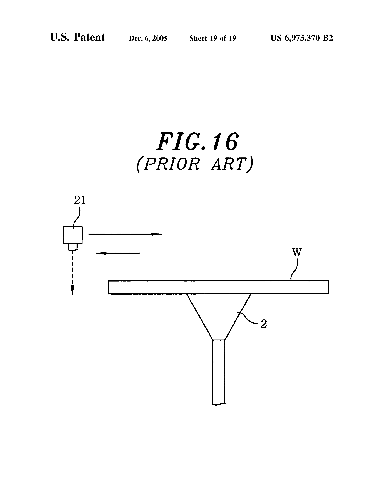

*도 16 — 종래의 티칭 방법*

### 바람직한 실시예의 상세한 설명 (DETAILED DESCRIPTION OF THE PREFERRED EMBODIMENTS)

먼저, 본 발명의 바람직한 실시예에 따른 기판 처리 장치에 내장된 도포/현상 장치를 도 1 및 도 2를 참조하여 이하에서 설명한다.

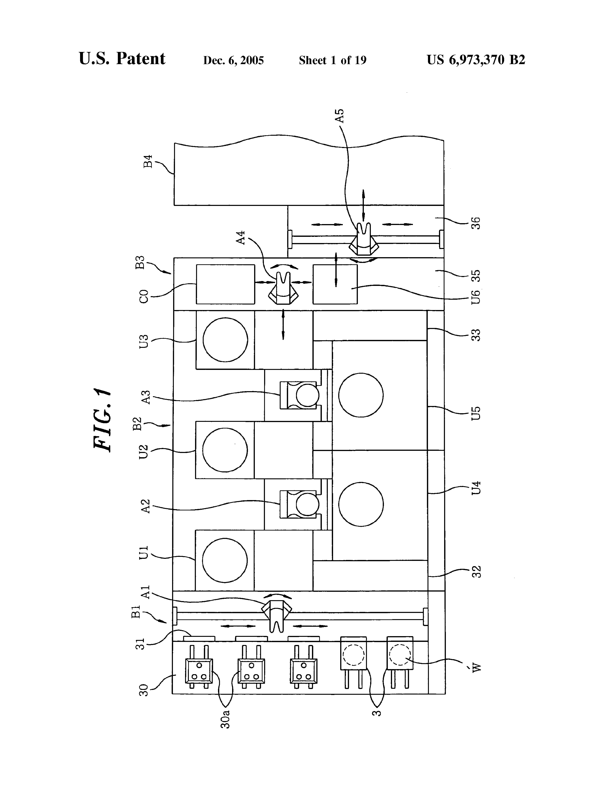

*도 1 — 도포/현상 장치의 평면도*

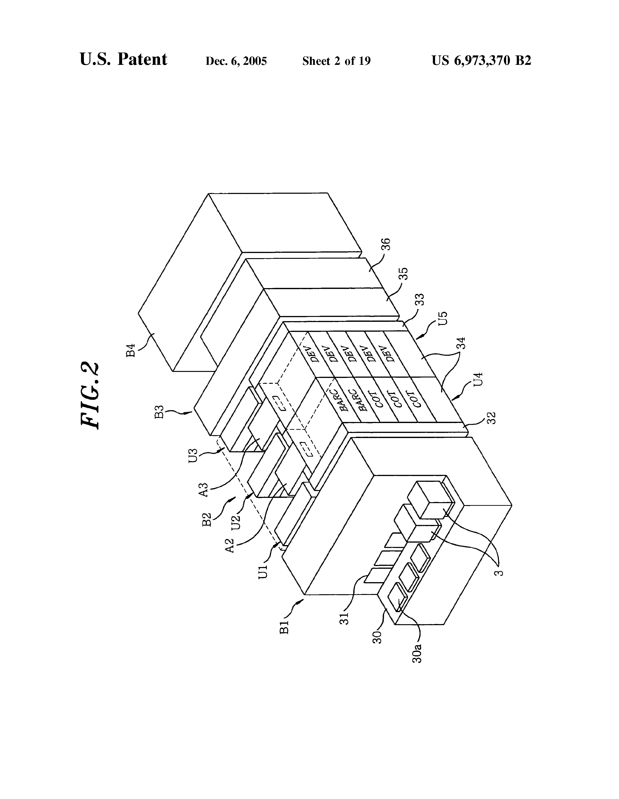

*도 2 — 도포/현상 장치의 사시도*

참조 부호 B1은 기판으로서 예컨대 13매의 웨이퍼 W를 각각 밀폐 수용하는 카세트 3을 반입 및 반출하기 위한 카세트 탑재 블록을 나타낸다. 카세트 탑재 블록 B1은 다수의 카세트 3을 탑재하기 위한 탑재 스테이지 30a를 갖는 카세트 스테이션 30; 카세트 스테이션 30에서 볼 때 전면 벽에 설치된 개폐 부재 31; 및 개폐 부재 31을 통해 카세트 3으로부터 웨이퍼 W를 꺼내는 운반 기구(conveying mechanism) A1을 포함한다. 또한, 카세트 탑재 블록 B1의 후방에는, 가열계 또는 냉각계 유닛이 각각 적층된 3개의 선반 유닛 U1, U2 및 U3; 처리액을 이용하여 웨이퍼 W에 소정의 액처리를 수행하는 액처리 유닛 U4 및 U5; 및 웨이퍼 W를 각 유닛으로 반입하는 주 이송 기구 A2 및 A3을 포함하는 처리 블록 B2가 접속된다. 즉, 주 이송 기구 A2 및 A3은 각각 인접한 유닛 각각에 접근 가능하도록 구성되어, 웨이퍼 W는 처리 블록 B2 내에서 일단의 선반 유닛 U1로부터 타단의 선반 유닛 U3까지 자유롭게 운반될 수 있다. 또한, 참조 부호 32 및 33은 온습도를 조절하기 위한 덕트 또는 각 유닛에서 사용되는 처리액의 온도를 조절하기 위한 장치를 각각 포함하는 온습도 조절 유닛을 나타낸다.

액처리 유닛 U4 및 U5 각각은, 도포액(레지스트액) 또는 현상액과 같은 약액을 공급하기 위한 공간으로 기능하는 수납 영역 34 위에, 도포 유닛 COT, 현상 유닛 DEV 및 하부 반사방지막 도포 유닛 BARC의 조합으로 이루어진 예컨대 5개의 처리 유닛을 적층한 구성을 갖는다. 또한, 상술한 선반 유닛 U1, U2 및 U3 각각은 액처리 유닛 U4 및 U5에서 실행되는 처리의 전처리 및 후처리를 수행하기 위한 예컨대 10개의 유닛을 조합하여 적층한 구성을 갖는다. 구체적으로, 이 조합은 웨이퍼 W를 가열(베이크)하는 가열 유닛, 웨이퍼 W를 냉각하는 냉각 유닛 등을 포함한다.

처리 블록 B2의 선반 유닛 U3의 후방에는, 제1 및 제2 이송 챔버(transfer chamber) 35 및 36으로 이루어진 인터페이스 블록 B3을 통해 노광 블록 B4가 접속된다. 인터페이스 블록 B3은 웨이퍼 W의 이송을 수행하는 2개의 운반 기구 A4 및 A5에 더하여 선반 유닛 U6 및 버퍼 카세트 C0을 내장한다.

이러한 도포/현상 장치에서의 웨이퍼 W의 흐름을 간단히 설명한다. 먼저, 웨이퍼 W를 수용한 카세트 3이 외부로부터 탑재 스테이지 30a로 반입되면, 개폐 부재 31이 열리면서 카세트 3의 덮개가 분리되고, 운반 기구 A1에 의해 카세트 3으로부터 웨이퍼 W가 인출된다. 그런 다음, 웨이퍼 W는 선반 유닛 U1의 한 구성 요소를 이루는 수수 유닛(도시되지 않음)을 거쳐 주 이송 기구 A2로 이송된다. 선반 유닛 U4에서는 예컨대 하부 반사방지막 형성 처리가 수행되고, 선반 유닛 U1 내지 U3 중 하나에서는 후속 도포 처리를 위한 사전 준비로서 가열 및 냉각 처리가 수행되며, 그 후 웨이퍼 W는 도포 유닛 COT에 의해 레지스트액이 도포된다. 이어서, 웨이퍼는 선반 유닛 U1 내지 U3 중 하나의 가열 유닛에 의해 가열(베이크)되고, 냉각된 후 선반 유닛 U3의 수수 유닛을 거쳐 인터페이스 블록 B3으로 반입된다. 웨이퍼 W는 예컨대 운반 기구 A4→선반 유닛 U6→운반 기구 A5의 경로를 통해 인터페이스 블록 B3으로부터 노광 블록 B4로 이송되고, 노광 처리가 수행된다. 노광 처리가 완료되면, 웨이퍼 W는 역경로로 처리 블록 B2로 되돌려져 현상 유닛 DEV에 의해 현상되고, 이로써 그 위에 레지스트 마스크가 형성된다. 그 후, 웨이퍼 W는 탑재 스테이지 30a의 카세트 3으로 복귀된다.

이하, 기판 이송 기구로서 기능하는 주 이송 기구 A2(A3)의 구성을 도 3을 참조하여 상세히 설명한다. 주 이송 기구 A2(A3)는 구동 유닛(도시되지 않음)에 의해 수직 이동 및 수직축을 중심으로 회전할 수 있는 이동 플랫폼 40을 포함한다. 이동 플랫폼 40에는, 웨이퍼 W의 주연부를 이면으로부터 지지하면서 웨이퍼 W를 수평으로 이송하는 예컨대 3개의 이송 암 4A 내지 4C와, 티칭 과정에 사용되는 이송 암 4D(이하 티칭용 이송 암이라 한다)가 상하로 배치되며, 동시에 이송 암 4A(4B, 4D) 각각은 구동 기구에 의해 독립적으로 진퇴할 수 있다. 또한, 이송 암 4D는 후술하는 티칭 과정에서만 사용되므로, 모든 티칭이 완료되면 이동 플랫폼 40으로부터 분리된다. 더욱이, 주 이송 기구 A2(A3)는 처리 공간을 구획하는 격벽 41로 둘러싸여 있다. 각 구성 요소의 처리 유닛으로의 웨이퍼 W의 반입/반출은 격벽 41의 측벽 상부 및 하부에 형성된 이송 개구 42를 통해 수행된다. 즉, 주 이송 기구 A2(A3)의 수평 위치는 극좌표를 이용하여 이송 암 4A(4B, 4C)가 진퇴하는 거리 R과 회전각 θ에 의해 결정되고, 주 이송 기구 A2(A3)의 수직 위치는 수직 방향(Z축)에 의해 결정된다. 즉, 이송 암 4A 내지 4C의 위치는 R, θ 및 Z 위치 좌표에 의해 정의되며, 그 이동량의 제어는 예컨대 인코더를 이용하여 각 축에 개별적으로 설치된 구동 유닛의 동작을 제어함으로써 수행될 수 있다.

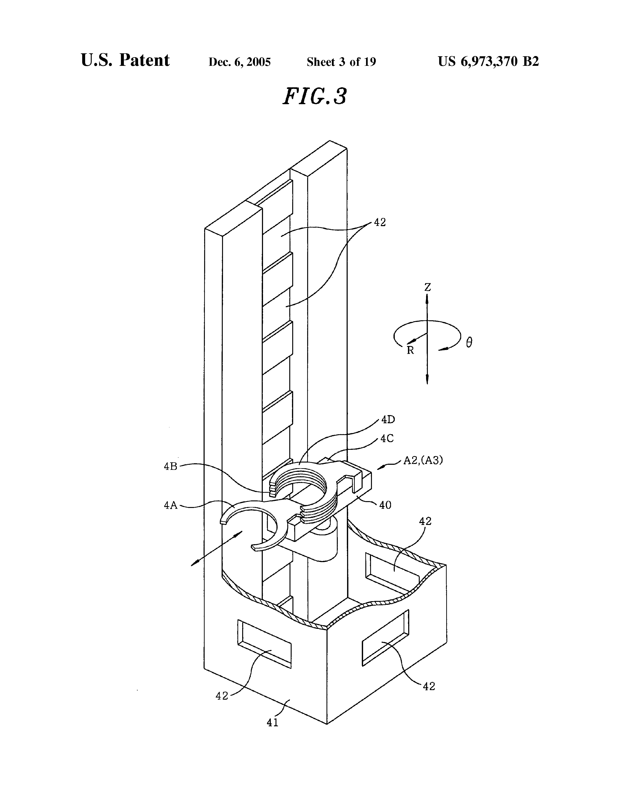

*도 3 — 기판 이송 기구(주 이송 기구)의 사시도*

그런데, 상술한 바와 같이 도포/현상 장치는 서로 다른 처리를 수행하기 위한 서로 다른 장치 구성을 갖는 복수의 처리 유닛을 포함하면서, 주 이송 기구 A2(A3)를 공통으로 이용하여 각 처리 유닛에 대한 웨이퍼 W의 반입 및 반출을 수행한다. 따라서, 티칭을 보다 효율적으로 실행하기 위해서는 서로 다른 구성 각각에 적합한 특정 티칭 방법을 선택할 필요가 있다. 이러한 이유로, 본 발명의 바람직한 실시예에 따라 두 가지 서로 다른 티칭 방법을 제시한다: 하나는 티칭 대상 처리 유닛의 웨이퍼 탑재대가 회전하는 경우를 위한 것이고, 다른 하나는 웨이퍼 탑재대가 회전하지 않는 경우를 위한 것이다. 웨이퍼 W를 회전시키는 기능을 갖는 처리 유닛으로서의 도포 유닛 COT가 도 4에 도시되고, 회전 기능이 없는 처리 유닛의 일례로서의 가열 유닛 BAKE가 도 5에 제시된다.

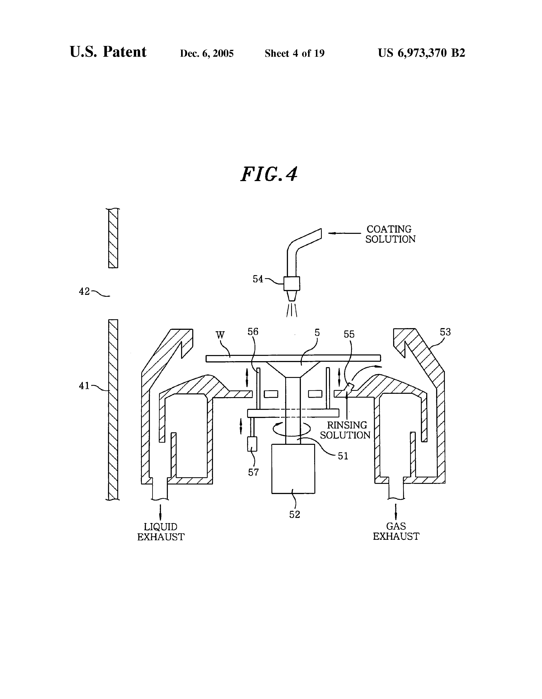

*도 4 — 도포 유닛의 단면도*

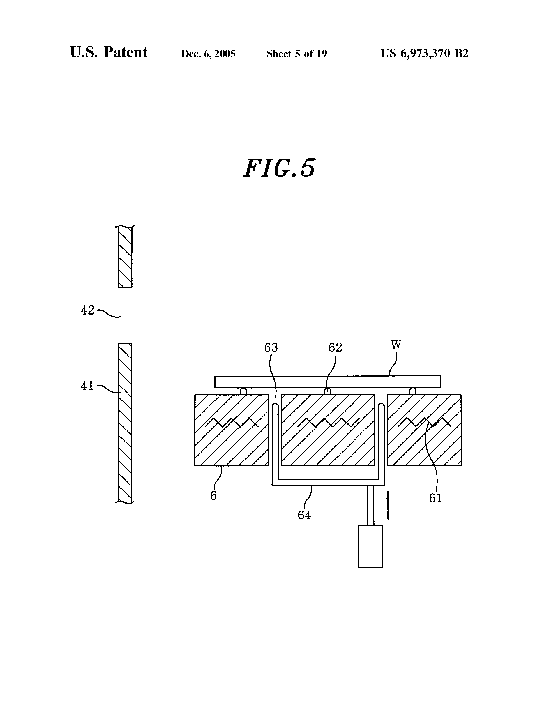

*도 5 — 가열 유닛의 단면도*

먼저 도포 유닛 COT를 상세히 설명한다. 도 4에서, 참조 부호 5는 웨이퍼 W의 이면을 흡착하여 유지하는 기판 지지 부재로서 기능하는 스핀 척이다. 스핀 척 5는 수직축 51을 통해 구동 유닛 52에 연결되며, 웨이퍼 W를 수평으로 지지하면서 수직축을 중심으로 회전하도록 구성된다. 스핀 척 5 상에 지지된 웨이퍼 W의 에지 부근을 둘러싸도록 컵 53이 설치된다. 또한, 도포액, 즉 레지스트액을 공급하기 위한 도포액 공급 노즐 54가 웨이퍼 W의 표면에 대향하여 배치된다. 또한, 웨이퍼 W의 아래에는 웨이퍼 W의 주연부에 린스액을 공급하는 린스액 분사부 55가 설치된다. 스핀 척 5의 이면 아래에는, 각각 기판 승강 부재로서 기능하는 예컨대 3개의 기판 지지 핀 56이 제공되며, 이들은 승강 기구 57에 의해 상승됨으로써 웨이퍼 W를 그 이면으로부터 지지하도록 되어 있다.

이송 암 4A(4B, 4C)는 웨이퍼 W를 수평으로 유지한 채 격벽 41의 이송 개구 42를 통해 도포 유닛 COT 내로 진입하고, 웨이퍼 W는 소정의 이송 위치, 예컨대 스핀 척 5의 기판 지지 영역 위의 위치에 놓인다. 그런 다음, 웨이퍼 W는 수직 이동 가능한 기판 지지 핀 56과의 협동에 의해 스핀 척 5의 표면 상으로 옮겨진다. 그 후, 이송 암 4A(4B, 4C)가 후퇴하고, 도포액 공급 노즐 54가 웨이퍼 W의 중앙부에 레지스트액을 공급함과 동시에 웨이퍼 W가 수직축을 중심으로 회전되어, 원심력에 의해 레지스트액이 웨이퍼 W의 표면 전체로 확산된다. 이어서, 웨이퍼 W를 고속으로 회전시켜 레지스트액을 스핀 건조한다. 그런 다음, 웨이퍼 W를 다시 회전시키면서 린스액 분사부 55로부터 웨이퍼 W의 주연부 상으로 린스액을 공급하여, 웨이퍼의 주연부에 도포된 레지스트액을 씻어내는 에지 린스 처리를 수행한다.

이제 가열 유닛 BAKE를 상세히 설명한다. 도 5에서, 참조 부호 6은 웨이퍼 W를 그 위에 탑재하기 위한 기판 지지 부재로서 기능하는 탑재대를 나타낸다. 탑재대 6에는 히터 61이 매립되어 있으며, 탑재대 6의 표면은 웨이퍼 W를 가열하는 가열 플레이트를 구성한다. 또한, 탑재대 6 상에는 이물질이 웨이퍼 W에 부착되는 것을 방지하기 위해 웨이퍼 W의 이면을 탑재대 6으로부터 약간 띄우는, 프록시미티 핀이라 불리는 복수의 돌기 62가 제공되며, 그중 하나는 탑재대 6의 웨이퍼 W 탑재 영역의 중심에 설치된다. 또한, 탑재대 6에는 관통 구멍 63이 형성되어 있으며, 이를 통해 기판 승강 기구로서 기능하는 기판 지지 핀 64가 돌출 및 몰입한다. 이와 같이 구성된 가열 유닛 BAKE에서, 이송 암 4A(4B, 4C)는 웨이퍼 W를 수평으로 유지한 채 격벽 41의 이송 개구 42를 통해 도포 유닛 COT 내로 진입하고, 웨이퍼 W는 소정의 이송 위치, 예컨대 스핀 척 5의 기판 지지 영역 위의 위치에 놓인다. [역주: 원문 그대로 옮김. 문맥상 가열 유닛 BAKE 및 탑재대 6을 의미하는 것으로 보임.] 그런 다음, 웨이퍼 W는 기판 지지 핀 64와의 협동에 의해 기판 지지 핀 64 상으로 옮겨지고, 이어서 기판 지지 핀 64가 하강하여 웨이퍼 W가 탑재대 6 상에 탑재된다. 탑재대 6 상에 탑재된 웨이퍼 W가 소정 온도로 가열된 후, 웨이퍼 W는 상술한 것과 역순으로 유닛으로부터 반출된다.

이하, 상술한 도포/현상 장치를 내장한 티칭 시스템에 대한 설명을 도 6 및 도 7을 참조하여 제공한다. 도 6에서, 참조 부호 W1은 티칭 과정에서 위치 정렬에 사용되는 웨이퍼이며, 그 위의 소정 위치, 예컨대 그 중심에 예컨대 직경 5 mm의 원형 마크 M이 형성되어 있다. 참조 부호 70은 예컨대 웨이퍼 W1과 동일한 크기를 갖는 지그(jig) 70을 나타낸다. 지그 70은 그 중앙 영역에 구멍 70a를 가지며, 모니터링 장치로서 기능하는 예컨대 CCD 카메라 71이 지그 70의 상면에 설치된다. CCD 카메라 71은 구멍 70a를 통해 그 아래 영역을 모니터링한다. 구체적으로, 티칭 과정에서 지그 70은 웨이퍼 W1과 마찬가지로 티칭용 이송 암 4D 상에 수평으로 유지된 채, 스핀 척 5 상에 탑재된 웨이퍼 W1의 표면에 대향하는 위치로 안내되며, 이로써 CCD 카메라 71이 웨이퍼 W1의 마크 M을 모니터링할 수 있게 된다. CCD 카메라 71은 예컨대 배선을 통해 티칭 과정의 제어계로서 기능하는 제어기(controller) 8에 연결된다.

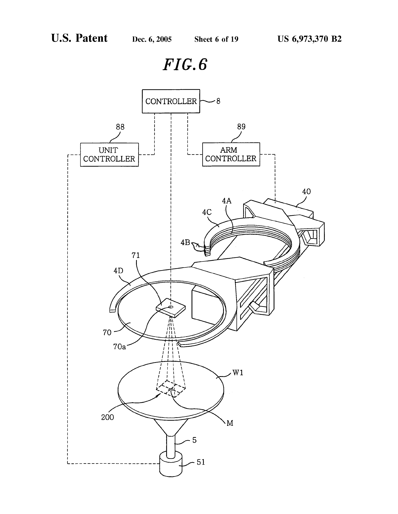

*도 6 — 주 이송 기구에 CCD 카메라를 달아 위치 정렬용 웨이퍼를 모니터링하는 모습*

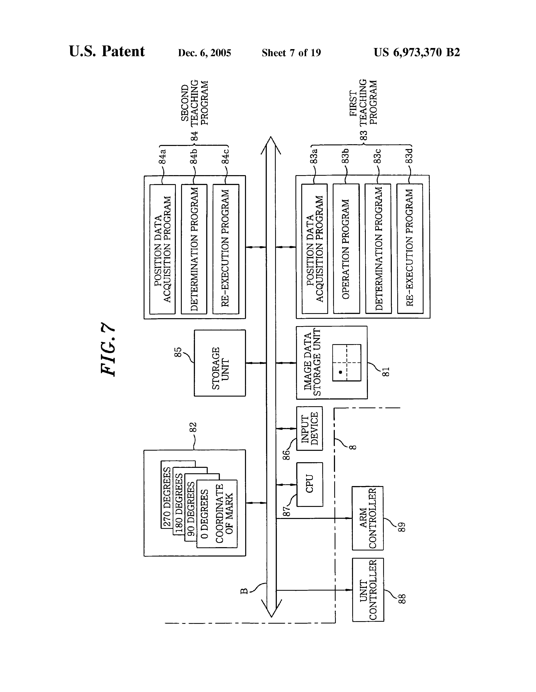

*도 7 — 티칭 기구(제어기 구성)*

제어기 8을 상세히 설명한다. 도 7에서, 참조 부호 81은 CCD 카메라 71에 의해 얻어진 화상 데이터를 저장하는 화상 데이터 저장부를 나타내고; 참조 부호 82는 스핀 척 5의 각 회전 위치에 대한 웨이퍼 W1 상의 마크 M의 위치(X 및 Y 좌표)를 일시적으로 저장하는 작업 메모리를 가리키며; 참조 부호 83 및 84는 각각 제1 및 제2 티칭 프로그램을 나타낸다. 프로그램 83 및 84는 실제로는 저장소에 저장되지만, 설명의 편의를 위해 프로그램에 참조 부호를 부여한다. 본 바람직한 실시예에서는, 처리 유닛, 예컨대 도포 유닛 COT의 탑재대가 회전하는 경우와, 처리 유닛, 예컨대 가열 유닛 BAKE의 탑재대가 회전하지 않는 경우 각각에 대해 주 이송 기구 A2 및 A3의 이송 동작 데이터를 얻는다. 이러한 이유로, 제1 티칭 프로그램 83은 예컨대 도포 유닛 COT에 대한 티칭을 수행하도록 설계되고, 제2 티칭 프로그램 83은 예컨대 가열 유닛 BAKE에 대한 티칭을 수행하도록 제공된다. [역주: 원문 그대로 "83"으로 표기됨. 문맥상 84를 의미함.] 제1 티칭 프로그램 83은, CCD 카메라 71에 의해 스핀 척 5의 각 회전 위치에서 얻어진 화상 데이터에 기초하여 각 회전 위치에 대한 마크 M의 위치(X 및 Y 좌표)를 얻는 위치 데이터 취득 프로그램 83a; 스핀 척 5의 각 회전 위치에 대한 마크 M의 위치에 기초하여 스핀 척 5의 회전 중심과 웨이퍼 W의 중심 사이의 틀어짐 양을 산출하는 연산 프로그램 83b; 연산 프로그램 83b에 의해 얻어진 결과에 기초하여 틀어짐의 유무를 판정하는 판정 프로그램 83c; 및 틀어짐 양이 있다고 판정될 때 이송 암 4A(4B, 4C)를 이용하여 웨이퍼 W1을 조정(재실행)하는 재실행 프로그램 83d를 포함한다.

제2 티칭 프로그램 84는, CCD 카메라 71에 의해 얻어진 화상 데이터에 기초하여, 가열 유닛 BAKE의 탑재대(가열 플레이트) 6의 중심 마크가 될 수 있는 돌기 62의 위치와 웨이퍼 W1 상의 마크 M의 위치를 얻는 위치 데이터 취득 프로그램 84a; 위치 데이터 취득 프로그램 84a에 의해 얻어진 결과에 기초하여 돌기 62의 위치와 웨이퍼 W1의 마크 M 사이의 틀어짐을 산출하고 그 틀어짐 양이 소정 허용 범위 내에 드는지 여부를 판정하는 판정 프로그램 84b; 및 틀어짐 양이 허용 범위를 벗어날 때 이송 암 4A(4B, 4C)를 이용하여 웨이퍼 W1을 조정하는 재실행 프로그램 84c를 포함한다.

또한, 도 7의 참조 부호 85는, 웨이퍼 W1의 중심과 스핀 척 5의 회전 중심이 서로 일치하는 위치, 또는 웨이퍼 W1의 중심과 탑재대 6의 중심 마크로서 기능하는 돌기 62의 위치 사이의 틀어짐 양이 허용 범위 내에 있을 때 측정된, 각 처리 유닛에 대한 이송 암 4A 내지 4C 각각의 웨이퍼 이송 위치를 저장하는 저장부를 나타낸다. 즉, 저장부 85에는 티칭 과정을 통해 학습되고 상술한 바와 같이 R, θ 및 Z 값을 이용하여 정의된 이송 암 4A 내지 4C의 이송 위치 데이터가 저장된다. 또한, 참조 부호 86은 예컨대 조작 패널로 이루어진 입력 장치이며, 입력 장치는 예컨대 티칭 과정에서 조작 화면을 표시한다. 참조 부호 87은 CPU를 나타내고, 참조 부호 88은 제어기 8로부터 제공되는 제어 신호에 기초하여 처리 유닛을 제어하는 유닛 제어기를 가리킨다. 참조 부호 89는 제어기 8로부터의 제어 신호에 기초하여 주 이송 기구 A2 및 A3을 제어하는 암 제어기이다. 참조 부호 B는 버스를 나타낸다.

이제 이송 암 4A 내지 4C의 티칭을 수행하는 과정을 도 8 및 도 9를 참조하여 설명한다. 다만 여기서는 웨이퍼 W1을 회전시키는 기능을 갖는 도포 유닛 COT의 경우에 대해 과정을 설명한다. 먼저, 단계 S1에 나타낸 사전 준비로서, 위치 정렬용 웨이퍼 W1이 티칭 대상인 예컨대 상단의 이송 암 4C 상에 지지되고, 동시에 지그 70이 티칭용 이송 암 4D 상에 지지된다. 이어서, 예컨대 설계 데이터에 기초하여 저장된 스핀 척 5의 위치를 참조하여 이송 암 4D를 전방으로 신장시키고, 동시에 CCD 카메라 71이 스핀 척 5를 모니터링하면서 스핀 척 5의 대략 중앙부, 예컨대 웨이퍼 W의 이면을 흡착하기 위해 스핀 척 5 표면의 중앙부에 형성된 진공 구멍의 위치를 탐색하며(단계 S2), 이로써 스핀 척 5의 중심이 이송 암 4D 상에 지지된 지그 70의 모니터링 영역의 대략 중앙부에 위치하게 된다. 그때의 이송 암 4D의 위치 좌표는 작업 메모리 82에 저장된다. 그 후, 이러한 위치 좌표에 기초하여 이송 암 4C를 전진시켜 웨이퍼 W1을 이송 위치에 위치시킨다. 그런 다음, 상술한 바와 같이 도포 유닛 COT에서 기판 지지 핀 56을 거쳐 웨이퍼 W1이 이송 암 4C로부터 스핀 척 5 상으로 옮겨진다(단계 S3).

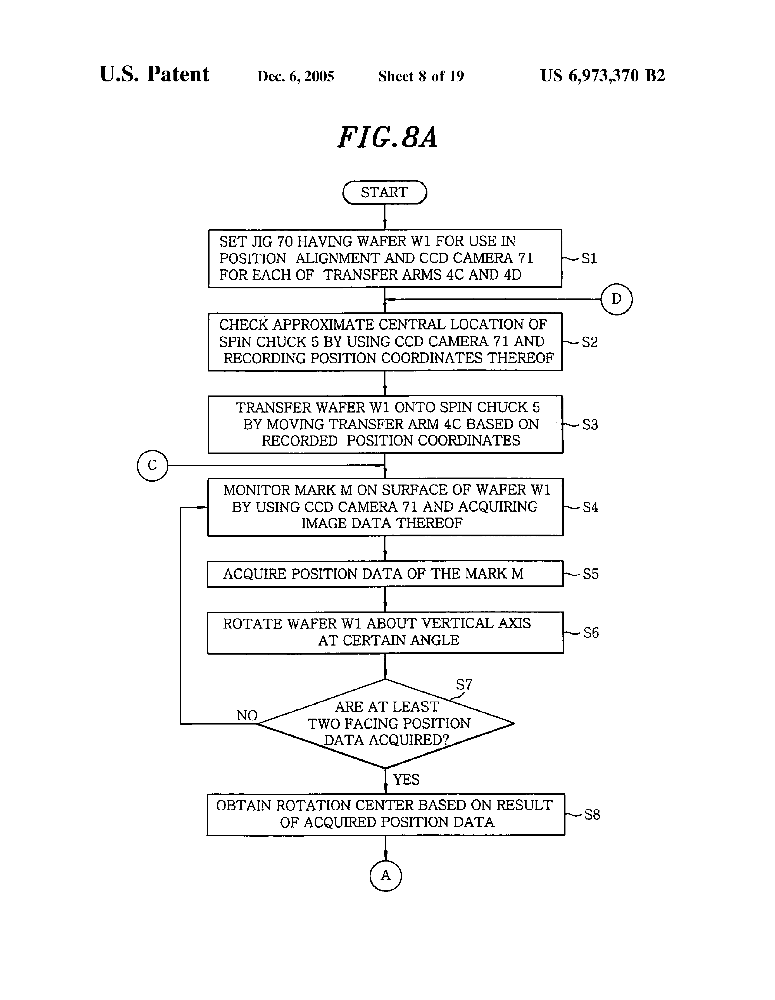

*도 8A — 티칭 과정 흐름도(1/3)*

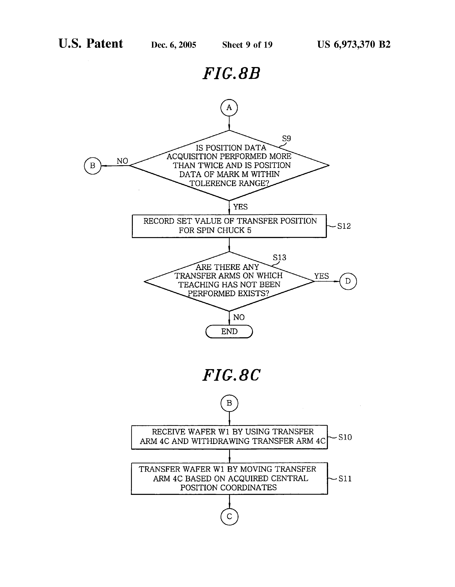

*도 8B, 도 8C — 티칭 과정 흐름도(2/3, 3/3)*

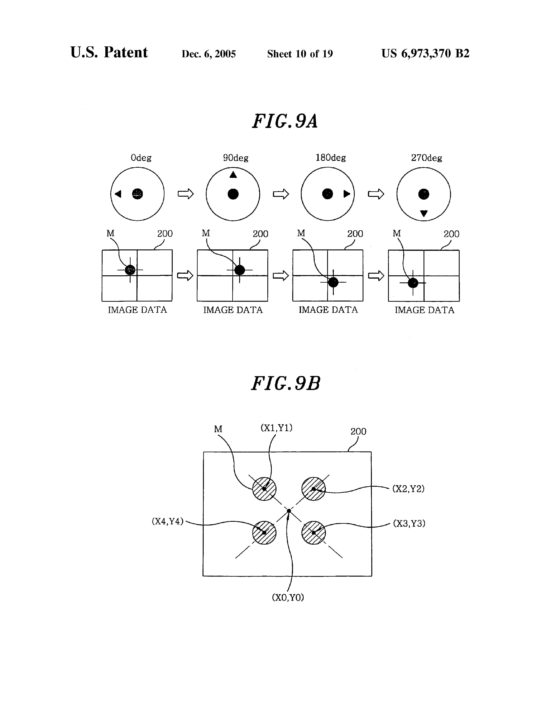

*도 9A, 도 9B — 티칭 과정에서 얻어지는 화상 데이터*

다음으로, 이송 암 4C가 유닛으로부터 후퇴하고, 지그 70을 지지하는 이송 암 4D가 단계 S2에서 취득된 위치 좌표 데이터에 기초하여 유닛 내로 진입한다. 지그 70은 스핀 척 5 상에 유지된 웨이퍼 W1의 표면에 대향하는 위치로 안내되어, CCD 카메라 71에 의해 웨이퍼 W1 표면의 마크 M을 모니터링한다. 모니터링에 의해 얻어진 화상 데이터 200은 화상 데이터 저장부 81에 기록된다. 그런 다음, 위치 데이터 취득 프로그램 83a에 기초하여, 화상 데이터 200의 모니터링 영역 내의 위치 데이터, 즉 X1 및 Y1과 같은 위치 좌표 데이터가 계산에 의해 취득된 후 작업 메모리 82에 기록된다(단계 S5). 그 후, 단계 S6에 도시된 바와 같이, 유닛 제어기 88에 의해 스핀 척 5의 회전이 제어되어 웨이퍼 W1이 수직축을 중심으로 소정 각도, 예컨대 90도마다 회전되고, 각 위상에 대한 위치 데이터가 동일한 방식으로 각각 취득된다. 위치 데이터는 적어도 2개의 위치, 그리고 회전 전후로 180도 각도로 서로 대향하는 짝수 개의 위치로부터 취득될 수 있다. 도 9A에 도시된 바와 같이, 본 예에서와 같이 예컨대 0도, 90도, 180도 및 270도의 4개 위치로부터 위치 데이터를 얻는 경우, 그 위치 데이터가 모두 취득될 때까지 단계 S4 내지 S6이 반복 수행된다(단계 S7).

단계 S8에 나타낸 바와 같이, 위치 데이터 취득 프로그램 83a에 의해 취득된 4개 위치의 위치 데이터에 기초하여 연산 프로그램 83b에 의해 회전축의 중심이 탐색된다. 구체적으로, 도 9B에 도시된 바와 같이, 0도와 180도의 위치 데이터를 잇는 직선이 90도와 270도의 위치 데이터를 잇는 직선과 교차하는 점(X0=0, Y0=0)이 회전축의 중심으로 설정된 후, 이송 암 4C에 대응하는 중심 위치 좌표로서 작업 메모리 82에 기록된다. 또한, 예컨대 2개 위치의 위치 데이터를 취득하는 경우에는, 두 위치 데이터를 잇는 직선의 중점에 해당하는 위치 좌표가 회전축의 중심 위치 좌표로 설정된다. 다음으로, 이송 암 4C가 스핀 척 5 상에 탑재된 웨이퍼 W1을 수취한 후 유닛으로부터 외부로 후퇴한다(단계 S10). 단계 S8에서 취득된 위치 데이터로부터 얻어진 중심 위치 좌표에 기초하여 웨이퍼 W1이 스핀 척 5 상으로 이송되고(단계 S1), 그런 다음 단계 S4 내지 S8을 수행하여 2회차 데이터를 취득한다. 여기서, 단계 S9에 도시된 바와 같이, 2회차 위치 데이터를 취득한 후 웨이퍼 W1 표면의 마크 M의 위치 좌표 값들이 단일 값이 아니거나 소정 허용 범위를 벗어나면, 판정 프로그램 83c가 틀어짐을 검출한다. 틀어짐이 검출된 경우, 단계 S10에 나타낸 바와 같이 이송 암 4C가 스핀 척 5 상에 탑재된 웨이퍼 W1을 수취한 후 유닛으로부터 외부로 후퇴하고(단계 S10), 재실행 프로그램 83d에 기초하여 두 위치 좌표 값의 틀어짐을 줄이도록 θ 및 R이 수정되며, 즉 단계 S8에서 취득된 위치 데이터로부터 얻어진 중심 위치 좌표에 기초하여 웨이퍼 W1이 스핀 척 5 상으로 이송되고(단계 S11), 수정된 위치 좌표 값에 기초하여 단계 S4 내지 S8이 다시 수행된다. 상술한 허용 범위는 예컨대 처리 유닛의 종류에 따라 결정된다. 예를 들어, 도포 유닛(COT)의 경우 허용 범위는 편심 0.1 mm 이하로 설정되고; 현상 유닛(DEV)의 경우 편심 0.3 mm 이하로 설정되며; 후술하는 베이크 유닛의 경우 거리 차 0.5 mm 이하로 설정된다. 다음으로, 단계 S9에서 위치 데이터가 동일하다고(틀어짐이 없다고) 판정되면, 단계 S12에 도시된 바와 같이 이송 위치의 설정값이 해당 도포 유닛(COT)에 대한 이송 암 4C의 설정값으로서 저장부 85에 기록되어, 이송 암 4C의 티칭이 완료된다. 웨이퍼 W1을 회전시키면서 마크 M의 회전 궤적에 편심이 존재하는지 여부를 확인함으로써 위치 정렬 정밀도를 높일 수 있다.

그 후, 단계 S13에 도시된 바와 같이, 아직 티칭이 수행되지 않은 이송 암 4B 및 4A가 추가로 있는 경우, 중단의 이송 암 4B가 유닛 내로 진입하여 스핀 척 5로부터 웨이퍼 W1을 수취한 후 후퇴한다. 단계 S2로 복귀함으로써 이송 암 4B의 티칭이 개시된다. 중단의 이송 암 4B의 티칭이 완료되면, 하단의 이송 암 4A의 티칭이 동일한 방식으로 수행된다. 또한, 기준이 되는 처리 유닛, 예컨대 처음 티칭을 수행하는 유닛에서 이송 암 4A 내지 4C의 위치 정렬이 수행된 후에는, 다른 처리 유닛에서는 이송 암 4A 내지 4C 중 어느 하나에 대해서만 수행하는 것으로 충분하다. 이는 나머지 이송 암에서는 그 하나의 이송 위치에 대한 상대 위치 데이터가 미리 취득되어 있기 때문이다.

상술한 실시예에 따르면, 실제 처리될 기판과 동일한 웨이퍼 W1은 그 표면에 마크 M이 형성되어 있으며 스핀 척 5 상에 유지된다. 웨이퍼 W1을 회전시켜 얻은 마크 M의 궤적에 기초하여 회전축의 중심을 탐색하는 구성에 의해, 웨이퍼 W1의 중심과 회전축의 중심 사이의 틀어짐을 간단히 정량화할 수 있다. 따라서, 재실행 시의 설정점(보정값)을 간단한 보정에 의해 설정할 수 있다. 그 결과, 더 적은 재실행으로 웨이퍼 W1의 중심을 회전축의 중심과 일치시킬 수 있으므로, 티칭을 단시간에 수행할 수 있다. 또한, "발명의 배경"에서 설명한 투과형 광 센서를 사용하는 경우, 예컨대 50 μm의 정밀도를 맞추기 위해 재실행을 최대 5회 수행해야 한다. 그러나 본 발명에 따르면, 발명자들은 더 적은 재실행, 예컨대 2회로 동일한 정밀도를 달성할 수 있음을 관찰하였다. 본 발명의 발명자들은 그 이유를 다음과 같이 설명한다. 예를 들어, 투과형 광 센서로 웨이퍼 W1의 주연부를 검출하는 경우, 센서와 이송 암 각각이 좌표계를 가지며, 따라서 이송 암은 투과형 광 센서의 이동 방향에 수직인 방향으로 진입한다고 가정한다. 또한, 1회 검출로 얻어지는 데이터는 한 방향(X 또는 Y 방향)의 데이터이다. 예를 들어, 웨이퍼 W1을 90도마다 회전시킴으로써 X 방향의 위치 데이터 2개와 Y 방향의 위치 데이터 2개가 취득된다.

본 발명의 바람직한 실시예에서는, CCD 카메라 71을 이송 암 4D에 설치함으로써 각 처리 유닛에 대해 해당 CCD 카메라 71의 좌표계와 이송 암(4A 내지 4D)의 좌표계가 결합되고, 1회차 검출(모니터링) 중에 얻어지는 마크 M의 위치 데이터가 X 및 Y 두 좌표를 모두 특정하므로, 웨이퍼 W1을 90도마다 회전시킴으로써 결과적으로 X 방향의 데이터 점 4개와 Y 방향의 데이터 점 4개를 취득할 수 있다. 이러한 차이로부터, 본 발명의 바람직한 실시예는 웨이퍼 W1의 틀어짐 정보에 있어서 높은 정밀도를 가지며, 이로써 재실행 횟수가 감소된다. 1회 시행에 걸리는 시간은 약 2분이지만, 복수의 처리 유닛에서 다수의 시행이 수행되기 때문에 결과적으로 많은 시간을 절감할 수 있다.

더욱이, 스핀 척 5의 회전 중심을 찾기 위해서는 적어도 2개의 회전 영역에서 마크 M의 위치 데이터를 취득할 필요가 있다. 본 예에서는 서로 90도 간격으로 떨어진 4개의 서로 다른 회전 위치에서 마크 M의 위치 데이터를 취득하고, 서로 180도 떨어진 서로 다른 좌표를 잇는 직선들의 교점을 회전 중심으로 결정하므로, 연산 과정이 용이해진다. 또한, 2개 위치에서 위치 데이터를 취득하고 그 위치 데이터를 잇는 직선의 중점의 위치 좌표, 즉 해당 직선의 중점의 위치 좌표를 중심 위치 좌표로 설정하는 경우, 더 적은 위치 데이터로 회전축의 중심을 얻을 수 있다. 더욱이, 취득하는 위치 데이터가 적은 경우는 티칭을 더 짧은 시간에 수행할 수 있다는 점에서 유리하다.

나아가, 상술한 실시예에 따르면, 모니터링 장치로서 CCD 카메라 71을 갖는 지그 70이 이송 암 4D에 의해 지지됨과 동시에 이송 암 4D에 의해 유닛 내의 모니터링 위치로 안내되는 구성에 의해, 유닛에 센서를 설치하는 경우와 비교하여 작업자가 들이는 시간과 노력을 상당히 줄일 수 있다. 그 결과, 티칭 시간을 단축할 수 있고, 나아가 작업자의 부담도 줄일 수 있다.

이하, 베이크 유닛, 즉 웨이퍼 W1을 회전시키는 기능이 없는 처리 유닛을 이용한 과정을 도 10 및 도 11을 참조하여 설명한다. 단계 S101에 나타낸 바와 같이, 사전 준비로서 위치 정렬용 웨이퍼 W1이 티칭이 수행될 상단의 이송 암 4C에 의해 지지되고, 동시에 지그 70이 티칭 전용의 티칭용 이송 암 4D에 의해 지지된다. 이어서, 이송 암 4D는 예컨대 설계 데이터에 기초하여 기억된 베이크 유닛의 중심 위치에 대응하여 전방으로 신장된 위치에서 정지된다. 또한, 돌기 62를 모니터링하여 화상 데이터 200을 화상 데이터 저장부 81에 기록하며(단계 S102), 여기서 돌기 62는 탑재대 6 상의 웨이퍼 탑재 영역의 중심 마크가 될 수 있다. 화상 데이터 200의 모니터링 영역의 중심에 해당하는 돌기 62의 위치 좌표[탑재대 6의 중심의 위치 데이터]가 위치 데이터 취득 프로그램 84a에 의해 취득된 후 작업 메모리 82에 기록된다(단계 S103).

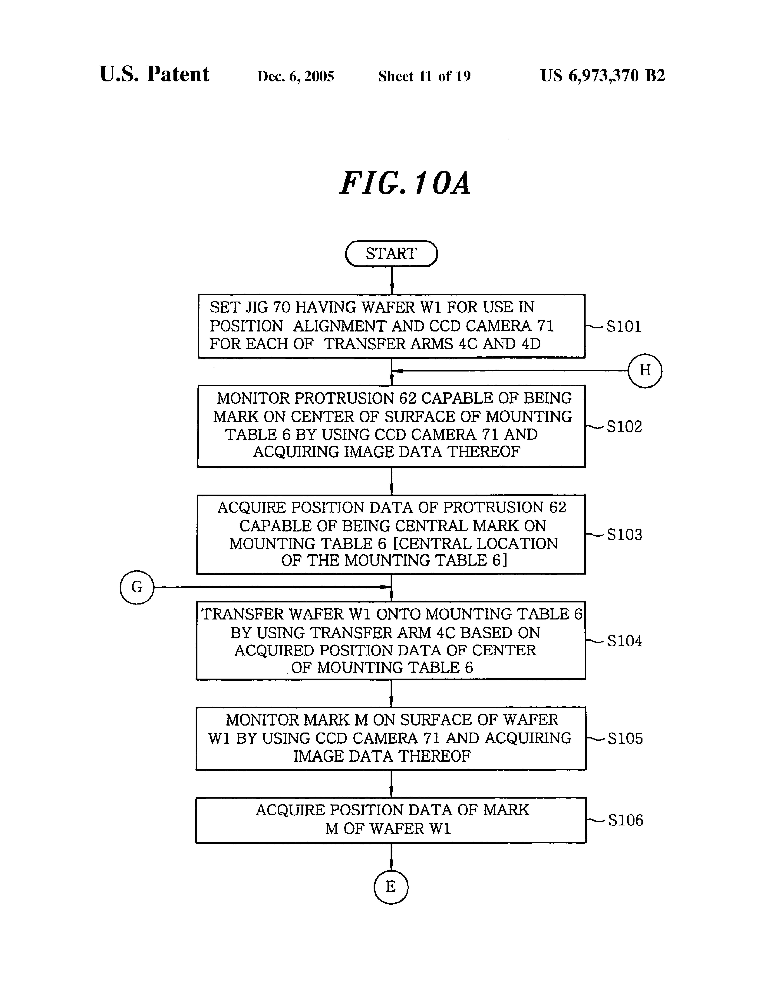

*도 10A — 티칭 과정의 다른 예 흐름도(1/3)*

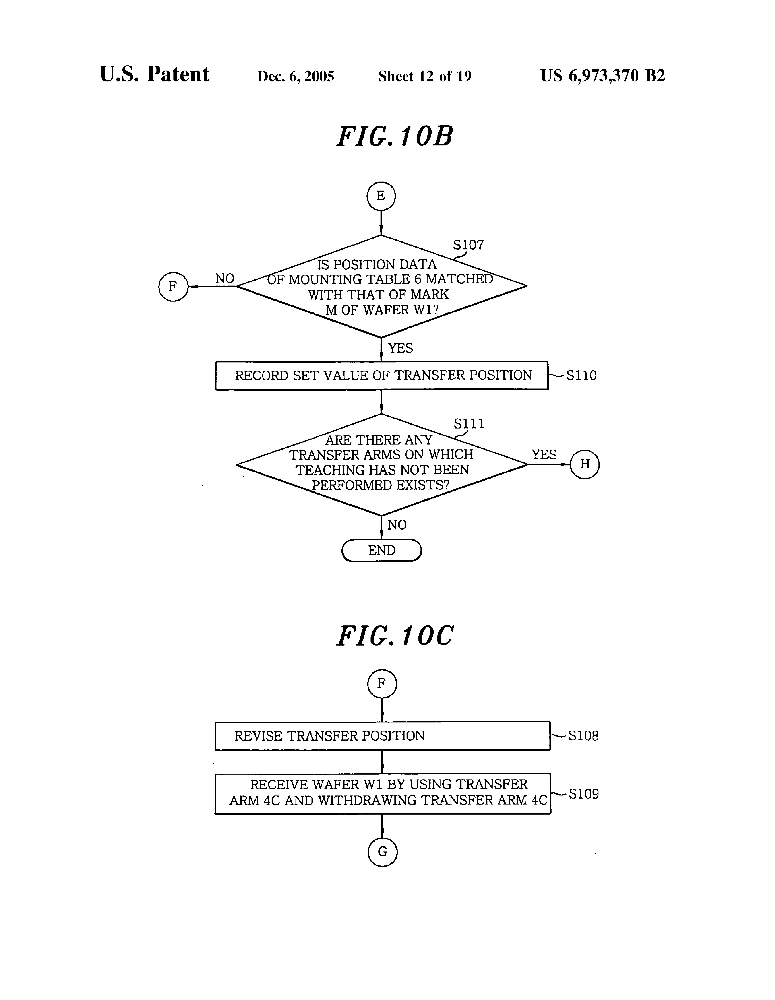

*도 10B, 도 10C — 티칭 과정의 다른 예 흐름도(2/3, 3/3)*

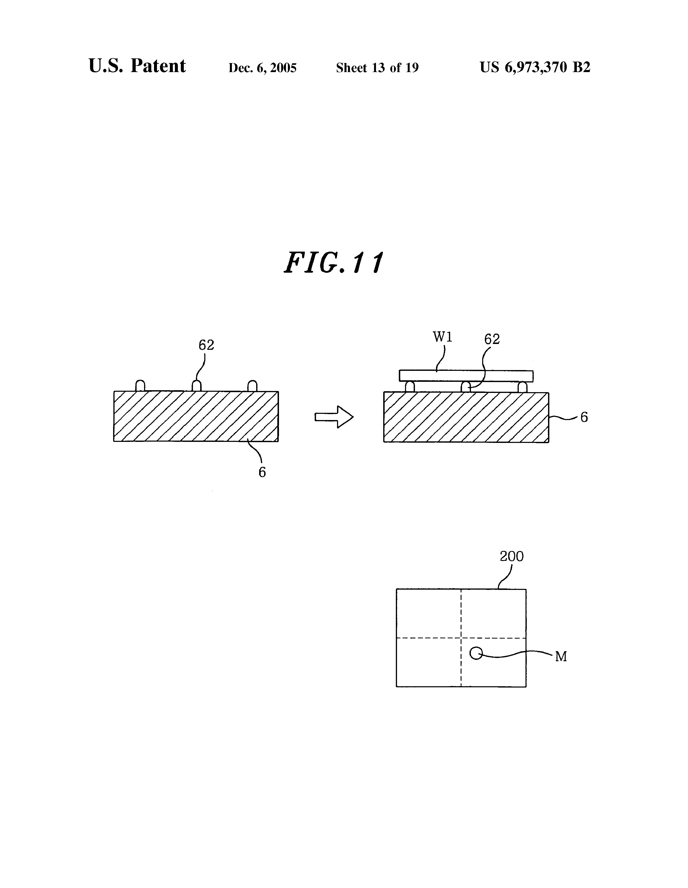

*도 11 — 도 10의 티칭 과정에서 얻어지는 화상 데이터*

그 후, 이송 암 4D가 유닛으로부터 후퇴함과 동시에, 이송 암 4C가 위치 좌표에 기초하여 전진하여 웨이퍼 W1이 이송 위치에 제공될 수 있게 된다. 이때, 베이크 유닛(BAKE)에서는 상술한 바와 같이 웨이퍼 W1이 기판 지지 핀 64를 거쳐 이송 암 4C로부터 탑재대 6으로 옮겨진다(단계 S104). 다음으로, 이송 암 4C가 유닛으로부터 후퇴하고, 지그 70을 지지하는 상단의 이송 암 4D가 단계 S103에서 취득된 중심 위치 좌표 데이터에 기초하여 유닛 내로 진입한 후, 탑재대 6 상에 유지된 웨이퍼 W1의 표면에 대향하는 위치로 안내된다. 단계 S105에 도시된 바와 같이, CCD 카메라 71에 의해 웨이퍼 W1 표면의 마크 M이 모니터링되어 그 화상 데이터 200이 화상 데이터 저장부 81에 기록된다. 또한, 위치 좌표, 즉 마크 M의 위치 데이터가 취득 프로그램 84a에 의해 취득된 후 작업 메모리 82에 기록된다(단계 S106).

단계 S107에 도시된 바와 같이, 판정 프로그램 84b가 판독되어 웨이퍼 W1의 위치 데이터가 탑재대 6의 중심의 위치 데이터와 비교된다. 위치 데이터가 동일하든 그렇지 않든 허용 범위 내에 존재하는 한, 웨이퍼 W1은 적절한 위치에 위치한 것으로 간주된다. 한편, 위치 데이터가 동일하지 않고 나아가 허용 범위 내에도 존재하지 않으면, 재실행 프로그램 84c에 기초하여 위치 데이터 간의 틀어짐을 줄이도록 θ 및 R의 값이 수정된다(단계 S108). 그런 다음, 이송 암 4C가 탑재대 6 상의 웨이퍼 W1을 수취한 후 유닛으로부터 후퇴한다(단계 S109). 수정된 이송 위치를 새로운 설정값으로 설정한 후, 단계 S104 내지 S106이 다시 수행된다. 그 후, 단계 S107에서 위치 데이터가 동일하다고 판정되면, 단계 S110에 도시된 바와 같이 그때의 이송 위치 설정값이 해당 베이크 유닛에 대한 이송 암 4C의 설정값으로서 저장부 85에 기록되어, 이송 암 4C의 티칭이 완료된다.

다음으로, 단계 S111에서 알 수 있는 바와 같이, 아직 티칭이 수행되지 않은 이송 암이 추가로 있는 경우, 티칭이 수행될 중단의 이송 암 4B가 유닛 내로 진입하여 웨이퍼 W1을 수취한 후 후퇴한다. 단계 S104 내지 S110을 수행함으로써 이송 암 4B의 티칭이 수행된다. 중단의 이송 암 4B의 티칭이 완료되면, 하단의 이송 암 4A의 티칭이 동일한 방식으로 수행된다.

상술한 실시예에 따르면, 대상 처리 유닛이 웨이퍼 W1을 회전시키는 기능을 갖지 않더라도, 웨이퍼 W1의 중심 위치 데이터를 탑재대 6의 중심 위치 데이터와 비교함으로써 어느 정도의 틀어짐이 있는지 여부를 쉽게 확인할 수 있다. 또한, 틀어짐을 줄이도록 새로운 설정값(보정값)을 간단히 설정할 수 있으므로, 상술한 경우와 동일한 효과를 얻을 수 있다. 본 예는 이송 위치를 제어하는 구성에 한정되지 않으며, 나아가 예컨대 단계 S107에서 얻어진 판정 결과에 기초하여 웨이퍼 W1이 소정 위치에 탑재되었는지 여부를 확인하는 장치로서만 사용될 수도 있다.

이하, 상술한 도포 유닛(COT)의 티칭을 수행하기 위한 다른 과정의 예를 도 12를 참조하여 설명한다. 각 단계의 세부 동작은 웨이퍼 W1이 기판 지지 핀 56에 의해 지지된 상태에서 모니터링된다는 점을 제외하고는 도 8에 도시된 예와 동일하다. 먼저, 위치 정렬용 웨이퍼 W1이 이송 암 4C 상에 지지되고, 동시에 지그 70이 이송 암 4D 상에 지지된다(단계 S201). 다음으로, 이송 암 4D를 전방(R축 방향)으로 신장시켜 CCD 카메라 71로 스핀 척 5를 모니터링함으로써, 그 대략적인 중심 위치를 확인한다. 그런 다음, 그 위치 좌표가 작업 메모리 82에 기록된다(단계 S202). 이어서, 기록된 위치 좌표에 기초하여 이송 암 4C가 전진하고, 기판 지지 핀 56과 이송 암 4C 사이의 협동 동작에 의해 웨이퍼 W1이 스핀 척 5 상으로 옮겨진다(단계 S203).

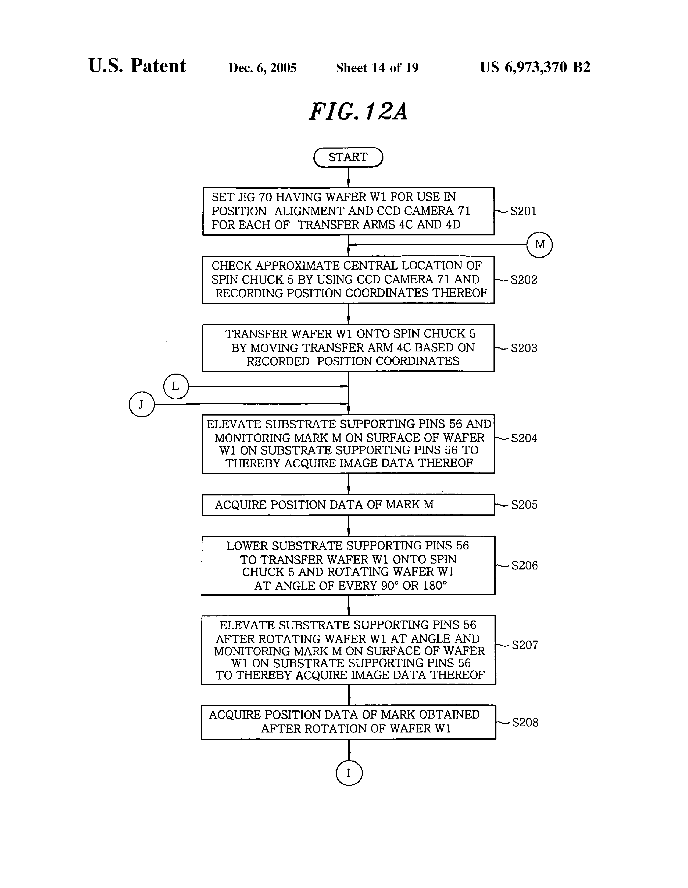

*도 12A — 티칭 과정의 또 다른 예 흐름도(1/3)*

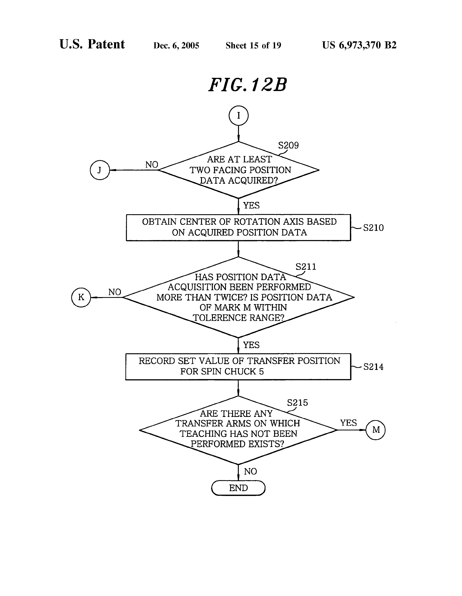

*도 12B — 티칭 과정의 또 다른 예 흐름도(2/3)*

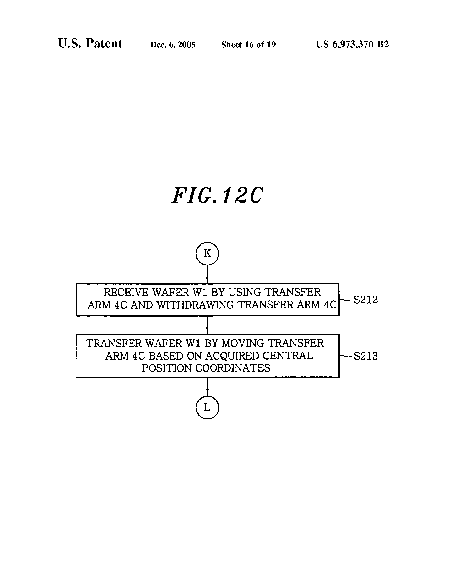

*도 12C — 티칭 과정의 또 다른 예 흐름도(3/3)*

그 후, 이송 암 4C가 유닛으로부터 외부로 후퇴하고, 기판 지지 핀 56이 상승하여 웨이퍼 W1을 상승 위치(모니터링 위치), 예컨대 이송 암 4C와의 수수 위치 부근에 위치시키며, 동시에 지그 70을 지지하는 이송 암 4D가 유닛 내로 진입한다. 그런 다음, 기판 지지 핀 56 상의 웨이퍼 W1의 마크 M이 CCD 카메라 71에 의해 모니터링된다(단계 S204). 즉, 모니터링 대상인 웨이퍼 W1이 기판 지지 핀 56에 의해 CCD 카메라 71에 근접하여 위치되는 방식으로 마크 M이 모니터링된다. 0도 위치에서 얻어진 이러한 모니터링 화상 데이터는 화상 데이터 저장부 81에 기록된다. 다음으로, 위치 데이터 취득 프로그램 83a에 기초하여 위치 데이터가 취득된 후 작업 메모리 82에 기록된다(단계 S205). 이어서, 기판 지지 핀 56이 하강하여 웨이퍼 W1을 스핀 척 5 상으로 옮긴다. 웨이퍼 W1은 해당 스핀 척 5에 의해 수직축을 중심으로 소정 각도, 예컨대 90도 또는 180도마다 회전되어, 마크 M의 대향 위치 데이터가 취득된다(단계 S206 내지 S208). 또한, 적어도 2개의 위치, 예컨대 회전 전후로 180도 각도로 서로 대향하는 짝수 개의 위치로부터 위치 데이터가 취득될 때까지 단계 S204 내지 S208이 반복 수행된다(단계 S209).

그 후, 단계 S210에서 알 수 있는 바와 같이, 취득된 위치 데이터에 기초하여 연산 프로그램 83b에 의해 회전축의 중심이 탐색된다. 구체적으로, 단계 S205에서 얻어진 0도 위치에 해당하는 위치 좌표와 단계 S202에서 얻어진 위치 좌표(2회차부터는 이전 단계 S210에서 취득된 중심축의 위치 좌표) 사이에 틀어짐이 존재하는지 여부를 확인한다. 틀어짐이 없다고 판정되면, 회전축의 중심은 예컨대 0도와 180도 또는 90도와 270도의 두 위치의 위치 데이터를 잇는 직선의 중점의 위치 좌표로 결정된다. 한편, 웨이퍼 W1이 하강할 때 발생하는 에어 베어링(air bearing) 현상 등에 의한 해당 웨이퍼 W1의 수평 이동으로 인해 두 위치 좌표 사이에 틀어짐이 있다고 판정되면, 틀어짐의 방향과 양을 연산에 의해 구하여 각 위치 데이터를 수정한다. 수정 후 얻어진 대향 위치 데이터를 잇는 직선의 중점의 위치 좌표가 회전 중심축의 중심 위치 좌표로 설정된다.

이와 같은 방식으로 1회차 데이터 취득이 완료되고, 그런 다음 이송 암 4C가 기판 지지 핀 56으로부터 웨이퍼 W1을 수취한 후 유닛으로부터 외부로 후퇴한다(단계 S211 및 S212). 그런 다음, 상술한 중심 위치 좌표에 기초하여 이송 암 4C가 유닛 내로 진입한 후, 기판 지지 핀 56과의 협동 동작에 의해 웨이퍼 W1을 스핀 척 5 상으로 옮긴다(단계 S213). 마찬가지로 단계 S204 내지 S210을 수행함으로써 2회차 데이터 취득이 수행된다. 그리고, 2회차 데이터 취득 후, 회전 후의 웨이퍼 W1 표면의 마크 M의 위치 좌표가 동일하거나 허용 범위 내에 있으면, 이송 위치의 설정값이 해당 도포 유닛(COT)에 대한 이송 암 4C의 설정값으로서 저장부 85에 기록되어, 이송 암 4C의 티칭이 완료된다(단계 S214).

한편, 단계 S211에서 판정 프로그램 83c가 회전 후의 웨이퍼 W1 표면의 마크 M의 위치 좌표가 동일하지 않거나 허용 범위를 벗어난다고 판정하면, 이송 암 4C가 기판 지지 핀 56으로부터 웨이퍼 W1을 수취한 후 유닛으로부터 외부로 후퇴한다(단계 S212). 다음으로, 위치 데이터 간의 틀어짐을 줄이도록 재실행 프로그램 83d에 기초하여 θ 및 R의 값을 수정함으로써 얻어진 이송 위치가 새로운 설정값으로 설정된다. 그 후, 이송 암 4C가 유닛 내로 진입하여 웨이퍼 W1을 기판 지지 핀 56 상으로 옮긴다(단계 S213). 그런 다음, 단계 S204 내지 S210이 다시 수행된다.

이어서, 단계 S215에 도시된 바와 같이, 아직 티칭이 수행되지 않은 이송 암이 추가로 존재하면, 중단의 이송 암 4B가 유닛 내로 진입하여 스핀 척 5로부터 웨이퍼 W1을 수취한 후 후퇴한다. 단계 S2로 복귀함으로써 이송 암 4B의 티칭이 수행된다. 또한, 이송 암 4B의 티칭이 완료되면, 하단의 이송 암 4A의 티칭이 동일한 방식으로 수행된다.

상술한 구성에 의해서도, 취득된 위치 데이터에 기초하여 웨이퍼 W1 S2의 중심과 회전축의 중심 사이의 틀어짐 양을 간단히 확인할 수 있으므로, 상술한 경우와 동일한 효과를 제공한다. [역주: "W1 S2"는 원문 표기 그대로임.] 또한, 본 예는 웨이퍼 W1을 CCD 카메라 71 가까이의 위치에서 모니터링하는 경우를 설명하므로, 예컨대 모니터링 거리가 짧은 저가의 CCD 카메라 71을 사용하더라도 화상 데이터의 정밀도를 보장할 수 있다. 구체적으로, 후술하는 바와 같이, 모니터링 전후에 기판 지지 핀 56에 의해 웨이퍼 W1을 승강시키는 것의 영향을 줄이면서 티칭을 수행할 수 있다.

즉, 기판 지지 핀 56에 의해 웨이퍼 W1이 하강하는 동안, 도 13A에 도시된 바와 같이 예컨대 에어 베어링 등에 의해 스핀 척 5와 웨이퍼 W1 사이에 수평 방향의 틀어짐이 발생할 수 있다. 동일한 유닛과 웨이퍼 W1과 동일한 크기를 갖는 웨이퍼에서는 상술한 틀어짐의 방향과 양이 실질적인 재현성을 가지므로, 티칭을 수행하여 이송 위치를 결정하면 이후 공정에서 각 웨이퍼 W1에 대해 이송 위치가 일정해진다. 그러나 본 예에서는, 웨이퍼 W1이 각 회전 위치에서 모니터링되기 위해 기판 지지 핀 56에 의해 상승된다. 따라서, 0도 위치에서의 틀어짐 양이 180도 위치에서의 틀어짐 양과 다르면, 계산에 의해 얻어지는 회전축의 중심 위치 좌표는 실제 회전축의 중심으로부터 벗어나게 되어 티칭 결과가 수렴하지 않는다. 그러므로 본 예에서는, 단계 S205에서 얻어진 0도 위치에 해당하는 위치 좌표와 단계 S202에서 얻어진 위치 좌표(2회차부터는 이전 단계 S210에서 취득된 중심축의 위치 좌표)를 이용하여, 웨이퍼 W가 하강할 때 발생한 틀어짐의 방향과 양을 계산에 의해 구한다. 그런 다음, 웨이퍼 W1의 하강 동작 수행 횟수에 따라 위치 좌표를 수정함으로써, 해당 기판 지지 핀 56에 의한 웨이퍼 W1 승강의 영향이 있더라도 이를 방지하거나 줄일 수 있다.

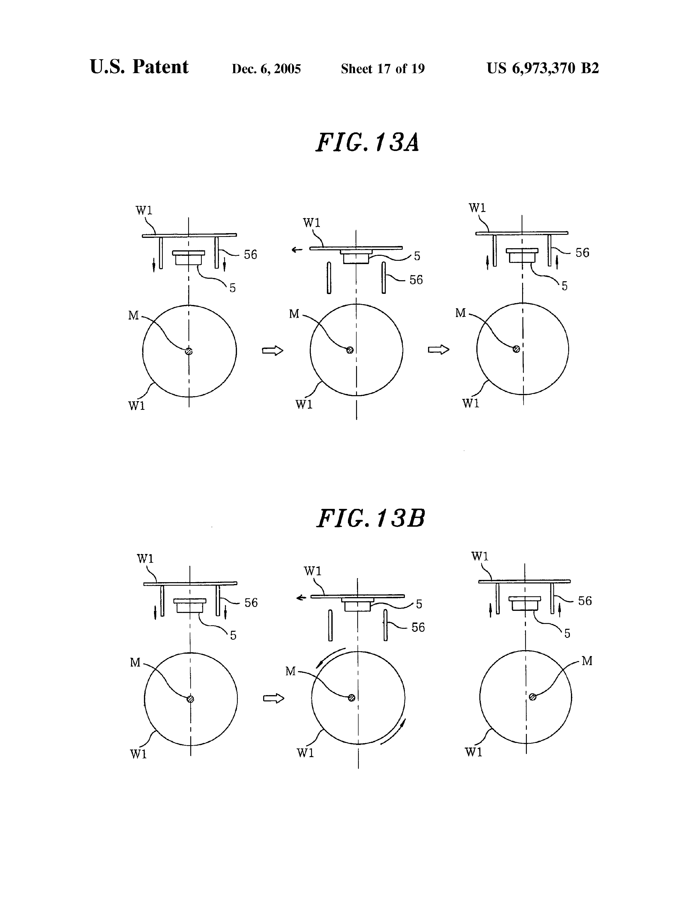

*도 13A, 도 13B — 웨이퍼를 하강시킬 때 발생하는 웨이퍼 틀어짐*

또한, 상술한 실시예에서, 0도의 위치 데이터를 취득한 후, 0도에 대향하는 180도의 위치 데이터를 취득하기 전에, 티칭이 수행되고 있는 이송 암 4C(4A, 4B) 상에서 웨이퍼 W1의 위치를 조정할 수 있다. 웨이퍼 W1을 이송 암 4C(4A, 4B)로 옮기는 타이밍은 예컨대 단계 S205와 단계 206 사이이다. 이 경우, 웨이퍼 W1을 조정한 후 180도 회전시킴으로써, 틀어짐을 포함하는 0도의 위치 데이터(도 13A 참조)와 틀어짐을 포함하는 180도의 위치 데이터(도 13B 참조)가 취득되어 회전축의 중심 위치를 얻으므로, 상술한 경우와 동일한 효과를 제공한다. 나아가, 처리 유닛이 상술한 베이크 유닛처럼 웨이퍼 W1을 회전시키는 기능을 갖지 않더라도, 웨이퍼 W1이 기판 지지 핀 56에 의해 CCD 카메라 71에 근접하여 위치되는 방식으로 웨이퍼 W1을 모니터링할 수 있다. 이 경우, 예컨대 저가의 CCD 카메라 71을 이용하여 티칭을 수행할 수 있다.

본 발명의 바람직한 실시예는 모니터링 장치로서의 지그 70만을 지지하는 암을 이용하는 구성에 한정되지 않으며, 나아가 작업자가 지그를 교체 장착하는 구성에도 적용될 수 있다. 구체적으로, 티칭 전용의 티칭용 이송 암 4D 없이 3개의 이송 암 4A, 4B 및 4C를 갖는 주 이송 기구 A2(A3)의 티칭을 수행할 때, 상단의 이송 암 4C에 지그 70을 지지시킨 채 다른 이송 암 4A(4B)의 티칭을 수행한다. 그런 다음, 지그 70을 다른 암, 예컨대 이송 암 4A에 교체 장착함으로써 해당 이송 암 4C의 티칭을 수행할 수 있다. 이러한 구성도 상술한 경우와 동일한 효과를 제공할 수 있다.

더욱이, 본 발명에서는 지그 70에 배터리 등의 전원을 설치함과 동시에 화상 데이터를 무선으로 송신할 수 있는 송신 장치를 제공함으로써, 배선이 없는 해당 CCD 카메라 71을 얻을 수 있다. 따라서, 지그 70이 스핀 척 5를 통해 이송 암 4A 내지 4C 각각의 사이에서 옮겨지는 구성이 허용될 수 있다. 이 경우, 지그 70을 교체 장착하는 데 작업자가 들이는 시간과 노력을 줄일 수 있으므로, 티칭을 단시간에 수행할 수 있다.

또한, 본 발명의 바람직한 실시예는 위치 정렬에 사용되는 웨이퍼 W1의 마크 M이 그 표면 중심에 형성되는 구성에 한정되지 않는다. 예를 들어 도 14에 도시된 바와 같이, 복수의 마크 M이 웨이퍼 W1의 중심을 중심으로 동심원상으로 배치될 수 있다. 이러한 구성도 상술한 경우와 동일한 효과를 제공할 수 있다.

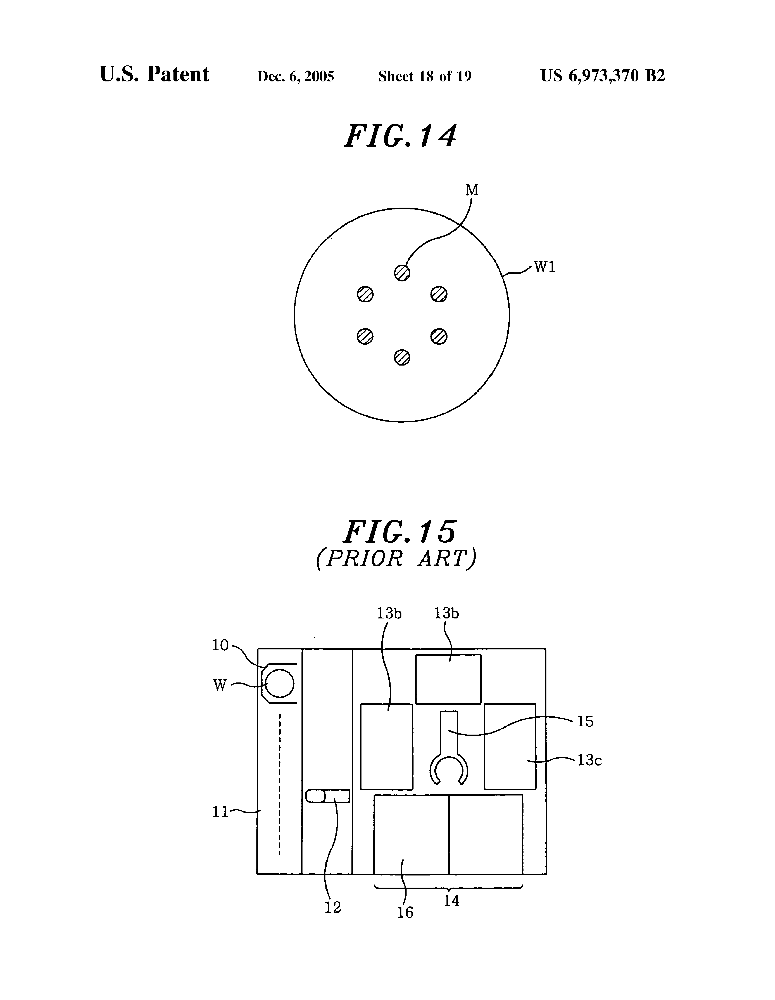

*도 14, 도 15 — 위치 정렬용 웨이퍼 표면의 마크 예 / 종래 도포/현상 장치의 평면도*

또한, 본 발명은 도포/현상 장치에 한정되지 않으며, 나아가 층간 절연막이나 디바이스 보호막과 같은 박막을 형성하는 장치에 내장된 기판 이송 기구에도 적용될 수 있다. 또한, 본 발명은 웨이퍼 W1에 한정되지 않고, 예컨대 LCD 기판, 포토마스크용 레티클 기판의 가열/세정 장치 및 LCD 장치에도 적용될 수 있다.

본 발명에 따르면, 표면에 마크가 형성된 위치 정렬용 기판이 기판 지지 부재 상에 유지되고, 기판을 수직축을 중심으로 회전시켜 얻은 마크의 궤적에 기초하여 회전축의 중심이 탐색된다. 이러한 구성 하에서, 기판의 중심과 회전축의 중심 사이의 틀어짐 양을 확인하고 그러한 틀어짐을 줄일 수 있다. 또한, 그 중심들을 단시간에 수렴시킬 수 있다. 기판 지지 부재가 회전하지 않는 경우에도, 모니터링 장치를 이용하여 기판 지지 부재의 중심과 기판의 중심을 확인함으로써 기판 이송 기구의 위치 정렬이 수행되어, 보다 정확한 위치 정렬이 가능해진다. 또한, 모니터링 장치가 기판 이송 기구에 의해 지지됨과 동시에 기판 이송 기구에 의해 처리 유닛 내의 모니터링 위치로 안내되는 구성 하에서, 그 설치에 드는 시간과 노력을 줄일 수 있으므로, 이송 위치를 단시간에 제어할 수 있다.

본 발명은 바람직한 실시예에 대해 도시되고 설명되었으나, 당업자라면 이하의 청구범위에 정의된 본 발명의 사상과 범위를 벗어나지 않고 다양한 변경 및 수정이 이루어질 수 있음을 이해할 것이다.
