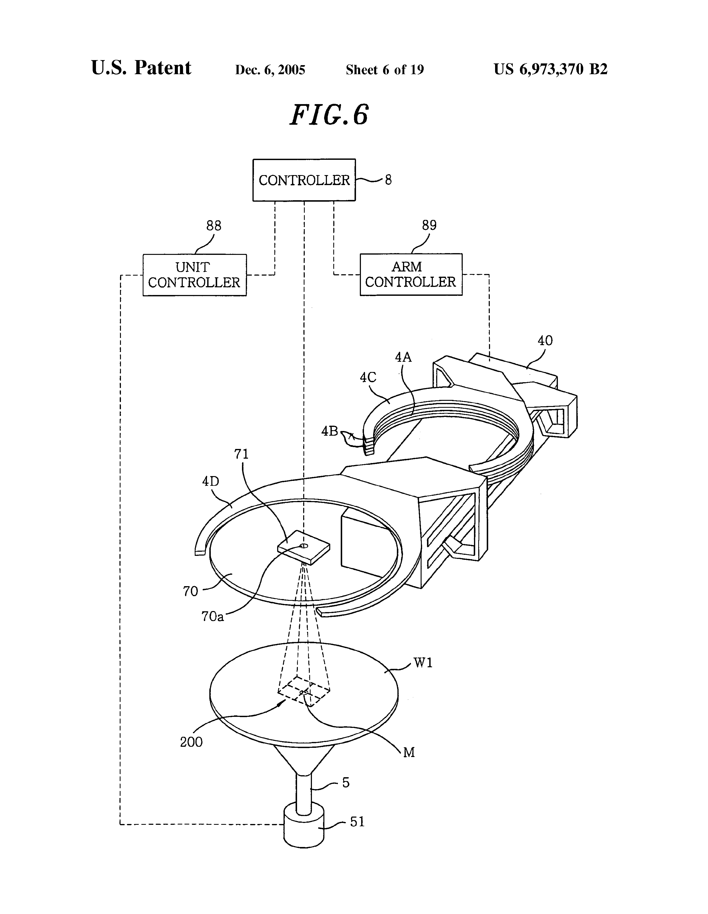
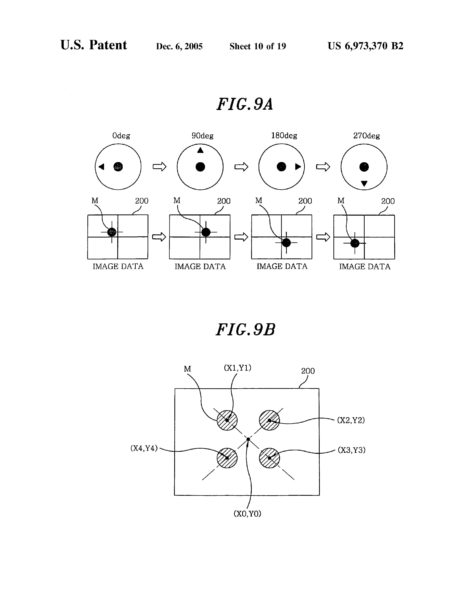

# US6973370B2 — 기판 처리 장치 및 기판 이송 위치 조정 방법 (Tokyo Electron)

| 항목 | 내용 |
|---|---|
| 원문 | `US6973370.pdf`(등록, 2005-12-06, 권리 만료) · `US20050016818.pdf`(공개, 2005-01-27) |
| 출원인 | Tokyo Electron |
| 우선일 | 2003-06-03 |
| 핵심 | 티칭 전용 암(4D)의 지그에 CCD 카메라를 달고, 위치 맞춤용 웨이퍼 중심의 원형 마크(직경 5 mm)를 스핀 척 회전 위치(0·90·180·270도)마다 찍어 회전 중심과의 틀어짐을 구하고 반송 암의 R·θ를 보정한다. 회전하지 않는 가열판은 중심 돌기와 마크를 비교한다. 허용 범위는 유닛별 0.1~0.5 mm. |
| 관련도 | △ 참고 |
| 본 과제와의 관계 | 오래된 기본 아이디어. 180도 대향 위치의 중점으로 회전 중심을 구하는 방법과 유닛별 허용 범위 수치를 참고할 수 있다. |
| 링크 | [Google Patents](https://patents.google.com/patent/US6973370B2/en) |

---

## 상세 요약 (번역본 기준)

### 1. 해결하려는 문제
- 웨이퍼 중심이 회전축 중심에서 벗어나면 도포 유닛 에지 린스가 불균일해지고, 가열/냉각 유닛에서 면내 온도 불균일이 생김. 그래서 반송 위치를 미리 가르치는 티칭이 필요함.
- 종래 티칭(도 16): 반사형 센서(21)를 웨이퍼 반경 방향으로 움직여 에지를 찾고, 웨이퍼를 90도씩 돌려 에지 4점으로 중심을 계산함. 50 μm 정밀도를 맞추려면 재실행이 최대 5회 필요함.
- 센서(21)는 한 개뿐이라 처리 유닛마다 작업자가 설치하고 축을 맞춰야 함. 소형화된 유닛이 많은 장치에서는 시간이 많이 듦.
- 광 센서는 먼지·조도 같은 주변 환경에 따라 성능이 달라져 에지 검출 정밀도가 떨어짐.

### 2. 핵심 구성
| 구성 | 참조 부호 | 위치·역할 |
|---|---|---|
| 주 이송 기구 | A2, A3 | 이동 플랫폼(40) 위에 이송 암(4A~4C)과 티칭용 이송 암(4D)이 상하로 배치. 위치는 R(진퇴 거리)·θ(회전각)·Z로 정의 (도 3) |
| 티칭용 이송 암 | 4D | 티칭에만 사용, 티칭이 끝나면 이동 플랫폼(40)에서 분리 |
| 위치 정렬용 웨이퍼 | W1 | 실제 웨이퍼와 같은 크기. 중심에 직경 5 mm 원형 마크(M) (도 6) |
| 지그 | 70 | 웨이퍼 W1과 같은 크기, 중앙 구멍(70a). 이송 암(4D)에 실림 |
| CCD 카메라 | 71 | 지그(70) 상면에 설치, 구멍(70a)을 통해 아래쪽 웨이퍼 W1의 마크(M)를 촬영 |
| 스핀 척 | 5 | 도포 유닛 COT의 회전 기판 지지 부재. 아래에 기판 지지 핀(56)·승강 기구(57) (도 4) |
| 탑재대(가열 플레이트) | 6 | 가열 유닛 BAKE의 비회전 지지 부재. 중심의 돌기(62, 프록시미티 핀)가 중심 마크 역할 (도 5) |
| 제어기 | 8 | 화상 데이터 저장부(81), 작업 메모리(82), 제1·제2 티칭 프로그램(83, 84), 이송 위치 저장부(85), 입력 장치(86), CPU(87), 유닛 제어기(88), 암 제어기(89) (도 7) |

- 제1 티칭 프로그램(83, 회전 유닛용): 위치 데이터 취득(83a), 틀어짐 연산(83b), 판정(83c), 재실행(83d).
- 제2 티칭 프로그램(84, 비회전 유닛용): 위치 데이터 취득(84a), 판정(84b), 재실행(84c).

### 3. 동작 순서
**(A) 회전하는 스핀 척 — 도포 유닛 COT (도 8A~8C, 도 9A·9B)**
1. S1: 티칭 대상 이송 암(4C)에 웨이퍼 W1, 이송 암(4D)에 지그(70)를 실음.
2. S2: 설계 데이터 위치로 이송 암(4D)을 뻗어 카메라(71)로 스핀 척(5) 중앙의 진공 구멍을 찾고, 그때 암(4D) 좌표를 작업 메모리(82)에 저장.
3. S3: 그 좌표로 이송 암(4C)을 전진, 기판 지지 핀(56)을 거쳐 W1을 스핀 척(5)에 올림.
4. S4~S5: 암(4C) 후퇴, 암(4D) 진입 후 마크(M) 촬영 → 화상 데이터(200)에서 X1·Y1 좌표 산출.
5. S6~S7: 스핀 척(5)을 90도씩 돌려 0·90·180·270도의 4개 위치 좌표 취득. 최소 2개, 180도 대향 짝수 개 위치면 됨.
6. S8: 회전 중심 계산 (도 9B).
   - 4점: 0도–180도를 잇는 직선과 90도–270도를 잇는 직선의 교점(X0=0, Y0=0)을 회전 중심으로 설정.
   - 2점: 180도 대향 두 점을 잇는 직선의 중점을 회전 중심으로 설정.
7. S10~S11: 구한 중심 좌표로 W1을 다시 올리고 S4~S8을 반복해 2회차 데이터 취득.
8. S9: 회전 후 마크 좌표가 한 점으로 모이지 않거나 허용 범위를 넘으면 틀어짐으로 판정 → 재실행 프로그램(83d)으로 θ·R을 수정하고 다시 측정.
9. S12: 틀어짐이 없으면 그 이송 위치를 암(4C)의 설정값으로 저장부(85)에 기록.
10. S13: 암(4B), (4A) 순으로 같은 티칭. 기준 유닛에서 세 암을 맞춘 뒤 다른 유닛은 한 암만 티칭해도 됨(상대 위치를 이미 앎).
- 허용 범위(유닛 종류별): 도포 유닛 COT 편심 0.1 mm 이하, 현상 유닛 DEV 0.3 mm 이하, 베이크 유닛 거리 차 0.5 mm 이하.

**(B) 회전하지 않는 탑재대 — 가열 유닛 BAKE (도 10A~10C, 도 11)**
1. S101~S103: 암(4D)을 설계상 중심 위치로 뻗어 돌기(62)를 촬영하고, 그 좌표를 탑재대(6) 중심으로 저장.
2. S104~S106: 암(4C)으로 W1을 탑재대(6)에 올리고 마크(M) 좌표 취득.
3. S107~S109: 마크 좌표와 돌기(62) 좌표를 비교해 허용 범위를 넘으면 θ·R 수정 후 재측정.
4. S110~S111: 범위 안이면 설정값 저장, 다음 암 티칭.

**(C) 핀으로 들어 올려 촬영하는 변형 — 도포 유닛 (도 12A~12C, 도 13A·13B)**
- S204: 기판 지지 핀(56)으로 W1을 카메라(71) 가까이 올려 촬영 → 촬영 거리가 짧은 저가 카메라로도 정밀도 확보.
- 핀이 내려갈 때 에어 베어링 현상으로 웨이퍼가 수평으로 밀릴 수 있음(도 13A·13B). S210에서 0도 좌표와 S202 좌표(2회차부터는 직전 중심 좌표)를 비교해 밀린 방향·양을 계산하고, 각 위치 데이터를 보정한 뒤 대향 점의 중점을 회전 중심으로 설정.

### 4. 청구항 요지
- 청구항 1(장치): 카메라 유닛 + 기판 지지 부재 180도 회전 전후 마크 위치들의 중심으로 틀어짐 산출 + 정렬 판정 + 이송 기구로 재배치 + 정렬 시 위치 데이터 저장.
- 청구항 4(장치): 기판 표면 중심 마크 촬영 결과와 기판 지지 부재 중심 마크 촬영 결과로 중심 일치 여부 판정.
- 청구항 5(장치): 청구항 4 + 틀어짐 산출, 임계값 비교, 재배치, 임계값 이하일 때 위치 저장.
- 청구항 7(장치): 웨이퍼를 놓는 제1 이송 암과 카메라를 실은 다른 제2 이송 암, 180도 전후 마크 좌표와 지지 부재 중심 마킹 좌표 비교로 틀어짐 산출·판정·재실행·저장.
- 청구항 13(방법): 이송 → 180도 전후 촬영 → 두 마크 위치를 잇는 직선의 중점으로 틀어짐 산출 → 판정 → 재배치 → 위치 데이터 취득.
- 청구항 14(방법): 중심 마크 기판 이송 → 촬영 → 정렬 여부 판단 (가장 넓은 범위).
- 청구항 15(방법): 청구항 14 + 틀어짐 산출, 임계값 비교, 재배치, 위치 취득.
- 종속항: 처리 유닛 종류별 서로 다른 임계값(3, 8), 웨이퍼와 카메라를 서로 다른 암에 실음(6, 16), 카메라 전용 암(11, 19), 카메라를 기판 지지 부재 경유로 다른 암에 옮김(10, 18), 기판 승강 부재로 들어 올려 촬영(12, 20).

### 5. 대표 도면

*도 6 — 티칭용 이송 암의 지그(70)에 실린 CCD 카메라(71)가 웨이퍼 W1의 중심 마크(M)를 촬영하는 구성*

*도 9A, 도 9B — 0·90·180·270도 마크 위치와, 대향 점을 잇는 두 직선의 교점으로 회전 중심을 구하는 원리*

### 6. 본 과제(Y·Θ 얼라인먼트)와 비교
- 같은 점:
  - 카메라로 마크를 찍어 반송 로봇의 위치 보정값을 구함.
  - 로봇 좌표가 극좌표(R·θ)로 정의되고, 보정도 θ와 R을 수정하는 방식.
- 다른 점:
  - 이 특허는 웨이퍼 중심(평행 이동) 틀어짐만 다룸. 웨이퍼 자체의 회전각 Θ 측정은 없음.
  - 마크가 직경 5 mm 단순 원형이라 위치만 나오고 방향 정보가 없음. 우리는 QR형 마커로 위치와 회전을 한 장에서 구함.
  - 실시간 보정이 아니라 사전 티칭(1회 시행 약 2분, 반복 수렴).
  - 회전 중심을 구하려면 스핀 척 회전이 필요하고, 비회전 유닛은 별도의 중심 기준(돌기 62)이 필요함.
- 참고할 점:
  - 180도 대향 두 점의 중점 = 회전 중심. 4점이면 두 직선의 교점. 마커 회전 중심이나 카메라–로봇 축 보정(캘리브레이션)에 그대로 쓸 수 있음.
  - 처리 유닛 종류별 허용 범위(0.1 / 0.3 / 0.5 mm)를 합격 기준 설정의 참고값으로 사용.
  - 1회 측정에서 X·Y를 함께 얻으면 1축 센서보다 재실행 횟수가 줄어든다는 근거(최대 5회 → 2회).
  - 측정 → 보정 → 재측정의 반복 수렴 구조와, 기준 암을 맞춘 뒤 나머지는 상대 위치로 처리하는 방식.
  - 웨이퍼를 내릴 때 생기는 재현성 있는 밀림(에어 베어링)을 계산으로 보상하는 아이디어. 놓은 뒤 측정과 놓기 전 측정의 차이를 고려해야 함.
  - 카메라를 로봇 암에 실어 카메라 좌표계와 암 좌표계를 결합하는 구성. 무선·배터리 지그로 배선 없이 옮기는 변형도 있음.
