# 3차원 영상 데이터를 이용한 기판의 티칭 방법 및 이송 시스템 (US12536776B2)

- 원제: Teaching method and transfer system for substrate using three-dimensional image data
- 원문: 같은 폴더의 PDF, https://patents.google.com/patent/US12536776B2/en
- 번역 기준: Google Patents 원문 텍스트를 한국어로 옮김. 도면은 PDF 참조.
- 도면: 원문 PDF 도면 시트 17장을 도면/ 폴더에 넣고 본문에서 처음 언급되는 곳에 삽입함

> 용어: transfer source object = 이송원 대상물, transfer destination object = 이송처 대상물, transfer device = 이송 장치, capturing unit = 촬상부, image sensor = 이미지 센서, fork = 포크, design data = 설계 데이터.

## 요약

기판이 배치될 수 있는 이송원 대상물(transfer source object)과 이송처 대상물(transfer destination object) 사이에서 기판을 이송하도록 구성된 이송 장치(transfer device)를 위한 티칭(teaching) 방법이 제공된다. 이 티칭 방법은, 촬상부(capturing unit)가 촬상한 이송원 대상물, 이송처 대상물 및 기판의 촬상 영상 데이터와, 이송원 대상물, 이송처 대상물 및 기판의 설계 데이터(design data)에 기초하여, 이송원 대상물의 형상, 이송처 대상물의 형상 및 기판의 상태에 대한 3차원 영상 데이터를 생성하는 단계; 및 기판이 이송원 대상물 및 이송처 대상물과 충돌하지 않고 이송원 대상물과 이송처 대상물 사이에서 이송되도록, 3차원 영상 데이터에 기초하여 이송 장치를 티칭하는 단계를 포함한다.

## 청구범위

청구되는 것은 다음과 같다.

1. 이송원 대상물과 이송처 대상물 사이에서 기판을 이송하는 이송 장치를 위한 티칭 방법으로서,

제어기(controller)에 의해, 이미지 센서가 촬상한 이송원 대상물, 이송처 대상물 및 기판의 촬상 영상 데이터와, 이송원 대상물, 이송처 대상물 및 기판의 3차원 CAD 데이터를 포함하는 설계 데이터에 기초하여, 가상 공간 내에서, 기판이 탑재되는 이송원 대상물의 형상, 기판이 이송 장치를 통해 이송원 대상물로부터 이송되는 이송처 대상물의 형상, 및 기판의 상태에 대한 3차원 영상 데이터를 생성하는 단계 - 이송 장치는 수평 방향으로 이송원 대상물과 이송처 대상물 사이에 설치됨 -; 및

제어기에 의해, 기판이 이송원 대상물 및 이송처 대상물과 충돌하지 않고 이송 장치를 통해 이송원 대상물과 이송처 대상물 사이에서 이송되도록, 3차원 영상 데이터에 기초하여 이송 장치를 티칭하는 단계를 포함하고,

3차원 영상 데이터를 생성하는 단계는, 촬상 영상 데이터와 설계 데이터 사이의 차이에 기초하여 이송원 대상물, 이송처 대상물 및 기판 중 적어도 하나의 형상을 보정하는 단계를 포함하는, 티칭 방법.

2. 제1항에 있어서, 3차원 영상 데이터를 생성하는 단계는, 이송원 대상물 및 이송처 대상물의 형상으로서, 이송원 대상물이 기판을 탑재하는 탑재 위치의 형상 및 이송처 대상물이 기판을 탑재하는 탑재 위치의 형상을 파악할 수 있는 3차원 영상 데이터를 생성하는 단계를 포함하는, 티칭 방법.

3. 제2항에 있어서, 이송 장치를 티칭하는 단계는, 영상 데이터로부터 생성된 3차원 영상 데이터와 설계 데이터로부터 생성된 3차원 영상 데이터 사이의 차이에 기초하여, 이송 장치에 대해 수행될 티칭 위치를 조정하는 단계를 포함하는, 티칭 방법.

4. 제3항에 있어서, 이송 장치를 티칭하는 단계는, 영상 데이터로부터 생성된 3차원 영상 데이터와 설계 데이터로부터 생성된 3차원 영상 데이터 사이의 차이에 기초하여, 이송원 대상물 또는 이송처 대상물의 위치 어긋남(misplacement), 뒤틀림(distortion) 또는 기울어짐(inclination)을 검출하는 단계를 포함하는, 티칭 방법.

5. 제4항에 있어서, 3차원 영상 데이터를 생성하는 단계는, 이송원 대상물의 형상, 이송처 대상물의 형상 및 기판의 상태를 촬상하여 얻은 복수의 영상 데이터를 딥러닝(deep learning)한 모델을 이용하여, 3차원 영상 데이터로 표시되는 이송원 대상물의 형상, 이송처 대상물의 형상 및 기판의 형상을 선명화(sharpening)하는 단계를 포함하는, 티칭 방법.

6. 제5항에 있어서, 이송 장치를 티칭하는 단계는, 이송원 대상물 또는 이송처 대상물과 기판 사이의 간극 치수(clearance dimension)가 미리 정해진 범위 내에 있는지 여부를 판정하고, 간극 치수가 미리 정해진 범위 내에 있지 않은 경우 예방 정비(preventive maintenance) 통지를 수행하는 단계를 포함하는, 티칭 방법.

7. 제6항에 있어서, 이미지 센서는, 이송원 대상물, 이송처 대상물 및 기판을 촬상하도록 구성된 제1 이미지 센서와, 기판을 이송하는 이송 장치에 설치되며 위치 및 촬상 방향을 변경할 수 있는 제2 이미지 센서를 포함하는, 티칭 방법.

8. 제1항에 있어서, 이송 장치를 티칭하는 단계는, 영상 데이터로부터 생성된 3차원 영상 데이터와 설계 데이터로부터 생성된 3차원 영상 데이터 사이의 차이에 기초하여, 이송 장치에 대해 수행될 티칭 위치를 조정하는 단계를 포함하는, 티칭 방법.

9. 제1항에 있어서, 이송 장치를 티칭하는 단계는, 영상 데이터로부터 생성된 3차원 영상 데이터와 설계 데이터로부터 생성된 3차원 영상 데이터 사이의 차이에 기초하여, 이송원 대상물 또는 이송처 대상물의 위치 어긋남, 뒤틀림 또는 기울어짐을 검출하는 단계를 포함하는, 티칭 방법.

10. 제1항에 있어서, 3차원 영상 데이터를 생성하는 단계는, 이송원 대상물의 형상, 이송처 대상물의 형상 및 기판의 상태를 촬상하여 얻은 복수의 영상 데이터를 딥러닝한 모델을 이용하여, 3차원 영상 데이터로 표시되는 이송원 대상물의 형상, 이송처 대상물의 형상 및 기판의 형상을 선명화하는 단계를 포함하는, 티칭 방법.

11. 제1항에 있어서, 이송 장치를 티칭하는 단계는, 이송원 대상물 또는 이송처 대상물과 기판 사이의 간극 치수가 미리 정해진 범위 내에 있는지 여부를 판정하고, 간극 치수가 미리 정해진 범위 내에 있지 않은 경우 예방 정비 통지를 수행하는 단계를 포함하는, 티칭 방법.

12. 제1항에 있어서, 이미지 센서는, 이송원 대상물, 이송처 대상물 및 기판을 촬상하도록 구성된 제1 이미지 센서와, 기판을 이송하는 이송 장치에 설치되며 위치 및 촬상 방향을 변경할 수 있는 제2 이미지 센서를 포함하는, 티칭 방법.

13. 이송 시스템으로서,

기판이 탑재되는 이송원 대상물;

기판이 이송원 대상물로부터 이송되는 이송처 대상물;

수평 방향으로 이송원 대상물과 이송처 대상물 사이에 설치되고, 이동체(moving body) 및 이동체에 연결된 포크(fork)를 포함하는 이송 장치;

이송원 대상물, 이송처 대상물 및 이송 장치의 전체 동작을 제어하도록 구성된 제어기를 포함하고,

제어기는,

이송 장치의 포크를 통해 이송원 대상물과 이송처 대상물 사이에서 기판을 이송하고;

촬상부가 촬상한 이송원 대상물, 이송처 대상물 및 기판의 영상 데이터와, 이송원 대상물, 이송처 대상물 및 기판의 3차원 CAD 데이터를 포함하는 설계 데이터에 기초하여, 가상 공간 내에서 이송원 대상물의 형상, 이송처 대상물의 형상 및 기판의 상태에 대한 3차원 영상 데이터를 생성하며;

기판이 이송원 대상물 및 이송처 대상물과 충돌하지 않고 이송 장치를 통해 이송 장치의 포크를 사용하여 이송원 대상물과 이송처 대상물 사이에서 이송되도록, 3차원 영상 데이터에 기초하여 이송 장치를 티칭하도록 구성되고,

제어기가 3차원 영상 데이터를 생성할 때, 촬상 영상 데이터와 설계 데이터 사이의 차이에 기초하여 이송원 대상물, 이송처 대상물 및 기판 중 적어도 하나의 형상이 보정되는, 이송 시스템.

14. 이송원 대상물과 이송처 대상물 사이에서 기판을 이송하는 이송 장치에 대한 처리를 컴퓨터가 실행하게 하는 프로그램이 저장된 비일시적 컴퓨터 판독 가능 기록 매체로서, 처리는,

컴퓨터에 의해, 이미지 센서가 촬상한 이송원 대상물, 이송처 대상물 및 기판의 촬상 영상 데이터와, 이송원 대상물, 이송처 대상물 및 기판의 3차원 CAD 데이터를 포함하는 설계 데이터에 기초하여, 가상 공간 내에서, 기판이 탑재되는 이송원 대상물의 형상, 기판이 이송 장치를 통해 이송원 대상물로부터 이송되는 이송처 대상물의 형상, 및 기판의 상태에 대한 3차원 영상 데이터를 생성하는 단계 - 이송 장치는 수평 방향으로 이송원 대상물과 이송처 대상물 사이에 설치됨 -; 및

컴퓨터에 의해, 기판이 이송원 대상물 및 이송처 대상물과 충돌하지 않고 이송 장치를 통해 이송원 대상물과 이송처 대상물 사이에서 이송되도록, 3차원 영상 데이터에 기초하여 이송 장치를 티칭하는 단계를 포함하고,

3차원 영상 데이터를 생성하는 단계는, 촬상 영상 데이터와 설계 데이터 사이의 차이에 기초하여 이송원 대상물, 이송처 대상물 및 기판 중 적어도 하나의 형상을 보정하는 단계를 포함하는, 비일시적 컴퓨터 판독 가능 기록 매체.

15. 제1항에 있어서, 이송 장치를 티칭하는 단계는, 영상 데이터로부터 생성된 3차원 영상 데이터를 설계 데이터로부터 생성된 3차원 영상 데이터와 비교하는 단계를 포함하는, 티칭 방법.

16. 제13항에 있어서, 제어기는 또한, 이송 장치가 티칭될 때, 영상 데이터로부터 생성된 3차원 영상 데이터를 설계 데이터로부터 생성된 3차원 영상 데이터와 비교하도록 구성되는, 이송 시스템.

17. 제14항에 있어서, 이송 장치를 티칭하는 단계는, 영상 데이터로부터 생성된 3차원 영상 데이터를 설계 데이터로부터 생성된 3차원 영상 데이터와 비교하는 단계를 포함하는, 비일시적 컴퓨터 판독 가능 기록 매체.

## 상세한 설명

### 관련 출원의 상호 참조 (CROSS-REFERENCE TO RELATED APPLICATION)

본 출원은 2020년 6월 23일 일본 특허청에 출원된 일본 특허출원 제2020-107705호에 기초하며 그 우선권을 주장하고, 그 개시 내용 전체는 참조로써 본 명세서에 포함된다.

### 기술분야 (TECHNICAL FIELD)

본 개시는 티칭 방법, 이송 시스템, 및 프로그램을 저장하는 저장 매체에 관한 것이다.

### 배경기술 (BACKGROUND)

수직으로 연장된 열처리로를 갖고, 복수의 웨이퍼를 웨이퍼 보트(wafer boat)에 탑재하여 열처리로 내에 수용함으로써 웨이퍼를 가열하는 종형 열처리 장치가 알려져 있다. 종형 열처리 장치에서는, 캐리어(carrier)에 수용된 복수의 웨이퍼가, 복수의 포크를 갖는 웨이퍼 이송 장치에 의해 웨이퍼 보트로 동시에 이송된다(예컨대, 일본 특허공개 제2019-046843호 참조).

### 발명의 내용 (SUMMARY)

본 개시의 일 양태에 따르면, 기판이 탑재되는 이송원 대상물과 이송처 대상물 사이에서 기판을 이송하는 이송 장치를 위한 티칭 방법이 제공된다. 이 티칭 방법은, 촬상부가 촬상한 이송원 대상물, 이송처 대상물 및 기판의 촬상 영상 데이터와, 이송원 대상물, 이송처 대상물 및 기판의 설계 데이터에 기초하여, 이송원 대상물의 형상, 이송처 대상물의 형상 및 기판의 상태에 대한 3차원 영상 데이터를 생성하는 단계; 및 기판이 이송원 대상물 및 이송처 대상물과 충돌하지 않고 이송원 대상물과 이송처 대상물 사이에서 이송되도록, 3차원 영상 데이터에 기초하여 이송 장치를 티칭하는 단계를 포함한다.

상기 요약은 예시일 뿐이며 어떠한 방식으로도 한정하려는 의도가 아니다. 위에서 설명한 예시적인 양태, 실시예 및 특징에 더하여, 추가적인 양태, 실시예 및 특징은 도면과 이하의 상세한 설명을 참조함으로써 명백해질 것이다.

### 도면의 간단한 설명 (BRIEF DESCRIPTION OF THE DRAWINGS)

도 1은 일 실시예의 기판 처리 시스템의 구성예를 나타내는 단면도이다.

도 2는 실시예의 기판 처리 시스템의 구성예를 나타내는 단면도이다.

도 3은 제어 장치의 하드웨어 구성의 일례를 나타내는 도면이다.

도 4는 제어 장치의 기능 구성의 일례를 나타내는 도면이다.

도 5는 3차원 계측 데이터를 활용하는 처리의 일례의 흐름도이다.

도 6은 카메라 72를 활용하는 처리의 일례의 흐름도이다.

도 7은 카메라 70을 활용하는 처리의 일례의 흐름도이다.

도 8은 카메라 70 및 72를 활용하는 처리의 일례의 흐름도이다.

도 9는 광학 센서를 활용하는 처리의 일례의 흐름도이다.

도 10은 카메라 70의 촬상 영상 데이터를 활용하는 처리의 일례의 흐름도이다.

도 11은 카메라 72의 촬상 영상 데이터를 활용하는 처리의 일례의 흐름도이다.

도 12는 단계 S202에서의 영상 처리의 일례를 나타내는 도면이다.

도 13은 단계 S202에서의 영상 처리의 일례를 나타내는 도면이다.

도 14는 카메라 70의 촬상 영상 데이터의 정밀도의 일례를 나타내는 도면이다.

도 15는 카메라 70의 설치 위치 및 촬상 방향의 일례를 나타내는 도면이다.

도 16은 자동 티칭 처리의 일례의 흐름도이다.

도 17은 자동 티칭 처리의 일례의 흐름도이다.

### 발명을 실시하기 위한 구체적인 내용 (DETAILED DESCRIPTION)

이하의 상세한 설명에서는, 그 일부를 이루는 첨부 도면을 참조한다. 상세한 설명, 도면 및 청구범위에 기재된 예시적 실시예는 한정하려는 의도가 아니다. 여기에 제시된 주제의 사상 또는 범위를 벗어나지 않고 다른 실시예가 이용될 수 있으며, 다른 변경이 이루어질 수 있다.

이하, 첨부 도면을 참조하여 본 개시의 비한정적인 실시예를 설명한다. 첨부된 모든 도면에서 동일하거나 대응하는 부재 또는 부품에는 동일하거나 대응하는 참조 부호를 붙이고, 중복되는 설명은 생략한다.

#### <시스템 구성>

도 1 및 도 2는 각각 실시예의 기판 처리 시스템의 구성예를 나타내는 단면도 및 평면도이다. 도 1에 나타낸 바와 같이, 기판 처리 시스템은 기판 처리 장치 1 및 제어 장치 90을 포함한다. 기판 처리 장치 1은 기판의 일례인 반도체 웨이퍼(이하, 웨이퍼 W라 함)에 대해 소정의 처리(예컨대, 열처리)를 수행한다. 제어 장치 90은 기판 처리 장치 1 전체를 제어한다.

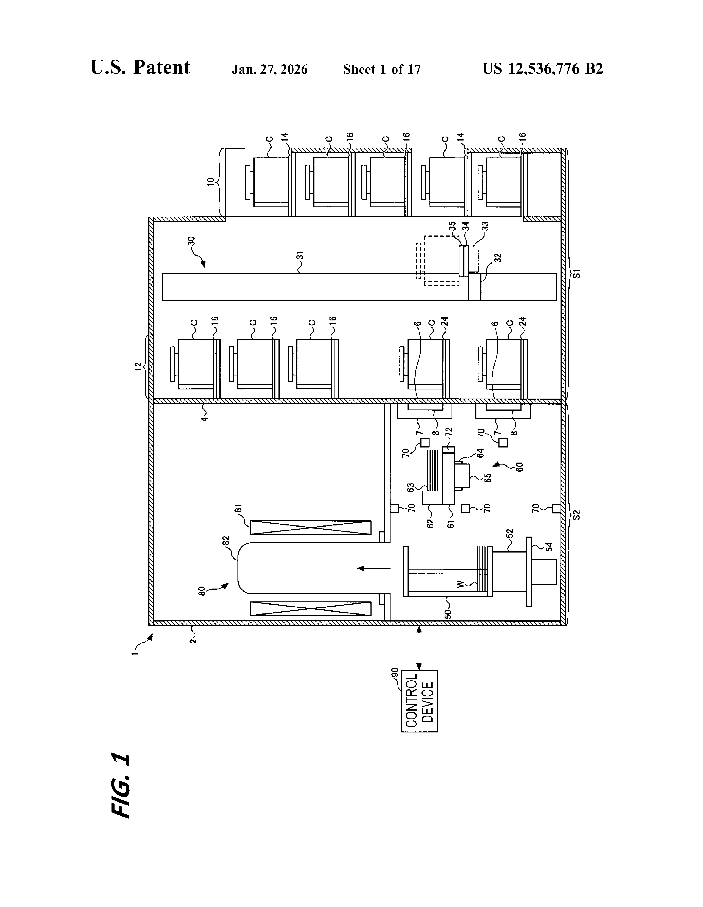
*도 1 — 기판 처리 시스템의 구성예 (단면도)*

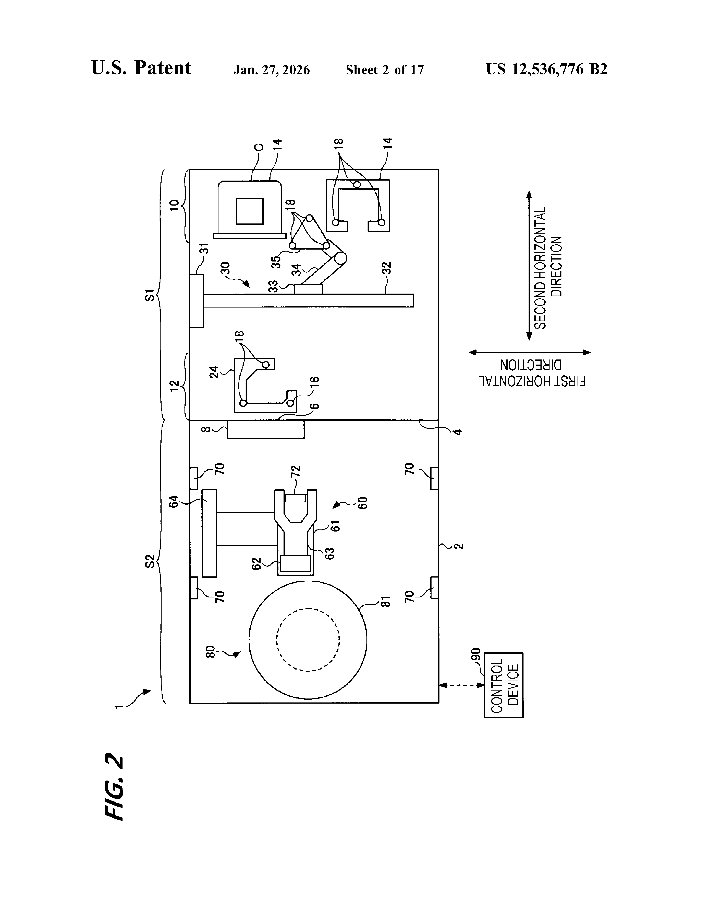
*도 2 — 기판 처리 시스템의 구성예 (평면도)*

기판 처리 장치 1은 장치의 외장체를 구성하는 하우징 2 내에 수용된다. 하우징 2 내에는 캐리어 이송 영역 S1과 웨이퍼 이송 영역 S2가 형성된다. 캐리어 이송 영역 S1과 웨이퍼 이송 영역 S2는 격벽 4에 의해 구획된다. 격벽 4에는 캐리어 이송 영역 S1과 웨이퍼 이송 영역 S2를 연통시키고 웨이퍼 W를 이송하기 위한 이송구 6이 설치된다.

이송구 6은 FIMS(front-opening interface mechanical standard) 규격에 따른 도어 기구 8에 의해 개폐된다. 도어 기구 8에는 덮개 개폐 장치 7의 구동 기구가 연결된다. 도어 기구 8은 구동 기구에 의해 전후 방향 및 상하 방향으로 이동 가능하게 구성되어, 이송구 6이 개폐된다.

이하, 캐리어 이송 영역 S1과 웨이퍼 이송 영역 S2의 배열 방향을 전후 방향(도 2의 제2 수평 방향에 대응)으로 정의하고, 전후 방향에 수직인 수평 방향을 좌우 방향(도 2의 제1 수평 방향에 대응)으로 정의한다.

캐리어 이송 영역 S1은 대기 분위기하의 영역이다. 캐리어 이송 영역 S1은, 웨이퍼 W가 수용된 캐리어 C가 기판 처리 장치 1 내의 요소들(후술함) 사이에서 이송되거나, 외부로부터 기판 처리 장치 1 내로 반입되거나, 기판 처리 장치 1로부터 외부로 반출되는 영역이다. 캐리어 C로는, 예컨대 FOUP(front-opening unified pod)이 사용될 수 있다. FOUP 내의 청정도를 소정 수준으로 유지함으로써, 웨이퍼 W의 표면에 이물질이 부착되거나 자연 산화막이 형성되는 것을 방지할 수 있다. 캐리어 이송 영역 S1은 제1 이송 영역 10과, 제1 이송 영역 10의 후방(웨이퍼 이송 영역 S2 측)에 위치하는 제2 이송 영역 12로 구성된다.

일례로서, 도 1 및 도 2에 나타낸 제1 이송 영역 10에는, 상하 2단으로, 그리고 각 단의 좌우에 2개씩 로드 포트(load port) 14가 설치된다. 로드 포트 14는 캐리어 C가 기판 처리 장치 1로 반입될 때 캐리어 C를 받아들이는 반입대이다. 로드 포트 14는 하우징 2의 벽이 개방된 곳에 설치되어, 외부로부터 기판 처리 장치 1에 접근할 수 있다. 구체적으로, 로드 포트 14 위로의 캐리어 C의 반입 및 탑재와, 로드 포트 14로부터 외부로의 캐리어 C의 반출은 기판 처리 장치 1의 외부에 설치된 이송 장치(도시하지 않음)에 의해 수행될 수 있다.

또한, 로드 포트 14가 예컨대 상하 2단으로 존재하므로, 양쪽에서 캐리어 C를 반입 및 반출할 수 있다. 로드 포트 14의 하단에는 캐리어 C를 보관하기 위해 스토커 16이 설치될 수 있다. 로드 포트 14의 캐리어 C가 탑재되는 면에는, 캐리어 C를 위치 결정하기 위한 위치 결정 핀 18이 예컨대 3군데에 설치된다. 또한, 로드 포트 14는 캐리어 C가 로드 포트 14 위에 탑재된 상태에서 전후 방향으로 이동 가능하게 구성될 수 있다.

제2 이송 영역 12의 하부에는 2개의 FIMS 포트 24(예컨대, 도 1 참조)가 상하로 나란히 배치된다. FIMS 포트 24는, 캐리어 C 내의 웨이퍼 W가 웨이퍼 이송 영역 S2 내의 열처리로 80(후술함)으로 반입 및 반출될 때 캐리어 C를 유지하는 유지대이다. FIMS 포트 24는 전후 방향으로 이동 가능하게 구성된다. 로드 포트 14와 마찬가지로, FIMS 포트 24의 캐리어 C가 탑재되는 면에는 캐리어 C를 위치 결정하기 위한 위치 결정 핀 18이 3군데에 설치된다.

또한, 제2 이송 영역 12의 상방에는 캐리어 C를 보관하기 위한 스토커 16이 설치된다. 스토커 16은 예컨대 3단의 선반으로 구성된다. 스토커 16의 각 선반에는 좌우 방향으로 2개 이상의 캐리어 C가 탑재될 수 있다. 또한, 캐리어 탑재대가 배치되지 않은 제2 이송 영역 12의 하부에도 스토커 16이 배치될 수 있다.

제1 이송 영역 10과 제2 이송 영역 12 사이에는, 로드 포트 14, 스토커 16 및 FIMS 포트 24 사이에서 캐리어 C를 이송하는 캐리어 이송 기구 30이 설치된다. 캐리어 이송 기구 30은 제1 가이드 31, 제2 가이드 32, 이동부 33, 암부 34 및 핸드부 35를 포함한다. 제1 가이드 31은 상하 방향으로 연장되도록 구성된다. 제2 가이드 32는 제1 가이드 31에 연결되며 좌우 방향(즉, 제1 수평 방향)으로 연장되도록 구성된다. 이동부 33은 제2 가이드 32에 안내되면서 좌우 방향으로 이동하도록 구성된다. 암부 34는 하나의 관절과 2개의 암부를 포함하며, 이동부 33에 설치된다. 핸드부 35는 암부 34의 선단에 설치된다. 핸드부 35에는 캐리어 C를 위치 결정하기 위한 핀 18이 3군데에 설치된다.

웨이퍼 이송 영역 S2는 캐리어 C로부터 웨이퍼 W를 꺼내어 각종 처리를 수행하는 영역이다. 웨이퍼 이송 영역 S2는 웨이퍼 W 상의 산화막 형성을 억제하기 위해 불활성 가스 분위기, 예컨대 질소 가스 분위기로 된다. 웨이퍼 이송 영역 S2에는 하단이 노구(爐口)로서 개방된 종형 열처리로 80이 설치된다.

열처리로 80은 웨이퍼 W를 수용할 수 있으며, 웨이퍼 W를 열처리하기 위한 석영제의 원통형 처리 용기 82를 갖는다. 처리 용기 82의 주위에는 원통형 히터 81이 배치된다. 처리 용기 82에 수용된 웨이퍼 W는 히터 81의 가열에 의해 열처리된다. 처리 용기 82의 하방에는 셔터(도시하지 않음)가 설치된다. 셔터는 웨이퍼 보트 50이 열처리로 80으로부터 반출되고 다음 웨이퍼 보트 50이 반입될 때까지 열처리로 80의 하단을 덮는 문이다. 열처리로 80의 하방에는, 기판 유지구인 웨이퍼 보트 50이 보온통 52를 사이에 두고 덮개 54 위에 탑재된다. 즉, 덮개 54는 웨이퍼 보트 50의 하방에서 웨이퍼 보트 50과 일체로 설치된다.

웨이퍼 보트 50은 예컨대 석영으로 이루어지며, 대구경(예컨대, 직경 300 mm 또는 450 mm)의 웨이퍼 W를 상하 방향으로 소정 간격을 두고 대략 수평으로 유지하도록 구성된다. 웨이퍼 보트 50에 수용되는 웨이퍼 W의 매수는 특별히 한정되지 않으나, 예컨대 50매 내지 200매이다. 덮개 54는 승강 기구(도시하지 않음)에 의해 지지되며, 승강 기구에 의해 웨이퍼 보트 50이 열처리로 80에 대해 반입 또는 반출된다. 웨이퍼 보트 50과 이송구 6 사이에는 웨이퍼 이송 장치 60이 설치된다.

웨이퍼 이송 장치 60은 FIMS 포트 24 위에 유지된 캐리어 C와 웨이퍼 보트 50 사이에서 웨이퍼 W를 이송한다. 웨이퍼 이송 장치 60은 가이드 기구 61, 이동체 62, 포크 63, 승강 기구 64 및 회전 기구 65를 포함한다. 가이드 기구 61은 직육면체 형상을 갖는다. 가이드 기구 61은 상하 방향으로 연장되는 승강 기구 64에 부착되어, 승강 기구 64에 의해 상하 방향으로 이동될 수 있고 회전 기구 65에 의해 회전될 수 있다.

또한, 이동체 62는 가이드 기구 61 위에 길이 방향을 따라 전진 및 후진할 수 있도록 설치된다. 포크 63은 이동체 62를 통해 부착된 이재구(移載具)이며, 복수(예컨대, 5개)의 포크 63이 설치된다. 복수의 포크 63을 갖는 웨이퍼 이송 장치 60은 복수의 웨이퍼 W를 동시에 이송할 수 있으므로, 웨이퍼 W의 이송에 소요되는 시간을 단축할 수 있다. 포크 63의 수는 하나일 수도 있다.

웨이퍼 이송 영역 S2의 천장 또는 측벽에는 필터 유닛(도시하지 않음)이 설치될 수 있다. 필터 유닛의 예로는 HEPA(high efficiency particulate air) 필터 및 ULPA(ultra-low penetration air) 필터가 있다. 필터 유닛을 설치함으로써 웨이퍼 이송 영역 S2에 청정 공기를 공급할 수 있다.

웨이퍼 이송 영역 S2의 천장, 측벽 또는 바닥에는 하나 이상의 카메라 70이 설치된다. 또한, 웨이퍼 이송 장치 60에는 하나 이상의 카메라 72가 설치된다. 카메라 72는 웨이퍼 이송 장치 60의 가동부에 설치된다. 웨이퍼 이송 장치 60의 가동부에 설치된 카메라 72는, 예컨대 카메라 70보다 높은 정밀도로 영상을 촬상할 수 있다. 후술하는 바와 같이, 카메라 70 및 72는 FIMS 포트 24 위에 유지된 캐리어 C의 형상(예컨대, 웨이퍼 탑재 위치의 형상)과 웨이퍼 보트 50의 형상(예컨대, 전체 형상 및 웨이퍼 탑재 위치의 형상)을 촬상한다. 도 1 및 도 2에 나타낸 카메라 70 및 72의 설치 위치는 예시이다.

제어 장치 90은 기판 처리 장치 1 전체를 제어한다. 제어 장치 90은 레시피에 나타난 각종 처리 조건하에서 열처리가 수행되도록 기판 처리 장치 1 내의 각종 장치의 동작을 제어한다. 후술하는 바와 같이, 제어 장치 90은 FIMS 포트 24 위에 유지된 캐리어 C의 형상 및 웨이퍼 보트 50의 형상을 자동으로 검출하는 처리를 실행한다. 또한 후술하는 바와 같이, 제어 장치 90은, 기계 학습의 일례인 딥러닝을 이용하여 웨이퍼 이송 장치 60의 티칭을 자동화하는 완전 자동 티칭 처리, 웨이퍼 이송 장치 60에 의한 웨이퍼 W의 이송을 자율적으로 제어하는 자율 자동 이송 처리, 및 웨이퍼 이송 장치 60의 예방 정비 활동을 지원하는 정비 실시 예측 처리를 실행한다.

#### <하드웨어 구성>

도 3을 참조하여 제어 장치 90의 하드웨어 구성의 일례를 설명한다. 도 3은 제어 장치의 하드웨어 구성의 일례를 나타내는 도면이다.

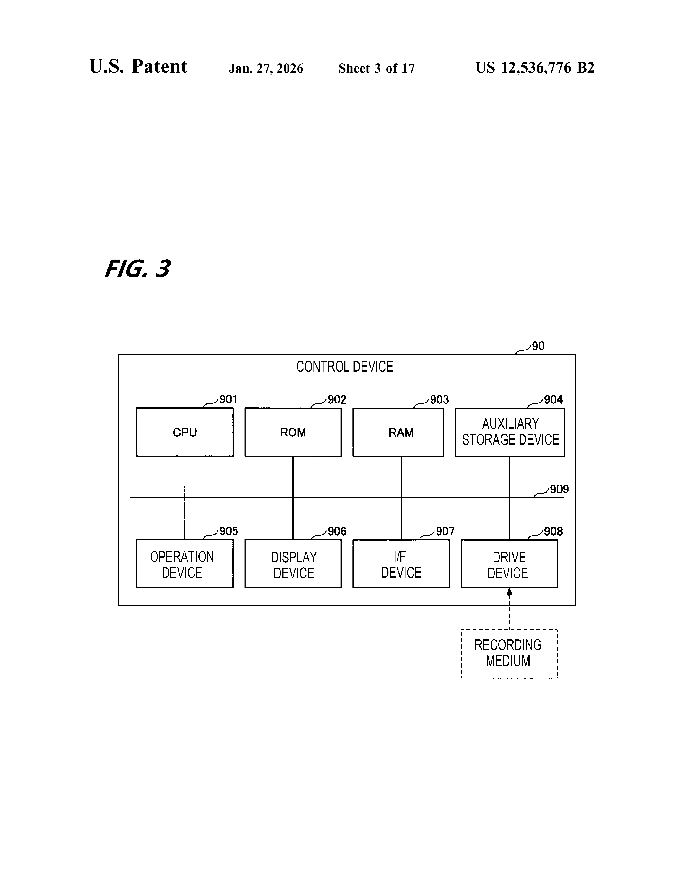
*도 3 — 제어 장치의 하드웨어 구성*

제어 장치 90은 CPU(central processing unit) 901, ROM(read only memory) 902 및 RAM(random access memory) 903을 포함한다. CPU 901, ROM 902 및 RAM 903은 이른바 컴퓨터를 구성한다. 제어 장치 90은 또한 보조 기억 장치 904, 조작 장치 905, 표시 장치 906, I/F(interface) 장치 907 및 드라이브 장치 908을 포함한다. 제어 장치 90의 하드웨어는 버스 909를 통해 서로 연결된다.

CPU 901은 보조 기억 장치 904에 설치된 각종 프로그램을 전개하여 실행한다. ROM 902는 비휘발성 메모리이며 주기억 장치로서 기능한다. ROM 902는 CPU 901이 보조 기억 장치 904에 설치된 각종 프로그램을 실행하는 데 필요한 각종 프로그램 및 데이터를 저장한다.

RAM 903은 DRAM(dynamic random access memory) 또는 SRAM(static random access memory)과 같은 휘발성 메모리이며, 주기억 장치로서 기능한다. RAM 903은 보조 기억 장치 904에 설치된 각종 프로그램이 CPU 901에 의해 실행될 때 전개되는 작업 영역을 제공한다.

보조 기억 장치 904는 각종 프로그램과, CPU 901에 의해 각종 프로그램이 실행됨으로써 취득된 3차원 영상 데이터, 촬상 영상 데이터 및 티칭 데이터를 저장한다. 또한, 보조 기억 장치 904는 각종 프로그램이 사용하는 기판 처리 장치 1의 설계 데이터를 저장한다. 설계 데이터는 예컨대 3차원 CAD 데이터이다.

조작 장치 905는 사용자가 제어 장치 90에 각종 지시를 입력할 때 사용하는 입력 장치이다. 표시 장치 906은 제어 장치 90의 내부 정보를 표시하는 표시 장치이다. I/F 장치 907은 통신 회선(도시하지 않음)에 연결되어 기판 처리 장치 1 및 호스트 컴퓨터(도시하지 않음)와 통신하기 위한 연결 장치이다.

드라이브 장치 908은 기록 매체를 세팅하는 장치이다. 기록 매체에는 CD-ROM, 플렉시블 디스크 또는 광자기 디스크와 같이 정보를 광학적, 전기적 또는 자기적으로 기록하는 매체가 포함된다. 또한, 기록 매체에는 ROM 또는 플래시 메모리와 같이 정보를 전기적으로 기록하는 반도체 메모리가 포함될 수 있다.

보조 기억 장치 904에 설치되는 각종 프로그램은, 예컨대 배포된 기록 매체를 드라이브 장치 908에 세팅하고, 기록 매체에 기록된 각종 프로그램을 드라이브 장치 908이 읽어 들임으로써 설치된다. 또한, 보조 기억 장치 904에 설치되는 각종 프로그램은 클라우드와 같은 서버로부터 다운로드되어 설치될 수도 있다.

#### <기능 구성>

도 4를 참조하여 제어 장치 90의 하드웨어 구성의 일례를 설명한다. 도 4는 제어 장치 90의 기능 구성의 일례를 나타내는 도면이다. 제어 장치 90은 취득부 91, 3차원 영상 데이터 생성부 92, 판정부 93, 산출부 94, 동작 제어부 95, 표시부 96, 학습부 97 및 기억부 98을 포함한다.

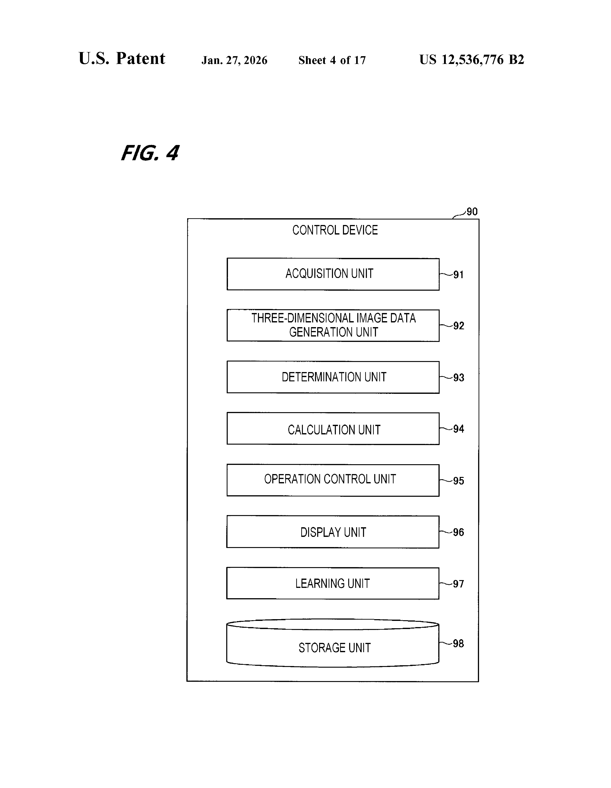
*도 4 — 제어 장치의 기능 구성*

취득부 91은 각종 데이터를 취득한다. 실시예에서, 취득부 91은 카메라 70 및 72로부터 촬상 영상 데이터를 취득한다. 또한, 취득부 91은 기판 처리 장치 1의 설계 데이터를 취득한다. 취득부 91은 또한 웨이퍼 보트 50의 형상과 같은 3차원 계측 데이터를 취득한다.

또한, 취득부 91은 포크 스캐닝(fork scanning)으로 측정된 포크 간격 데이터 및 보트 스캐닝(boat scanning)으로 측정된 웨이퍼 간격 데이터를 취득할 수 있다. 취득부 91이 취득하는 각종 데이터는 기억부 98에 저장된 데이터일 수도 있고, 네트워크를 통해 데이터 통신이 가능하도록 연결된 서버에 저장된 데이터일 수도 있다.

3차원 영상 데이터 생성부 92는, 후술하는 바와 같이 취득부 91이 취득한 촬상 영상 데이터 및 설계 데이터에 기초하여, 웨이퍼 보트 50, 캐리어 C 및 웨이퍼 W를 포함하는 기판 처리 장치 1 내부의 3차원 영상 데이터를 생성한다. 생성된 3차원 영상 데이터는 디지털 트윈(digital twin) 기술을 이용하여 가상 공간(사이버 공간) 내에 기판 처리 장치 1 내부의 3차원 영상을 작성하는 데 사용된다.

3차원 영상 데이터 생성부 92는 과거에 취득된 기판 처리 장치 1 내부의 촬상 영상 데이터에 기초하여 딥러닝을 수행하고, 딥러닝을 수행한 모델을 이용한 영상 처리에 의해 3차원 영상 데이터를 선명화할 수 있다.

딥러닝을 수행한 모델을 이용한 영상 처리에 의한 3차원 영상 데이터의 선명화란, 기판 처리 장치 1의 설계 데이터에 기초하여 생성된 3차원 영상 데이터 상에서 동일한 위치로부터 본 영상을 동시에 학습하는 학습 플로우와, 기판 처리 장치 1 내부에서 촬영된 촬상 영상 데이터로 딥러닝을 수행할 때의 실제 운용 중 플로우에서, 각 계측 위치의 판정 정밀도를 향상시키는 처리를 말한다.

예컨대, 학습 플로우에서는 제1 처리로서 웨이퍼 W의 이송 중 각종 기계 동작 상태를 촬상한다. 또한, 학습 플로우에서는 제2 처리로서, 설계 데이터에 기초하여 생성된 3차원 영상 데이터 상에서 제1 처리와 동일한 기계 동작 상태를 재현하고, 동일한 위치로부터 본 영상 데이터를 생성한다.

제3 처리로서, 제1 처리에서 촬상된 촬상 영상 데이터와 제2 처리에서 생성된 영상 데이터 양쪽에 대해, 제1 처리의 촬상 영상 데이터와 제2 처리의 영상 데이터 모두에 각종 계측 위치를 교시(티칭)한 후, 제1 처리의 촬상 영상 데이터와 제2 처리의 영상 데이터를 조합하여 기계 학습을 수행한다.

그리고 제1 내지 제3 처리의 기계 학습 처리를 다양한 기계 동작 상태에서 수행하여, 딥러닝 모델에 대해 교시를 반복한다. 이러한 처리에 따르면, 각 계측 위치를 판정할 때 오판정을 줄이고 정밀도를 향상시킬 수 있다.

예컨대, 실제 운용 중 플로우에서는 제1 처리로서 웨이퍼 W의 이송 중 각종 기계 동작 상태를 촬상한다. 또한, 학습 플로우에서는 제2 처리로서, 설계 데이터에 기초하여 생성된 3차원 영상 데이터 상에서 제1 처리와 동일한 기계 동작 상태를 재현하고, 동일한 위치로부터 본 영상 데이터를 생성한다.

제3 처리로서, 제1 처리에서 촬영된 촬상 영상 데이터와 제2 처리에서 생성된 영상 데이터를 딥러닝된 모델에 입력함으로써 각종 계측 위치를 판정할 수 있다.

판정부 93은 취득부 91이 취득한 각종 데이터와 3차원 영상 데이터 생성부 92가 생성한 3차원 영상 데이터에 기초하여 각종 판정을 수행한다. 실시예에서, 판정부 93은 웨이퍼 보트 50 또는 캐리어 C와 이송되는 웨이퍼 W 사이의 간극 치수가 미리 정해진 범위 내에 있는지 여부를 판정한다. 간극 치수는 서로 접촉하지 않도록 만들어진 틈이다.

또한, 판정부 93은 설계 데이터로부터 생성된 3차원 영상 데이터와 촬상 영상 데이터로부터 생성된 3차원 영상 데이터를 비교함으로써(데이터를 중첩하여 설계값으로부터의 어긋남량(기차, machine difference)을 계측함으로써), 부품이 잘못 설치되었는지(예컨대, 웨이퍼 보트 50이 잘못 설치되었는지), 그리고 부품이 뒤틀리거나, 기울어지거나, 누락되었는지를 판정할 수 있다.

산출부 94는 각종 산출을 수행한다. 실시예에서, 산출부 94는 취득부 91이 취득한 각종 데이터와 3차원 영상 데이터 생성부 92가 생성한 3차원 영상 데이터에 기초하여, 웨이퍼 보트 50, 캐리어 C 및 이송 중인 웨이퍼 W의 간극 치수 계측을 실시간으로 수행한다. 간극 치수의 계측 결과에 기초하여, 산출부 94는 웨이퍼 보트 50, 캐리어 C 및 이송 중인 웨이퍼 W가 서로 충돌하지 않고 웨이퍼 W를 이송할 수 있는 웨이퍼 이송 장치 60의 티칭 데이터를 산출한다.

동작 제어부 95는 기판 처리 장치 1의 각 부의 동작, 예컨대 티칭 데이터에 따른 웨이퍼 이송 장치 60의 동작을 제어한다. 실시예에서, 동작 제어부 95는 티칭 데이터에 따라 웨이퍼 이송 장치 60을 동작시켜 캐리어 C와 웨이퍼 보트 50 사이에서 웨이퍼 W를 이송한다. 또한, 동작 제어부 95는 웨이퍼 이송 장치 60을 동작시켜, 웨이퍼 이송 장치 60의 가동부에 설치된 카메라 72의 위치 및 촬상 방향을 제어한다.

또한, 동작 제어부 95는 웨이퍼 이송 장치 60을 동작시켜 포크 스캐닝을 실행할 수 있다. 포크 스캐닝은 예컨대 광학 센서(도시하지 않음)에 의해 웨이퍼 이송 장치 60의 위치 정보를 계측하는 동작이다. 웨이퍼 이송 장치 60의 위치 정보에는, 예컨대 웨이퍼 이송 장치 60의 복수의 포크 63 중 인접한 포크 사이의 거리인 포크 간격과, 이동체 62에 대한 각 포크 63의 각도인 포크 각도가 포함된다. 광학 센서는 예컨대 웨이퍼 이송 영역 S2에 설치된 투과형 광학 센서 또는 반사형 광학 센서일 수 있다.

또한, 동작 제어부 95는 웨이퍼 이송 장치 60을 동작시켜 보트 스캐닝을 실행할 수 있다. 3차원 계측 데이터는 예컨대 보트 스캐닝에 의해 작성된다. 보트 스캐닝은 예컨대 웨이퍼 이송 장치 60의 포크 63에 부착된 광학 센서(도시하지 않음)에 의해 웨이퍼 보트 50의 위치 정보를 계측하는 동작이다.

표시부 96은 표시 장치 906에 표시할 각종 정보를 생성한다. 학습부 97은 취득부 91이 취득한 촬상 영상 데이터, 설계 데이터, 및 웨이퍼 이송 장치 60에 대한 과거의 복수의 티칭 데이터(티칭 데이터의 평가 포함)와 같이 딥러닝에 필요한 데이터를 취득한다. 학습부 97은 취득한 데이터에 기초한 딥러닝에 의해, 웨이퍼 이송을 위한 최적의 티칭 데이터를 산출하는 뉴럴 네트워크(모델)를 생성한다.

예컨대, 학습부 97은 티칭 데이터를, 소정 기간(예컨대, 1년) 동안 사고 없이 계속 사용된 고평가 티칭 데이터와, 사고를 일으키거나 조정이 불량하여 재티칭이 필요한 저평가 티칭 데이터로 나누어 딥러닝에 사용한다. 웨이퍼 이송 장치 60에 대한 과거의 복수의 티칭 데이터로는, 티칭 대상인 기판 처리 장치 1의 과거 티칭 데이터뿐만 아니라, 동일 기종의 다른 기판 처리 장치 1의 티칭 데이터도 사용될 수 있다.

기억부 98은 각종 데이터를 저장한다. 각종 데이터의 예로는 설계 데이터, 촬상 영상 데이터, 3차원 계측 데이터, 딥러닝용 학습 데이터, 모델 데이터 및 판정 데이터가 있다. 모델 데이터에는 학습부 97이 딥러닝에 의해 생성한 모델, 예컨대 뉴럴 네트워크가 포함된다. 판정 데이터에는 판정부 93에 의한 판정에 필요한 각종 데이터가 포함된다.

#### <처리>

이하에서는, 웨이퍼 보트 50과 캐리어 C의 일례인 FOUP 사이에서 웨이퍼 W를 이송하는 웨이퍼 이송 장치 60의 티칭을 자동화하는 완전 자동 티칭 처리, 웨이퍼 이송 장치 60에 의한 웨이퍼 W의 이송을 자율적으로 제어하는 자율 자동 이송 처리, 및 웨이퍼 이송 장치 60의 예방 정비 활동을 지원하는 정비 실시 예측 처리에 대해 설명한다. 또한, 웨이퍼 이송 장치 60의 완전 자동 티칭 처리, 자율 자동 이송 처리 및 정비 실시 예측 처리는 대부분 기계 학습에 기초하지만, 기계 학습에 사용되는 웨이퍼 보트 50의 형상 및 FOUP의 형상을 정확하게 파악하는 것이 중요하다.

따라서 여기서는, 기계 학습의 일례인 딥러닝에 사용되는 웨이퍼 보트 50 및 FOUP의 형상에 대한 데이터 수집 방법과, 그 데이터 수집 방법에 의해 수집된 데이터에 기초한 웨이퍼 이송 장치 60의 완전 자동 티칭 처리, 자율 자동 이송 처리 및 정비 실시 예측 처리에 대해 설명한다.

##### <<3차원 계측 데이터의 활용>>

제어 장치 90은, 예컨대 도 5에 나타낸 절차에 의해 검출된 웨이퍼 보트 50 및 FOUP의 형상에 기초하여, 웨이퍼 이송 장치 60의 완전 자동 티칭 처리, 자율 자동 이송 처리 및 정비 실시 예측 처리를 수행한다. 도 5는 3차원 계측 데이터를 활용하는 처리의 일례의 흐름도이다.

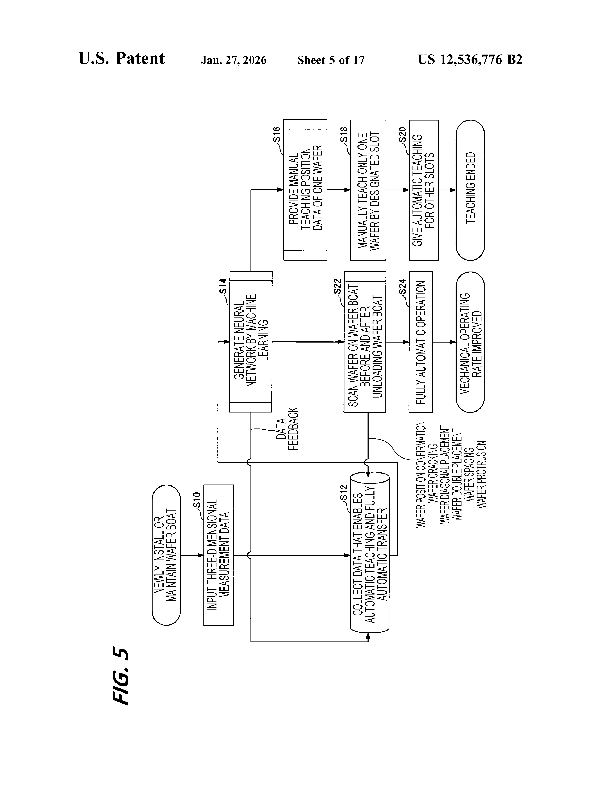
*도 5 — 3차원 계측 데이터를 활용하는 처리 흐름도*

단계 S10에서, 웨이퍼 보트 50, FOUP 및 웨이퍼 이송 장치 60의 3차원 계측 데이터가 제어 장치 90에 입력된다. 단계 S12에서, 제어 장치 90은 단계 S10에서 입력된 3차원 계측 데이터를 포함하고 자동 티칭 및 완전 자동 이송을 가능하게 하는 데이터를 수집하여 기억부 98에 저장한다.

자동 티칭 및 완전 자동 이송을 가능하게 하는 데이터의 예로는, 전술한 3차원 영상 데이터의 선명화에 의해 얻어진 위치 정보, 3차원 CAD 데이터의 설계 정보에 기초한 설계값상의 이송 위치, 및 숙련자의 티칭 위치를 학습한 기계 학습에 의해 보정된 위치 정보가 있다. 또한, 자동 티칭 및 완전 자동 이송을 가능하게 하는 데이터에는, 예컨대 포크 스캐닝 및 보트 스캐닝에 의해 얻어진 웨이퍼 보트 50 및 포크 63의 위치, 이송 통계 데이터, 및 티칭 위치 정보가 포함된다. 자동 티칭 및 완전 자동 이송을 가능하게 하는 데이터에는, 예컨대 전술한 딥러닝된 모델에 의한 영상 처리로 3차원 영상 데이터를 선명화하는 과정에서, 웨이퍼 W의 이송 중 각종 기계 동작 상태의 촬상 영상 데이터와 설계 데이터에 기초하여 생성된 3차원 영상 데이터를 조합한 혼합 3차원 영상 데이터가 포함된다.

기억부 98은 기판 처리 장치 1에 부착되었던 이전 웨이퍼 보트 50의 3차원 계측 데이터와, 기판 처리 장치 1에 부착된 현재 웨이퍼 보트 50의 3차원 계측 데이터를 저장한다.

단계 S14에서, 제어 장치 90은 입력된 3차원 계측 데이터를 포함하고 자동 티칭 및 완전 자동 이송을 가능하게 하는 데이터에 기초하여, 기계 학습에 의해 웨이퍼 이송을 위한 최적의 티칭 데이터를 산출하는 뉴럴 네트워크를 생성한다.

단계 S16에서, 정비 담당자(작업자)가 웨이퍼 이송 장치 60에 대한 티칭 기능을 호출한다. 단계 S18에서, 작업자는 웨이퍼 이송 장치 60을 조작하여 웨이퍼 보트 50 상의 적어도 하나의 슬롯(지정 슬롯)을 티칭하고, 티칭 데이터를 기억부 98에 저장한다. 슬롯은 웨이퍼 보트 50 상의 임의의 슬롯, 예컨대 웨이퍼 보트 50 상의 하단, 상단 및 중간 부근의 슬롯일 수 있다.

단계 S20에서, 제어 장치 90은 기억부 98에 저장된 웨이퍼 보트 50 상의 적어도 하나의 슬롯의 티칭 데이터와 뉴럴 네트워크에 기초하여 모든 슬롯에 대한 티칭 데이터를 생성하고, 그 티칭 데이터를 기억부 98에 저장한다.

단계 S22 및 S24에서, 제어 장치 90은 단계 S18 및 S20에서 기억부 98에 저장된 티칭 데이터에 기초하여 웨이퍼 이송 장치 60을 동작시켜, 이송원의 캐리어 C로부터 이송처의 웨이퍼 보트 50으로 웨이퍼 W를 이송한다. 제어 장치 90은 웨이퍼 보트 50을 열처리로 80에 반입하기 전과 웨이퍼 보트 50을 열처리로 80으로부터 반출한 후에 웨이퍼 보트 50 상의 웨이퍼 W를 스캔한다.

그 결과, 제어 장치 90은 웨이퍼 위치 확인, 웨이퍼 깨짐, 웨이퍼 경사 탑재, 웨이퍼 이중 탑재, 웨이퍼 간격 및 웨이퍼 돌출과 같은 데이터를 계측할 수 있으며, 그때의 티칭 데이터와 연관시켜, 단계 S12에서 자동 티칭 및 완전 자동 이송을 가능하게 하는 데이터로서 이러한 데이터를 기억부 98에 저장할 수 있다. 또한, 단계 S14에서 생성된 뉴럴 네트워크는 기억부 98에 저장된 각종 데이터로 피드백될 수 있다. 이와 같이, 제어 장치 90은 기계 학습에 의해 산출된 최적의 티칭 데이터에 기초하여 웨이퍼 이송 장치 60의 동작을 제어할 수 있고, 웨이퍼 W의 이송을 자율적으로 제어할 수 있다.

##### <<카메라 72의 촬상 영상 데이터의 활용>>

제어 장치 90은, 예컨대 도 6에 나타낸 절차에 의해 검출된 웨이퍼 보트 50 및 FOUP의 형상에 기초하여, 웨이퍼 이송 장치 60의 완전 자동 티칭 처리, 자율 자동 이송 처리 및 정비 실시 예측 처리를 수행한다. 도 6은 카메라 72를 활용하는 처리의 일례의 흐름도이다.

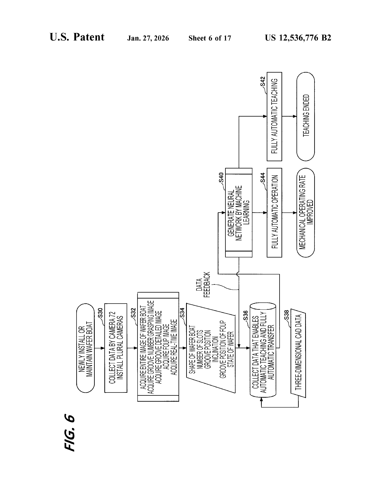
*도 6 — 카메라 72를 활용하는 처리 흐름도*

단계 S30에서, 제어 장치 90은 카메라 72로 데이터를 수집한다. 예컨대, 제어 장치 90은 편광판을 사용하여 웨이퍼 보트 50의 석영 두께 차이에 기인하는 편광(홈 부분)을 검출함으로써, 웨이퍼 보트 50의 홈 형상을 촬상한다. 또한, 제어 장치 90은 가시광 영역에서 웨이퍼 보트 50 및 FOUP의 형상을 촬상한다. 복수의 카메라 72를 설치함으로써, 웨이퍼 보트 50의 형상을 파악하고 거리 계측 정밀도를 향상시킬 수 있다. 카메라 72는 광각 렌즈를 이용할 수 있다.

단계 S32에서, 제어 장치 90은 단계 S30에서 수집된 데이터로부터 웨이퍼 보트 50의 전체 영상, 홈 개수 파악 영상, 홈 상세 영상, FOUP 영상 및 실시간 영상을 취득한다.

단계 S34에서, 제어 장치 90은 단계 S32에서 취득한 웨이퍼 보트 50의 전체 영상, 홈 개수 파악 영상, 홈 상세 영상, FOUP 영상 및 실시간 영상에 대해 영상 처리를 수행함으로써, 웨이퍼 보트 50의 형상, 슬롯 수, 홈 위치, 기울기, FOUP의 홈 위치 및 웨이퍼 W의 상태를 계측한다. 웨이퍼 W의 상태는 웨이퍼 보트 50 상의 웨이퍼 W의 위치, 깨짐, 경사 탑재, 이중 탑재, 간격 및 돌출과 같은 데이터를 나타낸다. 단계 S34에서의 영상 처리의 상세는 전술한 "딥러닝된 모델에 의한 영상 처리에 의한 3차원 영상 데이터의 선명화" 처리에서 설명하였으므로, 여기서는 설명을 생략한다.

단계 S36에서, 제어 장치 90은 단계 S34에서 계측된 데이터를 포함하고 자동 티칭 및 완전 자동 이송을 가능하게 하는 데이터를 수집하여 기억부 98에 저장한다. 단계 S38에서, 제어 장치 90은 설계 데이터의 일례인 3차원 CAD 데이터를 자동 티칭 및 완전 자동 이송을 가능하게 하는 데이터로서 기억부 98에 저장할 수 있다.

기억부 98은 기판 처리 장치 1에 부착되었던 이전 웨이퍼 보트 50의 자동 티칭 및 완전 자동 이송을 가능하게 하는 데이터와, 기판 처리 장치 1에 부착된 현재 웨이퍼 보트 50의 자동 티칭 및 완전 자동 이송을 가능하게 하는 데이터를 저장한다.

단계 S40에서, 제어 장치 90은 기억부 98에 저장된 자동 티칭 및 완전 자동 이송을 가능하게 하는 데이터에 기초하여, 기계 학습에 의해 웨이퍼 이송을 위한 최적의 티칭 데이터를 산출하는 뉴럴 네트워크를 생성한다.

단계 S42에서, 제어 장치 90은 뉴럴 네트워크와 기억부 98에 저장된 자동 티칭 및 완전 자동 이송을 가능하게 하는 데이터에 기초하여 모든 슬롯에 대한 티칭 데이터를 생성하고, 그 티칭 데이터를 기억부 98에 저장한다. 단계 S44에서, 제어 장치 90은 단계 S42에서 기억부 98에 저장된 티칭 데이터에 기초하여 웨이퍼 이송 장치 60을 동작시켜, 웨이퍼 보트 50과 FOUP 사이에서 웨이퍼 W를 이송한다.

또한, 단계 S40에서 생성된 뉴럴 네트워크는 기억부 98에 저장된 각종 데이터로 피드백될 수 있다. 이와 같이, 제어 장치 90은 기계 학습에 의해 산출된 최적의 티칭 데이터에 기초하여 웨이퍼 이송 장치 60의 동작을 제어할 수 있고, 웨이퍼 W의 이송을 자율적으로 제어할 수 있다.

##### <<카메라 70의 촬상 영상 데이터의 활용>>

제어 장치 90은, 예컨대 도 7에 나타낸 절차에 의해 검출된 웨이퍼 보트 50 및 FOUP의 형상에 기초하여, 웨이퍼 이송 장치 60의 완전 자동 티칭 처리, 자율 자동 이송 처리 및 정비 실시 예측 처리를 수행한다. 도 7은 카메라 70을 활용하는 처리의 일례의 흐름도이다.

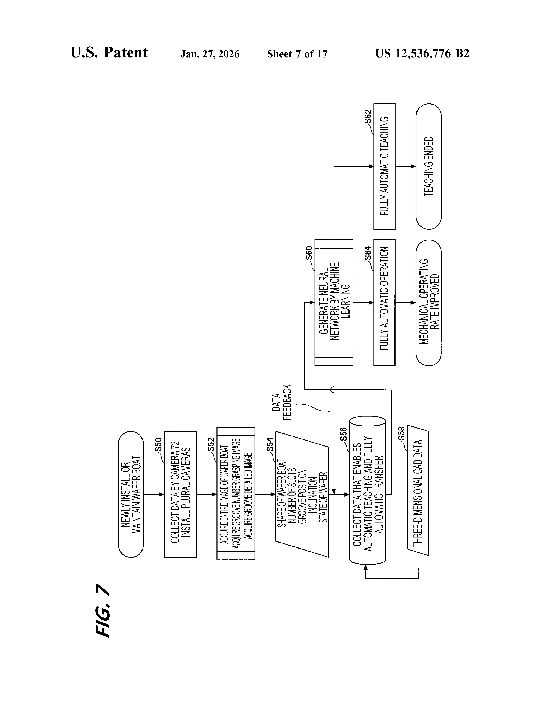
*도 7 — 카메라 70을 활용하는 처리 흐름도*

단계 S50에서, 제어 장치 90은 카메라 70으로 데이터를 수집한다. 예컨대, 제어 장치 90은 편광판을 사용하여 웨이퍼 보트 50의 석영 두께 차이에 기인하는 편광(홈 부분)을 검출함으로써, 웨이퍼 보트 50의 홈 형상을 촬상한다. 또한, 제어 장치 90은 광각 렌즈를 이용하여 웨이퍼 보트 50의 전체 형상을 촬상한다. 복수의 카메라 70을 설치함으로써, 웨이퍼 보트 50의 형상을 파악하고 거리 계측 정밀도를 향상시킬 수 있다.

단계 S52에서, 제어 장치 90은 단계 S50에서 수집된 데이터로부터 웨이퍼 보트 50의 전체 영상, 홈 개수 파악 영상, 홈 상세 영상, FOUP 영상 및 실시간 영상을 취득한다. 단계 S54에서, 제어 장치 90은 취득한 웨이퍼 보트 50의 전체 영상, 홈 개수 파악 영상 및 홈 상세 영상에 대해 영상 처리를 수행함으로써, 웨이퍼 보트 50의 형상, 슬롯 수, 홈 위치, 기울기 및 웨이퍼 W의 상태를 계측한다. 웨이퍼 W의 상태는 웨이퍼 보트 50 상의 웨이퍼 W의 위치, 깨짐, 경사 탑재, 이중 탑재, 간격 및 돌출과 같은 데이터를 나타낸다.

단계 S56에서, 제어 장치 90은 단계 S54에서 계측된 데이터를 포함하고 자동 티칭 및 완전 자동 이송을 가능하게 하는 데이터를 수집하여 기억부 98에 저장한다. 단계 S58에서, 제어 장치 90은 설계 데이터의 일례인 3차원 CAD 데이터를 자동 티칭 및 완전 자동 이송을 가능하게 하는 데이터로서 기억부 98에 저장할 수 있다.

기억부 98은 기판 처리 장치 1에 부착되었던 이전 웨이퍼 보트 50의 자동 티칭 및 완전 자동 이송을 가능하게 하는 데이터와, 기판 처리 장치 1에 부착된 현재 웨이퍼 보트 50의 자동 티칭 및 완전 자동 이송을 가능하게 하는 데이터를 저장한다.

단계 S60에서, 제어 장치 90은 기억부 98에 저장된 자동 티칭 및 완전 자동 이송을 가능하게 하는 데이터에 기초하여, 기계 학습에 의해 웨이퍼 이송을 위한 최적의 티칭 데이터를 산출하는 뉴럴 네트워크를 생성한다.

단계 S62에서, 제어 장치 90은 뉴럴 네트워크와 기억부 98에 저장된 자동 티칭 및 완전 자동 이송을 가능하게 하는 데이터에 기초하여 모든 슬롯에 대한 티칭 데이터를 생성하고, 그 티칭 데이터를 기억부 98에 저장한다. 단계 S64에서, 제어 장치 90은 단계 S62에서 기억부 98에 저장된 티칭 데이터에 기초하여 웨이퍼 이송 장치 60을 동작시켜, 웨이퍼 보트 50과 FOUP 사이에서 웨이퍼 W를 이송한다.

또한, 단계 S60에서 생성된 뉴럴 네트워크는 기억부 98에 저장된 각종 데이터로 피드백될 수 있다. 이와 같이, 제어 장치 90은 기계 학습에 의해 산출된 최적의 티칭 데이터에 기초하여 웨이퍼 이송 장치 60의 동작을 제어할 수 있고, 웨이퍼 W의 이송을 자율적으로 제어할 수 있다.

##### <<카메라 70 및 72의 촬상 영상 데이터의 활용>>

제어 장치 90은, 예컨대 도 8에 나타낸 절차에 의해 검출된 웨이퍼 보트 50 및 FOUP의 형상에 기초하여, 웨이퍼 이송 장치 60의 완전 자동 티칭 처리, 자율 자동 이송 처리 및 정비 실시 예측 처리를 수행한다. 도 8은 카메라 70 및 72를 활용하는 처리의 일례의 흐름도이다.

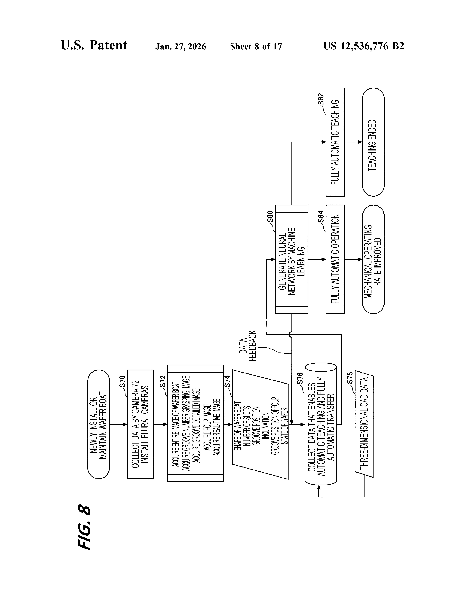
*도 8 — 카메라 70 및 72를 활용하는 처리 흐름도*

단계 S70에서, 제어 장치 90은 카메라 70 및 72로 데이터를 수집한다. 예컨대, 제어 장치 90은 편광판을 사용하여 웨이퍼 보트 50의 석영 두께 차이에 기인하는 편광(홈 부분)을 검출함으로써, 웨이퍼 보트 50의 홈 형상을 촬상한다. 또한, 제어 장치 90은 가시광 영역에서 웨이퍼 보트 50 및 FOUP의 형상을 촬상한다. 복수의 카메라 70 및 72를 설치함으로써, 웨이퍼 보트 50의 형상을 파악하고 거리 계측 정밀도를 향상시킬 수 있다. 카메라 70 및 72는 광각 렌즈를 이용할 수 있다.

단계 S72에서, 제어 장치 90은 단계 S70에서 수집된 데이터로부터 웨이퍼 보트 50의 전체 영상, 홈 개수 파악 영상, 홈 상세 영상, FOUP 영상 및 실시간 영상을 취득한다. 카메라 72는, 포크 63에 유지된 웨이퍼 W를 웨이퍼 보트 50 위에 놓는(put) 동작과, 웨이퍼 보트 50에 유지된 웨이퍼 W를 포크 63으로 들어 올리는(get) 동작을 촬상할 수 있는 위치에 설치되도록 설계된다.

카메라 70은, 웨이퍼 보트 50의 형상, 웨이퍼 보트 50의 상태, 웨이퍼 W의 설치 상태의 변화(반입/반출 시의 비교), 및 중요 부품의 변화를 촬상할 수 있는 위치에 설치되도록 설계된다. 또한, 카메라 70은 자동 티칭을 시작하는 웨이퍼 보트 50의 홈의 위치를 고정밀도로 검출할 수 있는 위치에 설치되도록 설계된다. 웨이퍼 보트 50의 홈의 위치는 카메라 72의 촬상 영상 데이터, 3차원 계측 데이터, 및 과거의 기계 학습을 포함하는 뉴럴 네트워크 데이터에 기초하여 검출될 수 있다.

단계 S74에서, 제어 장치 90은 단계 S72에서 취득한 웨이퍼 보트 50의 전체 영상, 홈 개수 파악 영상, 홈 상세 영상, FOUP 영상 및 실시간 영상에 대해 영상 처리를 수행함으로써, 웨이퍼 보트 50의 형상, 슬롯 수, 홈 위치, 기울기, FOUP의 홈 위치 및 웨이퍼 W의 상태를 계측한다. 웨이퍼 W의 상태는 웨이퍼 보트 50 상의 웨이퍼 W의 위치, 깨짐, 경사 탑재, 이중 탑재, 간격 및 돌출과 같은 데이터를 나타낸다.

단계 S76에서, 제어 장치 90은 단계 S74에서 계측된 데이터를 포함하고 자동 티칭 및 완전 자동 이송을 가능하게 하는 데이터를 수집하여 기억부 98에 저장한다. 단계 S78에서, 제어 장치 90은 설계 데이터의 일례인 3차원 CAD 데이터를 자동 티칭 및 완전 자동 이송을 가능하게 하는 데이터로서 기억부 98에 저장할 수 있다.

기억부 98은 기판 처리 장치 1에 부착되었던 이전 웨이퍼 보트 50의 자동 티칭 및 완전 자동 이송을 가능하게 하는 데이터와, 기판 처리 장치 1에 부착된 현재 웨이퍼 보트 50의 자동 티칭 및 완전 자동 이송을 가능하게 하는 데이터를 저장한다.

단계 S80에서, 제어 장치 90은 기억부 98에 저장된 자동 티칭 및 완전 자동 이송을 가능하게 하는 데이터에 기초하여, 기계 학습에 의해 웨이퍼 이송을 위한 최적의 티칭 데이터를 산출하는 뉴럴 네트워크를 생성한다.

단계 S82에서, 제어 장치 90은 기억부 98에 저장된 자동 티칭 및 완전 자동 이송을 가능하게 하는 데이터와 뉴럴 네트워크에 기초하여 모든 슬롯에 대한 티칭 데이터를 생성하고, 그 티칭 데이터를 기억부 98에 저장한다. 단계 S84에서, 제어 장치 90은 단계 S82에서 기억부 98에 저장된 티칭 데이터에 기초하여 웨이퍼 이송 장치 60을 동작시켜, 웨이퍼 보트 50과 FOUP 사이에서 웨이퍼 W를 이송한다.

또한, 단계 S80에서 생성된 뉴럴 네트워크는 기억부 98에 저장된 각종 데이터로 피드백될 수 있다. 이와 같이, 제어 장치 90은 기계 학습에 의해 산출된 최적의 티칭 데이터에 기초하여 웨이퍼 이송 장치 60의 동작을 제어할 수 있고, 웨이퍼 W의 이송을 자율적으로 제어할 수 있다.

##### <<광학 센서의 활용>>

제어 장치 90은, 예컨대 도 9에 나타낸 절차에 의해 검출된 웨이퍼 보트 50 및 FOUP의 형상에 기초하여, 웨이퍼 이송 장치 60의 완전 자동 티칭 처리, 자율 자동 이송 처리 및 정비 실시 예측 처리를 수행할 수 있다. 도 9는 광학 센서를 활용하는 처리의 일례의 흐름도이다.

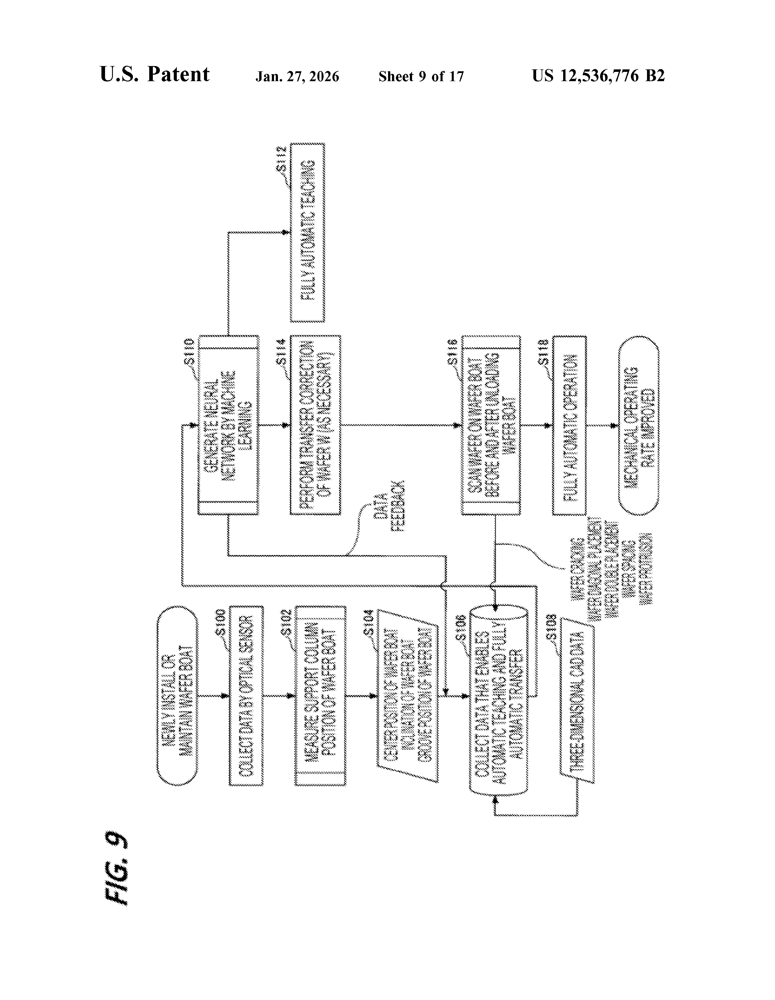
*도 9 — 광학 센서를 활용하는 처리 흐름도*

단계 S100에서, 제어 장치 90은 광학 센서로 데이터를 수집한다. 단계 S102에서, 제어 장치 90은 단계 S100에서 수집된 데이터로부터 웨이퍼 보트 50의 지주(support column) 위치를 계측한다. 단계 S104에서, 제어 장치 90은 단계 S102에서 계측된 웨이퍼 보트 50의 지주 위치로부터 웨이퍼 보트 50의 중심 위치를 파악한다. 또한, 제어 장치 90은 단계 S100에서 수집된 데이터로부터 웨이퍼 보트 50의 기울기 및 홈 위치를 파악한다.

단계 S106에서, 제어 장치 90은 단계 S104에서 파악된 데이터를 포함하고 자동 티칭 및 완전 자동 이송을 가능하게 하는 데이터를 수집하여 기억부 98에 저장한다. 단계 S108에서, 제어 장치 90은 설계 데이터의 일례인 3차원 CAD 데이터를 자동 티칭 및 완전 자동 이송을 가능하게 하는 데이터로서 기억부 98에 저장할 수 있다.

단계 S110에서, 제어 장치 90은 기억부 98에 저장된 자동 티칭 및 완전 자동 이송을 가능하게 하는 데이터에 기초하여, 기계 학습에 의해 웨이퍼 이송을 위한 최적의 티칭 데이터를 산출하는 뉴럴 네트워크를 생성한다.

단계 S112에서, 제어 장치 90은 기억부 98에 저장된 자동 티칭 및 완전 자동 이송을 가능하게 하는 데이터와 뉴럴 네트워크에 기초하여 모든 슬롯에 대한 티칭 데이터를 생성하고, 그 티칭 데이터를 기억부 98에 저장한다. 단계 S114에서, 제어 장치 90은 필요에 따라 웨이퍼 W의 이송 보정을 수행할 수 있다.

단계 S116 및 S118에서, 제어 장치 90은 단계 S112에서 기억부 98에 저장된 티칭 데이터에 기초하여 웨이퍼 이송 장치 60을 동작시켜, 이송원의 캐리어 C로부터 이송처의 웨이퍼 보트 50으로 웨이퍼 W를 이송한다. 제어 장치 90은 웨이퍼 보트 50을 열처리로 80에 반입하기 전과 웨이퍼 보트 50을 열처리로 80으로부터 반출한 후에 웨이퍼 보트 50 상의 웨이퍼 W를 스캔한다.

그 결과, 제어 장치 90은 웨이퍼 깨짐, 웨이퍼 경사 탑재, 웨이퍼 이중 탑재, 웨이퍼 간격 및 웨이퍼 돌출과 같은 데이터를 계측할 수 있으며, 그때의 티칭 데이터와 연관시켜, 단계 S106에서 자동 티칭 및 완전 자동 이송을 가능하게 하는 데이터로서 이러한 데이터를 기억부 98에 저장할 수 있다. 또한, 단계 S110에서 생성된 뉴럴 네트워크는 기억부 98에 저장된 각종 데이터로 피드백될 수 있다. 이와 같이, 제어 장치 90은 기계 학습에 의해 산출된 최적의 티칭 데이터에 기초하여 웨이퍼 이송 장치 60의 동작을 제어할 수 있고, 웨이퍼 W의 이송을 자율적으로 제어할 수 있다.

##### <<3차원 영상 데이터의 활용>>

제어 장치 90은, 예컨대 도 10 및 도 11에 나타낸 절차에 의해 웨이퍼 이송 장치 60의 완전 자동 티칭 처리, 자율 자동 이송 처리 및 정비 실시 예측 처리를 수행한다. 도 10은 카메라 70의 촬상 영상 데이터를 활용하는 처리의 일례의 흐름도이다. 도 11은 카메라 72의 촬상 영상 데이터를 활용하는 처리의 일례의 흐름도이다.

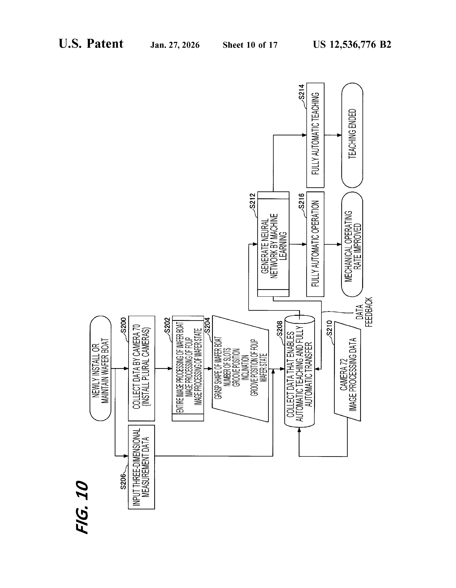
*도 10 — 카메라 70의 촬상 영상 데이터를 활용하는 처리 흐름도*

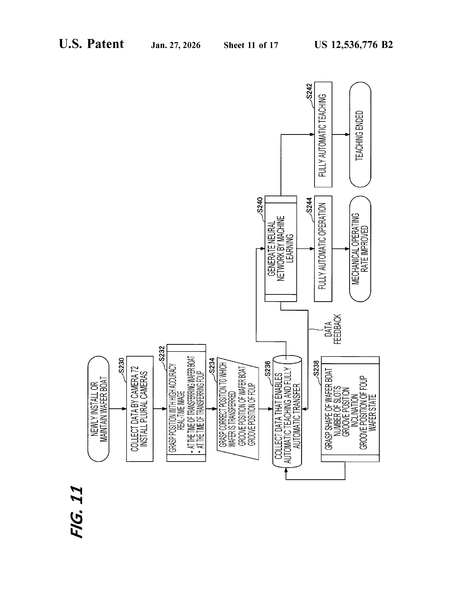
*도 11 — 카메라 72의 촬상 영상 데이터를 활용하는 처리 흐름도*

도 10에 나타낸 절차에서는, 카메라 70이 촬상한 촬상 영상 데이터에 기초하여 웨이퍼 보트 50 및 FOUP의 형상의 3차원 영상 데이터화 처리가 수행된다. 본 실시예에서는, 이러한 3차원 영상 데이터화 처리에 의해 웨이퍼 보트 50 및 FOUP의 3차원 영상 데이터가 생성될 수 있으며, 이른바 디지털 트윈에 의해 물리 공간의 변화가 가상 공간에서 재현될 수 있다.

도 11에 나타낸 절차에서는, 카메라 72가 촬상한 촬상 영상 데이터에 기초하여, 웨이퍼 W를 확실하게 이송할 수 있는 치수(웨이퍼 W와, 웨이퍼 보트 50 및 FOUP와 같이 웨이퍼 W가 이송되는 대상물 사이의 간극 치수)가 실시간으로 계측된다. 웨이퍼 이송 장치 60에 의한 웨이퍼 보트 50과 FOUP 사이의 웨이퍼 W 이송과 같은 실공간의 변화는, 이른바 디지털 트윈에 의해 실시간으로 연동되어 가상 공간에서 구현될 수 있다.

다음으로, 도 10의 처리에 대해 설명한다. 단계 S200에서, 제어 장치 90은 웨이퍼 이송 영역 S2에 설치된 복수의 카메라 70으로 데이터를 수집한다. 단계 S202에서, 제어 장치 90은 단계 S200에서 수집된 데이터와 3차원 CAD 데이터를 사용하여, 후술하는 바와 같이 웨이퍼 보트 50의 전체 영상 처리, FOUP의 영상 처리 및 웨이퍼 상태의 영상 처리를 수행한다. 단계 S204에서, 제어 장치 90은 웨이퍼 보트 50의 전체 영상 처리, FOUP의 영상 처리 및 웨이퍼 상태의 영상 처리를 수행함으로써 웨이퍼 보트 50의 형상, 슬롯 수, 홈 위치, 기울기, FOUP의 홈 위치 및 웨이퍼 W의 상태를 판정한다. 단계 S206에서, 웨이퍼 보트 50의 3차원 계측 데이터가 제어 장치 90에 입력된다.

단계 S208에서, 제어 장치 90은 단계 S204에서 계측된 데이터와 단계 S206에서 입력된 3차원 계측 데이터를 포함하고 자동 티칭 및 완전 자동 이송을 가능하게 하는 데이터를 수집하여 기억부 98에 저장한다. 단계 S210에서, 제어 장치 90은 도 11에 나타낸 처리에 의해 취득될 수 있는 카메라 72의 영상 처리 데이터(영상 위치 정보)를 자동 티칭 및 완전 자동 이송을 가능하게 하는 데이터로서 기억부 98에 저장할 수 있다.

기억부 98은 기판 처리 장치 1에 부착되었던 이전 웨이퍼 보트 50의 자동 티칭 및 완전 자동 이송을 가능하게 하는 데이터와, 기판 처리 장치 1에 부착된 현재 웨이퍼 보트 50의 자동 티칭 및 완전 자동 이송을 가능하게 하는 데이터를 저장한다.

단계 S212에서, 제어 장치 90은 기억부 98에 저장된 자동 티칭 및 완전 자동 이송을 가능하게 하는 데이터에 기초하여, 기계 학습에 의해 웨이퍼 이송을 위한 최적의 티칭 데이터를 산출하는 뉴럴 네트워크를 생성한다.

단계 S214에서, 제어 장치 90은 기억부 98에 저장된 자동 티칭 및 완전 자동 이송을 가능하게 하는 데이터와 뉴럴 네트워크에 기초하여 모든 슬롯에 대한 티칭 데이터를 생성하고, 그 티칭 데이터를 기억부 98에 저장한다. 단계 S216에서, 제어 장치 90은 기억부 98에 저장된 티칭 데이터에 기초하여 웨이퍼 이송 장치 60을 동작시켜, 웨이퍼 보트 50과 FOUP 사이에서 웨이퍼 W를 이송한다.

또한, 단계 S212에서 생성된 뉴럴 네트워크는 기억부 98에 저장된 각종 데이터로 피드백될 수 있다. 이와 같이, 제어 장치 90은 기계 학습에 의해 산출된 최적의 티칭 데이터에 기초하여 웨이퍼 이송 장치 60의 동작을 제어할 수 있고, 웨이퍼 W의 이송을 자율적으로 제어할 수 있다.

도 10에 나타낸 처리에 따르면, 설계 데이터의 일례인 3차원 CAD 데이터로부터 생성된 3차원 영상 데이터를 카메라 70의 촬상 영상 데이터로부터 생성된 3차원 영상 데이터와 비교함으로써, 웨이퍼 보트 50과 같은 부품의 오설치(웨이퍼 보트 50의 오설치), 허용 범위를 벗어나 발생한 웨이퍼 보트 50의 뒤틀림 또는 기울어짐, 또는 설치 부품의 누락과 같은 이상을 검출할 수 있다.

다음으로, 도 11의 처리에 대해 설명한다. 단계 S230에서, 제어 장치 90은 카메라 72로 데이터를 수집한다. 단계 S232에서, 제어 장치 90은 웨이퍼 W가 웨이퍼 보트 50으로 이송될 때(웨이퍼 보트 이송 시) 및 웨이퍼 W가 FOUP으로 이송될 때(FOUP 이송 시)의 카메라 72의 촬상 영상 데이터로부터 위치를 고정밀도로 파악한다.

단계 S234에서, 제어 장치 90은 단계 S232에서 고정밀도로 파악될 수 있는 위치로부터, 웨이퍼 W가 이송되는 웨이퍼 보트 50의 위치(홈 위치) 또는 FOUP의 위치(홈 위치)를 파악한다.

단계 S236에서, 제어 장치 90은 단계 S234에서 계측된 데이터를 포함하고 자동 티칭 및 완전 자동 이송을 가능하게 하는 데이터를 수집하여 기억부 98에 저장한다. 단계 S238에서, 제어 장치 90은 도 10에 나타낸 처리에 의해 취득될 수 있는 웨이퍼 보트 50의 형상, 슬롯 수, 홈 위치, 기울기, FOUP의 홈 위치 및 웨이퍼 W의 상태를 자동 티칭 및 완전 자동 이송을 가능하게 하는 데이터로서 기억부 98에 저장할 수 있다. 기억부 98은 웨이퍼 이송 장치 60에 대한 자동 티칭 및 완전 자동 이송을 가능하게 하는 데이터를 저장한다.

단계 S240에서, 제어 장치 90은 기억부 98에 저장된 자동 티칭 및 완전 자동 이송을 가능하게 하는 데이터에 기초하여, 기계 학습에 의해 웨이퍼 이송을 위한 최적의 티칭 데이터를 산출하는 뉴럴 네트워크를 생성한다.

단계 S242에서, 제어 장치 90은 기억부 98에 저장된 자동 티칭 및 완전 자동 이송을 가능하게 하는 데이터와 뉴럴 네트워크에 기초하여 모든 슬롯에 대한 티칭 데이터를 생성하고, 그 티칭 데이터를 기억부 98에 저장한다. 단계 S244에서, 제어 장치 90은 기억부 98에 저장된 티칭 데이터에 기초하여 웨이퍼 이송 장치 60을 동작시켜, 웨이퍼 보트 50과 FOUP 사이에서 웨이퍼 W를 이송한다.

또한, 단계 S240에서 생성된 뉴럴 네트워크는 기억부 98에 저장된 각종 데이터로 피드백될 수 있다. 이와 같이, 제어 장치 90은 기계 학습에 의해 산출된 최적의 티칭 데이터에 기초하여 웨이퍼 이송 장치 60의 동작을 제어할 수 있고, 웨이퍼 W의 이송을 자율적으로 제어할 수 있다.

도 11에 나타낸 처리에서는, 웨이퍼 W의 이송 이외의 모니터링이 수행될 수 있다. 예컨대, 제어 장치 90은 카메라 72의 촬상 영상 데이터로부터 포크 63 상의 웨이퍼 W의 척(chuck) 상태 및 웨이퍼 W의 틀어짐(오정렬, misalignment)을 모니터링할 수 있다. 웨이퍼 W의 틀어짐이 허용 범위 내인 경우, 제어 장치 90은 웨이퍼 W를 웨이퍼 보트 50에 놓은(put) 후 웨이퍼 W를 다시 들어 올리고(re-get) 다시 놓음(re-put)으로써 웨이퍼 W의 틀어짐을 보정할 수 있다.

또한, 제어 장치 90은 포크 63 상의 웨이퍼 W의 상태를 모니터링함으로써 예방 정비 통지를 발행할 수 있다. 제어 장치 90은 기판 처리 장치 1의 물리적 변화(예컨대, 드라이 클리닝에 의한 형상 변화, 부품의 뒤틀림, 기울어짐 또는 누락과 같은 구조적 변화)를 포착하여 예방 정비 통지를 할 수 있다.

단계 S202에서의 영상 처리는 예컨대 도 12 및 도 13에 나타낸 바와 같이 수행된다. 도 12 및 도 13은 단계 S202에서의 영상 처리의 일례를 나타내는 도면이다. 도 12에 나타낸 바와 같이, 제어 장치 90은 3차원 CAD 데이터로부터 생성된 가상 공간 내의 3차원 영상 데이터(설치 영상 데이터)에 기초하여, 딥러닝에 의해 카메라 70 및 72의 촬상 영상 데이터를 선명화하는 처리를 수행한다. 또한, 카메라 70 및 72의 촬상 영상 데이터는 웨이퍼 보트 50이 교체될 때마다 디지털 트윈의 기준 데이터로서 각종 처리에 사용된다.

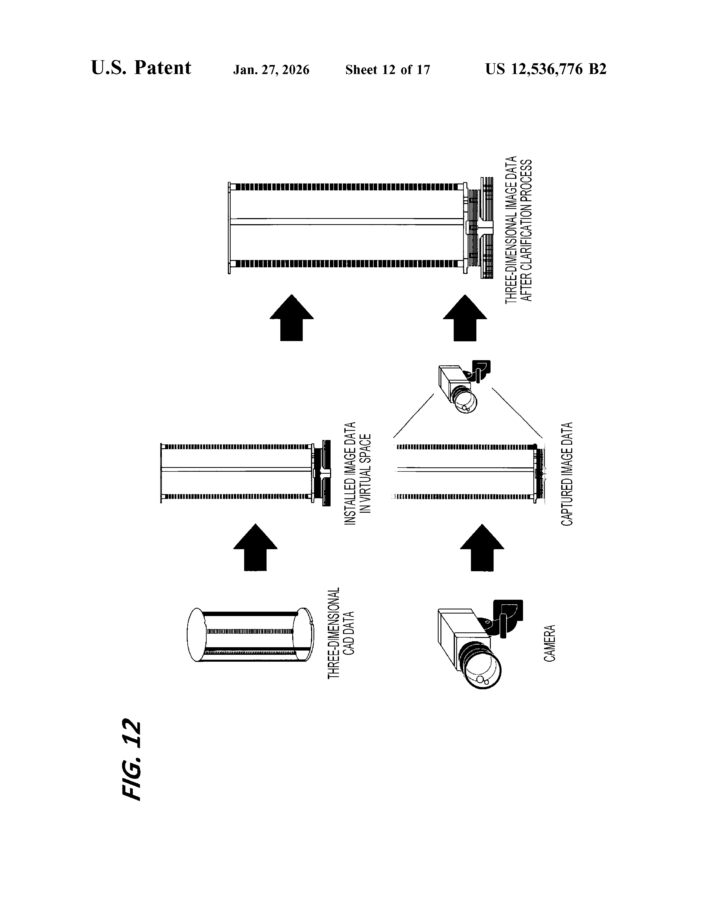
*도 12 — 단계 S202의 영상 처리 예 (CAD 기반 설치 영상과 촬상 영상의 선명화)*

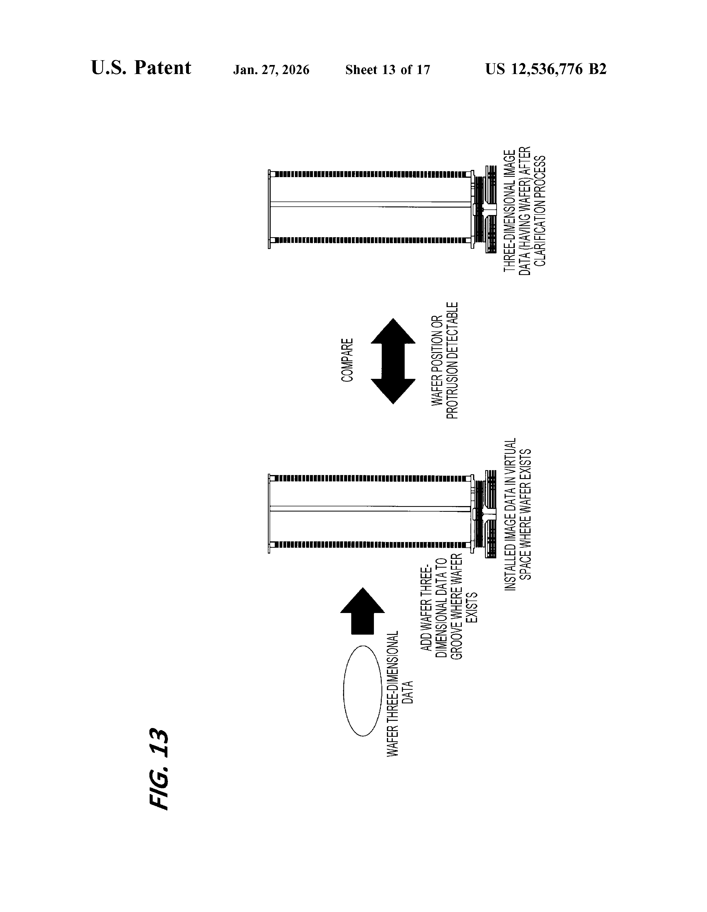
*도 13 — 단계 S202의 영상 처리 예 (웨이퍼 추가 설치 영상과 비교)*

도 13에 나타낸 바와 같이, 제어 장치 90은 웨이퍼 W의 3차원 데이터를 사용하여, 웨이퍼 W가 존재하는(탑재된) 홈 위치에 웨이퍼 W의 3차원 데이터를 추가함으로써, 웨이퍼 W가 존재하는 가상 공간 내의 3차원 데이터(설치 영상 데이터)를 생성한다. 이와 같이 생성된 웨이퍼 보트 50의 설치 영상 데이터를, 도 12에 나타낸 선명화 처리 후의 웨이퍼 W가 있는 웨이퍼 보트 50의 3차원 영상 데이터와 비교함으로써, 웨이퍼 W의 위치 및 돌출을 검출할 수 있다.

도 14는 카메라 70의 촬상 영상 데이터의 정밀도의 일례를 나타내는 도면이다. 도 14에 나타낸 바와 같이, 카메라 70이 촬상하는 영역은 고정밀도 계측 가능 영역, 중정밀도 영역 및 저정밀도 영역으로 나뉜다. 고정밀도 계측 영역에서는 웨이퍼 보트 50의 홈을 100 μm 이하와 같은 높은 정밀도로 계측할 수 있다. 중정밀도 영역에서는 웨이퍼 보트 50의 홈을 1 mm 이하와 같은 중간 정밀도로 계측할 수 있다. 저정밀도 영역에서는 웨이퍼 보트 50의 홈을 판별할 수 있다.

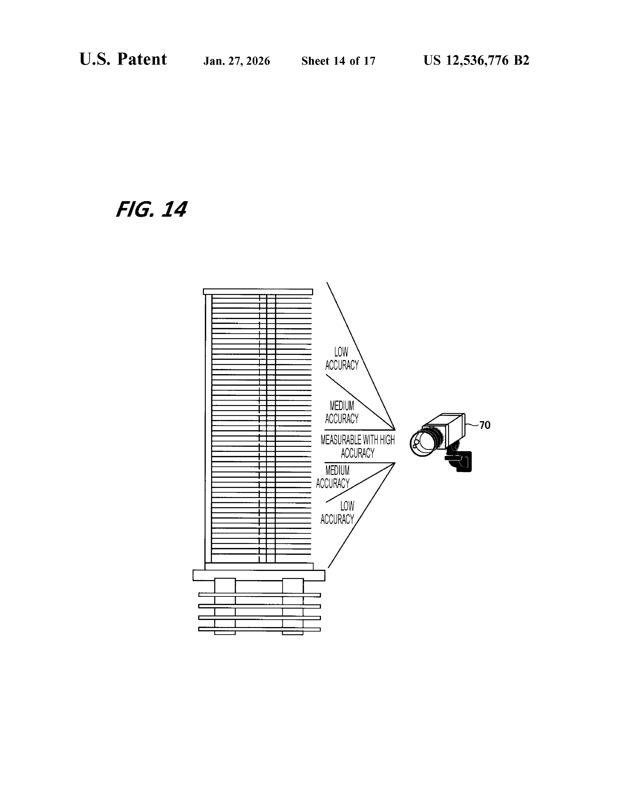
*도 14 — 카메라 70 촬상 영상 데이터의 정밀도*

예컨대, 제어 장치 90은 저정밀도 영역의 데이터에 기초하여 웨이퍼 보트 50의 홈 수를 판정하고 대략적인 형상을 판정할 수 있으므로, 웨이퍼 보트 50의 설치 오류를 판정할 수 있다. 또한, 제어 장치 90은 고정밀도 계측 영역 및 중정밀도 영역의 데이터에 기초하여 웨이퍼 보트 50 설치의 올바른 설치 정밀도를 판정하고, 웨이퍼 보트 50이 올바르게 설치되지 않은 경우 올바른 설치 위치 정보를 제공할 수 있다.

또한, 웨이퍼 W를 웨이퍼 보트 50의 지정된 홈에 100 μm의 정밀도로 자동 이송할 수 있는 경우, 과거의 뉴럴 네트워크와 새로 설치된 웨이퍼 보트 50의 형상으로부터 새로운 티칭 데이터를 자동으로 생성할 수 있다.

제어 장치 90은 웨이퍼 W를 웨이퍼 보트 50에 장입(charge)하기 전과 웨이퍼 W를 웨이퍼 보트 50으로부터 취출(discharge)하기 전에 카메라 70의 촬상 영상 데이터를 취득한다. 웨이퍼 W의 장입 전에는, 웨이퍼 보트 50의 기준 데이터에 기초하여 웨이퍼 보트 50의 홈 위치에 변이가 있는지 여부를 확인한다. 변이가 있는 것으로 확인되면, 변이량에 기초하여 티칭 데이터가 자동으로 보정된다.

웨이퍼 W의 취출 전에는, 웨이퍼 W의 이송이 완료된 후 웨이퍼 보트 50을 반입하기 전에 취득한 촬상 영상 데이터를, 웨이퍼 W를 취출하기 전의 웨이퍼 보트 50의 촬상 영상 데이터와 비교한다. 그 결과 변이가 있는 경우, 변이량에 기초하여 티칭 데이터가 자동으로 보정된다. 또한, 허용할 수 없는 변이량이 검출된 경우, 제어 장치 90은 표시 장치 906에 경보를 표시하여 사용자에게 통지하는 자동 경보 기능을 가질 수 있다. 이 자동 경보 기능에 의해 정비 담당자에 의한 적절한 예방 정비 및 정기 조정이 수행될 수 있으며, 기판 처리 장치 1의 가동률을 향상시킬 수 있다.

또한, 카메라 70의 설치 위치 및 촬상 방향은 도 14에 나타낸 예에 한정되지 않으며, 예컨대 도 15에 나타낸 카메라 70의 설치 위치 및 촬상 방향일 수도 있다. 예컨대, 도 15에 나타낸 바와 같이 촬상 방향이 비스듬한 카메라 70에 의한 웨이퍼 보트 50의 촬상 영상 데이터에 따르면, 촬상 방향이 수평인 카메라 70에 의한 웨이퍼 보트 50의 촬상 영상 데이터로부터는 파악하기 어려운 웨이퍼 W의 돌출을 쉽게 파악할 수 있게 된다.

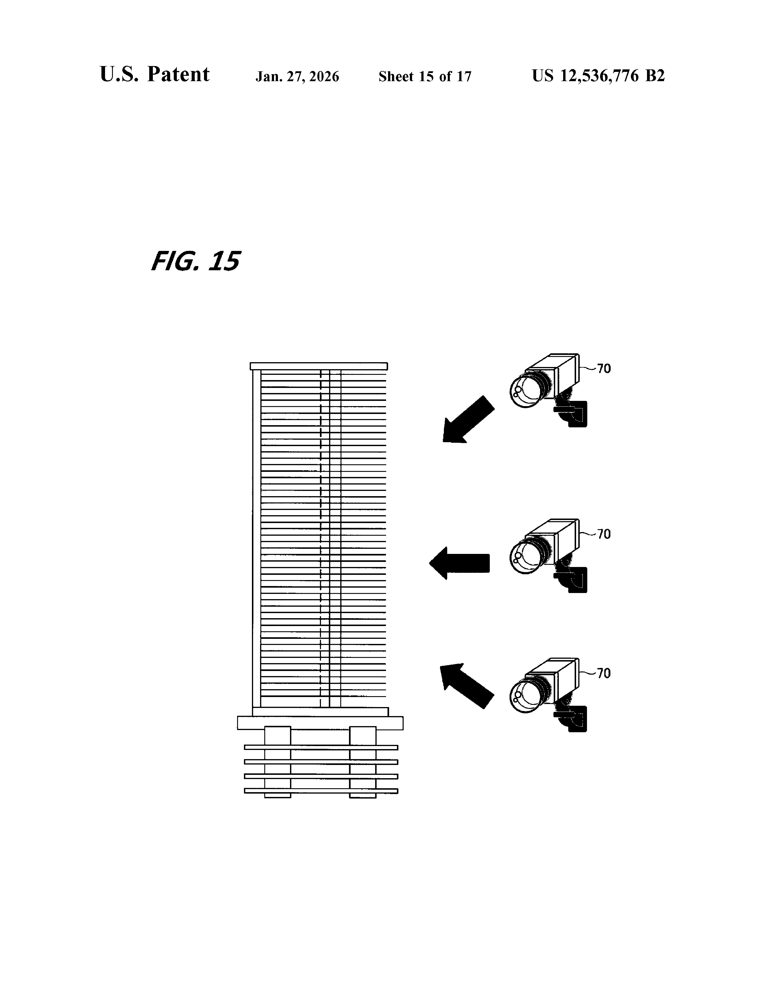
*도 15 — 카메라 70의 설치 위치 및 촬상 방향*

단계 S214에서의 자동 티칭 동작은 예컨대 도 16에 나타낸 바와 같이 수행된다. 도 16은 자동 티칭 처리의 일례의 흐름도이다. 단계 S300에서, 제어 장치 90은 카메라 70 및 72로 FOUP 상의 웨이퍼 W의 위치 및 각도를 계측한다. 또한, 단계 S302에서, 제어 장치 90은 카메라 70 및 72로 웨이퍼 이송 장치 60의 포크 63의 위치 및 각도를 계측한다.

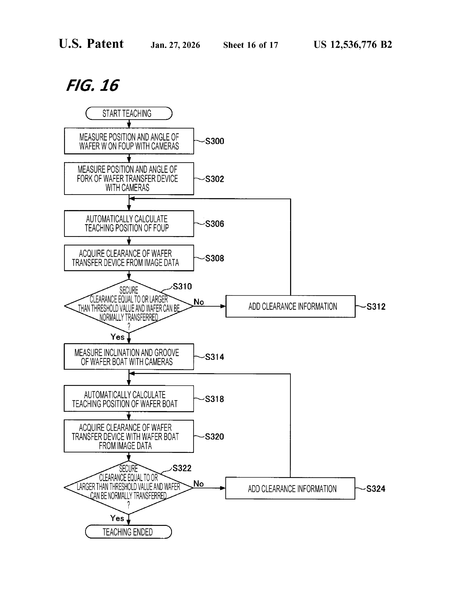
*도 16 — 자동 티칭 처리 흐름도*

단계 S306에서, 제어 장치 90은 단계 S300 및 S302의 계측 결과로부터 FOUP의 티칭 위치를 자동으로 산출한다. 단계 S308에서, 제어 장치 90은 카메라 72가 촬상한 촬상 영상 데이터를 계측함으로써 웨이퍼 이송 장치 60의 간극 치수를 취득한다. 단계 S310에서, 제어 장치 90은 임계값 이상의 간극 치수를 확보하여 웨이퍼 W를 정상적으로 이송할 수 있는지 여부를 판정한다.

임계값 이상의 간극 치수를 확보할 수 없다고 판정된 경우, 제어 장치 90은 단계 S312에서, 단계 S306의 FOUP의 티칭 위치를 자동으로 산출하는 처리에 필요한 데이터에 간극 치수 정보를 추가한다. 그 후, 제어 장치 90은 단계 S306으로 돌아가 처리를 계속한다.

임계값 이상의 간극 치수를 확보할 수 있다고 판정된 경우, 제어 장치 90은 단계 S314에서 카메라 70 및 72로 웨이퍼 보트 50의 기울기 및 홈을 계측한다. 단계 S318에서, 제어 장치 90은 단계 S314의 계측 결과로부터 웨이퍼 보트 50의 티칭 위치를 자동으로 산출한다. 단계 S320에서, 제어 장치 90은 카메라 72가 촬상한 촬상 영상 데이터를 계측함으로써 웨이퍼 보트 50에 대한 웨이퍼 이송 장치 60의 간극 치수를 취득한다.

단계 S322에서, 제어 장치 90은 임계값 이상의 간극 치수를 확보하여 웨이퍼 W를 정상적으로 이송할 수 있는지 여부를 판정한다. 임계값 이상의 간극 치수를 확보할 수 없다고 판정된 경우, 제어 장치 90은 단계 S324에서, 단계 S318의 웨이퍼 보트 50의 티칭 위치를 자동으로 산출하는 처리에 필요한 데이터에 간극 치수 정보를 추가한다. 그 후, 제어 장치 90은 단계 S318로 돌아가 처리를 계속한다. 임계값 이상의 간극 치수를 확보할 수 있다고 판정된 경우, 제어 장치 90은 도 16의 자동 티칭 처리를 종료한다.

또한, 웨이퍼 보트 50이 교체된 경우, 제어 장치 90은 예컨대 도 17에 나타낸 바와 같은 자동 티칭 동작을 수행한다. 도 17은 자동 티칭 처리의 일례의 흐름도이다. 단계 S340에서, 형상이 다른 웨이퍼 보트 50이 부착된다. 또한, 단계 S342에서, 부착된 웨이퍼 보트 50의 3차원 CAD 데이터가 취득된다.

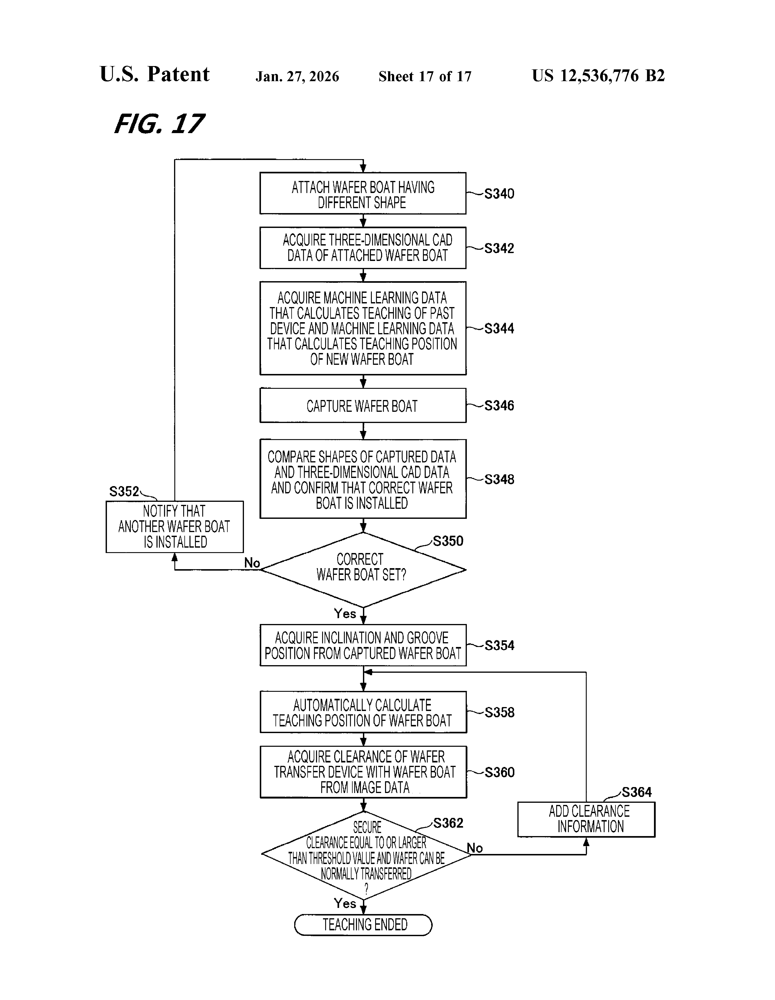
*도 17 — 자동 티칭 처리 흐름도 (웨이퍼 보트 교체 시)*

단계 S344에서, 제어 장치 90은 과거의 기계 학습 데이터와, 단계 S340에서 부착된 웨이퍼 보트 50의 티칭 위치를 자동으로 산출하기 위한 기계 학습 데이터를 취득한다. 티칭 위치를 자동으로 산출하기 위한 기계 학습 데이터는 다양한 변화에 대응할 수 있도록 동일 기종의 복수의 기판 처리 장치 1로부터 취득된다.

따라서, 형상이 다른 웨이퍼 보트 50이 부착된 경우에도, 부착된 웨이퍼 보트 50의 3차원 CAD 데이터와 기계 학습 알고리즘에 의해 티칭 위치의 자동 산출에 대응할 수 있다.

단계 S346에서, 카메라 70 및 72가 웨이퍼 보트 50을 촬상한다. 제어 장치 90은 단계 S348에서 촬상 영상 데이터의 웨이퍼 보트 50의 형상을 3차원 CAD 데이터에 의해 생성된 3차원 영상 데이터의 웨이퍼 보트 50의 형상과 비교함으로써, 단계 S350에서 올바른 웨이퍼 보트 50이 설치되었는지 여부를 확인한다.

올바른 웨이퍼 보트 50이 설치되지 않은 것으로 확인된 경우, 제어 장치 90은 단계 S352에서 자동 경보 기능에 의해 형상이 다른 웨이퍼 보트 50이 설치되었음을 정비 담당자에게 통지한다. 그 결과, 정비 담당자는 형상이 다른 웨이퍼 보트 50이 부착되었음을 인식할 수 있으며, 단계 S340에서 웨이퍼 보트 50을 다시 부착할 수 있다.

올바른 웨이퍼 보트 50이 설치된 것으로 확인된 경우, 제어 장치 90은 단계 S354에서 계측에 의해 촬상 영상 데이터로부터 웨이퍼 보트 50의 기울기 및 홈 위치를 취득한다. 단계 S358에서, 제어 장치 90은 단계 S354의 계측 결과로부터 웨이퍼 보트 50의 티칭 위치를 자동으로 산출한다. 단계 S360에서, 제어 장치 90은 카메라 72가 촬상한 촬상 영상 데이터를 계측함으로써 웨이퍼 보트 50에 대한 웨이퍼 이송 장치 60의 간극 치수를 취득한다.

단계 S362에서, 제어 장치 90은 임계값 이상의 간극 치수를 확보하여 웨이퍼 W를 정상적으로 이송할 수 있는지 여부를 판정한다. 임계값 이상의 간극 치수를 확보할 수 없다고 판정된 경우, 제어 장치 90은 단계 S364에서, 단계 S358의 웨이퍼 보트 50의 티칭 위치를 자동으로 산출하는 처리에 필요한 데이터에 간극 치수 정보를 추가한다. 그 후, 제어 장치 90은 단계 S358로 돌아가 처리를 계속한다. 임계값 이상의 간극 치수를 확보할 수 있다고 판정된 경우, 제어 장치 90은 도 17의 자동 티칭 처리를 종료한다.

상기 실시예에서는, 상하로 서로 대향하는 천판과 저판 사이에 복수의 지주가 설치되고, 각 지주의 내측면에 복수의 홈이 형성되며, 웨이퍼 W의 주연부가 홈에 삽입되어 지지되는, 이른바 래더 보트(ladder boat)를 예로 들어 설명하였다. 그러나 본 개시는 이에 한정되지 않는다. 본 개시는, 예컨대 상하로 서로 대향하는 천판과 저판 사이에 복수의 지주가 설치되고, 복수의 지주에 평탄한 지지면을 갖는 링 부재가 설치되며, 웨이퍼 W가 링 부재의 지지면 위에 지지되는, 이른바 링 보트(ring boat)에도 적용될 수 있다. 링 보트는 포크 스캐닝으로는 대응하기 어려운 보트 형상의 일례이다.

상기 실시예에서, 캐리어 C 및 웨이퍼 보트 50은 이송원 대상물 및 이송처 대상물의 일례이다. 웨이퍼 이송 장치 60은 이송 장치의 일례이다. 웨이퍼 W는 기판의 일례이다.

본 개시에 따르면, 기판 이송 장치의 티칭을 자동화할 수 있다.

이상으로부터, 본 개시의 다양한 실시예가 예시의 목적으로 본 명세서에 기재되었으며, 본 개시의 범위와 사상을 벗어나지 않고 다양한 변형이 이루어질 수 있음을 이해할 것이다. 따라서, 본 명세서에 개시된 다양한 실시예는 한정하려는 의도가 아니며, 진정한 범위와 사상은 이하의 청구범위에 의해 나타난다.
