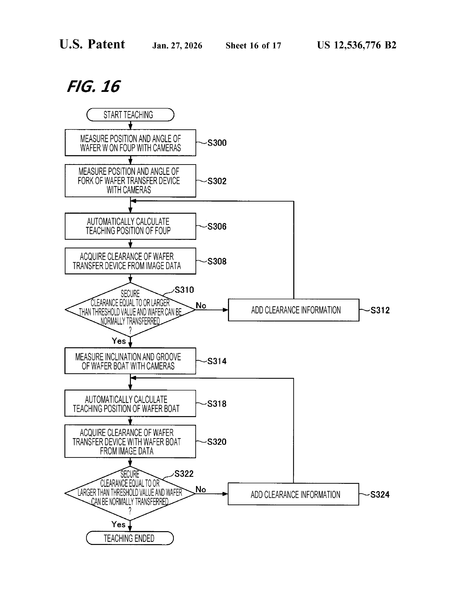
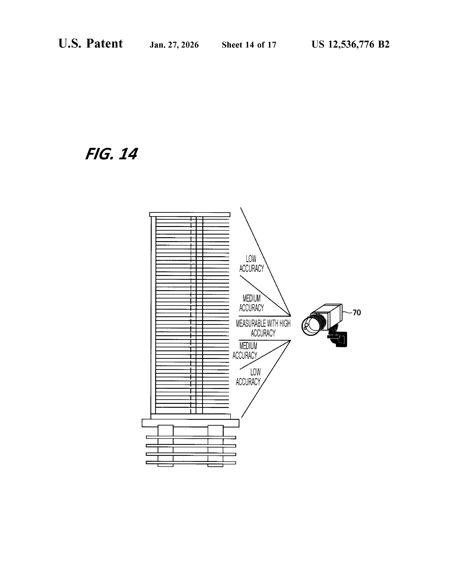

# US12536776B2 — 3D 영상 데이터를 쓰는 티칭 (Tokyo Electron)

| 항목 | 내용 |
|---|---|
| 원문 | `US12536776.pdf`(등록, 2026-01-27) · `US20210398342.pdf`(공개, 2021-12-23) |
| 출원인 | Tokyo Electron |
| 우선일 | 2020-06-23 (일본 특원 2020-107705) |
| 핵심 | 카메라 영상과 3D CAD 설계 데이터로 이송원(FOUP)·이송처(웨이퍼 보트)·기판의 3D 영상 데이터를 가상 공간에 만들고, 둘의 차이로 형상을 보정한 뒤 충돌하지 않도록 이송 장치를 티칭한다. 마커는 쓰지 않는다(대상물 형상 자체를 촬상). |
| 관련도 | △ 참고 |
| 본 과제와의 관계 | 참고용. 직접 Y·Θ 보정 산출식은 없음. 고정 카메라(70)+로봇 장착 카메라(72) 2종 구성과 기준 영상 대비 변이량으로 티칭 자동 보정하는 구조만 참고. |
| 링크 | [Google Patents](https://patents.google.com/patent/US12536776B2/en) |

---

## 상세 요약 (번역본 기준)

### 1. 해결하려는 문제
- 배경기술: 종형 열처리 장치에서 캐리어(C) 안의 웨이퍼 여러 장을 복수 포크의 웨이퍼 이송 장치(60)로 웨이퍼 보트(50)에 동시 이송. 번역본에 종래기술의 문제점은 따로 적혀 있지 않음.
- 목표: 웨이퍼 이송 장치(60)의 티칭 자동화(완전 자동 티칭), 이송 자율 제어(자율 자동 이송), 예방 정비 지원(정비 실시 예측).
- 전제: 이 처리들은 대부분 기계 학습 기반이므로 웨이퍼 보트(50)와 FOUP의 형상을 정확히 파악하는 것이 중요.
- 포크 스캐닝으로 대응하기 어려운 링 보트 같은 보트 형상도 다룰 수 있게 함.

### 2. 핵심 구성
| 구성 | 부호 | 위치·역할 |
|---|---|---|
| 웨이퍼 이송 장치 | 60 | 웨이퍼 보트(50)와 이송구(6) 사이. 가이드 기구(61), 이동체(62), 포크(63, 예: 5개), 승강 기구(64), 회전 기구(65) |
| 카메라 70 | 70 | 웨이퍼 이송 영역(S2)의 천장·측벽·바닥에 1대 이상 고정. 보트 전체 형상·설치 상태·홈 위치 촬상 |
| 카메라 72 | 72 | 웨이퍼 이송 장치(60)의 가동부에 1대 이상. 카메라 70보다 고정밀, 포크(63)의 put/get 동작 촬상 |
| 광학 센서 | 미도시 | 포크 스캐닝(포크 간격·각도), 보트 스캐닝(포크(63)에 부착, 보트 위치) |
| 이송원/이송처 | C, 50 | FIMS 포트(24) 위 캐리어(FOUP) / 웨이퍼 보트(50) |
| 제어 장치 | 90 | 취득부(91), 3차원 영상 데이터 생성부(92), 판정부(93), 산출부(94), 동작 제어부(95), 표시부(96), 학습부(97), 기억부(98) (도 4) |
- 설계 데이터: 보조 기억 장치(904)에 저장한 3차원 CAD 데이터.
- 3차원 영상 데이터 생성부(92): 촬상 영상+설계 데이터로 장치 내부를 디지털 트윈으로 가상 공간에 재현.
- 판정부(93): 설계 기반 3D와 촬상 기반 3D를 중첩해 설계값과의 어긋남량(기차)을 계측 → 오설치·뒤틀림·기울어짐·누락 판정, 간극 치수 범위 판정.
- 산출부(94): 간극 치수를 실시간 계측해 충돌 없는 티칭 데이터 산출.

### 3. 동작 순서
- 데이터 수집 경로 5종: 3차원 계측 데이터(도 5, S10~S24), 카메라 72(도 6, S30~S44), 카메라 70(도 7, S50~S64), 카메라 70+72(도 8, S70~S84), 광학 센서(도 9, S100~S118). 공통 흐름은 수집 → 계측(형상·슬롯 수·홈 위치·기울기·웨이퍼 상태) → 기억부(98) 저장 → 뉴럴 네트워크 생성 → 전 슬롯 티칭 데이터 생성 → 이송.
- 도 5: 작업자가 하단·상단·중간 등 지정 슬롯 일부만 티칭(S18) → 뉴럴 네트워크로 모든 슬롯 티칭 데이터 생성(S20).
- 도 9: 광학 센서로 보트 지주 위치 계측(S102) → 지주 위치로 보트 중심 위치 파악(S104).
- 홈 촬상: 편광판으로 석영 두께 차이에 의한 편광(홈 부분) 검출. 광각 렌즈, 복수 카메라로 거리 계측 정밀도 향상.
- 도 10(카메라 70): S200 수집 → S202 CAD 데이터 이용 영상 처리 → S204 형상·홈 위치·기울기·웨이퍼 상태 판정 → S206 3차원 계측 데이터 입력 → S212 학습 → S214 티칭 데이터 생성 → S216 이송.
- 도 11(카메라 72): S230 수집 → S232 보트·FOUP 이송 시 영상에서 위치 고정밀 파악 → S234 홈 위치 파악 → S240~S244 학습·티칭·이송.
- S202 영상 처리(도 12, 13): CAD 기반 설치 영상으로 딥러닝 선명화. 웨이퍼 3D 데이터를 홈 위치에 추가한 설치 영상과 비교해 웨이퍼 위치·돌출 검출.
- 변이 보정: 웨이퍼 장입 전 기준 데이터 대비 보트 홈 위치 변이 확인, 취출 전 이전 촬상 영상과 비교 → 변이 있으면 변이량에 기초해 티칭 데이터 자동 보정. 허용 불가 변이량이면 표시 장치(906)에 경보.
- 자동 티칭(도 16): S300 FOUP 위 웨이퍼 위치·각도 계측 → S302 포크(63) 위치·각도 계측 → S306 FOUP 티칭 위치 산출 → S308 카메라 72로 간극 치수 취득 → S310 임계값 이상 확보 여부 판정(미확보 시 S312 간극 정보 추가 후 S306 재산출) → S314 보트 기울기·홈 계측 → S318 보트 티칭 위치 산출 → S320~S324 같은 간극 판정 루프.
- 보트 교체 시(도 17): S340 다른 형상 보트 부착 → S342 CAD 취득 → S344 과거·동일 기종 학습 데이터 취득 → S346~S350 촬상 형상과 CAD 형상 비교로 올바른 보트인지 확인(아니면 S352 경보) → S354 기울기·홈 위치 → S358 티칭 위치 산출 → S360~S364 간극 판정 루프.
- 웨이퍼 틀어짐 보정: 카메라 72로 포크(63) 위 웨이퍼 척 상태·틀어짐 감시, 허용 범위 내면 put 후 re-get·re-put으로 보정.
- 구체적 좌표 변환식·회전 산출식은 번역본에 없음.

### 4. 청구항 요지
- 청구항 1(방법): 이미지 센서 촬상 영상 + 3차원 CAD 포함 설계 데이터로 가상 공간에 이송원·이송처 형상과 기판 상태의 3D 영상 데이터 생성, 충돌 없도록 3D 데이터로 티칭. 이송 장치는 수평 방향으로 이송원과 이송처 사이 설치. 3D 생성 시 촬상 영상과 설계 데이터 차이로 형상 보정.
- 청구항 13(시스템): 이송원·이송처·이동체와 포크를 가진 이송 장치·제어기 구성, 제어기가 청구항 1과 같은 생성·보정·티칭 수행.
- 청구항 14(기록 매체): 청구항 1과 같은 처리를 컴퓨터가 실행하게 하는 프로그램.
- 종속항: 탑재 위치 형상 파악(2), 두 3D 데이터 차이로 티칭 위치 조정(3, 8), 위치 어긋남·뒤틀림·기울어짐 검출(4, 9), 딥러닝 모델로 선명화(5, 10), 간극 치수 범위 판정과 예방 정비 통지(6, 11), 고정 제1 이미지 센서 + 이송 장치에 설치된 위치·방향 가변 제2 이미지 센서(7, 12), 두 3D 데이터 비교(15~17).

### 5. 대표 도면

*도 16 — 자동 티칭 흐름: FOUP·포크 계측 → 티칭 위치 산출 → 간극 임계값 판정 루프 → 보트 티칭*

*도 14 — 카메라 70 촬상 영역의 정밀도 구분(고정밀 100 μm 이하 / 중정밀 1 mm 이하 / 저정밀 판별만)*

### 6. 본 과제(Y·Θ 얼라인먼트)와 비교
- 같은 점:
  - 카메라 영상으로 이송 로봇의 티칭 위치를 자동 산출·보정.
  - 기준 데이터 대비 변이량을 구해 티칭 데이터를 자동 보정하는 구조.
  - 웨이퍼·포크의 위치와 각도를 계측(S300, S302).
- 다른 점:
  - 마커 없이 보트·FOUP 형상 자체를 촬상, 3D CAD와 비교하는 3D 디지털 트윈 방식. 본 과제는 QR형 마커 2D 영상.
  - 출력이 Y·Θ 보정값이 아니라 전 슬롯 티칭 데이터와 간극 치수 판정. 구체 산출식 없음.
  - 뉴럴 네트워크·딥러닝 학습 의존이 큼. 본 과제는 실시간 C++/OpenCV 기하 계산.
- 참고할 점:
  - 2단계 측정: 고정 카메라(70)로 대략 위치·설치 오류 판정, 로봇 장착 카메라(72)로 고정밀 위치 파악.
  - 정밀도 등급 구분(도 14): 홈 판별 / 1 mm 이하 / 100 μm 이하 영역을 나눠 쓰는 방식 → 마커 검출 신뢰도·ROI 설계에 응용.
  - 허용 범위 판정 구조: 범위 내 자동 보정, 허용 불가 시 경보(표시 장치 906) → 보정값 상한·알람 설계 근거.
  - 간극 임계값 미달 시 정보 추가 후 재산출하는 반복 루프(S310→S312→S306) → 보정 후 재측정 검증 단계로 응용.
  - 기준 데이터를 장비 교체 시마다 갱신(웨이퍼 보트 교체 시 디지털 트윈 기준 데이터) → 캘리브레이션 기준 영상 갱신 절차.
  - 비스듬한 촬상 방향(도 15)이 수평 방향보다 돌출 파악에 유리 → 카메라 설치 각도 검토 시 참고.
