# 반도체 제조 장비용 자동 티칭 장치 (US20240312821A1)

- 원제: Automatic teaching apparatus for semiconductor manufacturing equipment
- 원문: 같은 폴더의 PDF, https://patents.google.com/patent/US20240312821A1/en
- 번역 기준: Google Patents 원문 텍스트를 한국어로 옮김. 도면은 PDF 참조.
- 도면: 원문 PDF 도면 시트 18장을 도면/ 폴더에 넣고 본문에서 처음 언급되는 곳에 삽입함

## 요약

반도체 제조 장비용 자동 티칭(teaching) 장치는, 장비 전단 모듈(equipment front end module, EFEM); EFEM의 일측 가장자리를 따라 마련되어 EFEM의 내부와 연결되는 하나 이상의 로드 포트(load port); EFEM의 내부에 배치되고, 웨이퍼를 처리하기 위해 엔드 이펙터(end effector)에 의해 웨이퍼를 하나 이상의 로드 포트로 이송하도록 구성된 이송 로봇(transfer robot); 및 웨이퍼가 로드 포트 내의 고정 위치에 놓이도록, 웨이퍼를 언로딩한 상태에서 엔드 이펙터의 고정 위치를 검출하도록 구성된 로드 포트 티칭부를 포함한다.

## 청구범위

청구되는 것은 다음과 같다.

1. 반도체 제조 장비용 자동 티칭 장치로서, 상기 자동 티칭 장치는,

장비 전단 모듈(EFEM);

상기 EFEM의 일측 가장자리를 따라 마련되어 상기 EFEM의 내부와 연결되는 하나 이상의 로드 포트;

상기 EFEM의 상기 내부에 배치되고, 웨이퍼들을 처리하기 위해 엔드 이펙터에 의해 상기 웨이퍼들을 상기 하나 이상의 로드 포트로 이송하도록 구성된 이송 로봇; 및

상기 웨이퍼가 상기 로드 포트 내의 고정 위치에 놓이도록, 상기 웨이퍼를 언로딩한 상태에서 상기 엔드 이펙터의 고정 위치를 검출하도록 구성된 로드 포트 티칭부를 포함하는, 자동 티칭 장치.

2. 청구항 1에 있어서, 상기 엔드 이펙터는,

적어도 상면이 평면 형상으로 형성된 베이스 패드; 및

상기 베이스 패드의 전방측으로 연장되는 2개의 포크를 포함하고,

상기 로드 포트 티칭부는,

평면상 상기 웨이퍼의 전방 가장자리 또는 중심에 대응하도록, 특정 로드 포트, 더미 포트, 또는 상기 EFEM의 내측 바닥면으로부터 돌출되는 검출 핀;

상기 엔드 이펙터의 진입 방향으로 상기 검출 핀과 일직선을 따라 설정 거리만큼 이격된 위치에서, 상기 특정 로드 포트, 상기 더미 포트, 또는 상기 EFEM의 상기 내측 바닥면으로부터 돌출되는 반원형 블록;

상기 포크들 각각에 서로 마주보도록 일직선상에 마련되고, 상기 검출 핀이 평면상 상기 포크들 사이의 중앙 및 설정 높이에 위치하도록 Y 방향 및 Z 방향으로의 상기 엔드 이펙터의 진입 위치를 검출하여 안내하도록 구성된 전단 센서;

상기 포크들이 전진하고 상기 전단 센서가 상기 반원형 블록을 검출할 때 상기 검출 핀이 그 내부에 위치하도록 상기 베이스 패드를 관통하는 중앙 홀부; 및

상기 중앙 홀부의 가장자리를 따라 상기 베이스 패드에 마련되어 상기 중앙 홀부와 내측 방향으로 상호작용하며, 상기 검출 핀이 설정 위치에 설정되도록 X 방향 및 Z 방향으로 상기 엔드 이펙터의 위치를 설정하는 하나 이상의 중앙 센서를 포함하는, 자동 티칭 장치.

3. 청구항 1에 있어서, 상기 엔드 이펙터는,

적어도 상면이 평면 형상으로 형성된 베이스 패드; 및

상기 베이스 패드의 전방측으로 연장되는 2개의 포크를 포함하고,

상기 로드 포트 티칭부는,

특정 로드 포트, 더미 포트, 또는 상기 EFEM의 내측 바닥의 설정 위치에 놓이는 베이스 플레이트;

평면상 상기 웨이퍼의 전방 가장자리 또는 중심에 대응하도록 상기 베이스 플레이트의 바닥면으로부터 돌출되는 검출 핀;

상기 엔드 이펙터의 진입 방향으로 상기 검출 핀과 일직선을 따라 설정 거리만큼 이격된 위치에서 상기 베이스 플레이트로부터 돌출되는 반원형 블록;

상기 포크들 각각에 서로 마주보도록 일직선상에 마련되고, 상기 검출 핀이 평면상 상기 포크들 사이의 중앙 및 설정 높이에 위치하도록 Y 방향 및 Z 방향으로의 상기 엔드 이펙터의 진입 위치를 검출하여 안내하도록 구성된 전단 센서;

상기 포크들이 전진하고 상기 전단 센서가 상기 반원형 블록을 검출할 때 상기 검출 핀이 그 내부에 위치하도록 상기 베이스 패드를 관통하는 중앙 홀부; 및

상기 중앙 홀부의 가장자리를 따라 상기 베이스 패드에 마련되어 상기 중앙 홀부와 내측 방향으로 상호작용하며, 상기 검출 핀이 설정 위치에 설정되도록 X 방향 및 Z 방향으로 상기 엔드 이펙터의 위치를 설정하는 하나 이상의 중앙 센서를 포함하는, 자동 티칭 장치.

4. 청구항 3에 있어서, 상기 더미 포트가 상기 특정 로드 포트 내부에 위치할 때, 상기 더미 포트는 제1 위치결정부에 의해 상기 로드 포트에 대해 고정 위치에 설정되는, 자동 티칭 장치.

5. 청구항 1에 있어서,

상기 EFEM의 타측 가장자리를 따라 마련되어 상기 EFEM의 상기 내부와 연결되는 하나 이상의 스테이션; 및

상기 웨이퍼가 상기 스테이션 내의 고정 위치에 놓이도록, 상기 웨이퍼를 언로딩한 상태에서 상기 엔드 이펙터의 고정 위치를 검출하도록 구성된 스테이션 티칭부를 더 포함하는, 자동 티칭 장치.

6. 청정 공간을 형성하는 이송 장치에 설치된 로드 포트 상에 배치된 웨이퍼 캐리어 내에서의 웨이퍼의 전달 위치를 티칭하기 위한 티칭 시스템을 포함하는 이송 장치로서, 상기 이송 장치는,

웨이퍼를 파지하도록 구성된 핸드, 상기 핸드를 수평 방향 및 수직 방향으로 이동시키도록 구성된 암, 및 상기 핸드에 마련된 센서를 포함하는 로봇,

적어도 상기 센서의 검출, 및 상기 암과 상기 핸드의 이동 제어를 수행하도록 구성된 로봇 제어 장치, 및

상기 로드 포트 상에 배치되고, 상기 로봇에 의한 상기 웨이퍼 캐리어 내 웨이퍼의 전달 위치와 동일한 위치에서 상기 이송 장치의 상기 청정 공간을 유지하도록 구성된 티칭 지그를 포함하며,

상기 티칭 지그는 상기 웨이퍼 캐리어 내 상기 웨이퍼의 상기 전달 위치와의 상대적 위치 관계를 결정하도록 배치된 특정 피처(specific feature)를 갖고,

상기 로봇 제어 장치는 상기 핸드를 동작시켜 상기 센서에 의해 상기 티칭 지그의 상기 특정 피처를 검출하고, 상기 특정 피처의 검출 위치에 기초하여 상기 웨이퍼의 상기 전달 위치를 저장하는, 이송 장치.

7. 청구항 6에 있어서, 상기 티칭 지그는 일면에 개구가 마련되고 나머지 면은 상기 티칭 지그를 유지하도록 형상화된 하우징을 포함하고,

상기 특정 피처는 상기 하우징 내부에 마련되며,

상기 로봇은 상기 이송 장치의 상기 청정 공간을 유지하는 상기 티칭 지그의 상기 개구를 통해 상기 특정 피처에 접근하도록 구성되는, 이송 장치.

8. 청구항 6에 있어서, 상기 티칭 지그는 웨이퍼를 수용하도록 구성된 웨이퍼 캐리어이고, 상기 특정 피처를 갖는 판형 기판이 상기 웨이퍼 캐리어 내의 웨이퍼 탑재단에 탑재되는, 이송 장치.

9. 청구항 7에 있어서, 상기 특정 피처는 상기 웨이퍼 캐리어 내에 배치되는 상기 웨이퍼의 높이와 동일한 높이에 위치하는 판형 기판 상에 마련되는, 이송 장치.

10. 청구항 7에 있어서, 상기 티칭 지그는 상기 개구를 덮는 덮개를 더 포함하고, 상기 덮개는 상기 로드 포트에 의해 개폐되는, 이송 장치.

11. 청구항 7에 있어서, 상기 특정 피처는 제1 특정 피처 및 제2 특정 피처를 포함하고, 상기 제1 특정 피처와 상기 제2 특정 피처는 서로 간의 상대적 위치 관계를 결정하도록 배치되며, 상기 제2 특정 피처는 상기 제1 특정 피처보다 상기 개구에 더 가깝게 위치하고,

상기 로봇 제어 장치는 상기 핸드를 동작시켜 상기 센서에 의해 상기 제2 특정 피처를 검출하고, 상기 제2 특정 피처의 검출 위치에 기초하여 상기 센서에 의해 상기 제1 특정 피처를 검출하며, 상기 제1 특정 피처의 위치에 기초하여 상기 웨이퍼의 상기 전달 위치를 취득하는, 이송 장치.

12. 청구항 11에 있어서, 상기 제1 특정 피처 및 상기 제2 특정 피처는, 평면에서 볼 때 상기 개구에 대한 상기 핸드의 축선의 각도에 따른 배치 위치에 배치되는, 이송 장치.

13. 청구항 12에 있어서, 상기 티칭 지그는 제1 배치 위치 및 상기 제1 배치 위치와 상이한 제2 배치 위치를 갖고,

평면에서 볼 때, 상기 제1 특정 피처 및 상기 제2 특정 피처는, 상기 개구에 대한 상기 핸드의 상기 축선의 각도가 대략 직각을 유지하면서 상기 핸드가 상기 개구로부터 접근하는 경우에는 상기 제1 배치 위치에 배치되고, 상기 개구에 대한 상기 축선의 각도가 대략 직각을 유지하지 않으면서 상기 핸드가 상기 개구로부터 접근하는 경우에는 상기 제2 배치 위치에 배치되는, 이송 장치.

14. 청구항 11에 있어서, 상기 제1 특정 피처는, 상기 제2 특정 피처가 상기 센서에 의해 검출된 후, 상기 개구에 대한 상기 핸드의 축선의 각도가 유지되는 동안 상기 센서에 의해 검출되는 위치에 배치되는, 이송 장치.

15. 청구항 11에 있어서, 상기 제2 특정 피처는, 상기 센서에 의해 검출될 때 적어도 상기 하우징의 측벽과 상기 핸드 사이의 간극이 확보되는 위치에 배치되는, 이송 장치.

16. 청구항 11에 있어서, 복수의 제1 특정 피처 및 제2 특정 피처가 상기 티칭 지그 내에 다단으로 계층적으로 마련되는, 이송 장치.

17. 청구항 13에 있어서, 상기 제2 배치 위치에서, 상기 제1 특정 피처가 위치하는 면과 상기 제2 특정 피처가 위치하는 면이 상이한, 이송 장치.

18. 청구항 11에 있어서, 상기 센서는 상기 핸드의 전단에 설치된 제1 센서, 및 상기 핸드의 기단에 마련되고 상기 제1 센서의 광축과 직교하는 광축을 갖는 제2 센서를 포함하고,

상기 제1 특정 피처는 제1 검출부 및 제2 검출부를 포함하며,

상기 제1 센서가 상기 제2 특정 피처를 검출한 후, 상기 로봇 제어 장치는 상기 제1 센서가 상기 제2 검출부를 검출하고 상기 제2 센서가 상기 제1 검출부를 검출하는 위치로 상기 핸드를 이동시키는, 이송 장치.

19. 청구항 18에 있어서, 상기 제1 검출부와 상기 제2 검출부는, 상기 제2 센서가 상기 제1 검출부를 검출함과 동시에 상기 제1 센서가 상기 제2 검출부를 검출하도록 하는 상대적 위치 관계를 갖는, 이송 장치.

20. 청구항 18에 있어서, 상기 제2 센서는 상기 핸드의 상기 기단에 마련된 개구를 가로지르도록 마련되고, 상기 제1 센서가 상기 제2 검출부를 검출하고 상기 제1 검출부가 상기 개구에 진입할 때, 상기 핸드와 상기 제2 특정 피처가 서로 간섭하지 않도록 구성되는, 이송 장치.

21. 청구항 20에 있어서, 상기 제2 센서는 상기 제1 센서의 상기 광축과 평행한 광축을 갖는 알파 센서, 및 상기 알파 센서와 상기 제1 센서의 광축 각각과 직교하는 광축을 갖는 베타 센서를 포함하고,

상기 베타 센서는 상기 개구를 가로지르도록 마련되는, 이송 장치.

22. 청구항 6에 있어서, 상기 티칭 지그는 천장 호이스트 반송장치(overhead hoist transport, OHT) 또는 무인 운반차(automated guided vehicle, AGV)에 의해 상기 로드 포트 상에 배치되는, 이송 장치.

23. 청정 공간을 형성하는 이송 장치에 설치된 로드 포트 상에 배치된 웨이퍼 캐리어 내에서의 웨이퍼의 전달 위치를 티칭하기 위한 티칭 시스템으로서, 상기 티칭 시스템은,

웨이퍼를 파지하도록 구성된 핸드, 상기 핸드를 수평 방향 및 수직 방향으로 이동시키도록 구성된 암, 및 상기 핸드에 마련된 센서를 포함하는 로봇,

적어도 상기 센서의 검출, 및 상기 암과 상기 핸드의 이동 제어를 수행하도록 구성된 로봇 제어 장치, 및

상기 로드 포트 상에 배치되고, 상기 로봇에 의한 상기 웨이퍼 캐리어 내 상기 웨이퍼의 상기 전달 위치와 동일한 위치에서 상기 이송 장치의 상기 청정 공간을 유지하도록 구성된 티칭 지그를 포함하며,

상기 티칭 지그는 상기 웨이퍼 캐리어 내 상기 웨이퍼의 상기 전달 위치와의 상대적 위치 관계를 결정하도록 배치된 특정 피처를 갖고,

상기 로봇 제어 장치는 상기 핸드를 동작시켜 상기 센서에 의해 상기 티칭 지그의 상기 특정 피처를 검출하고, 상기 특정 피처의 검출 위치에 기초하여 상기 웨이퍼의 상기 전달 위치를 저장하는, 티칭 시스템.

24. 청정 공간을 형성하는 이송 장치에 설치된 로드 포트 상에 배치된 웨이퍼 캐리어와의 사이에서 웨이퍼의 전달을 수행하는 로봇으로서,

상기 웨이퍼를 파지하도록 구성된 핸드,

상기 핸드를 수평 방향 및 수직 방향으로 이동시키도록 구성된 암; 및

상기 핸드에 마련된 센서를 포함하고,

상기 로봇은 상기 웨이퍼 캐리어 내 상기 웨이퍼의 전달 위치를 티칭하기 위한 티칭 지그를 상기 센서에 의해 검출함으로써 상기 웨이퍼의 상기 전달 위치를 티칭하며,

상기 티칭 지그는 상기 로드 포트에 배치되고, 상기 로봇에 의한 상기 웨이퍼 캐리어 내 상기 웨이퍼의 상기 전달 위치와 동일한 위치에서 상기 이송 장치의 상기 청정 공간을 유지하도록 구성되며, 상기 웨이퍼 캐리어 내 상기 웨이퍼의 상기 전달 위치와의 상대적 위치 관계를 결정하도록 배치된 특정 피처를 갖고,

상기 로봇은 상기 핸드를 동작시켜 상기 센서에 의해 상기 티칭 지그의 상기 특정 피처를 검출하고, 상기 특정 피처의 검출 위치에 기초하여 상기 웨이퍼의 상기 전달 위치를 티칭하는, 로봇.

## 상세한 설명

### 관련 출원의 상호 참조 (CROSS-REFERENCE TO RELATED APPLICATIONS)

본 출원은 2022년 8월 31일 출원된 국제특허출원 제PCT/KR2022/013064호의 계속 출원이며, 상기 국제특허출원은 2021년 11월 23일 한국 특허청(KIPO)에 출원된 한국 특허출원 제10-2021-0162099호에 대한 우선권을 주장하고, 이들 모두는 그 전체가 참조로서 본 명세서에 포함된다.

### 기술분야 (TECHNICAL FIELD)

본 개시는 반도체 제조 장비용 자동 티칭 장치에 관한 것이다.

### 배경기술 (BACKGROUND)

반도체 소자는 박막 증착 공정, 이온 주입 공정, 확산 공정, 세정 공정, 포토리소그래피 공정, 식각 공정 등 다수의 공정에 의해 제조된다. 이러한 반도체 제조 공정이 수행되는 장치로서, 웨이퍼를 한 장씩 처리하는 매엽식 처리 장치가 널리 사용되고 있다.

예를 들어, 세정 공정에서는 높은 청정도를 만족시키기 위해, 파티클, 금속 불순물, 유기물 등의 오염을 제거하도록 웨이퍼를 약액으로 처리하여 웨이퍼를 한 장씩 세정하는 매엽식 세정이 널리 사용되고 있다. 매엽식 세정 장치는, 웨이퍼가 로딩되는 로딩부와 세정 공정이 수행되는 세정부 사이에서 웨이퍼의 원활한 공급을 보장하기 위해, 웨이퍼가 대기 상태로 보관되는 버퍼를 갖는 것이 일반적이다.

이송 로봇에 의해 웨이퍼가 버퍼에 로딩될 때, 이송 로봇이 틀어져(오정렬되어) 있으면 웨이퍼는 버퍼의 웨이퍼 슬롯에 틀어진 위치로 놓이게 된다.

버퍼 내 웨이퍼의 위치가 틀어져 있으면, 웨이퍼가 세정부로 이송될 때 웨이퍼가 이송 로봇에서 이탈하여 웨이퍼가 손상되거나, 웨이퍼가 세정부에 올바르게 놓이지 않아 세정 동작이 중단되는 문제가 발생할 수 있다.

또한, 웨이퍼가 이송 로봇에서 이탈하지 않더라도, 웨이퍼 위치 검출 센서에 의해 웨이퍼 위치의 틀어짐이 검출되면, 공정 진행을 멈추고 제조 장비를 정지시켜야 하며, 이송 로봇의 틀어짐 정도를 측정하여 이송 로봇을 수동으로 티칭하는 작업을 수행해야 한다.

제조 장비를 정지시키고 이송 로봇을 티칭하는 데에는 상당한 시간이 소요되며, 이는 공정의 생산성을 저하시킨다. 또한, 장비 전단 모듈(EFEM)이 대기에 개방된 상태에서 작업자가 EFEM 내부의 청정 공간에 들어가 수동으로 지그를 설치하고 이송 로봇을 티칭하기 때문에, EFEM 외부로부터 반입되는 이물질로 인해 EFEM 내부가 오염되는 문제가 있다. 이는 제조 장비 전체의 청정도 저하로 이어지며, 저하된 청정도를 원하는 수준으로 회복하기 위해 EFEM 내부를 청소하는 과정이 반복되어 전체 작업 시간이 길어진다.

또한, 5개의 웨이퍼 캐리어(예를 들어, 전면 개방 일체형 포드(front opening unified pod, FOUP))를 탑재할 수 있는 EFEM에서는, 이송 로봇의 핸드가 웨이퍼 캐리어의 개구에 거의 일직선으로 접근할 수 있는 중앙에 위치한 3개의 웨이퍼 캐리어와 달리, 5개의 웨이퍼 캐리어 중 양단에 위치한 2개의 웨이퍼 캐리어에 대해서는, 이송 로봇의 핸드가 도달할 수 있는 범위에 따라 이송 로봇의 핸드가 웨이퍼를 전달하기 위해 2개의 웨이퍼 캐리어에 비스듬히 접근해야 하는 경우가 있을 수 있다. 이때, 로봇의 핸드가 주변 부분, 특히 웨이퍼 캐리어의 측벽과 간섭하여 안전한 티칭 작업이 어려워지는 경우가 있다.

따라서, 이러한 문제를 해결할 필요가 있다.

관련 기술은 한국 공개특허공보 제10-2013-0058413호(공개일: 2013년 6월 4일, 발명의 명칭: 기판 처리 장치)에 제안되어 있다.

상술한 기술 구성은 본 개시의 이해를 돕기 위한 배경 기술로서, 본 개시가 속하는 기술 분야에서 널리 알려진 종래기술을 의미하는 것은 아니다.

### 발명의 내용 (SUMMARY)

본 명세서에 개시된 실시예들은 상술한 문제점들을 극복하기 위해 안출되었다. 실시예들의 목적은, 수동으로 설치되는 별도의 티칭 지그를 사용하지 않고, 웨이퍼 처리 공정을 위한 장비 전단 모듈(EFEM)의 가장자리를 따라 마련된 로드 포트 및 스테이션의 검출 핀과 반원형 블록을 통해, 이송 로봇의 엔드 이펙터에 마련된 전단 센서를 이용하여 엔드 이펙터(end effort)를 Y 방향 및 Z 방향의 고정 위치에 설정한 후, 엔드 이펙터에 형성된 중앙 홀부의 중앙 센서를 이용하여 엔드 이펙터를 X 방향 및 Z 방향의 고정 위치에 설정하여 웨이퍼의 티칭 과정을 완료함으로써, 수동으로 설치되는 기존 티칭 지그 상에서 엔드 이펙터 또는 웨이퍼의 티칭 작업을 수행하는 과정에 비해 티칭 시간을 단축하는 것을 목표로 하는 반도체 제조 장비용 자동 티칭 장치를 제공하는 것이다.

또한, 개시된 실시예들의 목적은, 내부에 웨이퍼를 수용할 수 있는 웨이퍼 캐리어(예를 들어, 전면 개방 일체형 포드(FOUP))와 마찬가지로 로드 포트에 탑재될 수 있는 티칭 지그를 제공하여, EFEM이 대기에 개방된 상태에서 작업자가 EFEM에 들어가지 않고도 EFEM의 청정 공간이 유지되는 동안 이송 로봇에 대한 티칭 과정이 자동으로 수행될 수 있도록 하는 것이다.

나아가, 개시된 실시예들의 목적은, 이송 로봇의 핸드가 웨이퍼 캐리어 내의 웨이퍼에 비스듬히 접근해야 하는 경우에도, 이송 로봇의 핸드가 그 주변(특히, 웨이퍼 캐리어의 측벽)과 간섭되지 않고 안전하게 웨이퍼의 전달 위치를 정확히 티칭할 수 있는 티칭 시스템 및 티칭 지그를 제공하는 것이다.

본 명세서에 개시된 일 실시예에 따른 반도체 제조 장비용 자동 티칭 장치는, 장비 전단 모듈(EFEM); EFEM의 일측 가장자리를 따라 마련되어 EFEM의 내부와 연결되는 하나 이상의 로드 포트; EFEM의 내부에 배치되고, 웨이퍼들을 처리하기 위해 엔드 이펙터에 의해 웨이퍼들을 하나 이상의 로드 포트로 이송하도록 구성된 이송 로봇; 웨이퍼가 로드 포트 내의 고정 위치에 놓이도록, 웨이퍼를 언로딩한 상태에서 엔드 이펙터의 고정 위치를 검출하도록 구성된 로드 포트 티칭부; EFEM의 타측 가장자리를 따라 마련되어 EFEM의 내부와 연결되는 하나 이상의 스테이션; 및 웨이퍼가 스테이션 내의 고정 위치에 놓이도록, 웨이퍼를 언로딩한 상태에서 엔드 이펙터의 고정 위치를 검출하도록 구성된 스테이션 티칭부를 포함한다.

엔드 이펙터는 적어도 상면이 평면 형상으로 형성된 베이스 패드; 및 베이스 패드의 전방측으로 연장되는 2개의 포크를 포함한다.

일 예로서, 로드 포트 티칭부는, 평면상 웨이퍼의 전방 가장자리 또는 중심에 대응하도록 특정 로드 포트, 더미 포트, 또는 EFEM의 내측 바닥면으로부터 돌출되는 검출 핀; 엔드 이펙터의 진입 방향으로 검출 핀과 일직선을 따라 설정 거리만큼 이격된 위치에서 특정 로드 포트, 더미 포트, 또는 EFEM의 내측 바닥면으로부터 돌출되는 반원형 블록; 포크들 각각에 서로 마주보도록 일직선상에 마련되고, 검출 핀이 평면상 포크들 사이의 중앙 및 설정 높이에 위치하도록 Y 방향 및 Z 방향으로의 엔드 이펙터의 진입 위치를 검출하여 안내하도록 구성된 전단 센서; 포크들이 전진하고 전단 센서가 반원형 블록을 검출할 때 검출 핀이 그 내부에 위치하도록 베이스 패드를 관통하는 중앙 홀부; 및 중앙 홀부의 가장자리를 따라 베이스 패드에 마련되어 중앙 홀부와 내측 방향으로 상호작용하며, 검출 핀이 설정 위치에 설정되도록 X 방향 및 Z 방향으로 엔드 이펙터의 위치를 설정하는 하나 이상의 중앙 센서를 포함한다.

다른 예로서, 로드 포트 티칭부는, 특정 로드 포트, 더미 포트, 또는 EFEM의 내측 바닥의 설정 위치에 놓이는 베이스 플레이트; 평면상 웨이퍼의 전방 가장자리 또는 중심에 대응하도록 베이스 플레이트의 바닥면으로부터 돌출되는 검출 핀; 엔드 이펙터의 진입 방향으로 검출 핀과 일직선을 따라 설정 거리만큼 이격된 위치에서 베이스 플레이트로부터 돌출되는 반원형 블록; 포크들 각각에 서로 마주보도록 일직선상에 마련되고, 검출 핀이 평면상 포크들 사이의 중앙 및 설정 높이에 위치하도록 Y 방향 및 Z 방향으로의 엔드 이펙터의 진입 위치를 검출하여 안내하도록 구성된 전단 센서; 포크들이 전진하고 전단 센서가 반원형 블록을 검출할 때 검출 핀이 그 내부에 위치하도록 베이스 패드를 관통하는 중앙 홀부; 및 중앙 홀부의 가장자리를 따라 베이스 패드에 마련되어 중앙 홀부와 내측 방향으로 상호작용하며, 검출 핀이 설정 위치에 설정되도록 X 방향 및 Z 방향으로 엔드 이펙터의 위치를 설정하는 하나 이상의 중앙 센서를 포함한다.

더미 포트가 특정 로드 포트 내부에 위치할 때, 더미 포트는 제1 위치결정부에 의해 로드 포트에 대해 고정 위치에 설정된다.

다른 예로서, 청정 공간을 형성하는 이송 장치에 설치된 로드 포트 상에 배치된 웨이퍼 캐리어(예를 들어, 전면 개방 일체형 포드(FOUP)) 내에서의 웨이퍼의 전달 위치를 티칭하기 위한 티칭 시스템을 포함하는 이송 장치가 제공되며, 이송 장치는, 웨이퍼를 파지하도록 구성된 핸드, 핸드를 수평 방향 및 수직 방향으로 이동시키도록 구성된 암, 및 핸드에 마련된 센서를 포함하는 로봇; 적어도 센서의 검출, 및 암과 핸드의 이동 제어를 수행하도록 구성된 로봇 제어 장치; 및 로드 포트 상에 배치되고, 로봇에 의한 웨이퍼 캐리어 내 웨이퍼의 전달 위치와 동일한 위치에서 이송 장치의 청정 공간을 유지하도록 구성된 티칭 지그를 포함하고, 티칭 지그는 웨이퍼 캐리어 내 웨이퍼의 전달 위치와의 상대적 위치 관계를 결정하도록 배치된 특정 피처를 가지며, 로봇 제어 장치는 핸드를 동작시켜 센서에 의해 티칭 지그의 특정 피처를 검출하고, 특정 피처의 검출 위치에 기초하여 웨이퍼의 전달 위치를 저장한다.

다른 예로서, 청정 공간을 형성하는 이송 장치에 설치된 로드 포트 상에 배치된 웨이퍼 캐리어(예를 들어, 전면 개방 일체형 포드(FOUP)) 내에서의 웨이퍼의 전달 위치를 티칭하기 위한 티칭 시스템이 제공되며, 티칭 시스템은, 웨이퍼를 파지하도록 구성된 핸드, 핸드를 수평 방향 및 수직 방향으로 이동시키도록 구성된 암, 및 핸드에 마련된 센서를 포함하는 로봇; 적어도 센서의 검출, 및 암과 핸드의 이동 제어를 수행하도록 구성된 로봇 제어 장치; 및 로드 포트 상에 배치되고, 로봇에 의한 웨이퍼 캐리어 내 웨이퍼의 전달 위치와 동일한 위치에서 이송 장치의 청정 공간을 유지하도록 구성된 티칭 지그를 포함하고, 티칭 지그는 웨이퍼 캐리어 내 웨이퍼의 전달 위치와의 상대적 위치 관계를 결정하도록 배치된 특정 피처를 가지며, 로봇 제어 장치는 핸드를 동작시켜 센서에 의해 티칭 지그의 특정 피처를 검출하고, 특정 피처의 검출 위치에 기초하여 웨이퍼의 전달 위치를 저장한다.

다른 예로서, 청정 공간을 형성하는 이송 장치에 설치된 로드 포트 상에 배치된 웨이퍼 캐리어(예를 들어, 전면 개방 일체형 포드(FOUP)) 내에서의 웨이퍼의 전달 위치를 로봇에 티칭하기 위한 티칭 지그가 제공되며, 티칭 지그는, 로드 포트에 배치되고, 로봇에 의한 웨이퍼 캐리어 내 웨이퍼의 전달 위치와 동일한 위치에서 이송 장치의 청정 공간을 유지하도록 구성되며, 일면에 개구를 갖는 하우징을 포함하고, 하우징의 내부에는 웨이퍼 캐리어 내 웨이퍼의 전달 위치와의 상대적 위치 관계를 결정하도록 배치된 특정 피처가 마련된다.

다른 예로서, 청정 공간을 형성하는 이송 장치에 설치된 로드 포트 상에 배치된 웨이퍼 캐리어(예를 들어, 전면 개방 일체형 포드(FOUP))와의 사이에서 웨이퍼의 전달을 수행하는 로봇이 제공되며, 로봇은, 웨이퍼를 파지하도록 구성된 핸드; 핸드를 수평 방향 및 수직 방향으로 이동시키도록 구성된 암; 및 핸드에 마련된 센서를 포함하고, 로봇은 웨이퍼 캐리어 내 웨이퍼의 전달 위치를 티칭하기 위한 티칭 지그를 센서에 의해 검출함으로써 웨이퍼의 전달 위치를 티칭하며, 티칭 지그는 로드 포트에 배치되고, 로봇에 의한 웨이퍼 캐리어 내 웨이퍼의 전달 위치와 동일한 위치에서 이송 장치의 청정 공간을 유지하도록 구성되며, 웨이퍼 캐리어 내 웨이퍼의 전달 위치와의 상대적 위치 관계를 결정하도록 배치된 특정 피처를 갖고, 로봇은 핸드를 동작시켜 센서에 의해 티칭 지그의 특정 피처를 검출하고, 특정 피처의 검출 위치에 기초하여 웨이퍼의 전달 위치를 티칭한다.

상술한 바와 같이, 본 개시의 실시예에 따른 반도체 제조 장비용 자동 티칭 장치는, 종래기술과 달리 수동으로 설치되는 별도의 티칭 지그를 사용하지 않고, 웨이퍼 처리 공정을 위한 장비 전단 모듈(EFEM)의 가장자리를 따라 마련된 로드 포트 및 스테이션의 검출 핀과 반원형 블록을 통해, 이송 로봇의 엔드 이펙터에 마련된 전단 센서를 이용하여 엔드 이펙터를 Y 방향 및 Z 방향의 고정 위치에 설정한 후, 엔드 이펙터에 형성된 중앙 홀부의 중앙 센서를 이용하여 엔드 이펙터를 X 방향 및 Z 방향의 고정 위치에 설정하여 웨이퍼의 티칭 과정을 완료함으로써, 수동으로 설치되는 기존 티칭 지그 상에서 엔드 이펙터 또는 웨이퍼의 티칭 작업을 수행하는 과정에 비해 티칭 시간을 단축할 수 있다.

또한, 본 개시의 실시예에 따른 티칭 시스템은 작업자가 EFEM에 들어가지 않고도 EFEM의 청정 공간을 유지하면서 이송 로봇에 대한 티칭 작업을 수행할 수 있다.

특히, 이송 로봇의 핸드가 웨이퍼에 비스듬히 접근해야 하는 경우에도, 이송 로봇의 핸드는 그 주변(특히, 웨이퍼 캐리어의 측벽)과 간섭되지 않고 안전하고 정확하게 웨이퍼의 전달 위치를 티칭할 수 있다.

나아가, 작업자가 EFEM에 들어가지 않고도 웨이퍼 캐리어가 탑재되는 EFEM의 로드 포트에 티칭 지그가 설치될 수 있으므로, EFEM의 청정 공간을 유지하면서 로봇의 티칭 위치를 정기적으로 자동 확인하고, 티칭 위치를 정기적으로 취득하여 티칭 위치가 소정 기준을 벗어나는 경우 티칭을 다시 수행할 수 있다. 또한, 티칭 위치를 정기적으로 취득하고 이 데이터를 축적함으로써, 적절한 시기에 티칭이 수행될 수 있다.

상기 요약은 예시적인 목적일 뿐이며 어떠한 방식으로도 한정하려는 의도가 아니다. 상술한 예시적인 양태, 실시예 및 특징에 더하여, 추가적인 양태, 실시예 및 특징이 도면 및 이하의 상세한 설명을 참조함으로써 명확해질 것이다.

### 도면의 간단한 설명 (BRIEF DESCRIPTION OF THE DRAWINGS)

도 1은 본 개시의 일 실시예에 따른 반도체 제조 장비용 자동 티칭 장치가 적용된 반도체 제조 장치의 이송 장치를 초기 상태로 도시한 평면도이다.

도 2는 도 1에 도시된 본 개시의 일 실시예에 따른 반도체 제조 장비용 자동 티칭 장치가 적용된 반도체 제조 장치의 이송 장치의 로봇이 로드 포트 티칭을 수행하는 상태를 도시한 평면도이다.

도 3은 본 개시의 일 실시예에 따른 로드 포트 티칭부에 의해 수행되는 로봇의 엔드 이펙터의 티칭 과정을 순차적으로 도시한 도면이다.

도 4는 본 개시의 일 실시예에 따른 반도체 제조 장비용 자동 티칭 장치가 적용된 반도체 제조 장치의 이송 장치의 엔드 이펙터가 티칭 완료 후 버퍼에 웨이퍼를 공급하는 상태를 도시한 평면도이다.

도 5는 본 개시의 일 실시예에 따른 반도체 제조 장비용 자동 티칭 장치가 적용된 반도체 제조 장치의 이송 장치의 로봇이 스테이션 티칭을 수행하는 상태를 도시한 평면도이다.

도 6은 본 개시의 일 실시예에 따른 반도체 제조 장비용 자동 티칭 장치가 적용된 반도체 제조 장치의 이송 장치의 엔드 이펙터의, 스테이션 티칭부에 의해 수행되는 티칭 과정을 순차적으로 도시한 도면이다.

도 7은 본 개시의 일 실시예에 따른 반도체 제조 장비용 자동 티칭 장치가 적용된 반도체 제조 장치의 이송 장치의 엔드 이펙터가 티칭 완료 후 스테이션에 웨이퍼를 공급하는 상태를 도시한 평면도이다.

도 8은 본 개시의 일 실시예에 따른 반도체 제조 장비용 자동 티칭 장치가 적용된 반도체 제조 장치의 이송 장치의 더미 포트가 로드 포트에 위치결정되어 고정된 상태를 도시한 단면도이다.

도 9는 본 개시의 다른 실시예에 따른 반도체 제조 장비용 자동 티칭 장치가 적용된 반도체 제조 장치의 이송 장치의 로봇이 로드 포트 티칭을 수행하는 상태를 도시한 평면도이다.

도 10은 본 개시의 다른 실시예에 따른 반도체 제조 장비용 자동 티칭 장치가 적용된 반도체 제조 장치의 이송 장치의 로봇이 스테이션 티칭을 수행하는 상태를 도시한 평면도이다.

도 11a 및 도 11b는 본 개시의 변형예에 따른 이송 장치를 도시한 도면이다. 도 11a는 제2 로드 포트(420-2)에 배치된 웨이퍼 캐리어(FOUP)(460)에 접근하는 로봇을 도시하고, 도 11b는 제1 로드 포트(420-1)에 배치된 티칭 지그(500)에 접근하는 로봇을 도시한다.

도 12는 이송 장치의 로드 포트에 배치된 웨이퍼 캐리어(FOUP)를 도시한 도면이다.

도 13은 이송 장치의 로드 포트에 배치된 티칭 지그로서, 특정 피처를 갖는 판형 기판이 내부에 수용된 티칭 지그를 도시한 도면이다.

도 14는 이송 장치에 설치된 로드 포트에 티칭 지그를 탑재하는 상태를 설명하기 위한 측단면도이다.

도 15는 티칭 지그 내에 특정 피처가 배치되는 제1 배치 위치의 일 예를 도시한 도면이다.

도 16은 티칭 지그 내에 특정 피처가 위치하는 제2 배치 위치의 일 예를 도시한 도면이다.

도 17은 특정 피처가 마련된 판형 기판들이 다단으로 계층적으로 수용된 티칭 지그를 도시한 도면이다.

### 실시예의 설명 (DESCRIPTION OF EMBODIMENTS)

이하의 상세한 설명에서는 본 개시의 일부를 이루는 첨부 도면을 참조한다. 상세한 설명, 도면 및 청구범위에 기재된 예시적인 실시예들은 한정하려는 의도가 아니다. 본 명세서에 제시된 주제의 범위 또는 사상을 벗어나지 않고 다른 실시예들이 이용될 수 있으며 다른 변경이 이루어질 수 있다.

이하, 첨부된 도면을 참조하여 본 개시에 따른 반도체 제조 장비용 자동 티칭 장치의 실시예들을 설명한다. 이 과정에서 도면에 도시된 선들의 두께나 구성요소의 크기 등은 설명의 명료성을 위해 과장되어 도시될 수 있다. 또한, 본 명세서에서 사용되는 용어들은 본 개시에서의 기능을 고려하여 정의된 용어들로서, 이는 사용자 또는 운용자의 의도 또는 관례에 따라 달라질 수 있다. 따라서 이러한 용어들의 정의는 본 명세서 전반에 걸친 내용을 토대로 내려져야 한다.

도 1은 본 개시의 일 실시예에 따른 반도체 제조 장비용 자동 티칭 장치가 적용된 반도체 제조 장치의 이송 장치를 초기 상태로 도시한 평면도이다. 도 2는 본 개시의 일 실시예에 따른 반도체 제조 장비용 자동 티칭 장치가 적용된 반도체 제조 장치의 이송 장치의 로봇이 로드 포트 티칭을 수행하는 상태를 도시한 평면도이다. 도 3은 본 개시의 일 실시예에 따른 로드 포트 티칭부에 의해 수행되는 로봇의 엔드 이펙터의 티칭 과정을 순차적으로 도시한 도면이다.

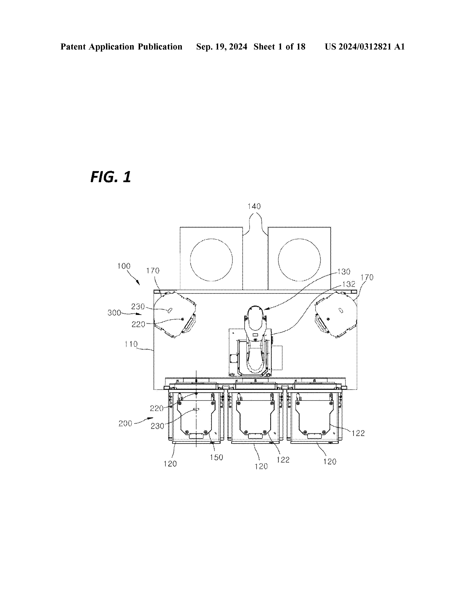
*도 1 — 자동 티칭 장치가 적용된 이송 장치의 초기 상태 (평면도)*

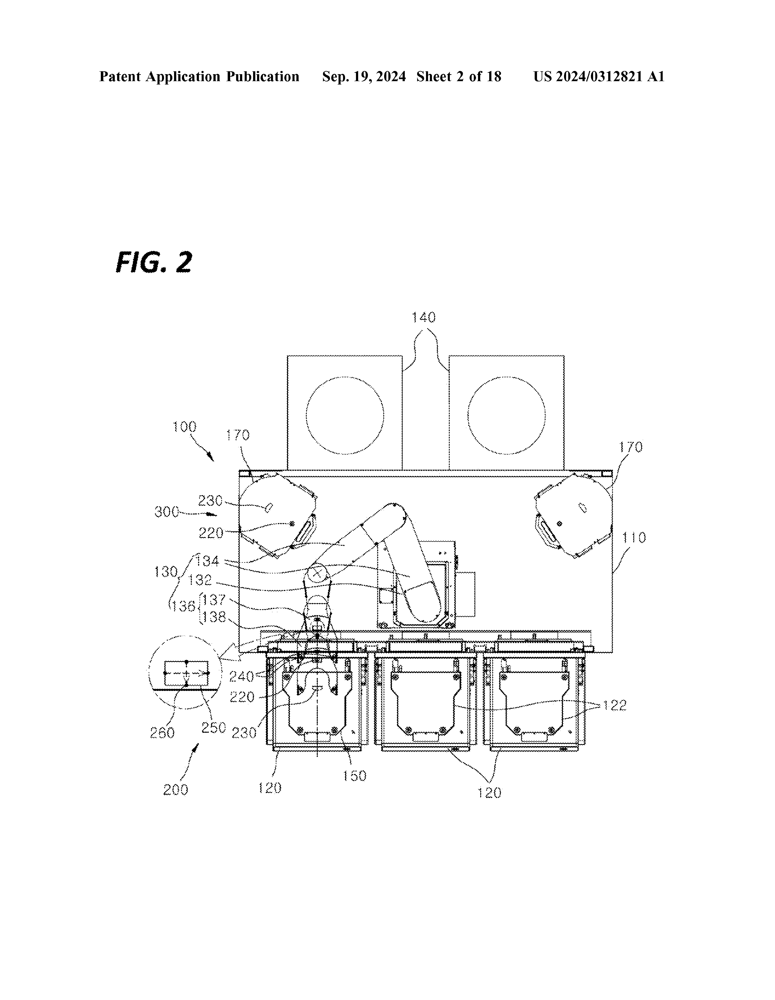
*도 2 — 로봇이 로드 포트 티칭을 수행하는 상태 (평면도)*

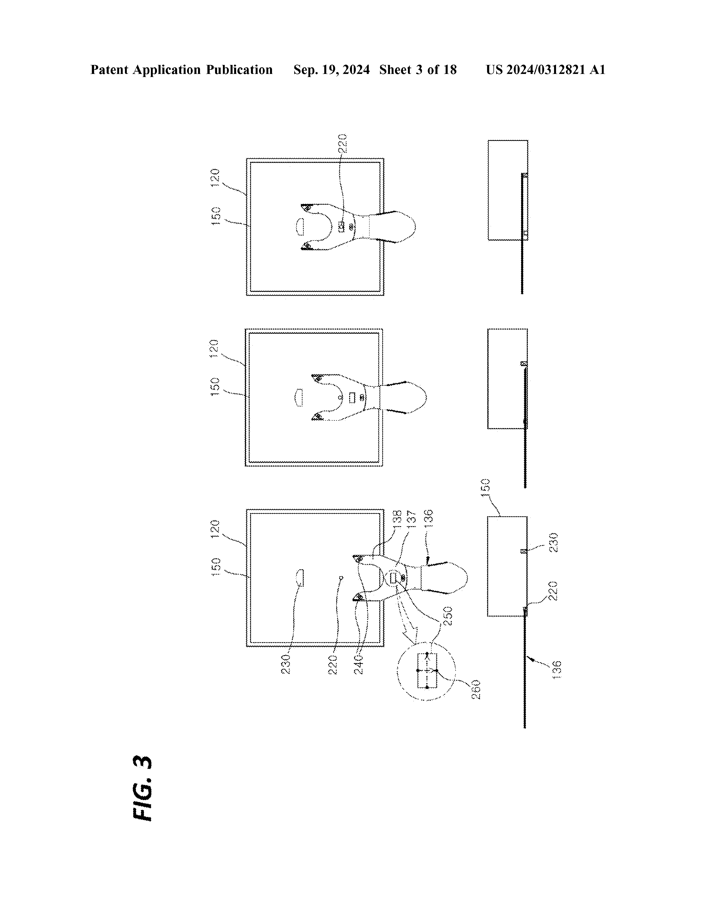
*도 3 — 로드 포트 티칭부에 의한 엔드 이펙터 티칭 과정*

도 4는 본 개시의 일 실시예에 따른 반도체 제조 장비용 자동 티칭 장치가 적용된 반도체 제조 장치의 이송 장치의 엔드 이펙터가 티칭 완료 후 버퍼에 웨이퍼를 공급하는 상태를 도시한 평면도이다.

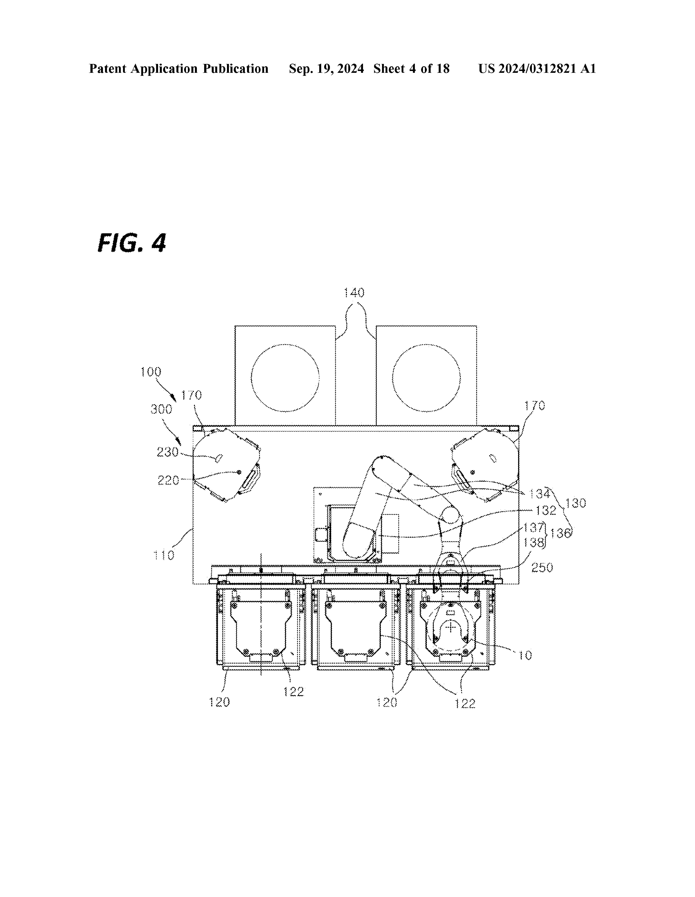
*도 4 — 티칭 완료 후 엔드 이펙터가 버퍼에 웨이퍼를 공급하는 상태 (평면도)*

도 5는 본 개시의 일 실시예에 따른 반도체 제조 장비용 자동 티칭 장치가 적용된 반도체 제조 장치의 이송 장치의 로봇이 스테이션 티칭을 수행하는 상태를 도시한 평면도이다. 도 6은 본 개시의 일 실시예에 따른 반도체 제조 장비용 자동 티칭 장치가 적용된 반도체 제조 장치의 이송 장치의 엔드 이펙터의, 스테이션 티칭부에 의해 수행되는 티칭 과정을 순차적으로 도시한 도면이다.

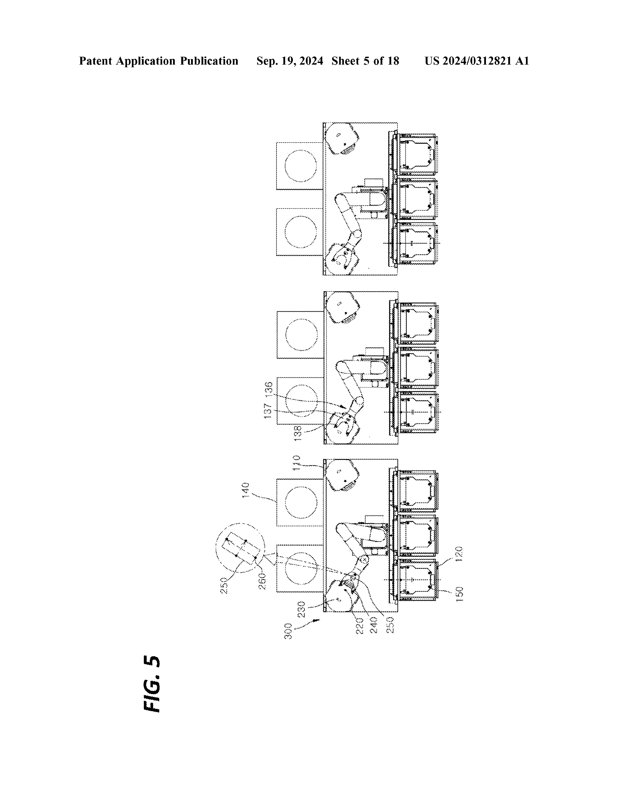
*도 5 — 로봇이 스테이션 티칭을 수행하는 상태 (평면도)*

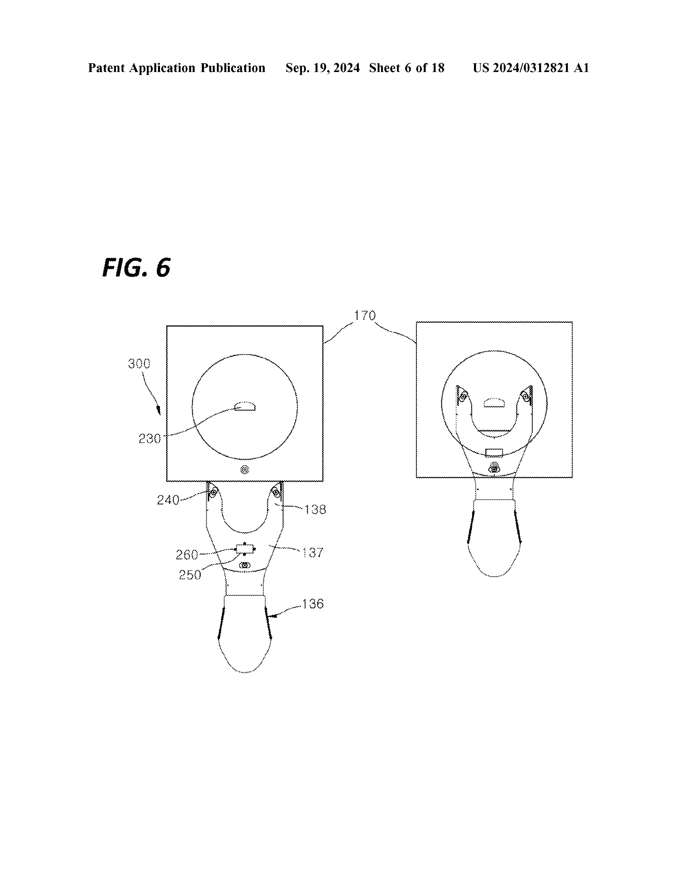
*도 6 — 스테이션 티칭부에 의한 엔드 이펙터 티칭 과정*

도 7은 본 개시의 일 실시예에 따른 반도체 제조 장비용 자동 티칭 장치가 적용된 반도체 제조 장치의 이송 장치의 엔드 이펙터가 티칭 완료 후 스테이션에 웨이퍼를 공급하는 상태를 도시한 평면도이다. 도 8은 본 개시의 일 실시예에 따른 반도체 제조 장비용 자동 티칭 장치가 적용된 반도체 제조 장치의 이송 장치의 더미 포트가 로드 포트에 위치결정되어 고정된 상태를 도시한 단면도이다.

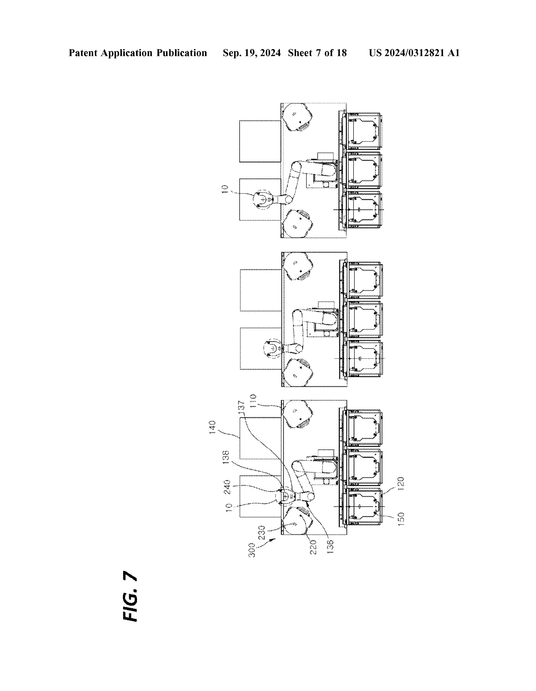
*도 7 — 티칭 완료 후 엔드 이펙터가 스테이션에 웨이퍼를 공급하는 상태 (평면도)*

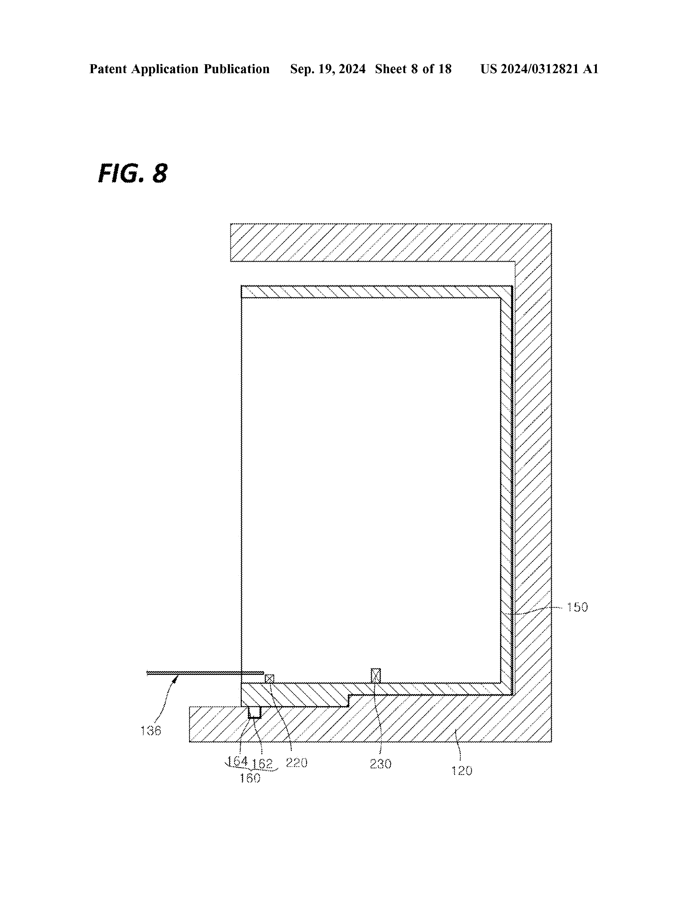
*도 8 — 더미 포트가 로드 포트에 위치결정되어 고정된 상태 (단면도)*

도 1 내지 도 8을 참조하면, 본 개시의 일 실시예에 따른 반도체 제조 장비용 웨이퍼(10)의 자동 티칭 장치가 적용된 반도체 제조 장치의 이송 장치(100)는, 장비 전단 모듈(EFEM)(110), 이송 로봇(130), 로드 포트(LP)(120), 로드 포트 티칭부(200), 스테이션(140), 및 스테이션 티칭부(300)를 포함한다.

EFEM(110)은 평면상 다각형 형상을 가지며, 그 내부에 청정 환경을 유지하여 웨이퍼(10)가 오염 없이 반송되는 청정 공간을 제공한다. 설명의 편의를 위해, EFEM(110)은 평면상 직사각형 형상을 갖는 것으로 도시된다.

또한, 하나 이상의 로드 포트(120)가 EFEM(110)의 일측 가장자리를 따라 배치되며, 각 로드 포트는 EFEM(110)의 내부와 연결된다. 이 경우, 로드 포트(120)는 처리된 웨이퍼(10)를 내부에 적재하기 위한 웨이퍼 캐리어(본 명세서에서는 전면 개방 일체형 포드(FOUP) 또는 버퍼라고도 함)를, 로봇이 EFEM 내부로부터 웨이퍼에 접근할 수 있는 상태가 되도록 하는 역할을 한다. 설명의 편의를 위해, 3개의 로드 포트(120)가 EFEM(110)의 일측 가장자리를 따라 배치된다. 도 1에서 가장 좌측의 로드 포트(120)는, 그 가장 좌측의 로드 포트(120)에 수용된 더미 포트(150)에 검출 핀(220)과 반원형 블록(230)을 설치함으로써 특정 로드 포트라고 지칭하고, 중앙 및 가장 우측의 로드 포트(120)에는 버퍼(122)가 로딩된다. 버퍼(122)는 개폐 가능한 도어를 갖고 다단으로 형성된 웨이퍼 슬롯(웨이퍼 탑재단)에 웨이퍼를 수용하므로, 웨이퍼를 내부에 수용하기 위한 웨이퍼 캐리어(FOUP)에 해당한다. 도 12에 도시된 바와 같이, FOUP(460)는 일면에 개구를 갖는 하우징(464) 및 개구를 개폐하기 위한 덮개(462)를 갖고, 하우징 내부에는 웨이퍼를 수용하기 위한 웨이퍼 탑재단이 다단으로 설치된다. 일부 경우에, 로드 포트(120)는 그 내부 공간에 버퍼(122)를 수용(로딩)하는 것으로 설명 및 도시되지만, 이에 한정되지 않으며, 버퍼(122)는 로드 포트의 재치대(스테이지) 상에 탑재될 수도 있다.

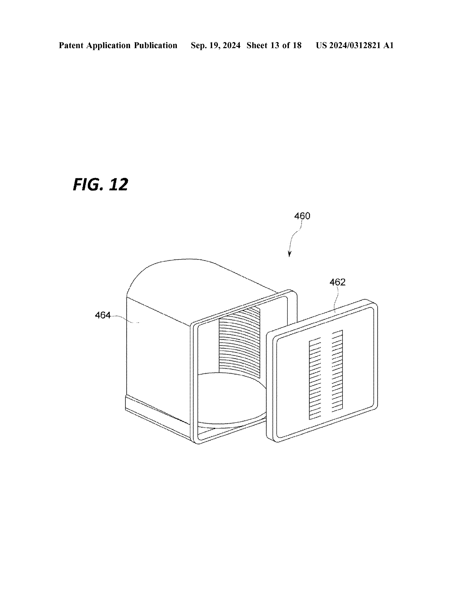
*도 12 — 이송 장치의 로드 포트에 배치되는 웨이퍼 캐리어(FOUP)*

또한, 하나 이상의 스테이션(140)이 EFEM(11)의 타측 가장자리를 따라 배치되며, 각 스테이션(140)은 EFEM(110)의 내부와 연결된다. 예를 들어, 처리 전의 웨이퍼(10)가 반입된 후, 스테이션(140)은 내부 가스가 배기된 진공 상태, 또는 불활성 가스를 퍼지하여 대기압과 대략 동일한 압력 상태로 전환되어, 웨이퍼 처리 장치(미도시)가 스테이션(140)을 통해 웨이퍼(10)를 교환할 수 있게 한다. 따라서 스테이션(140)은 중공의 내부를 갖는다. 설명의 편의를 위해, 2개의 스테이션(140)이 EFEM(110)의 타측 가장자리를 따라 마련된 것으로 도시된다.

이송 로봇(130)은 EFEM(110) 내부에 위치되어 고정되거나, 설정된 궤적을 따라 이동될 수 있으며, 로드 포트(120)와 스테이션(140) 사이에서 웨이퍼(10)를 직접 이송하는 역할을 한다. 즉, 이송 로봇(130)은 로드 포트(120)에 로딩된 버퍼(122)(웨이퍼 캐리어)로부터 웨이퍼를 EFEM(110) 내로 반입하여 스테이션(140)으로 전달하고, 스테이션(140)으로부터 반출된 웨이퍼(10)를 로드 포트(120) 내의 버퍼(122)(웨이퍼 캐리어)로 전달한다. 설명의 편의를 위해, 이송 로봇(130)은 EFEM(110)의 내부에 고정된 것으로 도시된다.

구체적으로, 본 실시예에서 이송 로봇(130)은 본체(132), 중간 링크 암(134), 및 엔드 이펙터(136)를 포함한다.

본체(132)는 EFEM(110)의 내측 바닥에 고정된 상태에서 중간 링크 암(134) 및 엔드 이펙터(핸드)(136)를 지지한다.

중간 링크 암(134)의 일측은 본체(132)에 설정 각도로 회동 가능하게 연결된다. 이 경우, 중간 링크 암(134)은 단일 링크 암 또는 서로 연결된 복수의 링크 암으로 마련될 수 있다.

또한, 엔드 이펙터(핸드)(136)는 수평 및 수직 방향 모두로 이동 가능하도록 중간 링크 암(134)에 회동 가능하게 연결되며, 초기에는 접혀 있거나, 웨이퍼(10)의 로딩 또는 언로딩을 위해 펼쳐지도록(확장되도록) 마련된다.

또한, 엔드 이펙터(136)는 베이스 패드(137) 및 포크(138)를 포함한다.

베이스 패드(137)의 적어도 상면은 웨이퍼(10)의 일부와 맞닿아 안정적으로 지지하도록 실질적으로 평면 형상을 갖는다.

한 쌍의 포크(138)는 베이스 패드(137)로부터 전방측으로 연장되어, 엔드 이펙터(136)의 하중을 줄이면서 웨이퍼(10)와 접촉하여 지지한다. 베이스 패드(137) 및 포크(138)는 다양한 형상으로 변형될 수 있다.

한편, 로드 포트 티칭부(200)는, 웨이퍼(10)가 로드 포트(120) 내의 고정 위치에 놓이도록, 웨이퍼(10)를 언로딩한 상태(즉, 웨이퍼(10)가 놓이지 않은 상태)에서 엔드 이펙터(136)의 고정 위치, 즉 로드 포트(120) 내에서의 웨이퍼(10)의 전달 위치를 검출하는 역할을 한다.

이를 위해, 로드 포트 티칭부(200)는 검출 핀(220), 반원형 블록(230), 전단 센서(240), 중앙 홀부(250), 및 중앙 센서(260)를 포함한다. 검출 핀(220) 및 반원형 블록(230)은 이송 로봇(130)에 웨이퍼(10)의 전달 위치를 티칭하기 위한 티칭 지그의 예이며, 웨이퍼(10)의 전달 위치와의 상대적 위치 관계를 결정하도록 배치된 특정 피처의 일 예에 해당한다. 전단 센서(240), 중앙 홀부(250), 및 중앙 센서(260)는 이송 로봇(130)의 엔드 이펙터(핸드)(136)에 마련된다.

검출 핀(220)은 평면상 웨이퍼(10)의 전방 가장자리 또는 중심에 대응하도록 특정 로드 포트(120), 더미 포트(150) 또는 EFEM(110)의 내측 바닥면으로부터 돌출된다. 이하에서는 설명의 편의를 위해, 특정 로드 포트(120)가 더미 포트(150)를 포함하고, 검출 핀(220)이 더미 포트(150)의 내측 바닥면으로부터 돌출되는 것으로 가정한다. 이 경우, 검출 핀(220)은 엔드 이펙터(136)가 진입하는 더미 포트(150)의 내측 바닥의 전방 가장자리로부터 돌출된다. 검출 핀(220)은 다양한 형상으로 적용될 수 있으며 크기에 제한이 없다.

반원형 블록(230)은 엔드 이펙터(136)의 진입 방향으로 검출 핀(220)과 일직선을 따라 설정 거리만큼 이격된 위치에서 특정 로드 포트(120), 더미 포트(150), 또는 EFEM(110)의 내측 바닥면으로부터 돌출된다. 이 경우, 반원형 블록(230)은 검출 핀(220)이 돌출된 더미 포트(150)의 내측 바닥면으로부터 돌출되는 것으로 도시된다. 반원형 블록(230)은 다양한 형상으로 적용될 수 있으며 크기 및 높이에 제한이 없다.

도 8에 도시된 바와 같이, 내측 바닥면에 검출 핀(220) 및 반원형 블록(230)이 형성된 더미 포트(150)는, 실제 웨이퍼 캐리어가 탑재되는 로드 포트(120)에 배치되며, 엔드 이펙터(136)가 진입할 수 있는 개구를 갖는 하우징 형상을 갖는다.

또한, 전단 센서(240)는 엔드 이펙터(136)의 베이스 패드(137)로부터 연장된 한 쌍의 포크(138)에 서로 마주보도록 일직선상에 마련된다. 즉, 전단 센서(240)는 엔드 이펙터(핸드)(136)의 전단에 마련되며, 본 명세서에서는 제1 센서의 일 예로 지칭된다. 따라서 엔드 이펙터(136)는 한 쌍의 전단 센서(240)를 포함하며, 하나의 전단 센서(240)는 수광부이고 다른 하나의 전단 센서(240)는 투광부이다. 대안적으로, 한 쌍의 전단 센서(240)는 리밋 센서일 수 있다.

따라서, 엔드 이펙터(136)가 더미 포트(150)의 내부로 진입할 때, 검출 핀(220)은 한 쌍의 포크(138) 사이에 위치한다.

특히, 전단 센서(240)는 해당 포크(138)들 사이에서 검출 핀(220)의 위치를 검출하고, 위치가 검출된 검출 핀(220)을 기준으로 엔드 이펙터(136)가 평면상 중앙에 설정 높이로 위치하도록 Y 방향 및 Z 방향으로의 엔드 이펙터(136)의 진입 위치를 검출하여 안내한다.

여기서, Y 방향은 엔드 이펙터(136)가 더미 포트(150)로 진입하는 방향을 의미하고, Z 방향은 수직 방향을 의미한다.

전단 센서(240)는 다양한 방식으로 해당 포크(138)에 고정 설치될 수 있다.

이에 따라, 엔드 이펙터(136)는 검출 핀(220)에 대한 한 쌍의 포크(138)의 Y 방향 위치 및 Z 방향 위치를 검출한 후, 검출 핀(220)의 위쪽에 위치하여 전진 이동 중 검출 핀(220)과 충돌하는 것이 방지된다.

중앙 홀부(250)는, 검출 핀(220)의 위쪽에 위치한 엔드 이펙터(136)가 Y 방향으로 설정 거리만큼 전진한 후 한 쌍의 전단 센서(240)가 반원형 블록(230)을 검출할 때 검출 핀(220)이 그 내부에 위치하도록, 베이스 패드(137)를 관통하여 형성된다.

이때, 중앙 홀부(250)는 엔드 이펙터(136)가 티칭을 위해 이동하는 영역을 확보할 수 있는 크기를 갖도록 구성된다.

또한, 하나 이상의 중앙 센서(260)가 중앙 홀부(250)의 가장자리를 따라 베이스 패드(137)에 마련되어, 중앙 홀부(250)와 내측 방향으로 상호작용하며, 검출 핀(220)이 설정 위치에 설정되도록 X 방향 및 Z 방향으로 엔드 이펙터(136)를 위치시킨다. 도 3에 도시된 바와 같이, 중앙 센서(260)는 전단 센서(240)보다 엔드 이펙터(136)의 기단에 더 가깝게 배치되고 중앙 홀부(250)의 개구를 가로지르도록 배치되며, 제2 센서의 일 예로 지칭된다. 2개의 중앙 센서(260)가 중앙 홀부(250)에 마련된 것으로 도시된다. 이 경우, 하나의 중앙 센서는 전단 센서(240)의 광축과 평행한 광축을 가지며 알파 센서라고도 지칭되고, 다른 하나의 중앙 센서는 상기 하나의 중앙 센서의 광축 및 전단 센서(240)의 광축 각각과 직교하는 광축을 가지며 베타 센서라고도 지칭된다. 대안적으로, 전단 센서(240)의 광축과 직교하는 광축을 갖는 단일의 중앙 센서(260)가 마련될 수도 있다.

즉, 엔드 이펙터(136)는 검출 핀(220) 위로 Y 방향으로 전진하며, 한 쌍의 전단 센서(240)가 반원형 블록(230)을 검출하면 엔드 이펙터(136)의 전진 이동이 정지된다. 이때, 검출 핀(220)은 중앙 홀부(250)의 내측 영역에 위치한다.

이후, 중앙 센서(260)는 검출 핀(220)이 중앙 홀부(250)의 설정 위치(즉, 중심)에 위치하도록 검출 핀(220)을 연속적으로 검출한다. 이 경우, 엔드 이펙터(136)는 검출 핀(220)을 중앙 홀부(250)의 중앙 영역에 위치시키도록 X 방향 및 Z 방향으로 이동한다. 즉, 전단 센서(240)가 반원형 블록(230)을 검출하면, 검출 핀(220)은 중앙 홀부(250)에 진입한다. 여기서, "X 방향"은 Y 방향에 수직인 방향을 의미한다.

이때, 제어기는 검출 핀(220)이 한 쌍의 전단 센서(240) 사이의 중앙 및 중앙 홀부(250)의 중심에 위치하도록 모터 동력에 의해 엔드 이펙터(136)의 이동을 제어한다.

최종적으로, 검출 핀(220)은 중앙 홀부(250)의 내측 중앙 영역에 위치하는 동시에, 반원형 블록(230)은 한 쌍의 포크(138) 사이의 중앙에 위치한다. 이에 따라, 로드 포트(120)에 대한 엔드 이펙터(136)의 티칭 과정이 완료된다.

이 경우, 중앙 센서(260)는 검출 핀(220)을 검출하여 엔드 이펙터(136)의 위치를 티칭하고, 전단 센서(240)는 반원형 블록(230)을 검출하여 엔드 이펙터(136)의 위치를 티칭함으로써, 엔드 이펙터(136)는 모터 동력에 의해 X, Y, 및 Z 방향으로 복합적으로 위치되도록 제어된다.

티칭을 위해 특정 로드 포트(120)에 마련된 더미 포트(150)는 다른 로드 포트(120)의 내부에 마련된 버퍼(122)와 상이하거나 동일할 수 있다.

더미 포트(150)와 버퍼(122)가 상이한 경우, 티칭 과정이 완료된 후 더미 포트(150)를 특정 로드 포트(120)로부터 제거한 다음, 특정 로드 포트(120)에 버퍼(122)를 설치한다.

다음으로, 엔드 이펙터(136)는 티칭 값에 기초하여 모든 로드 포트(120) 또는 모든 버퍼(122)의 내부로 웨이퍼(10)를 이송한 후 웨이퍼를 언로딩한다.

특히, 더미 포트(150)가 특정 로드 포트(120) 내부에 위치할 때, 더미 포트(150)는 제1 위치결정부(160)에 의해 로드 포트(120)에 대해 고정 위치에 설정된다. 추가적으로, 버퍼(122)도 제1 위치결정부(160)에 의해 로드 포트(120) 내부의 고정 위치에 설정될 수 있다.

여기서, 제1 위치결정부(160)는 제1 세팅 핀(162) 및 제1 세팅 홈(164)을 포함한다.

복수의 제1 세팅 핀(162)이 더미 포트(150) 및 버퍼(122)의 하면으로부터 돌출된다.

또한, 제1 세팅 홈(164)은 제1 세팅 핀(162)을 일대일로 수용하도록 로드 포트(120)의 내측 바닥면에 오목하게 형성된다. 이에 따라, 더미 포트(150) 또는 버퍼(122)는 해당 로드 포트(120)에 위치결정되어 고정된다. 이와 같이, 제1 세팅 핀(162) 및 제1 세팅 홈(164)은 더미 포트(150)(또는 버퍼)를 로드 포트(120)에 고정하는 역할을 하지만, 이에 한정되지 않고 다양하게 변형될 수 있다. 예를 들어, 제1 세팅 핀(162)이 로드 포트의 바닥면에 마련되고 제1 세팅 홈(164)이 더미 포트(150)(또는 버퍼)의 하면에 마련될 수도 있다.

결과적으로, 엔드 이펙터(136)가 로드 포트(120) 또는 버퍼(122)의 내부로 웨이퍼(10)를 이송하여 웨이퍼(10)를 언로딩하기 전에, 엔드 이펙터(136)만이 특정 로드 포트(120) 또는 특정 로드 포트(120) 내부의 더미 포트(150)로 진입한다. 그런 다음, 전단 센서(240) 및 중앙 센서(260)에 의해 검출 핀(220)의 위치가 순차적으로 검출되고, 전단 센서(240)에 의해 반원형 블록(230)의 위치가 검출됨으로써, 엔드 이펙터(136)가 특정 로드 포트(120) 또는 더미 포트(150) 내에 위치하도록 티칭된다.

한편, 스테이션 티칭부(300)는, 웨이퍼(10)를 언로딩한 상태의 엔드 이펙터(136)가 웨이퍼(10)를 스테이션(140) 내의 고정 위치에 놓도록, 스테이션(140) 내의 고정 위치를 검출하는 역할을 한다.

이를 위해, EFEM(110)은 그 내부 바닥의 설정 위치에 더미 스테이션(170)을 포함하거나, 특정 스테이션(140) 내부에 더미 스테이션(170)을 포함할 수 있다. 설명의 편의를 위해, 스테이션(140) 내에서의 웨이퍼(10)의 티칭을 위해, 스테이션(140)과 동일한 크기의 더미 스테이션(170)이 EFEM(110)의 내부 바닥에 고정 설치된다. 더미 스테이션(170)은 다양한 방식으로 EFEM(110)에 고정될 수 있다.

특히, 스테이션 티칭부(300)는 제작 용이성 및 호환성을 위해 상술한 로드 포트 티칭부(200)의 한정된 구성과 동일한 구성을 갖는다.

즉, 스테이션 티칭부(300)는 검출 핀(220), 반원형 블록(230), 전단 센서(240), 중앙 홀부(250), 및 중앙 센서(260)를 포함한다.

검출 핀(220)은 평면상 웨이퍼(10)의 전방 가장자리 또는 중심에 대응하도록 특정 스테이션(140) 또는 더미 스테이션(170)의 내측 바닥면으로부터 돌출된다. 설명의 편의를 위해, 더미 스테이션(170)은 EFEM(110)의 설정된 내측 바닥면에 마련된 것으로 도시된다.

반원형 블록(230)은 특정 스테이션(140) 또는 더미 스테이션(170)의 내측 바닥면으로부터 돌출된다.

이 경우, 검출 핀(220) 및 반원형 블록(230)의 기능은 상술한 것으로 대체한다. 또한, 전단 센서(240), 중앙 홀부(250), 및 중앙 센서(260)의 기능은 상술한 것으로 대체한다.

검출 핀(220) 및 반원형 블록(230)은 특정 스테이션(140)의 내측 바닥면에 마련될 수도 있다.

또한, 검출 핀(220), 반원형 블록(230), 전단 센서(240), 중앙 홀부(250), 및 중앙 센서(260)의 상호작용에 의해 엔드 이펙터(136)의 티칭 과정을 수행하는 것에 대한 상세한 설명은 상술한 것으로 대체한다.

도 9는 본 개시의 다른 실시예에 따른 반도체 제조 장비용 자동 티칭 장치의 로봇이 로드 포트 티칭을 수행하는 상태를 도시한 평면도이다. 도 10은 본 개시의 다른 실시예에 따른 반도체 제조 장비용 자동 티칭 장치의 로봇이 스테이션 티칭을 수행하는 상태를 도시한 평면도이다.

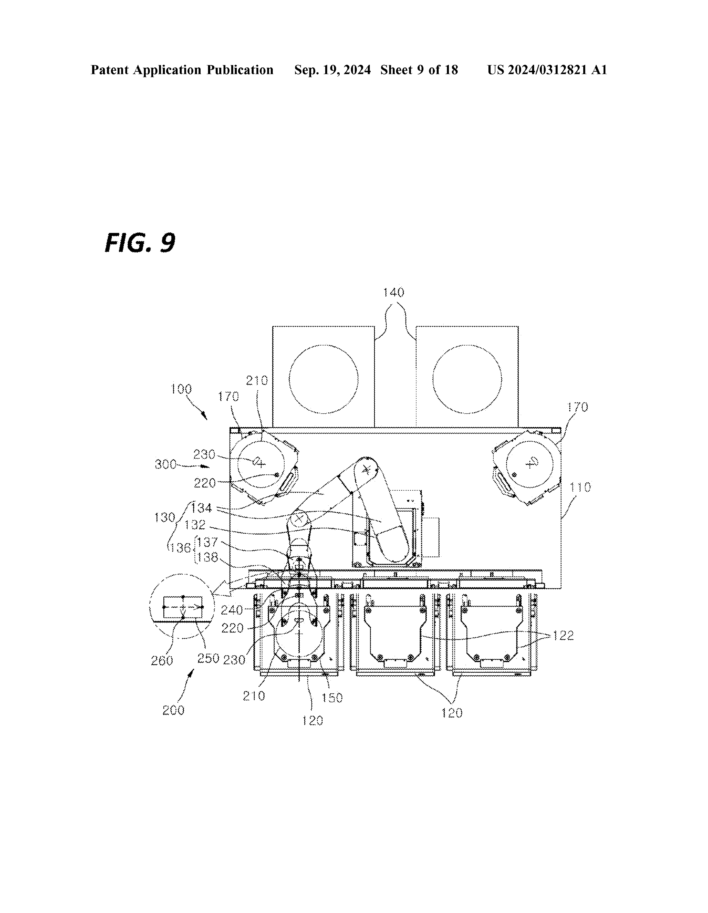
*도 9 — 다른 실시예: 로봇이 로드 포트 티칭을 수행하는 상태 (평면도)*

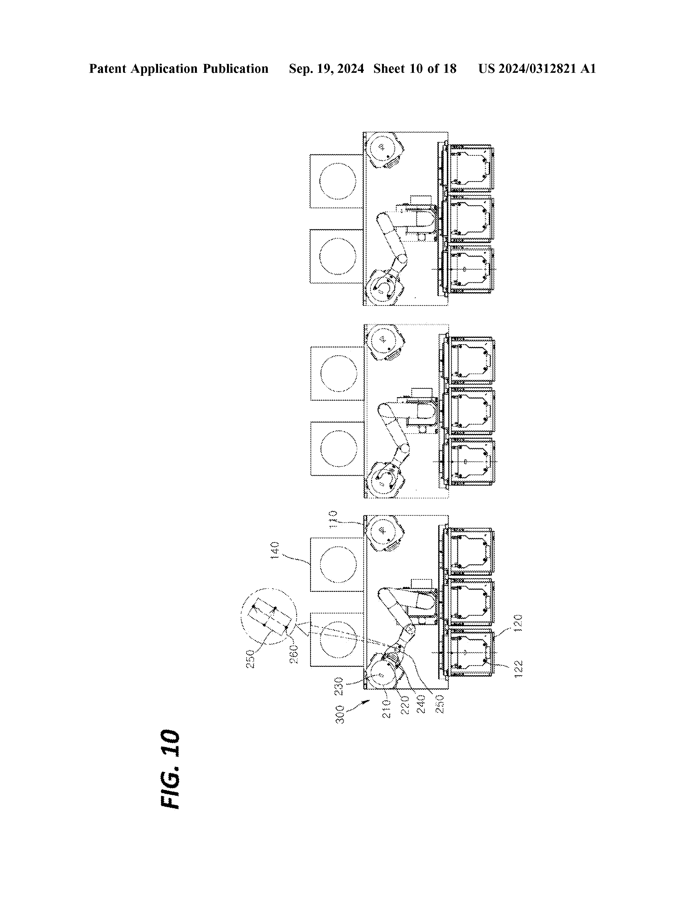
*도 10 — 다른 실시예: 로봇이 스테이션 티칭을 수행하는 상태 (평면도)*

도 9 및 도 10을 참조하면, 본 개시의 다른 실시예에 따른 반도체 제조 장비용 웨이퍼(10)의 자동 티칭 장치가 적용된 반도체 제조 장치의 이송 장치(100)는, 장비 전단 모듈(EFEM)(110), 반송 로봇(130), 로드 포트(LP)(120), 로드 포트 티칭부(200), 스테이션(140), 및 스테이션 티칭부(300)를 포함한다.

이때, EFEM(110), 이송 로봇(130), 로드 포트(120), 및 스테이션(140)은 상술한 것으로 대체한다.

로드 포트 티칭부(200)는 베이스 플레이트(210), 검출 핀(220), 반원형 블록(230), 전단 센서(240), 중앙 홀부(250), 및 중앙 센서(260)를 포함한다.

베이스 플레이트(210)는 특정 로드 포트(120)의 내측 바닥 또는 특정 로드 포트(120) 내부에 마련된 더미 포트(150)의 내측 바닥의 고정 위치에 놓인다. 설명의 편의를 위해, 베이스 플레이트(210)는 더미 포트(150)의 내측 바닥의 고정 위치에 설치되지만, 이에 한정되지 않는다. 베이스 플레이트(210)는 더미 포트(150) 내에서 버퍼(122)에 배치되는 웨이퍼와 동일한 높이에 설치될 수 있다.

본 개시의 일 실시예에 따른 검출 핀(220) 및 반원형 블록(230)은 베이스 플레이트(210)로부터 돌출된다. 특히, 검출 핀(220) 및 반원형 블록(230)의 기능은 상기 일 실시예에서 상술한 것으로 대체한다.

따라서, 베이스 플레이트(210)의 설치 방향은 검출 핀(220)이 더미 포트(150)의 개방된 전방측에 위치하도록 설정될 필요가 있다. 베이스 플레이트(210)는 다양한 형상으로 변형될 수 있다. 예를 들어, 베이스 플레이트(210)는 판형 기판일 수 있고, 또는 실제 웨이퍼와 동일한 직경을 갖는 기판일 수 있다.

또한, 전단 센서(240), 중앙 홀부(250), 및 중앙 센서(260)는 상술한 것으로 대체한다.

추가적으로, 스테이션 티칭부(300)는 본 실시예에 따른 로드 포트 티칭부(200)의 한정된 구성과 동일하게 구성된다.

즉, 스테이션 티칭부(300)는 베이스 플레이트(210), 검출 핀(220), 반원형 블록(230), 전단 센서(240), 중앙 홀 유닛(250), 및 중앙 센서(260)를 포함한다.

베이스 플레이트(210)는 스테이션(140) 또는 EFEM(110) 내의 설정 위치에 고정된 더미 스테이션(170)의 내측 바닥면에 위치결정되어 고정된다. 설명의 편의를 위해, 베이스 플레이트(210)는 더미 스테이션(170)의 내측 바닥면에 위치결정되어 고정된다.

또한, 검출 핀(220) 및 반원형 블록(230)은 베이스 플레이트(210)로부터 돌출된다. 특히, 검출 핀(220) 및 반원형 블록(230)의 기능은 상기 일 실시예에서 상술한 것으로 대체한다.

따라서, 베이스 플레이트(210)의 설치 방향은 검출 핀(220)이 더미 스테이션(170)의 개방된 전방측에 위치하도록 설정될 필요가 있다. 베이스 플레이트(210)는 다양한 형상으로 성형될 수 있다.

또한, 전단 센서(240), 중앙 홀부(250), 및 중앙 센서(260)는 상술한 것으로 대체될 수 있다.

본 명세서에 개시된 실시예들은 상술한 실시예들에 한정되지 않으며, 그 사상 및 기술적 사상을 벗어나지 않는 범위에서 다양하게 변형될 수 있다.

다시 말해, 앞선 실시예들은 3개의 로드 포트(120)가 EFEM(110)의 일측 가장자리를 따라 설치된 경우를 예시하였으나, 3개를 초과하는 로드 포트(120)가 EFEM(110)에 설치된 경우에도 동일한 방식으로 적용될 수 있다. 또한, 앞선 실시예들에서는 검출 핀(220) 및 반원형 블록(230)이 설치되었으나, 추가 검출 핀이 더 설치될 수도 있다. 나아가, 앞선 실시예들은 웨이퍼 캐리어로서 기능하는 버퍼(122) 및 더미 포트(150)가 특정 로드 포트(120)의 내부 공간에 로딩(수용)되는 경우를 예시하였으나, 웨이퍼 캐리어로서 기능하는 버퍼(122) 및 더미 포트(150)가 로드 포트(120)의 스테이지(재치대) 상에 탑재되는 경우에도 동일한 방식으로 적용될 수 있다.

이하에서는 이송 장치의 변형예를 설명한다. 이 이송 장치의 변형예에서는, 5개의 로드 포트가 EFEM의 일측 가장자리를 따라 설치되고, 웨이퍼 전달 위치를 티칭하기 위한 더미 포트가 웨이퍼 캐리어가 탑재될 수 있는 로드 포트의 스테이지 상에 탑재되며, 앞선 실시예에서 설명한 검출 핀(220) 및 반원형 블록(230)에 더하여 추가 검출 핀이 더미 포트에 설치될 수 있다. 이하의 변형예를 설명함에 있어서, 로드 포트에 탑재되는 더미 포트를 티칭 지그라고 지칭한다. 변형예를 검출 핀(220) 및 반원형 블록(230)을 포함하는 앞선 실시예들과 구별하기 위해, 앞선 실시예들에서 특정 피처의 일 예로 지칭된 검출 핀(220) 및 반원형 블록(230)은 변형예에서 제1 특정 피처의 일 예로 지칭하고, 추가로 도입된 검출 핀은 변형예에서 제2 특정 피처의 일 예로 지칭한다. 또한, 설명의 편의를 위해, 일부 경우에 제1 특정 피처에서 검출 핀(220)은 제1 검출부의 일 예로, 반원형 블록(230)은 제2 검출부의 일 예로 지칭한다.

도 11a를 참조하면, 본 변형예에 따른 이송 장치(400)는 EFEM(410), 로드 포트(420), 티칭 지그(500), 로봇(430), 스테이션(440), 및 로봇 제어 장치(450)를 포함한다. 앞선 실시예들과 비교하여 변경이 없는 구성들은 설명하지 않는다.

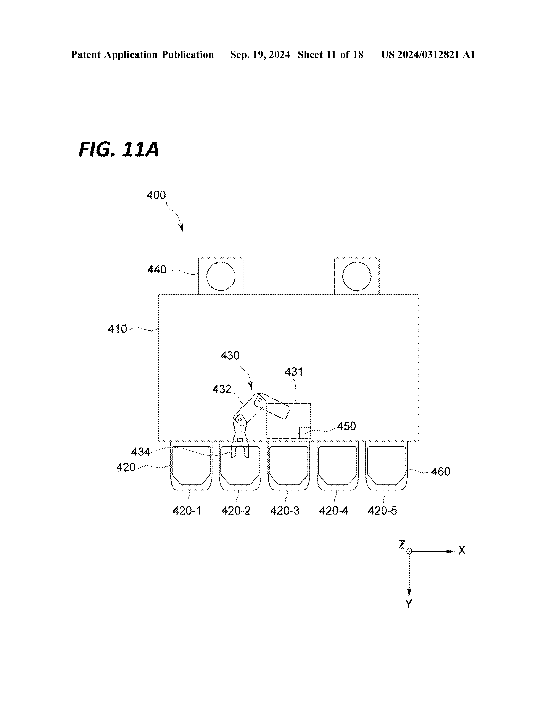
*도 11a — 변형예: 제2 로드 포트(420-2)의 웨이퍼 캐리어(FOUP)(460)에 접근하는 로봇*

앞서 설명한 바와 같이, EFEM(410)은 그 내부를 청정 환경으로 유지함으로써 웨이퍼의 오염을 방지하면서 웨이퍼를 이송하기 위한 청정 공간을 제공한다.

5개의 로드 포트(420)는 스테이션(440)이 위치한 EFEM(410)의 타측 가장자리와 반대되는 일측 가장자리를 따라 배치된다. 도면에서, 로드 포트(420)는 좌측에서 우측으로 순서대로 제1 로드 포트(420-1), 제2 로드 포트(420-2), 제3 로드 포트(420-3), 제4 로드 포트(420-4), 및 제5 로드 포트(420-5)로 지칭된다. 로드 포트(420)의 재치대(스테이지)(470) 상에는, 도 12에 도시된 바와 같이, 내부에 웨이퍼를 적재할 수 있는 웨이퍼 캐리어(FOUP)(460)가 탑재된다. 웨이퍼 캐리어(460)에 수용된 웨이퍼는 로봇(430)에 의해 EFEM(410)의 내부로 반입될 수 있고, 반대로, 로봇(430)에 파지된 웨이퍼가 웨이퍼 캐리어(460)로부터 반출될 수 있다.

앞선 실시예들에서와 같이, 하나 이상의 스테이션(440)이 로드 포트(420)가 위치한 EFEM(410)의 일측과 반대되는 타측 가장자리를 따라 배치되며, 각 스테이션은 EFEM(410)의 내부와 연결된다.

앞선 실시예에서와 같이, 로봇(430)은 청정 공간을 형성하는 EFEM(410)에 설치된 로드 포트(420)에 배치된 웨이퍼 캐리어(460)와의 사이에서 웨이퍼의 전달을 수행한다.

로봇(430)은 EFEM(410)의 내측 바닥에 고정된 본체(431), 일측이 본체(431)에 회동 가능하게 연결된 암(432), 암(432)에 의해 수평 방향 및 수직 방향으로 이동 가능하며 웨이퍼를 파지하도록 구성된 핸드(434), 및 핸드(434)에 마련된 센서들을 포함한다. 핸드(434)는 앞선 실시예의 엔드 이펙터(136)에 해당하며 엔드 이펙터(136)와 동일한 구조를 가지므로, 상세히 설명하지 않는다.

또한, 로봇(430)의 핸드(434)에 마련된 센서들은 핸드의 전단에 마련된 제1 센서 및 제1 센서보다 핸드의 기단에 더 가깝게 마련된 제2 센서를 포함하며, 이들은 앞선 실시예의 엔드 이펙터에 마련된 센서들(전단 센서(240) 및 중앙 센서(260))과 동일한 구성 및 기능을 갖는다. 따라서 센서들에 대한 설명은 생략한다. 즉, 앞선 실시예의 전단 센서(240)는 변형예에서의 제1 센서에 해당하고, 앞선 실시예의 중앙 센서(260)는 변형예에서의 제2 센서에 해당한다.

변형예의 티칭 지그(500)는, 앞선 실시예에서 특정 피처의 일 예인 검출 핀(220) 및 반원형 블록(230)을 갖는 더미 포트(150)와 동일한 방식으로, 청정 공간을 형성하는 EFEM(110)에 설치된 로드 포트(120)에 탑재되어 로봇(130)에 웨이퍼의 전달 위치를 티칭한다. 티칭 지그(500)는 도 11b에 도시된 바와 같이 로드 포트(420) 상에 배치되며, 로봇(430)에 의한 웨이퍼 캐리어(460) 내 웨이퍼의 전달 위치와 동일한 위치에서 이송 장치(400)의 청정 공간을 유지하도록 구성된다.

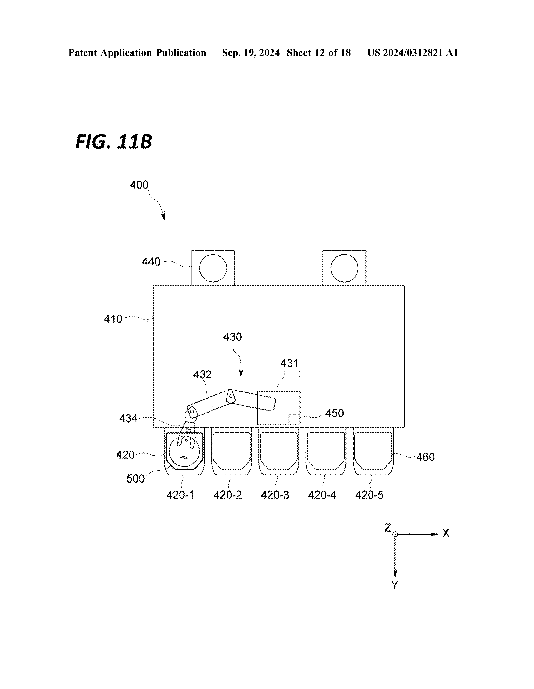
*도 11b — 변형예: 제1 로드 포트(420-1)의 티칭 지그(500)에 접근하는 로봇*

즉, 티칭 지그(500)는 이송 장치(400)의 청정 공간을 유지할 수 있는 하우징 형태로 로드 포트(420) 상에 배치될 수 있으며, 그 형상에 제한되지 않는다. 예를 들어, 티칭 지그(500)의 하우징은 도 12에 도시된 웨이퍼 캐리어(FOUP)와 유사한 형상을 가질 수 있다. 또한, 티칭 지그(500)는 웨이퍼 캐리어와 동일한 형상을 가질 수도 있다. 티칭 지그(500)는, 도 13에 도시된 바와 같이, 하우징(570)의 일면에 개구(580)를 포함하고, 개구(580)를 덮기 위한 덮개(560)를 개구(580)에 더 포함한다. 티칭 지그(500)의 덮개(560)는 티칭 지그(500)의 반송 중에는 닫혀 있어, 그 내부가 이송 장치(400)의 내부에서 유지되는 청정도 수준으로 유지될 수 있다. 덮개(560)는 티칭 지그(500)가 로드 포트(420) 상에 배치된 상태에서 로드 포트(420)에 의해 개폐되도록 구성되어, 티칭 지그(500)를 이용하여 웨이퍼 전달 위치의 티칭 작업이 수행될 때 이송 장치의 청정 공간이 유지될 수 있다.

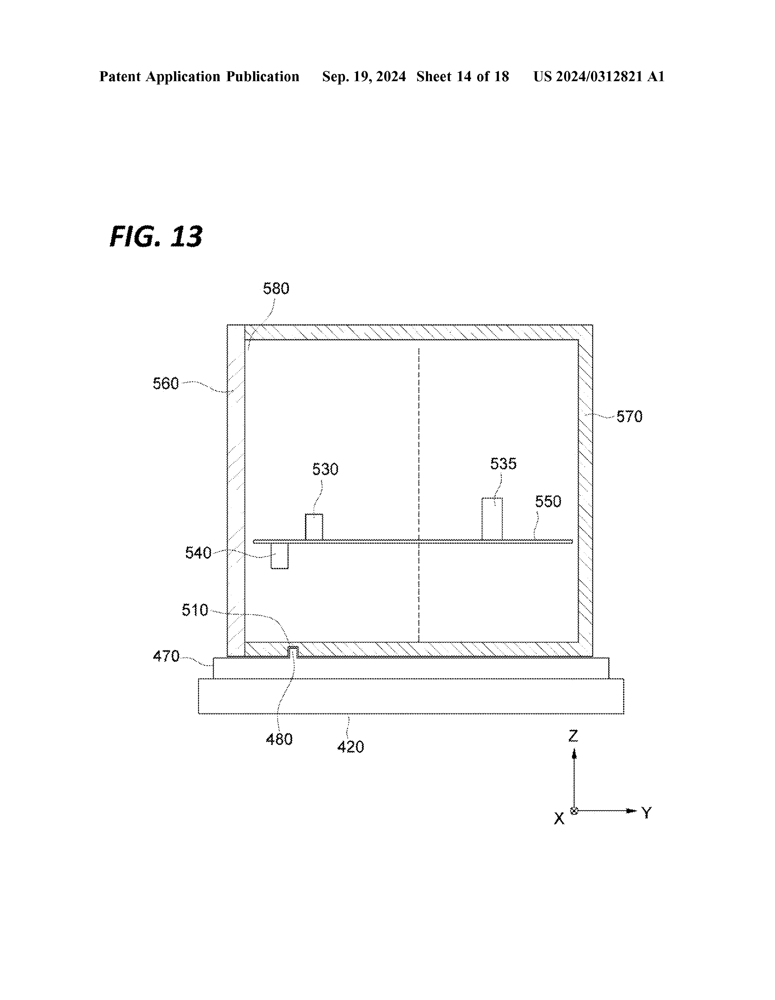
*도 13 — 특정 피처를 갖는 판형 기판이 내부에 수용된 티칭 지그*

도 14는, 티칭 지그(500)가 이송 장치(400)의 로드 포트(420) 상에 배치되고 이송 장치(400)의 청정 공간이 유지되는 상태에서, 로봇(430)의 핸드(434)가 티칭 지그(500)에 접근하는 상태를 설명하기 위한 이송 장치(400)의 측단면도를 도시한다. 도 14에 도시된 바와 같이, 덮개(560)가 닫힌 상태로 티칭 지그(500)가 로드 포트(420)에 탑재되면, 티칭 지그(500)의 덮개(560)는 로드 포트(420)의 개폐 기구에 의해 하우징(570)으로부터 분리되어 티칭 지그(500)의 아래쪽으로 이동되어 개방되며, 이에 따라 로봇(430)의 핸드(434)가 티칭 지그(500)의 개구(580)를 통해 티칭 지그(500)의 내부에 접근할 수 있다.

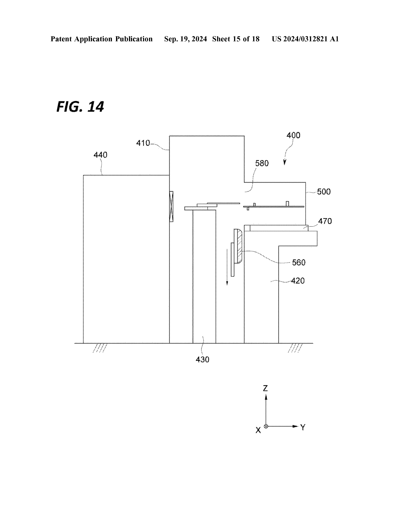
*도 14 — 로드 포트에 티칭 지그를 탑재하는 상태의 측단면도*

티칭 지그(500)의 하우징(570)은, 티칭 지그(500)가 로드 포트(420) 상에 배치될 때 로드 포트(420)가 티칭 지그(500)를 유지할 수 있도록 하는 형상을 하우징(570)의 나머지 면에 갖는다. 도 13에서, 하우징(570)의 하면이 티칭 지그(500)가 로드 포트(420)에 유지될 수 있도록 하는 형상을 갖는 것으로 도시된다. 그 형상의 일 예로서, 티칭 지그(500)의 하우징(570)의 하면에 오목하게 형성된 세팅 홈(510)이 사용될 수 있다. 세팅 홈(510)은 로드 포트(420)의 스테이지(470) 상에서 세팅 홈(510)에 대응하는 위치에 마련된 세팅 핀(480)에 일대일로 수용되어, 티칭 지그(500)가 로드 포트(420)에 유지될 수 있다.

추가적으로, 티칭 지그(500)는 웨이퍼 캐리어(460) 내 웨이퍼의 전달 위치와의 상대적 위치 관계를 결정하도록 배치된 특정 피처(530, 535, 540)를 포함한다. 본 변형예에서는 특정 피처의 일 예로서, 도 13에 도시된 바와 같이 로봇(430)의 핸드가 진입하는 개구로부터 제2 검출 핀(540), 제1 검출 핀(530), 및 반원형 블록(535)이 순차적으로 배치될 수 있으나, 특정 피처는 이에 한정되지 않으며, 로봇(430)의 핸드(434)가 웨이퍼 캐리어 내에 위치하는 웨이퍼의 전달 위치를 정확히 인식할 수 있는 한 다양하게 변형될 수 있다.

또한, 일부 경우에, 본 명세서에서 제1 검출 핀(530) 및 반원형 블록(535)은 제1 특정 피처의 일 예로, 제2 검출 핀(540)은 제2 특정 피처의 일 예로 설명될 수 있다. 또한, 제1 특정 피처의 일 예인 제1 검출 핀(530) 및 반원형 블록(535)은 각각 제1 검출부 및 제2 검출부의 일 예로 설명될 수 있다.

추가적으로, 특정 피처는 예를 들어 판형 기판(550) 상에 마련될 수 있다. 이 경우, 도 13에 도시된 바와 같이, 제1 검출 핀(530) 및 반원형 블록(535)은 기판(550)의 일면으로부터 돌출되고, 제2 검출 핀(540)은 기판(550)의 타면으로부터 돌출될 수 있다. 특정 피처가 형성된 판형 기판(550)은, 웨이퍼 캐리어(460)와 유사한 형상을 갖는 티칭 지그(500) 내에서, 실제 웨이퍼 캐리어(460) 내의 웨이퍼 수용 위치에 대응하는 위치에 수용될 수 있다. 판형 기판(550)은 실제 웨이퍼와 동일한 직경을 갖는 기판일 수 있다.

제1 특정 피처(530, 535)와 제2 특정 피처(540)는 서로에 대한 상대적 위치가 결정될 수 있도록 배치된다. 제2 특정 피처(540)는 제1 특정 피처(530, 535)에 비해 티칭 지그(500)의 덮개(560)에 더 가깝게 위치한다. 상술한 바와 같이, 본 변형예에서는 판형 기판(550)의 일면에 형성된 검출 핀(530) 및 반원형 블록(535)이 제1 특정 피처의 일 예로 사용되고, 판형 기판(550)의 타면에 형성된 검출 핀(540)이 제2 특정 피처의 일 예로 사용되지만, 제1 특정 피처 및 제2 특정 피처는 이에 한정되지 않으며 다양하게 변경될 수 있다.

또한, 티칭 지그(500)는, 티칭 지그(500)를 평면에서 볼 때 제1 특정 피처(530, 535) 및 제2 특정 피처(540)를 배치하기 위한 배치 위치로서, 제1 배치 위치 및 제1 배치 위치와 상이한 제2 배치 위치를 갖는다.

도 15는 제1 배치 위치의 일 예를 도시하고, 도 16은 제2 배치 위치의 일 예를 도시한다. 평면에서 볼 때, 티칭 지그(500)가 복수의 로드 포트(420) 중 최외측 로드 포트 이외의 로드 포트, 예를 들어 제2 내지 제4 로드 포트(420-2, 420-3, 420-4)에 배치되고, 개구(580)에 대한 핸드(434)의 축선의 각도가 대략 직각을 유지하면서 핸드(434)가 티칭 지그(500)의 개구(580)로부터 접근하는 경우, 도 15에 도시된 바와 같이 제1 특정 피처(530, 535) 및 제2 특정 피처(540)는 티칭 지그(500)의 개구(580)에 직교하는 방향으로 배열된 제1 배치 위치에 배치된다.

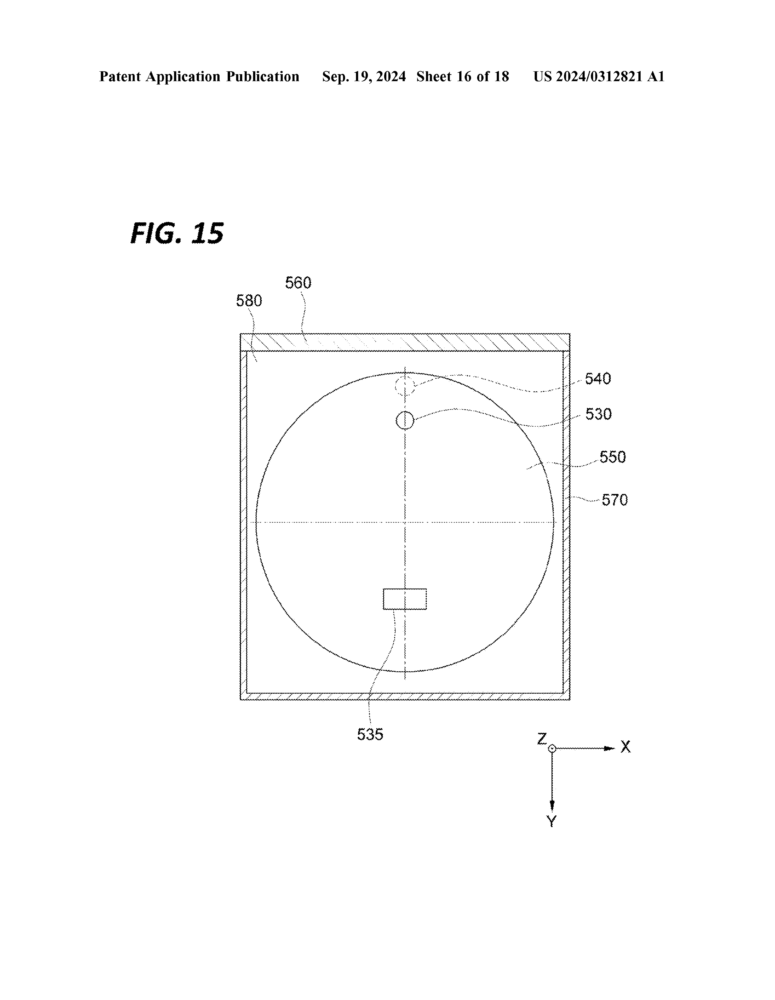
*도 15 — 티칭 지그 내 특정 피처의 제1 배치 위치 예*

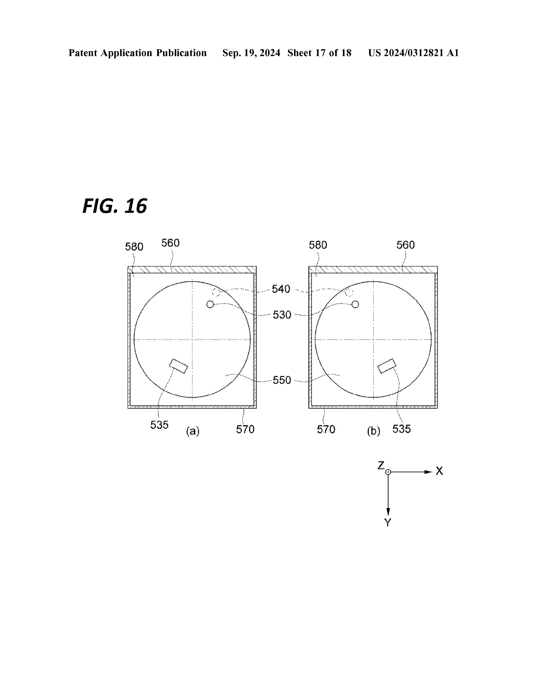
*도 16 — 티칭 지그 내 특정 피처의 제2 배치 위치 예*

한편, 티칭 지그(500)가 복수의 로드 포트(420) 중 최외측 로드 포트, 예를 들어 제1 로드 포트(420-1) 또는 제5 로드 포트(420-5)에 배치되고, 개구(580)에 대한 핸드(434)의 축선의 각도가 대략 직각을 유지하지 않으면서 핸드(434)가 티칭 지그(500)의 개구(580)로부터 접근하는 경우, 도 16에 도시된 바와 같이 특정 피처들은 티칭 지그(500)의 개구(580)에 대해 수직이 아니라 경사진 방향으로 배열된 제2 배치 위치에 배치된다.

웨이퍼 캐리어(460)가 제1 로드 포트(420-1) 또는 제5 로드 포트(420-5)에 배치되는 경우, 로봇(430)의 암(432) 및 핸드(434)의 길이 제한으로 인해 티칭 지그(500)의 개구(580)에 대한 핸드(434)의 축선의 각도가 직각이 되지 않을 수 있다. 이에 따라, 제1 로드 포트(420-1) 또는 제5 로드 포트(420-5)와 같은 최외측 로드 포트에 배치된 웨이퍼 캐리어(460)에 진입하는 핸드(434)는 웨이퍼 캐리어(460)에 수직으로 접근하는 것이 아니라 일정 각도로 비스듬히 접근한다.

결과적으로, 티칭 지그(500)의 제1 특정 피처(530, 535) 및 제2 특정 피처(540)는 티칭 지그(500)의 개구(580)에 대한 핸드(434)의 축선의 각도에 기초한 배치 위치에 위치된다. 본 변형예에서, 핸드(434)의 축선은 핸드(434)의 전단에 마련된 전단 센서(240)에 의해 형성되는 센싱 라인의 중심, 핸드(434)의 기단에 마련된 중앙 홀부(250)의 중심, 및 핸드(434)의 회전축을 연결하는 선을 의미한다.

또한, 제2 배치 위치에서는, 제1 특정 피처(530, 535)가 위치하는 면과 제2 특정 피처(540)가 위치하는 면이 상이하다. 즉, 도 16에 도시된 바와 같은 제2 배치 위치에서, 제1 특정 피처의 일 예인 제1 검출 핀(530) 및 반원형 블록(535)은 기판(550)의 일면에 위치하는 반면, 제2 특정 피처의 일 예인 제2 검출 핀(540)은 기판(550)의 타면에 위치한다.

추가적으로, 도 15에 도시된 바와 같은 제1 배치 위치에서는, 제2 특정 피처의 일 예인 제2 검출 핀(540)이 생략될 수 있다.

각 배치 위치에 특정 피처가 배치된 티칭 지그(500)는 해당 배치 위치에 따라 티칭될 로드 포트(420)에 배치되며, 즉 제1 배치 위치에 특정 피처가 배치된 티칭 지그(500)는 제2 내지 제4 로드 포트(420-2, 420-3, 420-4)에 배치되고, 제2 배치 위치에 특정 피처가 배치된 티칭 지그(500)는 제1 로드 포트(420-1) 또는 제5 로드 포트(420-5)에 배치되어, 각 로드 포트(420)에 배치된 웨이퍼 캐리어(460) 내 웨이퍼의 전달 위치의 티칭이 수행될 수 있다.

로봇(430)의 핸드(434)에 마련된 전단 센서(240) 및 중앙 센서(260)를 이용하여 제1 특정 피처(530, 535) 및 제2 특정 피처(540)를 검출하는 방법은 후술한다.

또한, 도 17에 도시된 바와 같이, 특정 피처를 갖는 복수의 판형 기판(550)이 티칭 지그(500) 내에 마련될 수 있다. 예를 들어, 티칭 지그(500) 내의 웨이퍼를 위한 복수의 수용 위치에 판형 기판(550)을 수용함으로써, 복수의 특정 피처가 티칭 지그(500) 내에 다단으로 계층적으로 배치될 수 있다. 이 경우, 각 판형 기판(550)의 수용 위치는 웨이퍼 캐리어 내에 수용될 웨이퍼의 높이에 대응한다.

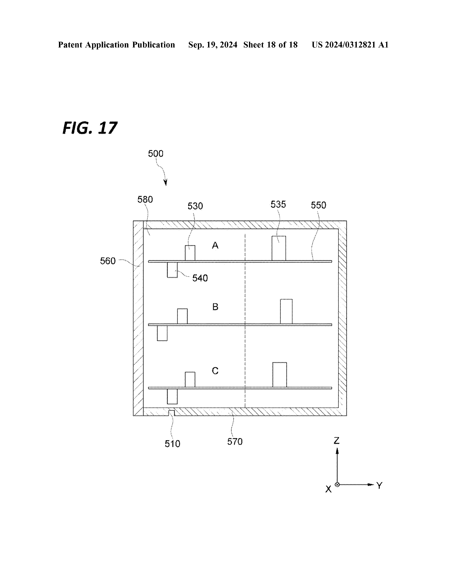
*도 17 — 특정 피처가 마련된 판형 기판들이 다단으로 계층적으로 수용된 티칭 지그*

또한, 상술한 바와 같이 특정 피처를 갖는 복수의 판형 기판(550)이 단일 티칭 지그(500) 내에 수용되는 경우, 각 판형 기판(550) 상의 특정 피처의 배치 위치는 상이할 수 있다. 예를 들어, 최하단 판형 기판(550-C)은 도 16의 (a)에 도시된 바와 같이 제2 배치 위치에 배치된 특정 피처를 가질 수 있고, 최하단 판형 기판(550-C) 위에 위치한 판형 기판(550-B)은 도 15에 도시된 바와 같이 제1 배치 위치에 배치된 특정 피처를 가질 수 있으며, 최상단 판형 기판(550-A)은 도 16의 (b)에 도시된 바와 같이 제2 배치에 배치된 특정 피처를 가질 수 있다. 이와 같이, 배치 위치가 서로 다른 특정 피처를 갖는 복수의 기판(550-A, 550-B, 550-C)을 단일 티칭 지그(500) 내에 수용함으로써, 로드 포트(420)의 위치에 따른 티칭 작업을 위해 복수의 티칭 지그를 마련할 필요가 없다.

제1 특정 피처(530, 535)는 제1 검출부(530) 및 제2 검출부(535)를 포함할 수 있다. 도 13에서는 앞선 실시예들에서와 같이, 기판의 표면으로부터 돌출되는 제1 검출 핀이 제1 검출부(530)의 일 예로 사용되고, 제1 검출 핀과 동일한 면으로부터 돌출되는 반원형 블록이 제2 검출부(535)의 일 예로 사용된다.

도 13에 도시된 바와 같이, 제1 검출부(530)는 제2 검출부(535)보다 티칭 지그(500)의 덮개(560)에 더 가깝게 위치하고, 제2 특정 피처(540)의 일 예인 제2 검출 핀은 제1 검출부(530)보다 티칭 지그(500)의 덮개(560)에 더 가깝게 위치한다. 제2 검출부(535)는 핸드(434)가 진입하는 방향으로 제1 검출부(530)로부터 소정 거리만큼 이격된 위치에 배치되며, 또한 로봇(430)의 핸드(434)의 전단에 배치된 전단 센서(240)에 의해 검출될 때 티칭 지그(500)의 하우징(570)의 측벽과 핸드(434) 사이의 간극이 확보되는 위치에 배치된다. 소정 거리는 로봇(430)의 핸드(434)의 전단에 마련된 전단 센서(240)(제1 센서의 일 예)와, 로봇(430)의 핸드(434)의 기단에 형성된 중앙 홀부(250)를 가로지르도록 마련된 중앙 센서(260)(제2 센서의 일 예) 사이의 거리에 의해 결정된다. 구체적으로, 소정 거리는 중앙 홀부(250)의 중심 위치와 전단 센서(240)의 투광부 및 수광부에 의해 형성되는 직선 사이의 거리에 해당한다. 즉, 제1 검출부(530) 및 제2 검출부(535)는 중앙 센서(260)가 제1 검출부(530)를 검출함과 동시에 전단 센서(240)가 제2 검출부(535)를 검출할 수 있도록 하는 상대적 위치 관계를 갖는다.

따라서, 전단 센서(240)가 제2 검출부(535)를 검출할 때, 제1 검출부(530)는 중앙 홀부(250)의 내측 영역에 위치하여 중앙 센서(260)에 의해 검출될 수 있다. 제1 검출부(530)는 핸드(434)의 이동에 의해 중앙 홀부(250)의 내부로 진입하므로, 핸드(434)는 제1 검출부(530)와 충돌하지 않는다. 또한, 핸드(434)의 중앙 홀부(250)로부터 떨어져 있는 제2 특정 피처(540)는 제1 검출부(530)와 다른 면에 위치하므로, 제1 검출부(530) 및 제2 검출부(535)가 검출될 때 제2 특정 피처(540)는 핸드(434)와 간섭하지 않는다.

본 변형예의 로봇 제어 장치(450)는 핸드(434)에 마련된 센서(240, 260)의 검출 및 핸드(434)의 이동 제어를 수행하기 위한 장치이다. 로봇 제어 장치(450)는 핸드(434)를 동작시켜 이송 장치(400)의 로드 포트(420) 상에 배치된 티칭 지그(500)의 제2 특정 피처(540)를 제1 센서(240)에 의해 검출하고, 제2 특정 피처(540)의 검출 위치에 기초하여 핸드(434)를 티칭 지그(500)의 제1 특정 피처(530, 535)로 이동시켜 제1 및 제2 센서(240, 260)에 의해 제1 특정 피처(530, 535)를 검출하며, 제1 특정 피처(530, 535)의 위치에 기초하여 웨이퍼의 전달 위치를 취득한다.

다시 말해, 티칭 지그(500)가 이송 장치(400)의 로드 포트(420)에 탑재되고 로드 포트(420)에 의해 티칭 지그(500)의 덮개(560)가 개방되면, 로봇 제어 장치(450)는 로봇(430)의 핸드(434)가 티칭 지그(500)의 개구(580)를 통해 티칭 지그(500)의 내부로 진입하도록 하고, 티칭 지그(500)에 설치된 제2 특정 피처(540)를 제1 센서(240)에 의해 검출하며, 제1 센서(240)가 제1 특정 피처의 제2 검출부(535)를 검출하고 제2 센서(260)가 제1 특정 피처의 제1 검출부(530)를 검출할 수 있는 위치로 핸드(434)를 이동시켜 제1 및 제2 검출부의 위치를 검출함으로써, 웨이퍼의 전달 위치를 저장한다.

도 11a 및 도 11b는 로봇 제어 장치(450)가 로봇(430)과 일체로 설치된 것을 도시하지만, 이에 한정되지 않으며, 로봇 제어 장치(450)는 로봇(430)과 별도로 설치될 수도 있다.

본 변형예에서와 같이 5개의 로드 포트(420)가 EFEM(410)의 일측 가장자리를 따라 설치되는 경우, EFEM(410)의 내부 공간 및 로봇(430)의 암(432)과 핸드(434)의 길이 제한으로 인해, 도 11b에 도시된 바와 같이 핸드(434)가 개구에 수직인 상태로 제1 로드 포트(420-1)에 배치된 웨이퍼 캐리어(460)에 진입하지 못할 수 있으므로, 로봇 제어 장치(450)는 핸드(434)의 축선이 제1 로드 포트(420-1)의 개구에 대해 경사진 상태로 핸드(434)가 제1 로드 포트(420-1)에 배치된 웨이퍼 캐리어(460)에 진입하도록 제어한다. 이는 웨이퍼 캐리어(460)가 제5 로드 포트(420-5)에 배치되는 경우에도 마찬가지이다. 그러나, 웨이퍼 캐리어(460)가 제1 또는 제5 로드 포트(420-1 또는 420-5)에 배치되는 경우에도, 본 변형예의 티칭 지그(500)를 이용함으로써 청정 공간을 유지하면서 웨이퍼 캐리어 내 웨이퍼의 전달 위치를 자동으로 티칭할 수 있다.

이하에서는 본 변형예의 티칭 지그(500)를 이용한 티칭 동작을 설명한다.

티칭 지그(500)는 EFEM(410)의 일측 가장자리에 형성된 로드 포트(420) 상에 배치된다. 티칭 지그(500)는 천장 호이스트 반송장치(OHT) 또는 무인 운반차(AGV)에 의해 자동으로 배치될 수 있다. 티칭 지그(500)의 하우징(570)의 바닥면에 마련된 세팅 홈(510)이 로드 포트(420)의 스테이지(470) 상에 마련된 세팅 핀(480)과 결합하여, 티칭 지그(500)가 로드 포트(420)에 유지된다.

티칭 지그(500)가 로드 포트(420)에 유지되면, 이송 장치(400)의 청정 공간이 유지되는 상태에서 티칭 지그(500)의 덮개(560)가 개방된다. 로드 포트(420)에 의해 티칭 지그(500)의 덮개(560)를 개방하는 예시적인 형태는 도 14를 참조하여 제공될 수 있으나, 이에 한정되지 않는다. 티칭 지그(500)의 덮개(560)가 개방되면, 로봇 제어 장치(450)는 EFEM(410) 내부에 설치된 로봇(430)을 제어하여 핸드(434)가 티칭 지그(500)의 개구(580)를 통해 티칭 지그(500)의 내부로 진입하도록 한다.

핸드(434)가 티칭 지그(500)의 개구(580)를 통과하여 티칭 지그(500)의 내부에 접근함에 따라, 개구(580)에 가장 가깝게 위치한 티칭 지그(500)의 제2 특정 피처(540)가 핸드(434)의 전단에 마련된 제1 센서(240)에 의해 검출된다. 제2 특정 피처(540)가 검출되면, 로봇 제어 장치(450)는 제2 특정 피처(540)의 검출 위치에 기초하여 핸드(434)가 평면상 제1 센서(240)의 중앙 및 설정 높이에 위치하도록 X 방향, Y 방향, 및 Z 방향으로 핸드(434)의 위치를 조정한다. Y 방향은 티칭 지그(500)의 개구에 수직인 방향을 의미하고, X 방향은 평면에서 볼 때 Y 방향에 수직인 방향을 의미하며, Z 방향은 티칭 지그(500)의 수직 방향을 의미한다.

이후, 로봇 제어 장치(450)는 판형 기판(550)의 반대면에 형성된 제1 특정 피처(530, 535)를 검출하기 위해 핸드(434)를 Y 방향 및 Z 방향으로 이동시킨다. 이때, 제1 및 제2 특정 피처(530, 535)의 검출을 위해 핸드가 티칭 지그(500)에 진입할 때 핸드(434)가 티칭 지그(500)의 하우징(570)의 측벽과 충돌하는 것을 방지하도록 핸드(434)의 위치가 추가로 조정될 수 있다. 상술한 바와 같이, 실제 웨이퍼 전달 위치(티칭될 위치)에 더 가까운 위치에 배치된 제1 특정 피처(530, 535)보다 티칭 지그(500)의 개구(580)에 더 가까운 제2 특정 피처(540)를 이용하면, 핸드(434)는 티칭 지그(500)의 하우징(570)의 측벽과 같은 주변 부분과 간섭하지 않고 제1 특정 피처(530, 535)에 안전하게 접근할 수 있다. 다만, 티칭 지그(500)에 제2 특정 피처가 마련되지 않은 경우, 상술한 제2 특정 피처(540)를 검출하는 동작은 생략될 수 있다.

이후, 로봇 제어 장치(450)는 개구(580)에 대한 핸드(434)의 축선의 각도를 유지하면서 핸드(434)를 티칭 지그(500)의 내부로 이동시켜, 제1 센서(240) 및 제2 센서(260)에 의해 제1 및 제2 특정 피처(530, 535)를 검출하고, 핸드(434)가 웨이퍼 캐리어(460) 내에서 웨이퍼를 전달하는 전달 위치를 저장한다. 이 동작은 앞선 실시예에서 설명한 동작과 실질적으로 동일하다.

즉, 개구(580)에 대한 핸드(434)의 축선의 각도를 유지하면서 핸드(434)를 이동시킴으로써, 제1 특정 피처(530, 535)의 제1 검출부(530)가 핸드(434)의 전단에 마련된 제1 센서(240)들 사이에 위치하게 되고, 제1 검출부(530)의 위치가 검출된다. 제1 검출부(530)의 위치가 검출되면, 로봇 제어 장치(450)는 제1 검출부(530)의 검출 위치에 기초하여 핸드(434)가 평면상 제1 센서(240)의 중앙 및 설정 높이에 위치하도록 핸드(434)의 위치를 조정한다. 핸드(434)는 전진 이동 중 제1 검출부(530)와의 충돌을 방지하도록 Z 방향으로 이동한 후, 핸드(434)의 축선의 각도를 유지하면서 전진하며, 이에 따라 제1 특정 피처(530, 535)의 제2 검출부(535)가 핸드(434)의 전단에 마련된 제1 센서(240)들 사이에 위치하게 되어 제2 검출부(535)가 검출된다. 이와 같이 제1 센서(240)에 의해 제2 검출부(535)가 검출될 때, 제1 검출부(530)와 제2 검출부(535) 사이의 소정 거리는 핸드(434)의 전단의 제1 센서(240)들에 의해 형성되는 직선과 중앙 홀부(250)의 중심 위치 사이의 거리에 해당한다. 따라서, 제1 특정 피처의 제1 검출부(530)는 핸드(434)의 중앙 홀부(250)에 위치하게 되고, 제1 검출부(530)는 중앙 홀부(250)를 가로지르도록 마련된 제2 센서(260)에 의해 검출될 수 있다.

이때, 로봇 제어 장치(450)는 제1 검출부(530)가 중앙 홀부(250)의 중심 위치에 위치하도록 핸드(434)를 제어한다. 제1 검출부(530)가 핸드(434)의 중앙 홀부(250)의 중심 위치에 위치하면, 핸드(434)의 해당 위치가 웨이퍼 캐리어(460) 내에서 핸드(434)가 웨이퍼를 전달하는 전달 위치로 결정되고, 로봇 제어 장치(450)는 해당 위치를 저장한다.

이후, 로봇 제어 장치(450)는 저장된 위치에 기초하여 로드 포트(420) 상에 배치된 웨이퍼 캐리어(460)와의 사이에서 웨이퍼를 전달하도록 로봇(430)을 제어한다.

(설명되지 않은) 도면 부호는 상술한 것으로 대체한다.

이상으로부터, 본 개시의 다양한 실시예들은 예시의 목적으로 본 명세서에 설명되었으며, 본 개시의 범위 및 사상을 벗어나지 않고 다양한 변경이 이루어질 수 있음이 이해될 것이다. 따라서, 본 명세서에 개시된 다양한 실시예들은 이하의 청구범위에 의해 지정되는 진정한 범위 및 사상을 한정하려는 의도가 아니다.
