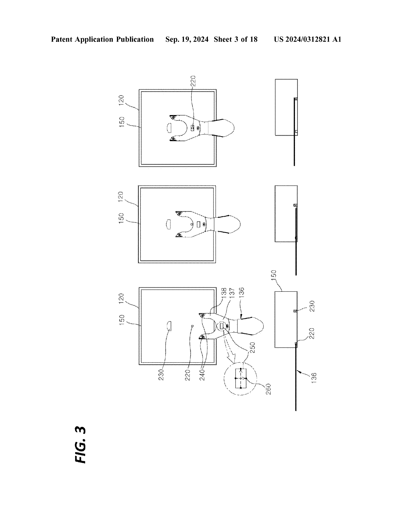
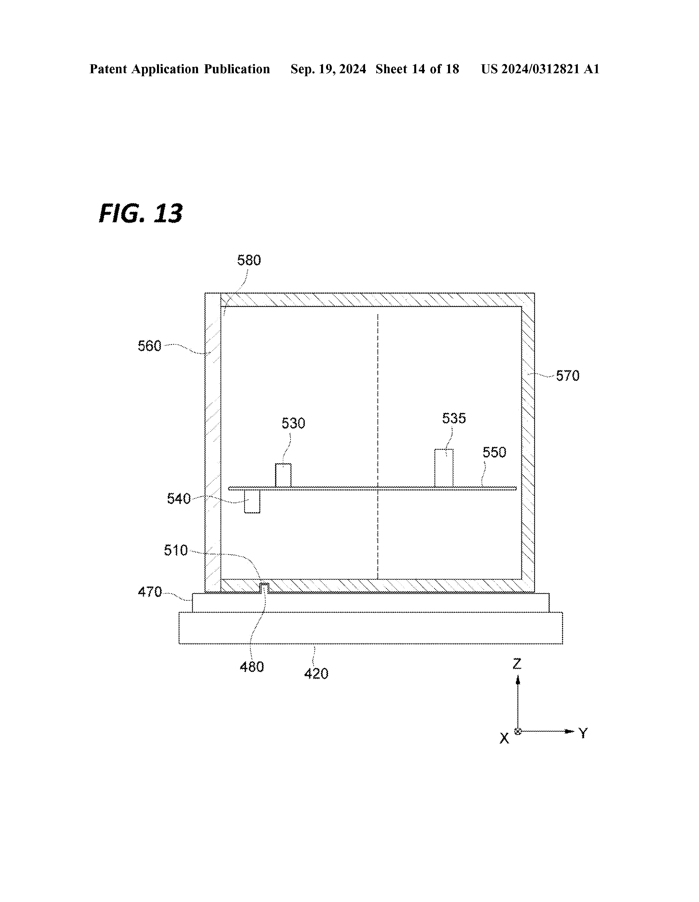

# US20240312821A1 — 반도체 장비 자동 티칭 장치 (Yaskawa)

| 항목 | 내용 |
|---|---|
| 원문 | `US20240312821.pdf`(공개, 2024-09-19, 심사 중이라 등록본 없음) |
| 출원인 | Yaskawa Electric |
| 우선일 | 2021-11-23 (한국 출원 10-2021-0162099, PCT/KR2022/013064의 계속 출원) |
| 핵심 | 카메라 없이 핸드의 투광·수광 센서(전단 센서·중앙 센서)로 검출 핀과 반원형 블록을 찾아 X·Y·Z를 맞춘다. 피처는 로드 포트에 올리는 FOUP 모양 티칭 지그 안에 두어 EFEM 청정 공간을 연 채로 자동 티칭. |
| 관련도 | △ 참고 |
| 본 과제와의 관계 | 비전이 아닌 방식의 비교 대상. 회전(Θ) 보정은 다루지 않음. |
| 링크 | [Google Patents](https://patents.google.com/patent/US20240312821A1/en) |

---

## 상세 요약 (번역본 기준)

### 1. 해결하려는 문제
- 이송 로봇이 틀어지면 웨이퍼가 버퍼 슬롯에 틀어져 놓이고, 이송 중 이탈·파손 또는 세정부 안착 불량으로 공정 중단.
- 틀어짐 검출 시 장비를 멈추고 작업자가 수동으로 지그를 설치해 티칭 → 시간 소요, 생산성 저하.
- 작업자가 대기 개방된 EFEM 내부에 들어가 작업 → 외부 이물 유입, 청정도 회복을 위한 청소 반복.
- 로드 포트 5개 EFEM에서 양 끝 포트는 핸드가 비스듬히 접근해야 하므로 FOUP 측벽과 간섭, 안전한 티칭 곤란.

### 2. 핵심 구성
| 구성 | 위치·역할 |
|---|---|
| EFEM(110/410) | 청정 공간 제공, 일측에 로드 포트(120/420), 타측에 스테이션(140/440) |
| 이송 로봇(130/430) | 본체(132/431), 중간 링크 암(134)/암(432), 엔드 이펙터(핸드)(136/434) |
| 엔드 이펙터(136) | 평면 베이스 패드(137) + 전방 한 쌍의 포크(138) |
| 전단 센서(240) = 제1 센서 | 양 포크 끝에 마주보게 배치, 한쪽 투광부·한쪽 수광부(또는 리밋 센서). Y·Z 진입 위치 검출 |
| 중앙 홀부(250) | 베이스 패드(137)를 관통하는 구멍, 티칭 시 검출 핀이 들어오는 영역 |
| 중앙 센서(260) = 제2 센서 | 중앙 홀부 개구를 가로지름. 알파 센서(전단 센서 광축과 평행) + 베타 센서(둘 다와 직교), 또는 단일 직교 센서. X·Z 위치 설정 |
| 검출 핀(220) | 더미 포트(150)·로드 포트·EFEM 바닥에서 돌출, 평면상 웨이퍼 전방 가장자리 또는 중심에 대응 |
| 반원형 블록(230) | 진입 방향으로 검출 핀과 일직선, 설정 거리만큼 떨어져 돌출 |
| 더미 포트(150) / 더미 스테이션(170) | 피처를 담는 하우징, 제1 위치결정부(160: 세팅 핀(162)·세팅 홈(164))로 로드 포트에 고정 |
| 베이스 플레이트(210) | 다른 실시예(도 9, 10). 피처를 판에 세워 버퍼 웨이퍼와 같은 높이에 설치 |
| 티칭 지그(500) | 변형예. 하우징(570)·개구(580)·덮개(560), 바닥 세팅 홈(510)이 스테이지(470)의 세팅 핀(480)에 결합 |
| 판형 기판(550) | 지그 내 웨이퍼 수용 위치에 수납, 실제 웨이퍼와 같은 직경 가능. 일면에 제1 검출 핀(530)·반원형 블록(535), 타면에 제2 검출 핀(540) |
| 로봇 제어 장치(450) | 센서 검출과 암·핸드 이동 제어, 전달 위치 저장 |

### 3. 동작 순서
(번역본에 S-단계 번호 없음. 본문 서술 순서 기준)

기본 실시예 (도 2, 3)
1. 웨이퍼를 내린 빈 엔드 이펙터(136)만 특정 로드 포트의 더미 포트(150)로 진입.
2. 검출 핀(220)이 두 포크(138) 사이에 들어오면 전단 센서(240)가 핀 위치 검출 → 핀이 포크 사이 중앙·설정 높이에 오도록 Y·Z 진입 위치 안내. 이후 핸드를 핀 위쪽으로 올려 충돌 방지.
3. Y 방향으로 전진, 전단 센서(240)가 반원형 블록(230)을 검출하면 전진 정지. 이때 검출 핀(220)은 중앙 홀부(250) 안에 위치.
4. 중앙 센서(260)가 핀을 연속 검출하며 핀이 중앙 홀부 중심에 오도록 X·Z 방향 이동. 제어기가 모터로 핀을 전단 센서 사이 중앙 + 중앙 홀부 중심에 맞춤.
5. 최종 상태: 검출 핀은 중앙 홀부 중앙, 반원형 블록은 포크 사이 중앙 → 티칭 완료. 티칭 값으로 모든 로드 포트·버퍼에 웨이퍼 이송(도 4).
6. 스테이션도 같은 구성의 스테이션 티칭부(300)와 더미 스테이션(170)으로 동일 절차(도 5~7).

변형예: 티칭 지그 이용 (도 11~17)
1. OHT 또는 AGV가 티칭 지그(500)를 로드 포트(420)에 배치, 세팅 홈(510)·세팅 핀(480)으로 고정.
2. 로드 포트 개폐 기구가 덮개(560)를 분리해 아래로 내림, 청정 공간 유지(도 14).
3. 핸드(434)가 개구(580)로 진입, 개구에 가장 가까운 제2 검출 핀(540)을 제1 센서(240)로 검출 → 그 위치 기준으로 핸드 X·Y·Z 조정.
4. 기판(550) 반대면의 제1 특정 피처(530, 535) 쪽으로 Y·Z 이동, 필요 시 하우징 측벽과 충돌하지 않게 위치 추가 조정.
5. 개구에 대한 핸드 축선 각도를 유지한 채 전진: 제1 검출부(530)를 제1 센서로 검출·중앙 정렬 → Z로 올려 충돌 회피 → 전진하여 제2 검출부(535)를 제1 센서로 검출.
6. 이때 제1 검출부(530)는 중앙 홀부(250) 안에 있어 제2 센서(260)로 검출. 중앙 홀부 중심에 오도록 핸드 제어 → 그 위치를 전달 위치로 저장.
7. 저장 위치로 실제 FOUP(460)와 웨이퍼 전달.

기하 규칙 (수식 없음)
- 제1 검출부(530)–제2 검출부(535) 간격 = 전단 센서 투광·수광 직선과 중앙 홀부(250) 중심 사이 거리 → 두 센서가 두 피처를 동시에 검출.
- 핸드 축선 = 전단 센서 센싱 라인 중심, 중앙 홀부 중심, 핸드 회전축을 잇는 선.
- 축 정의: Y = 진입 방향(개구에 수직), X = 평면상 Y에 수직, Z = 수직.

### 4. 청구항 요지
- 청구항 1 (자동 티칭 장치): EFEM + 일측 로드 포트 + 엔드 이펙터를 가진 이송 로봇 + 웨이퍼를 내린 상태에서 엔드 이펙터 고정 위치를 검출하는 로드 포트 티칭부.
- 청구항 6 (이송 장치): 센서 달린 핸드·암의 로봇 + 로봇 제어 장치 + 로드 포트에 놓여 청정 공간을 유지하는 티칭 지그. 지그는 전달 위치와 상대 위치가 정해진 특정 피처를 갖고, 제어 장치는 센서로 피처를 검출해 전달 위치 저장.
- 청구항 23 (티칭 시스템): 청구항 6과 같은 구성을 시스템으로 청구.
- 청구항 24 (로봇): 핸드·암·센서를 가진 로봇이 티칭 지그의 특정 피처를 검출해 전달 위치를 티칭.
- 주요 종속항: 2·3 검출 핀·반원형 블록·전단 센서·중앙 홀부·중앙 센서(3은 베이스 플레이트 추가), 5 스테이션 티칭부, 11 제1·제2 특정 피처 2단 검출, 12·13 핸드 축선 각도에 따른 제1·제2 배치 위치, 16 다단 계층 배치, 18~21 직교 광축의 제1·제2 센서와 알파·베타 센서, 22 OHT·AGV 배치.

### 5. 대표 도면

*도 3 — 전단 센서·중앙 센서로 검출 핀과 반원형 블록을 순차 검출하는 티칭 과정*

*도 13 — 판형 기판(550) 양면에 제1 특정 피처(530, 535)와 제2 검출 핀(540)을 둔 티칭 지그(500)*

### 6. 본 과제(Y·Θ 얼라인먼트)와 비교
- 같은 점:
  - 반송 로봇 핸드의 위치 틀어짐을 자동으로 찾아 보정, 수동 티칭 대체.
  - 위치가 알려진 기준 피처(검출 핀·반원형 블록)를 측정해 실제 전달 위치를 계산.
  - Y 방향(진입 방향) 위치 결정이 핵심 축 중 하나.
- 다른 점:
  - 카메라가 아닌 투광·수광 센서 빔 차단으로 검출, 영상 처리 없음.
  - 핸드를 움직이며 센서 중앙에 피처를 맞추는 탐색식(서보) 방식, 한 장 이미지에서 보정값을 바로 계산하지 않음.
  - X·Y·Z 병진만 다루고 회전(Θ) 보정 없음. 핸드 축선 각도는 측정 대상이 아니라 "유지"하는 조건.
  - 오차 허용치·정밀도 수치 없음.
- 참고할 점:
  - 2단 측정: 개구 근처 거친 기준(제2 검출 핀 540)으로 먼저 잡고, 안쪽 정밀 기준(530, 535)으로 최종 결정 → 우리도 마커 거친 검출 후 정밀 검출 구조 가능.
  - 진입 축 위 두 점(검출 핀·반원형 블록)을 일정 거리로 배치 → 마커 내 두 기준점 사이 각도로 Θ 계산하는 설계에 그대로 응용 가능.
  - 두 피처 간격을 센서 배치 거리와 맞춰 동시 검출 → 마커 크기·특징점 간격을 카메라 FOV와 맞춰 설계.
  - 기준 피처를 실제 웨이퍼 높이·직경의 판형 기판에 둠 → 마커를 실제 작업 높이에 두어 높이 차 오차 줄이기.
  - 비스듬한 접근(양 끝 포트) 별 배치 위치 분리 → 접근 각도별 마커 배치·보정 테이블 고려.
  - 티칭 위치를 정기 취득·축적해 기준 벗어나면 재티칭 → 보정값 로그·추세 감시 기능.
