# 영역 기반 정합에서의 부화소 추정 오차 상쇄 (Shimizu 2005)

- 원제: Sub-Pixel Estimation Error Cancellation on Area-Based Matching
- 저자: Masao Shimizu, Masatoshi Okutomi (Graduate School of Science and Engineering, Tokyo Institute of Technology)
- 원문: 같은 폴더의 `Shimizu2005_IJCV_subpixel.pdf` (International Journal of Computer Vision 63(3), 207–224, 2005)
- 번역 범위: 전문(초록, 1~7절, 주석). 참고문헌은 원문 그대로 옮겼다.
- 그림: 원문 그림 33개를 `그림/`에 넣고 본문에서 처음 언급되는 곳에 삽입했다.

2004년 7월 29일 접수; 2004년 11월 23일 수정; 2004년 11월 23일 게재 승인. 첫 온라인판 2005년 4월 공개.

## 초록 (Abstract)

유사도 척도(similarity measure)를 이용한 영역 기반 영상 정합(area-based image matching)과 부화소(sub-pixel) 변위 추정은 여러 분야에서 쓰이는 흔한 방법이다. 세 점의 유사도 값에 포물선을 맞추는 부화소 추정도 정합 분해능을 높이는 흔한 방법이다. 그러나 이 추정의 특성을 탐구한 조사나 연구는 거의 없다.

본 연구¹는 두 가지 다른 유형의 정합 모델을 써서 부화소 추정 오차를 분석했다. 분석 결과, 추정에는 영상 특성, 유사도 함수, 맞춤 함수(fitting function)에 따라 달라지는 계통 오차가 들어 있음을 보인다. 이 오차는 이른바 화소 고착 효과(pixel-locking effect)처럼 본질적으로 문제가 되는 현상을 일으키는데, 이 효과로 추정 위치가 정수 값 쪽으로 편향되는 경향을 보인다. 또한 유사도 함수와 맞춤 함수 사이에 좋은 조합이 있음을 보인다. [역주: pixel-locking은 공통 용어 "피크 로킹(peak-locking)"과 같은 현상을 가리킨다. 이 번역에서는 원문 용어를 살려 "화소 고착(pixel-locking)"으로 옮긴다.]

나아가 부화소 추정 오차를 크게 줄이는 새 알고리즘을 제안한다. 이 방법은 유사도 척도와 맞춤 함수에 무관하다. 게다가 구현이 아주 간단하다. 여러 종류의 영상을 쓴 실험으로 새 방법의 이점을 확인한다.

주제어: 영역 기반 영상 정합, 유사도 척도, 부화소 추정, 화소 고착 효과, 추정 오차 저감

## 1. 서론 (Introduction)

영역 기반 영상 정합은 운동 추정(Aggarwal and Nandhakumar, 1988), 물체 추적(Shortis et al., 1994), 머신 비전(Aghajan et al., 1993), 비디오 데이터 부호화, 스테레오 영상 처리(Kanade and Okutomi, 1994), 영상 기반 측정(West and Clarke, 1990), 영상 정합(image registration; Irani and Peleg, 1991), 원격 탐사, 유체역학(Raffel et al., 1998) 등 많은 분야에서 쓰이는 흔하고 기본적인 방법이다. 부화소 변위를 추정하기 위해 많은 응용에서는 유사도 함수의 극값 근처 세 인덱스에 포물선이나 다른 함수를 맞춰 참 피크를 찾는 방법을 써 왔다(Frischholz and Spinnler, 1993; Fusiello and Roberto, 2000; Raffel et al., 1998; Tian and Huhns, 1986). 이 방법을 유사도 보간법(similarity interpolation method)이라 부른다.

그럼에도 많은 경우, 특히 산업 응용에서는 유사도 함수와 맞춤 함수의 조합을 전혀 고려하지 않고 계산 속도만을 기준으로 삼는다. 유사도 보간법은 계통 오차가 있음에도 계산량이 적다고 보고되기도 했다(Westerweel, 1998). 부화소 추정 오차는 주어진 조건에서 특정 영상에 대해 그 크기와 특성이 논의되었다(Dvornychenko, 1983). 그렇지만 추정 오차를 줄이는 방법은 제시되지 않았다.

그림 1은 간단한 실험을 보여 준다. 표적은 수평 방향으로 일정한 속도로 직선 운동한다. 측정한 수평 위치는 프레임 번호(시간)에 따라 선형으로 증가할 것으로 기대된다. 그러나 그림 2에 보인 실제 측정 위치에는 1화소 주기의 뚜렷한 계통 오차가 들어 있다.

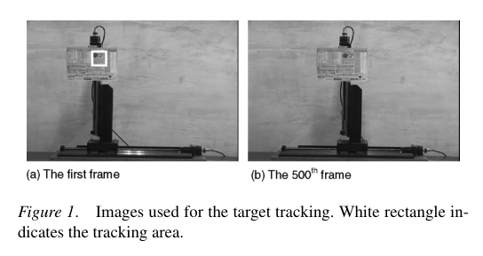
*그림 1 — 표적 추적에 쓴 영상. 흰 사각형은 추적 영역을 나타낸다. (a) 첫 프레임 (b) 500번째 프레임.*

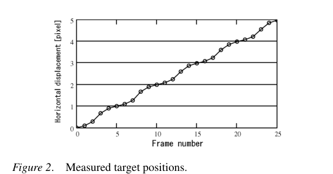
*그림 2 — 측정한 표적 위치.*

유체역학 분야에서는 이른바 화소 고착(pixel-locking) 효과가 보고되었다(Westerweel, 1998). 이 효과는 추정된 부화소 변위가 정수 화소 위치 쪽으로 기우는 현상이다. 그 정도는 영상이나 유사도 함수에 따라 다르다. 이 효과를 검출하는 유일한 방법은 대응하는 많은 흐름 벡터(flow vector)로 히스토그램을 만드는 것이다.

그림 4는 그림 3의 실제 영상에서 추정한 5040개 점의 흐름 벡터에 대한 변위 수평 성분의 히스토그램이다. 정수 화소 값에서 빈도가 부자연스럽게 높다. 이 현상은 영역 기반 정합을 쓰는 모든 측정에 계통 오차가 있을 가능성을 보여 준다.

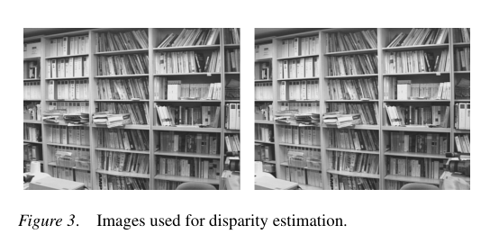
*그림 3 — 시차(disparity) 추정에 쓴 영상.*

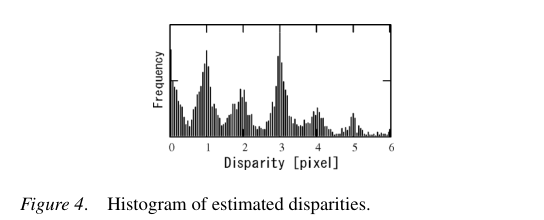
*그림 4 — 추정 시차의 히스토그램.*

본 논문은 추정 오차를 크게 줄일 수 있는 새로운 추정 오차 상쇄(EEC, estimation error cancel) 방법을 제시한다. 이 방법은 반복 계산을 쓰지 않으므로 소프트웨어와 하드웨어 모두 구현이 쉽다. 또한 유사도 함수, 맞춤 함수, 사용하는 영상에 무관하다.

EEC 방법은 부화소 추정 오차에 몇 가지 성질을 가정한다. 이 가정을 검증하기 위해 두 가지 다른 유형의 영상 정합 모델을 살펴본다. 하나는 1화소 정합 모델(one-pixel-matching model)로, 부화소 추정 오차의 특성을 분석하는 데 쓴다. 이 모델은 최소한의 모델이며 특정 영상을 필요로 하지 않는다.

다른 하나는 에지 영상 모델(edge image model)로, 추정 오차를 모델링하고 평가하는 데 더 실용적이다. 두 모델의 관계를 설명한 뒤 EEC 방법의 효과를 보인다.

본 논문의 구성은 다음과 같다. 다음 절은 두 종류의 유사도 척도 함수와 두 종류의 맞춤 함수를 설명한다. 3절은 일반화된 부화소 추정 성질을 위한 1화소 정합 모델을 설명한다. 4절은 광학 결상 모델을 고려한 에지 영상 모델을 제시하고, 두 모델 사이의 관계를 설명한다. 5절은 EEC 방법을 자세히 설명한다. 아울러 잔차 오차를 논의한다. 6절은 네 가지 다른 종류의 영상을 써서 실험 결과를 제시한다.

### 1.1. 관련 연구 (Related Works)

영상에서 부화소 변위를 추정하는 데는 일반적으로 다음 방법들이 쓰여 왔다(Aggarwal and Nandhakumar, 1988; Tian and Huhns, 1986).

(1) *유사도 보간(Similarity interpolation)*은 극값 근처 세 인덱스에 포물선을 맞춰 유사도 함수의 참 피크를 추정한다. 이 방법은 계통 오차가 있음에도 계산량이 적다(Westerweel, 1998).

(2) *밝기 보간(Intensity interpolation)*은 영상 보간으로 얻은 고공간분해능 영상에서 유사도의 피크 위치를 찾는다(Szeliski and Scharstein, 2002). 이 방법은 일반적으로 많은 메모리 공간과 계산 시간이 필요하다. 이러한 요구를 줄이기 위해 연속 함수를 쓴 영상 보간 방법이나 계층적 조대-정밀(coarse-to-fine) 접근이 제안되었다(Fincham and Delerce, 1999; Hart, 1998; Lecordier et al., 1999). 이 방법과 기울기 기반 방법의 등가성은 Davis et al. (1995)에 제시되어 있다.

(3) *기울기 기반 방법(Gradient-based method)*은 영상 기울기를 써서 부화소 보정량을 계산한다. 이 방법은 반복으로 1화소 미만의 변위를 추정할 수 있다(Horn and Schunck, 1981; Lucas and Kanade, 1981). 반복 방법의 수렴에 관한 연구는 Mitiche and Mansouri (2004)에 있다. 영상 기울기 추정 필터도 영향을 준다(Davis and Freeman, 1998). 이 방법은 변위가 매우 작다고 가정한다. 따라서 일반적으로 조대-정밀 탐색 전략과 함께 쓴다(Tian and Huhns, 1986).

(4) *위상 상관(Phase correlation)*은 푸리에 영역의 위상 차를 공간 영역의 이동으로 검출한다(Tian and Huhns, 1986). 부화소 위상 차를 얻으려면 푸리에 영역에서 보간이 필요하다. 상관값을 써서 위상 차를 직접 추정하는 방법이 제안되었으나(Foroosh et al., 2002), 관심 영역(AOI, area of interest)이 직사각형 모양으로 제한된다.

(5) *기하학적 방법(Geometric method)*은 특징점을 추출하고 그들 사이의 대응을 찾는다. 이 방법의 정확도는 특징 추출 성능에 달려 있다.

여기서는 단순성과 효과 때문에 방법 (1)을 살펴본다. 이 방법의 계통 오차는 이미 보고되었지만, 지금까지 제안된 오차 저감 방법은 초점이 흐린(out-focused) 영상을 쓰는 것뿐이다(Schreier et al., 2000). 더 효과적인 추정 오차 저감 방법은 컴퓨터 비전과 산업 응용, 특히 정밀 측정이 필요한 시스템에 폭넓은 영향을 줄 것이다.

## 2. 비유사도 척도와 부화소 추정 (Dissimilarity Measures and Sub-Pixel Estimations)

두 영상의 정합은 두 영상 사이 변위에 대응하는 비유사도(dissimilarity) 함수 또는 유사도 함수의 최소값 또는 최대값을 찾는 것이다. 정합 영역의 척도로는 보통 절대차 합(SAD, sum of absolute differences), 차제곱합(SSD, sum of squared differences), 상호상관(CC, cross correlation), 영평균 정규화 상호상관(zero-mean normalized cross-correlation) 중 하나를 쓴다.

주어진 1차원 변위를 $d$라 하자. 일반성을 잃지 않고 $d$는 $-0.5\le d\le 0.5$ 범위에 있다고 볼 수 있다. 화소 단위의 영상 정합은 이미 이루어졌다고 볼 수 있다. SAD를 쓴 유사도 함수 $R(s)$는 다음과 같이 나타낼 수 있다.

$$R_{\mathrm{SAD}}(s)=\sum_{i\in W}\left|f(i)-f(i-d+s)\right|, \tag{1}$$

여기서 $f(i)$와 $f(i-d+s)$는 각각 기준 영상과 관측 영상이고, $s$는 극값 위치로부터의 화소 단위 이동값이다. SSD를 쓴 $R(s)$는 다음과 같다.

$$R_{\mathrm{SSD}}(s)=\sum_{i\in W}\left(f(i)-f(i-d+s)\right)^2. \tag{2}$$

또한 CC를 쓴 $R(s)$는 다음과 같다.

$$R_{\mathrm{CC}}(s)=\sum_{i\in W}\left(f(i)\times f(i-d+s)\right). \tag{3}$$

우리의 영상 모델에서는 CC를 쓴 결과가 SSD의 경우와 같으므로 SAD와 SSD를 써서 조사한다.

부화소 변위 위치는 유사도 값으로 추정할 수 있다. 부화소 변위를 찾기 위해 세 유사도 값에 맞추는 함수로는 일반적으로 몇 가지 대칭 함수를 쓴다. 그림 5(a)는 1차 대칭 맞춤 함수(이 논문에서는 등각 직선 맞춤(equiangular line fitting)이라 부른다)를 보여 준다. 등각 직선 맞춤은 두 직선의 교점으로 부화소 위치를 추정한다. 한 직선은 $(-1,R(-1))$과 $(0,R(0))$을 지나고, 다른 직선은 기울기의 부호를 반대로 하여 $(1,R(1))$을 지난다. 부화소 추정값 $\hat d_{\mathrm{EL}}$은

$$
\hat d_{\mathrm{EL}}=
\begin{cases}
\dfrac12\,\dfrac{R(1)-R(-1)}{R(0)-R(-1)} & \text{if } R(1)<R(-1),\\[2ex]
\dfrac12\,\dfrac{R(1)-R(-1)}{R(0)-R(1)} & \text{otherwise},
\end{cases}\tag{4}
$$

이다. 여기서 $R(-1)$, $R(0)$, $R(1)$은 식 (1) 또는 (2)에서 얻은 유사도 값이다.

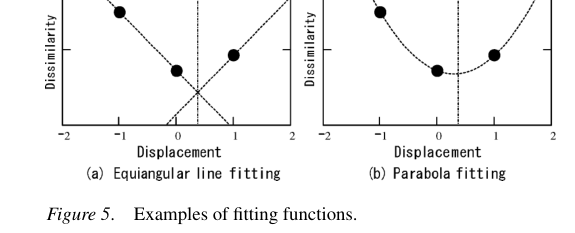
*그림 5 — 맞춤 함수의 예. (a) 등각 직선 맞춤 (b) 포물선 맞춤.*

그림 5(b)는 포물선 맞춤(parabola fitting)을 보여 준다. 포물선 맞춤은 맞춘 포물선의 중심선으로 부화소 위치를 추정한다. 부화소 추정값 $\hat d_{\mathrm{PB}}$는

$$\hat d_{\mathrm{PB}}=\frac{R(-1)-R(1)}{2R(-1)-4R(0)+2R(1)}. \tag{5}$$

## 3. 1화소 정합 모델 (One-Pixel-Matching Model)

부화소 추정의 자세한 성질을 살펴보려 할 때, 비유사도의 합산은 영상 특성이 부화소 추정 오차에 주는 영향을 찾는 것을 방해한다. 따라서 정합과 부화소 추정에 쓸 수 있는 최소한의 화소 집합을 사용한다.

### 3.1. 최소 화소 집합 (Minimum Set of Pixels)

이 목적에는 관측 화소 하나만 쓸 수 있다. 부화소 변위를 추정하려면 세 위치에 대응하는 세 유사도 값이 필요하다. 따라서 기준으로 화소 세 개가 필요하다. 결국 문제는 세 기준 화소에 대해 관측 화소 하나가 가장 잘 정합하는 부화소 위치를 찾는 것이 된다.

화소 단위 유사도 함수를 고려하면, 관측 화소 하나는 기준 화소들의 가운데와 가장 잘 정합한다고 본다. 그러면 기준 화소 가운데에 대한 관측 화소의 변위는 −0.5~+0.5화소로 제한된다. 분석 모델은 단순성을 위해 1차원으로 한다. 그림 6은 1화소 정합 모델(이하 opm)을 보여 준다.

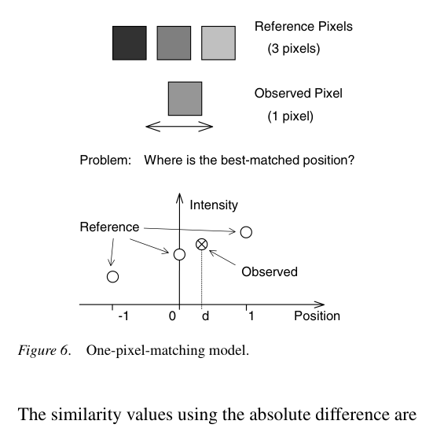
*그림 6 — 1화소 정합 모델. (기준 화소 3개, 관측 화소 1개. 문제: 가장 잘 정합하는 위치는 어디인가?)*

부화소 추정 오차의 특성은 모델의 밝기 성질의 함수로 볼 수 있다. 이어지는 소절에서 매개변수 하나를 도입하고 그 존재 범위를 보인다.

관측 화소와 기준 화소 사이의 유사도 값은 모델을 써서 나타낼 수 있다. 절대차(absolute difference)를 쓴 유사도 값은

$$
\begin{aligned}
R_{\mathrm{AD}}(-1)&=\left|I(-1)-I(d)\right|,\\
R_{\mathrm{AD}}(0)&=\left|I(0)-I(d)\right|,\\
R_{\mathrm{AD}}(1)&=\left|I(1)-I(d)\right|,
\end{aligned}\tag{6}
$$

이다. 여기서 $I(d)$는 관측 화소의 밝기이고, $I(-1)$, $I(0)$, $I(1)$은 기준 화소의 밝기다.

차의 제곱(squared difference)²을 쓴 유사도 값은

$$
\begin{aligned}
R_{\mathrm{SD}}(-1)&=(I(-1)-I(d))^2,\\
R_{\mathrm{SD}}(0)&=(I(0)-I(d))^2,\\
R_{\mathrm{SD}}(1)&=(I(1)-I(d))^2
\end{aligned}\tag{7}
$$

이다.

### 3.2. 화소 밝기 비선형성 (Pixel Intensity Nonlinearity)

부화소 추정은 식 (7) 또는 (8)의 유사도 값과 식 (4) 또는 (5)로 수행할 수 있다. [역주: 원문 그대로. 문맥상 식 (6) 또는 (7)이다.] 추정값은 세 기준 화소 사이의 밝기 관계에 따라 달라질 것으로 예상할 수 있다. 이 소절의 목적은 기준 화소들의 밝기 배치를 표현하는 매개변수를 도입하는 것이다. 이 매개변수는 이어지는 소절에서 부화소 추정 오차를 조사하는 데 쓸 수 있다.

비선형성(nonlinearity)으로 다음 척도 $E$를 도입한다.

$$E=\frac{1}{\sqrt6}\left(2I(0)-I(-1)-I(1)\right). \tag{8}$$

척도 $E$는 세 화소에 대한 최소제곱 추정 직선으로부터 세 화소의 *부호 있는* RMS 오차를 나타낸다. $E>0$이면 $I(0)$이 직선 위에, $E<0$이면 $I(0)$이 직선 아래에 있다(그림 7 참조). 세 기준 화소의 밝기가 모두 직선 위에 있으면 $E=0$이다. 식 (8)로부터 $I(0)$은 다음과 같이 나타낼 수 있다.

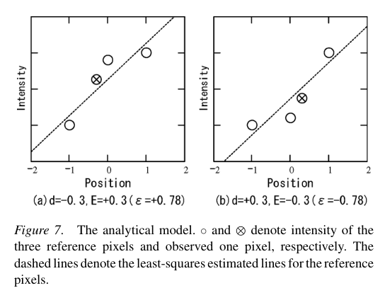
*그림 7 — 해석 모델. ○와 ⊗는 각각 세 기준 화소와 관측 화소 하나의 밝기를 나타낸다. 점선은 기준 화소들에 대한 최소제곱 추정 직선이다. (a) d=−0.3, E=+0.3 (ε=+0.78) (b) d=+0.3, E=−0.3 (ε=−0.78).*

$$I(0)=\frac12\left(I(-1)+I(1)+\sqrt6E\right). \tag{9}$$

다음으로, 관측 화소 하나의 밝기 $I(d)$를 $E$와 주어진 변위 $d$의 함수로 유도한다. 부화소 추정 오차를 평가하려면 세 기준 화소에 대한 관측 화소의 참 입력 변위를 알아야 한다. 관측 화소 밝기 $I(d)$는 세 기준 화소로 선형 보간한 값이라고 가정한다.

$$
I(d)=
\begin{cases}
I(0)+(I(0)-I(-1))d & \text{if } d<0,\\
I(0)+(I(1)-I(0))d & \text{otherwise}.
\end{cases}\tag{10}
$$

식 (6) 또는 (7)의 유사도 값은 식 (9)와 (10)을 써서 비선형성 $E$, 주어진 변위 $d$, 화소 밝기 $I(-1)$과 $I(1)$로 나타낼 수 있다.

마지막으로 비선형성 $E$의 범위를 알아야 한다. 앞서 말했듯이 관측 화소 밝기 $I(d)$는 기준 화소의 가운데 $I(0)$과 가장 잘 정합해야 한다. 이 조건에 대해 다음 관계를 $E$의 범위로 생각한다.

$$
|I(1)-I(d)|>|I(0)-I(d)|,\quad\text{그리고}\quad |I(-1)-I(d)|>|I(0)-I(d)|. \tag{11}
$$

식 (9)와 (10)을 쓰면, $-0.5\le d\le 0.5$에 대해 식 (11)로부터 다음 조건을 얻는다.

$$-\frac{I(1)-I(-1)}{\sqrt6}<E<\frac{I(1)-I(-1)}{\sqrt6}. \tag{12}$$

### 3.3. 부화소 추정 (Sub-Pixel Estimation)

기준 화소의 가운데 화소 밝기 $I(0)$은 식 (9)로 $I(-1)$, $I(1)$, $E$에 의해 정해진다. 동시에 관측 화소 밝기 $I(d)$는 식 (10)으로 실제 변위 $d$에 의해 정해진다. 이 식들을 식 (6) 또는 (7)에 대입하면 각각 AD 또는 SD의 유사도 값이 된다. 이 유사도 값들로 등각 직선(EL) 맞춤 또는 포물선(PB) 맞춤에 대해 각각 식 (4) 또는 (5)로 부화소 추정을 한다. 이 부화소 추정값은 $E$와 $d$의 함수다.

**AD를 쓴 EL:**

$$
\hat d_{\mathrm{AD+EL}}(d,\varepsilon)=
\begin{cases}
\dfrac{d+(1+d)\varepsilon}{(1+2d)(1+\varepsilon)} & \left(d<0,\ \varepsilon\ge\dfrac{-d}{1+d}\right),\\[2ex]
\dfrac{d+(1-d)\varepsilon}{1+\varepsilon} & \left(d\ge0,\ \varepsilon\ge\dfrac{-d}{1-d}\right),\\[2ex]
\dfrac{d+(1+d)\varepsilon}{1-\varepsilon} & \left(d<0,\ \varepsilon<\dfrac{-d}{1+d}\right),\\[2ex]
\dfrac{d+(1-d)\varepsilon}{(1-2d)(1-\varepsilon)} & \left(d\ge0,\ \varepsilon<\dfrac{-d}{1-d}\right),
\end{cases}\tag{13}
$$

여기서 $\varepsilon$은 단순화를 위한 다음 치환이다.

$$\varepsilon=\frac{\sqrt6}{I(1)-I(-1)}E. \tag{14}$$

식 (12)의 범위는 다음과 같이 유도된다.

$$-1<\varepsilon<1. \tag{15}$$

**AD를 쓴 PB:**

$$\hat d_{\mathrm{AD+PB}}(d,\varepsilon)=\frac12\,\frac{d+(1-|d|)\varepsilon}{(1-|d|)+d\varepsilon}. \tag{16}$$

**SD를 쓴 EL:**

$$
\hat d_{\mathrm{SD+EL}}(d,\varepsilon)=
\begin{cases}
\dfrac{2(d+(1+d)\varepsilon)}{(1+2d)(1+\varepsilon)^2} & \left(d<0,\ \varepsilon\ge\dfrac{-d}{1+d}\right),\\[2ex]
\dfrac{2(d+(1-d)\varepsilon)}{(1+2d)+2\varepsilon+(1-2d)\varepsilon^2} & \left(d\ge0,\ \varepsilon\ge\dfrac{-d}{1-d}\right),\\[2ex]
\dfrac{2(d+(1+d)\varepsilon)}{(1-2d)-2\varepsilon+(1+2d)\varepsilon^2} & \left(d<0,\ \varepsilon<\dfrac{-d}{1+d}\right),\\[2ex]
\dfrac{2(d+(1-d)\varepsilon)}{(1-2d)(1-\varepsilon)^2} & \left(d\ge0,\ \varepsilon<\dfrac{-d}{1-d}\right).
\end{cases}\tag{17}
$$

**SD를 쓴 PB:**

$$\hat d_{\mathrm{SD+PB}}(d,\varepsilon)=\frac{d+(1-|d|)\varepsilon}{1+2d\varepsilon+(1-2|d|)\varepsilon^2}. \tag{18}$$

그림 8(a)~(d)는 식 (13)~(18)의 결과를 보여 준다. 가로축은 실제 변위 $d$, 세로축은 부화소 추정 오차 $\hat d(d,\varepsilon)-d$에 해당한다. 그림 8의 곡선들은 위에서 아래로 각각 $\varepsilon$ = 0.99, 0.8, 0.6, 0.4, 0.2, 0, −0.2, −0.4, −0.6, −0.8, −0.99에 해당한다.

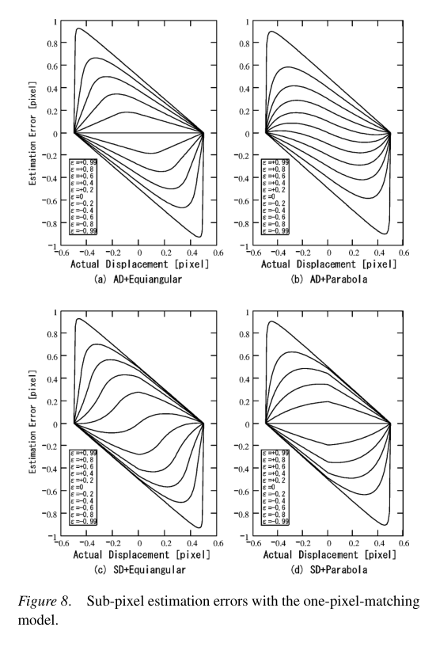
*그림 8 — 1화소 정합 모델에서의 부화소 추정 오차. (a) AD+등각 직선 (b) AD+포물선 (c) SD+등각 직선 (d) SD+포물선.*

그림 8의 부화소 추정 오차를 보면, AD를 쓴 EL과 SD를 쓴 PB에서는 $\varepsilon=0$일 때 오차가 0이지만, 다른 조합에서는 오차가 생긴다. $\varepsilon=0$이라는 조건은 세 기준 화소(이웃한 세 화소)의 밝기가 선형으로 변한다는 뜻이다. 모든 영상은 고주파 성분보다 저공간주파수 성분을 더 많이 담고 있으므로 이 조건은 높은 확률로 일어난다. 이런 이유로 이 조합들을 *좋은(good)* 조합으로 본다.

### 3.4. 정합 창 (Matching Window)

그림 8은 유사도 함수와 맞춤 함수의 *좋은* 조합이 있음을 드러내지만, 그림 8의 오차는 어떤 $\varepsilon>0$에서도 항상 양수이고 어떤 $\varepsilon<0$에서도 음수이므로 화소 고착 효과를 설명하지 못한다. 이 차이는 1화소 정합 모델과 영역 기반 정합의 차이에서 생긴다. 영역 기반 정합은 AOI에 대한 유사도 척도의 합을 쓴다. 예를 들어 SSD로 포물선 맞춤을 하는 경우 다음 식을 쓴다.

$$
\hat d_{\mathrm{SSD+PB}}=\frac{\sum_W R_{\mathrm{SD}}(-1)-\sum_W R_{\mathrm{SD}}(1)}{2\sum_W R_{\mathrm{SD}}(-1)-4\sum_W R_{\mathrm{SD}}(0)+2\sum_W R_{\mathrm{SD}}(1)}. \tag{19}
$$

이후 식 (19)를 *주 추정(principal estimation)*이라 부른다.

한편, 아래에 보인 식 (18)의 가중합을 AOI에 대한 부화소 추정으로 볼 수 있다.

$$
\bar d_{\mathrm{SD+PB}}=\frac1n\int_{-1}^{1}h(\varepsilon)\,\hat d_{\mathrm{SD+PB}}(d,\varepsilon)
=\frac1n\int_{-1}^{1}h(\varepsilon)\,\frac{R_{\mathrm{SD}}(-1)-R_{\mathrm{SD}}(1)}{2R_{\mathrm{SD}}(-1)-4R_{\mathrm{SD}}(0)+2R_{\mathrm{SD}}(1)}, \tag{20}
$$

여기서 $h(\varepsilon)$은 $\varepsilon$에 대한 가중 함수이고, $n$은 영역의 전체 화소 수다. 이후 식 (20)을 *가중 평균 추정(weighted average estimation)*이라 부른다.

다음으로 두 추정 사이의 관계를 조사한다. $n-1$개 화소 영역과 이웃한 1화소 영역을 생각하자. 특히 각 영역에서 얻은 각 추정과, 합친 $n$화소 영역에서 얻은 추정 사이의 관계를 생각한다.

$n-1$화소 영역과 1화소 영역에서 얻은 *주 추정* 부화소 변위는 다음과 같다.

$$
\hat d^{\langle1,n-1\rangle}_{\mathrm{SSD+P}}
=\frac{\sum_{i=1}^{n-1}R^{\langle i\rangle}_{\mathrm{SD}}(-1)-\sum_{i=1}^{n-1}R^{\langle i\rangle}_{\mathrm{SD}}(1)}{2\sum_{i=1}^{n-1}R^{\langle i\rangle}_{\mathrm{SD}}(-1)-4\sum_{i=1}^{n-1}R^{\langle i\rangle}_{\mathrm{SD}}(0)+2\sum_{i=1}^{n-1}R^{\langle i\rangle}_{\mathrm{SD}}(1)}
=\frac{\sum_{i=1}^{n-1}f_i}{\sum_{i=1}^{n-1}g_i}, \tag{21}
$$

그리고

$$
\hat d^{\langle n,n\rangle}_{\mathrm{SSD+P}}=\frac{R^{\langle n\rangle}_{\mathrm{SD}}(-1)-R^{\langle n\rangle}_{\mathrm{SD}}(1)}{2R^{\langle n\rangle}_{\mathrm{SD}}(-1)-4R^{\langle n\rangle}_{\mathrm{SD}}(0)+2R^{\langle n\rangle}_{\mathrm{SD}}(1)}=\frac{f_n}{g_n}, \tag{22}
$$

여기서 $R^{\langle i\rangle}_{\mathrm{SD}}()$는 $i$번째 화소에서 SD로 얻은 유사도 값을 뜻한다. 또한 단순화를 위해 다음 치환을 쓴다.

$$
\begin{aligned}
f_i&=R^{\langle i\rangle}_{\mathrm{SD}}(-1)-R^{\langle i\rangle}_{\mathrm{SD}}(1),\\
g_i&=2R^{\langle i\rangle}_{\mathrm{SD}}(-1)-4R^{\langle i\rangle}_{\mathrm{SD}}(0)+2R^{\langle i\rangle}_{\mathrm{SD}}(1).
\end{aligned}\tag{23}
$$

나아가 식 (21)과 (22)를 쓰면, $n-1$화소 영역과 1화소 영역을 모두 포함하는 $n$화소 영역에서 얻은 *주 추정* 부화소 변위는

$$
\hat d^{\langle1,n\rangle}_{\mathrm{SSD+P}}=\frac{\sum_{i=1}^{n-1}f_i+f_n}{\sum_{i=1}^{n-1}g_i+g_n}
=\frac{\hat d^{\langle1,n-1\rangle}_{\mathrm{SSD+P}}\sum_{i=1}^{n-1}g_i+\hat d^{\langle n,n\rangle}_{\mathrm{SSD+P}}\,g_n}{\sum_{i=1}^{n}g_i}. \tag{24}
$$

한편, 영역 크기 가중치를 써서 $\hat d^{\langle1,n-1\rangle}_{\mathrm{SSD+P}}$와 $\hat d^{\langle n,n\rangle}_{\mathrm{SSD+P}}$로부터 얻은 *가중 평균 추정* 부화소 변위 $\bar d^{\langle1,n\rangle}_{SD+P}$는

$$\bar d^{\langle1,n\rangle}_{SD+P}=\frac{n-1}{n}\hat d^{\langle1,n-1\rangle}_{\mathrm{SSD+P}}+\frac1n\hat d^{\langle n,n\rangle}_{\mathrm{SSD+P}}. \tag{25}$$

따라서 다음을 만족하는 $\delta$를 찾을 수 있다.

$$
\begin{aligned}
\hat d^{\langle1,n-1\rangle}_{\mathrm{SSD+P}}&=\bar d^{\langle1,n\rangle}_{SD+P}-\frac1n\delta,\\
\hat d^{\langle n,n\rangle}_{\mathrm{SSD+P}}&=\bar d^{\langle1,n\rangle}_{SD+P}+\frac{n-1}{n}\delta.
\end{aligned}\tag{26}
$$

식 (26)을 식 (24)에 대입하면 다음을 얻는다.

$$\hat d^{\langle1,n\rangle}_{\mathrm{SSD+P}}=\bar d^{\langle1,n\rangle}_{SD+P}-\frac{\sum_{i=1}^{n-1}g_i-(n-1)g_n}{\sum_{i=1}^{n}g_i}\,\frac{\delta}{n}. \tag{27}$$

식 (27)의 보정 항은 두 추정 사이의 차이를 나타낸다. $\sum_{i=1}^{n-1}g_i-(n-1)g_n\ll\sum_{i=1}^{n}g_i$이고 $\delta\ll n$이므로 이 항은 $\approx0$으로 볼 수 있다. 이는 식 (20)의 *가중 평균 추정*을 근사적으로 *주 추정* 대신 영역의 추정으로 쓸 수 있음을 뜻한다. 설명은 $n-1$화소 영역과 1화소 영역을 썼지만, $n=2$부터 영역 크기를 하나씩 늘려 가면 임의 크기의 영역으로 쉽게 확장할 수 있다. 위 논의에서는 포물선 맞춤을 썼지만 등각 직선 맞춤의 경우도 본질적으로 같다.

### 3.5. 정합 창을 고려한 특성 (Characteristics with Taking Account of Matching Window)

가중 함수 $h(\varepsilon)$은 평균 0인 가우스형 분포로 가정한다.

$$h(\varepsilon)=\left(\cos\left(\frac\pi2\varepsilon\right)\right)^{n_{\mathrm{opm}}}, \tag{28}$$

여기서 $n_{\mathrm{opm}}$은 분포 매개변수다.

그림 9는 서로 다른 세 $n_{\mathrm{opm}}$에 대해 식 (20)의 *가중 평균 추정*의 오차를 나타낸다.

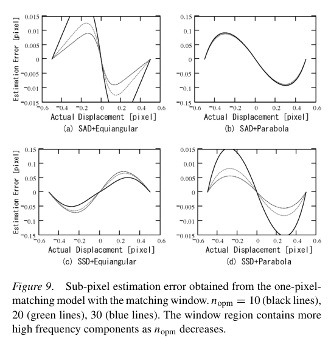
*그림 9 — 정합 창을 고려한 1화소 정합 모델에서 얻은 부화소 추정 오차. $n_{\mathrm{opm}}$ = 10(검은 선), 20(녹색 선), 30(파란 선). $n_{\mathrm{opm}}$이 작을수록 창 영역에 고주파 성분이 많다.*

그림 10은 그림 9의 $n_{\mathrm{opm}}=20$(녹색 선) 오차에 대응하는 히스토그램을 보여 준다. 히스토그램은 참 입력 변위를 0부터 6[pixel]까지 1/1000[pixel] 간격으로 바꾸어 가며 수치적으로 얻었다. 부화소 추정에 오차가 없다면 히스토그램은 평평할 것이다.

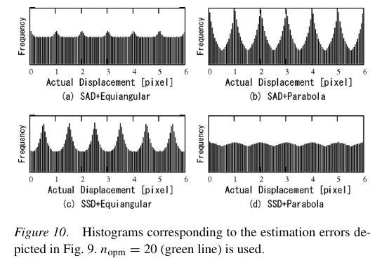
*그림 10 — 그림 9의 추정 오차에 대응하는 히스토그램. $n_{\mathrm{opm}}=20$(녹색 선)을 사용했다.*

그림 10(b)(SAD를 쓴 PB)는 정수 위치에서 빈도가 높음을 나타낸다. 이를 화소 고착 효과라 한다. 반면 그림 10(c)(SSD를 쓴 EL)는 높은 빈도가 정수 위치를 피함을 나타낸다. 이 논문에서는 이를 *반(反)화소 고착(anti-pixel-locking)*이라 부른다.

이 절의 연구에서 다음 결과를 얻었다.

- 포물선 맞춤은 유사도 또는 비유사도 값이 변위에 대해 2차식을 따른다고 가정한다. 그러한 (비)유사도는 SSD, CC, ZNCC다. 이 기대는 밝기가 선형으로 변하는 영상 영역에서 참이다. 반면 등각 직선 맞춤은 값이 등각인 두 직선 위에 있다고 가정한다. 그러한 비유사도는 SAD다.
- 이 *좋은* 조합들(AD를 쓴 EL과 SD를 쓴 PB)은 비슷하게 단순한 경향을 보인다. 영상의 고공간주파수 성분이 줄수록($n_{\mathrm{opm}}$이 커질수록) 추정 오차가 줄어든다. 오차 크기는 비교적 작다.
- 부화소 추정 오차의 성질은 특정 영상 없이 1화소 정합 모델과 단순한 $h(\varepsilon)$ 분포로부터 유도된다. 따라서 이 결과를 제안하는 EEC 방법을 만들기 위한 일반적 정합 특성으로 쓸 수 있다.
- 화소 고착 효과는 *가중 평균 추정*으로 잘 설명된다. 그림 9(a), (b), (d)는 $d<0$일 때 추정값 $\hat d$가 참값보다 크고 $d>0$일 때 참값보다 작은 뚜렷한 특성을 보인다. 이 때문에 추정값 $\hat d$의 히스토그램이 그림 10(a), (b), (d)처럼 정수 화소 위치에서 피크를 갖는다. 이 현상을 화소 고착이라 한다. 이 효과의 정도는 $n_{\mathrm{opm}}$과 사용한 유사도 척도 및 맞춤 함수에 따라 다르다. SAD를 포물선 맞춤과 함께 쓰면 어떤 $n_{\mathrm{opm}}$에서도 추정 오차가 꽤 크다는 점이 주목할 만하다.

  반면 그림 9(c)의 SSD를 쓴 EL의 오차는 다른 조합들과 부호가 반대다. 이 조합에서는 반화소 고착 효과가 예상된다.

## 4. 에지 영상 모델 (Edge Image Model)

영상은 2차원 정보를 담지만, 많은 경우 각 차원을 독립적으로 다룰 수 있다. 이 절에서는 단순성을 위해 1차원으로 조사하지만, 2차원으로 쉽게 확장할 수 있다. 또한 뒤에서 말할 실험에서는 실제 2차원 영상을 쓴다.

위치와 공간주파수의 단위는 전형적인 CCD 촬상 소자의 화소 간격 $p=11.0\times10^{-6}$ [m]로 정한다. 이 단위를 [pixel]로 표시한다.

### 4.1. 결상 특성 (Imaging Characteristics)

영상의 디지털 정보를 쓸 때는 영상 데이터에 영향을 준 전달 함수를 완전히 알아야 하지만, 보통 그것을 모두 알기는 불가능하다. 결상 전달 함수에 영향을 주는 주요 요인은 광학 전달 함수와 CCD 개구 함수다. 이 둘을 합친 함수를 가우스 함수로 근사하여 에지 영상 모델을 얻는다.

#### 4.1.1. 광학 전달 함수 (Optical Transfer Function)

잘 알려진 대로, 광학계의 점 확산 함수(point spread function)는 다음 식으로 나타낼 수 있다. 렌즈의 개구가 원형이면(Driscoll, 1978),

$$h(x)=\left[\frac{2J_1(kdx/2z')}{kdx/2z'}\right]^2, \tag{29}$$

여기서 $x$는 중심으로부터의 거리, $J_1()$은 제1종 베셀 함수, $d$는 광학계의 유효 직경, $z'$은 대물렌즈의 초점 거리, $k(=2\pi/\lambda)$는 파수다.

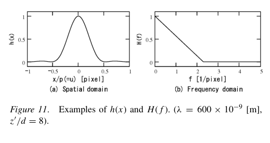
*그림 11 — $h(x)$와 $H(f)$의 예. ($\lambda=600\times10^{-9}$ [m], $z'/d=8$). (a) 공간 영역 (b) 주파수 영역.*

보통 광학 전달 함수(OTF)라 부르는 그 푸리에 변환은 근사적으로 다음과 같다.

$$
H(f)=
\begin{cases}
1-|f/f_c| & \text{if } |f/f_c|\le1,\\
0 & \text{otherwise},
\end{cases}\qquad f_c=d/\lambda z', \tag{30}
$$

여기서 $f$는 공간주파수이고 $f_c$는 차단 주파수다. 차단 주파수는 파장 $\lambda$와 광학 조리개 $z'/d$에 따라 다르다. 예를 들어 $\lambda=400\times10^{-9}$~$800\times10^{-9}$ [m], $z'/d$ = 4~16일 때 $f_c$ = 6.88~0.86[1/pixel]이다. 그림 11이 그 예다.

#### 4.1.2. CCD 개구 (CCD Aperture)

모든 CCD 촬상 소자는 감광 영역으로서 개구(aperture)를 가지며, 이것이 적분 효과를 일으킨다. 그 임펄스 응답은 다음과 같다.

$$
a(u)=
\begin{cases}
1/a & \text{if } |u|\le a/2,\\
0 & \text{otherwise},
\end{cases}\tag{31}
$$

여기서 $a$는 CCD 개구이고 $u$는 영상 내 위치다. 그 푸리에 변환은

$$A(f)=\mathrm{sinc}(af). \tag{32}$$

그림 12가 그 예다.

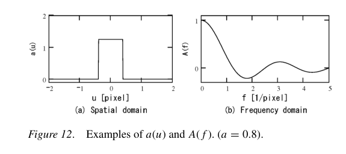
*그림 12 — $a(u)$와 $A(f)$의 예. ($a=0.8$). (a) 공간 영역 (b) 주파수 영역.*

#### 4.1.3. 근사 (Approximation)

결상 특성은 파장, 광학 조리개, CCD 개구에 따라 다르다. 그 밖에도 광학 렌즈 수차나 CCD 앞의 광학 저역통과 필터(LPF) 같은 고주파 차단 요소가 있다. 근사한 전체 결상 특성으로 평균 0, 표준편차 $\sigma$인 가우스 함수를 택했다. 이 소절에서는 매개변수 $\sigma$와 개구 $a$의 관계를 조사한다. 그다음 $\sigma$의 범위를 살펴본다.

평균 0, 표준편차 $\sigma$인 가우스 함수와 그 푸리에 변환은 다음과 같다(그림 13).

$$gauss(u)=\frac{1}{\sqrt{2\pi}\sigma}e^{-\frac{u^2}{2\sigma^2}}, \tag{33}$$

$$GAUSS(f)=e^{-\frac12\sigma^2f^2}. \tag{34}$$

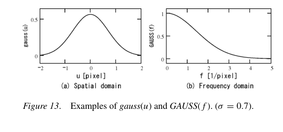
*그림 13 — $gauss(u)$와 $GAUSS(f)$의 예. ($\sigma=0.7$). (a) 공간 영역 (b) 주파수 영역.*

전체 전달 함수 $H(f)A(f)$를 차단 공간주파수 $f_e$가 같은 가우스 함수 $GAUSS(f)$로 근사한다.

$$H(f_e)A(f_e)=GAUSS(f_e)=1/2. \tag{35}$$

그림 14가 이 근사를 보여 준다.

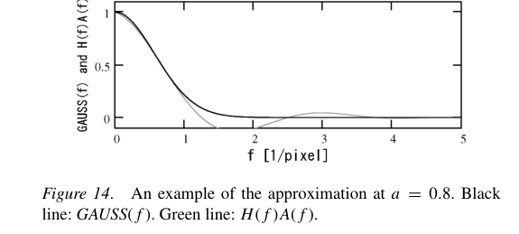
*그림 14 — $a=0.8$에서의 근사 예. 검은 선: $GAUSS(f)$. 녹색 선: $H(f)A(f)$.*

그러면 식 (30), (32), (35)로부터 $\sigma$와 $a$의 관계는 다음과 같다.

$$H\left(\frac{\sqrt{2\ln2}}{\sigma}\right)\times\mathrm{sinc}\left(a\frac{\sqrt{2\ln2}}{\sigma}\right)=\frac12. \tag{36}$$

$\lambda=600\times10^{-9}$ [m], 화소 간격 $11.0\times10^{-6}$ [m] 조건에서 $z'/d$ = 4, 5.6, 8로 계산한 몇 가지 관계를 그림 15에 나타냈다.

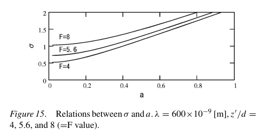
*그림 15 — $\sigma$와 $a$의 관계. $\lambda=600\times10^{-9}$ [m], $z'/d$ = 4, 5.6, 8 (=F 값).*

다음으로 $\sigma$의 범위를 조사한다. 그림 15처럼 $\sigma$는 광학 조리개 $z'/d$와 CCD 개구 $a$에 따라 변한다. $\sigma$는 광학 조리개 $z'/d$가 작아질수록 줄어들지만, 실제 사용에서는 $z'/d=4$를 하한으로 볼 수 있다.

또한 $\sigma$는 CCD 개구 $a$가 작아질수록 줄어드는데, CCD 제조사들은 감도를 높이려고 $a$를 1.0까지 키우려 한다. 최근 CCD에서 $a<0.25$는 비현실적으로 보인다. 따라서 $\sigma$의 하한은 $z'/d=4$, $a=0.25$에서 찾을 수 있다. 식 (36)에 따라 $\sigma$의 범위는 $\sigma\ge0.7$로 볼 수 있다.

### 4.2. 에지 영상 모델 (Edge Image Model)

영상의 계단 에지는 정합에 쓰이는 가장 기본적인 요소이므로, 다음 계단 함수가 대상 광학 정보를 대표할 수 있다.

$$
edge(u)=
\begin{cases}
-1 & \text{if } u<0,\\
1 & \text{otherwise}.
\end{cases}\tag{37}
$$

화소 값은 식 (33)과 (37)의 합성곱으로 나타낼 수 있다.

$$f(u)=\int_{-\infty}^{\infty}edge(u-\xi)\,gauss(\xi)\,d\xi. \tag{38}$$

식 (38)은 다음과 같이 단순화할 수 있다.

$$f(u)=2\int_0^u gauss(\xi)\,d\xi, \tag{39}$$

여기서 $u$는 화소 위치다. 식 (39)를 에지 영상 모델로 사용한다(그림 16). 이 모델의 특성은 전적으로 가우스 함수의 표준편차 $\sigma$에 달려 있다. 이를 $\sigma_{\mathrm{edge}}$라 부르며, 식 (36)처럼 CCD 개구 $a$의 함수다. 대상 광학 정보가 아무리 날카로워도 표본화된 화소 값은 어느 정도 매끄러워진다. $\sigma_{\mathrm{edge}}$의 범위는 $\sigma_{\mathrm{edge}}\ge0.7$이다.

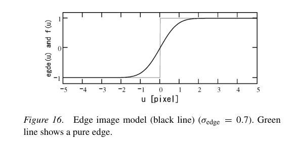
*그림 16 — 에지 영상 모델(검은 선) ($\sigma_{\mathrm{edge}}=0.7$). 녹색 선은 순수 에지다.*

### 4.3. 부화소 추정 (Sub-Pixel Estimation)

식 (4) 또는 (5)의 유사도 척도는 식 (39)를 써서 식 (1) 또는 (2)로 계산할 수 있다. 따라서 부화소 추정값 $\hat d$는 아래와 같이 주어진 입력 변위 $d$와 $\sigma_{\mathrm{edge}}$의 함수로 나타낼 수 있다.

**SAD를 쓴 EL:**

$$\hat d_{\mathrm{SAD+EL}}(d,\sigma_{\mathrm{edge}})=\frac12\sum_{i\in W}\mathrm{es}(d-i), \tag{40}$$

여기서

$$\mathrm{es}(x)=\mathrm{erf}\left(\frac{x}{\sqrt2\sigma_{\mathrm{edge}}}\right)=\frac{2}{\sqrt\pi}\int_0^{\frac{x}{\sqrt2\sigma_{\mathrm{edge}}}}e^{-\xi^2}d\xi, \tag{41}$$

이고, erf()는 오차 함수(error function)다.

**SAD를 쓴 PB:**

$$\hat d_{\mathrm{SAD+PB}}(d,\sigma_{\mathrm{edge}})=\frac{\sum_{i\in W}\mathrm{es}(d-i)}{4-2\left|\sum_i\mathrm{es}(d-i)\right|}. \tag{42}$$

**SSD를 쓴 EL:**

$$
\hat d_{\mathrm{SSD+EL}}(d,\sigma_{\mathrm{edge}})=
\begin{cases}
\dfrac12\,\dfrac{\sum_{i\in W}\left[(\mathrm{es}(i)+\mathrm{es}(d-i-1))^2-(\mathrm{es}(i)+\mathrm{es}(d-i+1))^2\right]}{\sum_{i\in W}\left[(\mathrm{es}(i)+\mathrm{es}(d-i))^2-(\mathrm{es}(i)+\mathrm{es}(d-i-1))^2\right]} & \text{if } d<0,\\[3ex]
\dfrac12\,\dfrac{\sum_{i\in W}\left[(\mathrm{es}(i)+\mathrm{es}(d-i-1))^2-(\mathrm{es}(i)+\mathrm{es}(d-i+1))^2\right]}{\sum_{i\in W}\left[(\mathrm{es}(i)+\mathrm{es}(d-i))^2-(\mathrm{es}(i)+\mathrm{es}(d-i+1))^2\right]} & \text{otherwise}.
\end{cases}\tag{43}
$$

**SSD를 쓴 PB:**

$$
\hat d_{\mathrm{SSD+PB}}(d,\sigma_{\mathrm{edge}})=\frac12\,\frac{\sum_{i\in W}\left[\mathrm{es}(i)\left(\mathrm{es}(d-i+1)-\mathrm{es}(d-i-1)\right)\right]}{\sum_{i\in W}\left[\left(\mathrm{es}(i+1)-\mathrm{es}(i)\right)\left(\mathrm{es}(d-i)-\mathrm{es}(d-i-1)\right)\right]}. \tag{44}
$$

그림 17(a)~(d)는 식 (40)~(44)로 계산한 추정 오차 $\hat d(d,\sigma_{\mathrm{edge}})-d$를 보여 준다.

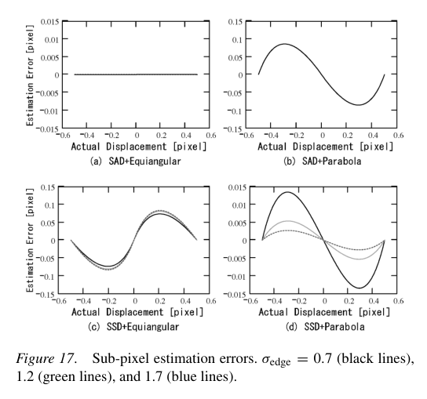
*그림 17 — 부화소 추정 오차. $\sigma_{\mathrm{edge}}$ = 0.7(검은 선), 1.2(녹색 선), 1.7(파란 선).*

그림 17의 오차는 17(a)와 9(a)를 제외하면 그림 9와 매우 잘 일치한다. 그래도 그림 17로부터 3.5절과 같은 결론을 이끌어 낼 수 있다. 즉 같은 *좋은* 조합이 존재하고, 같은 화소 고착 및 반화소 고착 효과를 볼 수 있다.

### 4.4. 모델 사이의 관계 (Model Relations)

지금까지의 논의에서 완전히 다른 두 유형의 정합 모델을 도입했다. 첫째는 1화소 정합 모델로, 영상에 대한 가정 없이 부화소 추정의 몇 가지 기본 성질을 보여 준다. 둘째는 에지 영상 모델로, 수학적 연산에 유용하다. 제안하는 EEC 방법은 첫째 모델에서 얻은 결과를 쓰지만, 이어지는 절에서는 둘째 모델을 쓴다. 따라서 두 모델 사이의 관계를 언급해야 한다.

1화소 정합 모델은 화소 밝기 비선형성 매개변수 $\varepsilon$을 쓴다. 그 분포 매개변수 $n_{\mathrm{opm}}$은 영역 확장에 쓰인다. 에지 모델은 흐림 강도로 매개변수 $\sigma_{\mathrm{edge}}$를 쓴다. 1차원 에지 모델을 2차원 경사 에지 영상의 수평선 하나로 생각하면, 매개변수 $\sigma_{\mathrm{edge}}$를 갖는 에지 모델로부터 매개변수 $n_{\mathrm{opm}}$을 얻을 수 있다.

그림 18이 그런 예를 보여 준다. 첫째 행은 서로 다른 두 $\sigma_{\mathrm{edge}}$의 에지 영상 모델을 나타낸다. 둘째 행은 위치에 대한 $\varepsilon$을 나타낸다. $\varepsilon$은 −1에서 1까지 변한다. 그림 19의 첫째 행이 이 변화를 보여 준다.

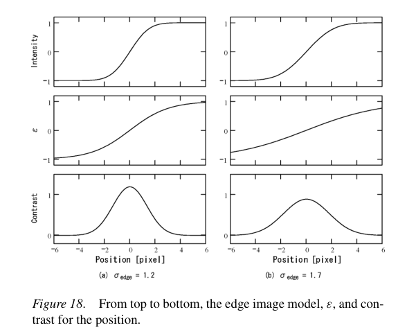
*그림 18 — 위에서 아래로, 위치에 대한 에지 영상 모델, $\varepsilon$, 대비(contrast). (a) $\sigma_{\mathrm{edge}}=1.2$ (b) $\sigma_{\mathrm{edge}}=1.7$.*

에지 모델에서 표본화한 변화는 가우스형 분포와 크게 다르다. 이는 1화소 정합 모델이 $|I(1)-I(-1)|$로 정의할 수 있는 영상 대비를 고려하지 않기 때문이다. 대비는 유사도 합에 대한 가중치로 볼 수 있다. 그림 18의 셋째 행과 그림 19의 둘째 행이 대비를 보여 준다. 그림 19의 셋째 행은 가중된 $\varepsilon$ 히스토그램을 나타내며, 점선은 식 (28)에 의한 근사다.

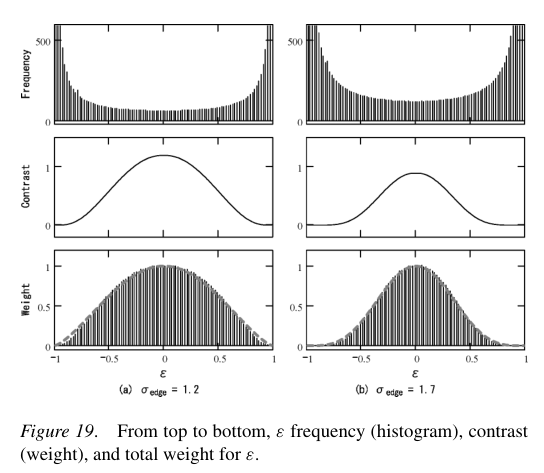
*그림 19 — 위에서 아래로, $\varepsilon$ 빈도(히스토그램), 대비(가중치), $\varepsilon$에 대한 전체 가중치.*

그림 20은 두 매개변수 사이의 관계를 보여 준다.

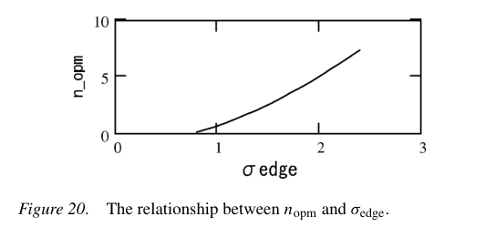
*그림 20 — $n_{\mathrm{opm}}$과 $\sigma_{\mathrm{edge}}$의 관계.*

## 5. 정밀 부화소 추정 (Precise Sub-Pixel Estimation)

### 5.1. 제안 방법 (Proposed Method)

앞의 두 절에서 완전히 다른 두 유형의 정합 모델과 그 매개변수 관계를 조사했다. 두 모델 모두 부화소 추정 오차에서 같은 성질을 보인다. 추정 오차는 다음 특징을 갖는다.

- 오차는 화소 간격을 주기로 갖는다.
- 오차 크기는 $d=0$에 대해 대칭이다.
- 또한 구간 [0, 0.5]에서는 $d=0.25$에 대해, 구간 [−0.5, 0]에서는 $d=-0.25$에 대해 거의 대칭이다.

두 유형의 정합 모델에 대한 연구를 통해, 이는 영역 기반 영상 정합에서 부화소 추정 오차의 일반적 특징으로 생각된다. 같은 특징이 Dvornychenko (1983), Fincham and Delerce (1999), Westerweel (1998)에서도 발견된다. 제안 방법은 이 특징을 이용해 부화소 추정 오차를 줄인다.

원래 함수에서 반 화소 이동한 또 다른 추정 함수가 있다면, 그 결과 오차는 원래 추정에 대해 위상이 반대가 되며, 이는 이 함수가 추정 오차를 상쇄할 수 있음을 뜻한다.

상쇄 함수를 얻기 위해 다음 보간 영상을 사용한다.

$$
\begin{aligned}
g1(u)&=(f(u)+f(u+1))/2,\\
g2(u)&=(f(u-1)+f(u))/2.
\end{aligned}\tag{45}
$$

이동값은 각각 −1/2과 +1/2이다. 식 (45)를 두 경우로 나눈 이유는 추정 결과가 [−0.5, +0.5] 범위에 들어오게 하기 위해서다. $g1(u)$과 $g2(u)$는 위치만 다른 같은 보간 영상 함수다. 식 (45)에서는 선형 보간을 썼다. 다른 보간 함수는 다음 소절에서 조사한다.

이 이동 영상을 쓰면 SSD의 유사도 함수는 다음과 같이 나타낼 수 있다.

$$
\begin{aligned}
Ri1_{\mathrm{SSD}}(s)&=\sum_{i\in W}\left(g1(i)-f(i-d+s)\right)^2 && \text{if } -0.5\le d\le0,\\
Ri2_{\mathrm{SSD}}(s)&=\sum_{i\in W}\left(g2(i)-f(i-d+s)\right)^2 && \text{otherwise}.
\end{aligned}\tag{46}
$$

그 결과 부화소 추정값은 다음과 같다.

$$
\begin{aligned}
\hat di1(d,\sigma_{\mathrm{edge}})&=\frac{Ri1(-1)-Ri1(1)}{2Ri1(-1)-4Ri1(0)+2Ri1(1)}-\frac12 && \text{if } -0.5\le d\le0,\\
\hat di2(d,\sigma_{\mathrm{edge}})&=\frac{Ri2(-1)-Ri2(1)}{2Ri2(-1)-4Ri2(0)+2Ri2(1)}+\frac12 && \text{otherwise}.
\end{aligned}\tag{47}
$$

이 추정값들을 써서 다음과 같이 추정 오차를 상쇄할 수 있다.

$$
\tilde d(d,\sigma_{\mathrm{edge}})=
\begin{cases}
(\hat d(d,\sigma_{\mathrm{edge}})+\hat di1(d,\sigma_{\mathrm{edge}}))/2 & \text{if } -0.5\le d\le0,\\
(\hat d(d,\sigma_{\mathrm{edge}})+\hat di2(d,\sigma_{\mathrm{edge}}))/2 & \text{otherwise}.
\end{cases}\tag{48}
$$

그림 21은 기존 추정, 상쇄 함수, 제안하는 EEC 방법의 추정 오차를 보여 준다.

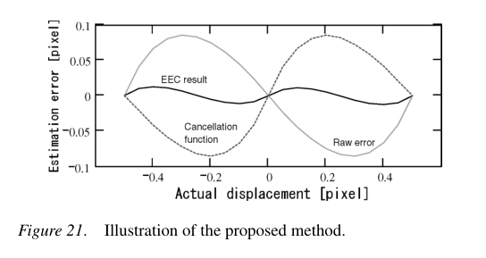
*그림 21 — 제안 방법의 설명도. (EEC result: EEC 결과, Cancellation function: 상쇄 함수, Raw error: 원 오차)*

EEC 방법의 본질적 특징은 계통적 추정 오차가 위상이 반전된 같은 추정 오차에 의해 상쇄된다는 것이다. 위상이 반전된 추정은 보간 영상으로부터 얻을 수 있다. 따라서 영상의 특성이나 성질은 상관이 없다.

### 5.2. 다른 보간 함수 (Another Interpolation Function)

다음 식은 식 (45)에서 쓴 선형 보간 대신 쓰는 3차 합성곱 보간(cubic-convolution interpolation; Keys, 1981)을 나타낸다.

$$
\begin{aligned}
g1(u)&=\frac{-f(u-1)+5f(u)+5f(u+1)-f(u+2)}{8},\\
g2(u)&=\frac{-f(u-2)+5f(u-1)+5f(u)-f(u+1)}{8}.
\end{aligned}\tag{49}
$$

그림 22는 두 보간 함수에 따른 잔차 오차의 차이를 보여 준다. $\sigma_{\mathrm{edge}}=0.7$과 SSD를 썼다. 그림은 차이가 작을 뿐임을 보여 주며, 그 차이는 $\sigma_{\mathrm{edge}}$가 커질수록 더 작아진다.

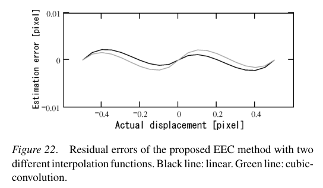
*그림 22 — 두 가지 다른 보간 함수를 쓴 제안 EEC 방법의 잔차 오차. 검은 선: 선형. 녹색 선: 3차 합성곱.*

### 5.3. 잔차 오차 (Residual Errors)

잔차 오차는 식 (48)로 살펴볼 수 있다. SAD를 쓴 PB의 경우, 오차가 상쇄된 추정값은

$$
\tilde d_{\mathrm{SAD+PB}}(d,\sigma_{\mathrm{edge}})=\frac{\left(\sum_{i\in W}es(d-i)\right)\left(5-\left|\sum_{i\in W}es(d-i)\right|\right)}{4\left(2-\left|\sum_{i\in W}es(d-i)\right|\right)\left(1+\left|\sum_{i\in W}es(d-i)\right|\right)}. \tag{50}
$$

그림 23(b)는 식 (42)의 기존 오차와 비교한 EEC 방법의 잔차 오차를 보여 준다. 다른 조합의 경우는 계산 결과만 그림 23에 보였다.

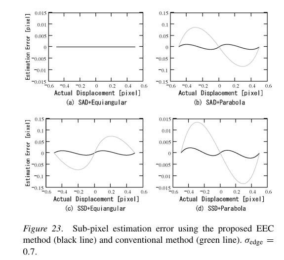
*그림 23 — 제안 EEC 방법(검은 선)과 기존 방법(녹색 선)을 쓴 부화소 추정 오차. $\sigma_{\mathrm{edge}}=0.7$.*

### 5.4. 전체 오차 감소 비율 (Overall Error Reduction Ratio)

그림 24는 네 조합에 대해 기존 방법과 EEC 방법의 RMS 오차를 보여 준다. 그림 25는 각 조합의 오차 감소 비율을 보여 준다. EEC 방법은 기존 방법에 비해 추정 오차를 최대 1/5까지 줄일 수 있다. SAD를 쓴 등각 직선 맞춤 (a)는 오차가 거의 없음에 유의한다.

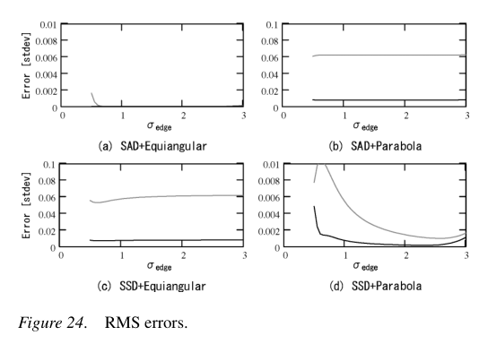
*그림 24 — RMS 오차.*

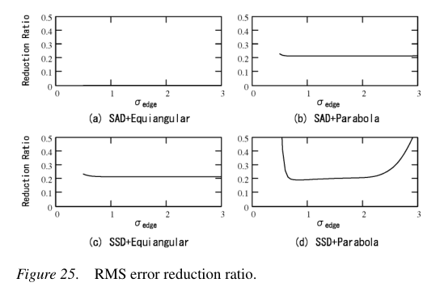
*그림 25 — RMS 오차 감소 비율.*

### 5.5. 2차원 확장과 구현 (2-D Extension and Implementation)

앞 절들에서는 1차원 영상 모델로 조사했다. 1차원 영상은 임의의 2차원 영상의 한 줄에 해당한다. 따라서 2차원 영상으로 확장하는 것은 아주 간단하다.

먼저 원 영상으로 기존 부화소 추정을 수행한다. 둘째, 부화소 추정 결과 $\hat d$의 부호를 확인하여 식 (45)의 보간 영상을 생성한다. 셋째, 식 (47)로 또 한 번의 부화소 추정을 수행한다. 끝으로 식 (48)로 추정 오차를 상쇄할 수 있다.

계산 시간이 중요하지 않을 때는 더 쉬운 구현을 택할 수 있다. (1) 보통의 영상 쌍으로 일반적인 정합과 부화소 추정을 수행한다. (2) 영상 쌍 중 하나로 수평[원문 오기 "hirizontal"] 보간 영상을 만들어 수평 표본화 위치를 이동시킨 다음, 다른 영상과 정합 및 부화소 추정을 수행한다. 이어서 결과에 0.5 [pixel]을 보정한다. (3) 영상 쌍 중 하나로 수직 보간 영상을 만들어 수직 표본화 위치를 이동시킨 다음, 다른 영상과 정합 및 부화소 추정을 수행한다. 끝으로 결과에 0.5 [pixel]을 보정한다.

이 결과들로 식 (48)을 써서 부화소 추정 오차를 상쇄할 수 있다. 이 경우 전체 계산 시간은 기존 방법의 세 배가 된다. 다음 실험에서는 이 간단한 구현을 사용했다.

## 6. 실험 결과 (Experimental Results)

### 6.1. 합성 영상 (Synthetic Images)

주어진 입력 변위에 대한 부화소 추정 오차를 검증하기 위해 합성 영상을 쓴다. 합성 영상은 수평 및 수직 정현파 밝기 스윕(sweep) 패턴으로 이루어진다. 위치 $(u,v)$에서의 정규화 밝기는

$$I(u,v)=\frac12+\frac14\left(\cos\left(\frac{\pi u^2}{R}\right)+\cos\left(\frac{\pi v^2}{R}\right)\right), \tag{51}$$

이다. 여기서 $R$은 공간주파수가 1[1/pixel]이 되는 위치다. 이 경우 $R=1000$을 썼다. 위치 $(u,v)$에서 공간주파수는 $(u/R,v/R)$[1/pixel]이다. 그림 26이 이 합성 영상이다. 영상 크기는 640×480[pixel]이다.

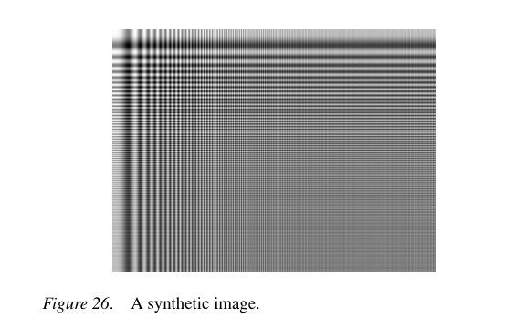
*그림 26 — 합성 영상.*

$I_n(u-n/20,\ v-n/20)$, $n$ = 0~19인 영상 20장을 생성한다. $I_{10}$을 기준 영상으로 쓴다. AOI 크기는 16×16[pixel]이다.

영상 내 위치를 $\sigma_{\mathrm{edge}}$에 대응시키기 위해, 정현파 함수의 반 주기를 영상 모델로 근사한다. 대응 관계는

$$\sigma_{\mathrm{edge}}=0.118312T, \tag{52}$$

이고, 여기서 $T$는 정현파 함수의 주기다.

그림 27(a)와 (b)는 합성 영상의 밝기를 에지 영상 모델로 근사한 것을 보여 준다. 정합 창의 중심은 $u$ = 169[pixel]과 $u$ = 99[pixel]이며, 대응하는 $\sigma_{\mathrm{edge}}$는 각각 0.7과 1.2다.

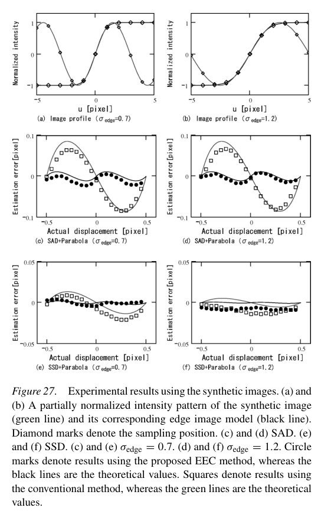
*그림 27 — 합성 영상을 쓴 실험 결과. (a)와 (b) 합성 영상의 부분 정규화 밝기 패턴(녹색 선)과 그에 대응하는 에지 영상 모델(검은 선). 마름모 표시는 표본화 위치를 나타낸다. (c)와 (d) SAD. (e)와 (f) SSD. (c)와 (e) $\sigma_{\mathrm{edge}}=0.7$. (d)와 (f) $\sigma_{\mathrm{edge}}=1.2$. 원 표시는 제안 EEC 방법의 결과이고 검은 선은 그 이론값이다. 사각형은 기존 방법의 결과이고 녹색 선은 그 이론값이다.*

그림 27(c)~(f)는 주어진 입력 변위에 대한 이론적 추정 오차와 실험 결과를 나타낸다. 결과가 이론과 똑같지 않은 이유는 영상이 8비트 밝기 분해능으로 합성되었기 때문으로 추정된다. 또한 정합 창에 여러 에지가 들어 있다.

그림 28은 $\sigma_{\mathrm{edge}}$에 대해 20번의 추정에 걸친 추정 오차의 표준편차를 보여 준다. 검은 선은 식 (48)을 써서 서로 다른 입력 변위에 대응하는 100개의 추정값으로부터 얻은 EEC 방법의 이론값이다. 녹색 선은 기존 방법의 이론값이다. 원과 사각형은 각각 EEC 방법과 기존 방법의 실험 결과다. 4.2절에서 말했듯이 $\sigma_{\mathrm{edge}}$의 범위는 $\sigma_{\mathrm{edge}}\ge0.7$로 본다. 이 영역에서 결과는 이론값과 잘 일치한다.

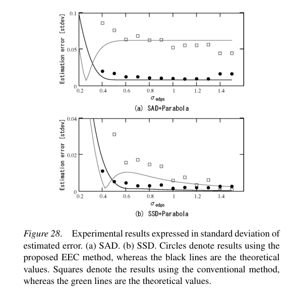
*그림 28 — 추정 오차의 표준편차로 나타낸 실험 결과. (a) SAD. (b) SSD. 원은 제안 EEC 방법의 결과이고 검은 선은 그 이론값이다. 사각형은 기존 방법의 결과이고 녹색 선은 그 이론값이다.*

CC를 쓴 실험 결과는 SSD를 쓴 것과 거의 같다.

### 6.2. 실제 영상을 쓴 시차 (Disparity Using Real Images)

그림 29는 실험에 쓴 영상을 보여 준다. 영상은 평행 스테레오 카메라로 촬영했다. 대상 표적은 광축에 수직이 아닌 평판에 붙인 신문이다. 영상 크기는 640×480 [pixel], 창 크기는 16×16 [pixel]이다. 시차는 5040개 위치에서 구했다.

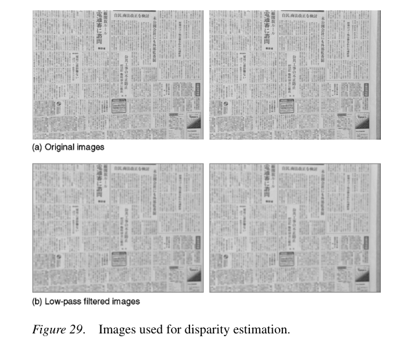
*그림 29 — 시차 추정에 쓴 영상. (a) 원 영상 (b) 저역통과 필터링한 영상.*

그림 30은 시차의 3차원 그래프를 보여 준다. SAD를 쓴 기존 방법(30(a)와 30(c))은 계통적인 부화소 추정 오차를 드러낸다. 제안 방법(30(b)와 30(d))에서는 오차가 극적으로 줄어든다.³

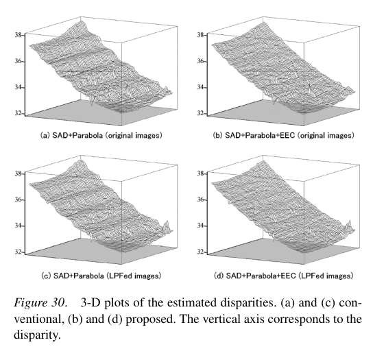
*그림 30 — 추정 시차의 3차원 그래프. (a)와 (c) 기존, (b)와 (d) 제안. 세로축은 시차에 해당한다.*

그림 31은 변위 수평 성분의 히스토그램을 보여 준다. 이 결과는 제안 EEC 방법이 계통 오차가 거의 없는 추정값을 낼 수 있음을 나타낸다. 나아가 결과는 다음을 보여 준다. (1) SAD를 쓴 PB는 영상 성질과 무관하게 큰 오차를 낸다. (2) SSD를 쓴 EL은 영상에 LPF를 적용하면 커지는 오차를 낸다. (3) 응용에서 LPF를 쓴다면 SAD를 쓴 EL이나 SSD를 쓴 PB를 권장한다. (4) 위에서 말한 모든 항목이 두 유형의 영상 모델을 쓴 분석과 일치한다.

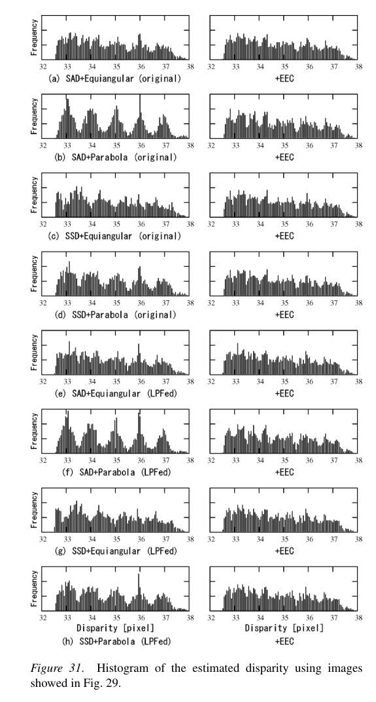
*그림 31 — 그림 29의 영상을 써서 추정한 시차의 히스토그램. (a)~(d) 원 영상, (e)~(h) LPF 적용 영상. 오른쪽 열은 +EEC.*

### 6.3. 정밀 표적 위치 (Precise Target Position)

그림 1(1절)이 실험에 쓴 영상을 보여 준다. 표적은 수평 방향으로 일정한 속도로 직선 운동한다. 측정한 수평 위치는 프레임 번호(시간)에 따라 선형으로 증가할 것으로 기대된다. 그림 2와 비교하면, 그림 32(a)처럼 EEC 방법으로 위치를 매우 정밀하게 측정할 수 있다.

그림 32(b)는 표적 위치에 대한 부화소 오차를 보여 준다. EEC 방법으로 오차는 약 1/5로 줄어든다.

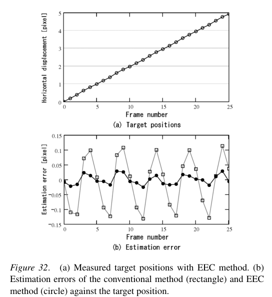
*그림 32 — (a) EEC 방법으로 측정한 표적 위치. (b) 표적 위치에 대한 기존 방법(사각형)과 EEC 방법(원)의 추정 오차.*

### 6.4. 다른 실제 영상 (Other Real Images)

그림 3(1절)이 실험에 쓴 영상을 보여 준다. 영상은 카메라 위치와 방향을 조금씩 달리하여 촬영했다. 영상 크기는 640×480[pixel], 창 크기는 16×16[pixel]이다. 흐름 벡터는 서로 다른 5040개 위치에서 구했다.

그림 33은 흐름 벡터 수평 성분의 히스토그램을 보여 준다. SAD(33(a)) 또는 SSD(33(c))를 쓴 기존 방법은 화소 고착 효과를 뚜렷이 보인다. 이 경향은 제안 EEC 방법(33(b)와 (d))에서 크게 줄어든다. CC를 쓴 실험 결과는 SSD를 쓴 것과 거의 같다.

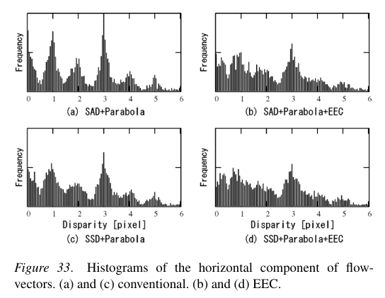
*그림 33 — 흐름 벡터 수평 성분의 히스토그램. (a)와 (c) 기존. (b)와 (d) EEC.*

## 7. 결론 (Conclusions)

SAD와 포물선 맞춤 부화소 추정의 조합은 계산 시간이 짧아 흔히 쓰인다. 그럼에도 그 결과에는 $\sigma_{\mathrm{edge}}$와 무관하게 부화소 추정 오차가 들어 있다. SAD를 쓴 등각 직선 맞춤이 SSD를 쓴 포물선 맞춤과 거의 같은 정확도를 낸다는 것을 증명하고 검증했다.

또한 이 논문에서는 기존 추정 오차를 분석한 뒤 대안적인 부화소 추정 방법을 제안했다. 제안 방법은 기존 방법의 1/5 추정 오차를 달성한다. 이 방법은 사용하는 유사도 척도와 맞춤 함수에 무관하다.

네 종류의 영상을 쓴 실험으로 제안 방법의 효과를 입증했다.

## 주석 (Notes)

1. 이 연구의 일부는 학술대회 논문집에 실렸다(Shimizu and Okutomi, 2001).
2. 여기서 고려하는 유사도 값은 1화소 영역에 대한 것뿐이다. 따라서 이 값들을 여기서는 절대차(AD) 또는 차의 제곱(SD)이라 부른다.
3. 평행 스테레오 카메라의 촬영 조건이 완벽하지 않으므로 시차가 완전히 평평하지는 않다. 또한 대물렌즈에 수차가 있다.

## 참고문헌

- Aggarwal, J.K. and Nandhakumar, N. 1988. On the computation of motion from sequences of images—a review. Proceedings of the IEEE, 76(8):917–935.
- Aghajan, H.K., Schaper, C.D., and Kailath, T. 1993. Machine vision techniques for sub-pixel estimation of critical dimensions. Optical Engineering, 32(4):828–839.
- Davis, C.Q. and Freeman, C.Q. 1998. Statistics of subpixel registration algorithms based on spatiotemporal gradients or block matching. Optical Engineering, 37(4):1290–1298.
- Davis, C.Q., Karu, Z.Z., and Freeman, D.M. 1995. Equivalence of subpixel motion estimators based on optical flow and block matching. In IEEE International Symposium for Computer Vision, Coral Gables, Florida, pp. 7–12.
- Driscoll, W.G. 1978. Handbook of Optics. New York: McGraw-Hill.
- Dvornychenko, V.N. 1983. Bounds on (deterministic) correlation functions with application to registration. IEEE Transactions on Pattern Analysis and Machine Intelligence, 5(2):206–213.
- Fincham, A. and Delerce, G. 1999. Advanced optimization of correlation imaging velocimetry algorithms. In Proceedings of the 3rd International Workshop on PIV, additional print, Santa Barbara, USA.
- Foroosh, H., Zerubia, J.B., and Berthod M. 2002. Extension of phase correlation to subpixel registration. IEEE Transactions on Image Processing, 11(3):188–200.
- Frischholz, R.W. and Spinnler, K.P. 1993. A class of algorithms for real-time subpixel registration. In Europto Confference, Munich.
- Fusiello, A. and Roberto, V. 2000. Symmetric stereo with multiple windowing. International Journal of Pattern Recognition and Artificial Intelligence, 14(8):1053–1066.
- Hart, D.P. 1998. The elimination of correlation errors in piv processing. Proceedings of the 9th International Symposium on Applications of Laser Techniques to Fluid Mechanics, Lisbon, Portugal, page 13.3.
- Horn, B.K.P. and Schunck, B.G. 1981. Determining optical flow. Artificial Intelligence, 17:185–204.
- Irani, M. and Peleg, S. 1991. Improving resolution by image registration. CVGIP: Graphical Models and Image Processing, 53(3):231–239.
- Kanade, T. and Okutomi, M. 1994. A stereo matching algorithm with an adaptive window: Theory and experiment, IEEE Transactions on Pattern Analysis and Machine Intelligence, 16(9):920–932.
- Keys, R. 1981. Cubic convolution interpolation for digital image processing. IEEE Transactions on Acoustics, Speech, and Signal Processing, 29(6):1153–1160.
- Lecordier, B., Lecordier, J.C., and Trinite, M. 1999. Iterative sub-pixel algorithm for the cross-correlation piv measurements. In Proceedings of the 3rd International Workshop on PIV, Santa Barbara, USA, pp. 37–43.
- Lucas, B. and Kanade, T. 1981. An iterative image registration technique with an application to stereo vision. In Proceedings of the 7th International Joint Conference on Artificial Intelligence, Vancouver, 674–679.
- Mitiche, A. and Mansouri, A.-R. 2004. On convergence of the Horn and Schunck optical-flow estimation method. IEEE Transactions on Image Processing, 13(6):848–852.
- Raffel, M., Willert, C.E. and Kompenhans, J. 1998. Particle Image Velocimetry. Heidelberg: Springer-Verlag.
- Schreier, H.W., Braasch, J.R., and Sutton, M.A. 2000. Systematic errors in digital image correlation caused by intensity interpolation. Optical Engineering, 39(11):2915–2921.
- Shimizu, M. and Okutomi, M. 2001. Precise sub-pixel estimation on area-based matching. In Proceedings of the 8th IEEE International Conference on Computer Vision, Vancouver, Canada, pp. 90–97.
- Shimizu, M. and Okutomi, M. 2002. An analysis of sub-pixel estimation error on area-based image matching, In Proceedings of the 14th International Conference on Digital Signal Processing, Santorini, Greece Vol. II, pp. 1239–1242 (w3B4).
- Shortis, M.R., Clarke, T.A., and Short, T. 1994. A comparison of some techniques for the subpixel location of discrete target images. In Proceedings of the SPIE: Videometrics III, Boston, MA, USA, Vol. 2350, pp. 239–250.
- Szeliski, R. and Scharstein, D. 2002. Symmetric sub-pixel stereo matching, Proceedings of the 7th European Conference on Computer Vision, II:525–540, Copenhagen.
- Tian, Q. and Huhns, M.N. 1986. Algorithms for subpixel registration. Computer Vision, Graphics and Image Processing, (35):220–233.
- West, G.A.W. and Clarke, T.A. 1990. A survey and examination of subpixel measurement techniques. In Proceedings of the SPIE: Close-Range Photogrammetry Meets Machine Vision, Zurich, Switzerland, Vol. 1395, pp. 456–463.
- Westerweel, J. 1998. Effect on sensor geometry on the performance of PIV interrogation. In Proceedings of the 9th International Symposium on Applications of Laser Techniques to Fluid Mechanics, Lisbon, Portugal, page 1.2..
