# 입자 영상 유속계의 피크 로킹 저감 (Michaelis 2016)

- 원제: Peak-locking reduction for particle image velocimetry
- 원문: 같은 폴더의 `Michaelis2016_MST_PeakLocking.pdf` (Meas. Sci. Technol. 27 (2016) 104005, 17pp, doi:10.1088/0957-0233/27/10/104005, Open Access CC BY 3.0)
- 저자: Dirk Michaelis¹, Douglas R Neal², Bernhard Wieneke¹ (¹ LaVision GmbH, Göttingen, Germany; ² LaVision Inc, Ypsilanti, USA)
- 번역 범위: 전문 (PDF 1쪽의 출판사 표지·관련 논문 추천 목록은 제외)
- 그림: 원문 그림 18개를 `그림/`에 넣고 본문에서 처음 언급되는 곳에 삽입. 표 1은 마크다운 표로 옮김.

## 초록

입자 영상 유속계(particle image velocimetry, PIV)에서 알려진 편향(bias) 오차 원인인 피크 로킹(peak-locking)에 기여하는 요인들에 대해, 최신 PIV 알고리즘으로 처리한 합성 데이터를 사용하여 매개변수 연구를 수행한다. 조사한 매개변수는 입자 영상 직경, 영상 보간 기법, 비대칭(asymmetric) 대 대칭(symmetric) 창 변형(window deformation)의 효과, 패스(pass) 수, 질의 창(interrogation window) 크기이다. 이들 중 일부는 피크 로킹 오차의 크기에 지대한 영향을 미치는 것으로 나타났다. 특정 PIV 카메라에 대한 효과도, 알려진 회전 속도장을 생성하는 정밀 턴테이블을 사용하여 실험적으로 연구한다. 이 실험으로 기록한 영상 시계열은 0에서 ±4화소에 이르는 화소 및 부화소(sub-pixel) 이동의 선형 범위를 보인다. 일정한 와도장(vorticity field, ωz)에서의 편차는, 초점 거리와 f-수(f-number) 같은 검출 시스템의 매개변수를 바꾸는 것과 PIV 해석 설정을 바꾸는 것 모두에 의해 피크 로킹이 어떻게 체계적으로 영향을 받는지를 드러낸다.

원시 영상을 기록하는 동안 과소표본화(undersampled)된 입자 영상을 피하기 위해 광학 확산판(optical diffuser)을 사용하는, PIV의 피크 로킹 관련 편향 오차를 줄이는 새로운 사전(a priori) 기법을 소개한다. 이 기법을 실험 데이터를 사용하여 다른 사전 접근법들과 비교 평가하며, 좋은 성능을 보임을 보인다. 끝으로, 새로운 사후(a posteriori) 반(反) 피크 로킹 필터(anti peak-locking filter, APLF)를 개발하고 조사하며, 이는 매우 작은 입자 영상 크기에 대해 합성 데이터와 실제 측정 모두에서 유망한 결과를 보인다.

키워드: 입자 영상 유속계, 오차 원인, 데이터 처리, 광학 필터링, 유체 역학

(일부 그림은 온라인 저널에서만 컬러로 나타날 수 있다)

## 1. 서론 (Introduction)

피크 로킹(화소 로킹(pixel-locking) 또는 화소 편향(pixel-biasing)이라고도 함)은 PIV에서 심각한 편향 오차 원인이다. 이는 측정된 입자 영상의 위치와 변위가 정수 값 쪽으로 편향되는 경향이다. 피크 로킹은 센서 위의 회절 한계(diffraction-limited) 입자 영상 크기가 너무 작아져 입자 영상이 과소표본화될 때 발생한다 [1]. 상관 피크 보간이 부실하거나 PIV 방법이 부적절해서 생기는 다른 형태의 피크 로킹은 이전에 깊이 있게 다루어졌으므로 여기서는 논의하지 않는다 [2, 3]. 피크 로킹 오차의 영향을 최소 수준으로 유지하려면 입자 영상 크기는 2–4화소 사이여야 한다 [2]. 같은 렌즈와 조리개라면, PIV에 적합한 특정 종류의 카메라에서 볼 수 있는 큰 화소 크기의 센서일수록 피크 로킹 효과가 더 두드러진다. 특히 CMOS(complementary metal–oxide semiconductor) 칩을 쓰는 고속 카메라는 CCD나 sCMOS 저속 카메라(5–10 µm)보다 상당히 큰 화소(10–20 µm)를 갖는 경우가 많다. 더 높은 취득 속도에 대한 요구가 커지면서 이러한 과학용 CMOS 카메라가 PIV에 점점 더 많이 사용되고 있다. 이 수요는 결과적으로 화소 크기를 더욱 키우는 경향을 낳았으며, 이는 최근 화소가 28 µm에 이르는 초고속(20 kHz 이상) CMOS 카메라가 도입된 데서 드러난다. 초고속 카메라의 이러한 새로운 진화는 피크 로킹과 그것이 만드는 오차를 완화하는 방법에 대한 관심을 다시 불러일으켰다.

피크 로킹과 관련된 오차는 난류 통계의 추정에 악영향을 주며 [4], 따라서 여러 연구의 동기가 되었다. 데이터 처리 알고리즘을 통해 이러한 효과를 사후적으로 줄이는 수많은 방법이 제안되었다. 이 방법에는 상관 사상(correlation mapping) 방법 [5], 대안적 부화소 변위 알고리즘 [6, 7], 입자 변위 히스토그램 수정 [7, 8], 스펙트럼 영역 영상 이동 기법 [9], 단순화된(1D) 모델링과 보정 [10], 위상 상관을 이용한 처리 [11]가 포함된다. 입자 영상을 탈초점(defocusing)하거나 큰 f-수를 사용해 과소표본화 형태의 피크 로킹을 사전에 방지하는 방법이 논의되었으나 [2] 광범위하게 연구되지는 않았다. 최근 연구에서는 입자 영상을 약간 탈초점하는 것이 효과적임이 밝혀졌다 [12]. 피크 로킹의 영향을 완화하는 이러한 수많은 방법에도 불구하고, 숙련된 PIV 실험자들의 실험 데이터에서조차 여전히 피크 로킹이 자주 보고된다(최근의 주목할 만한 예가 2014년 제4회 PIV 챌린지의 케이스 B이다 [13]).

본 연구에서는 실제 카메라와 관련된 효과로부터 기본 원리를 분리하기 위해, 합성 데이터를 사용하여 최신 PIV 알고리즘의 피크 로킹 편향 오차를 조사한다. 조사한 매개변수는 입자 영상 직경, 영상 보간 기법, 비대칭 대 대칭 창 변형의 효과, 질의 창 크기이다. 이들 중 일부는 편향 오차의 체계성과 강도에 지대한 영향을 미치는 것으로 나타났으며, 이 결과를 상세히 제시하고 논의한다.

또한 개별 카메라에 대해 피크 로킹을 표준화된 방식으로 쉽고 강건하게 특성화할 수 있는 간단한 실험 장치를 제안한다. 카메라를 정밀 턴테이블(일정한 33 rpm으로 회전) 위에 장착하고, 턴테이블에는 매우 작은 입자 영상으로 이루어진 인쇄 입자 패턴을 붙인다. 초점 거리와 카메라 거리는 대부분의 실제 PIV 실험과 비슷하게 결상이 회절 한계가 되도록 선택한다. 회전하는 패턴은 거의 0화소에서 가변 최대 이동(여기서는 약 ±4화소)까지 모든 부화소 이동을 포함하는 단순한 회전 속도장을 만든다. 일정한 회전은 측정 영역 전체에 걸쳐 일정한 와도를 주므로, 와도의 z 성분(ωz)을 표시하면 피크 로킹 오차를 시각화할 수 있다. 피크 로킹의 효과는 초점 거리와 f-수 같은 검출 시스템의 매개변수를 바꾸는 것과 PIV 해석 설정을 바꾸는 것 모두를 통해 체계적으로 정량화하고 최소화할 수 있다.

피크 로킹을 사전에 피하는 새롭고 강건한 광학적 방법으로 광학 확산판(optical diffuser plate)의 사용을 제안한다. 이 판은 보통 베이어 패턴(Bayer pattern) 컬러 센서에 빛의 세기를 고르게 퍼뜨리는 데 쓰인다. 이 판은 퍼짐(spread)이 10 µm인 복굴절 확산판(birefringent diffuser)으로 특성화할 수 있으며, LaVision이 제조한다. 확산판은 센서 앞에 장착되어 영상에 약간의 탈초점 효과를 준다. 효과를 키우기 위해 두 장을 겹쳐 쓸 수 있다. 이 확산판의 성능을 앞서 언급한 정밀 턴테이블 실험 장치를 사용하여 다른 사전 방법들과 상세히 비교한다. 적절히 선택하면 광학 확산판은 탈초점만큼 효과적임을 보인다 [12]. 그러나 실제로 최적 설정을 찾기 어려운 탈초점과 달리, 확산판은 그 특성상 PIV 실험에서 흔히 나타나는 다양한 까다로운 실험 조건에서 피크 로킹을 안정적으로 방지하므로 더 강건하다. 여기에는 우연히 화소가 다시 초점이 맞게 되는 상황이 포함된다. 이런 상황의 한 예는 초점면이 레이저 시트(laser sheet)와 정확히 정렬되지 않은 경우이다(샤임플러그(Scheimpflug) 어댑터를 사용하거나 초점면이 어긋난 경우). 또 다른 예는 초점면이 광학적 왜곡으로 휘는 경우이다(실린더나 파이프 같은 곡면 경계 뒤에서의 측정). 또한 어떤 측정 상황에서는 초점면을 조명 영역 밖으로 옮기는 것이 불가능하거나 바람직하지 않을 수 있다. 그 예는 체적 측정(tomographic PIV, 3D-PTV)에서 찾을 수 있으며, 이때 확산판은 체적 중앙에서 입자가 너무 선명하고 작아지는 것을 막는다. 끝으로, 새로운 사후 반 피크 로킹 필터(APLF)를 개발하고 조사하며, 이는 합성 데이터와 실제 측정 모두에서 유망한 결과를 보인다.

## 2. 반 피크 로킹 방법 (Anti peak-locking methods)

본 연구에서는 피크 로킹을 줄이기 위한 방법으로 사전 방법과 사후 방법을 조사한다.

1. 사전(a priori) 방법:
   - Canon 원격 초점 링(remote focus ring)을 사용한 탈초점
   - 서로 다른 렌즈 조리개로 기록
   - 렌즈와 카메라 센서 사이에 확산판을 넣지 않거나, 1장 또는 2장 넣기
2. 사후(a posteriori) 방법:
   - 최적의 화소 보간기(쌍선형(bilinear), 스플라인(spline))와 질의 방식(비대칭 대 대칭) 선택
   - 새로운 APLF 적용

APLF의 착상은 쌍선형 대칭 질의 방식의 편향 오차(그림 1 참조)가 근사적으로 점대칭이고 주기적이며 파장이 2화소라는 관찰에 기반한다. 이 성질 때문에 편향 곡선 위의 임의의 점 x에 대해, x − 0.5 pix에서의 편향은 x + 0.5 pix에서의 편향과 세기가 거의 같고 방향이 반대이다. APLF는 새로운 영상 보간기로 구현된다. 보간기가 위치 x의 화소에 대해 질의되면 x − 0.5 pix와 x + 0.5 pix에서 보간한 값의 합을 반환하여 편향 오차가 상쇄되도록 한다. 실제로는 x와 y의 편향을 동시에 보상해야 하므로, 보간기는 다음과 같이 구현된다.

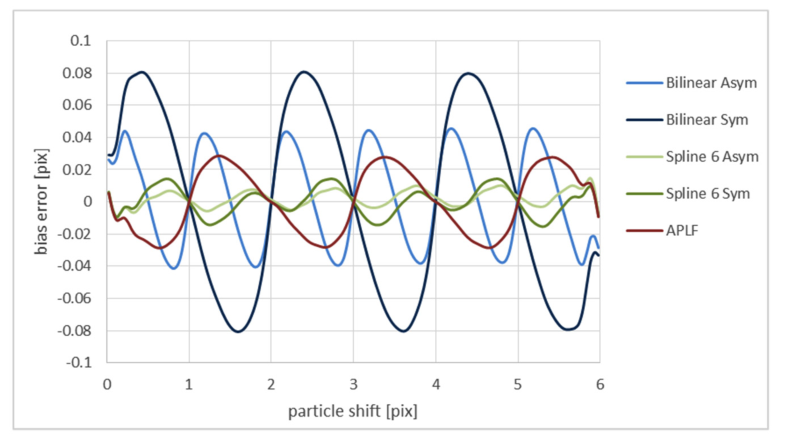
*그림 1 — 여러 보간 방식에 대한 편향 오차 대 입자 이동 비교. APLF의 동기를 보여 준다.*

$$
\mathrm{APLF}(x, y) = 0.5\ast I(x - 0.5,\, y - 0.5) + 0.25\ast I(x,\, y + 0.5) + 0.25\ast I(x + 0.5,\, y) \tag{1}
$$

여기서 I(x,y)는 (부화소) 위치 (x,y)에서의 쌍선형 보간 값이다. 이 필터가 피크 로킹을 완전히 억제하지 못하는 불완전성은, 가정한 조건(점대칭과 주기성)이 정확히 성립하지 않는다는 사실에서 비롯된다. 이 때문에 APLF에는 잔여 편향이 남는다.

## 3. 합성 시험 데이터 (Synthetic test data)

서로 다른 PIV 처리 방법이 입자 영상 크기에 얼마나 민감한지 시험하기 위해 합성 PIV 영상을 사용한다. 입자 직경을 선택할 수 있는 PIV 영상을 만들 수 있는 무작위 입자 생성기를 구현하였다. 입자 영상 직경 dτ는 [2]에 기술되고 최근 [14]에도 기술된 것과 같은 방법으로 추정하는데, 이에 따르면 변위 상관 피크(displacement-correlation peak)의 폭 dD는 입자 영상 직경과 다음과 같은 관계가 있다.

$$
d_\mathrm{D} \cong \sqrt{2 d_\tau^2 + \frac{4}{3} a^2} \tag{2}
$$

[2]에서 논의된 바와 같이, dD를 자기상관 함수(autocorrelation function, ACF)로 계산할 때는 기울기(gradient) 매개변수 a를 무시할 수 있다. 여기서 자기상관 피크 폭은 e⁻² 폭을 사용하여 계산하며, 이는 가우스 분포 표준편차의 네 배(4σ)이다. 식 (2)를 풀면 입자 영상 직경은 다음과 같다.

$$
d_\tau \cong 2\sqrt{2}\,\sigma \tag{3}
$$

가우스 입자 함수를 한 화소에 걸쳐 실제로 적분하여 계산하는 것이 필요함이 밝혀졌다. 예를 들어 화소 중심에서의 함수값만 할당하면 PIV 해석에서 인공물(artifact)이 생긴다.

입자 영상은 4096 × 4096화소 크기로 만들었다. 입자 밀도는 화소당 0.05개로 설정하여, 32 × 32 창에 평균 51개의 입자가 들어가도록 했다. 이는 창당 권장 입자 수 10개보다도 다섯 배 많다. 따라서 질의 창당 입자 수가 적어서 생기는 문제는 없을 것으로 예상된다. 입자 영상의 예를 그림 2에 보였다. 매우 작은 크기의 입자를 만들 때, 예컨대 그림 2 왼쪽처럼 입자 영상 크기가 0.4화소이면 각 입자가 단 하나의 화소로만 표현된다는 점에 주목하라.

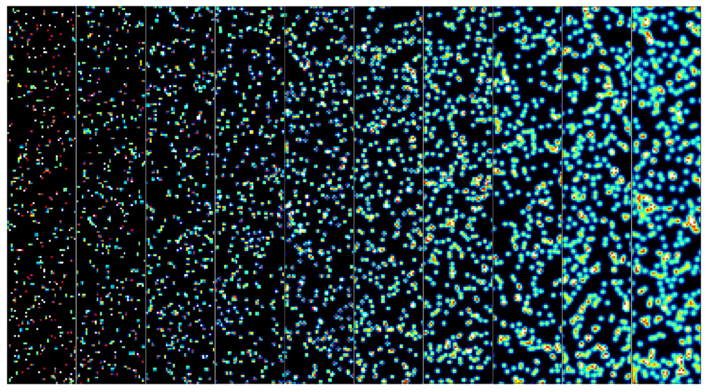
*그림 2 — 입자 영상 크기를 0.4화소(왼쪽)에서 4.0화소(오른쪽)까지 0.4화소씩 10단계로 늘린 합성 PIV 영상.*

피크 로킹 효과를 연구하기 위해 단순한 속도장, 즉 입자 이동장(particle shift field)을 만들었다. 입자는 첫 번째 영상과 두 번째 영상 사이에서 x 방향으로 선형 증가하는 거리만큼 이동한다(x 이동 또는 u 성분). 이동은 왼쪽 끝에서 0화소이고 오른쪽 끝에서 6화소까지 선형으로 증가한다(그림 3 참조). y 이동 또는 u 성분 [역주: 원문 그대로. v 성분의 오기로 보임]은 전체 장에서 0이다. 4096화소에 걸쳐 천천히 변하므로 32 × 32 창 안의 기울기는 0.05화소 미만으로 비교적 작다. 이 작은 선형 기울기는 적용한 연속 창 변형 PIV 방법에 아무런 어려움을 주지 않을 것으로 예상된다. 4096화소인 영상의 높이는 단일 영상에서 충분한 통계를 얻을 만큼 크다. 75% 겹침의 32 × 32 창이면 y 방향으로(유동 조건이 일정한 채로) 500개가 넘는 질의 창이 있다. 128 × 128 창이면 여전히 128개의 벡터가 있다.

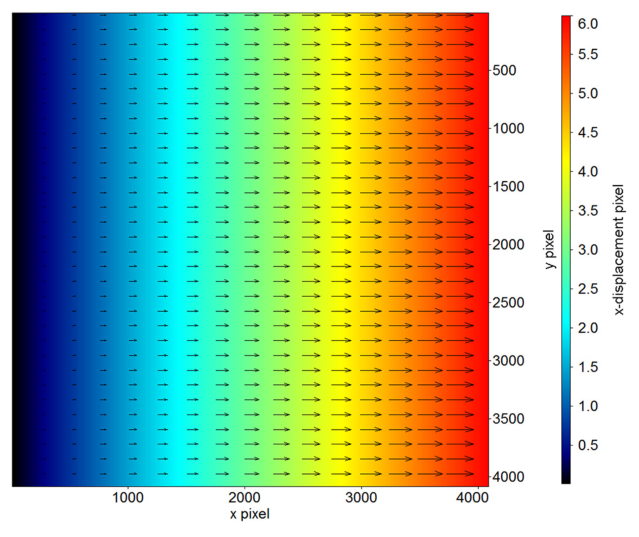
*그림 3 — 합성 PIV 데이터의 변위장: x 변위가 0화소(왼쪽)에서 6화소(오른쪽)까지 선형으로 증가한다. 명확성을 위해 모든 벡터를 표시하지는 않았다.*

## 4. 실험 시험 데이터 (Experimental test data)

실제적인 결상 조건에서 피크 로킹을 연구하기 위해 고속 카메라(Phantom V711)로 실험을 수행하였다. 이 카메라의 화소는 20 µm × 20 µm로, 최신 고속 CMOS 센서(보통 16–28 µm 범위)로서는 중간 크기의 화소이다. 유동장이 시간적으로 충분히 안정하면서, 0에서 6화소 사이의 연속적인 입자 이동 범위를 포함하고 시딩(seeding) 밀도가 고정된 실제 PIV 실험을 설계하는 것은 매우 어렵다. 대신, 시간적 안정성이 높은 입자 이동장을 만들기 위해 인쇄 입자 패턴을 붙인 턴테이블을 사용한다. 회전 속도는 매우 정밀하며 거의 변하지 않는다. 인쇄 입자 패턴을 사용하면 시딩 밀도가 일정하게 보장된다.

확산판, 탈초점, 렌즈 조리개가 피크 로킹에 미치는 효과를 연구하기 위해 각 100장으로 된 기록 시퀀스를 여러 개 촬영하였다. 시퀀스의 세부 사항은 표 1에 나열하였다.

*표 1 — 기록 시퀀스와 기록 매개변수.*

| 확산판 (Diffuser plate) | 렌즈 조리개 f# | 초점 스캔: 위치 수 | 영상 수 |
|---|---|---|---|
| No | 1.4 | 21 | 21 × 100 |
| No | 2.0 | 17 | 17 × 100 |
| No | 2.8 | 18 | 18 × 100 |
| No | 4.0 | 20 | 20 × 100 |
| No | 8.0 | 19 | 19 × 100 |
| No | 16 | 17 | 17 × 100 |
| No | 22.6 | 26 | 26 × 100 |
| 1 × | 1.4 | 21 | 21 × 100 |
| 1 × | 1.4–22.6 | 1 (초점 맞음) | 7 × 100 |
| 1 × | 1.4–22.6 | 1 (약간 초점 벗어남) | 7 × 100 |
| 2 × | 1.4 | 21 | 21 × 100 |
| 2 × | 1.4–22.6 | 1 (초점 맞음) | 7 × 100 |

## 5. PIV 해석 (PIV analysis)

피크 로킹은 카메라 화소 크기, 배율, 초점, 조리개 같은 결상 시스템의 특성에 좌우되지만, 적용하는 PIV 방법의 구현 세부에도 강하게 영향을 받는다. 영향을 줄 수 있는 매개변수는 다음과 같다. 반복 유형(단일 패스(single-pass) 대 다중 패스(multi-pass)), 화소 보간을 위한 보간 방법(다중 패스에만 해당), 적용하는 창 변형의 유형(대칭, 비대칭, 변형된 창 또는 단순 창 이동, 이산 창 이동 또는 연속 이동이나 변형), 부화소 상관 피크 보간의 유형. 다룰 수 있는 수의 매개변수에 집중하고 문헌의 결과를 반복하지 않기 위해, 여기서는 다음 매개변수만 바꾸어 조사한다.

- 상관 창 크기: 합성 데이터와 실험 데이터에 32 × 32화소, 합성 데이터에만 128 × 128화소
- 창 변형을 위한 화소 보간기:
  1. 보간 없는 단일 패스(합성 데이터만)
  2. 쌍선형(빠름)
  3. 6차 스플라인 보간(더 느리지만 입자 영상이 충분히 크면 더 정밀한 것으로 알려짐)
  4. 피크 로킹을 줄이도록 설계한 APLF라는 새로운 보간기
- 대칭 대 비대칭 창(또는 영상) 변형. 대칭 변형에서는 각 위치의 속도장 V(x,y)를 반으로 나누어 각 반을 (영상 쌍의) 시각 t = 0과 시각 t = 0 + Δt의 각 영상에 똑같이 적용한다. 비대칭 변형은 각 위치의 속도장 V(x,y)를 영상 쌍 중 시각 t = 0 + Δt의 두 번째 영상에만 적용하는 경우이다. 자세한 내용은 Scarano [15]를 참조하라.

저자들이 아는 한, 화소 보간기의 영향과 대칭 대 비대칭 창 변형이 피크 로킹 및 작은 입자 영상 크기(<1화소)에 미치는 영향은 아직 광범위하게 연구되지 않았다. 주목할 만한 예외는 Liao와 Cowen [9]의 연구로, 이들은 쌍선형 입자 영상 보간기를 포함하여 여섯 가지 부화소 보간기를 상세히 조사하였다. 위에서 언급한 그 밖의 매개변수는 저자들이 아는 최선의 범위에서 현재 최신 PIV 처리를 대표하도록 선택하였다.

- 75% 겹침의 가우스 형태 질의 창
- 연속 질의 창 변형과 중간 속도장 후처리(중앙값 필터와 다항식 벡터 정류(polynomial vector rectification))를 포함한 다중 패스 처리(5 패스)

모든 기록과 PIV 해석은 LaVision DaVis 8.3.0 소프트웨어로 수행하였다. 카메라의 기록 속도는 x와 y 방향으로 ±3.5화소의 화소 이동 동적 범위를 얻도록 250 Hz로 조정하였다(그림 4 참조).

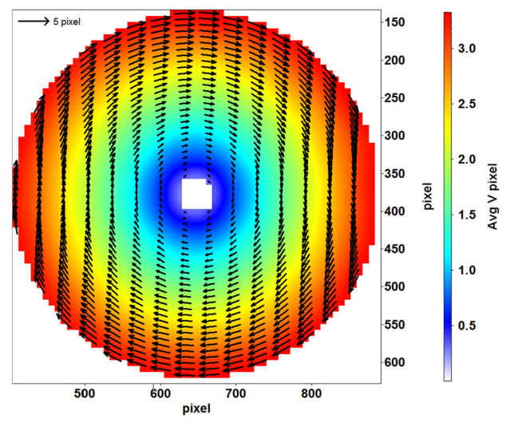
*그림 4 — 입자 이동 턴테이블: 바깥 경계에서 최대 이동은 약 3.5화소이며, x와 y 방향으로 총 7화소(±3.5화소)의 동적 범위를 준다.*

## 6. 합성 시험 데이터의 결과 (Results from synthetic test data)

합성 데이터의 해석에서는 알려진 참 입자 이동을 뺀다. 남은 이동장은 무작위 오차와 편향 오차를 포함하며, 후자는 주로 부입자(sub particle) 이동에 의존하여 주기적인 편향 오차 구조를 만든다. 잔차 오차의 예를 두 가지 PIV 매개변수 구성에 대해 그림 5에 나타냈다. 입자 크기는 0.4화소(위)에서 4.0화소(아래)로 증가한다. 잔차는 일부 무작위적 특징(예: 그림 5 위 왼쪽: 작은 창 크기, 작은 입자)을 분명히 보이지만, (수평) x 방향의 부화소 이동량에 따라 주기적으로 반복되는 꽤 체계적인 특징도 보인다. 이 체계적 특징을 이하에서는 체계적 편향 오차라고 부른다. 편향 오차의 강도는 화소 보간기와 입자 영상 크기에 의존한다. 보통 강도는 입자 영상 크기가 커질수록 줄어들지만, 논의해야 할 예외가 있다. 강도뿐 아니라 체계적 편향의 파장도 매개변수 설정마다 다르다. 대부분의 설정은 (화소 이동 변화로) 파장 1화소의 주기성을 보인다. 그러나 대칭 창 변형을 쓰는 쌍선형 화소 보간기는 입자 이동 변화 2화소의 주기성을 보인다. 편향 오차를 간결하게 나타내기 위해, 오차의 u 성분을 계산된 모든 벡터에 대해 수직(y) 방향으로 평균하고, 모든 입자 영상 크기에 대해 입자 이동(x축)에 대한 함수로 그림 6과 7에 표시하였다.

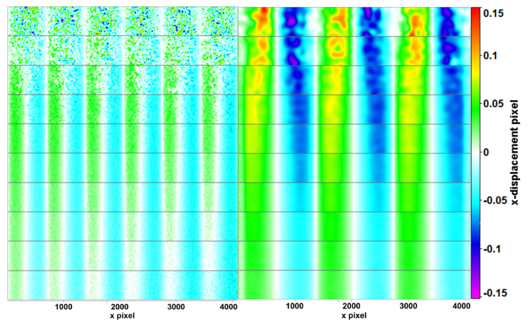
*그림 5 — 원래 입자 이동으로부터 u 성분의 편차. 왼쪽: 32 × 32 창 크기, 단일 패스. 오른쪽: 128 × 128 창 크기, 쌍선형 화소 보간, 대칭 창 변형. 입자 영상 크기는 0.4화소(위)에서 4.0화소(아래)까지 0.4화소씩 변한다.*

피크 로킹 측면에서 연구할 가장 기본적인 PIV 절차는 단일 패스 PIV 처리이다(그림 6 위). 여기에는 보간이나 창 변형이 관여하지 않는다. 피크 로킹은 입자의 통계적 특성과 부화소 상관 피크 보간기에만 의존할 것이다. 창 변형이 없으므로 대칭과 비대칭 변형의 구별도 없다. 이 구성에서 관찰되는 최대 편향 오차는 입자 영상 크기 1.6화소와 2.0화소에서 약 0.04화소이다. 예상과 달리 편향 오차는 입자 영상 크기가 작을수록 더 낮으며, 크기 0.4화소의 입자에서 최소에 이른다. 이는 아래에서 그림 8과 9와 관련하여 더 논의한다. 쌍선형 비대칭 보간기에서도 마찬가지이다(그림 5, 가운데 [역주: 원문 그대로. 그림 6 가운데를 가리키는 것으로 보임]).

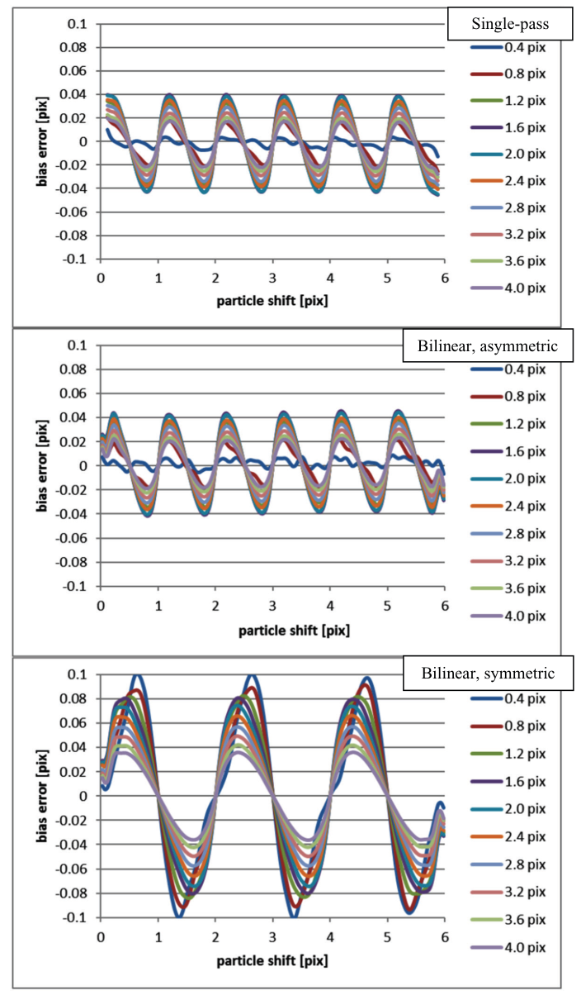
*그림 6 — 서로 다른 화소 보간기와 입자 영상 크기에 대한 입자 이동의 함수로서의 편향 오차. (위: 단일 패스, 가운데: 쌍선형 비대칭, 아래: 쌍선형 대칭)*

쌍선형 보간기를 유지하되 비대칭에서 대칭 창 변형으로 바꾸면 편향 오차의 양상이 완전히 바뀐다(그림 6 아래). 최대 편향 오차는 훨씬 더 크다(가장 작은 입자에서 0.1화소 이상). 주기적 편향 오차의 파장은 이동 변화 1화소에서 2화소로 두 배가 된다. 여기서 오차는 입자가 클수록 단조 감소하지만, 현재 연구한 가장 큰 입자 영상 직경(크기 4.0화소)에서도 최대 0.04화소의 높은 수준에 머문다. 이 보간기의 편향 오차의 흥미로운 특징은, 특히 작은 입자 영상 크기에서 거의 완벽하게 점대칭이라는 것이다. 이 특징은 이미 논의한 APFL [역주: 원문 그대로. APLF의 오기]의 설계에 활용된다.

6차 스플라인 보간기의 결과를 그림 7(위와 가운데)과 그림 8에 나타냈는데, 그림 8에서는 편향 오차 축척을 10배 확대하여 더 큰 화소 크기 [역주: 원문 그대로. 문맥상 더 큰 입자 영상 크기]에서의 매우 작은 편향 오차를 더 정밀하게 시각화할 수 있게 하였다. 파장은 비대칭과 대칭 모두에서 다시 입자 이동 변화 1화소이다. 전체적인 크기와 구조는 비대칭과 대칭 창 변형 사이에 매우 비슷하다. 그러나 작은 차이로, 대칭의 경우 약간의 주기 배가(period doubling)가 보여 편향 오차 곡선에서 더 높은 피크와 더 낮은 피크가 번갈아 나타난다(그림 7 가운데). 또한 다른 보간기와 달리, 스플라인 보간기는 작은 입자에 대해 이동 0화소(왼쪽 경계)와 6화소(오른쪽 경계)에서 강한 경계 효과를 보이며, 경계에서 편향 오차가 점점 커진다. 이는 영상 경계에서 스플라인 보간기의 구현에 사용한 '거울(mirror)' 경계 조건에서 비롯될 수 있는데, 보간 커널이 영상 경계 밖으로 나가면 화소를 '추측'해야 하기 때문이다. 스플라인 보간기의 더 큰 커널(7 × 7화소)은 쌍선형 보간기의 작은 2 × 2 커널보다 경계 효과의 영향을 훨씬 강하게 받는다. 더 큰 입자에서는 스플라인 보간기가 매우 좋은 성능을 보여 약 0.001화소에 이르는 낮은 오차를 달성한다(그림 8 아래, 보라색 곡선)(편향 오차가 더 높은 경계 효과는 제외). 이 때문에 최종 패스에서 고차 보간에 흔히 사용된다. 흥미롭게도 대칭의 경우에만, 입자 영상 크기를 1.2 pix(그림 7 가운데, 녹색 곡선)에서 2.0 pix(그림 8, 청록색 곡선)로 키울 때 파장이 1화소에서 2화소 입자 이동으로 바뀐다.

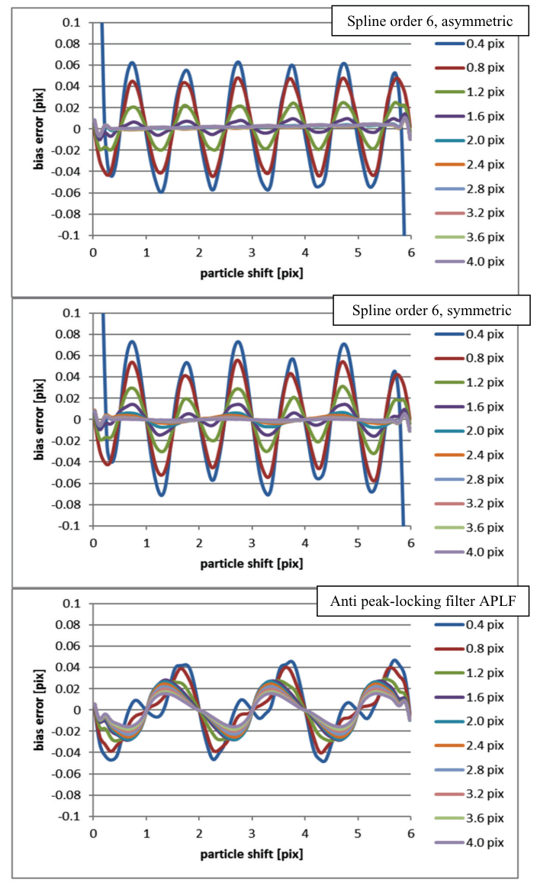
*그림 7 — 서로 다른 화소 보간기와 입자 영상 크기에 대한 입자 이동의 함수로서의 편향 오차. (위: 6차 스플라인 비대칭, 가운데: 6차 스플라인 대칭, 아래: 반 피크 로킹 필터 APLF)*

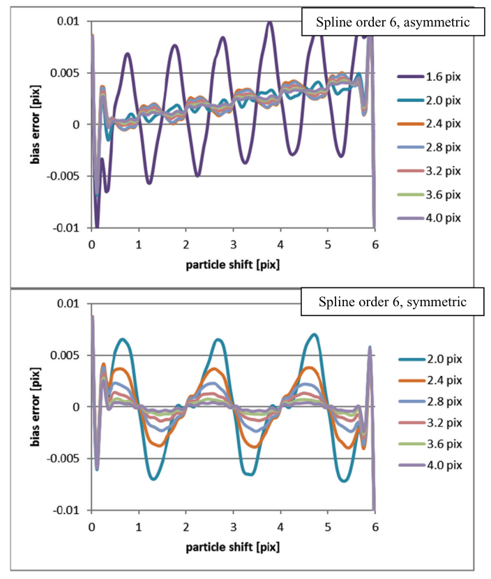
*그림 8 — 서로 다른 PIV 보간기와 입자 영상 크기에 대한 입자 이동의 함수로서의 편향 오차(y축 확대). (위: 6차 스플라인 비대칭, 아래: 6차 스플라인 대칭)*

서로 다른 보간 방식의 효과를 그림 9에 나타냈다. 일반적으로 스플라인 6 보간기는 약 1.2화소 이상의 입자 영상 크기에서 가장 낮은 피크 로킹 오차를 보인다. 두 창 크기 모두에서, 직경이 커질수록 대칭 스플라인 6이 비대칭보다 오차가 낮았다. 더 큰 창(128 × 128)에서는 쌍선형 비대칭이 더 작은 입자 영상 크기에서 더 낮은 오차를 보인다. 이 의외의 결과는 더 작은 창(32 × 32)에서는 나타나지 않는다. 작은 입자에서 감소한 RMS 오차는 작은 질의 창의 전반적으로 높은 잡음 수준에 의해 상쇄되는 것으로 보인다. 또한 큰 화소 영상 크기(4.0 pix)에서는, 더 작은 창 크기(32 × 32)에서 단일 패스의 편향 오차가 쌍선형 비대칭보다 상당히 큰 반면, 더 큰 창 크기(128 × 128)에서는 두 곡선이 넓은 입자 영상 크기 범위에 걸쳐 명목상 동일하다. 이는 FFT 상관기를 사용하여 영상 1과 영상 2 사이에서 창 변형을 수행하는 방식의 결과로 생각된다. 검출할 이동이 커질수록(최대 6화소) 영상 1과 영상 2의 창이 겹치는 부분이 줄어들고(32화소–6화소) FFT의 순환적 성질에서 오는 경계 효과가 더 두드러진다. 이는 더 높은 패스에서 창 변형에 의해 보상되어, 최종 패스에서는 다시 거의 100% 겹침이 된다. 단일 패스에서 창 겹침이 줄어드는 효과가 커지는 것은 그림 10 아래 왼쪽 [역주: 원문 그대로. 그림 10은 턴테이블 영상이며, 그림 5 왼쪽을 가리키는 것으로 보임]에서도 볼 수 있는데, 겹침이 작아짐에 따라 편향 오차가 왼쪽에서 오른쪽으로 조금씩 변한다. 그림 9 오른쪽에서 단일 패스와 쌍선형 비대칭 곡선이 일치하는 것은, 약 6화소의 경계 효과가 훨씬 작은 역할을 하는 더 큰 창 크기(128 × 128)에서는 쌍선형 비대칭 화소 보간기와 함께 쓰는 다중 패스가 그다지 효과적이지 않다는 것으로도 해석할 수 있다. 이는 그림 6의 위와 가운데 프로파일이 비슷한 데서도 보인다.

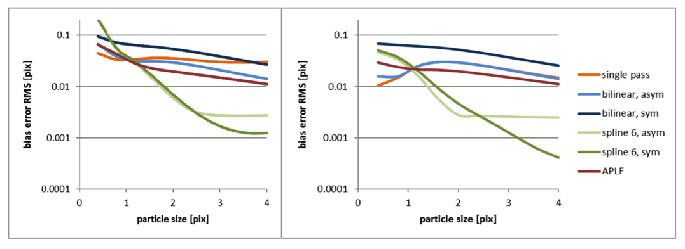
*그림 9 — 서로 다른 보간기에 대한 입자 영상 크기의 함수로서의 편향 오차 RMS. 왼쪽: 창 크기 32 × 32, 오른쪽: 창 크기 128 × 128.*

그림 7과 8의 그래프는 보간기의 평균 성능에 대한 좋은 개관을 준다. 그러나 이 결과는 평균에 대해서만 유효하며 개별 영상에 대한 성능에 관해서는 구체적인 정보를 주지 않는다. 예를 들어 두 보간기가 평균 편향 오차는 같지만, 하나는 평균 주위의 변동이 작고 다른 하나는 변동이 클 수 있다. 변동이 크다는 것은 개별 시간 단계가 평균보다 상당히 높은 오차 값을 보일 수 있음을 뜻한다. 따라서 평균뿐 아니라 개별적이고 순간적인 결과도 중요하다면, 다른 성능이 비슷하다고 가정할 때 변동이 더 작은 방법을 선호해야 한다.

단일 패스와 쌍선형 비대칭 사이의 더 뚜렷한 차이는 그림 11에서 관찰되는데, 이 그림은 주어진 화소 크기에 대한 편향 오차의 분산을 보여 준다. 단일 패스는 작은 입자에 대해 편향 오차의 분산도 가장 작다. 반대로 큰 입자에서는 단일 패스의 분산이 가장 크다. 실제로 다른 보간기보다, 특히 쌍선형 비대칭보다 한 자릿수 더 높다. 이는 입자 영상 크기가 1.4화소를 넘으면 단일 패스 해석에서의 개별 결과(순간 속도장)가 다른 접근법에 비해 평균으로부터 훨씬 더 크게 벗어난다는 것을 뜻한다.

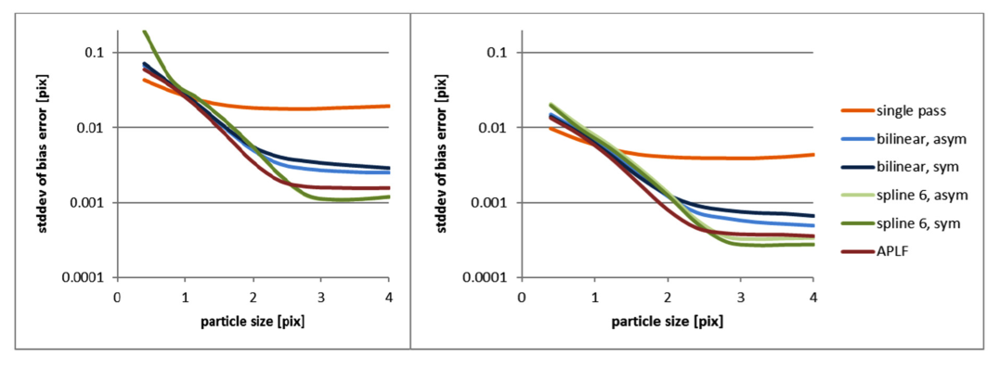
*그림 11 — 서로 다른 보간기에 대한 입자 영상 크기의 함수로서의 편향 오차 변동성(표준편차). 왼쪽: 창 크기 32 × 32, 오른쪽: 창 크기 128 × 128.*

이 크기 문턱값 아래에서, 단일 패스는 합성 데이터를 사용할 때 매우 작은 입자에 대해 놀랍도록 좋은 성능을 보인다. 예컨대 32 × 32 창에서 스플라인 6 보간기보다 편향 오차가 약 5배 작다(그림 9 왼쪽). 그럼에도 이 효과는 실용적 의미가 거의 없는 것으로 간주하였는데, 단일 패스는 기울기가 있을 때 성능이 나쁜 것으로 알려져 있고, 기울기는 실제 유동장에서 흔하지만 이 합성 데이터에는 포함되지 않기 때문이다. 이런 이유로 실험 데이터 시험에서는 단일 패스를 사용하지 않았다.

단일 패스를 제외하면 모든 보간기가 그림 11에서 비슷한 변동을 보이며, 이는 실제 평균 편향 오차와 강하게 관련된다. 편향 오차가 낮을수록 분산이 작다. 이는 또한 일반적으로 입자가 클수록 분산이 작아진다는 것을 뜻한다. 이는 실험 영상에서는 다르다는 것을 보일 것인데, 실험 영상에서는 최적 입자 영상 크기에 도달한 뒤 분산이 다시 증가한다. 결과적으로 스플라인 6 보간기는 더 큰 입자 영상 크기에서 가장 작은 분산을 보이며, 개별 시간 단계에 대해 가장 신뢰할 만한 보간기가 된다.

## 7. 실험 시험 데이터의 결과 (Results from experimental test data)

여기서 조사하는 일정 회전 턴테이블 유동의 피크 로킹 효과를 시각화하고 정량화하는 데에는 와도의 z 성분(ωz)을 표시하는 것이 직관적이고 간단한 방법임이 밝혀졌다(그림 12 위). 여기서는 명목상 일정한 와도 값에서의 어떤 편차든 오차로 간주할 수 있다. 피크 로킹에 기인하는 일정 와도로부터의 체계적 편차는, 100장 전체에서 검출한 입자 이동장을 평균함으로써 강조된다. 일정 와도로부터의 수치적 편차는 동시에 피크 로킹 강도의 정량적 척도이다. 이하에서 이 오차를 총 일정 와도(ωz)에 대한 백분율로 '와도 오차(vorticity error, %)'라 하며, 이는 피크 로킹 강도의 선형적, 또는 적어도 단조적인 척도로 생각할 수 있다. 이 오차는 최적 결상 조건과 최적 PIV 처리 설정에서의 약 0.5%부터, 가장 작은 입자 영상 크기와 피크 로킹에 민감한 PIV 설정에서의 42%까지(예: 그림 12 위 오른쪽) 넓은 범위에 걸치는 것으로 나타났다. 이하에서는 이 오차가 초점 거리, 렌즈 조리개, 확산판에 의해 어떻게 영향을 받는지 논의한다.

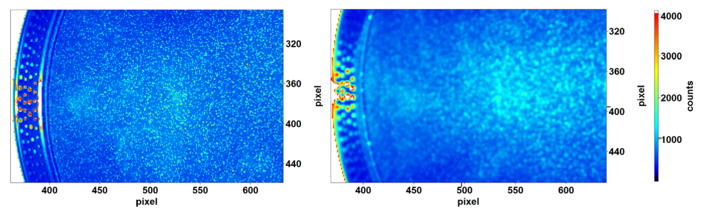
*그림 10 — 턴테이블 기록의 입자 패턴 영상. 왼쪽: 확산판 없음, f# = 4, 초점 맞음, 입자 영상 크기 = 0.602 pix. 오른쪽: 2 × 확산판, f# = 1.4, 초점 벗어남, 입자 영상 크기 = 2.03 pix.*

[역주: 그림 10은 원문 본문에서 턴테이블 영상으로서 직접 인용되지 않아(6절의 "그림 10 아래 왼쪽" 인용은 오기로 보임) 턴테이블 실험 결과가 시작되는 이 위치에 넣었다.]

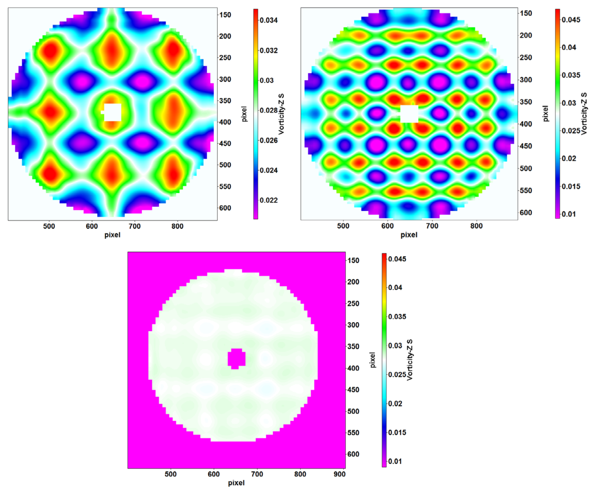
*그림 12 — 와도 등고선: 이 값들은 일정해야 하지만 피크 로킹 때문에 일정하지 않은 값을 보인다. 위 왼쪽: 쌍선형 대칭, 확산판 없음, f# = 1.4, 초점 맞음. 위 오른쪽: 스플라인 6, 대칭, 확산판 없음, f# = 4.0, 초점 맞음. 측정 와도의 평균값으로부터의 편차가 와도 오차를 정의하며, 이는 피크 로킹의 척도이다. 체커보드 무늬는 합성 데이터에서 검출된 편향 오차의 파장에 직접 대응한다. 아래: 거의 평탄한 와도. 측정 와도의 변동이 작아 피크 로킹이 훨씬 적음을 보인다. 2 × 확산판, 대칭 스플라인 6 보간기, f# = 1.4, 약간 초점 벗어남(비교를 위해 와도 축척은 위 오른쪽과 비슷하며, 대비를 위해 여기서는 누락 벡터를 분홍색으로 표시함).*

### 7.1. 초점 거리 (Focal distance)

초점 거리를 바꾼 효과를 확산판 없이 렌즈 조리개 f# = 1.4(위)와 f# = 4.0(아래)에 대해 그림 13에 나타냈다. 초점은 오차가 가장 큰 위치(초점 거리 = 0 m)로 정의하고, 다른 값들은 원격 초점 제어 장치인 Canon 원격 초점 링이 표시하는 상대 초점 거리를 사용하여 이 점에 대해 상대적으로 그렸다. 대칭과 비대칭 모두의 스플라인 보간기가 초점 변화에 가장 강한 민감도를 보인다. 초점 설정에 따라 이들은 전체적으로 가장 높은 와도 오차와 가장 낮은 와도 오차를 모두 보인다. 스플라인 보간기는 적절한 입자 영상 크기에서의 뛰어난 성능 때문에 가장 바람직하므로, 이는 큰 화소 크기의 카메라로 작업할 때 신중한 탈초점이 엄청나게 중요함을 부각한다.

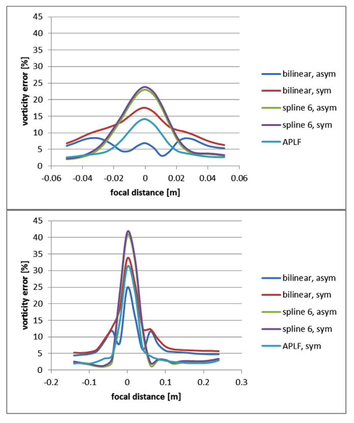
*그림 13 — 탈초점의 효과: 확산판 없음. 위: f# = 1.4, 아래: f# = 4.0.*

초점 효과는 f# = 1.4보다 f# = 4.0에서 훨씬 강한데, 이는 더 작은 f#가 카메라 센서 위에 더 작은 회절 한계 입자 점을 줄 것으로 예상되므로 언뜻 보면 직관에 반하는 것 같다. 그러나 Overmars [12]가 이미 논의했듯이, 실제 렌즈의 불완전성 때문에 가장 작은 f#가 가장 작은 입자 영상을 만들지는 않는다. 이 예에서는 가장 작은 입자 영상이 조리개 f# = 4.0 또는 f# = 8.0에서 만들어지는 것으로 보인다. 이 조리개는 사진술에서 유리한 조리개(favorable aperture)로도 알려져 있다. 이는 PIV에 좋은 소식인데, 더 작은 f#를 사용하여 더 많은 빛을 얻으면서 동시에 피크 로킹을 줄일 수 있기 때문이다.

그럼에도 불구하고, 추가 확산판을 쓰지 않을 때의 절대 최소 오차는 정확히 유리한 조리개 f# = 4와 최적 탈초점(그림 13 아래, 초점 거리 = −0.05 m 또는 +0.07 m)에서 달성된다는 점을 언급해야 한다. 다만 이러한 최적 탈초점 지점은 명시적인 초점 거리 스캔을 수행하지 않고는 실제로 달성하기 어려울 수 있다.

쌍선형 비대칭 보간기는 계속해서 비단조적 거동을 보이며, 초점 위치에 왼쪽이나 오른쪽에서 다가갈 때 국소 최소를 나타낸다. 입자 영상이 가장 작을 것으로 예상되는 초점에서의 오차 값은 다시 모든 보간기 중 가장 낮으며, 이는 합성 데이터의 결과(그림 9)와 잘 맞는다.

APLF는 넓은 범위의 초점 거리에서 전체적으로 가장 성능이 좋은 대칭 보간기이다. 스플라인 6 보간기는 (위에서 언급한 대로) 스플라인 6 보간기에 대한 최적 탈초점의 좁은 범위에서만 더 낫다.

쌍선형 대칭 보간기는 어떤 경우에도 권장할 수 없는데, 모든 초점 조건 중 어디에서도 가장 성능이 좋은 대칭 보간기가 아니기 때문이다.

### 7.2. 조리개의 효과 (Effect of aperture)

렌즈 조리개만 바꾼(즉 확산판을 쓰지 않은) 효과를 그림 14 위에 나타냈다. 이 연구에 사용한 렌즈는 Canon EF 24 mm f/1.4 L USM이다. 모든 보간기에서 조리개 f#를 1.4(왼쪽)에서 22.6(오른쪽)으로 키울 때 와도 오차는 매우 비슷하게 변한다. f# = 1.4와 f# = 22.6에서 경계 최소를 보이며, 모든 보간기에서 f# = 4.0–8.0에서 국소 최대에 이른다. 최소와 최대의 차이는 모든 경우에 약 20%이다(그림 14 위). 이 곡선들은 그림 13의 f# = 1.4와 f# = 4.0에 대해 이미 논의한 효과를 확인해 준다. 가장 작은 입자 영상은 가장 작은 조리개 f# = 1.4 [역주: 원문 그대로. 가장 작은 f-수, 즉 가장 큰 조리개 개구]가 아니라 가능한 가장 선명한 결상을 주는 유리한 조리개 f# = 4.0과 8.0에서 얻어진다. 조리개가 와도 오차에 주는 효과는 매우 강해서 조리개를 반드시 고려해야 한다. 다행히 대부분의 PIV 실험은 가능한 한 많은 빛을 얻기 위해 사용 가능한 가장 작은 f#로 수행되며, 이렇게 하여 위험한 '유리한' 조리개(이 경우 f# = 4와 8)를 피한다. 조리개 효과만으로는 스플라인 6 보간기가 그 강점을 보일 만큼 입자를 키우기에 충분하지 않다. 스플라인 6 보간기는 전체 조리개 범위에서 가장 나쁜 성능을 보이며, 작은 입자 영상 크기에서 좋은 것으로 이미 알려진 보간기들(쌍선형 비대칭과 대칭, 그리고 APLF)이 여기서 훨씬 좋은 성능을 보인다. 스플라인 6 보간기가 더 나은 성능과 더 낮은 와도 오차를 얻으려면 추가 탈초점이나 확산판, 또는 둘 다가 필요할 것이다.

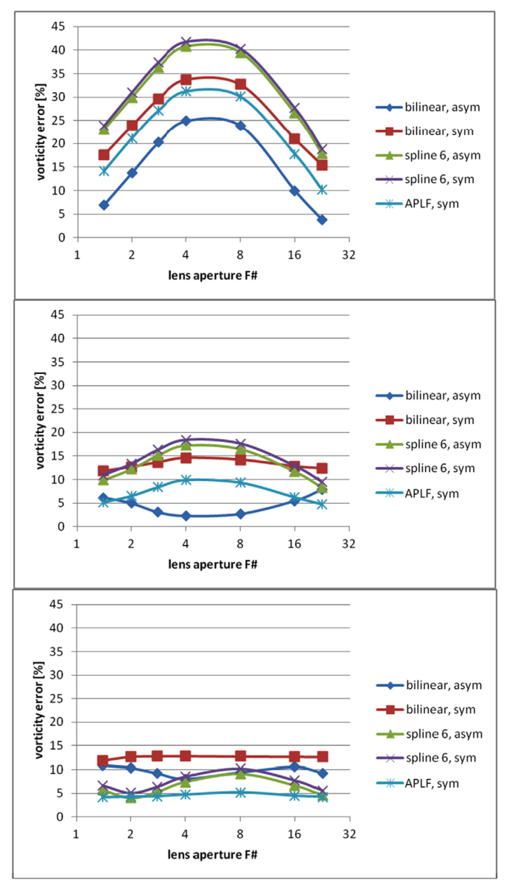
*그림 14 — 조리개와 확산판의 효과. 위: 확산판 없음, 가운데: 1 × 확산판, 아래: 2 × 확산판, 모두 초점 맞음.*

### 7.3. 확산판의 효과 (Effect of diffuser plates)

렌즈와 카메라 센서 사이에 확산판을 한 장 또는 두 장 넣은 효과를 그림 14의 위, 가운데, 아래에 나타냈다. 확산판 수가 0장(위)에서 2장(아래)으로 늘어남에 따라, 관찰된 와도 오차는 특히 조리개 f# = 4와 8에서, 그리고 스플라인 6 보간기에서 상당히 그리고 꾸준히 감소한다. 확산판을 쓰면 보간기의 성능 순서가 이제 바뀐다. 스플라인 6 보간기는 판을 추가하면 상대적으로 더 좋은 성능을 보인다. 그러나 APLF는 여전히 모든 경우에 더 좋은 성능을 보이며, 이는 스플라인 6 보간기를 추가 탈초점 없이는 만족스럽게 쓸 수 없음을 다시 확인해 준다. 확산판 2장을 쓰면 쌍선형 보간기는 비대칭과 대칭 모두 덜 매력적이 되는데, 이 상황에서 특별히 낮은 오차를 보이지 않기 때문이다. 입자 영상 크기가 이미 너무 커져서 이 보간기들이 이점을 얻을 수 없다(그림 14 아래).

### 7.4. 입자 영상 크기 (Particle image size)

탈초점, 조리개, 확산판의 효과를 따로따로 연구하고 나면, 와도 오차로 나타나는 보간기의 성능과 피크 로킹 강도를 설명하는 공통의 기저 원리가 있을 것이라고 생각하는 것이 합리적이다. 이 공통 기저 원리는 탈초점, 조리개 변경, 확산판 추가에 의한 결상 입자 영상 크기의 변화에 의해 영향을 받을 수 있다. 이 원리를 더 명시적으로 보이기 위해, 실제 입자 영상으로부터 공간적으로 분해된 입자 영상 크기를 추정할 수 있는 자기상관 기반 입자 영상 크기 계산기를 사용한다. 이 입자 영상 크기 추정기를 피크 로킹 효과의 해석에 쓰기 전에, 먼저 합성 영상의 알려진 입자 영상 크기에 기반하여 측정 입자 영상 크기와 실제 입자 영상 크기 사이의 관계를 보여 주는 보정 곡선을 만든다. 그림 15는 작은 입자에 대해 입자 영상 크기가 과대추정됨을 보여 주며(그림 15 왼쪽), 실제 입자 영상 크기가 0.4화소일 때 1.2화소의 입자 영상 크기가 측정된다. 이 결과는 나중에 입자 영상 크기 측면에서 결과를 논의할 때 염두에 두어야 한다. 작은 입자는 실제로는 측정된 것보다 훨씬 작을 수 있다. 입자가 커질수록 측정 입자 영상 크기는 절대적으로 더 정확해진다. 끝으로 입자 영상 크기 4화소에서는 측정 입자 영상 크기와 참 입자 영상 크기가 일치한다(그림 15 오른쪽).

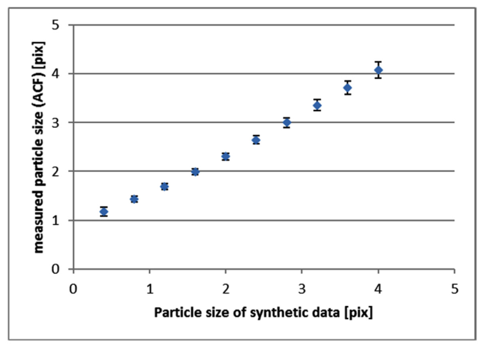
*그림 15 — ACF를 사용하여 합성 데이터로부터 측정한 입자 크기.*

실험 데이터에 대한 입자 영상 크기 계산기 성능의 일관성을 확인하기 위해, 초점 거리, 조리개, 확산판 수를 바꾸면서 추정 입자 영상 크기를 연구하였고, 그 결과를 그림 13과 14에서 연구한 조건을 재현하여 그림 16에 제시하였다. 초점 거리를 바꾸면, 왼쪽이나 오른쪽에서 초점에 다가갈 때 일관되게 추정 입자 영상 크기가 작아진다.

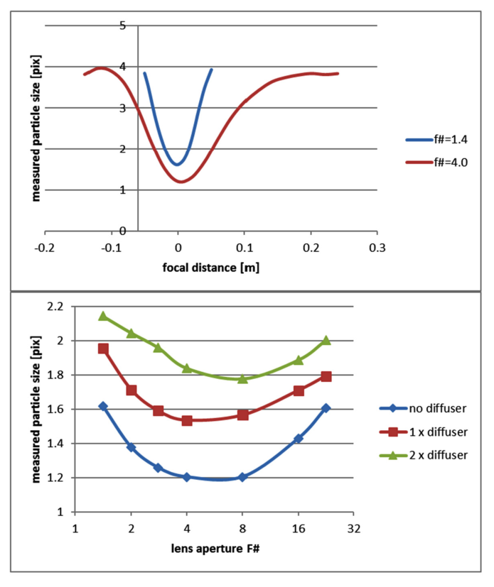
*그림 16 — 탈초점(위)과 서로 다른 조리개(아래)에 따른 입자 영상 크기.*

초점에서 입자 영상 크기는 f# = 1.4와 4에 대해 최소를 보인다. 특히 f# = 4에서, 검출된 최소 입자 영상 크기 약 1.2 pix는 보정 곡선(그림 15)을 고려하면 실제 입자 영상 크기 약 0.4화소에 해당한다. 이는 회절 이론에서 추정한 입자 영상 크기와 잘 맞는데, 이 경우 그 값은 약 0.28화소이다. 이는 위의 절들에서 이 크기의 합성 입자를 조사한 것이 순전히 학술적인 연습이 아니라 실제 조건에 적용됨을 보여 준다.

검출된 입자 영상 크기의 범위는 보정 곡선(그림 15)과 거의 같은 범위를 포함하며, 1.2에서 4.0 pix로, 이는 실제 입자 영상 크기 0.4에서 4.0화소에 해당한다. 측정 입자 영상 크기는 조리개 변화에 대해서도 일관되며(그림 16 아래), 와도 오차에 대해 얻은 결과와 정확히 맞는다. 가장 작은 입자는 유리한 조리개 f# = 4와 8에서 검출된다. 입자 크기는 더 작은 f#와 더 큰 f#에서 커진다. 따라서 실제 렌즈의 왜곡이 f# = 4에 비해 더 작은 f# = 1.4에서 더 큰 입자 영상을 낳는다는 것이 실제로 입증된다. 그 효과의 강도는 큰 f#, 예컨대 f# = 22.6을 사용할 때와 비슷하다. 이 결과는 평면 PIV 실험에서 그렇게 큰 f#를 써서 빛의 세기를 몇 자릿수나 잃을 필요가 없음을 보여 준다. 확산판을 쓰지 않는 대신 두 장을 쓰면, f# = 4에서 측정 입자 영상 크기가 최소 1.2화소에서 새로운 최소 1.8화소로 커지며, 이는 각각 실제 입자 영상 크기 0.4와 2.0화소에 해당한다(그림 14).

그림 16에 보인 모든 결과는, 이하에서 하는 것처럼 측정 입자 영상 크기를 서로 다른 영상 보간기의 성능을 연구하는 기저 변수로 사용한다는 생각을 확인해 준다.

### 7.5. 피크 로킹과 입자 영상 크기 (Peak-locking and particle image size)

평균 입자 영상 크기를 100장으로 된 각 기록 시퀀스(표 1)에 대해 계산하였으며, 시퀀스의 모든 영상에 걸쳐 평균하고 동시에 전체 영상 영역에 걸쳐(입자 패턴만 포함하는 원형 마스크를 적용한 뒤) 공간적으로 평균하였다. 검출된 입자 영상 크기는 1.2화소에서 4.5화소에 이르며, 이는 실제 입자 영상 크기 0.4화소에서 4.6화소에 해당한다(그림 15). 4.6화소의 입자 영상 크기는 주어진 실험 조건에서 검출할 수 있는 입자 영상 크기의 상한으로 보인다. 자기상관 방법은 적어도 합성 데이터에 대해서는 더 큰 입자를 검출할 수 있어야 한다(이는 향후 연구할 것이다). 그러나 이 실험에서는 이 2.3화소 [역주: 원문 그대로. 앞 문장의 4.6화소와 불일치]의 상한이 있는 것으로 보인다. 이는 더 큰 입자의 실제 크기와만 관련된 것이 아니라, 큰 입자를 낳는 결상 조건의 열화와 더 관련된 인공물일 수 있다. 예컨대 극단적인 탈초점에서는 입자 영상 형태가 구형 입자에서 벗어나 흐릿한 입자 영상이 되기 시작하며, 사용하는 렌즈에 따라 도넛 같은 모양까지 포함할 수 있다. 따라서 더 큰 입자 영상 크기에 대한 측정값은 근사값으로 간주해야 하며, 실제 입자 영상 크기는 더 클 수도 있음을 염두에 두어야 한다.

모든 보간기의 성능을 입자 영상 크기와 와도 오차 측면에서 그림 17에 나타냈다. 가장 일관된 성능은 APLF에 돌릴 수 있다(그림 17 아래 왼쪽, 짙은 빨간 점). 처음에는 입자 영상 크기에 따라 측정 오차가 가파르게 단조 감소하며, 이는 입자 크기 약 1화소 부근에서 평탄해진다. 오차는 최대 입자 영상 크기 4.4화소까지 더 느린 속도로 선형적으로 계속 감소한다. 다른 보간기와 비교하여, 특정 입자 영상 크기에서 오차 값의 산포가 매우 작다. 산포의 대부분은 입자 영상 크기 1.5화소와 2.0화소 사이의 작은 영역에서만 나타난다. 그림 17 아래 오른쪽은 APFL [역주: 원문 그대로. APLF의 오기]이 입자 영상 크기 2.0화소까지 가장 성능이 좋은 대칭 보간기임을 다시 확인해 준다.

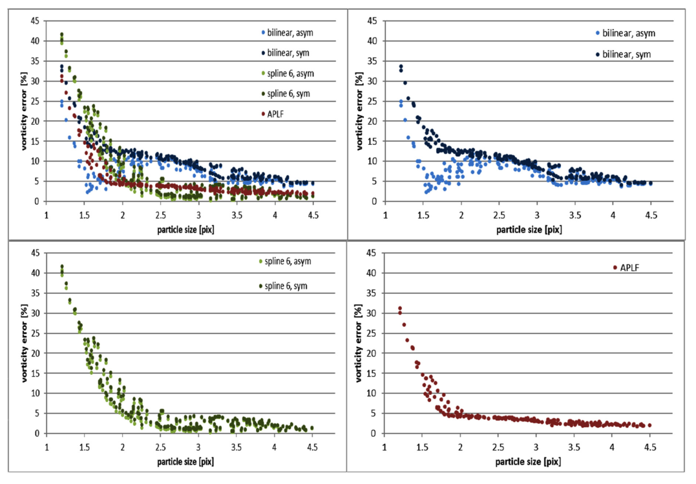
*그림 17 — 모든 기록(표 1)을 고려한 실험 데이터의 측정 와도 오차(RMS, %). 입자 크기는 ACF를 사용하여 계산하였다. 각 데이터 점은 100개 속도장의 평균을 나타낸다.*

쌍선형 보간기는 비대칭과 대칭 모두 1.2화소 이상의 입자 영상 크기에서 매우 비슷한 결과를 보인다(그림 17 위 왼쪽). 대칭 보간기는 입자 영상 크기 범위 전체에서 단조적인 반면, 비대칭 보간기는 비단조적 거동을 보이며 입자 영상 직경 약 1.6화소에서 국소 최소를 보인다. 이는 이 보간기가 마찬가지로 이례적인 비단조적 거동을 보이는 그림 9와 12의 결과와 일치한다. 어떤 이유에서인지 이 보간기는 매우 작은 입자 영상 크기에서 피크 로킹이 더 적다. 동시에 와도 오차의 퍼짐이 비교적 커서, 예컨대 입자 영상 크기 2.0화소에서 측정 와도 오차가 5%에서 10% 사이로 변한다.

비대칭과 대칭 스플라인 6 보간기는 그림 17 위 오른쪽에서 매우 비슷한 결과를 보인다. 가장 높은 오차(42%)와 가장 낮은 오차(0.3%)가 이 보간기들로 측정된다. 입자 영상 크기가 커짐에 따라 측정 와도 오차가 매우 매끄럽게 단조 감소한다. 또한 약 5% 와도 오차의 큰 산포가 있어, 매우 작은 와도 오차가 필요한 경우 성능을 예측하기 어렵게 만든다. 최고의 성능(와도 오차 0.5% 수준)을 달성할 수 있는 정확한 조건을 조사하는 것은 향후 연구 과제로 남는다.

단 0.32%의 절대 최소 와도 오차는 비대칭 스플라인 6 보간기, 2 × 확산판, f# = 1.4, 약간의 탈초점에서 얻어졌다. 대칭 보간기에서 두 번째로 작은 오차 0.66%도 위와 같은 조건의 스플라인 6 보간기이다. 확산판 없이 f# = 2.8, 약간 초점을 벗어난 대칭 스플라인 6 보간기가 0.64%의 오차로 아주 조금 더 낫다. 반대로 실제로 쉽게 일어날 수 있는 불리한 조건에서는 가장 큰 오차가 42%에 이를 수 있다는 점에 유의해야 한다.

그림 17은 점점 더 큰 입자 영상을 쓸수록 와도 오차가 계속 작아진다고 시사할 수 있다. 이는 평균 와도 오차에 대해서는 사실인 것으로 보인다. 그러나 그림 18은 더 큰 입자일수록 오차의 변동이 상당히 커져서, 순간 결과가 점점 더 흩어지고 점점 더 신뢰할 수 없게 됨을 보여 준다. 이를 고려하면, 가장 정밀한 스플라인 6 보간기를 사용하여 최소 와도 오차의 최적 범위에 머물기 위해, 측정 입자 영상 크기가 2–3.5화소가 되도록 광학 조건(초점, 조리개, 확산판)을 설정할 것을 강력히 권장한다. 이 결과는 몬테카를로(Monte Carlo) 시뮬레이션으로 입자 영상 직경과 관련된 오차를 조사한 Cowen과 Monismith [16]의 연구와 일치한다.

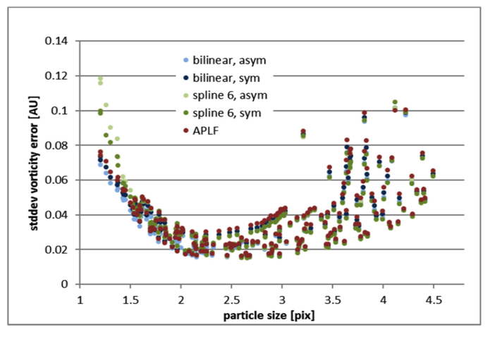
*그림 18 — 와도 오차의 변동(표준편차): 합성 데이터와 달리 더 큰 입자 영상 크기에서 변동이 다시 증가한다. 가능한 원인: 초점이 벗어난 영상의 화질 저하(잡음 증가).*

## 8. 결론 (Conclusion)

최신 PIV 방법은 입자 영상 크기가 2화소 이상인 영상에 적용될 때 놀랍도록 정확한 입자 이동장을 계산할 수 있다. 특히 대칭 스플라인-6 보간기는 합성 데이터를 해석할 때 32 × 32 창으로 약 0.001화소의 정확도를 달성할 수 있다. 같은 방법이라도 입자 영상 크기가 0.4화소만큼 작으면 0.1화소 이상의 오차를 겪으며, 이는 최적 조건보다 백 배 이상 크다. 더욱이 이 오차는 체계적(또는 편향) 오차여서 평균으로 상쇄되지 않는다. 그림 12에서 보듯이 이 오차는 매우 눈에 띄게 된다(이 경우 100장 평균).

값비싼 광원에서 최대의 빛을 얻기 위해 PIV에서 표준 관행인 작은 f-수의 사용은, 이미 피크 로킹의 최악의 효과를 피하는 좋은 방법이다. (적어도 사진술에서) 가장 유리한 f#, 이 장치에서는 f# = 4.0으로 작업하면 더 작은 f-수 1.4를 쓸 때(25% 오차)보다 2배 높은 와도 오차(약 45%)가 나오며, f-수 1.4는 PIV 실험에서 상당히 더 많은 빛도 준다. f# = 4.0보다 큰 f-수는 다시 입자 영상 크기를 키우고 피크 로킹 오차를 줄인다. 화소 크기가 더 큰(20 µm 초과) 고속 카메라는 피크 로킹 오차를 없애기 위해 매우 큰 f-수가 필요할 것이다. 실제로는 f# = 1.4에 비해 감도가 한 자릿수 줄어들기 때문에 이는 실행 가능한 선택지가 아니다. 프레임률 5–10 kHz 이상의 시간 분해 PIV에서는 표준 고출력, 고반복률 레이저를 써도 이미 한계에 있는 경우가 많다.

큰 화소 카메라에 탈초점을 쓰라는 잘 알려진 규칙이 유익함을 보였다. 큰 화소와 대칭 창 변형을 쓰는 카메라에서는 신중한 탈초점 없이는 최적의 피크 로킹 억제가 없다! 탈초점 없이는 모든 대칭 화소 보간기에서 측정 와도 오차가 5% 이상이었다. 보간기에 따라 f# = 1.4에서 오차는 13%에서 22%이다. 가장 선명한 결상을 얻기 위해 f# = 4.0을 쓰면 오차가 약 45%로 극적으로 증가하며, 이는 이 장치에서의 최악의 시나리오를 나타낸다. 신중하게 탈초점하면 오차가 1% 이하로 내려갈 수 있다. 최적 입자 영상 크기에 대한 신뢰할 만한 척도는 자기상관 입자 영상 크기 검출로 주어진다. 2.0과 3.0화소 사이의 측정 입자 영상 크기와 6차 스플라인 보간기를 함께 쓰면 와도 오차가 최소가 되고 따라서 피크 로킹이 최소가 된다.

광학 확산판은 렌즈 탈초점과 같은 효과를 준다. 중요한 이점은 최적의 양만큼 정밀하게 탈초점할 필요 없이 통제된 방식으로 탈초점이 이루어진다는 것이다. 이는 약간의 샤임플러그 어긋남이나 곡면 매질 경계(파이프, 실린더)처럼 초점면이 레이저 시트와 정렬되지 않은 많은 실험 상황에서 특히 그렇다. 확산판은 체적 측정에서도 유일한 선택지인데, 렌즈 탈초점은 체적 어딘가에 여전히 어떤 초점면을 남기기 때문이다. 초점면을 체적 밖으로 옮기지 않는 한 그러하며, 그렇게 옮기면 반대쪽이 상당히 초점을 벗어나게 된다. f# = 4.0에서 대칭 변형의 스플라인 6 보간으로, 초점 맞은 영상을 사용할 때 오차는 42%(확산판 없음)에서 18%(1 × 확산판), 마지막으로 10% 미만(2 × 확산판)으로 줄었다. 확산판을 더 추가하거나 개별적으로 더 강한 확산판을 쓰면 피크 로킹 오차가 거의 완전히 제거될 것으로 예상된다.

최종 사용자가 비대칭 속도장을 받아들일 수 있고(그 결과 벡터 위치가 벡터 격자 위치에 정확히 있지 않고 벡터 길이의 절반만큼 어긋남), 실험이 이미 끝난 뒤 작은 입자 영상 크기를 마주친다면(예: ACF를 사용하여), 쌍선형 비대칭 보간을 시도해 볼 만할 수 있다. 단일 패스 처리에 대해서도 같은 말을 할 수 있다. 입자 영상 크기가 정말 작고 크기의 변동도 작다면(전체 영상에서 결상 조건이 일정하다고 가정할 때) 이것이 피크 로킹 효과를 줄일 수 있다. 그래도 저자들은 이 이례적으로 좋은 성능이 아직 잘 이해되지 않았으므로 조금 회의적이다.

모든 광학 매개변수(초점, 조리개, 확산판)의 영향은, 결과를 입자 영상 크기만의 관점에서 보면 쉽게 해석할 수 있다(그림 17). 여기서 입자 영상 크기는 ACF를 사용하여 사후에 계산한다. 모든 보간기는 입자 영상 크기와 와도 오차 사이에 뚜렷한 관계를 보이며, 이는 비대칭 쌍선형 보간기라는 주목할 만한 예외를 제외하면 대부분의 경우 단조적이다. 이 결과를 사용하면 실험이 이미 완료된 뒤에도 최적의 PIV 구성을 선택할 수 있다.

끝으로, 특히 화소 크기가 큰 고속 카메라에 대해 실험 장치마다 해석 매개변수를 조정할 필요를 없애기 위해 다음 접근법을 제안한다. 대칭 스플라인 6 보간기를 항상 확산판 2장 및 작은 f#와 함께 사용해야 한다. 평면 PIV에서는 추가로 약간의 탈초점이 유용하다. 이 조합은 모든 실험 조건에서 최적의 성능을 주는데, 확산판이 입자 크기를 스플라인 6 보간기가 다른 모든 보간기보다 우월한 1.2화소 이상으로 보장하기 때문이다.

## 참고문헌

- [1] Prasad A K, Adrian R J, Landreth C C and Offutt P W 1992 Effect of resolution on the speed and accuracy of particle image velocimetry interrogation Exp. Fluids 13 105–16
- [2] Adrian R J and Westerweel J 2010 Particle Image Velocimetry (New York: Cambridge University Press)
- [3] Scarano F and Reithmuller M L 2000 Advances in iterative multigrid PIV image processing Exp. Fluids 29 S51–60
- [4] Christensen K T 2004 On the influence of peak-locking errors on turbulence statistics compared from PIV ensembles Exp. Fluids 36 484–97
- [5] Chen J and Katz J 2005 Elimination of peak-locking error in PIV analysis using the correlation mapping method Meas. Sci. Technol. 16 1605–18
- [6] Roesgen T 2003 Optimal subpixel interpolation in particle image velocimetry Exp. Fluids 35 252–6
- [7] Roth G and Katz J 2001 Five techniques for increasing the speed and accuracy of PIV interrogation Meas. Sci. Technol. 12 238
- [8] Hearst R J and Ganapathisubramani B 2015 Quantification and adjustment of pixel-locking in particle image velocimetry Exp. Fluids 56 1–5
- [9] Liao Q and Cowen E A 2005 An efficient anti-aliasing spectral continuous window shifting technique for PIV Exp. Fluids 38 197–208
- [10] Cholemari M R 2007 Modeling and correction of peak-locking in digital PIV Exp. Fluids 42 913–22
- [11] Eckstein A, Charonko J and Vlachos P 2008 Phase correlation processing for DPIV measurements Exp. Fluids 45 485–500
- [12] Overmars E F J, Warncke N G W, Poelma C and Westerweel J 2010 Bias errors in PIV: the pixel locking effect revisited 15th Int. Symp. Applications of Laser Techniques to Fluid Mechanics (Lisbon, Portugal) pp 5–8
- [13] Kähler C J, Astarita T, Vlachos P P, Sakakibara J, Hain R, Discetti S, La Foy R and Cierpka C 2016 Main results of the 4th International PIV Challenge Exp. Fluids 57 1–71
- [14] Warner S O and Smith B L 2014 Autocorrelation-based estimate of particle image density for diffraction limited particle images Meas. Sci. Technol. 25 065201
- [15] Scarano F 2001 Iterative image deformation methods in PIV Meas. Sci. Technol. 13 R1
- [16] Cowen E A and Monismith S G 1997 A hybrid digital particle tracking velocimetry technique Exp. Fluids 22 199–211
