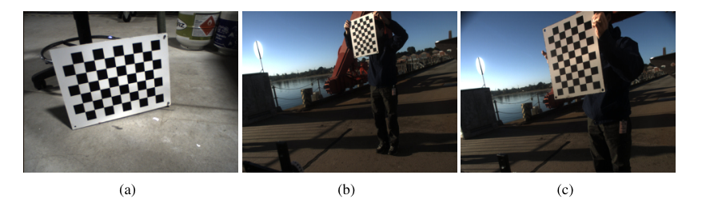
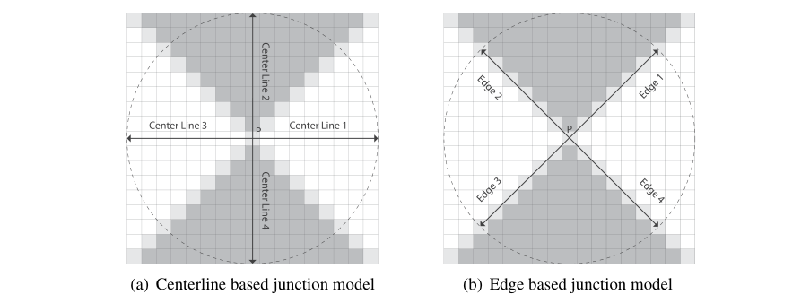
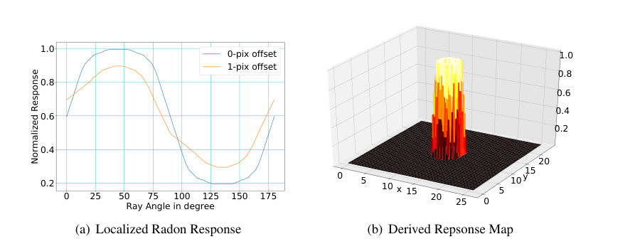
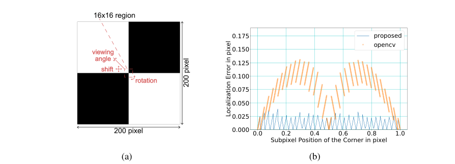
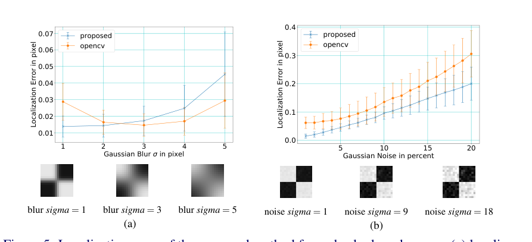
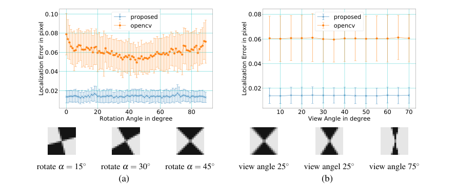
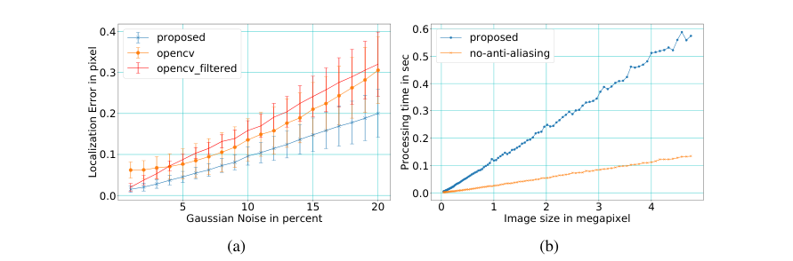
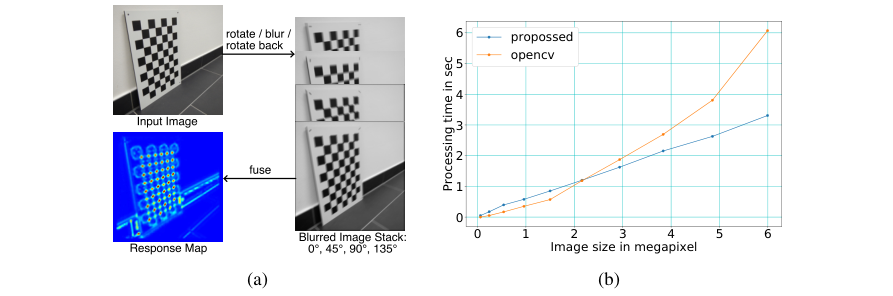
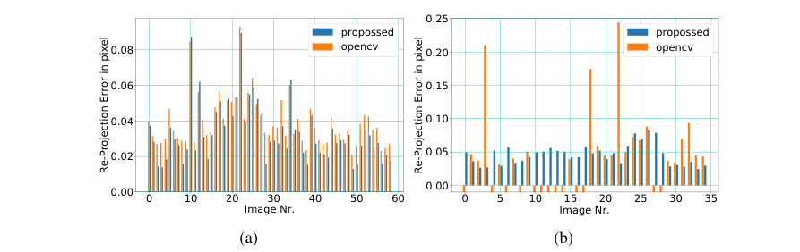

# 보정을 위한 체커보드 코너의 정확한 검출과 위치 추정 (Duda 2018)

- 원제: Accurate Detection and Localization of Checkerboard Corners for Calibration
- 원문: 같은 폴더의 `Duda2018_BMVC_CheckerboardCorners.pdf` (British Machine Vision Conference (BMVC) 2018, 10쪽)
- 저자: Alexander Duda (Kraken Robotik GmbH, Bremen, Germany), Udo Frese (German Research Center for Artificial Intelligence, Cyber-Physical Systems, Bremen, Germany)
- 번역 범위: 전문
- 그림: 원문 그림 9개를 `그림/`에 넣고 본문에서 처음 언급되는 곳에 삽입. 표 1·2는 마크다운 표로 옮김.

## 초록

카메라의 보정(캘리브레이션, calibration)은 머신 비전에서 결정적인 단계이며, 보통 영상 속 보정 패턴을 정확하게 검출하고 위치를 추정하는 데 의존한다. 따라서 코너를 정밀하게 부화소(subpixel) 추정할 수 있는 체커보드가 자주 사용된다. 그러나 위치 추정의 잡음은 그로부터 유도되는 모델 매개변수에 비례하는 잡음을 만든다. 따라서 위치 추정이 영상 잡음에 대해 어느 정도 강건성을 갖는 것이 중요하다. 이는 부화소 검출기에 강하게 영향을 주는 열악한 촬영 조건에서 더욱 중요하다. 본 논문은 큰 박스 필터(box filter)로 구현한 국소화된 라돈 변환(localized Radon transform)에 기반하여, 낮은 대비·영상 잡음·흐림(blur)에 강건하면서도 높은 부화소 정확도를 유지하는 새로운 체커보드 코너 검출기를 제시한다.

## 1 서론 (Introduction)

광학 카메라는 광선을 카메라에 대한 각도에 따라 화소에 투영하고 빛의 색이나 세기를 측정한다. 따라서 한 점의 영상 위치는 그 점의 공간 위치에 대한 정보를 담고 있으며, 이는 사진측량(photogrammetry)부터 물체 자세 검출, 영상 스티칭(image stitching)에 이르기까지 다양한 응용에 쓰인다. 그에 앞서 화소에서 광선으로의 사상(mapping)을 결정해야 한다. 즉 카메라를 보정해야 한다 [17]. 이는 보통 물리적으로 알려진 보정 물체 위의 특징점, 대개 체커보드 코너를 검출하고 그 데이터에 카메라 모델을 맞추어(fitting) 수행한다. 1차 오차 전파에 따르면 결과 보정 오차는 검출 오차에 비례하므로, 정확한 체커보드 코너 검출기가 필요하다.

이는 현장 보정(in-field calibration, 그림 1)에서 더욱 중요한데, 현장에서는 낮은 대비, 영상 잡음, 움직임 흐림(motion blur)이 검출기의 정확도를 위협하고, 최적이 아닌 체커보드 배치 때문에 이 오차가 보정 결과에서 증폭된다. 이러한 불완전한 조건에서 보정을 개선하기 위해, 잡음을 증폭하는 기울기(gradient) 필터 대신 잡음을 억제하는 박스 필터에 기반하므로 낮은 대비, 영상, 잡음 [역주: 원문 그대로. "image noise"의 쉼표 오기로 보임] 및 움직임 흐림에 강건한 새로운 체커보드 코너 검출기를 제시한다.

*그림 1 — 보정에 사용한 두 가지 데이터셋에서 뽑은 예시 영상: (a) 통제된 환경에서의 보정; (b-c) 실외 보정.*

이 글의 구성은 다음과 같다. 2절에서는 체커보드 및 코너 검출기와 관련된 이전 연구를 검토한다. 3절에서는 제안 알고리즘과 그 참조 구현을 기술한다. 4절에서는 합성 시험과 실제 사례 실험의 결과를 논의한다. 이어서 5절에서 글을 맺는다.

© 2018. 이 문서의 저작권은 저자들에게 있다. 인쇄 또는 전자 형태로 변경 없이 자유롭게 배포할 수 있다.

## 2 관련 연구 (Related Work)

체커보드 검출에는 주로 두 가지 측면이 있다. 첫째는 체커보드 전체를 검출하고 다른 영상 내용과 구별하는 것이다. 이는 특히 어려운 조건에서 그 영상을 보정에 쓸 수 있는지 없는지를 결정한다. 둘째는 정확한 코너 위치를 찾는 것이다. 이는 보정의 정확도(accuracy)와 정밀도(precision)를 결정하며, 보통 부화소 정제(sub-pixel refinement)라는 두 번째 단계가 뒤따른다. 체커보드 코너는 모든 방향으로 강한 기울기를 가지므로 이 작업에 잘 맞는다.

Harris 연산자 [10]는 보정에 자주 쓰이는 가장 잘 알려진 코너 검출기이다. Förstner는 부화소 코너 위치 추정 방법 [6]을 제안했는데, 이는 정제 단계로 자주 쓰이며 OpenCV [1]의 카메라 보정 파이프라인에도 구현되어(`cornerSubPix`) 사용된다. 이 방법은 점 $\binom{x}{y}$에서의 영상 기울기 $\nabla f[x,y]$가 $\binom{x}{y}$에서 코너 $\binom{c_x}{c_y}$로 향하는 선에 수직이라는 점을 이용한다. 그러면 코너는 다음과 같이 최소제곱으로 추정된다.

$$
\begin{pmatrix}\hat{c}_x\\ \hat{c}_y\end{pmatrix} = \arg\min_{c_x,c_y} \sum_{x,y} \left( \nabla f[x,y]^T \begin{pmatrix} x-c_x \\ y-c_y \end{pmatrix} \right)^2 \tag{1}
$$

Douskos 등 [4]은 부화소 정제를 거친 Harris 코너로 체커보드 코너를 찾고, 이후 오검출(false positive)을 버린다. 이들은 0.1화소의 정밀도를 보고한다. 체커보드 전체를 찾기 위해 중앙값(median) 코너를 원점으로 정하고, 원점과 강한 에지로 이어진 두 이웃 점을 주축으로 삼는다. 그 다음 추가 점들을 차례로 더한다.

Chu 등 [2]은 영상 히스토그램에서 얻은 문턱값으로 이진화한 영상에서 템플릿 정합(template matching) 접근법을 제안한다.

OpenCV [1]의 체커보드 검출기(`findChessboardCorners`)는 적응적 문턱값 처리(adaptive thresholding)와 침식(erosion)으로 영상을 이진화하고, 윤곽 추적(contour following) [16]으로 체커보드 칸들을 사각형(quadrilateral)으로 분리한다. 마지막으로 체커보드를 연결된 사각형들의 2D 격자로 검출한다. 코너 정제에는 Förstner 연산자 (1)이 뒤따른다.

Rufli 등 [14]은 침식 커널을 조정하고 사각형들을 위한 새로운 연결 휴리스틱을 도입하여, 흐리고 왜곡된 영상에 대해 OpenCV 접근법을 개선하였다.

Ha 등 [9]은 흐림과 세기 잡음 아래 정면 평행(fronto-parallel) 시점에서 더 정밀한 위치 추정을 위해, 보정 패턴의 기본 요소로 사각형 대신 삼각형을 제안한다. 정제를 위해서는 코너에서의 세기 곡면 함수에 3차 다항식을 맞춘다.

전체적으로 Sinzinger [15]를 따르면 체커보드 코너에는 두 가지 모델이 있다. 중심선(centerline)을 갖는 흑백 섹터(그림 2(a))와 에지의 교차(그림 3(b) [역주: 원문 그대로. 그림 2(b)의 오기로 보임])이다. 에지 기반 관점은 영상 잡음에 취약한 기울기 기반 알고리즘으로 이어진다. 제안 알고리즘은 이 문제를 피하기 위해 섹터 기반 관점을 취한다. 이전 연구들과 달리, 박스 필터로 근사한 국소화된 라돈 변환을 사용하여 체커보드 코너의 점대칭성을 이용하며, 이는 기울기 기반 방법보다 영상 잡음의 영향을 훨씬 덜 받는다.

*그림 2 — 교차점(junction) 모델. (a) 중심선 기반 교차점 모델 (b) 에지 기반 교차점 모델.*

## 3 코너 검출과 위치 추정 (Corner Detection and Localization)

코너 검출기의 과제는 영상에서 코너 모델 2(a)를 따르는 점들을 식별하고, 이상적으로는 추가 정제 단계 없이 화소의 일부 단위까지 그 위치를 추정하는 것이다. 체커보드 코너의 경우, 대부분의 "자연스러운" 코너와 달리 이웃한 모든 영역이 원하는 점에 대해 점대칭이다. 따라서 마주 보는 영역들의 중심선을 하나의 공통 중심선으로 본다.

검출기의 기본 개념은, 밝은 영역을 지나는 중심선을 따른 모든 화소값의 합이 어두운 영역을 지나는 다른 중심선을 따른 화소값의 합보다 크다는 것이다. 실제로 합산/적분에 쓰는 두 경로가 체커보드 코너에 속하여 그 중심선이라면, 두 적분의 차이는 최대가 된다. 그 밖의 모든 경우에는 경로가 이웃 영역에 닿는 만큼 값이 줄어들며, 균일한 영상 영역에서는 0이 된다.

주어진 영상 점 f[x,y] 주위의 가능한 모든 중심선에 대해 적분을 계산하고 최대 적분값과 최소 적분값의 차의 제곱을 반환하는 함수 fc[x,y]가 있다고 가정하면, 이 함수로 영상을 응답 지도(response map)로 변환한 뒤 최소-최대 탐색으로 체커보드 코너를 간단히 식별할 수 있다. 이는 Harris 검출기의 응답 지도 [10]와 비슷하다. 그러나 창 패치를 영상 평면의 x와 y 방향으로 이동시키는 대신, 선택한 점을 중심으로 회전시킨다. 응답 지도에서 국소 최대를 식별한 뒤, 해당 코너의 부화소 위치는 부화소 피크 알고리즘으로 추정할 수 있다. 여러 알고리즘의 비교는 [5]와 [11]에 있으며, 여기서는 가우스 피크 맞춤(Gaussian peak fit)을 사용한다.

요구되는 함수 fc[x,y]를 더 자세히 살펴보면, 이는 사실 r을 0으로 두고 각 영상 점 f[x,y]에 국소화한 라돈 변환 Rf[r,α] [8]와 비슷함이 드러난다. 이 국소화된 라돈 변환 Rf_local[x,y,α]는 주어진 점 좌표 x, y에 대해 가능한 모든 중심선, 즉 광선(ray)의 적분을 제공한다. 여기서 fc[x,y]는 가장 강한 광선과 가장 약한 광선 사이의 차의 제곱만을 반환하며, m은 영상에서 코너가 얼마나 클 것으로 예상되는지를 지정한다.

$$
\begin{aligned}
Rf_{local}[x,y,\alpha] &= \sum_{k=-m}^{k=m} f\big[x + k\cos(\alpha),\, y + k\sin(\alpha)\big] \\
f_c[x,y] &= \big[\max_{\alpha\in[0,\pi]} \big(Rf_{local}[x,y,\alpha]) - \min_{\alpha\in[0,\pi]} (Rf_{local}[x,y,\alpha]\big)\big]^2
\end{aligned} \tag{2}
$$

*그림 3 — 체커보드 코너에 대한 응답. (a) 국소화된 라돈 응답 (b) 유도된 응답 지도.*

그러나 각 영상 점마다 국소화된 라돈 변환을 계산하는 것은 매우 시간이 많이 걸릴 것이다. 따라서 각도로 $\alpha \in \{0, \frac{\pi}{4}, \frac{2\pi}{4}, \frac{3\pi}{4}\}$만 고려하여 max와 min을 근사한다.

이것이 가능한 이유는, 체커보드 코너의 점대칭성 때문에 국소화된 라돈 변환을 적용한 뒤 사인이나 코사인과 비슷한 함수가 생성되기 때문이다(그림 3(a)).

### 3.1 구현 (Implementation)

이 근사를 사용하여 입력 영상을 응답 지도로 변환하는 것은, 코너 주위에서 고려하는 창 패치와 일치하는 커널 크기의 박스 필터로 영상을 합성곱(convolution)하여 효율적으로 달성할 수 있다. 그러나 필터 커널을 각도 α만큼 회전시키는 대신(조향 가능 필터, steerable filter), 영상을 반대 방향으로 [역주: 원문 "counter wise"] 회전시키고 두 개의 1D 커널로 합성곱한 뒤 다시 회전시켜 되돌린다. 이는 같은 접근법으로 윤곽 검출을 가속한 Maire [13]의 연구에서 착안하였다. 이 경우 박스 필터 커널은 미리 정의한 이산 광선 각도에 대해 국소화된 라돈 변환의 적분을 계산하는 데 쓰인다.

$$
\begin{aligned}
f_{blur}[x,y] &= \frac{1}{2k+1} \sum_{i=-m}^{i=m} f[x+i,\, y] \\
f_{rot}[x,y,\alpha] &= f[x\cos(\alpha) - y\sin(\alpha),\, x\sin(\alpha) + y\cos(\alpha)] \\
f_r[x,y,\alpha] &= f_{rot}\big(f_{blur}(f_{rot}(f[x,y], -\alpha)),\, \alpha\big) \propto Rf_{local}[x,y,\alpha] \\
f_c[x,y] &\sim \big[\max\big(f_r[x,y,0], f_r[x,y,\tfrac{\pi}{4}], f_r[x,y,\tfrac{2\pi}{4}, f_r[x,y,\tfrac{3\pi}{4}]\big) - \\
&\qquad \min\big(f_r[x,y,0], f_r[x,y,\tfrac{\pi}{4}], f_r[x,y,\tfrac{2\pi}{4}, f_r[x,y,\tfrac{3\pi}{4}]\big)\big]^2
\end{aligned} \tag{3}
$$

[역주: 식 (2)·(3)의 괄호 짝 불일치(예: `f_r[x,y,2π/4` 의 닫는 대괄호 누락, 식 (2) 정규화 계수 1/(2k+1)과 합 범위 m의 불일치)는 원문 그대로 옮겼다.]

회전과 합성곱을 한 번 조합할 때마다 하나의 이산 방향으로 흐려진 입력 영상의 새 사본이 하나 만들어진다. 따라서 검출기의 창 크기에 해당하는 n × m 크기의 흐림 커널을 사용하며, 보통 1 × 3에서 1 × 9 사이의 범위이다. 지정한 스케일의 코너를 검출하기 위해 수직으로 1화소보다 크게 일반화할 수도 있다. 다음 단계에서 이 흐려진 영상들을 식 3에 따라 응답 지도로 합친다. 검출의 전체 절차는 다음과 같다.

- 입력 영상을 회색조(greyscale) 영상으로 변환한다.
- 앤티에일리어싱(anti-aliasing)을 개선하기 위해 회색조 영상을 2배로 초표본화(supersample)한다.
- 회색조 영상을 각도 0과 π/4로 그 중심을 기준으로 회전한다.
- 회전한 영상을 각각 n × m 및 m × n 박스 필터로 흐리게 하여, 이전보다 두 배 많은 영상을 얻고 각도 구간을 [0, π[로 넓힌다.
- 흐려진 영상을 다시 회전시켜 되돌린다.
- 원래 방향으로 되돌린 영상들을 식 3을 사용하여 합친다.
- 이산화 오차를 고려하기 위해 결과 응답 지도를 k × k 박스 필터로 흐리게 한다.
- 흐려진 응답 지도에서 국소 최대를 탐색하여 코너의 위치를 찾는다.
- 문턱값 처리와 비최대 억제(nonmaximal suppression)로 약한 코너를 걸러 낸다.

## 4 평가 (Evaluation)

제안한 체커보드 코너 검출기의 정확도를 평가하기 위해, 회전, 원근 왜곡, 부화소 이동, 가우스 흐림, 가우스 잡음을 가한 합성 코너로 시험한다. 기준선(baseline)으로는 Förstner [6]가 제안하고 OpenCV [1]에 구현된 부화소 코너 위치 추정 방법 (1)을 사용하는데, 이는 [14]와 [7] 같은 많은 체커보드 검출기가 최종 코너 정제 단계로도 활용하는 것이다. 또한 제안 코너 검출기 위에 체커보드 검출기를 구현하여 실제 영상으로 시험하고, 역시 Förstner의 부화소 코너 위치 추정을 사용하는 OpenCV [1] 구현 체커보드 검출기와 비교한다.

### 4.1 합성 데이터셋 (Synthetic Datasets)

서로 다른 코너에 대한 검출기의 정확한 응답을 합성 데이터셋으로 시험한다. 이를 통해 결상된 코너 외관에 영향을 주는 여러 매개변수를 정밀하게 바꿀 수 있다. 여기서 생성한 각 체커보드 코너는 그림 4(a)에 보인 기본 체커보드 코너(200 × 200화소)에서 유도된다. 평가를 위해 이 기본 코너에 다음과 같은 섭동을 준다.

- 부화소 이동
- 영상 중심을 기준으로 한 회전 각도
- 코너의 원근 시야각(perspective viewing angle)
- 가우스 흐림 필터의 표준편차 σb
- 가우스 영상 잡음의 표준편차 σn

사용한 모든 합성 데이터셋은 이 매개변수 중 하나 이상을 바꾸어 이 기본 체커보드에서 유도된다. 다만 기본 체커보드 코너를 변경한 뒤에는 16x16화소 영역만을 서로 다른 검출기를 시험하는 입력으로 사용한다. 또한 제안 방법의 흐림 커널 크기는 1x9화소로, 기준선 알고리즘의 창 크기는 9x9화소로 고정하고 최소 20회 반복을 사용한다. 그리고 제안 방법은 반올림 오차를 줄이기 위해 응답 지도를 2배로 초표본화한다.

첫 번째 데이터셋에서는 그림 4(a)에 보인 체커보드 코너의 부화소 위치를 작은 증분으로 바꾸어 입력으로 사용하고 제안 방법의 위치 추정 오차를 계산하였으며, 이를 그림 4(b)에 그렸다. 여기서 기준선 알고리즘은 화소 경계로부터 약 4분의 1 떨어진 부근에서 부화소 위치를 안정적으로 추정하는 데 어려움을 겪는다.

*그림 4 — 서로 다른 부화소 위치에 놓인 코너에 대한 위치 추정 오차. (a) 이동이 0인 기본 체커보드 코너; (b) 화소의 일부만큼 이동한 코너에 대해 OpenCV(점 그래프)와 비교한 제안 방법의 위치 오차.*

부화소 위치에 따른 이러한 서로 다른 거동은, 이후 데이터셋에서 변경 매개변수에 더하여 코너의 부화소 위치를 균등 분포로 하여 1000회를 생성하는 방식으로 반영한다. 두 번째 데이터셋에서는 가우스 필터의 서로 다른 표준편차로 코너를 흐리게 한다. 제안 방법과 기준선 방법의 위치 오차를 위치 추정 오차의 표준편차와 함께 그림 5(a)에 그렸다. 여기서 기준선 알고리즘은 흐린 영상에서 더 좋은 성능을 보이는 반면, 제안 방법은 이미 선명한 입력 데이터에서 최적에 도달한다.

*그림 5 — 체커보드 코너에 대한 제안 방법의 위치 추정 오차: (a) 가우스 흐림에 따른 위치 추정 오차; (b) 가우스 잡음에 따른 위치 추정 오차.*

세 번째 데이터셋에서는 가우스 잡음의 표준편차를, 네 번째 데이터셋에서는 회전 각도를 바꾸었으며, 위치 추정 오차를 그림 5(b)와 그림 6(a)에 그렸다. 마지막 데이터셋은 카메라에 대한 체커보드 코너의 시야각을 바꾸어 생성한다(그림 6(b)).

*그림 6 — 체커보드 코너에 대한 제안 방법의 위치 추정 오차: (a) 회전 각도에 따른 위치 추정 오차; (b) 시야각에 따른 위치 추정 오차.*

기준선은 에일리어싱을 최소화하는 흐림 전처리 필터(pre-filer [역주: 원문 그대로. pre-filter의 오기])로 개선할 수 있다. 그러나 이는 잡음이 없는 영상에만 해당하며, 그림 7(a)에 보인 것처럼 가우스 잡음 아래에서는 성능이 저하될 것이다.

*그림 7 — (a) σ = 3의 추가 필터 단계를 사용하도록 수정한 기준선 방법의 가우스 잡음에 따른 위치 추정 오차; (b) 앤티에일리어싱 유무에 따른 코너 검출 및 위치 추정의 처리 시간.*

온라인 보정에서는 표시되는 영상과 기록되는 영상 사이의 지연을 줄이기 위해 들어오는 영상을 충분히 빠르게 처리하는 것이 필수적이다. 여기서 제안 방법의 처리 시간은 입력 영상 크기에 대해 대체로 선형이며, 이를 그림 7(b)에 그렸다. 처리 시간 측정을 위해 제안 방법을 2.3 GHz Intel Core i7에서 CPU 코어 하나를 사용하여 여러 영상 크기에 대해 실행하였다. 그린 데이터는 같은 하드웨어에서 실행되는 다른 프로세스의 영향을 줄이기 위해 특정 영상 크기에 대해 10회 실행한 평균 처리 시간이다. 시간은 앤티에일리어싱 단계가 없는 제안 방법에 대해서도 주어져 있는데, 이는 부화소 정확도가 약 두 배 나쁘지만 계산 시간이 상당히 적게 든다.

### 4.2 체커보드 영상 (Checkerboard Images)

제안 방법에는 체커보드 검출기에 유용한 몇 가지 추가 이점이 있다. 예컨대 스케일 공간(scale space) [3] [12]을 지원하거나, 두 중심선의 각도를 추정하는 부화소 피크 검출기로 흐려진 입력 영상들을 융합하여 각 코너의 각도를 제공하는 것이다. 또한 각 코너의 부화소 위치를 추정하는 데 직접 사용할 수도 있다. 이를 바탕으로, k-d 트리에 저장된 응답 지도의 국소 최대들을 점점 더 추가하면서 교차비(cross ratio)를 사용하여 초기 3x3 체커보드를 키워 나가는 체커보드 검출기를 구현하였다. 초기 보드는 초기 점 집합에서 무작위로 한 점을 뽑고, 제공된 각도를 사용하여 응답 지도에서 이웃 최대를 탐색함으로써 생성한다. 여기서도 제안 방법은 처리하는 화소 수에 대해 대체로 선형이며, 위치 추정 오차와 처리 시간 측면에서 보통 OpenCV에 구현된 체커보드 검출기보다 뛰어나다. 그림 8(a)에 시각화한 체커보드를 여러 영상 크기로 축소하여 검출한 처리 시간을 제안 방법과 OpenCV 방법에 대해 그림 8(b)에 나타냈다.

*그림 8 — 제안 방법을 사용한 체커보드 검출: (a) 응답 지도 계산; (b) 부화소 추정을 포함한 체커보드 검출의 처리 시간.*

체커보드 검출기는 두 가지 서로 다른 카메라 구성을 사용한 두 개의 실제 영상 세트로도 시험하였다. 첫 번째(그림 1(a))는 정지한 체커보드로 통제된 실내 환경에서 촬영하였고, 두 번째(그림 1(b))는 어려운 조명 조건의 실외에서, 약간의 움직임 흐림을 일으키는 준정적(quasi-static) 체커보드 구성으로 촬영하였다.

체커보드 검출에 대해 제안 방법을 OpenCV 구현(9x9 창 크기)과 비교하였다. 결과는 카메라 매개변수를 추정하고 각 체커보드 코너의 잔여 재투영 오차(re-projection error)를 계산하는 완전히 동일한 코드에 넣었다. 이 오차를 세트의 각 영상에 대한 평균 오차로 그림 9에 그렸다. 체커보드가 검출되지 않았거나 잔차 오차가 0.5화소를 넘은 경우 그 영상은 제외하였으며, 그래프에 음의 재투영 오차로 표시하였다.

*그림 9 — 보정 후 검출된 각 체커보드의 재투영 오차: (a) 통제된 환경에서의 보정; (b) 실외 보정 — 음의 값은 체커보드가 검출되지 않았음을 나타낸다.*

카메라 모델은 주점(principal point)에서의 위치 추정 편향(bias)을 흡수할 수 있다. 다른 모든 매개변수는 영상 안에서 상당히 복잡한 체계적 분포를 갖는 오차만 흡수할 수 있다. 따라서 저자들은 잔차가 타당한 평가 지표가 된다고 믿는다.

여기서 제안 방법은 시험한 모든 조건에서 OpenCV 구현보다 뛰어나며, 상당히 더 높은 검출률과 더 작은 재투영 오차를 낸다. 결과로 얻은 카메라 내부 매개변수를 표 1과 2에 나타냈다. 특히 실외의 경우 기준선 방법은 재투영 오차가 문제가 될 만큼 증가하는 반면, 제안 방법은 비교적 작은 재투영 오차를 유지할 수 있다.

*표 1 — 카메라 매개변수 - 실내*

| | Proposed | OpenCV |
|---|---|---|
| Focal Length (초점 거리) | 990.52 / 990.94 | 990.31 / 990.66 |
| Principle Point (주점) [역주: 원문 그대로. Principal의 오기] | 642.94 / 552.31 | 642.37 / 551.81 |
| Radial Distortion (반경 왜곡) | -0.12172 / 0.12032 | -0.11951 / 0.11917 |
| Tangential Distortion (접선 왜곡) | 0.00316 / -0.00101 | 0.00316 / -0.00101 |
| Mean Residual in pixel (평균 잔차, 화소) | 0.0332 | 0.0391 |

*표 2 — 카메라 매개변수 - 실외*

| | Proposed | OpenCV |
|---|---|---|
| Focal Length (초점 거리) | 746.49 / 745.86 | 746.79 / 745.48 |
| Principle Point (주점) | 514.66 / 512.73 | 514.12 / 514.12 |
| Radial Distortion (반경 왜곡) | 0.01752 / -0.01585 | 0.02114 / -0.01993 |
| Tangential Distortion (접선 왜곡) | 0.00062 / 0.002016 | 0.00147 / 0.000798 |
| Mean Residual in pixel (평균 잔차, 화소) | 0.0459 | 0.0738 |

## 5 결론 (Conclusion)

정확한 카메라 보정에 필요한, 부화소 정확도로 체커보드 코너를 검출하고 위치를 추정하는 새로운 방법을 제시하였다. 이 방법은 체커보드 코너의 점대칭성을 박스 필터로 근사한 국소화된 라돈 변환과 결합하여 큰 영상에서도 높은 성능을 달성한다. 시험 결과, 체커보드 코너의 위치 추정 능력은 화소의 1/100이라는 이론적 한계 [11]에 가까우면서도 표준 방법보다 영상 잡음에 상당히 덜 민감함을 보였다. 또한 흐림과 회전 같은 단순한 영상 처리 기본 연산을 사용하므로 GPU와 임베디드 시스템에 쉽게 구현하여 체커보드 보정 타깃을 위한 빠르고 강건하며 정확한 검출기로 쓸 수 있다.

## 6 감사의 글 (Acknowledgements)

이 연구는 공동 연구 프로젝트 RoboVaaS(과제 번호 03SX463B)의 일환으로 ERA-NET Cofund MarTERA와 독일 프로젝트 관리 기관 Jülich(PtJ)의 지원을 받았다.

## 참고문헌

- [1] G Bradski. The OpenCV Library. Dr Dobbs Journal of Software Tools, 25:120–125, 2000. ISSN 1044-789X. doi: 10.1111/0023-8333.50.s1.10.
- [2] Jun Chu, Anzheng GuoLu, and Lu Wang. Chessboard corner detection under image physical coordinate. Optics & Laser Technology, 48:599–605, jun 2013. ISSN 00303992. doi: 10.1016/j.optlastec.2012.11.010.
- [3] J L Crowley and a C Parker. A representation for shape based on peaks and ridges in the difference of low-pass transform. IEEE transactions on pattern analysis and machine intelligence, 6(2):156–70, feb 1984. ISSN 0162-8828.
- [4] V Douskos, I Kalisperakis, G Karras, and E Petsa. Fully automatic camera calibration using regular planar patterns. Int. Arch. Photogram. . . . , 2008.
- [5] RB Fisher and DK Naidu. A comparison of algorithms for subpixel peak detection. Image Technology, 1996.
- [6] Wolfgang Förstner and Eberhard Gülch. A fast operator for detection and precise location of distinct points, corners and centres of circular features. In Proc. ISPRS intercommission conference on fast processing of photogrammetric data, pages 281–305, 1987.
- [7] Andreas Geiger, Frank Moosmann, Omer Car, and Bernhard Schuster. Automatic camera and range sensor calibration using a single shot. In IEEE Conference on Robotics and Automation (ICRA), pages 3936–3943, 2012. ISBN 9781467314053. doi: 10.1109/ICRA.2012.6224570.
- [8] M. Van Ginkel, C L Luengo Hendriks, L. J. Van Vliet, C. L. Luengo Hendriks, and L. J. Van Vliet. A short introduction to the Radon and Hough transforms and how they relate to each other. Reading, pages 1–11, 2004.
- [9] Hyowon Ha, Michal Perdoch, Hatem Alismail, In So Kweon, and Yaser Sheikh. Deltille Grids for Geometric Camera Calibration. In Proceedings of the IEEE International Conference on Computer Vision, volume 2017-Octob, pages 5354–5362, 2017. ISBN 9781538610329. doi: 10.1109/ICCV.2017.571.
- [10] C. Harris and M. Stephens. A Combined Corner and Edge Detector. In Procedings of the Alvey Vision Conference 1988, pages 23.1–23.6, 1988. doi: 10.5244/C.2.23.
- [11] Ken Kiger. Introduction of Particle Image Velocimetry. Burgers Program For Fluid Dynamics, page 57, 2010.
- [12] T Lindeberg. Discrete Scale-space Theory and Scale-space Primal Sketch. PhD thesis, Royal Institute of Technology,Sweden, 1991.
- [13] Michael Randolph Maire. Contour detection and image segmentation. PhD thesis, University of California, Berkeley, 2009.
- [14] Martin Rufli, Davide Scaramuzza, and Roland Siegwart. Automatic detection of checkerboards on blurred and distorted images. In 2008 IEEE/RSJ International Conference on Intelligent Robots and Systems, IROS, pages 3121–3126, 2008. ISBN 9781424420582. doi: 10.1109/IROS.2008.4650703.
- [15] Eric D. Sinzinger. A model-based approach to junction detection using radial energy. Pattern Recognition, 41(2):494–505, feb 2008. ISSN 00313203. doi: 10.1016/j.patcog.2007.06.032.
- [16] S Suzuki. Topological structural analysis of digitized binary images by border following. Computer Vision, Graphics, and Image Processing, 46:32–46, 1985.
- [17] Zhengyou Zhang. A flexible new technique for camera calibration. IEEE Transactions on pattern analysis and machine intelligence, 22(11):1330–1334, 2000.
