# 어떤 패턴인가? 평면 보정 패턴과 검출 방법의 편향 측면 (Mallon 2007)

- 원제: Which Pattern? Biasing Aspects of Planar Calibration Patterns and Detection Methods
- 원문: 같은 폴더의 `Mallon2007_PRL_WhichPattern.pdf` (Pattern Recognition Letters 2007 게재본의 Elsevier 투고 사전 인쇄본(preprint), 2006년 11월 17일 제출, 19쪽)
- 저자: John Mallon, Paul F. Whelan (Vision Systems Group, Dublin City University, Dublin 9, Ireland)
- 번역 범위: 전문
- 그림: 원문 그림 13개를 `그림/`에 넣고 본문에서 처음 언급되는 곳에 삽입. 표 1·2는 마크다운 표로 옮김.

## 초록

본 논문은 카메라 보정(캘리브레이션, camera calibration)을 위한 제어점(control point) 생성에 평면 패턴을 사용하는 것에 관한 비교 연구를 제공한다. 이는 카메라 보정에서 중요하지만 자주 간과되는 측면이다. 널리 쓰이는 체커보드 패턴과 원형 점(circular dot) 패턴을 각각 두 가지 검출 전략으로, 사영 변환(projective transformation)과 비선형 왜곡에서 비롯될 수 있는 편향(bias)에 대한 불변성 측면에서 조사한다. 원형 패턴은 두 가지 편향 원인 모두의 영향을 받을 수 있음을 이론적·실험적으로 보인다. 이러한 편향을 통제하기 위한 지침을 제시한다. 반면 적절한 체커보드 검출은 편향이 없음을 보인다. 이 결과는 카메라 보정에 중요한 함의를 가지며, 널리 인정된 방법이라도 순진하게(naively) 적용하면 필요 이상으로 나쁜 결과를 줄 수 있음을 시사한다.

핵심어: 카메라 보정, 보정 패턴, 편향 보상, 렌즈 왜곡.

## 1 서론 (Introduction)

카메라 보정 분야에는 2D 및 3D 제어점의 원천으로 쓰이는 평면 차트가 매우 많다. 이 점들은 일반적으로 평면 위에 고대비 패턴으로 만들어진다. 이 패턴은 다시 영상 평면 위에서 제어점의 투영을 복원하는 것을 쉽게 해 준다. 사각형(Zhang, 2000; Weng et al., 1992), 체커보드(Lucchese and Mitra, 2002), 원(Heikkila, 2000; Asari et al., 1999; Kannala and Brandt, 2006) 같은 패턴이 널리 쓰이게 되었는데, 충분한 정밀도로 쉽게 제작할 수 있고 표준 영상 처리 기법으로 데이터 점을 복원할 수 있기 때문이다.

> ∗ 교신저자. Tel.: +353 1 7005869 Fax: +353 1 7005508 이메일 주소: john.mallon@eeng.dcu.ie (John Mallon).

실제 카메라에서 보정 패턴의 영상은 두 가지 유형의 변환을 겪을 가능성이 높다. 상대적 3D 위치의 결과인 사영 변환과, 여러 렌즈 왜곡에 의한 비선형 변환이다. 이 두 변환에서 생기는 오차에 대한 제어점의 불변성은 사용하는 패턴과 검출 방법의 조합에 달려 있다. 그 결과, 보정 패턴과 검출 방법의 이론적인 모든 조합에 대해, 제어점 복원에서 두 가지 가능한 편향 원인을 확인하였으며, 이를 간단히 원근 편향(Perspective bias)과 왜곡 편향(Distortion bias)이라 부른다. 실제로 이러한 편향 원인의 존재는 주로 사용하는 패턴의 유형에 좌우되며, 패턴 유형은 다시 적절한 검출 방법을 결정한다. 본 연구는 카메라 보정 문헌의 두 가지 보정 패턴에 기반하며, 각 패턴에는 두 가지 관련 제어점 검출 전략이 있다. 이는 널리 쓰이는 체커보드 패턴과 원형 점 패턴이며, 표준 검출 전략은 에지 교차(edge intersection), 코너(corner), 무게중심(centroid), 원뿔곡선 맞춤(conic fitting)이다. 기저의 편향 원리는 다른 비슷한 패턴과 검출 방법으로 자연스럽게 확장된다. 편향 없는 데이터를 얻는 것의 중요성은 보정 논문들에서 자주 무시되었고, 그 결과 카메라 모델과 정확도를 신뢰성 있게 평가할 수 없었다.

당연히 카메라 보정의 많은 연구는 특히 높은 보정 정확도와 안정성을 달성하는 데 초점을 맞추었다. 이 연구들은 주로 2D 또는 3D 종류의 고정밀 제어점과 그 투영의 정확한 검출에 토대를 둔다. 보정을 위한 선형 최소제곱 기법은 Tsai (1987)와 Weng et al. (1992)에 의해 개선되었는데, 이들은 렌즈 왜곡을 포괄적으로 모델링하고 나아가 매개변수를 반복적으로 최적화하여 보정 정확도를 높이는 데 집중하였다. 비교 연구는 Salvi et al. (2002)에 제시되어 있다. 평면 보정 기법은 Strum and Maybank (1999)와 Zhang (2000)이 제안했는데, 이들은 월드 좌표계를 보정 물체 위에 두므로 임의로 축척된 2D 좌표만을 요구한다. 덜 번거로운 제어점 명세를 요구하는 이 방법들은 평면 보정 타깃이 널리 채택되는 데 크게 기여하였다. 이 연구들은 최적 해로 올바르게 수렴하기 위해 검출된 영상 점이 평균 0의 가우스 분포를 갖는다고 가정한다. 항상 그렇지는 않을 수 있다. Heikkila (2000)와 Kannala and Brandt (2006)는 보정 정확도를 높이기 위해 원형 제어점의 원근 편향 보정을 포함한, 원형 제어점을 이용하는 보정 기법을 기술한다.

우리의 주된 목표는 어떤 패턴과 어떤 설계가 제어점 복원에서 최고의 정밀도를 주는지 실무자가 판단하도록 돕는 것이다. 이와 관련한 일차적 관심사는 편향 없는 데이터를 얻는 것인데, 이는 보정 알고리즘으로부터 오염되지 않은 추정값을 얻는 데 분명히 필수적이기 때문이다. 우리는 실제 데이터와 모의 데이터 모두로, 무게중심 복원 원리로 검출한 제어점이 원근 편향과 왜곡 편향 모두에 의해 오염될 수 있으며, 일반적인 카메라에서는 왜곡 편향의 크기가 더 클 가능성이 높음을 이론적·실험적으로 보인다. 그러나 문헌에서는 조정된 원뿔곡선 중심(adjusted conic centroid)을 사용하는 원근 편향 보상만이 고려되었다. 이러한 원형 패턴 점으로부터의 왜곡 편향 보상은 왜곡을 먼저 알지 못하면 불가능함을 보인다. 또한 표준 최소제곱 원뿔곡선 맞춤에서 생기는 편향 크기는 이에 비해 훨씬 작음을 보인다. 이로부터 원형 유형 패턴을 사용할 때 이러한 편향의 유입을 최소화하기 위한 기본 지침을 도출한다. 반면 특정 검출 전략을 쓰는 체커보드 패턴은 본질적으로 편향이 없음을 보인다. 전반적으로 본 연구는 널리 인정된 보정 방법이라도 부적절한 패턴 설계를 사용하여 순진하게 적용하면 필요 이상으로 나쁜 결과를 줄 수 있음을 부각한다.

우리의 분석은 주로 이상적인 제어점이 알려진 모의 영상에서 수행한다. 영상과 제어점은 비선형 변환과 사영 변환 모두로 합성한다. 영상 합성 정밀도의 세부를 제시하여 이 단계에서 추가 오차가 유입되지 않음을 보장한다. 모든 점이 영상에서 관측 가능한 자동 점 복원에 집중한다. 각 패턴에 대해 고유한 편향 불변 특성을 갖는 두 가지 표준 부화소(sub-pixel) 검출 전략을 기술한다. 편향의 원인을 각 패턴에 대해 이론적으로 규명하고, 이어서 모의 영상에서 검증한다. 흐림(blurring)과 잡음에 대한 각 방법의 비교 연구는 편향의 크기가 예상 검출 정확도나 잡음 바닥(noise floor)보다 상당히 크다는 것을 보여 준다. 마지막으로 실제 영상에서의 왜곡 편향 예를 보인다. 전반적으로 본 논문은 렌즈 왜곡의 영향을 받는 실제 카메라에서 편향 없는 제어점을 얻기 위해서는 패턴과 검출 기법의 선택이 이전에 인식된 것보다 훨씬 더 중요하다는 것을 강하게 보여 준다.

## 2 패턴과 제어점 합성 (Pattern and control point synthesis)

제어점 복원에는 두 가지 요인이 영향을 준다. 카메라 렌즈 효과와 보정 물체의 상대적 위치이다. 이러한 변환에 대한 오차 불변성은 사용하는 패턴의 유형과 검출 전략에 달려 있다. 본 연구에서는 가능한 모든 제어점 편향 원인을 보여 줄 수 있을 만큼 특성이 충분히 다른 두 가지 널리 쓰이는 패턴을 선택하였다. 다른 패턴 유형의 편향 측면은 여기서 소개하는 원리와 비교하여 이해할 수 있다. 선택한 체커보드와 원형 패턴을 표준(canonical) 형태로 그림 1에 나타냈다. 원과 체커보드 칸의 크기, 실제 제어점 수는 전형적인 실용 값으로 선택하였다. 분석을 위해 각 패턴에 가우스 흐림, 가산 가우스 잡음, 실패형(pincushion) 및 술통형(barrel) 왜곡, 무작위 배치를 가한다. 그런 다음 복원된 점을 참 위치와 비교한다. 왜곡과 위치 효과의 경우 제어점과 해당 영상을 모두 변환해야 한다. 기하학적 영상 재표본화(re-sampling)는 변환된 영상에서 원본 영상으로 사상하여 수행한다. 이는 변환된 영상의 모든 화소에 대해 원본 영상에서의 대응 화소 좌표를 계산하는 것으로, 사실상 역사상(inverse mapping)을 요구한다. 그런 다음 변환된 영상의 세기는 이 좌표 주위의 표준 쌍선형 보간(bilinear interpolation)으로 계산한다.

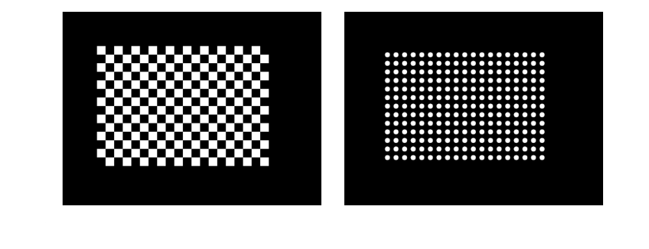
*그림 1 — 본 연구에 사용한 두 부류의 패턴, 체커보드와 원을 표준 형태로 나타낸 것. 영상 크기는 2560 x 1920화소이다. 247개의 제어점을 합성한다. 체커보드 칸의 크기는 85 x 85화소이고, 원의 직경은 51화소이다. 중심, 즉 주점(principle point [역주: 원문 그대로. principal point])은 (1280,960)에 있다.*

### 2.1 패턴 배치 (Pattern positioning)

제어점의 다양한 3D 위치에 대한 영상 지각, $\mathbf{p} = (x, y, 1)^T$(동차 형식)는 의사 무작위로 생성한 호모그래피(homography) $\mathbf{H}$를 사용하여 $\mathbf{p} = \mathbf{H}\bar{\mathbf{p}}$로 모의한다. 여기서 $\bar{\mathbf{p}}$는 제어점의 표준 표현이다. 이 호모그래피는 3D 회전(rotation)과 평행이동(translation)의 조합으로 생성하며, 그 값은 특정 범위에서 무작위로 뽑는다. 이 범위 제한은 변환된 영상이 대략 영상 창 안에 놓이고, 보이는 3D 위치가 보정 물체의 그럴듯한 시점을 모의하도록 보장한다. 대응하는 영상 재표본화는 $\mathbf{H}^{-1}$을 사용하여 계산한다.

또한 원근 변환이 닮음(similarity) 변환에 얼마나 가까운지를 정량화하는 수단이 필요하다. 변환의 세 번째 행만 따로 보는 것은 사영 변환의 아핀(affine) 요소를 고려하지 않으므로 충분한 정보를 주지 못한다. Mallon and Whelan (2005)에서 호모그래피의 아핀 요소가 그 원근 특성에 직접 영향을 준다는 것이 입증되었다. 따라서 호모그래피 전체를 고려해야 한다. 이를 위한 한 가지 유용한 방법은 행렬 노름(norm)을 사용하는 것으로, 이상적으로는 원근 측면의 심각도를 단일 값 척도로 준다. 그러나 이 변환은 본질적으로 비선형이므로 노름을 직접 적용할 수 없다. 이를 극복하기 위해 변환의 야코비안(Jacobian)의 노름, 특히 가장 큰 가장 큰 [역주: 원문 그대로 "largest largest"] 특이값(L2 노름)을 가장 작은 특이값으로 나눈 값을 고려한다. 이상적으로는 두 특이값이 같아 조건수(condition)가 1이 된다. 그러면 조건수는 다음과 같다.

$$
\mathrm{cond}(\mathbf{J}(\mathbf{H}, \mathbf{p})), \quad \text{where} \quad \mathbf{J}(\mathbf{H}, \mathbf{p}) = \begin{pmatrix} \frac{\partial x}{\partial \bar{x}} & \frac{\partial x}{\partial \bar{y}} \\ \frac{\partial y}{\partial \bar{x}} & \frac{\partial y}{\partial \bar{y}} \end{pmatrix}.
$$

이는 영상 창 안의 점 $\mathbf{p}$에서 비선형 변환의 국소 원근 효과를 선형적으로 정량화한다. 이 값들의 평균을 원근 변환의 순(net) 효과로 취한다.

### 2.2 렌즈 왜곡의 모의 (Simulating lens distortion)

일반적인 방사형(radial) 렌즈 왜곡은 영상에서 다음과 같이 근사된다(Born and Wolf, 1980; Mallon and Whelan, 2007).

$$
\breve{\mathbf{p}} = \mathbf{p} + \mathcal{D}(\mathbf{p}, \mathbf{k}), \quad \text{where} \quad \mathcal{D}(\mathbf{p}, \mathbf{k}) = \begin{pmatrix} x(k_1 r^2 + k_2 r^4 + 1) \\ y(k_1 r^2 + k_2 r^4 + 1) \end{pmatrix}, \tag{1}
$$

여기서 $\mathbf{p} = (x, y, 1)^T$는 왜곡되지 않은 영상 좌표이고 $r^2 = x^2 + y^2$이며, $\breve{\mathbf{p}} = (\breve{x}, \breve{y}, 1)^T$는 대응하는 왜곡된 좌표이다. 이 모델의 기원에 관한 자세한 내용은 Mallon and Whelan (2007)에 있다. 왜곡 매개변수 $(k_1)$을 지표로 사용하며, 그 값은 $\pm 2(pix^3)$ 범위에서 변하고 $k_2 = -k_1$이다. 이 값들은 영상 폭과 높이의 평균으로 정규화한 화소 좌표에 적용되며, 이를 $(pix)$로 표기한다. 왜곡된 영상을 재표본화하려면 (1)의 역이 필요하다. Mallon and Whelan (2004)에서 제안한 근사 모델을 사용한다.

$$
\mathcal{D}^{*}(\breve{\mathbf{p}}, \boldsymbol{\delta}) = \begin{pmatrix} \breve{x}(\delta_1 \breve{r}^2 + \delta_2 \breve{r}^4 + \delta_3 \breve{r}^6 + \delta_4 \breve{r}^8 + 1) \\ \breve{y}(\delta_1 \breve{r}^2 + \delta_2 \breve{r}^4 + \delta_3 \breve{r}^6 + \delta_4 \breve{r}^8 + 1) \end{pmatrix} \Big/ (1 + 4\delta_5 \breve{r}^2 + 6\delta_6 \breve{r}^4). \tag{2}
$$

이 모델의 매개변수는 영상 창을 덮는 조밀한 점 집합을 사용하여 선형적으로 추정한다. 고려하는 왜곡 범위에 대한 역변환 정확도를 표 1에 나타냈다. 이 잔차는 부화소 점 검출 알고리즘의 정밀도보다 몇 자릿수 낮아(4절 참조), 모의 영상으로부터 추가 오차 원인이 유입되지 않음을 보장한다.

*표 1 — 식 2를 맞춘 뒤의 역왜곡 잔차. 수준이 제어점 검출 정확도보다 몇 자릿수 낮다(4절 참조).*

| k1 (Barrel, 술통형) | -2 | -1.75 | -1.5 | -1.25 | -1 | -0.75 | -0.5 | -0.25 |
|---|---|---|---|---|---|---|---|---|
| Mean ×10⁻⁵ | 0.6997 | 1.8487 | 0.4540 | 0.1080 | 0.0051 | 0.0095 | 0.0027 | 0.0007 |
| SD ×10⁻⁴ | 1.7838 | 0.9531 | 0.1255 | 0.0232 | 0.0013 | 0.0015 | 0.0003 | 0.0001 |

| k1 (Pincushion, 실패형) | 0.25 | 0.5 | 0.75 | 1 | 1.25 | 1.5 | 1.75 | 2 |
|---|---|---|---|---|---|---|---|---|
| Mean ×10⁻⁵ | 0.0001 | 0.0028 | 0.0192 | 0.0735 | 0.2045 | 0.4682 | 0.9425 | 1.4668 |
| SD ×10⁻⁴ | 0.0000 | 0.0001 | 0.0012 | 0.0051 | 0.0151 | 0.0372 | 0.0806 | 1.0379 |

## 3 제어점 복원 (Control point recovery)

각 패턴에 대해 두 가지 일반적인 부화소 검출 전략을 기술한다. 이 전략들은 고유한 편향 특성 때문에 선택하였다. 안타깝게도 검출 방법을 완전히 일반화하는 것은 불가능하므로, 필요한 곳에서는 구현 세부를 제공한다. 이런 의미에서, 예컨대 어떤 종류의 에지 검출기, 문턱값 등을 사용하든 원리는 다른 검출 전략과 패턴으로 쉽게 추상화할 수 있다. 원 검출 방법은 무게중심 추출과 타원 맞춤에 기반한다. 사각형 검출 방법은 초기 코너 해를 에지 교차와 국소 곡면 맞춤으로 정제하는 데 기반한다. 검출 방법들이 두 가지 편향 원인의 영향을 받음을 보일 것이다. 이 편향들이 원근 시점과 렌즈 왜곡의 결과로 어떻게 생기는지 이론적으로 보인다.

### 3.1 원 패턴 검출 (Circle pattern detection)

원형 패턴의 영상이 주어지고 적절한 문턱값 처리를 거친 뒤, 원의 무게중심은 간단히 다음과 같이 계산된다.

$$
\mathbf{c_{cen}} = (x_{cen}, y_{cen}, 1)^T = \left( \frac{\sum_{x_f \in F} x_f \cdot I(\mathbf{p_f})}{\sum_{x_f \in F} I(\mathbf{p_f})},\, \frac{\sum_{y_f \in F} y_f \cdot I(\mathbf{p_f})}{\sum_{y_f \in F} I(\mathbf{p_f})},\, 1 \right)^T, \tag{3}
$$

여기서 $I(\mathbf{p_f})$는 점 $\mathbf{p_f}$에서의 세기(실제로는 이진)이고 $F$는 원에 속한다고 판정된 화소들의 집합이다. 동등하게 1차 및 2차 형상 모멘트를 사용할 수도 있다. 우리의 모의 영상에는 조명 변화가 없다는 점에 유의하라¹. 보정 평면이 영상 평면과 평행하지 않으면 $\mathbf{c_{cen}}$에 편향이 유입된다는 것은 알려져 있다.

> ¹ 실제 영상을 다룰 때는 추가 편향의 유입을 피하기 위해 신중한 국소 문턱값 처리 같은 기법으로 조명과 비네팅(vignetting) 효과에 대응해야 한다.

#### 3.1.1 원근 편향 (Perspective bias)

일반적인 3D 위치에 있는 보정 평면을 생각하면, 제어점의 화소 좌표와 이상적 표준 위치 사이의 호모그래피 $\mathbf{H}$를 $\mathbf{p} = \mathbf{H}\bar{\mathbf{p}}$로 계산할 수 있다. 여기서 $\mathbf{p}$는 영상에서 제어점의 위치이고 $\bar{\mathbf{p}}$는 제어점의 이상적 표준 위치이다. 패턴의 에지 점 $\bar{\mathbf{p}}_{edge}$에 대한 원뿔곡선 근사는 $\bar{\mathbf{p}}_{edge}^T \bar{\mathbf{Q}} \bar{\mathbf{p}}_{edge}$로 선형적으로 추정할 수 있다(Hartley and Zisserman, 2003). 그러면 원뿔곡선의 중심은 $\bar{\mathbf{c}}_{conic} = \bar{\mathbf{Q}}^{-1}(0, 0, 1)^T$로 계산된다. 일반적인 3D 위치에서 이 중심들은 $\mathbf{c}_{conic} = \mathbf{H}\bar{\mathbf{Q}}^{-1}(0, 0, 1)^T$로 변환된다. 그러나 영상에서는 원뿔곡선 $\mathbf{Q}$만 얻을 수 있는데, 이는 $\mathbf{Q} = \mathbf{H}^{-T}\bar{\mathbf{Q}}\mathbf{H}^{-1}$을 통해 $\bar{\mathbf{Q}}$와 관련된다. 따라서 일반적인 원근 변환 $\mathbf{H}$를 겪는 원뿔곡선 중심의 편향 없는 추정값은 다음과 같다.

$$
\mathbf{c}_{conic} = \mathbf{Q}^{-1}\mathbf{H}^{-T}(0, 0, 1)^T. \tag{4}
$$

이 편향 영향의 정도를 2.1절에서 기술한 무작위 원근 시점에 대해 그림 2에 모의하였다. 많은 알고리즘에서, 특히 렌즈 왜곡이 요인일 때, $\mathbf{H}$의 값이나 동등하게 카메라 투영 행렬의 원소를 사전에 정확히 알지 못한다. 이 때문에 알고리즘은 제어점의 추정값을 반복적으로 갱신해야 한다. 이러한 제어점의 재추정은 심각한 복잡성으로, 반복 횟수를 늘리고 미분 정보를 열화시킨다.

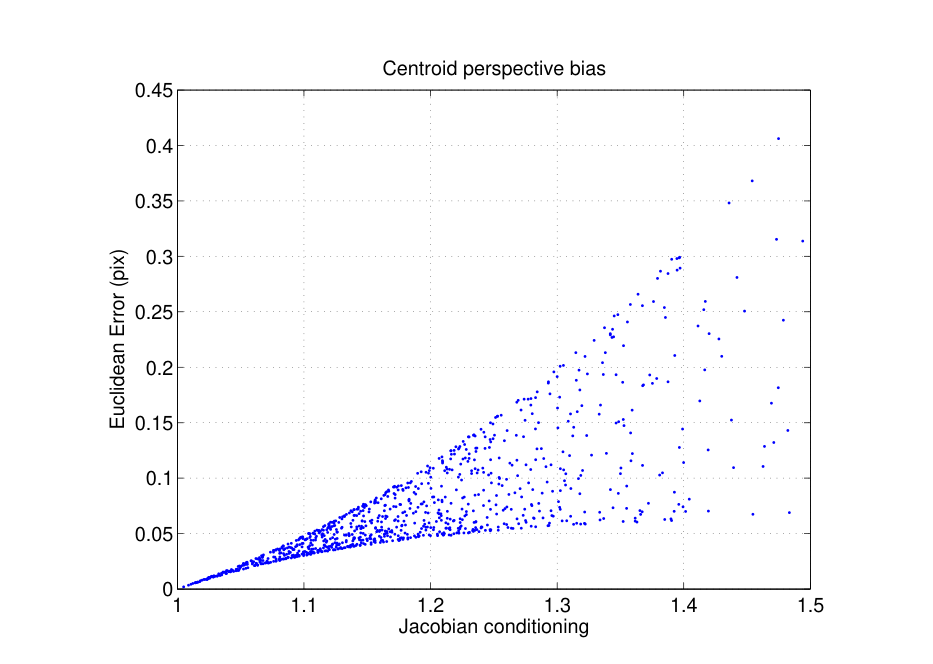
*그림 2 — 원형 패턴의 무작위 위치 1000개에 따른 평균 유클리드 오차. 직교에 가까운 호모그래피는 낮은 조건수(1에 가까움)를 유발하고, 원근 편향은 조건수가 커질수록 증가한다.*

#### 3.1.2 왜곡 편향 (Distortion bias)

원 패턴과 그 검출 방법의 두 번째 주요 단점은 렌즈 왜곡에서 비롯되는 편향의 영향도 받는다는 것이다. 렌즈 왜곡은 원뿔곡선 영역에 비선형 형상 뒤틀림(warping)을 가한다. 이 뒤틀림은 결과적으로 원뿔곡선의 중심점을 편향시킨다. 편향의 정도는 렌즈 왜곡의 양과 원뿔곡선의 면적 또는 반경에 의존하며, 이를 그림 3과 4에 나타냈다.

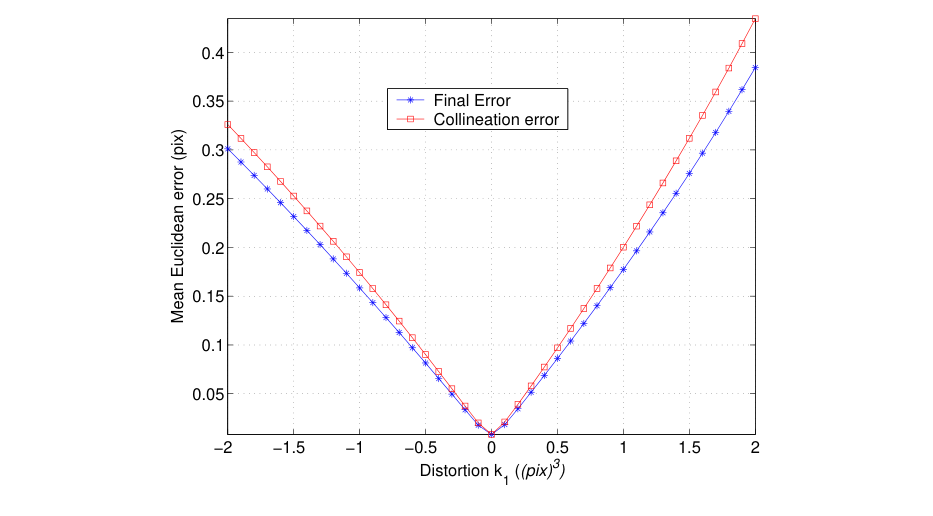
*그림 3 — 고려한 왜곡 범위에 걸친 원 패턴(원 직경 50 pix)의 모의 평균 유클리드 왜곡 편향. $\mathbf{H}_\mathcal{D}$에서 생기는 공선변환 오차(collineation error)는 원뿔곡선 부적합 오차에 의해 실제로 줄어든다.*

이 편향은 두 오차 원인의 결합 효과에서 비롯된다. 첫째, 왜곡 (1)의 비선형성은 원뿔곡선을 뒤틀어 더 이상 진짜 원뿔곡선이 아니게 만든다. 원뿔곡선의 일부 구간이 늘어나거나 압축되며, 이 모든 것이 최종 원뿔곡선 맞춤에서 편향을 유입하는 것으로 귀결된다. 왜곡의 한 항($k_1$)에 대해서만 식을 추적해 보면, 2차 최소제곱 원뿔곡선 맞춤(즉 대수적 거리의 최소화) $\breve{\mathbf{p}}^T \breve{\mathbf{Q}} \breve{\mathbf{p}}$가 6차 곡선 구간에 대해 수행된다. 이는 부적합(ill-fitting) 편향으로 이어지며, 그 정도를 그림 3에 나타냈다. 이러한 편향의 해석적 보상은 제어점의 참된 무왜곡 상태에 대한 정확한 지식 없이는 불가능하다.

두 번째 오차 원인은 원뿔곡선 맞춤에서 비롯되는, 왜곡이 유발한 국소 원근 변환이다. 이는 예컨대 원형 제어점 두 개, 즉 하나는 영상 중심에, 다른 하나는 왜곡이 심한 주변부 어딘가에 놓인 것을 생각하면 시각화할 수 있다. 중심의 점과 비교하면, 바깥쪽 제어점은 다른 상대 위치에 놓인 것처럼 보임을 알 수 있다. 이러한 원근의 차이는 앞서와 같이 편향을 유발하는데, 다만 이제는 각 제어점이 영상 안의 위치에 따라 개별적으로 영향을 받는다. 이를 공선변환 오차(collineation error)라 부른다.

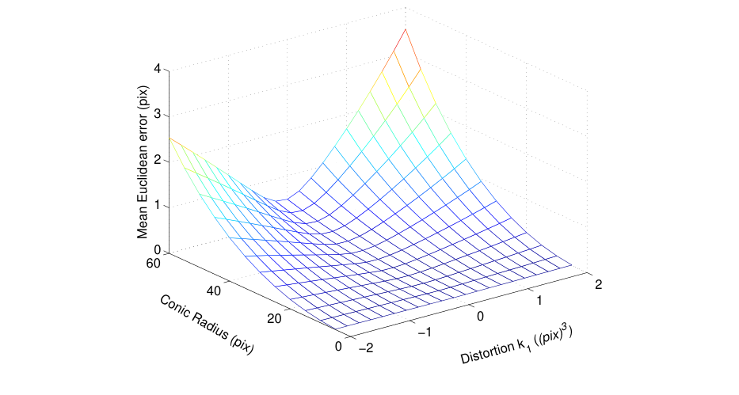
*그림 4 — 여러 왜곡 수준 범위에 걸쳐 고려한, 다양한 원 반경의 패턴에서의 모의 평균 유클리드 왜곡 편향.*

일반적인 무왜곡 원뿔곡선 $\mathbf{Q}$를 생각하면, 왜곡 공간에서의 최소제곱 대응물은 대수식 $\sum_i(\breve{\mathbf{p}}_i, \breve{\mathbf{Q}}\breve{\mathbf{p}}_i)^2$을 최소화하여 계산되며, 여기서 $\breve{\mathbf{Q}}$는 실수 고유(real proper) 원뿔곡선이어야 한다. 이 두 원뿔곡선은 $\mathbf{H}_\mathcal{D}^T \mathbf{Q} \mathbf{H}_\mathcal{D} = \breve{\mathbf{Q}}$를 통해 $\mathbf{Q}$를 $\breve{\mathbf{Q}}$로 사상하는 공선변환(collineation), 즉 호모그래피 $\mathbf{H}_\mathcal{D}$의 집합으로 관련된다. 이 공선변환은 $\mathbf{Q}$와 $\breve{\mathbf{Q}}$를 대각화하는 직교 행렬 $\mathbf{U}$와 $\breve{\mathbf{U}}$를 취하고 — $\mathbf{U}^T\mathbf{Q}\mathbf{U} = \boldsymbol{\Lambda}$, $\breve{\mathbf{U}}^T\breve{\mathbf{Q}}\breve{\mathbf{U}} = \breve{\boldsymbol{\Lambda}}$, 여기서 $\boldsymbol{\Lambda} = diag(\lambda_1, \lambda_2, \lambda_3)$, $\breve{\boldsymbol{\Lambda}} = diag(\breve{\lambda}_1, \breve{\lambda}_2, \breve{\lambda}_3)$ — $\boldsymbol{\Lambda_0} = diag(\sqrt{\breve{\lambda}_1/\lambda_1}, \sqrt{\breve{\lambda}_2/\lambda_2}, \sqrt{\breve{\lambda}_3/\lambda_3})$로 선택하여 구할 수 있다. 그러면 공선변환 $\mathbf{H}_\mathcal{D}$는 $\mathbf{H}_\mathcal{D} = \breve{\mathbf{U}}\boldsymbol{\Lambda}_0\mathbf{U}$로 구성된다. 그러나 식 $\mathbf{H}_\mathcal{D}^T \mathbf{Q} \mathbf{H}_\mathcal{D} = \breve{\mathbf{Q}}$는 필요한 여덟 개의 독립 제약 중 다섯 개만 제공하므로 유일하지 않다. 모의 목적상, $\sum_i(\breve{\mathbf{p}}_i, \mathbf{H}_\mathcal{D}\mathbf{p}_i)^2$을 최소화하여 최소제곱 의미에서 유일한 해를 얻는다.

호모그래피 $\mathbf{H}_\mathcal{D}$는 국소 원근 편향을 유입하며, 이를 공선변환 오차라 부른다. 무왜곡 점은 항상 관측 불가능하므로, 실제 카메라에서는 이 편향에 대한 보상을 직접 적용할 수 없다. 공선변환 오차 원인의 기여를 그림 3에 모의하였으며, 이것이 지배적이고 부적합 오차에 의해 실제로 줄어든다는 것이 드러난다. 당연히 왜곡 편향은 특징의 크기에 크게 의존한다. 이를 그림 4에서 여러 왜곡 수준과 원 직경 범위에 대해 조사하였다. 그림 2에서 모의한 원근 편향과 비교하면, $k_1$이 대략 $-0.3 \to -0.7\,pix^3$ 영역에 있는 전형적인 짧은 초점 거리 렌즈에서는 왜곡 편향이 원근 편향보다 크기가 클 가능성이 높다. 이는 4절에서 검증한다. 또한 왜곡 편향은 원뿔곡선 맞춤에 국한되지 않으며, 검출 방식(무게중심 또는 원뿔곡선 맞춤)에 관계없이 같은 정도로 존재한다는 점에 유의하라. 그림 4는 또한 점의 화소 직경이 대략 10화소보다 작으면 원형 점 패턴의 편향 효과가 무시할 만함을 보여 준다. 이 값을 원형 유형 패턴의 최적 성능을 위한 경험칙(rule of thumb)으로 사용해야 한다.

실무자에게는 항상 부화소 원뿔곡선 경계와 편향 없는 원뿔곡선 추정 절차를 사용할 것을 권장한다. 앞서 언급했듯이, 본 논문에서는 표준 최소제곱(대수적 거리) 맞춤을 부화소가 아닌 경계와 함께 사용한다. 이 역시 편향을 유발한다는 것은 잘 알려져 있다(Zhang, 1997). 그러나 이 선형 기법을 사용하면 이러한 원뿔곡선 추정 편향의 상대적 규모를 왜곡 및 원근 편향과 비교하여 파악할 수 있다. 원뿔곡선 추정 편향이 잠재적 원근 편향 및 왜곡 편향보다 훨씬 작음을 볼 수 있다(4절도 참조). 따라서 실제로 원형 유형 패턴을 사용할 때는 원근 및 왜곡 편향 원인에 우선순위를 두어야 한다. 그러면 잠재적 편향 원인의 위계는 다음과 같다. 렌즈 왜곡에서 비롯되는 것, 원근 왜곡에서 비롯되는 것, 마지막으로 잘못된 원뿔곡선 맞춤에서 비롯되는 것이다.

### 3.2 체커보드 패턴 검출 (Checkerboard pattern detection)

체커보드 패턴의 영상이 주어지면, 교차점 위치의 초기 추정값은 표준 코너 검출 방법(Jain et al., 1995)으로 모을 수 있다. 이 추정값은 일반적으로 참 위치에서 몇 화소 이내에 있다. 이러한 초기 해를 정제하는 기존 방법 두 가지, 즉 에지 정보를 이용하는 방법(Willson, 1994; Li and Lavest, 1996)과 곡면 맞춤(Lucchese and Mitra, 2002)을 기술한다. 패턴에 속하지 않는 점의 필터링(필터링 세부는 Mallon and Whelan (2007)에 있음)이나 이후 비교를 위한 데이터의 정렬은 다루지 않는다.

#### 3.2.1 에지 교차 (Edge intersections)

선 교차를 모델링하는 맞춤 함수를 정식화한다. 이를 체커보드 패턴에 사용하기 위해, 먼저 초기 추정값을 중심으로 하는 중간 크기의 국소 영역 Ψ에서 에지, 즉 세기 도함수를 계산한다. 그런 다음 비선형 반복 기법으로 함수를 맞춘다.

$$
\min_{\mathbf{h}} \Big\| h_1 e^{-h_2^2((x-h_5)\cos h_3 + (y-h_6)\sin h_3)^2} + h_1 e^{-h_2^2((x-h_5)\sin h_4 + (y-h_6)\cos h_4)^2} - 2h_1 e^{-h_2^2((x-h_5)^2 + (y-h_6)^2)} - \Psi(x, y) \Big\|^2,
$$

여기서 교차점은 $(h_5, h_6)$이고, $h_1$은 도함수 프로파일의 높이, $h_2$는 프로파일의 폭, $h_3$과 $h_4$는 에지 방향이다. 이 과정을 그림 5에 나타냈다. 원근 변환에서 직선은 직선으로 투영되므로, 이 검출 방법은 원근 편향에 불변이다. 그러나 렌즈 왜곡에서는 직선이 곡선으로 투영되는 것이 분명하며, 그 결과 이 방법은 왜곡 편향의 영향을 받는다. 따라서 해석적 증명은 다루지 않는다(perused [역주: 원문 그대로. pursued의 오기로 보임]).

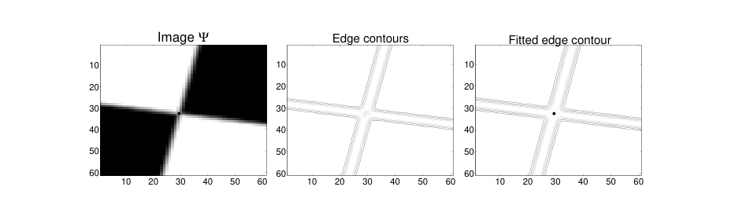
*그림 5 — 에지 맞춤에 기반한 제어점 정제. 첫 번째 영상은 선택한 관심 영역(ROI)을 보여 준다. 가운데 영상은 에지 영상 등고선을 보여 준다. 마지막 영상은 함수 맞춤 등고선을 보여 주며, 이로부터 제어점을 계산한다.*

#### 3.2.2 코너 (Corners)

부화소 정제의 한 범주는 코너 점 주위의 세기에 대한 곡면 맞춤에 기반한다(Lucchese and Mitra, 2002). 각 초기 위치 추정값에 대해 작은 관심 영역 Ψ를 맞춤에 고려한다. 흐림 처리 후, 그림 6에 보인 것처럼 다음을 최소화하여 결과 세기 프로파일에 2차 함수를 선형적으로 맞출 수 있다.

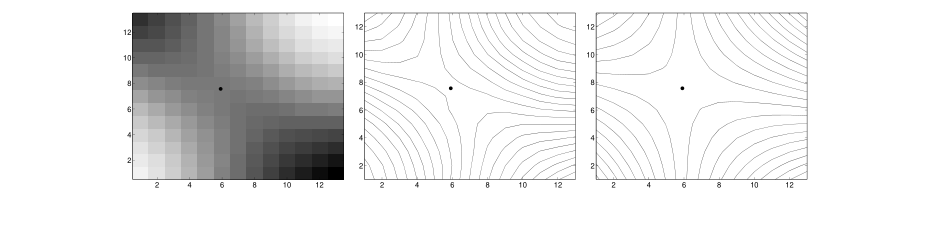
*그림 6 — 안장점(saddle) 정제 과정. 먼저 안장점을 표시한 흐린 ROI를 보인다. 가운데 영상은 세기 프로파일의 등고선 영상이다. 마지막 영상은 곡면 맞춤의 세기 프로파일을 보여 주며, 이로부터 안장점을 계산한다.*

$$
\min_{\mathbf{s}} \big\| s_1 x^2 + s_2 xy + s_3 y^2 + s_4 x + s_5 y + s_6 - \Psi(x, y) \big\|^2.
$$

교차점, 즉 안장점은 이 곡면으로부터 두 직선 $2s_1 x + s_2 y + s_4 = 0$과 $s_2 x + 2s_3 y + s_5 = 0$의 교점으로 유도된다. 실제로 작은 패치 Ψ는, 특히 검출 정확도와 잡음 바닥을 고려하면, 사실상 하나의 점으로 간주할 수 있다. 사영 변환과 렌즈 왜곡 변환 모두에서 점은 점으로 투영되므로, 이 방법은 원근 편향과 왜곡 편향 모두에 불변이라는 바람직한 특성을 갖는다.

## 4 실험 (Experiments)

2절에서 기술한 합성 시험 영상에 대해 세 묶음의 실험을 수행한다. 원형 패턴과 체스보드의 크기는 그림 1에 자세히 기술한 것과 같다. 두 실험은 각 검출 방법과 패턴에 대해 원근 편향과 왜곡 편향을 검증하고 정량화한다. 두 편향 원인의 크기를 평가할(access [역주: 원문 그대로. assess의 오기]) 기준을 주기 위해, 잡음과 흐림에 대한 정확도 평가를 나란히 제시한다. 마지막으로 원과 사각형을 결합한 패턴에 기반하여 왜곡 편향과 사영 편향의 실제 예를 제시한다. 간단히 하기 위해 검출 방법의 명칭을 줄여서, 원 무게중심은 centroids, 원뿔곡선 중심은 conics, 체커보드 에지 교차는 edges, 체커보드 코너 안장점 정제는 corners라 부른다.

### 4.1 잡음과 흐림 (Noise and Blurring)

각 방법의 성능을 여러 가우스 흐림 범위에 대해 조사한다. 그림 7은 참 위치를 사용하여 계산한 유클리드 오차의 평균과 표준편차를 보여 준다. 이 시험 영상 패턴은 원뿔곡선 기반 보상을 평가할 수 있도록 사영 변환도 가하였다. 이는 예상 검출 오차가 흐림에 대해 비교적 일정하게 유지됨을 보여 준다. 편향으로 오염된 centroids를 제외하면, 이 오차는 대략 0.02 → 0.04화소 범위이며, 에지 기반 방법에서는 더 낮다. 가산 정규 분포 잡음에 대한 검출 방법의 강건성을 표 2에 제시한다. 상한 수준 σ = 20 (pix)은 일반적인 보정 촬영에서는 마주치기 어려운 심한 잡음을 나타낸다. 영상의 전형적인 잡음 값은 σ = 5에서 σ = 10 pix 범위이다.

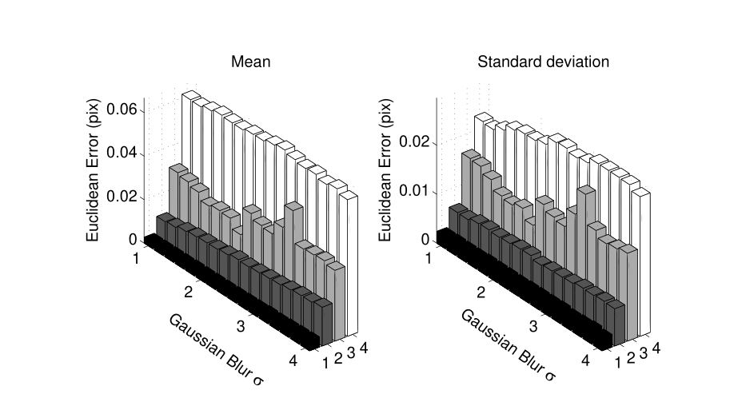
*그림 7 — 여러 가우스 흐림 수준에 걸친 네 방법의 평균과 표준편차. 1 ⇒ edges, 2 ⇒ corners, 3 ⇒ conics, 4 ⇒ centroids. 영상에는 원근 변환이 가해졌다.*

*표 2 — 가산 가우스 잡음에 대한 유클리드 오차. 오차는 100회의 독립 시행에 걸쳐 집계하였으며, 원근과 왜곡이 없는 영상에서 수행하였다.*

| Noise σ (pix) = | Centroids Mean | Centroids SD | Conics Mean | Conics SD | Corners Mean | Corners SD | Edges Mean | Edges SD |
|---|---|---|---|---|---|---|---|---|
| 1 | 0 | 0 | 0.0281 | 0.0141 | 0.0051 | 0.0026 | 0.0014 | 0.0007 |
| 5 | 0.0012 | 0.0039 | 0.0369 | 0.0198 | 0.0144 | 0.0076 | 0.0067 | 0.0035 |
| 10 | 0.0220 | 0.0122 | 0.0541 | 0.0287 | 0.0279 | 0.0149 | 0.0134 | 0.0070 |
| 15 | 0.0355 | 0.0188 | 0.0657 | 0.0350 | 0.0420 | 0.0221 | 0.0200 | 0.0104 |
| 20 | 0.0447 | 0.0233 | 0.0841 | 0.0805 | 0.0568 | 0.0298 | 0.0265 | 0.0139 |

### 4.2 배치 (Positioning)

그림 8과 같이 아홉 가지 서로 다른 사영 변환 범위에 대해 검출 패턴과 방법을 조사한다. 원 패턴에서의 무게중심 검출의 원근 편향을 관찰할 수 있으며, 이는 원근의 심각도와 함께 증가한다. 이 값들은 3.1.1절의 모의 결과와 대응한다. 이러한 기본 통계는 이 오차들이 무작위로 분포하지 않고 실제로는 편향되어 있다는 점을 전달하지 못한다. 그림 9는 이러한 원 무게중심 편향의 한 표본을 편향 없는 조정된 원뿔곡선 맞춤과 비교하여 보여 준다.

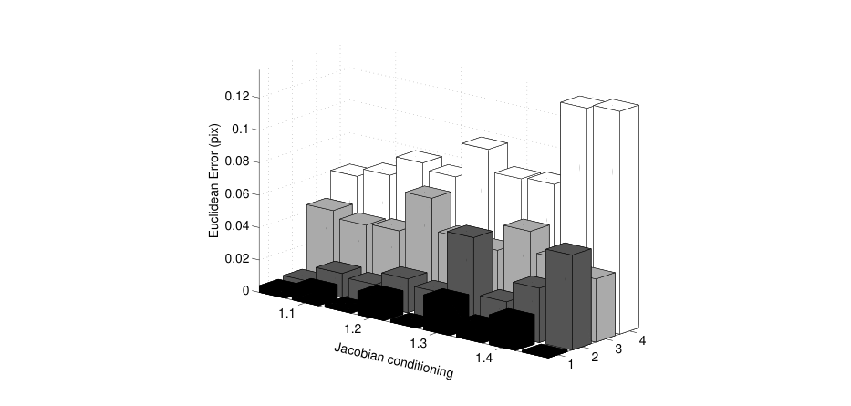
*그림 8 — 여러 정도의 원근 변환에 걸쳐 모의한 네 검출 방법(1 ⇒ edges, 2 ⇒ corners, 3 ⇒ conics, 4 ⇒ centroids)의 평균 유클리드 오차. 무게중심 편향이 큰 평균 유클리드 오차로 뚜렷이 드러난다.*

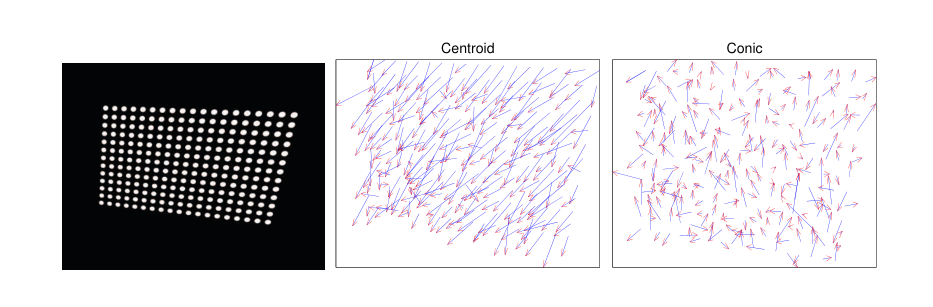
*그림 9 — 한 원근 변환(cond. = 1.25)의 표본. 벡터 그림이 무게중심 편향을 드러낸다. 잔차 축척 = ×2000.*

### 4.3 왜곡 (Distortion)

원근 뒤틀림 없이 왜곡 수준 범위에 걸쳐 패턴과 검출 방법을 평가한다. 외부 모의 오차 원인은 2.2절에서 무시할 만한 수준임을 보였다. 그림 10은 원 패턴 검출 방법의 평균 유클리드 오차가 왜곡 수준에 따라 꾸준히 증가함을 보여 준다. 이는 3.1.2절의 모의 왜곡 편향과 매우 잘 일치한다. 에지 기반 검출은 직선 맞춤 때문에 왜곡 편향을 어느 정도 줄이며, 고정된 창 크기와 왜곡이 유발하는 영상 확장 때문에 실패형 왜곡에서 더욱 그렇다. 그림 11은 한 왜곡 표본에 대해 각각 해당 검출 방법을 적용한 왜곡 모의 영상을 보여 준다.

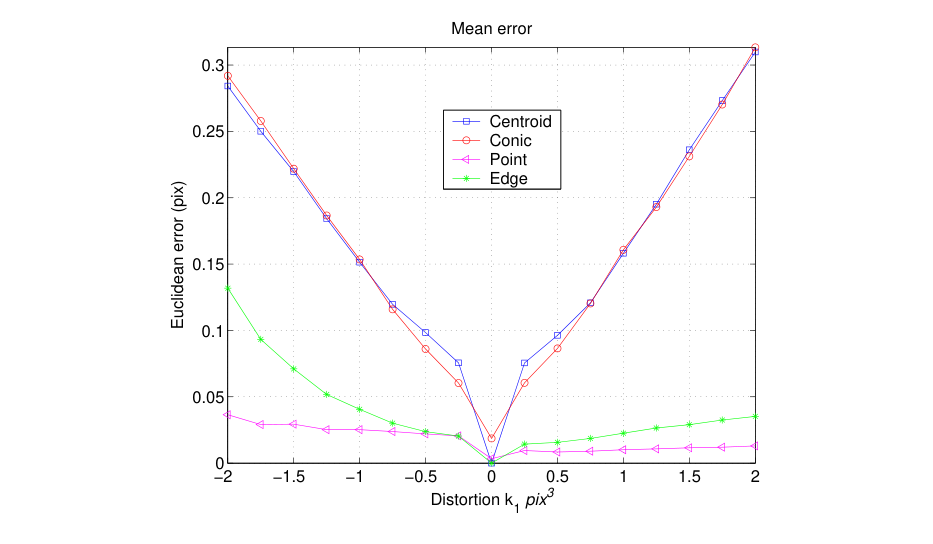
*그림 10 — 네 검출 방법에 대해 제어점에서 왜곡이 유발한 편향을 보여 준다.*

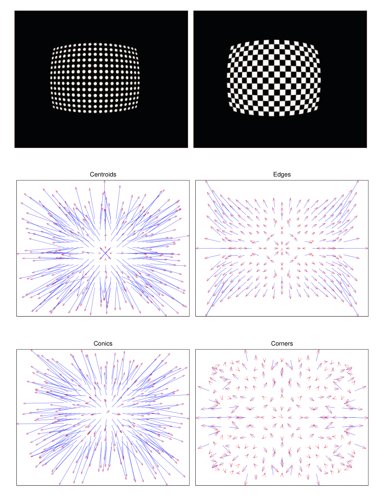
*그림 11 — 왼쪽 열 영상은 원 패턴과 관련 검출 방법의 오차를 보여 준다. 오른쪽 열 영상은 체커보드와 관련 방법을 보여 준다. 왜곡 수준은 $k_1 = -1.5\,pix^3$이다. 잔차 축척 = ×2000.*

### 4.4 실제 영상 결과 (Real image results)

특정 패턴의 사용에서 생기는 편향의 실제 예를 그림 12와 13에 나타냈다. 이 그림들은 원형 특징과 사각형 특징을 모두 결합한 특수 패턴으로 측정한, 무게중심 기반 제어점과 코너 기반 제어점 사이의 공간적 차이를 보여 준다.

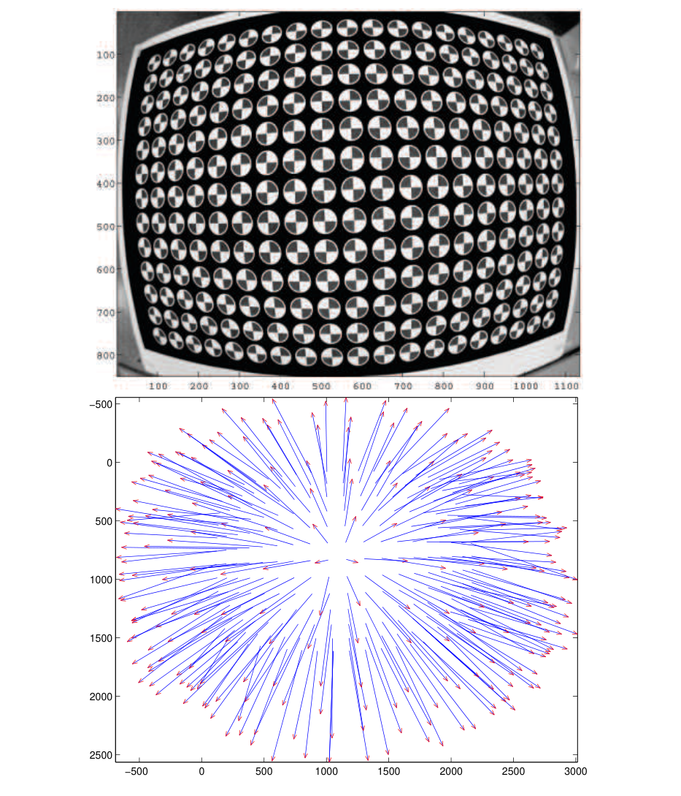
*그림 12 — 실제 영상에서의 편향 예(크기: 2272 × 1704). 원 직경 110 pix, 추정된 1차 왜곡 항: $k_1 = -1.2$. 벡터 그림은 Centroids(보정하지 않은 conics)와 Corner의 차이를 보여 주며, 왜곡 편향을 드러낸다(축척 ×500). 잔차 평균과 SD는 1.475(0.322)이다.*

그림 12는 원근 왜곡을 최소화하려고 노력한 예를 보여 준다(카메라를 손으로 배치했으므로 틀림없이 원근 왜곡 요소가 여전히 남아 있다). 관찰할 수 있듯이 왜곡 편향이 상당하다. 그림 13은 원근 요소를 포함한 두 번째 예를 보여 준다. 이는 편향의 겉보기 중심을 이동시키지만, 왜곡 편향이 여전히 지배적이다. 이 예들은 이러한 편향이 모의 사례에 국한되지 않고 실제 영상에서도 똑같이 널리 존재함을 포괄적으로 입증한다.

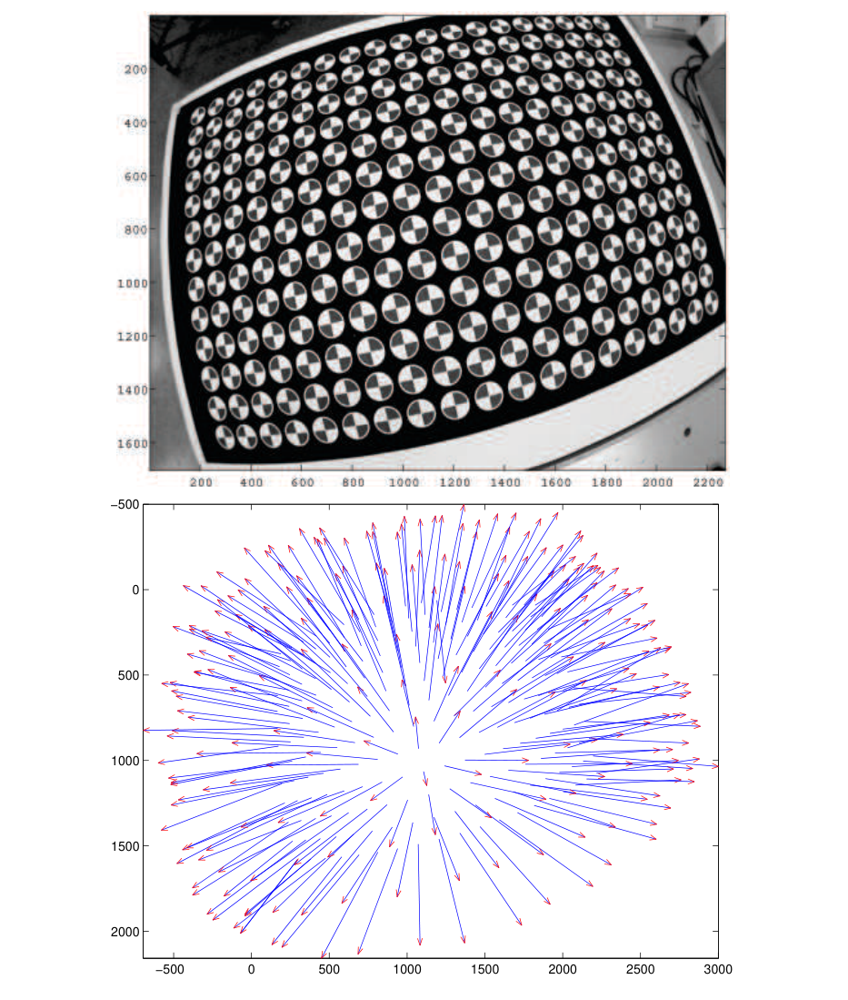
*그림 13 — 그림 12와 같은 카메라와 설정으로 얻은 실제 영상에서의 편향 예. 벡터 그림은 Centroids(보정하지 않은 conics)와 Corner의 차이를 보여 주며, 왜곡 편향이 거의 완전히 지배함을 드러낸다(축척 ×500). 잔차 평균과 SD는 1.272(0.2711)이다.*

## 5 결론 (Conclusion)

본 논문은 평면 보정 차트로부터의 제어점 복원을 다루며, 패턴의 선택이 전체 검출 정밀도를 높일 수 있는지 조사하였다. 이 정확도를 원근 변환과 렌즈 왜곡에 대해 조사하였다. 먼저 패턴 합성 문제, 특히 영상에서 정확한 렌즈 왜곡을 생성하는 것을 자세히 다루었다. 두 가지 대표적 패턴 유형, 원과 체커보드를 고려하였으며, 각각 두 가지 일반적인 제어점 복원 방법을 가진다. 무게중심, 원뿔곡선 맞춤, 에지 근사, 코너 점이다. 보상된 원뿔곡선 맞춤, 에지 근사, 코너 점은 원근 편향에 불변이고, 코너 점만이 왜곡 편향에 불변임을 이론적·실험적으로 보였다. 모의 결과와 실제 결과는 왜곡이 유발한 편향이 상당한 크기를 가질 수 있음을 나타낸다. 최적이 아닌 원형 점 패턴에서는 대략 ±0.3(pix³)의 낮은 왜곡 수준조차 원뿔곡선 추정 오차보다 훨씬 큰 왜곡 편향을 유발하며, 일반적인 보정 시점에서 마주칠 가능성이 높은 원근 편향보다도 더 중요하다. 이러한 경우 원근 편향만 보상하는 것은 편향 없는 제어점을 얻기에 분명히 충분하지 않다. 그러면 원형 유형 패턴의 편향 원인 위계는 렌즈 왜곡, 원근, 마지막으로 추정 편향 순이다. 원형 점 패턴의 실제 사용과 관련하여, 편향 유입을 피하려면 점의 직경을 대략 10화소 미만으로 할 것을 권장한다. 연구 결과는 널리 인정된 보정 방법이라도 순진하게 적용하면 필요 이상으로 나쁜 결과를 줄 수 있음을 나타낸다. 전반적으로 본 논문은 이러한 문제를 자세히 부각하고, 카메라 보정에서 올바르게 설계된 패턴의 중요성을 강조한다.

## 참고문헌

- Asari, K. V., Kumar, S., Radhakrishnan, D., 1999. A new approach for nonlinear distortion correction in endoscopic images based on least squares estimation. IEEE Transactions on Medical Imaging 18 (4), 345–354.
- Born, M., Wolf, E., 1980. Principles of Optics, sixth Edition. Permagon.
- Hartley, R. I., Zisserman, A., 2003. Multiple View Geometry in Computer Vision, 2nd Edition. Cambridge University Press.
- Heikkila, J., 2000. Geometric camera calibration using circular control points. IEEE Transactions on Pattern Analysis and Machine Intelligence 22 (10), 1066–1077.
- Jain, R., Kasturi, R., Schunck, B. G., 1995. Machine vision. McGraw-Hill.
- Kannala, J., Brandt, S., 2006. A generic camera model and calibration method for conventional, wide-angle and fish-eye lenses. IEEE Transactions on Pattern Analysis and Machine Intelligence 28 (8), 1335–1340.
- Li, M., Lavest, J. M., 1996. Some aspects of zoom lens camera calibration. IEEE Transactions on Pattern Analysis and Machine Intelligence 18 (11), 1105–1110.
- Lucchese, L., Mitra, S. K., 2002. Using saddle points for subpixel feature detection in camera calibration targets. In: Asia-Pacific Conference on Circuits and Systems. Vol. 2. pp. 191 – 195.
- Mallon, J., Whelan, P. F., 2004. Precise radial un-distortion of images. In: International Conference on Pattern Recognition. Vol. 1. pp. 18–21.
- Mallon, J., Whelan, P. F., 2005. Projective rectification from the fundamental matrix. Image and Vision Computing 23 (7), 643–650.
- Mallon, J., Whelan, P. F., 2007. Calibration and removal of lateral chromatic aberration in images. Pattern Recognition Letters 28 (1), 125–135.
- Salvi, J., Armangue, X., Batlle, J., 2002. A comparative review of camera calibrating methods with accuracy evaluation. Pattern Recognition 35, 1617– 1635.
- Strum, P. F., Maybank, S. J., 1999. On plane-based camera calibration: A general algorithm, singularities, applications. In: IEEE conference on computer vision and pattern recognition. Vol. 1. pp. 432–437.
- Tsai, R., 1987. A versatile camera calibration technique for high accuracy 3d machine vision metrology using off-the-shelf tv cameras and lenses. IEEE Journal of Robotics and Automation 3 (4), 323–344.
- Weng, J., Cohen, P., Herniou, M., 1992. Camera calibration with distortion models and accuracy evaluation. IEEE Transactions on Pattern Analysis and Machine Intelligence 14 (10), 965–980.
- Willson, R., 1994. Modeling and calibration of automated zoom lenses. Ph.D. thesis, Carnegie Mellon University.
- Zhang, Z., 1997. Parameter estimation techniques : a tutorial with application to conic fitting. Image and vision computing 15 (1), 59–76.
- Zhang, Z., 2000. A flexible new technique for camera calibration. IEEE Transactions on Pattern Analysis and Machine Intelligence 22 (11), 1330–1334.
