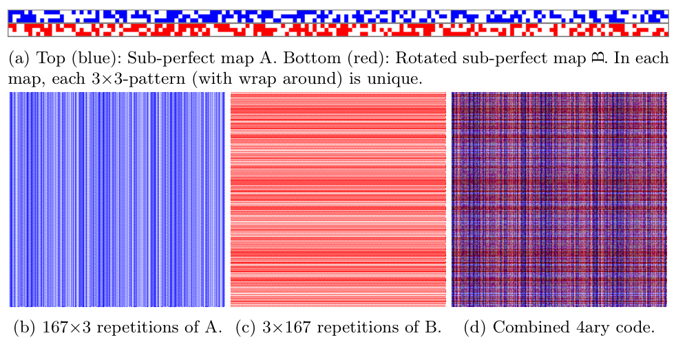
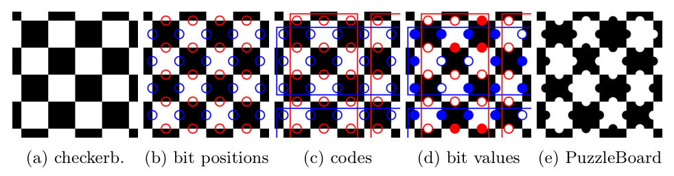
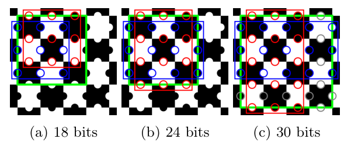
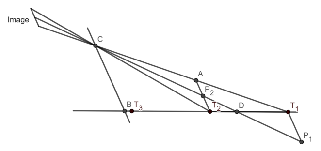
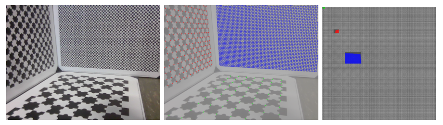
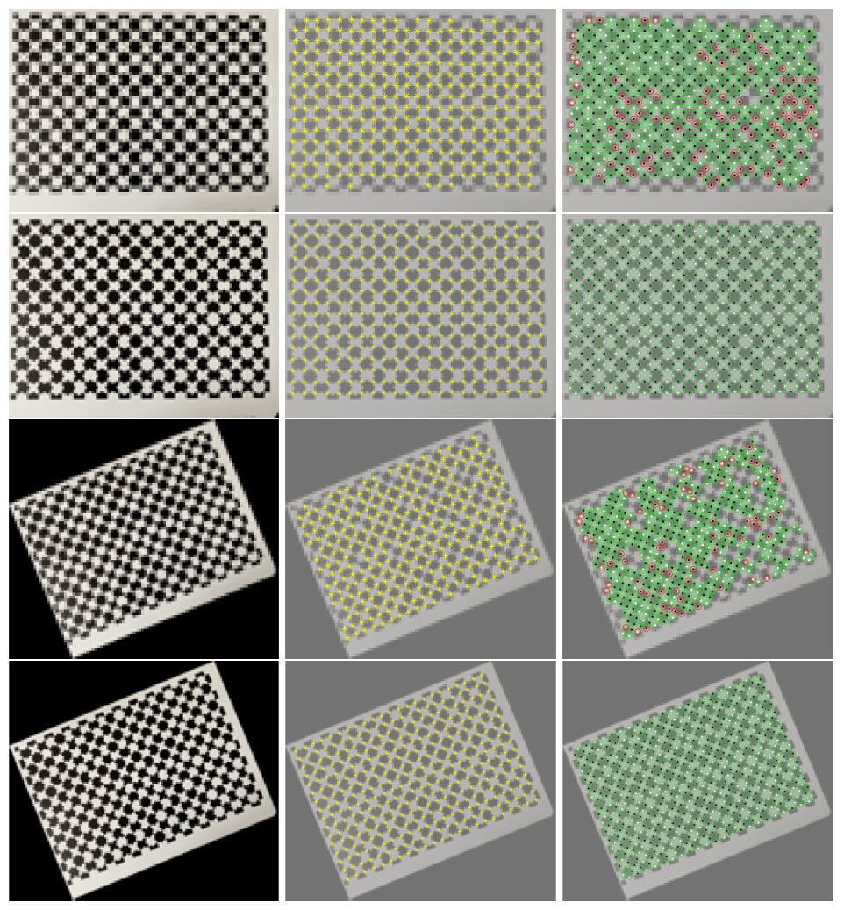
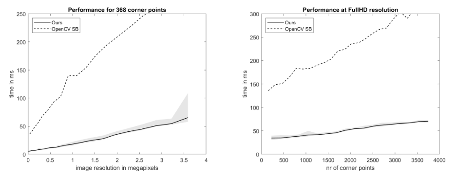

# PuzzleBoard: 위치 부호화를 갖춘 새로운 카메라 보정 패턴 (Stelldinger 2024)

- 원제: PuzzleBoard: A New Camera Calibration Pattern with Position Encoding
- 원문: 같은 폴더의 `Stelldinger2024_arXiv_PuzzleBoard.pdf` (arXiv:2409.20127v1 [cs.CV], 2024-09-30, 16쪽. 폴더 이름의 2025 LNCS 게재본이 아니라 arXiv 판을 번역함)
- 저자: Peer Stelldinger, Nils Schönherr, Justus Biermann (HAW Hamburg 컴퓨터과학과)
- 번역 범위: 전문
- 그림: 원문 그림 7개를 `그림/`에 넣고 본문에서 처음 언급되는 곳에 삽입. 4.3절의 해밍 거리 표 3개는 마크다운 표로 옮김
- 기호 [역주]: 원문은 패턴을 회전한 글자 모양(예: 뒤집힌 A, 눕힌 B)으로 표기한다. 마크다운에서 이를 그대로 쓸 수 없으므로 반시계 방향 회전각을 위첨자로 적어 $A^{90}, A^{180}, A^{270}$, $B^{90}, B^{180}, B^{270}$으로 옮겼다. 원문의 뒤집힌 A(∀)는 $A^{180}$, 뒤집힌 B는 $B^{180}$이고, 볼록한 쪽이 위로 가게 눕힌 B는 $B^{90}$, 아래로 가게 눕힌 B는 $B^{270}$, 꼭짓점이 왼쪽을 향한 A는 $A^{90}$, 오른쪽을 향한 A는 $A^{270}$이다.

## 초록

정확한 카메라 보정(calibration)은 컴퓨터 비전에서 잘 알려지고 널리 쓰이는 작업으로, 수십 년 동안 연구되어 왔다. 그러나 체커보드 보정 패턴에 기반한 표준 접근에는 적용 가능성을 제한하는 몇 가지 단점이 있다. 예를 들어 보정 패턴이 가림(occlusion) 없이 완전히 보여야 한다. ChArUco 보드 같은 대안은 부분적인 가림을 허용하지만, 위치 부호의 미세한 세부 때문에 더 높은 카메라 해상도를 요구한다. 우리는 체커보드 보정 패턴의 장점과, 매우 낮은 해상도에서도 해독할 수 있는 경량 위치 부호화를 결합한 새로운 보정 패턴을 제시한다. 해독 알고리즘은 오류 정정을 포함하며 계산 효율이 높다. 전체 접근은 체커보드 보정 패턴과 여러 체커보드 보정 알고리즘 모두와 하위 호환된다. 또한 이 방법은 카메라 보정뿐 아니라 카메라 자세 추정과 마커 기반 물체 위치 추정 작업에도 쓸 수 있다.

키워드: 보정 패턴 · 체스보드 · 체커보드 · 기준 마커(Fiducial Markers) · PuzzleBoard.

## 1 서론 (Introduction)

카메라 보정은 사진측량, 3D 복원, 로봇 비전, 증강현실의 많은 응용에 필수적인 컴퓨터 비전의 핵심 과정이다. 3D 타깃을 쓰던 오랜 전통 이후, 2차원 체커보드 패턴은 제작과 취급이 쉬워 정확한 보정을 위한 기본 접근으로 오랫동안 자리 잡았다. 그러나 체커보드 패턴은 특히 부분적인 가림을 다룰 때 본질적인 한계가 있다.

ChArUco 보드 [25]는 체커보드 패턴과 ArUco 마커 [16]를 결합하여, 카메라 보정의 정확도를 유지하면서 부분적인 가림을 허용한다. 그 대가로 위치 부호를 읽을 수 있으려면 더 높은 카메라 해상도가 필요하다. 이는 저해상도 카메라를 쓰는 임베디드 시스템 같은 특정 응용에서 유용성을 제한한다.

우리는 기존 방법의 한계를 극복하는 새로운 보정 패턴을 제시한다. 제안 접근은 전통적인 체커보드 패턴의 장점과 경량 위치 부호화 방식을 결합하여, 매우 낮은 해상도에서도 정확한 보정을 가능하게 한다. 또한 해독 알고리즘은 계산 효율이 높도록 설계되어 임베디드 및/또는 실시간 응용에 적합하며, 저해상도 영상 같은 어려운 조건에서도 보정을 보장하도록 오류 정정을 포함한다.

우리는 측정 오차는 평균으로 상쇄될 수 있으므로, 많은 수의 기준점을 얻는 것이 더 높은 위치 정확도로 점을 검출하는 것만큼 중요하다는 생각을 따른다. 우리 접근은 세 가지 이유로 이를 가능하게 한다. 첫째, 더 낮은 해상도에서 동작하는 알고리즘은 더 많은 기준점을 가진 더 조밀한 보정 패턴을 쓸 수 있게 한다. 둘째, 알고리즘이 빠를수록 움직이는 보정 패턴의 영상을 더 많이 쓸 수 있다(예를 들어 보정 정확도에 대한 실시간 피드백과 함께). 셋째, 가림을 다룰 수 있으면 패턴의 일부만 보이는 영상도 쓸 수 있다.

우리 방법은 기존 체커보드 보정 패턴 및 여러 체커보드 보정 알고리즘 모두와의 하위 호환성을 보장하여 기존 프레임워크에 매끄럽게 통합할 수 있게 한다. 이는 (a) 우리 검출 알고리즘이 표준 체커보드 패턴에서도 동작하고, (b) 변 위의 부호에 영향을 받지 않는 모든 체커보드 검출 알고리즘이 제안하는 PuzzleBoard 타깃을 해독할 수 있다는 뜻이다. 물론 두 경우 모두 위치 해독은 포함하지 않는다. 특히 우리 접근의 다용도성은 단순한 보정을 넘어서, 패턴의 작은 부분을 쓸 때 ArUco 같은 기준 마커의 대안이 된다.

보정은 많은 응용에서 실험실 조건에서 카메라를 한 번만 보정하면 충분한데 왜 이렇게 강건한 보정 패턴이 필요한지 물을 수 있다. 답은 항상 그렇지는 않다는 것이다. 한 예는 가변 초점·줌 렌즈를 가진 카메라로, 이들은 정기적으로 재보정해야 할 수 있다. 또 다른 응용은 다중 카메라 구성에서 (위치, 방향 및/또는 화각이 크게 다른) 매우 다른 카메라들의 공동 보정이다. 카메라 보정 외에도, 고정밀 광학 자세 추정과 위치 추정에서는 이점이 더욱 분명하다. 반드시 평평하지 않아도 되는 여러 타깃을 방 안에 배치할 수 있고, 각각의 작은 부분 패턴이 카메라의 위치와 방향을 유일하게 식별하게 해 주기 때문이다.

## 2 선행 연구 (Previous Work)

매우 흔한 보정 패턴 설계는 원형 블롭(blob)의 규칙적 격자로 된 원 격자(circle grid)이다 [29,30,31,32]. 타원형 블롭은 쉽게 검출할 수 있고 그 중심점 위치를 높은 부화소(sub-pixel) 정확도로 측정할 수 있다. 그러나 블롭 중심은 사영 변환과 렌즈 왜곡에 대해 불변이 아니므로 [2,20,34,45], 추가 보정 단계가 필요하다 [45].

여전히 가장 흔한 보정 패턴 설계는 체커보드 타깃이다 [55,56]. 체커보드의 코너는 영상에서 안장점으로 나타나므로, 그 위치 검출은 원근 변환이나 렌즈 왜곡 아래에서 편향(bias)이 없고, 편향 보정 없이도 높은 부화소 정확도로 검출할 수 있다. 이는 극단적 자세 [38]와 저해상도 [15]에서도 마찬가지이다.

더 최근에 제안된 대안은 델틸 격자(Deltille grid) [18]로, 체커보드 코너를 원숭이 안장(monkey-saddle) 형태의 삼각형 코너로 대체한다. Ha 등은 각 코너에서 교차하는 선이 두 개가 아니라 세 개이므로 코너점당 위치 정확도가 10% 증가한다고 보고한다 [18]. 그러나 델틸 코너는 고주파 성분이 더 많아 저해상도 영상에는 덜 적합하다. 정삼각형과 정사각형의 내접원 반지름이 필요한 샘플링 해상도를 정하며 [35,47], 정삼각형의 넓이는 같은 내접원 반지름을 가진 정사각형 넓이의 $\frac{3}{4}\sqrt{3} \approx 1.299$배이므로, 가장 낮은 해상도의 영상에서 델틸 삼각형보다 약 30% 더 많은 체커보드 정사각형을 검출할 수 있으며, 이는 대략 2.6배 많은 코너점을 뜻한다. 따라서 정사각형 코너 검출의 10% 낮은 정확도는 더 많은 코너에 대해 오차를 평균함으로써 과보상될 수 있다(코너가 2.6배 많으면 오차가 $1/\sqrt{2.6} \approx 62\%$로 줄어든다). 델틸 격자는 또한 체커보드 코너보다 극단적 자세(> 65° 투영각)에 덜 적합하다 [18]. 이는 Schöps 등 [40]이 제안한 더 높은 차수의 별 모양 코너에서 더욱 그렇다.

이러한 보정 패턴은 모두 대책을 취하지 않으면 부분적인 가림에 취약하다 [22]. 이 단점을 해결하기 위해 여러 대안이 제안되었다. 예를 들어 잘림(clipping)으로 인한 작은 비중심 가림에 대해서는 중앙에 몇 개의 부호화된 마커 점을 추가하는 것으로 충분할 수 있다 [40,43]. 그러나 더 심한 가림, 예를 들어 시야 겹침이 제한된 다중 카메라 시스템이나 가변 줌·초점 카메라의 연속 재보정 [52,4]에서는 타깃의 여러 영역에 더 많은 수의 탐색 패턴(finder pattern) [46]을 두거나 조밀한 부호가 필요하다. 부분 가림에 대한 이러한 높은 강건성은 ArUco [16]와 ARTag 보드 [14]가 제공하지만, 위치 정보의 정확도가 떨어진다는 대가가 따른다. CALTag 보드 [3]와 OpenCV 라이브러리 [25]에서 제안된 ChArUco 보드, 그리고 비슷한 접근 [54]은 기준 마커 기반 보정 보드의 가림 강건성과 체커보드 보정 패턴의 높은 위치 정확도를 결합하여, 강건성과 다용도성으로 주목받았다. 그러나 이러한 기준 마커 기반 보정 패턴은 기준 마커를 읽을 수 있어야 하므로 체커보드 패턴보다 상당히 높은 영상 해상도를 요구한다.

기준 마커만이 위치 부호화를 달성하는 유일한 방법은 아니다. 덜 흔한 접근으로, 우리가 아는 한 아직 카메라 보정 타깃에 쓰인 적이 없는 것은 2D 완전 지도(perfect map), 즉 드 브라윈 토러스(de Bruijn torus)를 쓰는 것이다. 이진 드 브라윈 토러스는 값 0과 1로 된 순환 배열로, 주어진 크기($m \times n$)의 각 부분 패턴이 한 주기 안에서 정확히 한 번 나타나므로 각 부분 패턴이 유일한 위치를 부호화한다. 완전 지도 또는 드 브라윈 토러스가 주어진 크기의 가능한 모든 부분 패턴을 정확히 한 번 포함하는 반면, 부분완전 지도(subperfect map)는 이 조건을 최대 한 번으로 완화한다. Scheinerman은 드 브라윈 수열의 2차원 일반화를 위치 부호화에 처음 사용했으나 [39], 카메라 응용은 아니었다. Szentandrási 등은 균일 마커 필드(Uniform Marker Fields, UMF) [49]를 제안하였는데, 이는 위치 식별에 이진 방향 구별 가능(orientable) 부분완전 지도(거기서는 잘못하여 드 브라윈 토러스라고 불렀다)를 쓰고, 이를 직선 맞춤에 기반한 부화소 정확도의 위치 추정과 결합한다. 따라서 그들의 접근은 위치 추정과 식별을 하나의 패턴에 결합한다. 전체 UMF 패턴은 92×92개의 흑백 정사각형으로 이루어지며, 크기 4×4의 각 부분 패턴은 회전 아래에서도 유일하다. 이후 UMF는 비이진 패턴으로 확장되었는데, 그러면 더 작은 부분 패턴으로 유일한 위치를 식별할 수 있기 때문이다 [21]. 그러나 이 UMF 접근들에서 쓰는 직선 맞춤은 왜곡 없는 카메라 영상을 요구하므로 카메라 보정 자체에는 쓸 수 없고 카메라 자세 추정에만 쓸 수 있다.

Schlüsselbauer 등은 이진 2D 드 브라윈 토러스에 기반하여 테이블 표면 위의 실물 조작 장치(tangible)의 위치를 추정하는 Dothraki [41]를 제안한다. 그들은 각 5×5 부분 패턴이 유일한 8192×4096 크기의 이진 패턴을 쓴다. 그들의 응용에는 원근 왜곡이 없고 평행이동(translation) [41]과 선택적으로 회전 [42]만 있으므로, 국소 패턴의 해독과 정확한 위치 결정을 대비 최대화를 이용한 단순 격자 탐색 [41]이나 단순한 3층 CNN [42]으로 할 수 있다.

(부분)완전 지도에 기반한 이러한 부호들에는 탐색 패턴이 없다. 이 때문에 왜곡이 강체 변환이나 원근 변환에 한정되지 않을 때 해독 과정이 더욱 어려워진다. 이것이 일반적인 보정 타깃은 물론 기준 마커와 2D 바코드가 모두 특정 탐색 패턴(예를 들어 원형 블롭, 체커보드 코너[역주: 원문 'ckeckerboard'는 오기], ArUco 마커의 경우 검은 정사각형 테두리)을 쓰는 이유를 설명한다.

이러한 선행 연구를 바탕으로, 제안하는 PuzzleBoard 보정 패턴은 체커보드 보정의 정밀도와 강건성을 (부분)완전 지도에 기반한 위치 부호화와 결합한다. 우리는 두 개의 이진 부분완전 지도를 체커보드 정사각형의 수평 변과 수직 변 중앙에 각각 부호 비트를 배치함으로써 4진(4ary) 지도로 결합한다.

또한 오류 정정을 포함하고 한 영상에서 여러 타깃의 검출을 지원하는 빠르고 강건한 해독 알고리즘을 제시한다.

전통적인 체커보드 패턴의 이점을 경량 위치 부호화 방식과 매끄럽게 통합함으로써, 우리 방법은 기존 접근의 한계를 극복한다. 또한 기존 알고리즘과의 호환성은 카메라 보정 절차의 정확도와 효율을 개선하려는 실무자들의 원활한 전환을 보장한다.

나아가 ChArUco 보드에서 보정 패턴에 위치 부호화를 도입하기 위해 기준 마커를 쓰는 것처럼, 우리 접근은 카메라 자세 추정과 마커 기반 물체 위치 추정 작업에도 쓸 수 있다. 예를 들어 PuzzleBoard 패턴의 작은 부분 패턴은 읽기 쉬운 기준 마커가 된다. 자율 로봇이나 드론의 위치 추정 수단으로 바닥 전체를 PuzzleBoard 패턴으로 덮는 것도 생각해 볼 수 있다.

이 논문의 나머지는 다음과 같이 구성된다. 3절에서는 부호화 방식을 소개하고 이를 이용해 PuzzleBoard 보정 패턴 설계를 정의한다. 4절에서는 해독 알고리즘을 자세히 제시하고, 5절에서 그 성능을 평가한 뒤, 6절에서 결론을 맺는다.

## 3 위치 부호화 (Position Encoding)

$(M, N; m, n)_k$ 유형의 부분완전 지도는 크기 $k$의 알파벳에서 온 문자들로 된 형태 $(M, N)$의 순환 2차원 배열로, 가능한 모든 $(m, n)$ 문자 패턴이 최대 한 번 나타난다 [36]. 가능한 모든 $(m, n)$ 패턴이 정확히 한 번 나타나면 이를 완전 지도(perfect map) [37] 또는 드 브라윈 토러스 [10,24]라고 부른다. 따라서 드 브라윈 토러스는 드 브라윈 수열 [12]의 자연스러운 2차원 일반화이다.

위치 부호화 작업에서는 지도가 반드시 완전할 필요는 없다. 거의 완전하고 효율적인 해독 방법이 주어져 있다면 어떤 부분완전 지도라도 충분하다 [48]. 우리는 크기 $(3, 167; 3, 3)_2$인 부분완전 지도 A의 순환 반복과 크기 $(167, 3; 3, 3)_2$인 두 번째 부분완전 지도 B의 순환 반복을 겹쳐서 $(501, 501; 3, 3)_4$ 유형의 부분완전 지도를 생성한다(그림 1 참조). 이 구성 과정은 이른바 $(3, 3)_2$ 드 브라윈 고리(de Bruijn ring)에 기반한 [48]의 방법을 따른다.

*그림 1 — 두 개의 $(3, 3)_2$ 드 브라윈 고리에 기반한 $(501, 501; 3, 3)_4$ 유형 부분완전 지도의 구성. (a) 위(파랑): 부분완전 지도 A. 아래(빨강): 회전한 부분완전 지도 $B^{90}$. 각 지도에서 (경계를 넘어 감아 도는 것을 포함하여) 각 3×3 패턴은 유일하다. (b) A의 167×3 반복. (c) B의 3×167 반복. (d) 결합된 4진 부호. (d)의 모든 3×3 화소 패턴은 유일하다.*

[48]과 달리, 우리는 두 패턴 A와 B의 이진 알파벳을 4문자 알파벳으로 결합하지 않고, 패턴을 따로 써서 501×501 조각으로 된 체커보드의 각 수평 또는 수직 변 중앙에 1비트의 정보를 더한다. 그림 2가 그 구성을 보여 준다. 그 결과 각 체커보드 조각은 평균 2비트를 담는다(실제로는 4비트이지만, 각 정보 비트는 이웃한 두 조각이 공유한다). 따라서 예를 들어 위쪽과 왼쪽 비트를 한 PuzzleBoard 조각에 배정하면, 3×3 조각의 각 부분 패턴은 유일한 18비트 부호를 담는다(그림 3a 참조).

*그림 2 — 체커보드(a)에서 시작하여, 변 길이의 $\frac{1}{3}$ 지름을 가진 원을 수평(빨강) 및 수직(파랑) 변 위에 배치하고(b), 크기 167×3(빨강)과 3×167(파랑)의 블록으로 묶은 뒤(c), 비트 패턴 A와 B를 더하여(d) PuzzleBoard(e)를 얻는다. (a) 체커보드, (b) 비트 위치, (c) 부호, (d) 비트 값, (e) PuzzleBoard.*

*그림 3 — 각 3×3 패턴의 18비트(a)는 방향을 알면 유일하다. 3×3 패턴의 24비트 전부(b)를 쓰면 패턴의 99,33%에 대해 회전 유일성이 더해지며, 4×4 패턴(c)은 회전 아래에서 항상 유일하다. (a) 18비트, (b) 24비트, (c) 30비트.*

부호를 체커보드 변 중앙의 원으로 표현하면 단순한 이점이 있다. 부호를 읽는다는 것은 이웃한 체커보드 코너점 사이 중앙의 회색값을 확인하는 것일 뿐이다. 원의 지름을 변 길이의 3분의 1로 정해 변의 가운데 3분의 1을 덮게 하면, 극단적인 원근 왜곡 아래에서도 이웃한 두 코너점 사이의 중앙이 이 원 안에 놓임이 보장된다(그림 4 참조).

*그림 4 — 이웃한 PuzzleBoard 코너 $T_1, T_2$를 가진 PuzzleBoard 패턴이 카메라 중심 $C$인 핀홀 카메라에 의해 영상에 투영된다. 직선 $CB$, $T_2A$, $T_1P_1$은 영상 평면과 평행하다. 영상 평면 위로의 투영이 이웃한 두 PuzzleBoard 코너 $T_1$과 $T_2$의 투영 사이 중앙에 놓이는 점 $D$는 $\overline{T_1T_2}$를 길이 비 $|T_2D|/|DT_1| = |T_2P_2|/|T_1P_1| = |AP_2|/|T_1P_1| = |CA|/|CT_1|$인 두 선분으로 나눈다. $T_2$가 $T_1$보다 카메라 평면 $CB$에서 더 멀리 있으면, $|T_3T_2| = |T_2T_1| = \frac{1}{2}|T_3T_1|$인 점 $T_3$에 대해 $|BT_2| > |T_3T_2|$이다. 그러면 $|CA|/|CT_1| = 1 - |AT_1|/|CT_1| = 1 - |T_2T_1|/|BT_1| \ge 1 - |T_2T_1|/|T_3T_1| = \frac{1}{2}$이 성립한다. 따라서 다음 코너점 $T_3$가 여전히 카메라 앞에 있다는 약한 가정 아래에서, PuzzleBoard 변 영상의 중앙점은 변 $T_1T_2$의 두 번째 3분의 1 안에 놓인 점 $D$의 투영이다.*

부분완전 지도는 방향을 알 때에만 각 3×3 부분 패턴의 유일성을 보장하는데, 방향은 일반적으로 가정할 수 없다는 점에 유의하라. 불행히도 이른바 4-방향 구별 가능(4-orientable) 드 브라윈 토러스 [5,49], 즉 국소 부분 패턴이 평행이동과 회전 모두에 대해 유일한 부분완전 지도를 효과적으로 생성하는 방법은 알려져 있지 않다. Szentandrási 등 [49]은 1000노드 슈퍼컴퓨터에서 병렬화된 유전 알고리즘을 사용해, 3×3 부분 패턴용 11×11 크기와 4×4 부분 패턴용 92×92 크기를 포함하는 비순환 방향 구별 가능 부분완전 지도를 구성하였다. 우리는 다른 접근을 쓴다. [48]의 구성 방법으로 가능한 모든 $(3, 3)_2$ 드 브라윈 고리를 생성할 수 있고, 그런 고리 두 개를 결합하면 $(501, 501; 3, 3)_4$ 유형의 부분완전 지도를 얻을 수 있다. 이 지도들은 3×3 부분 패턴에 대해 4-방향 구별 가능하지 않으므로, 3×3보다 약간 큰 이웃을 볼 때 방향 충돌의 수를 최소화하는 조합을 가진 두 지도를 찾기 위해 확률적 언덕 오르기(stochastic hill-climbing) 탐색을 사용하였다. 제안한 지도에서 3×3 PuzzleBoard 조각의 24개 변 전부를 쓰면(그림 3b 참조), 이러한 3×3 국소 패턴의 99,33%가 방향 아래에서 유일하다. 4×4 PuzzleBoard 조각으로 된 더 큰 패턴의 40개 변 전부를 쓰면(그림 3c 참조), 이 패턴들은 모두 방향 아래에서 유일하다. 후자의 경우 나머지 비트는 반복이므로 정보는 30비트뿐임에 유의하라.

비트 패턴의 고도로 반복적인 구조는 효과적인 오류 정정을 가능하게 한다. 각 비트는 세 행 또는 세 열마다 반복되므로, 더 많은 행과 열이 보이면 다수결로 올바른 값을 유도할 수 있다. PuzzleBoard가 클수록 위치 부호화는 더 강건해진다.

PuzzleBoard 패턴의 크기가 크므로 그 서로 다른 부분을 서로 다른 용도에 동시에 쓸 수 있다. 일부는 크기가 다른 보정 보드에 쓰고(그림 5 참조), 일부는 이동 물체의 식별과 추적을 위한 마커로 쓰며, 또 다른 부분은 고정밀 카메라 위치 추정과 자세 추정을 위해 바닥을 덮을 수 있다. 닫힌 환경에서는 검출된 부분 패턴으로부터 구체적 작업을 자동으로 도출할 수 있다. 드물게 501×501 PuzzleBoard 패턴이 어떤 작업에 충분히 크지 않은 경우, 이 접근은 더 큰 기본 패턴으로 쉽게 확장할 수 있다. 예를 들어 PuzzleBoard 구성에 $(4, 4)_2$ 드 브라윈 고리를 쓰면, 전체 패턴은 65.276×65.276 퍼즐 조각 크기가 되며 크기 4×4의 모든 부분 패턴이 유일하다 [48]. [역주: 65.276은 독일식 천 단위 표기로 65,276을 뜻한다.]

## 4 해독 알고리즘 (Decoding Algorithm)

해독 알고리즘은 (1) 체커보드 코너 검출, (2) 이웃 식별, (3) 격자 재구성, (4) 위치 해독의 네 단계로 이루어진다. 네 단계 모두 계산 시간과 거친 해상도에 대한 강건성 양쪽으로 최적화되어 있다.

### 4.1 체커보드 코너 검출 (Checkerboard Corner Detection)

영상 해상도가 충분히 높고 렌즈 왜곡이 작으면, 체커보드 코너를 검출하는 가장 정확한 방법은 변에 직선을 맞추고 교점을 계산하는 것이다. 그러나 해상도가 낮거나 왜곡이 크면 신뢰할 수 있는 직선 맞춤이 불가능하므로 국소 검출 알고리즘을 써야 한다. 체커보드 코너는 영상에서 안장점으로 나타나므로 [6], 흔한 선택은 헤세 행렬(Hessian) $H = \begin{pmatrix} f_{xx} & f_{xy} \\ f_{xy} & f_{yy} \end{pmatrix}$의 행렬식 $\det(H)$의 음의 극대(negative maxima)를 찾는 것이다. 그러나 이런 검출기는 오검출을 많이 내므로, 안장점에서 0이 되는 라플라시안의 제곱 $\mathrm{trace}(H)^2 = (f_{xx} + f_{yy})^2$을 가중하여 빼서 오검출 수를 줄인다. 그래서 다음의 국소 양의 극대를 찾는다.

$$s = -\det(H) - k\cdot\mathrm{trace}(H)^2 = f_{xy}^2 - f_{xx}f_{yy} - k(f_{xx} + f_{yy})^2.$$

기본적으로 $k = 1$을 쓴다. 이 필터는 흔히 쓰이는 해리스 코너 검출기(Harris corner detector) $\det(M) - k\cdot\mathrm{trace}(M)^2$ [19]와 비슷해 보이지만 근본적으로 다르다는 점에 유의하라. 해리스 검출기는 헤세 행렬 $H$ 대신 구조 텐서(structure tensor) $M$을 쓰며, 체커보드 코너와 원형 블롭이 모두 자기상관 함수의 국소 극대로 나타나므로 이 둘을 구별하지 못한다. 중심대칭 성질(centrosymmetric property) [33]에 대한 추가 검사로 오검출을 더 제거한다.

$s$의 국소 극대에서, $s$의 각 국소 극대의 3×3 이웃에서 음이 아닌 값들의 회색조 무게중심(grayscale centroid) [44]을 계산하여 부화소 코너 위치 정밀화를 수행한다.

이 논문의 목표가 새로운 코너 검출기를 유도하거나 체커보드 코너 검출 정밀도에서 새로운 최고 수준을 세우는 것이 아님에 유의하라. 실제로 패턴 기반 [23,28], 푸리에 [57] 또는 라돈 변환 기반 [13], 피라미드 기반 [1], 신경망 기반 접근 [7,8,9,26,27,53] 같은 다른 부화소 정확도의 체커보드 코너 검출기를 대신 쓸 수도 있다. 이런 필터는 PuzzleBoard에도 그대로 적용할 수 있으며 코너 검출 정확도[역주: 원문 'acuracy'는 오기]를 크게 높일 수 있다. 그 대신 헤세 행렬 기반 국소 필터를 쓰는 이유는 두 가지다. 첫째, 정밀도와 알고리즘 복잡도 사이의 좋은 절충이어서 계산이 적당히 빠르다. 둘째, 헤세 행렬은 이후 처리 단계에서 쓰이는 고유벡터 방향 같은 다른 관련 값의 기초를 제공한다. 또한 이 논문은 단순한 코너 검출 알고리즘을 써도 위치 부호를 신뢰성 있게 읽을 수 있음을 보여 준다.

### 4.2 이웃 식별과 격자 재구성 (Neighbor Identification and Grid Reconstruction)

체커보드 코너점을 검출하고 나면, 격자를 재구성하기 위해 이웃한 코너들을 연결해야 한다. 구조 복원의 전형적 접근은 직사각형 격자의 모든 점 [17,25] 또는 적어도 충분히 큰 직사각형 부분 격자 [8]가 보인다고 가정한다. 다른 접근은 국소 들로네 삼각형을 병합하거나 [28] 연결 변을 따라 순회함으로써 [15] 더 유연하다. 이 방법들은 모두 강한 가림이나 특정 카메라 자세에서 한계가 있다(예: 직교 투영에서도 투영각이 66° 이상이면 체커보드 변이 들로네 삼각분할에 포함된다는 보장이 없다). 더 복잡한 휴리스틱은 국소 그룹화 [11]를 쓰지만, 국소적으로 곧은 변을 요구하므로 저해상도의 PuzzleBoard에는 적용할 수 없다.

우리는 더 강건한 2단계 접근을 쓴다. 먼저 각 코너점에 대해 이웃 탐색으로 격자에서 최대 네 개의 직접 이웃을 검출하고, 다음으로 신장 트리(spanning tree) 기반 병합 알고리즘으로 이들을 연결한다.

**이웃 검출(Neighbor Detection):** 충분한 거리에 있는 핀홀 카메라와 최대 71.955°의 투영각을 가정하면, 체커보드 코너점 $P$의 네 직접 격자 이웃은 모두 투영 후 그 9개 최근접 이웃 안에 있다. 그래서 먼저 각 코너의 9개 최근접 이웃을 병렬로 구한다. 헤세 행렬 고유벡터의 방향으로 주어지는 코너 방향을 이용하면, 직접 이웃(격자 거리 (1, 0))을 대각 이웃(격자 거리 (1, 1))과 분리할 수 있다. 남은 최근접 이웃을 직접 이웃 $+X$로 선택하고, 그 짝 $-X$는 대략 반대 방향에서 가장 가까운 것이다. 코너점에서 헤세 행렬 고유벡터는 검은 부채꼴과 흰 부채꼴의 이등분 각이므로, 나머지 두 직접 이웃 $Y+$와 $Y-$의 방향은 $X+$를 고유벡터에 대해 반사하여 유도한다. 이 방법은 계산이 간단하며, 모든 직접 이웃이 9개 최근접 이웃 안에 있는 한 임의의 투영각에서 동작한다.

**격자 구성(Grid Construction):** 각 격자점에 대해 최대 네 개의 잠재적 직접 이웃을 찾은 뒤, 코너점들을 연결하여 격자를 형성해야 한다. 각 변에 대해 그 길이와 끝점들의 검출 응답에 기반한 가중치를 계산하고, 이 가중치로 최소 신장 숲(minimal spanning forest)을 구성한다. 숲 구조는 잠재적 모순을 자동으로 제거한다. 변을 처음 정렬한 뒤에는 선형보다 약간 높은 복잡도만 가지므로 합집합-찾기(union-find) 자료구조와 함께 크러스컬 알고리즘(Kruskal's algorithm)을 쓴다. 또한 합집합-찾기 구조는 두 부분 트리가 연결 변으로 병합될 때 그 상대 방향이 일관되게 유지됨을 보장한다.

### 4.3 위치 해독 (Position Decoding)

각 부호 비트는 이웃한 두 코너점의 평균 회색값(부화소 위치에서)을 그 사이 중앙점의 부화소 회색값과 비교하는 국소 임계값으로 읽는다.

패턴 A와 B는 의사난수 배열(pseudorandom array) [50]이므로, 관측된 패턴(비트 반복을 다수결로 단일 비트로 합친 뒤)과 올바른 패턴의 상호상관(cross-correlation)을 측정하여 해독할 수 있다. 이렇게 하면 최대 크기 3×167 패턴의 상호상관 8개를 계산하여 PuzzleBoard의 보이는 부분의 올바른 위치와 방향을 찾을 수 있다. 즉 각 수평·수직 비트 패턴을 두 패턴 A와 $B^{90}$ 각각, 그리고 그 180° 회전판 $A^{180}$과 $B^{270}$과 상관시킨다. 그런 다음 모듈로 산술로 정확한 위치를 계산할 수 있다. 예를 들어 검출된 수평·수직 비트 패턴의 가장 높은 상호상관이 패턴 쌍 A와 $B^{90}$에서 위치

$$x_A, y_A, \quad x_B, y_B$$

에 나타나고, 여기서

$$x_A, y_B \in \{0 \ldots 166\} \text{ 이고 } x_B, y_A \in \{0 \ldots 2\}$$

이면, 검출된 부호는 다음 위치에서 시작한다.

$$\begin{pmatrix} x_A + 167\cdot[x_A - x_B \pmod 3] \\ y_B + 167\cdot[y_B - y_A \pmod 3] \end{pmatrix}.$$

오류 정정 능력의 척도는 임의의 틀린 위치 또는 회전에 대해 패턴이 부호와 갖는 해밍 거리(Hamming distance)이다. 전체 부호 안에서 지각된 패턴의 방향을 모르므로, 가능한 4가지 방향을 모두 확인해야 한다. 충분히 큰 패턴은 크기 3×167과 167×3인 두 부호를 내며, 이를 기본 부호 $A$와 $B$ 및 그 회전들과 상호상관시켜야 한다. 그런 부호가 오류 없이 읽혔다면, 그것은 기본 패턴 또는 그 회전판 중 하나의 순환 평행이동이므로 A, $A^{180}$, B, $B^{180}$과 연관시킬 수 있다. 올바른 회전과 평행이동에서 상호상관과 같은 비트 수는 따라서 $3 \cdot 167 = 501$이다. 다른 각 회전 및/또는 평행이동에 대해, 다음 표는 패턴 A와 B에 대한 같은 비트의 최대 수를 보여 준다.

| | A | $A^{180}$ | $B^{90}$ | $B^{270}$ |
|---|---|---|---|---|
| **A** | 53 | 93 | 21 | 19 |

| | B | $B^{180}$ | $A^{90}$ | $A^{270}$ |
|---|---|---|---|---|
| **B** | 58 | 105 | 19 | 21 |

이는 틀린 회전 및/또는 평행이동에 대한 최소 해밍 거리가 다음과 같음을 뜻한다.

| | A | $A^{180}$ | $B^{90}$ | $B^{270}$ |
|---|---|---|---|---|
| **A** | 448 | 408 | 480 | 482 |

| | B | $B^{180}$ | $A^{90}$ | $A^{270}$ |
|---|---|---|---|---|
| **B** | 443 | 396 | 482 | 480 |

패턴은 항상 특정한 쌍으로 나타나므로, 가능한 패턴 조합에 대해 다음 최소 해밍 거리를 얻는다.

| | A, B | $A^{180}$, $B^{180}$ | $B^{90}$, $A^{90}$ | $B^{270}$, $A^{270}$ |
|---|---|---|---|---|
| **A, B** | 891 | 804 | 962 | 962 |

따라서 틀린 위치에서의 최소 해밍 거리는 804비트이다. 즉 두 번째로 높은 상호상관은 1002비트 중 198비트만 같은 위치에서 나타난다. $804/2 = 402$이므로, 충분히 큰 보정 보드에서는 모든 반복에 대해 평균한 *뒤에* 모든 비트의 최대 $401/1002 \approx 40\%$까지 잘못 해독되어도 되며, 따라서 변당 오류율은 그보다 더 높을 수도 있다.

*그림 5 — 왼쪽: 서로 다른 세 PuzzleBoard 타깃의 일부를 보여 주는 예시 영상. 가운데: 검출되고 성공적으로 해독된 코너점(빨강, 초록, 파랑). 오른쪽: 검출된 코너(빨강, 초록, 파랑)와 501×501 크기 전체 패턴 안에서의 위치(디지털 문서에서 확대해 볼 것). 세 보정 보드에서 보이지 않거나 검출되지 않은 코너점은 회색으로 표시하였다.*

## 5 실험 (Experiments)

우리는 7×10, 15×22, 51×71 조각 크기의 보정 타깃 세 개를 인쇄하였다. 이들은 501×501 조각으로 된 전체 패턴의 서로 다른 부분을 보여 주고, 해독 알고리즘은 한 번에 둘 이상의 연결된 패턴을 검출할 수 있으므로, 그림 5에 보인 것처럼 한 영상에서 여러 타깃을 동시에 해독할 수 있다.

해독 전에 PuzzleBoard 보정 타깃의 고해상도 영상을 다운샘플링하여 저해상도 영상에 대한 강건성을 시험하였다(그림 6 참조). PuzzleBoard 변당 5화소의 해상도에서도 전체 격자를 해독 오류 없이 해독할 수 있었다. 변 길이 3.33화소에서도 대부분의 격자 코너를 여전히 검출할 수 있었고, 약 15%의 부호 비트 오류가 있었음에도 그 부호 위치를 모두 올바르게 유도할 수 있었다. 비교하자면, ChArUco 보드의 7×7 ArUco 마커를 신뢰성 있게 해독하려면 일반적으로 체커보드 변 길이가 최소 25화소 필요하다.

*그림 6 — 왼쪽: 22×15 조각 크기 PuzzleBoard의 다운샘플링 영상. 가운데: 검출된 부화소 코너점. 오른쪽: 변 해독 결과(초록: 올바름, 빨강: 틀림). 틀린 해독은 오류 정정으로 자동 식별된다. 첫째 행: 변당 3.33화소 해상도. 368개 코너 중 341개가 검출되고 697개 변 중 633개가 해독되었으며 그중 537개가 올바르게 해독되었다. 둘째 행: 변당 5화소 해상도. 모든 코너가 검출되고 모든 변이 올바르게 해독되었다. 셋째 행: 22.5° 회전에서 변당 3.33화소 해상도. 368개 코너 중 312개가 검출되고 697개 변 중 514개가 해독되었으며 그중 443개가 올바르게 해독되었다. 넷째 행: 22.5° 회전에서 변당 5화소 해상도. 모든 코너가 검출되고 모든 변이 올바르게 해독되었다. 모든 경우에 오류 정정 덕분에 검출된 각 코너점의 올바른 부호 위치를 유도할 수 있었다.*

해독 알고리즘은 C++로 구현하였다. 성능 평가를 위해 2.80GHz Intel Core i7-8569U CPU의 코어 하나에서 알고리즘을 실행하였다. 코너점 검출, 격자 구성, 위치 해독을 포함한 처리 시간을 측정하고, 큰 영상에서 빠른 것으로 알려진 [22] OpenCV 검출기 findChessboardCornerSB [13,25]와 비교하였다.

첫 번째 성능 실험에서는 15×22 PuzzleBoard 보정 타깃(16×23 = 368개 코너점 포함)의 영상을 116×87부터 2188×1640 화소까지 다양한 해상도로 촬영하였다. 그림 7(왼쪽)은 해상도당 10회 측정의 평균 처리 시간과 최소~최대 처리 시간 구간을 보여 준다. 보다시피 알고리즘은 영상 크기에 선형으로 비례하며, 3.5메가화소 영상에서도 15fps로 동작한다.

두 번째 실험에서는 52×72 = 3744개 코너점을 가진 51×71 PuzzleBoard 보정 타깃의 영상을 FullHD 해상도로 촬영하고, 타깃의 일부를 가려 보이는 코너점의 수를 바꾸었다. 그림 7(오른쪽)에서 보듯 알고리즘은 격자점 수에 대략 선형으로 비례하며, 225개 코너점에서 29fps, 3744개 코너점 전체에서 14fps로 동작한다. 보다시피 우리 알고리즘은 OpenCV 검출기 findChessboardCornerSB [13,25]보다 상당히 빠르다.

*그림 7 — 영상 해상도(왼쪽)와 패턴 크기(오른쪽)에 따른 실행 시간.*

## 6 결론 및 향후 연구 (Conclusion and Future Work)

우리는 체커보드 패턴의 정밀도와 경량 위치 부호화 방식을 결합한 새로운 보정 패턴 PuzzleBoard를 소개하였다. 이 패턴은 단 3×3 퍼즐 조각의 국소 이웃으로부터 각 체커보드 코너점의 정체를 유도할 수 있게 한다. 필요한 이웃이 이렇게 작으므로, 이 방법은 심한 가림 아래에서도 동작한다. 부호는 극히 낮은 해상도에서도 읽을 수 있어, 이 패턴은 보정 목적뿐 아니라 예컨대 임베디드 장치의 저해상도 카메라나 먼 거리에서의 마커 기반 카메라 위치 추정에도 적합하다. 또한 PuzzleBoard 패턴을 검출하고 해독하는 빠른 알고리즘을 제시하였다. 앞으로는 더 넓은 범위의 투영각에 대해 알고리즘을 최적화하고, PuzzleBoard 조각을 기준 마커로 쓸 때의 강건성을 조사할 계획이다.

## 참고문헌

1. Abeles, P.: Pyramidal Blur Aware X-Corner Chessboard Detector. arXiv Preprint 2110.13793 (2021)
2. Ahn, S.J., Rauh, W., Warnecke, H.J.: Least-squares Orthogonal Distances Fitting of Circle, Sphere, Ellipse, Hyperbola, and Parabola. Pattern Recognition, 34 (12), pp. 2283–2303 (2001)
3. Atcheson, B., Heide, F., Heidrich, W.: CALTAG: High Precision Fiducial Markers for Camera Calibration. Vision, Modelling and Visualization (VMV), 10, pp. 41-48 (2010)
4. Ayaz, S.M., Kim, M.Y., Park, J.: Survey on Zoom-Lens Calibration Methods and Techniques. Machine Vision and Applications, 28, pp. 803-818 (2017)
5. Burns, J., Mitchell, C.J.: Coding schemes for two-dimensional position sensing. Hewlett-Packerd technical Report (1992)
6. Chen, D., Zhang, G.: A New Sub-Pixel Detector for X-Corners in Camera Calibration Targets. International Conference Computer Graphics, Visualization and Computer Vision (WSCG), pp. 97-100 (2005)
7. Chen, B., Xiong, C., Zhang, Q.: CCDN: Checkerboard Corner Detection Network for Robust Camera Calibration. International Conference on Intelligent Robotics and Applications (ICIRA), pp. 324-334 (2018)
8. Chen, B., Liu, Y., Xiong, C.: Automatic Checkerboard Detection for Robust Camera Calibration. IEEE International Conference on Multimedia and Expo (ICME) (2021)
9. Chen, B., Xiong, C., Li, Q., Wan, Z.: RCDN – Robust X-Corner Detection Algorithm based on Advanced CNN Model. arXiv preprint 2307.03505 (2023)
10. Cook, J.C.: Toroidal tilings from de Bruijn-Good cyclic sequences. Discrete Mathematics, 70, pp. 209-210 (1988)
11. Dao, V. N., Sugimoto, M.: A Robust Recognition Technique for Dense Checkerboard Patterns. International Conference on Pattern Recognition (ICPR), pp. 3081-3084 (2010)
12. De Bruijn, N. G.: A combinatorial problem. Proceedings of the Section of Sciences of the Koninklijke Nederlandse Akademie van Wetenschappen te Amsterdam,49(7), pp. 758-764 (1946)
13. Duda, A., Frese, U.: Accurate Detection and Localization of Checkerboard Corners for Calibration. British Machine Vision Conference (BMVC), pp. 126-135 (2018)
14. Fiala, M., Shu, C.: Self-identifying Patterns for Plane-based Camera Calbration. Machine Vision and Applications, 19(4), pp. 209-216 (2008)
15. Fuersattel, P., Dotenco, S., Placht, S., Balda, M., Maier, A., Riess, C.: OCPAD — Occluded Checkerboard Pattern Detector. IEEE Winter Conference on Applications of Computer Vision (WACV), pp. 1-9 (2016)
16. Garrido-Jurado, S., Muñoz-Salinas, R., Madrid-Cuevas, F. J., Marín-Jiménez, M. J.: Automatic Generation and Detection of Highly Reliable Fiducial Markers under Occlusion. Pattern Recognition (PR), 47(6), pp. 2280-2292 (2014)
17. Geiger, A., Moosmann, F., Car, Ö., Schuster, B.: Automatic Camera and Range Sensor Calibration using a single Shot. IEEE International Conference on Robotics and Automation (ICRA), pp. 3936-3943 (2012)
18. Ha, H., Perdoch, M., Alismail, H., Kweon, I. S., Sheikh, Y.: Deltille Grids for Geometric Camera Calibration. IEEE International Conference on Computer Vision (ICCV), pp. 5354-5362 (2017)
19. Harris, C., Stephens, M.J.: A Combined Corner and Edge Detector. Alvey Vision Conference, pp. 147–152 (1988)
20. Heikkila, J.: Geometric camera calibration using circular control points. IEEE Transactions on Pattern Analysis and Machine Intelligence (TPAMI) 22(10), pp. 1066-1077 (2000)
21. Herout, A., Szentandrási, I., Zachariáš, M., Dubská, M., Kajan, R.: Five Shades of Grey for Fast and Reliable Camera Pose Estimation. Computer Vision and Pattern Recognition (CVPR), pp. 1384-1390 (2013)
22. Hillen, M., De Boi, I., De Kerf, T., Sels, S., Cardenas De La Hoz, E., Gladines, J., Steenackers, G., Penne, R., Vanlanduit, S.: Enhanced Checkerboard Detection Using Gaussian Processes. Mathematics, 11(22), pp. 4568-4588 (2023)
23. Huang, L., He, L., Li, J., Yu, L.: A Checkerboard Corner Detection Method using Circular Samplers. International Conference on Computer and Communications (ICCC), pp. 1546-1550 (2018)
24. Hurlbert, G., Isaak, G.: On the de Bruijn Torus Problem. Journal of Combinatorial Theory, Series A (64), pp. 50-62 (1993)
25. Itseez Inc., Open Source Computer Vision Library (2015)
26. Kang, J., Yoon, H., Lee, S., Lee, S.: Checkerboard Corner Localization Accelerated with Deep False Detection for Multi-camera Calibration. Asia-Pacific Signal and Information Processing Association Annual Summit and Conference (APSIPA ASC), pp. 1488-1493 (2021)
27. Kang, J., Yoon, H., Lee, S., Lee, S.: Sparse Checkerboard Corner Detection from Global Perspective. International Conference on Signal and Image Processing Applications (ICSIPA), pp. 12-17 (2021)
28. Laureano, G.T., de Paiva, M.S.V., da Silva Soares, A., Coelho, C.J.: A topological Approach for Detection of Chessboard Patterns for Camera Calibration. Emerging Trends in Image Processing, Computer Vision and Pattern Recognition, Morgan Kaufman, pp. 517-531 (2015)
29. Lanser, S., Zierl, C., Beutlhauser, R.: Multibildkalibrierung einer CCD-Kamera. Mustererkennung, Springer, Informatik aktuell, pp. 481–491 (1995)
30. Lanser, S.: Modellbasierte Lokalisation gestützt auf monokulare Videobilder, PhD thesis, Technische Universität München (1997)
31. Lenz, R.: Videometrie mit CCD-Sensoren und ihre Anwendung in der Robotik. Habilitation, Technische Universität München (1988)
32. Lenz, R. and Fritsch, D.: Accuracy of Videometry with CCD Sensors. ISPRS Journal of Photogrammetry and Remote Sensing, 45 (2), pp. 90–110 (1990)
33. Liu, Y., Liu, S., Cao, S., Wang, Z.: Automatic Chessboard Corner Detection Method. IET Image Processing Journal, 10(1), pp. 16-23 (2016)
34. Mallon, J., Whelan, P.F.: Which pattern? biasing aspects of planar calibration patterns and detection methods. Pattern Recognition Letters (PRL), 28(8), pp. 921-930 (2007)
35. Meine, H., Köthe, U., Stelldinger, P.: A Topological Sampling Theorem for Robust Boundary Reconstruction and Image Segmentation. Discrete Applied Mathematics (DAM), 157(3), pp. 524-541 (2009)
36. Mitchell, C.J., Paterson, K.G.: Decoding Perfect Maps. Designs, Codes and Cryptography 4, pp. 11-30 (1994)
37. Paterson, K.G.: Perfect Maps. IEEE Transactions on Information Theory, 40(3), pp. 743–753 (1994)
38. Placht, S., Fürsattel, P., Mengue, E. A., Hofmann, H., Schaller, C., Balda, M., Angelopoulou, E.: ROCHADE: Robust Checkerboard Advanced Detection for Camera Calibration. European Conference on Computer Vision (ECCV), pp. 766-779 (2014)
39. Scheinerman, E.R.: Determining Planar Location Via Complement-Free de Bruijn Sequences Using Discrete Optical Sensors. IEEE Transactions on Robotics and Automation, 17(6), pp. 883–889 (2001)
40. Schöps, T., Larsson, V., Pollefeys, M., Sattler, T.: Why Having 10,000 Parameters in Your Camera Model is Better Than Twelve. IEEE/CVF Conference on Computer Vision and Pattern Recognition (CVPR), pp. 2532-2541 (2020)
41. Schlüsselbauer, D., Schmid, A., Wimmer, R.: Dothraki: Traking Tangibles Atop Tabletops Through Dr-Bruijn Tori. International Conference on Tangible, Embedded, and Embodied Interaction (TEI) (2021)
42. Schmid, A., Lippl, S., Wimmer, R.: Determining the Orientation of Low Resolution Images of a De-Bruijn Tracking Pattern with a CNN. ACM SIGGRAPH (2022)
43. Schramm, S., Ebert, J., Rangel, J., Schmoll, R., Kroll, A.: Iterative Feature Detection of a Coded Checkerboard Target for the Geometric Calibration of Infrared Cameras. Journal of Sensors and Sensor Systems, 10(2), 207-218 (2021)
44. Shortis, M.R., Clarke, T.A., Short, T.: A Comparison of some Techniques for the Subpixel Location of Discrete Target Images. SPIE Videometrics III, 2350, pp. 239–250 (1994)
45. Steger, C.: A Comprehensive and Versatile Camera Model for Cameras with Tilt Lenses. International Journal of Computer Vision, 123(2), pp. 121-159 (2017)
46. Steger, C., Ulrich, M., Wiedemann, C.: Machine Vision Algorithms and Applications. 2nd ed., Wiley, pp. 230-235 (2018)
47. Stelldinger, P.: Image Digitization and its Influence on Shape Properties in Finite Dimensions. DISKI, 312, IOS Press (2008)
48. Stelldinger, P.: On de Bruijn Rings and Families of Almost Perfect Maps. arXiv Preprint 2405.03309 (2024)
49. Szentandrási, I., Zachariáš, M., Havel, J., Herout, A., Dubská, M., Kajan, R.: Uniform Marker Fields: Camera Localization By Orientable De Bruijn Tori. IEEE International Symposium on Mixed and Augmented Reality (ISMAR), pp. 319-320 (2012)
50. Etzion, T.: Constructions for Perfect Maps and Pseudorandom Arrays. IEEE Transactions on Information Theory, 34(5), pp. 1308-1316 (1988)
51. Vezhnevets, V.: OpenCV Calibration Object Detection. Available online: https://www.graphicon.ru/oldgr/en/research/calibration/opencv.html (accessed on 28 May 2024).
52. Willson, R.G.: Modelling and Calibration of Automated Zoom Lenses. PhD thesis, Carnegie Mellon University (1994)
53. Wu, H., Wan, Y.: A Highly Accurate and Robust Deep Checkerboard Corner Detector. Electronics Letters, 57(8), pp. 317-320 (2021)
54. Xing, Z., Yu, J., Ma, Y.: A New Calibration Technique for Multi-Camera Systems of Limited Overlapping Field-of-Views. IEEE/RSJ International Conference on Intelligent Robots and Systems (IROS), pp.5892-5899 (2017)
55. Yokobori, N., Yeh, P., Rosenfeld, A.: Sub-Pixel Geometric Correction of Pictures by Calibration and Decalibration, IEEE International Conference on Robotics and Automation (ICRA), pp. 448-453 (1986)
56. Zhang, Z.: A flexible new Technique for Camera Calibration. IEEE Transactions on Pattern Analysis and Machine Intelligence (TPAMI), 22(11), pp. 1330-1334 (2000)
57. Zhang, Q., Xiong, C. : A New Chessboard Corner Detection Algorithm with Simple Thresholding. International Conference on Intelligent Robotics and Applications (ICIRA), pp. 532-542 (2017)
