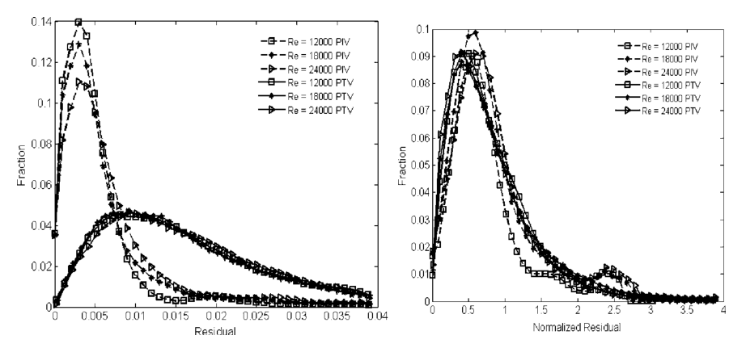
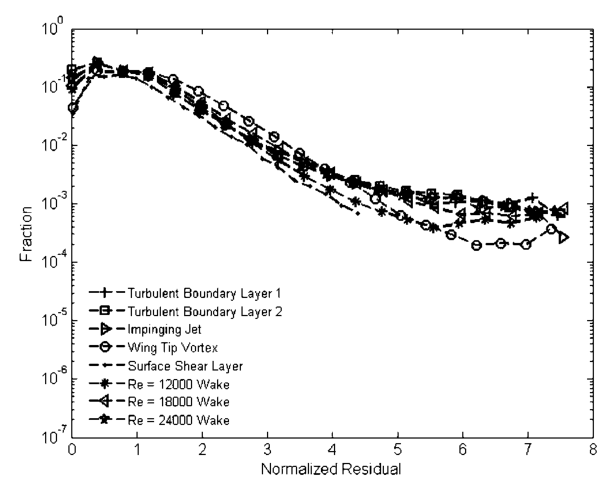
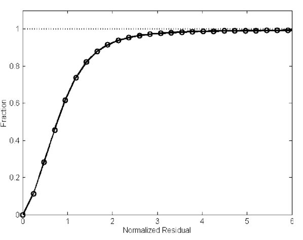
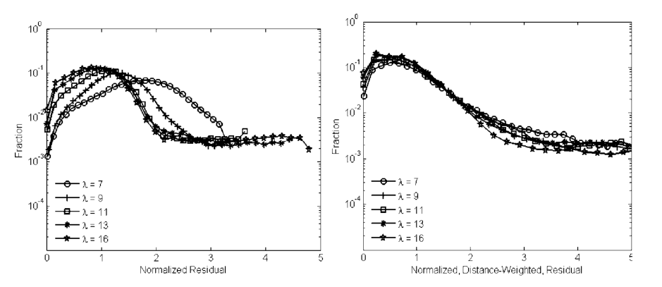

# 입자 영상 유속계(PIV)와 입자 추적 유속계(PTV) 데이터를 위한 범용 이상치 검출 (Duncan 2010)

- 원제: Universal outlier detection for particle image velocimetry (PIV) and particle tracking velocimetry (PTV) data
- 원문: 같은 폴더의 `Duncan2010_MST_UniversalOutlierDetection.pdf` (Meas. Sci. Technol. 21 (2010) 057002, Technical Design Note, 5쪽. PDF 1쪽은 IOPscience 표지)
- 저자: J Duncan¹, D Dabiri¹, J Hove², M Gharib³ (¹ 워싱턴대 항공우주공학과, ² 신시내티대 의대 분자세포생리학과, ³ 캘리포니아공대 대학원 항공연구소)
- 번역 범위: 전문
- 그림: 원문 그림 4개를 `그림/`에 넣고 본문에서 처음 언급되는 곳에 삽입

## 초록

Westerweel과 Scarano의 범용 이상치 검출(universal outlier detection) 방법(2005 Universal outlier detection for PIV data Exp. Fluids 39 1096–100)을 일반화하여, 이 알고리즘을 격자 데이터(PIV)와 비격자 데이터(PTV) 모두에 쓸 수 있게 하였다. 변경점은 들로네 분할(Delaunay tessellation)에 기반한 다른 이웃 정의, 해당 점으로부터의 거리에 따른 이웃 속도의 가중, 그리고 이웃까지의 거리가 서로 다른 것을 반영하는 적응형 허용오차(adaptive tolerance)이다. 새 알고리즘은 충돌 제트(impinging jet)에서 난류 경계층과 후류(wake), 날개 끝 와류(wingtip vortex)에 이르는 유동에 대해 PIV와 PTV 모두로 시험하였다. 이 유동들의 잔차(residual) 역시 확률밀도함수에서 범용성을 보이며, 마찬가지로 하나의 임계값(threshold)으로 이상치를 판별할 수 있음을 시사한다. 또한 새 알고리즘은 허위 벡터(spurious vector) 비율이 약 15%까지인 데이터에서 동작함을 확인하였다.

키워드: PIV, PTV, 이상치 검출

## 1. 서론 (Introduction)

PIV 데이터에서 나오는 허위 벡터를 처리하기 위해 Shinneeb et al (2004)과 Young et al (2004)처럼 가변 임계값 검출 방식을 쓰는 많은 기법이 제안되었다. 현재 가장 널리 쓰이는 방법 중 하나는 Westerweel과 Scarano (2005)의 범용 이상치 검출 알고리즘으로, 측정 속도의 잔차를 정규화하여 기울기가 큰 영역의 데이터 점이 단지 이웃들의 변동성 때문에 이상치로 판정되지 않도록 한다.

PIV에는 이상치 검출 방법의 선택지가 많지만, PTV에는 이러한 불량 벡터를 다루는 방법이 비교적 적다. Pun et al (2007)은 부트스트래핑(bootstrapping) 방법으로 데이터 집합을 생성하고 그로부터 벡터마다 통계적 확률을 계산하여 이상치를 정확히 판별하고 대체하였다. 그러나 이 방법은 필요한 반복 과정 때문에 계산 시간이 상당히 든다. Song et al (1999)이 개발한 다른 방법은 속도장의 보간이나 유동장에 대한 사전 지식을 요구하지 않았지만, 유동이 연속 방정식을 만족해야 했다(비압축성 유동 가정). 이 방법은 어떤 경우에는 동작할 수 있으나, 마하수가 높은 유동이나 3차원 유동에서는 상당히 문제가 될 수 있다.

본 연구의 접근은 Westerweel과 Scarano (2005)의 알고리즘이 단순하고 적용이 쉬우며 계산 효율이 높고 범용적이라는 이유로 같은 방법론을 쓰는 것이다. 그러나 PTV에서 나오는 흩어진(scattered) 데이터에 정규화 잔차 검정을 적용하려 하면 두 가지 문제가 생긴다. 첫째, 이웃을 식별하는 문제를 해결해야 한다. PIV의 경우 격자 데이터이므로 이웃을 쉽게 식별할 수 있다. 둘째, PTV 처리로 얻은 데이터는 등간격이 아니므로, 해당 벡터의 타당성을 판단하는 데 같은 영향력을 가져서는 안 된다.

이 두 문제는 새로 정의한 이웃(neighborhood)을 채택하고, 이웃 안의 속도를 해당 점으로부터의 거리로 가중함으로써 해결할 수 있다.

## 2. 알고리즘 (Algorithm)

Westerweel과 Scarano (2005)의 단순하고 강건한 이상치 검출 기법은 한 데이터 점의 속도가 가장 가까운 8개 이웃에 대해 갖는 정규화 잔차 변동(normalized residual fluctuation)에 임계값을 적용하는 것에 기반한다. 이 잔차는 허용오차(tolerance)를 포함하여 가능한 최소 잔차도 고려하는데, 이 허용오차는 데이터의 정밀도에 해당할 수 있다. 이 정규화 잔차는 식 (1)로 정의된다.

$$r_0^* = \frac{|U_0 - U_m|}{r_m + \varepsilon}, \tag{1}$$

여기서 $U_0$는 해당 데이터 점에서 측정한 속도, $U_m$은 그 이웃들의 중앙값(median), $r_m$은 각 이웃 값 $U_i$와 $U_m$ 사이 잔차의 중앙값이다. 명확히 하기 위해 식 (1)을 약간 풀어 쓴 형태를 식 (2)에 보인다.

$$r_0^* = \frac{|U_0 - \mathrm{med}(U_i)|}{\mathrm{med}\,|U_i - \mathrm{med}(U_i)| + \varepsilon}. \tag{2}$$

이 기법은 PIV의 격자 데이터에서는 잘 동작하지만, PTV의 무작위 분포 데이터에서 허위 벡터를 제거하지는 못한다. 그래서 본 연구에서는 이웃을 가장 가까운 8개 데이터 점과 다르게 정해야 한다고 판단하였다. 들로네 분할은 삼각형을 공유하는 데이터 점들을 이웃으로 정의하는 편리한 방법을 제공한다(Song et al 1999). 이렇게 하면 데이터의 공간 배치에 따라 평균적으로 5~8개의 이웃이 생긴다. 마찬가지로, 들로네 분할은 비정렬 격자(unstructured grid)의 벡터를 정렬 격자(structured grid)로 보간하는 데에도 쓰였다(Theunissen et al 2007).

데이터 점[역주: 원문 'dada points'는 'data points'의 오기]의 간격이 무작위이므로, 이웃은 해당 점으로부터 다양한 거리에 존재한다. 이로써 데이터 점에 가중을 줄 것인가 하는 문제가 생긴다. 해당 점에서 매우 멀리 떨어진 이웃은 그 점이 이상치로 판정되는지에 더 적은 영향을 주어야 한다. 이런 이유로 이웃 안의 모든 데이터 점을 해당 점으로부터의 거리로 가중하기로 하였다. 일관성을 위해 해당 점의 속도 역시 어떤 거리 척도로 가중해야 하며, 여기서는 그것을 이웃들 거리의 중앙값으로 정하였다. 이 두 가중치에는 Westerweel과 Scarano (2005)의 경우처럼 거리 허용오차를 더하였다. 이 허용오차는 아래에서 논의한다. 정규화되지 않은 변동을 거리로 가중하였으므로, 중앙값 잔차 역시 거리 척도(앞서 말한 허용오차와 함께)로 가중해야 한다. 그 결과 얻은 정규화 변동은 식 (3)과 같다.

$$r_0^* = \frac{\left|\dfrac{U_0}{\mathrm{med}(d_i)+\varepsilon_a} - \mathrm{med}\!\left(\dfrac{U_i}{d_i+\varepsilon_a}\right)\right|}{\mathrm{med}\left|\dfrac{U_i}{d_i+\varepsilon_a} - \mathrm{med}\!\left(\dfrac{U_i}{d_i+\varepsilon_a}\right)\right| + \varepsilon_a}, \tag{3}$$

여기서 $\varepsilon_a$는 곧 논의할 적응형 허용오차이고, $d_i$는 각 이웃에서 해당 점까지의 거리이다. 이제 모든 이웃의 거리가 $d$로 같으면 어떻게 되는지 보는 것이 흥미롭다. 이 경우 거리의 중앙값은 $d$이고, 식 (4)에 보인 것처럼 분모의 허용오차를 제외한 식 (3)의 모든 항에서 $d_i+\varepsilon_a$ 항을 약분할 수 있다.

$$r_0^* = \frac{|U_0 - \mathrm{med}(U_i)|}{\mathrm{med}|U_i - \mathrm{med}(U_i)| + \varepsilon_a(d + \varepsilon_a)}. \tag{4}$$

이제 $\varepsilon_a(d + \varepsilon_a) = \varepsilon$이면($\varepsilon$은 Westerweel과 Scarano (2005)의 허용오차) 식 (4)가 식 (2)와 동일해진다는 것이 분명하다. 허용오차는 전통적으로 0.1 화소(pixel)로 설정되어 왔으므로, 새 허용오차는 중앙값 거리에 따라 $\varepsilon_a(\mathrm{med}(d_i) + \varepsilon_a) = 0.1$이 되도록 적응적으로 바꿀 수 있다. 허용오차 값 0.1(Westerweel과 Scarano (2005))은 임의로 정한 것이지만 좋은 값임이 확인되었다.

## 3. 결과 (Results)

### 3.1. 범용성 (Universality)

범용성을 시험하기 위해, 제안 기법을 실험·합성, PIV·PTV를 아우르는 다양한 유동에 적용하였다. 다음 표는 유동과 데이터 출처를 나열한다. 보다시피 (초음속 유동과 마이크로채널 유동을 제외하면) 넓은 범위의 유동을 시험하였으며, 이는 이 수정된 정규화 잔차 방법의 적용 가능성을 가늠하는 좋은 척도가 될 것이다.

**표 1.** 시험한 유동 유형.

| 유동 설명 (Flow description) | 데이터 출처 (Source of data) |
|---|---|
| 충돌 제트 (Impinging jet) | VSJ Image #301 (Okamoto et al 2000) |
| 표면 전단 유동 (Surface shear flow) | Dabiri (2003) |
| 난류 경계층 (Turbulent boundary layer) | PIV Challenge 03 (Stanislas et al 2005) |
| 날개 끝 와류 (Wing-tip vortex) ($Re$ = 28 000) | 본 연구 (Current work) |
| 난류 원기둥 후류 (Turbulent cylinder wake) ($Re$ = 12 000, 18 000, 24 000) | 본 연구 (Current work) |

PIV와 PTV의 결과를 비교하는 시험으로, 세 가지 레이놀즈 수(12 000, 18 000, 24 000)에서 원기둥 뒤 유동 데이터를 PIV(이산 창 이동 방법; Westerweel et al 1997)와 자체 개발한 PTV 알고리즘 양쪽으로 처리하였다. 현재 기법은 격자·비격자 데이터를 모두 다룰 수 있으므로, 결과로 얻은 PIV와 PTV 속도장을 모두 무작위 간격 정규화 잔차 방법으로 처리하였다. 그림 1은 주어진 잔차에 해당하는 벡터의 비율을 정규화·비정규화 두 경우에 대해 보여 준다. 비정규화 경우에는 PIV와 PTV 결과가 이상치를 제대로 판별하는 데 서로 다른 임계값을 요구함이 분명하다. 또한 Westerweel과 Scarano (2005)에서 본 것과 비슷하게, PIV 데이터의 레이놀즈 수별로 층이 나뉘는 현상(stratification)이 보인다. 그러나 정규화 경우에는 PIV와 PTV 데이터가 하나의 곡선으로 모이며, 이는 하나의 임계값을 PIV와 PTV 데이터 모두에 범용적으로 적용할 수 있음을 시사한다. Westerweel과 Scarano (2005)에서와 같이 잔차에 뚜렷한 레이놀즈 수 의존성은 없다. 이는 현재 기법을 격자·비격자 데이터 모두에 같은 임계값으로 동등한 효과를 내며 적용할 수 있음을 보여 준다.

*그림 1 — 난류 원기둥 후류 유동의 잔차(왼쪽)와 정규화 잔차(오른쪽) 비교. 점선은 PIV 데이터, 실선은 PTV 데이터를 나타낸다.*

그림 1(오른쪽)을 보면 난류 후류 데이터의 PIV 평가에서 얻은 정규화 잔차 중 2와 3 사이 값의 일부가 '혹(bump)' 모양 분포를 가진다. 이는 이웃이 8개가 아니라 5개뿐인 가장자리 데이터를 처리했기 때문이며, 이웃 편향이 데이터 점을 중심으로 하지 않아 모든 가장자리 데이터 점에서 잔차와 이웃 변동이 비슷하게 영향을 받기 때문임을 확인하였다.

서로 다른 유동 유형 사이의 범용성을 제대로 시험하기 위해, 표 1에 나열한 모든 데이터를 자체 PTV 알고리즘으로 처리한 뒤 현재의 이상치 검출 알고리즘으로 시험하였다. 그림 2는 벡터의 비율(로그 척도)을 정규화 잔차의 함수로 보여 준다. Westerweel과 Scarano (2005)에서와 같이 데이터가 하나의 곡선으로 모이며, 여기에 범용 임계값을 적용할 수 있음을 확인하였다. 본 연구에서는 사용자가 데이터 정확도를 얼마나 신뢰하느냐에 따라 2–4의 임계값이 적용 가능함을 확인하였다. 임계값을 바꾸는 것이 이상치로 간주되는 벡터 비율에 미치는 영향은 그림 3에서 볼 수 있으며, 여기에는 원기둥 후류 데이터의 정규화 잔차 누적분포함수가 나와 있다. 그림에서 보듯 임계값 2는 정규화 잔차가 가장 큰 약 8%를 허위로 판정하게 되고, 마찬가지로 임계값 4는 정규화 잔차가 가장 큰 2%를 허위로 판정하게 된다.

*그림 2 — 시험한 모든 유동의 정규화 잔차. 여기 데이터는 모두 PTV 데이터이며 그래프는 반로그(semi-logarithmic) 척도임에 유의하라.*

*그림 3 — 난류 원기둥 후류($Re$ = 18 000)의 누적분포함수.*

### 3.2. 거리 가중의 필요성 (Necessity of distance weighting)

2절에서 말한 것과 같은 방법으로 이웃을 정의하되 거리 가중을 고려하지 않는 것도 가능하다. 이는 본질적으로 모든 이웃 벡터에 같은 가중치를 주는 것이어서, 가까운 벡터 하나가 검증을 좌우하지 못하게 한다. 실제로 이 접근은 대체로 잘 동작하며 위에서 설명한 방법과 비슷한 정확도를 준다. 그러나 평균 입자 간격에 비해 특성 유동 규모가 매우 작은 경우에는 범용 임계값을 고를 수 있는 능력이 사라진다. 이를 확인하기 위해 다양한 크기의 와류 격자로 된 합성 유동을 여러 개 생성하였는데, 특성 유동 공간 파장과 평균 입자 간격의 비(즉 격자 위 와류 중심 사이 거리와 입자 간 평균 거리의 비)를 $\lambda$로 나타냈다. 그림 4는 여러 $\lambda$ 값에 대해 확률밀도함수 대 잔차를 보여 준다.

*그림 4 — 거리 가중이 정규화 잔차에 미치는 영향. 가중하지 않은 잔차(왼쪽)는 하나의 곡선으로 모이지 않아 단일 임계값을 허용하지 않는 반면, 가중한 잔차(오른쪽)는 하나로 모인다.*

거리 가중의 효과로 허위 벡터 판정에 단일 임계값을 쓸 수 있음을 분명히 볼 수 있다. 가중하지 않은 경우, $\lambda$ 값이 클수록 수렴하는 것처럼 보이지만 규모가 매우 작은 유동에서는 확률밀도함수가 크게 달라진다. 가중하지 않은 이웃 방식도 많은 경우에 동작할 수 있지만, 가중 알고리즘은 범용성을 유지하면서도 더 큰 공간 기울기를 허용한다.

### 3.3. 이상치 검출 능력과 계산 속도 (Outlier detection capability and computational speed)

제안 알고리즘의 범용성은 다양한 유동에 유용하게 하지만, 실제로 필요한 것은 어느 벡터가 허위인지 판별하는 것이다. 새 알고리즘의 능력을 시험하기 위해, 난류 경계층(Stanislas et al 2005)의 알려진 깨끗한 데이터(합성 영상이며, PIV의 경우 평활화함)에 허위 벡터를 추가하였다. 허위 벡터는 0을 중심으로 무작위 분포로, 유동에 존재하는 최대 길이까지의 길이로 추가하였다. 다음 표는 새 알고리즘이 허위 벡터를 검출하는 능력을 보여 준다(임계값은 2로 설정). PIV 1과 PTV 1은 난류 경계층 집합의 한 영상 쌍에, PIV 2와 PTV 2는 다른 한 쌍에 해당한다.

**표 2.** 이상치를 추가한 데이터에서의 검출 능력.

| 추가한 이상치 (Added outliers) | PIV 1 | PIV 2 | PTV 1 | PTV 2 |
|---|---|---|---|---|
| 0% | 0.1% | 0.4% | 0.9% | 0.6% |
| 5% | 5.0% | 5.3% | 5.7% | 5.5% |
| 10% | 10.0% | 10.0% | 10.3% | 9.9% |
| 15% | 14.4% | 16.2% | 14.2% | 13.8% |

표 2에서 보듯, 허위 데이터의 양이 약 15%로 늘어나면 알고리즘의 신뢰성이 떨어짐이 분명하다. 다만 허위 비율은 언제나 5% 미만으로 유지하는 것을 목표로 해야 한다. 현재 방법의 신뢰성이 높은 허위 수준에서도 좋아 보이지만 주의해야 한다. 이상치(때로는 여러 개)가 인접해 있으면, 이웃 변동이 커지고 비정규화 잔차도 커지므로 결과를 신뢰할 수 없게 된다. 이로 인해 미검출(under-detection)과 과검출(over-detection)이 모두 늘어 신뢰성이 떨어질 수 있다. 이런 이유로 현재 방법은 허위가 매우 많은 데이터에는 적합하지 않다.

인접한 허위 벡터가 우려될 때는 이웃 변동의 증가로 미검출이 일어날 수 있으며, 이때는 반복 접근을 쓸 수 있다. 이상치 검출 알고리즘을 반복 실행하면 첫 번째 패스에서 일부 허위 벡터가 제거되어 이후 패스에서 이웃 변동이 줄어든다. 이 접근은 반복을 더해도 검출되는 허위 벡터의 수가 더 늘지 않을 때까지 계속할 수 있다. 이 방법은 과검출 문제를 해결하지 못하므로, 허위 비율이 매우 높을 것으로 예상될 때에만 써야 한다.

## 4. 결론 (Conclusion)

Westerweel과 Scarano (2005)의 원래 알고리즘을 바탕으로 PTV와 PIV 데이터 모두를 위한 새로운 이상치 검출 방법을 개발하였다. 새 알고리즘은 계산이 단순하고, 보간이나 유동 모델링이 필요 없으며, 구현이 유동에 대한 사전 지식에 의존하지 않는다. 현재 방법은 Westerweel과 Scarano (2005)의 범용 이상치 검출 방법보다 2~3배 오래 걸리는데, 이는 주로 분할(tessellation) 과정에 드는 시간 때문이다. 예를 들어 512 × 512 화소 영상을 50% 겹침의 32 × 32 화소 조사창(interrogation window)으로 처리했을 때, 원래 범용 이상치 방법은 0.3 s, 현재 방법은 0.85 s가 걸렸다(처리는 2.6 GHz Pentium 4의 Dell 8300에서 수행). 인공 충돌 제트에서 난류 경계층과 후류, 날개 끝 와류에 이르는 여러 유동 사례에 대해 PIV와 PTV 모두로 시험하였다. 주어진 데이터 점 주위의 이웃을 정하기 위해 들로네 분할을 사용하였다. 입자 간격이 서로 다른 것을 반영하기 위해, 개별 이웃에서 해당 점까지의 거리를 이웃 속도의 가중치로 사용하였다. 이 방법은 허위 데이터 수준이 약 15%까지는 PIV와 PTV에서 똑같이 잘 동작하며, 이는 좋은 실험 기법이라면 마주칠 수준보다 훨씬 높다. 15% 수준을 넘으면 인접한 이상치들이 서로 영향을 주어, 검출되지 않거나 올바른 벡터를 이상치로 잘못 판정하게 만든다. 이 방법은 적응형 허용오차를 포함하며, 이는 Westerweel과 Scarano (2005)가 제시한 0.1 화소의 허용오차와 연관 지을 수 있다. 정규화 잔차에 대해 2–4의 임계값이 시험한 모든 유동에서 잘 동작함을 확인하였으나, 허위 벡터 비율이 클 것으로 예상되는 유동에는 임계값 2를 쓰기를 권한다.

## 감사의 글 (Acknowledgments)

저자들은 DD, JRH, MG에 대한 미국 국립보건원(National Institutes of Health)의 지원(R01 RR023190-04)에 감사한다. 또한 이 원고의 가치를 크게 높여 준 Jerry Westerweel 교수의 통찰력 있는 논의와 제안에 감사한다. 이 연구를 위해 날개 끝 와류 유동 데이터를 기꺼이 공유하고 난류 원기둥 후류 데이터 취득을 도와준 Namiko Saito에게도 감사한다.

## 참고문헌

- Dabiri D 2003 On the interaction of a vertical shear layer with a free surface J. Fluid Mech. 480 217–32
- Okamoto K, Nishio S, Saga T and Kobayashi T 2000 Standard images for particle-image velocimetry Meas. Sci. Technol. 11 685–91
- Pun C S, Susanto A and Dabiri D 2007 Mode-ratio bootstrapping method for PIV outlier correction Meas. Sci. Technol. 18 3511–22
- Shinneeb A M, Bugg J D and Balachandar R 2004 Variable threshold outlier identification in PIV data Meas. Sci. Technol. 15 1722–32
- Song X, Yamamoto F, Iguchi M and Murai Y 1999 A new tracking algorithm and removal of spurious vectors using Delaunay tessellation Exp. Fluids 26 371–80
- Stanislas M, Okamoto K, Kähler C and Westerweel K 2005 Main results of the second international PIV challenge Exp. Fluids 39 170–91
- Theunissen R, Scarano F and Riethmuller M L 2007 An adaptive sampling and windowing interrogation method in PIV Meas. Sci. Technol. 18 275–87
- Westerweel J, Dabiri D and Gharib M 1997 The effect of a discrete window offset on the accuracy of cross correlation analysis of digital PIV recording Exp. Fluids 23 20–8
- Westerweel J and Scarano F 2005 Universal outlier detection for PIV data Exp. Fluids 39 1096–100
- Young C N, Johnson D A and Weckman E J 2004 A model-based validation framework for PIV and PTV Exp. Fluids 36 23–35
