# 중복 계산 없는 빠르고 강건하며 정확한 디지털 영상 상관 계산 (Pan 2013)

- 원제: Fast, Robust and Accurate Digital Image Correlation Calculation Without Redundant Computations
- 원문: 같은 폴더의 `Pan2013_ExpMech_ICGN_DIC.pdf` (Experimental Mechanics, 2013, DOI 10.1007/s11340-013-9717-6. 저자 B. Pan, K. Li, W. Tong. 접수 2012년 10월 22일, 채택 2013년 1월 8일)
- 번역 범위: 전문
- 그림: 원문 그림 11개를 `그림/`에 넣고 본문에서 처음 언급되는 곳에 삽입. 표는 마크다운 표로 옮겼다.

## 초록 (Abstract)

더 높은 해상도의 디지털 카메라를 쓰는 추세와 동적 시험에서 기록한 긴 영상 시퀀스를 처리해야 하는 일반적인 요구를 고려하면, 디지털 영상 상관(digital image correlation, DIC)을 이용한 고효율·고정확도 변형 해석은 최근 몇 년 동안 점점 더 중요해졌다. 이 연구에서는 정방향 가산(forward additive) 매칭 전략과 고전적 뉴턴-랩슨(Newton–Raphson) 알고리즘(FA-NR)을 쓰는 기존 DIC 방법에 들어 있는 중복 계산을, 그 부화소(sub-pixel) 정합 정확도를 희생하지 않고 없애기 위해, 역합성(inverse compositional) 매칭 전략과 가우스-뉴턴(Gauss-Newton) 알고리즘을 결합한(IC-GN) 등가이지만 더 효율적인 DIC 방법을 제안하여 빠르고 강건하며 정확한 전 영역(full-field) 변위 측정을 하고자 한다. 이를 위해 먼저, 반복마다 헤세 행렬(Hessian matrix)을 다시 계산하고 역행렬을 구할 필요가 없는 효율적인 IC-GN 알고리즘을 도입하여 강건한 영평균 정규화 차이 제곱합(zero-mean normalized sum of squared difference, ZNSSD) 기준을 최적화함으로써 각 조사 서브셋(subset)의 원하는 변형 파라미터를 결정한다. 다음으로 개선된 신뢰도 유도(reliability-guided) 변위 추적 전략을 써서, 각 계산점에서 수행하는 IC-GN 알고리즘에 정확하고 완전한 변형 초기 추정값을 자동으로 제공함으로써 추가적인 속도 이점을 얻는다. 끝으로 구현이 쉬운 보간 계수 조회표(look-up table) 방법을 써서 부화소 위치에서 쌍삼차(bicubic) 보간을 반복 계산하지 않도록 한다. 이러한 개선으로 기존 DIC 방법의 여러 절차(즉 변형 초기 추정, 부화소 변위 정합, 부화소 밝기 보간)에 들어 있던 중복 계산을 완전히 없앤다. 제안 DIC 방법의 정합 정확도와 계산 효율을 수치 실험과 실제 실험 영상으로 신중히 시험한다. 실험 결과는 IC-GN 알고리즘을 쓰는 제안 DIC 방법과 고전적 FA-NR 알고리즘을 쓰는 기존 DIC 방법이 비슷한 결과를 내지만 전자가 약 3–5배 빠름을 확인한다. 제안한 신뢰도 유도 IC-GN 알고리즘은 DIC의 새로운 표준 전 영역 변위 추적 알고리즘이 될 것으로 기대된다.

**키워드(Keywords)** — 디지털 영상 상관 · 영상 매칭 · 부화소 변위 · 역합성 영상 정렬 알고리즘 · 뉴턴-랩슨 알고리즘

## 서론 (Introduction)

디지털 영상 상관(DIC)은 전 영역 운동, 변형, 형상 측정을 위한 비접촉 광학 계측법이다. 1980년대 초에 발명된 이래[1, 2] 이 방법은 정합 정확도, 매칭 강건성, 계산 효율, 적용 범위 면에서 크게 개선되었다. DIC는 실험역학 분야에서 가장 인기 있고 널리 쓰이는 기법이라고 할 수 있다[3–6]. DIC의 실제 구현에서는 기준 영상에서 등간격 격자점을 중심으로 하는 정사각형 기준 서브셋들을 지정하고, 변형 영상에서 각 서브셋의 위치를 추적하여 전 영역 변위 벡터를 얻는다. 한 영상에서 수만 개의 계산점을 추적하는 것이 흔하므로, DIC의 계산 비용은 일반적으로 매우 크다고 여겨진다. 더 높은 해상도의 디지털 카메라를 쓰는 추세에 따라 기록 영상에서 추적해야 하는 점의 수는 계속 늘고 있다. 게다가 동적 시험에서 기록한 긴 디지털 영상 시퀀스를 처리해야 하는 일반적 요구와 일부 응용의 실시간 운동 추적이라는 특수 요구를 고려하면, DIC 방법의 계산 효율은 최근 몇 년 동안 점점 더 중요해졌다[7–9].

DIC에서 부화소 정합 알고리즘은 정확도를 높이는 핵심 기법으로 여겨져 왔다. 흥미롭게도 DIC에서 쓰는 기존 부화소 정합 알고리즘 대부분은 이해하기 쉬운 정방향 가산 매칭 전략을 쓴다. 즉 변형의 초기 추정으로 변형시킨 목표 서브셋을 원래의 정사각형 기준 서브셋과 비교하여 증분 변형 파라미터를 풀고, 이를 초기 추정에 더해 파라미터를 갱신한다. 정확한 서브셋 매칭은 보통 반복 알고리즘으로 비선형 상관 함수를 최적화하여 완료하는데, 예를 들어 Bruck HA 등[10]이 처음 제안하고 이후 다른 연구자들[11–16]이 개선한 정방향 가산 뉴턴-랩슨(FA-NR) 알고리즘이 있다. 전형적인 정방향 반복 DIC 방법으로서 FA-NR 알고리즘은 현재 정확한 부화소 변위 측정에 흔히 쓰이며[17], 최근에는 계산 효율을 크게 높이도록 개량되기도 했다[9]. 그러나 FA-NR 알고리즘의 내재적 한계 하나는 반복마다 헤세 행렬을 다시 계산하고 역행렬을 구해야 한다는 것이다. 헤세 행렬의 계산과 역행렬은 고전적 FA-NR 알고리즘을 쓰는 현재 정방향 반복 DIC 방법의 주된 계산 부담이다. 자연히, 반복마다 헤세 행렬을 다시 계산하고 역행렬을 구할 필요가 없는 등가이면서 더 효율적인 반복 부화소 정합 알고리즘은 DIC 방법의 계산 효율 향상에 유리하다.

사실 정방향 가산 매칭 알고리즘만이 부화소 변위를 계산하는 유일한 방법은 아니다[3, 18, 19]. 컴퓨터 비전 분야에서는 템플릿 영상을 입력 영상에 정렬하기 위해 효율적인 역합성 매칭 전략과 가우스-뉴턴 알고리즘을 결합한 방법(IC-GN)이 Baker와 Matthews[20, 21]에 의해 제안되었다. 문헌 [21]에서 IC-GN 알고리즘은 고전적 정방향 가산 영상 정렬 알고리즘, 즉 유명한 Lucas-Kanade 알고리즘[22]과 등가임이 증명되었다. 후자는 본질적으로 가우스-뉴턴 알고리즘이며, 기본 원리와 알고리즘 구현 면에서 DIC에서 널리 쓰이는 개선 NR 알고리즘과 실제로 등가다[23]. 그럼에도 Lucas-Kanade 알고리즘이나 FA-NR 알고리즘과 비교하면 IC-GN 알고리즘의 구현이 더 효율적인데, IC-GN 알고리즘의 헤세 행렬은 일정하게 유지되어 미리 계산할 수 있기 때문이다. IC-GN 알고리즘의 높은 효율은 빠르고 정확한 전 영역 변위 측정을 위해 이를 DIC에 도입할 동기가 된다. 그러나 원래 IC-GN 알고리즘은 차이 제곱합(sum of squared difference, SSD) 기준으로 구현되었는데, 이는 단순하지만 덜 실용적이다. 변형 영상에 오프셋 또는 배율 변화가 생기면 DIC 측정에 큰 오차가 생기기 때문이다. 실제 측정에서 변형 영상은 어느 정도의 밝기 변화를 겪을 수 있다[24, 25]. 따라서 조명이나 주변광의 잠재적 변화를 수용할 수 있는 강건하고 더 실용적인 상관 기준을 써야 한다. 또한 원래 IC-GN 알고리즘은 전 영역 운동 추적이 아니라 단순한 템플릿 매칭에 맞춰져 있었다. 관심 영역(region of interest, ROI)에 정의된 여러 계산점에서 IC-GN 알고리즘을 구현할 때, 각 측정점에 정확한 초기 추정을 어떻게 제공할지 하는 문제를 신중히 다뤄야 한다. 고전적 FA-NR 알고리즘과 마찬가지로, 부정확한 초기 추정은 IC-GN 알고리즘이 느리게 수렴하거나 전혀 수렴하지 않게 할 수 있기 때문이다. 이런 이유로 변형의 정확한 초기 추정 없이는 IC-GN 알고리즘의 효율 이득이 온전히 구현될 수 없다. 여기서 언급할 필요가 있는 것은, Sutton MA 등[3]이 쓴 DIC 기법에 관한 최근 책에서 저자들이 IC-GN 알고리즘을 전 영역 변위 측정에 썼다는 점이다. 그러나 그들 역시 IC-GN 알고리즘을 더 강건하고 효율적으로 쓰는 것과 관련한 위의 문제들을 다루지 못했다.

이 연구의 목적은 고전적 FA-NR 알고리즘 대신 더 효율적인 IC-GN 알고리즘을 채택하여 부화소 정확도의 정확한 전 영역 변위 측정을 하는, 빠르고 강건하며 정확한 DIC 방법을 개발하는 것이다. IC-GN 알고리즘을 최대한 활용하기 위해 제안 DIC 방법에 강건성과 계산 효율을 높이는 몇 가지 혁신을 더했다. 첫째, 목표 영상의 선형 밝기 변화를 허용하는 강건하고 실용적인 영평균 정규화 차이 제곱합(ZNSSD) 기준을 써서 원래 IC-GN 알고리즘의 실용성을 높인다. 둘째, 수정된 초기 추정 전달 방식을 채택한 개선된 신뢰도 유도 변위 추적 초기 추정 전달 전략을 쓴다. 이 전략은 오차 전파를 피하도록 DIC의 계산 경로를 지능적으로 유도할 뿐 아니라, 각 계산점에서 수행하는 IC-GN 알고리즘에 매우 정확한 초기 추정을 자동으로 제공한다. 끝으로 보간 계수 조회표 방법을 써서 부화소 밝기 보간에 들어 있는 중복 계산을 피한다. 이러한 개선으로 기존 DIC 계산의 여러 절차(즉 변형 초기 추정, 부화소 변위 정합, 부화소 밝기 보간)에 들어 있던 모든 중복 계산을 완전히 없앤다. 제안 DIC 방법은 정확도를 희생하지 않고 기존 FA-NR 알고리즘 기반 DIC 방법보다 뚜렷한 속도 이점을 얻을 수 있다. 제안 DIC 방법의 정확도와 계산 효율을 수치 실험과 실제 실험으로 입증한다.

*(저자 소속) B. Pan(교신저자): Institute of Solid Mechanics, Beijing University of Aeronautics & Astronautics, Beijing 100191, China, e-mail: panb04@mails.tsinghua.edu.cn. K. Li: Department of Mechanical Engineering, Shanghai University, Shanghai 200444, China. W. Tong: Department of Mechanical Engineering, Southern Methodist University, Dallas, TX 75275, USA. © Society for Experimental Mechanics 2013.*

## 정확한 부화소 정합을 위한 역합성 가우스-뉴턴 알고리즘 (Inverse Compositional Gauss-Newton Algorithm for Accurate Sub-Pixel Registration)

### ZNSSD 기준 (ZNSSD Criterion)

IC-GN 알고리즘은 컴퓨터 비전에서 템플릿을 목표 영상에 효율적으로 정렬하기 위해 2001년 Baker와 Matthews가 제안했다[20]. 그러나 원래 IC-GN 알고리즘은 단순하지만 덜 실용적인 SSD 기준으로 수행되었으며, 이 기준은 목표 영상의 잠재적 밝기 변화에 민감하다[24, 25]. 이 연구에서는 먼저 목표 영상의 선형 밝기 변화를 허용하는 더 실용적이고 강건한 상관 기준을 도입하여 원래 IC-GN 알고리즘의 강건성을 높인다. 구체적으로, 기준 서브셋과 목표 서브셋 사이의 유사도를 정량적으로 평가하기 위해 아핀 변환 워핑(warping) 함수와 결합한 실용적이고 강건한 ZNSSD 기준을 쓴다.

$$C_{ZNSSD}(\Delta\mathbf{p}) = \sum_{\xi}\left\{\frac{[f(\mathbf{x} + \mathbf{W}(\xi; \Delta\mathbf{p})) - \bar{f}]}{\Delta f} - \frac{[g(\mathbf{x} + \mathbf{W}(\xi; \mathbf{p})) - \bar{g}]}{\Delta g}\right\}^2 \tag{1}$$

여기서 $f(\mathbf{x})$와 $g(\mathbf{x})$는 기준 영상과 변형 영상의 $\mathbf{x} = (x, y, 1)^T$에서의 회색조 값이고, $\bar{f} = \frac{1}{N}\sum_{\xi} f(\mathbf{x} + \mathbf{W}(\xi; \Delta\mathbf{p}))$, $\bar{g} = \frac{1}{N}\sum_{\xi} g(\mathbf{x} + \mathbf{W}(\xi; \mathbf{p}))$는 두 서브셋의 평균 밝기값이며 $N$은 서브셋 안의 전체 점 수를 나타낸다. $\Delta f = \sqrt{\sum_{\xi}[f(\mathbf{x} + \mathbf{W}(\xi; \Delta\mathbf{p})) - \bar{f}]^2}$, $\Delta g = \sqrt{\sum_{\xi}[g(\mathbf{x} + \mathbf{W}(\xi; \mathbf{p})) - \bar{g}]^2}$이다. $\xi = (\Delta x, \Delta y, 1)^T$는 각 서브셋에서 화소점의 지역 좌표다(표기를 간결하게 하기 위해 모든 영상 좌표를 동차 좌표 형태로 표현했다). $\mathbf{W}(\xi; \mathbf{p})$는 워프 함수로, DIC에서는 변위 사상 함수(displacement mapping function)라고도 하며 기준 서브셋에 대한 목표 서브셋의 위치와 모양을 기술한다. $\mathbf{W}(\xi; \Delta\mathbf{p})$는 기준 서브셋에 가하는 증분 워프 함수다. (식 (1))에 보인 $\bar{f}$와 $\Delta f$는 각 기준 서브셋의 두 통계값이라는 점에 주의해야 한다. 이들은 변형 영상과 무관하므로 각 기준 서브셋에 대해 미리 계산할 수 있다. 이 두 값의 효율적 계산은 빠른 재귀 방식에 기반한 전역 합 테이블(global sum-table) 방법으로 할 수 있다[7].

ZNSSD 상관계수는 실제로 흔히 쓰는 영평균 정규화 상호상관(zero-mean normalized cross-correlation, ZNCC) 기준과 $C_{ZNCC}(\mathbf{p}) = 1 - 0.5 \times C_{ZNSSD}(\mathbf{p})$의 관계가 있다는 점은 주목할 만하다. [−1, 1] 범위에 드는 ZNCC 계수가 기준 서브셋과 목표 서브셋 사이의 유사도를 보여 주기에 더 직관적이지만, ZNSSD의 최적화가 훨씬 쉽다. 이런 이유로 각 계산점의 변위 성분을 결정하기 위해 ZNSSD 기준을 최적화한다. 그다음 ZNSSD 계수를 둘의 관계에 따라 ZNCC 계수로 변환한다. 다음 절에서는 계산된 점들의 최적화된 ZNCC 계수를 신뢰도(또는 품질) 지표로 써서 연속한 계산점들 사이에 신뢰할 수 있고 정확한 초기 추정 전달을 보장한다.

### 워프 함수 (Warp Function)

이 연구에서는 목표 서브셋의 강체 평행이동(translation), 회전(rotation), 수직 변형률, 전단 변형률과 그 조합을 허용하는 실용적인 아핀 워프 함수(즉 선형 변위 사상 함수)를 쓴다.

$$W(\xi; \mathbf{p}) = \begin{bmatrix} 1 + u_x & u_y & u \\ v_x & 1 + v_y & v \\ 0 & 0 & 1 \end{bmatrix}\begin{pmatrix} \Delta x \\ \Delta y \\ 1 \end{pmatrix} \tag{2}$$

여기서 $p = (u, u_x, u_y, v, v_x, v_y)^T$는 목표 서브셋에 가하는 미리 계산된 변형 파라미터 벡터로, $u$, $v$는 변위 성분을, 나머지 네 파라미터는 해당 서브셋의 변위 기울기를 나타낸다.

두 서브셋을 정확하게 매칭하기 위해 IC-GN 알고리즘에서는 목표 서브셋과 기준 서브셋의 역할을 뒤바꾼다. 그림 1에 도식적으로 보였듯이, 기준 서브셋에 증분 워핑 함수 $\mathbf{W}(\xi, \Delta\mathbf{p})$를 가하고 이를 $\mathbf{W}(\xi, \Delta\mathbf{p})$로 변형된 목표 서브셋과 비교하는 역방향(backward) 매칭 전략을 쓴다. [역주: 문맥상 목표 서브셋은 $\mathbf{W}(\xi; \mathbf{p})$로 변형된 것이다. 원문 그대로 옮겼다.]

$$\mathbf{W}(\xi; \Delta\mathbf{p}) = \begin{bmatrix} 1 + \Delta u_x & \Delta u_y & \Delta u \\ \Delta v_x & 1 + \Delta v_y & \Delta v \\ 0 & 0 & 1 \end{bmatrix}\begin{pmatrix} \Delta x \\ \Delta y \\ 1 \end{pmatrix} \tag{3}$$

여기서 $\Delta\mathbf{p} = (\Delta u, \Delta u_x, \Delta u_y, \Delta v, \Delta v_x, \Delta v_y)^T$는 결정할 증분 파라미터 벡터다.

증분 워프는 (식 (1))에 주어진 유사도 기준을 최소화하여 풀 수 있다. 이어서 증분 워프 $\mathbf{W}(\xi; \Delta\mathbf{p})$의 역을 구해 현재 추정값 $\mathbf{W}(\xi; \mathbf{p})$와 합성하여 변형 서브셋의 갱신된 워핑 함수를 얻는다[20]. 이런 의미에서 이 방법은 현재 DIC에서 쓰는 일반적인 정방향 매칭 전략과 매우 다르다. 정방향 매칭 전략에서는 그림 1(b)에 도식적으로 보였듯이, $\mathbf{W}(\xi; \mathbf{p})$로 변형된 목표 서브셋에 증분 파라미터 벡터 $\Delta\mathbf{p}$를 적용한 다음 원래 기준 서브셋과 비교하여 $\Delta\mathbf{p}$를 푼다.

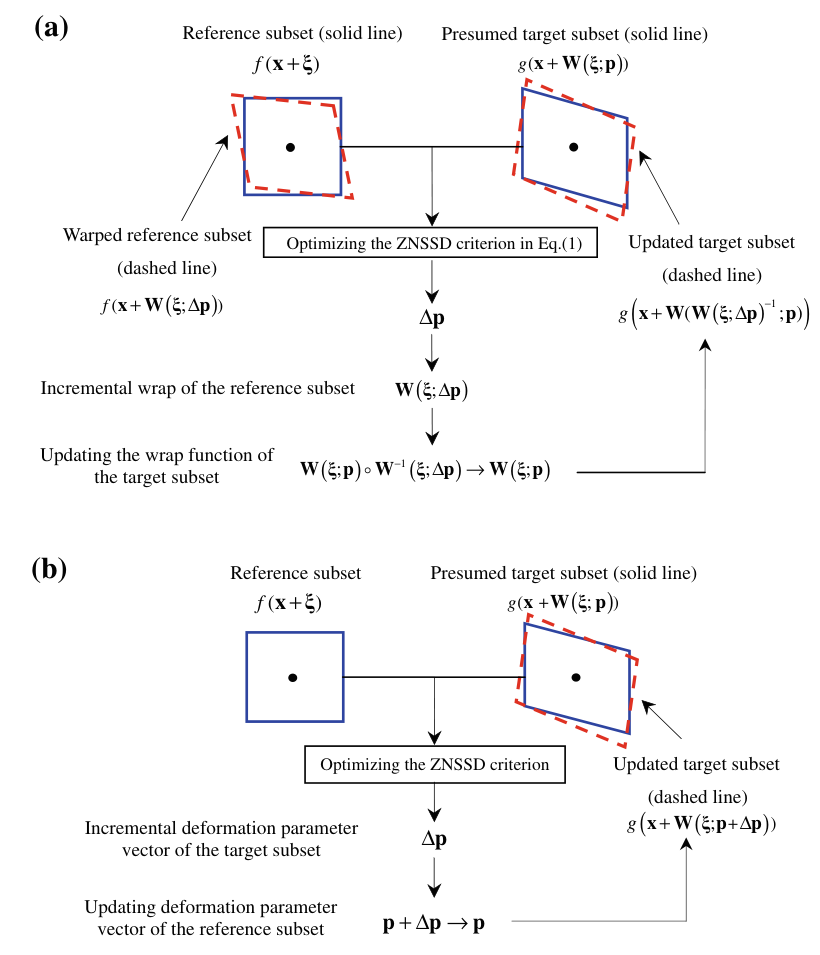
*그림 1 — (a) IC-GN 알고리즘의 역방향 매칭 전략과 (b) 고전적 FA-NR 알고리즘의 정방향 매칭 전략의 도식.* [역주: 그림 속 문구는 (a) "Reference subset (solid line)(기준 서브셋, 실선)", "Presumed target subset (solid line)(추정 목표 서브셋, 실선)", "Warped reference subset (dashed line)(워핑된 기준 서브셋, 점선)", "Optimizing the ZNSSD criterion in Eq.(1)(식 (1)의 ZNSSD 기준 최적화)", "Updated target subset (dashed line)(갱신된 목표 서브셋, 점선)", "Incremental wrap of the reference subset(기준 서브셋의 증분 워프)", "Updating the wrap function of the target subset(목표 서브셋의 워프 함수 갱신)", (b) "Incremental deformation parameter vector of the target subset(목표 서브셋의 증분 변형 파라미터 벡터)", "Updating deformation parameter vector of the reference subset(기준 서브셋의 변형 파라미터 벡터 갱신)"이다. 원문은 warp를 "wrap"으로 적었다.]

### 가우스-뉴턴 알고리즘을 이용한 ZNSSD 기준의 최적화 (Optimizing ZNSSD Criterion Using Gauss-Newton Algorithm)

$\mathbf{W}(\xi; \Delta\mathbf{p})$를 풀기 위해 먼저 (식 (1))을 $\Delta\mathbf{p}$에 대해 1차 테일러 전개한다. 그러면 다음을 얻는다.

$$C_{ZNSSD}(\Delta\mathbf{p}) = \sum_{\xi}\left[\frac{f(\mathbf{x} + \xi) + \nabla f\frac{\partial\mathbf{W}}{\partial\mathbf{p}}\Delta\mathbf{p} - \bar{\mathbf{f}}}{\Delta f} - \frac{g(\mathbf{x} + \mathbf{W}(\xi; \mathbf{p})) - \bar{g}}{\Delta g}\right]^2 \tag{4}$$

여기서 $\nabla f = \left(\frac{\partial f(\mathbf{x}+\xi)}{\partial x}, \frac{\partial f(\mathbf{x}+\xi)}{\partial y}\right)$는 기준 서브셋의 기울기다. 밝기의 1차 미분 $f_x, f_y$는 기준 영상의 회색조 행렬을 $x$, $y$ 방향으로 각각 마스크 $[\frac{1}{12}, -\frac{8}{12}, 0, \frac{8}{12}, -\frac{1}{12}]$와 합성곱하여 계산한다는 점을 꼭 언급할 필요가 있다. 이 기울기 연산자의 절단 오차는 $o(h^4)$로, 디지털 영상 처리에서 영상 경계 추출에 흔히 쓰는 Sobel 및 Prewitt 기울기 연산자보다 훨씬 작다. $\frac{\partial\mathbf{W}}{\partial\mathbf{p}} = \begin{pmatrix} 1 & \Delta x & \Delta y & 0 & 0 & 0 \\ 0 & 0 & 0 & 1 & \Delta x & \Delta y \end{pmatrix}$는 워프 함수의 자코비안이다. 이 두 항은 상수이며 기준 영상에만 관련되므로 미리 계산할 수 있다.

$\Delta\mathbf{p}$에 대해 $C_{ZNSSD}(\Delta\mathbf{p})$를 최소화하면, 즉 $\frac{\partial C_{ZNSSD}(\Delta\mathbf{p})}{\partial(\Delta\mathbf{p})} = 0$으로 두면 $\Delta\mathbf{p}$의 최소제곱 해를 얻는다.

$$\Delta\mathbf{p} = -\mathbf{H}_{6\times6}^{-1} \times \sum_{\xi}\left\{\left(\nabla\mathbf{f}\frac{\partial\mathbf{W}}{\partial\mathbf{p}}\right)^T_{6\times1} \times \left[(\mathbf{f}(\mathbf{x} + \xi) - \bar{\mathbf{f}}) - \frac{\Delta\mathbf{f}}{\Delta\mathbf{g}}(\mathbf{g}(\mathbf{x} + \mathbf{W}(\xi; \mathbf{p})) - \bar{\mathbf{g}})\right]\right\} \tag{5}$$

여기서 $\mathbf{H}$는 다음과 같이 주어지는 6×6 헤세 행렬이다.

$$\mathbf{H}_{6\times6} = \sum_{\xi}\left[\left(\nabla f\frac{\partial\mathbf{W}}{\partial\mathbf{p}}\right)^T_{6\times1} \times \left(\nabla f\frac{\partial\mathbf{W}}{\partial\mathbf{p}}\right)_{1\times6}\right] \tag{6}$$

식 (6)은 헤세 행렬이 기준 서브셋의 지역 기울기 $\nabla f(\mathbf{x}+\xi)$와 워프 함수의 자코비안 $\frac{\partial\mathbf{W}}{\partial\mathbf{p}}$에만 의존함을 보여 준다. 헤세 행렬 $\mathbf{H}$에는 $\mathbf{p}$에 의존하는 것이 아무것도 없으므로, 반복 동안 일정하며 미리 계산할 수 있다[20, 21]. 이렇게 하여 고전적 FA-NR 알고리즘에서 헤세 행렬의 반복 계산과 역행렬 계산을 없앤다. 또한 (식 (5))는 IC-GN 알고리즘 구현에 부화소 위치의 밝기, 즉 $g(\mathbf{x}+\mathbf{W}(\xi;\mathbf{p}))$만 제공하면 됨을 보여 주는 반면, 고전적 FA-NR 알고리즘에서는 밝기와 밝기 기울기, 즉 $g(\mathbf{x}+\mathbf{W}(\xi;\mathbf{p}))$, $g_x(\mathbf{x}+\mathbf{W}(\xi;\mathbf{p}))$, $g_y(\mathbf{x}+\mathbf{W}(\xi;\mathbf{p}))$를 모두 추정해야 한다. 이 점에서 IC-GN 알고리즘은 FA-NR 알고리즘보다 계산 효율을 더 높인다.

### 워프 함수의 갱신 (Updating Warp Function)

얻은 파라미터 벡터 $\Delta\mathbf{p}$로부터 기준 서브셋의 증분 워프 $\mathbf{W}(\xi; \Delta\mathbf{p})$를 결정할 수 있다. 그다음 증분 워프의 역을 구해 현재 추정값 $\mathbf{W}(\xi; \mathbf{p})$와 합성하여 목표 서브셋의 갱신된 워프 함수를 만든다.

$$\mathbf{W}(\xi; \mathbf{p}) \leftarrow \mathbf{W}(\xi; \mathbf{p}) \circ \mathbf{W}^{-1}(\xi; \Delta\mathbf{p}) = \begin{bmatrix} 1 + u_x & u_y & u \\ v_x & 1 + v_y & v \\ 0 & 0 & 1 \end{bmatrix}\begin{bmatrix} 1 + \Delta u_x & \Delta u_y & \Delta u \\ \Delta v_x & 1 + \Delta v_y & \Delta v \\ 0 & 0 & 1 \end{bmatrix}^{-1} \tag{7}$$

여기서 $\mathbf{W}(\xi; \Delta\mathbf{p})^{-1}$은 역을 구한 증분 워프 함수를 나타낸다.

### 수렴 조건 (Convergence Conditions)

식 (5)는 미리 정한 수렴 조건이 충족될 때까지 반복한다. 이 연구에서 수렴 조건은 증분 변형 파라미터의 노름 변화가 0.001 이하가 되도록 설정한다. 즉

$$\|\Delta\mathbf{p}\| = \sqrt{(\Delta u)^2 + (\max(\Delta x) \times \Delta u_x)^2 + (\max(\Delta y) \times \Delta u_y)^2 + (\Delta v)^2 + (\max(\Delta x) \times \Delta v_x)^2 + (\max(\Delta y) \times \Delta v_y)^2} \le 0.001.$$

## 중복 계산 없는 IC-GN 알고리즘의 효율적 구현 (Efficient Implementation of IC-GN Algorithm Without Redundant Computations)

### 개선된 초기 추정 전달 방식을 쓰는 신뢰도 유도 변위 추적 전략 (Reliability-Guided Displacement Tracking Strategy Using Improved Initial Guess Transfer Scheme)

위 절에서는 더 강건하고 실용적인 ZNSSD 기준을 도입하여 원래 IC-GN 알고리즘의 분명한 단점 하나를 극복했다. 그러나 모든 비선형 국소 최적화 알고리즘의 공통 특징으로서, IC-GN 알고리즘의 수렴 특성은 제공된 초기 추정에 크게 의존한다. 다시 말해 알고리즘이 올바르고 빠르게 수렴하도록 하려면 참값에 충분히 가까운 정확한 초기 추정을 제공해야 한다. 그렇지 않으면 IC-GN 알고리즘은 느리게 수렴하거나 전혀 수렴하지 않을 수 있다. 유감스럽게도 IC-GN 알고리즘은 원래 전 영역 운동 추적이 아니라 단순한 템플릿 매칭을 위해 개발되었다[20, 21]. 따라서 미리 정한 여러 계산점에서 수행할 IC-GN 알고리즘에 정확한 초기 추정을 효율적으로 제공하는 방법의 문제를 신중히 다뤄야 한다.

빠른 전 영역 변위 추적에 IC-GN 알고리즘을 최대한 활용하기 위해, 이 연구에서는 각 계산점에 완전하고 매우 정확한 초기 추정을 제공할 수 있는 단순하지만 효과적인 신뢰도 유도 변위 추적 전략[14, 15]을 IC-GN 알고리즘과 함께 쓴다. 신뢰도 유도 변위 추적 전략의 자세한 구현 절차는 다음과 같이 요약된다.

**1단계(Step 1):** 기준 영상에 정의한 ROI 안에서 시드점(seed point, 또는 시작점)을 지정한다. 시드점의 초기 추정은 여러 자동 탐색 방식[5, 7, 26, 27]으로 또는 변형 영상에서 수동으로[5] 정확하고 신뢰성 있게 결정할 수 있다. 그다음 앞서 설명한 IC-GN 알고리즘으로 단일 시드점의 변형 파라미터 6개와 ZNCC 계수를 최적화한다. 이후 상관된 시드점을 계산된 점으로 표시하고 큐(queue)에 넣는다. 각 계산된 점은 매칭 품질에 따라 큐의 한 위치에 삽입되며, 매칭 품질은 ZNCC 계수로 정량화할 수 있다는 점에 유의하라. 즉 큐 안의 모든 점은 ZNCC 계수의 높은 것부터 낮은 것 순으로 정렬되며, ZNCC 계수가 가장 높은 점이 큐의 맨 위에 놓인다.

**2단계(Step 2):** 큐가 비어 있지 않으면, 신뢰도가 가장 높은(즉 ZNCC 계수가 최대인) 첫 번째 점을 큐의 맨 위에서 꺼낸다. 다음으로 그 점의 네 이웃 관심점 각각을 분석한다. 이웃점이 유효한 점이고 아직 계산되지 않았다면, IC-GN 방법으로 처리하여 변형 파라미터 6개와 ZNCC 상관계수를 얻는다. 이웃 계산점에 정확한 초기 추정을 제공하고 IC-GN 알고리즘의 빠르고 올바른 수렴을 보장하기 위해, 그림 2에 도식적으로 보였듯이 두 점 사이의 거리와 국소 변위 기울기를 고려하는 개선된 초기 추정 전달 방식을 채택한다. 구체적으로, $\mathbf{p}_{NP(\text{Neighboring point})} = (u^0_{NP}, u^0_{x\_NP}, u^0_{y\_NP}, v^0_{NP}, v^0_{x\_NP}, v^0_{y\_NP})$로 표기하는 이웃점의 초기 추정은, $\mathbf{p}_{RP(\text{removed point})} = (u_{RP}, u_{x\_RP}, u_{y\_RP}, v_{RP}, v_{x\_RP}, v_{y\_RP})^T$로 표기하는 꺼낸 점의 계산된 변형 파라미터로부터 다음과 같이 계산한다.

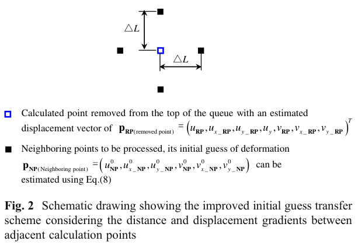
*그림 2 — 인접 계산점 사이의 거리와 변위 기울기를 고려하는 개선된 초기 추정 전달 방식의 도식. (파란 사각형: 큐의 맨 위에서 꺼낸, 변위 벡터 $\mathbf{p}_{RP(\text{removed point})} = (u_{RP}, u_{x\_RP}, u_{y\_RP}, v_{RP}, v_{x\_RP}, v_{y\_RP})^T$가 추정된 계산점. 검은 사각형: 처리할 이웃점으로, 변형 초기 추정 $\mathbf{p}_{NP(\text{Neighboring point})} = (u^0_{NP}, u^0_{x\_NP}, u^0_{y\_NP}, v^0_{NP}, v^0_{x\_NP}, v^0_{y\_NP})$을 식 (8)로 추정할 수 있다.)*

$$\begin{aligned} u^0_{NP} &= u_{RP} + u_{x\_RP} \times \Delta L + u_{y\_RP} \times \Delta L \\ u^0_{x\_NP} &= u_{x\_RP} \\ u^0_{y\_NP} &= u_{y\_RP} \\ v^0_{NP} &= v_{RP} + v_{x\_RP} \times \Delta L + v_{y\_RP} \times \Delta L \\ v^0_{x\_NP} &= v_{x\_RP} \\ v^0_{y\_NP} &= v_{y\_RP} \end{aligned} \tag{8}$$

여기서 $\Delta L$은 미리 정한 격자 간격, 즉 인접한 두 계산점 사이의 거리다. 앞서 쓴 직접 초기 추정 전달 방식[8, 14, 15]과 비교하면, (식 (8))로 얻은 초기 추정은 국소 변위 기울기를 고려하므로 더 정확한 초기 추정을 제공한다는 점에 유의해야 한다[27, 28]. 변형 영상이 큰 상대 변형 및/또는 회전을 포함하거나 큰 격자 간격을 쓸 때 (식 (8))로 추정한 초기 추정이 더 정확하다. 그 결과 IC-GN 알고리즘은 평균 반복 횟수가 줄어든 더 나은 수렴 특성을 보이며, 이는 더 높은 계산 효율을 뜻한다.

그다음 방금 계산한 각 점에 표시를 하고 ZNCC 계수 값에 따라 큐에 삽입한다.

**3단계(Step 3):** 큐가 빌 때까지 2단계를 반복한다. 큐가 비면 ROI의 모든 유효 점이 계산되어 영상 상관 계산이 끝난 것이다.

위 설명에서 IC-GN 알고리즘의 계산 경로는 각 열이나 행을 따른 단순한 점별 주사 전략이 아니라 계산된 점들의 ZNCC 계수에 의해 자동으로 유도됨이 분명하다. 신뢰도 유도 변위 추적 전략은 신뢰도(ZNCC 계수로 표시)가 가장 높은 점의 이웃이 먼저 처리되도록 보장한다. (식 (8))의 개선된 초기 추정 전달 방식은 더 정확한 변형 파라미터가 현재 계산점으로 자동 전달되도록 보장한다.

신뢰도 유도 변위 추적 전략의 장점은 다음 세 측면에서 구현된다. 1) **정확성(Accurateness)**: (식 (8))을 써서 참값에 더 가까운 완전한 초기 추정을 추정할 수 있으며, 정확한 초기 추정은 뒤에서 구현하는 IC-GN 알고리즘의 수렴을 빠르게 하는 데 도움이 된다. 2) **효율(Efficiency)**: 단순하지만 시간이 많이 드는 정수 화소 변위 탐색에 기반한 기존 초기 추정 방법을 완전히 피한다. 3) **강건성(Robustness)**: 신뢰도 유도 변위 추적 전략은 DIC의 계산 경로를 지능적으로 유도할 수 있으므로, 불규칙한 모양의 시편이나 불연속 변형을 겪는 시편에도 일반적으로 적용할 수 있다[14, 15, 29].

### 쌍삼차 보간을 위한 보간 계수 조회표 (Interpolation Coefficient Look-up Table for Bicubic Interpolation)

또한 (식 (5))는 IC-GN 알고리즘을 구현하는 동안, 이웃한 네 정수 화소 사이에 있는 부화소 위치의 밝기, 즉 $g(\mathbf{x}+\mathbf{W}(\xi; \mathbf{p}))$를 어떤 부화소 보간 방식으로 재구성해야 함을 보여 준다. 보간 방식의 선택은 IACA 알고리즘의 계산 정확도와 수렴 특성에 영향을 주는 핵심 요소다. [역주: "IACA"는 원문에 정의 없이 쓰였다. 원문 그대로 옮겼다.] 이 연구에서는 일반화된 쌍삼차 보간 방식[30, 31]을 구현하여 부화소 위치의 회색조 값을 다음과 같이 결정한다.

$$g(x, y) = \sum_{m=0}^{3}\sum_{n=0}^{3}\alpha_{mn}x^m y^n \tag{9}$$

여기서 (식 (9))의 미지 계수 16개, 즉 $a_{00}, a_{01}, \ldots, a_{33}$은 부화소 위치를 중심으로 이웃한 4×4 화소의 회색조 밝기로 결정할 수 있다.

필요할 때마다 각 부화소 위치에서 부화소 보간을 하는 것이 자연스럽다. 그러나 이 겉보기에 간단한 접근은 시간이 매우 많이 든다. 반복 알고리즘은 보통 수렴하기 전에 여러 번 반복하므로, 해당 서브셋의 각 화소를 여러 번 반복해서 보간해야 하기 때문이다. 또한 그림 3에 보였듯이 인접 서브셋들이 많이 겹치므로 한 기준 서브셋 안의 화소점이 이웃 기준 서브셋들에도 나타날 수 있으며, 이는 같은 화소점에서 보간을 더 반복해야 함을 뜻한다. 다음 예를 생각해 보자. DIC 계산에 $(2M+1)\times(2M+1)$ 화소의 서브셋과 $\Delta L$ 화소의 격자 간격을 고르면, 해당 서브셋 안의 각 화소는 인접한 $\left[\text{floor}\left(\frac{2M+1}{\Delta L}\right) + 1\right]^2$개의 기준 서브셋에서도 쓰인다. 여기서 $\text{floor}(x)$는 $x$보다 작은 최대 정수를 나타낸다. IC-GN 알고리즘이 평균 $n_{ave}$회 반복해야 한다고 하면, (식 (9))에 필요한 보간 계수 16개는 $n_{ave} \times \left[\text{floor}\left(\frac{2M+1}{\Delta L}\right) + 1\right]^2$회 반복 계산될 것으로 추정된다. 더 구체적으로, 41×41 화소의 보통 서브셋, 5 화소의 격자 간격, 평균 반복 3회이면 조사 서브셋 안의 각 화소마다 쌍삼차 보간이 약 243회 반복된다.

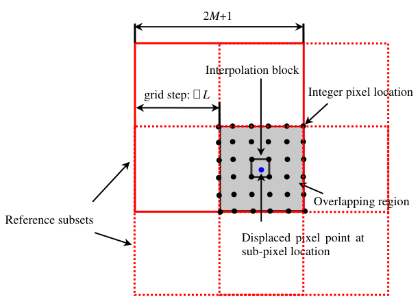
*그림 3 — 기존 FA-NR 알고리즘에 들어 있는 중복 보간의 도식: 변위된 화소점(파란 점)이 인접 서브셋들(점선)에 반복해서 나타난다. 기준 영상에 정의한 기준 서브셋들이 서로 겹치며, 이는 여러 서브셋을 최적화하는 동안 중복 보간 계산이 있음을 뜻한다.* [역주: 그림 속 문구는 "Interpolation block(보간 블록)", "grid step(격자 간격)", "Integer pixel location(정수 화소 위치)", "Overlapping region(겹치는 영역)", "Reference subsets(기준 서브셋)", "Displaced pixel point at sub-pixel location(부화소 위치로 변위된 화소점)"이다.]

16개 계수는 그 안의 구체적인 부화소 위치와 상관없이 각 보간 블록마다 같다는 점은 언급할 만하다. 이 사실은 부화소 밝기 재구성에 들어 있는 중복 계산을 없애는 보간 계수 조회표 방법을 개발하게 한다. 보간 계수 조회표 방법은 디지털 영상과 같은 크기의 2차원 빈 행렬(즉 조회표)을 만들며, 행렬의 각 원소는 각 보간 블록의 보간 계수를 나타낸다. 부화소 밝기 보간이 필요한 각 부화소 위치에 대해, 알고리즘은 먼저 조회표에서 해당 위치를 판단한다. 비어 있으면 쌍삼차 보간을 수행하고, 이어서 그 보간 블록의 보간 계수 16개를 조회표에 저장한다. 그렇지 않으면 이미 계산한 보간 계수 16개를 바로 써서 쌍삼차 보간 계수의 반복 추정을 피한다. 이렇게 하면 위의 같은 예에서 쌍삼차 보간을 각 보간 블록마다 243회가 아니라 단 한 번만 수행하면 된다.

## 실험적 검증 (Experimental Verification)

### 수치 시험을 이용한 IC-GN 알고리즘의 정확도와 정밀도 검증 (Verification the Accuracy and Precision of IC-GN Algorithm Using Numerical Tests)

IC-GN 알고리즘을 쓰는 제안 DIC 방법과 FA-NR 알고리즘을 쓰는 일반 DIC 방법의 계산 정확도와 정밀도를 정량적으로 비교하기 위해 이 연구에서는 수치 실험을 활용한다. 그림 4는 이어지는 수치 실험에 쓴 스페클(speckle) 패턴을 보여 준다. 768×576 화소 해상도의 8비트 스페클 패턴은 우리의 이전 실험에서 가져왔다. 이어지는 수치 연구에서는 순수 면내 평행이동 시험만 수행했다. 각 스페클 패턴에 대해 푸리에 이동 정리[32]에 따라 푸리에 영역에서 적절한 이동을 가하여 일련의 평행이동 스페클 영상을 생성했다. $x$ 방향으로 가한 부화소 변위는 0에서 1 화소 범위이며, 연속한 두 영상 사이 0.05 화소의 이동에 해당한다. 또한 영상 잡음을 모의하기 위해 평균 0, 분산 4인 가산 무작위 가우스 잡음을 각 영상에 더해 잡음의 영향을 모의했다. 각 평행이동 스페클 패턴의 변위는 위에서 설명한 제안 DIC 방법과 Ref. [8]에 자세히 소개된 기존 DIC 방법을 모두 써서 규칙적으로 분포한 2,501(=61×41)개 점(이웃 점 사이 거리 10 화소)에서 계산했다. 두 DIC 코드 모두 C++ 언어로 작성했고, 모든 계산은 데스크톱 컴퓨터(Inter(R) Core(TM) i5 CPU 750, 4코어, 주 주파수 2.67 GHz)에서 수행했다는 점에 유의하라.

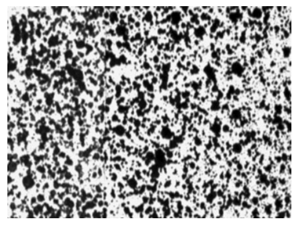
*그림 4 — 수치 실험에 쓴 스페클 패턴.*

두 DIC 방법이 계산한 변위를 정량적으로 평가하고 가한 변위와 비교하기 위해, 계산 변위의 오차를 평균 편향 오차(mean bias error, 또는 계통 오차)와 표준편차 오차(standard deviation error, 또는 무작위 오차) 두 성분으로 분해한다. 측정 변위의 평균 편향 오차는 다음과 같이 정의한다.

$$u_e = u_{mean} - u_{imp} \tag{10}$$

여기서 $u_{mean} = \frac{1}{N}\sum_{i=1}^{N}u_i$는 추정 변위 $N$개의 평균을 나타내고, $u_{imp}$는 실제로 가한 부화소 변위를 나타낸다.

측정 변위의 표준편차 오차는 다음과 같이 정의할 수 있다.

$$\sigma_u = \sqrt{\frac{1}{N-1}\sum_{i=1}^{N}(u_{mean} - u_{imp})^2} \tag{11}$$

[역주: 식 (11)의 합 안은 문맥상 $(u_i - u_{mean})^2$이어야 하나 원문 그대로 옮겼다.]

표준편차 오차는 측정 변위가 평균값에 대해 벗어난 정도를 반영한다.

그림 5는 31×31 화소 서브셋을 써서 두 가지 서로 다른 DIC 알고리즘이 검출한 변위의 평균 편향 오차와 표준편차 오차를 가한 부화소 변위의 함수로 보여 준다. DIC의 평균 편향 오차는 부화소 변위의 함수로서 주기 1 화소인 근사적 사인파 분포를 가진다는 점에 유의하라. 이런 종류의 계통 오차 분포는 부화소 재구성에서의 위치별 밝기 보간 오차 탓으로 돌릴 수 있다[32, 33]. 반면 DIC의 표준편차 오차는 대략 안정적이며 가한 부화소 변위에 의존하지 않고, 스페클 패턴의 품질과 계산에 쓴 서브셋 크기에 더 의존한다[32]. 그림 5에서 두 DIC 방법이 매우 비슷한 결과를 냄을 볼 수 있다. 무시할 만한 차이는 두 알고리즘의 서로 다른 구현 탓으로 돌릴 수 있다. 실험 결과는 두 DIC 방법이 등가임을 확인한다.

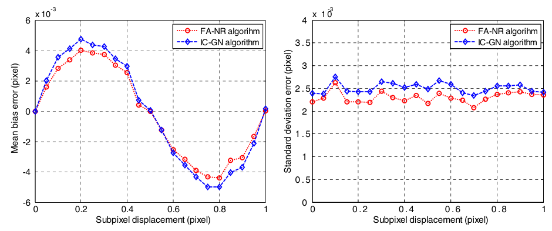
*그림 5 — 31×31 화소 서브셋을 쓰는 제안 IC-GN 알고리즘과 FA-NR 알고리즘에 대해, 부화소 변위의 함수로 나타낸 측정 $u$-변위의 평균 편향 오차(왼쪽)와 표준편차 오차(오른쪽).*

### 수치 시험을 이용한 IC-GN 알고리즘의 강건성 검증 (Verification the Robustness of IC-GN Algorithm Using Numerical Tests)

ZNSSD 기준을 쓰는 IC-GN 알고리즘이 SSD 기준을 쓰는 기존 IC-GN 알고리즘[21]보다 강건함을 확인하기 위해 컴퓨터로 모의한 스페클 패턴을 썼다. 먼저 Ref. [17]의 모의 알고리즘에 따라 반지름 4 화소인 스페클 1,200개로 이루어진 기준 스페클 패턴을 생성했다. 그다음 기준 스페클 패턴에 단축 인장 변형률 $u_x = 0.005$(다른 변형 파라미터는 0)를 가해 변형 스페클 영상을 생성했다. 조명 강도 변화를 모의하기 위해 변형 영상의 밝기를 인위적으로 조정하여 밝기를 20% 높이고 대비를 20% 낮췄다. 그림 6은 기준 스페클 영상, 변형된 스페클 영상, 그리고 밝기와 대비를 인위적으로 바꾼 최종 스페클 영상을 보여 준다.

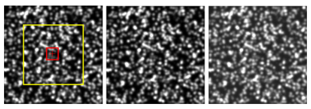
*그림 6 — 기준 영상(왼쪽), 변형 영상(가운데), 밝기를 20% 높이고 대비를 20% 낮추도록 인위적으로 조정한 변형 영상(오른쪽). 기준 영상의 노란 직사각형은 지정한 관심 영역을, 빨간 정사각형은 계산에 쓴 서브셋을 나타낸다.*

변형된 스페클 영상($u_x = 0.005$)을 ZNSSD 기준을 쓰는 IC-GN 알고리즘과 SSD 기준을 쓰는 기존 IC-GN 알고리즘으로 처리했다. 해석에서 변위는 31×31 화소 서브셋과 연속 계산점 사이 5 화소 거리로 계산했다. 계산 영역은 그림 6의 왼쪽 영상에 보였다. 두 가지 기준을 쓴 $u$-필드 변위의 해석 결과는 그림 7에 보였다. 기존 SSD 기준의 계산은

변형 영상의 밝기 변화에 심각하게 영향을 받음이 관찰된다. 반대로 ZNSSD 기준은 밝기 변화에 매우 잘 대처하며, 이론값과 매우 잘 일치하는 정확한 측정 결과를 준다. 실제 실험 영상은 하중을 가하는 동안 노출 및/또는 조명에 변화를 겪을 수 있으므로, 실용적인 ZNSSD 기준을 쓰는 IC-GN 알고리즘이 더 강건하다.

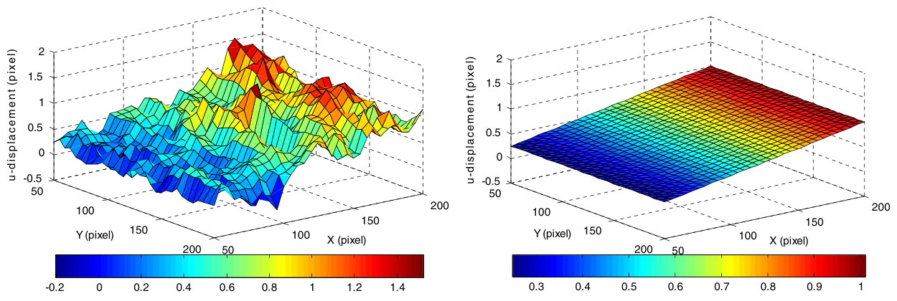
*그림 7 — 단축 변형된 스페클 패턴에 대해 (a) SSD 기준, (b) ZNSSD 기준을 쓰는 IC-GN 알고리즘으로 계산한 $u$-필드 변위(단위: 화소).*

### 실제 실험 영상을 이용한 IC-GN 알고리즘의 계산 효율 검증 (Verification the Computational Efficiency of IC-GN Algorithm Using Real Experimental Images)

제안 DIC 방법의 계산 효율을 더 검증하기 위해 고무 시편에 대해 실제 3점 굽힘 실험을 수행했다. 그림 8 (a)와 (b)에 보였듯이 8비트 회색조의 1,280×1,024 화소 크기 기준 영상과 변형 영상을 하중 없이, 그리고 300 N의 하중에서 촬영했다. 규칙적으로 배치된 4,212(=36×117)개 점을 포함하는 직사각형 관심 영역(ROI)을 IC-GN 알고리즘에 기반한 제안 DIC 방법과 우리가 최근 Ref. [9]에서 보고한 FA-NR 알고리즘을 쓰는 기존 DIC 방법으로 처리했다.

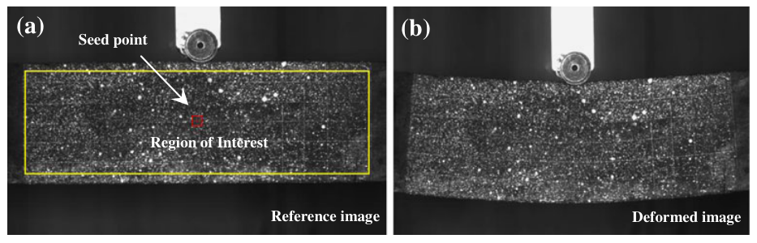
*그림 8 — 3점 굽힘을 받는 고무 시편의 실제 실험 영상: (a) 기준 영상, (b) 변형 영상.* [역주: 그림 속 문구 "Seed point"는 시드점, "Region of Interest"는 관심 영역, "Reference image"는 기준 영상, "Deformed image"는 변형 영상이다.]

그림 9(a)와 (b)는 10 화소 격자 간격에서 41×41 화소 서브셋을 써서 제안 DIC 방법으로 계산한 $x$ 방향, $y$ 방향 변위 필드를 보여 준다. 그림 9(a)에서는 예상대로 굽힘을 받은 고무 빔의 중립면과 반대칭 $u$-변위를 뚜렷이 알아볼 수 있으며, 이는 측정 변위가 올바름을 확인해 준다. 그림 9(c)에서도 대부분의 계산점의 ZNCC 계수가 0.96보다 크고 평균 ZNCC 값이 0.979임을 볼 수 있다. 높은 ZNCC 계수는 계산 결과가 올바름을 더 확인해 준다. 여기에 보이지는 않았지만, 고전적 FA-NR 알고리즘도 거의 같은 결과를 낸다는 점에 유의해야 한다. 두 계산을 정량적으로 비교하면 $u$-변위, $v$-변위, ZNCC 상관계수의 절대 최대 차이는 각각 0.0155 화소, 0.0150 화소, 0.0003이다. 이런 작은 차이는 서로 다른 계산 방식을 써서 생겼을 수 있으며, 대부분의 계산에서 허용할 만하다.

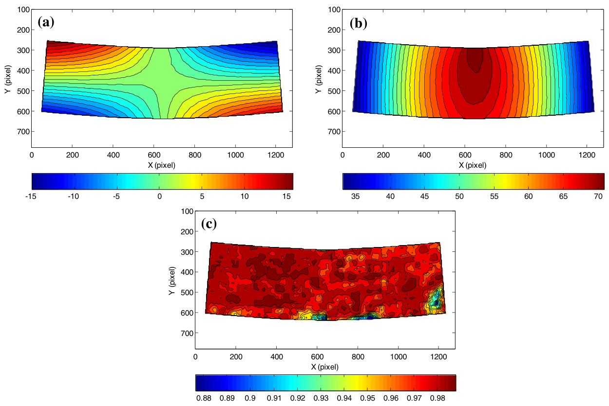
*그림 9 — 41×41 화소 서브셋으로 제안 IC-GN 알고리즘 기반 DIC 방법을 써서 계산한 고무 시편: (a) $u$-변위 필드, (b) $v$-변위 필드, (c) ZNCC 계수 분포.*

그림 10은 10 화소의 고정 격자 간격에서 여러 서브셋 크기로 제안 DIC와 최근 제안된 고속 FA-NR 알고리즘의 계산 효율을 비교한다. 이 경우 전부 4,212개 점을 해석했다. 고속 FA-NR 알고리즘과 비교하여 제안 DIC 방법은 계산 속도를 약 3–5배 높인다. 계산 효율의 이득은 주로 다음 덕분이다. 1) IC-GN 알고리즘을 써서 헤세 행렬의 반복 계산과 역행렬 계산을 없앤 것, 2) IC-GN 알고리즘에서 부화소 위치의 밝기 기울기 재구성을 없앤 것, 3) 개선된 초기 추정 전달 방식을 구현하여 IC-GN 알고리즘에서 더 나은 수렴 특성을 얻은 것. 또한 그림 10과 표 1에 나타낸 결과는 한 알고리즘 *대비* 다른 알고리즘의 상대적 계산 효율만 보여 줄 뿐 절대 계산 속도를 보여 주지 않는다는 점에 유의해야 한다. 절대 계산 속도는 수렴 조건, 프로그래밍 언어 사용, 프로그래밍 효율, 하드웨어 성능 같은 여러 요인에 의존한다.

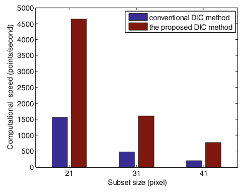
*그림 10 — 여러 서브셋 크기에서 제안 DIC 알고리즘과 기존 DIC 방법의 계산 속도 비교. 삽입된 표는 계산 속도와 평균 반복 횟수를 자세히 보여 준다.* [역주: 원문 그림에는 삽입된 표가 보이지 않는다. 범례 "conventional DIC method"는 기존 DIC 방법, "the proposed DIC method"는 제안 DIC 방법, 세로축은 계산 속도(points/second), 가로축은 서브셋 크기(pixel)다.]

표 1은 5 화소에서 20 화소에 이르는 여러 격자 간격에서, 41×41 화소의 고정 서브셋 크기로 여러 초기 추정 전달 방식을 쓰는 IC-GN 알고리즘의 평균 반복 횟수와 계산 속도를 비교한다. 보듯이 직접 초기 추정 전달 방식의 평균 반복 횟수는 격자 간격에 따라 증가한다. 격자 간격이 5 화소에서 20 화소로 커지면, 직접 초기 추정 전달 방식을 쓰는 IC-GN 알고리즘의 평균 반복 횟수는 3.6에서 5.1로 늘고, 계산 속도는 그에 따라 552 points/s에서 383 points/s로 줄어든다. 이는 큰 격자 간격을 쓰면 직접 초기 추정 전달 방식으로 추정한 초기 추정의 정확성이 떨어짐을 분명히 입증한다. 이에 비해 개선된 초기 추정 전달 방식을 쓰는 IC-GN 알고리즘의 평균 반복 횟수는 격자 간격이 달라도 사실상 같게 유지된다. 평균 반복 횟수의 감소와 계산 속도의 증가는 (식 (8))을 쓰는 개선된 초기 추정 전달 방식이 IC-GN 알고리즘에 더 정확한 초기 추정을 제공하여 IC-GN 알고리즘의 수렴을 빠르게 하고 계산 속도를 높임을 입증한다.

그림 11은 그림 8에 보인 두 실험 영상에 대해 두 초기 추정 전달 방식의 예측 오차(즉 변위 성분의 초기 추정과 최종 최적화된 변위 성분 사이의 차이)를 정량적으로 비교한다. DIC 계산은 41×41 화소의 서브셋 크기와 10 화소의 격자 간격으로 수행했다는 점에 유의하라. 그림 11(a)는 직접 초기 추정 전달 방식을 쓴 $u$-변위(왼쪽)와 $v$-변위(오른쪽)의 예측 오차를 보여 준다. 예측 오차는 [−0.8 0.8] 화소의 넓은 범위에 있으며, RMS 오차는 $u$-변위에서 0.4126 화소, $v$-변위에서 0.4697 화소로 추정된다. 반대로 그림 11(b)는 개선된 초기 추정 전달 방식을 쓴 $u$-변위(왼쪽)와 $v$-변위의 예측 오차를 보여 준다. 국소 변형률을 고려함으로써 개선된 초기 추정 전달 방식이 변형의 더 정확한 초기 추정을 제공함이 분명하다. 예측 오차는 [−0.2 0.3] 화소의 더 좁은 범위에 있으며, 대응하는 RMS 오차는 $u$-변위에서 0.0222 화소, $v$-변위에서 0.0250 화소에 불과하여 앞의 초기 추정 방식보다 한 자릿수 작다.

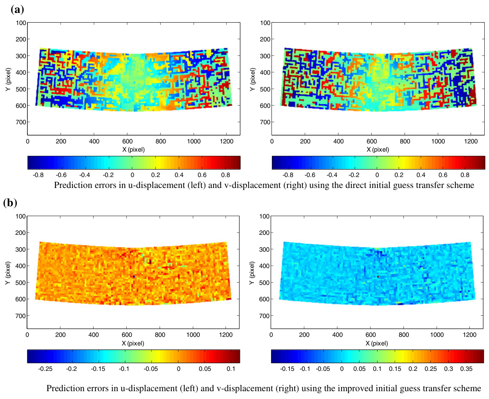
*그림 11 — 직접 초기 추정 전달 방식과 개선된 초기 추정 전달 방식의 예측 오차 비교. (a) 직접 초기 추정 전달 방식을 쓴 $u$-변위(왼쪽)와 $v$-변위(오른쪽)의 예측 오차. (b) 개선된 초기 추정 전달 방식을 쓴 $u$-변위(왼쪽)와 $v$-변위(오른쪽)의 예측 오차.*

**표 1** — 여러 격자 간격에서 직접 초기 추정 전달 방식과 개선된 초기 추정 전달 방식을 쓰는 IC-GN 알고리즘의 평균 반복 횟수와 계산 속도 비교

| 격자 간격 (Grid step, pixels) | 평균 반복 횟수/계산 속도 (p/s): 직접 초기 추정 전달 방식 | 평균 반복 횟수/계산 속도 (p/s): 개선된 초기 추정 전달 방식 |
|---|---|---|
| 5 | 3.6/552 | 2.4/1701 |
| 10 | 4.1/482 | 2.6/1627 |
| 20 | 5.1/383 | 2.8/1564 |

## 결론 (Conclusion)

정방향 반복 매칭 전략을 쓰는 디지털 영상 상관 방법, 대표적으로 고전적 FA-NR 알고리즘은 변형 해석에 널리 쓰이고 일반적으로 받아들여져 왔다. 이 논문에서는 전 영역 변형 해석을 위한 등가이지만 더 효율적인 DIC 방법을 제안한다. 개발한 DIC 방법은 실용적인 ZNSSD 상관 기준을 쓰는 효율적인 IC-GN 알고리즘, 수정된 초기 추정 전달 방식을 쓰는 개선된 신뢰도 유도 변위 추적 전략, 그리고 깔끔한 보간 계수 조회표 방법을 결합한다. 이런 혁신으로 DIC 계산의 여러 단계, 즉 변형 벡터의 초기 추정, 부화소 변위 정합, 부화소 밝기 보간 계산에 들어 있던 모든 중복 계산을 완전히 없앤다. 실험 결과는 제안한 IC-GN 알고리즘 기반 DIC 방법이 고전적 FA-NR 알고리즘 기반 DIC 방법과 비슷한 결과를 내지만, 구체적인 계산 설정에 따라 약 3–5배 빠름을 보여 준다. 전 영역 변위 측정을 위한 효율적이고 강건하며 정확한 알고리즘으로서, 제안한 신뢰도 유도 IC-GN 알고리즘은 DIC의 표준 변위 추적 알고리즘이 될 것으로 기대되며, 다양한 시간 제약 문제에서 더 많이 응용될 것이다.

**감사의 글(Acknowledgments)** 여기 보고한 연구는 중국 국가자연과학기금(National Natural Science Foundation of China, 과제 번호 11272032, 11002012, 91216301), 대학 신세기 우수 인재 프로그램(Program for New Century Excellent Talents in University), 중국 항천과학기술 혁신기금 과제(China Aerospace Science and Technology Innovation Fund Project, 과제 번호 CASC201101), 항공과학기금(Aeronautical Science Foundation of China, 과제 번호 2011ZD51043), 고등교육 박사과정 전문연구기금(Specialized Research Fund for the Doctoral Program of Higher Education, 과제 번호 20101102120015)의 지원을 받았다.

## 참고문헌 (References)

- [1] Peters WH, Ranson WF (1981) Digital imaging techniques in experimental stress analysis. Opt Eng 21:427–431
- [2] Chu TC, Ranson WF, Sutton MA, Peters WH (1985) Applications of digital-image-correlation techniques to experimental mechanics. Exp Mech 25:232–244
- [3] Sutton MA, Orteu JJ, Schreier HW (2009) Image correlation for shape, motion and deformation measurements. Springer
- [4] Pan B, Qian KM, Xie HM, Asundi A (2009) Two-dimensional digital image correlation for in-plane displacement and strain measurement: a review. Meas Sci Technol 20:062001
- [5] Pan B (2011) Recent progress in digital image correlation. Exp Mech 51:1223–1235
- [6] Hild F, Roux S (2006) Digital image correlation: from displacement measurement to identification of elastic properties—a review. Strain 42(2):69–80
- [7] Huang JY, Zhu T, Pan XY, Qin L, Peng XL, Xiong CY, Fang J (2010) A high-efficiency digital image correlation method based on a fast recursive scheme. Meas Sci Technol 21:035101
- [8] Wang ZY, Hoang TM, Nguyen DA, Urcinas AC, Magro JR (2010) High-speed digital-image correlation method: comment. Opt Lett 35:2891
- [9] Pan B, Li K (2011) A fast digital image correlation method for deformation measurement. Opt Lasers Eng 49:841–847
- [10] Bruck HA, McNeil SR, Sutton MA, Peters WH (1989) Digital image correlation using Newton–Raphson method of partial differential correction. Exp Mech 29:261–267
- [11] Vendroux G, Knauss WG (1998) Submicron deformation field measurements: Part 2. Improved digital image correlation. Exp Mech 38:86–92
- [12] Lu H, Cary PD (2000) Deformation measurement by digital image correlation: implementation of a second-order displacement gradient. Exp Mech 40:393–400
- [13] Pan B, Xie HM, Guo ZQ, Hua T (2007) Full-field strain measurement using a two-dimensional Savitzky-Golay digital differentiator in digital image correlation. Opt Eng 46(3):033601
- [14] Pan B (2009) Reliability-guided digital image correlation for image deformation measurement. Appl Opt 48:1535–1542
- [15] Pan B, Wang ZY, Lu ZX (2010) Genuine full-field deformation measurement of an object with complex shape using reliability-guided digital image correlation. Opt Express 18:1011–1023
- [16] Huang J, Pan X, Peng X, Yuan Y, Xiong C, Fang J, Yuan F (2012) Digital image correlation with self-adaptive Gaussian windows. Exp Mech, 10.1007/s11340-012-9639-8
- [17] Pan B, Xie HM, Xu BQ, Dai FL (2006) Performance of sub-pixel registration algorithms in digital image correlation. Meas Sci Tech 17(6):1615–1621
- [18] Tong W, Yao H, Xuan Y (2011) An improved error evaluation in one-dimensional deformation measurements by linear digital image correlation. Exp Mech 51(9):1019–1031
- [19] Tong W (2011) Subpixel image registration with reduced bias. Opt Lett 36(5):763–765
- [20] Baker S, Mattews I (2001) Equivalence and efficiency of image alignment algorithms. Proc IEEE Conf Comput Vis Pattern Recognit 56:1090–1097
- [21] Baker S, Mattews I (2004) Lucas-Kanade 20 years on: a unifying framework. Int J Comput Vision 56:221–255
- [22] Lucas B, Kanade T (1981) An iterative image registration technique with an application to stereo vision. In Proceedings of the International Joint Conference on Artificial Intelligence, 674–679
- [23] Pan B, Asundi A, Xie HM, Gao JX (2009) Digital image correlation using iterative least squares and pointwise least squares for displacement field and strain field measurements. Opt Lasers Eng 47(7–8):865–874
- [24] Tong W (2005) An evaluation of digital image correlation criteria for strain mapping applications. Strain 41(4):167–175
- [25] Pan B, Xie HM, Wang ZY (2010) Equivalence of digital image correlation criteria for pattern matching. Appl Opt 49:5501–5509
- [26] Zhang JQ, Zeng P, Lei LP, Ma Y (2012) Initial guess by improved population-based intelligent algorithms for large inter-frame deformation measurement using digital image correlation. Opt Lasers Eng 50(3):473–490
- [27] Zhou YH, Pan B, Chen YQ (2012) Large deformation measurement using digital image correlation: a full automatic approach. Appl Opt 51(31):7674–7683
- [28] Zhou YH, Chen YQ (2012) Propagation function for accurate initialization and efficiency enhancement of digital image correlation. Opt Lasers Eng 50(12):1789–1797
- [29] Pan B, Wu DF, Xia Y (2010) High-temperature deformation field measurement by combing transient aerodynamic heating system and reliability-guided digital image correlation. Opt Lasers Eng 48(9):841–848
- [30] Press WH (2003) C++ numerical algorithms. Publishing House of Electronics Industry, Beijing
- [31] http://en.wikipedia.org/wiki/Bicubic_interpolation
- [32] Pan B, Lu ZX, Xie HM (2010) Mean intensity gradient: an effective global parameter for quality assessment of the speckle patterns used in digital image correlation. Opt Lasers Eng 48(4):469–477
- [33] Wang YQ, Sutton MA, Bruch HA, Schreier HW (2009) Quantitative error assessment in pattern matching: effects of intensity pattern noise, interpolation, strain and image contrast on motion measurement. Strain 45:160–178
