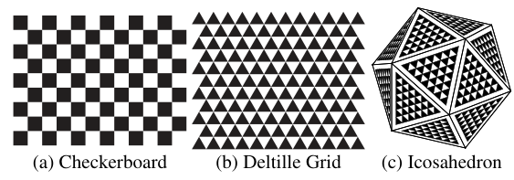
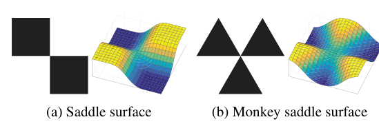
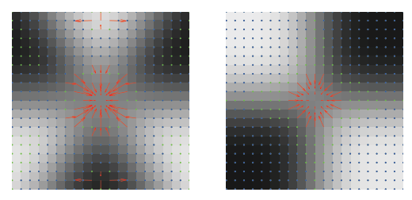
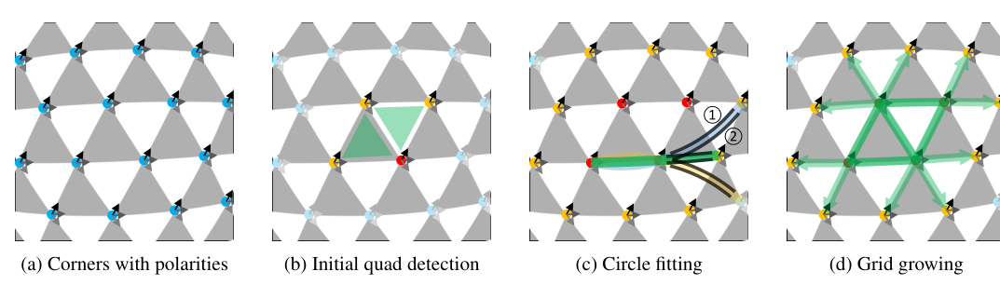
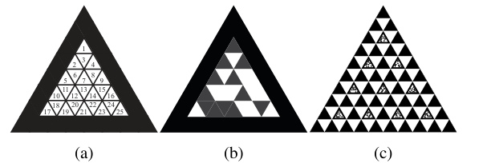
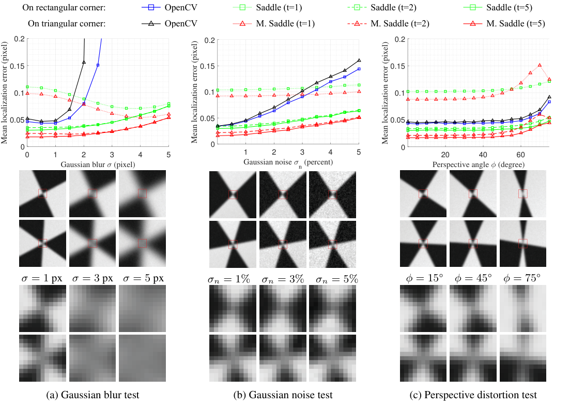
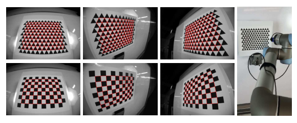
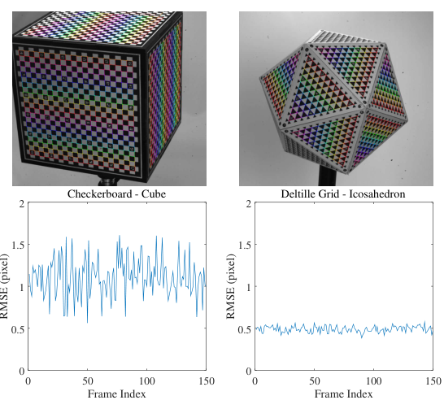

# 기하학적 카메라 보정을 위한 델틸 격자 (Ha 2017)

- 원제: Deltille Grids for Geometric Camera Calibration
- 원문: 같은 폴더의 `Ha2017_ICCV_DeltilleGrids.pdf` (ICCV 2017, CVF Open Access 판, 5344–5352쪽)
- 저자: Hyowon Ha†,\*, Michal Perdoch‡,\*, Hatem Alismail‡, In So Kweon†, Yaser Sheikh‡ († KAIST, ‡ Oculus Research, \* 동등 기여)
- 번역 범위: 전문
- 그림: 원문 그림 8개를 `그림/`에 넣고 본문에서 처음 언급되는 곳에 삽입. 표 1·2는 마크다운 표로 옮김

## 초록

최근 고해상도 카메라가 널리 보급되면서 시각 기반 3D 복원에서 전례 없는 수준의 정밀도를 달성할 기회가 생겼다. 그러나 수십 년 전 체커보드를 사용해 개발된 카메라 보정(calibration) 파이프라인이 여전히 사실상의 표준으로 남아 있다. 이 논문에서 우리는 다음 질문을 던진다. 체커보드가 고정밀 보정에 최적인 패턴인가? 우리는 델틸 격자(deltille grid, 정삼각형 타일링)가 유클리드 평면의 가능한 타일링 가운데 가장 높은 정밀도의 보정을 만들어 냄을 실험적으로 보인다. 우리는 델틸 격자가 고정밀 보정의 새로운 표준이 되어야 한다고 주장하며, 델틸 격자를 이용한 보정의 완전한 생태계를 제시한다. 여기에는 (1) 다항식 곡면 맞춤(polynomial surface fitting)에 기반한 매우 정밀한 코너 검출 알고리즘, (2) 맞춘 곡면에서 추출한 극성(polarity)에 기반한 인덱싱(indexing) 방식, (3) 기존 매트릭스 바코드 대신 쓰는, 우리가 DelTag라고 부르는 델틸 격자용 2D 부호화 시스템이 포함된다. 우리는 최고 수준(state-of-the-art)의 성능을 보이고, 다시점(multiview) 카메라 보정을 위한 3D 보정 물체를 사용해 전체 보정 생태계를 적용한다.

## 1. 서론 (Introduction)

카메라 보정은 3D 비전 시스템의 기초가 되는 작업이다. 원근 카메라 보정 중에 생긴 작은 오차는 역투영(back-projection)으로 확대되며, 이 오차는 흔히 시스템의 이후 모든 모듈로 연쇄적으로 전파된다. 따라서 정밀도가 무엇보다 중요하다. 체커보드 패턴은 정밀한 기준점(fiducial) 위치 추정을 위한 뚜렷한 코너를 가진 균일한 보정 패턴을 제공하므로 고정밀 카메라 보정의 기본 선택이 되었다 [5, 6]. 체커보드 패턴을 중심으로 하나의 생태계가 구축되었는데, 여기에는 효율적이고 정밀한 코너 검출 알고리즘 [6, 18, 24], 체커보드의 일부만 보일 때의 강건한 인덱싱 방식 [14, 30], 체커보드 위 코너의 절대 위치 추정을 위한 매트릭스 바코드 [13, 27]가 포함된다. 그러나 더 높은 해상도의 카메라가 등장하고 다중 카메라 리그(rig)가 확산되면서, 보정 파이프라인의 기초로서 체커보드 패턴의 장점을 다시 검토할 필요가 생겼다.

(\* 동등 기여)

*그림 1 — 균일하지만 번갈아 칠해진 정규 타일링. (a) 체커보드 패턴, (b) (a)와 같은 변 길이를 가진 델틸 패턴, (c) 델틸 격자를 텍스처로 입힌 3D 보정 물체.*

이 논문에서 우리는 보정 패턴의 기본 요소(primitive)로 사각형 대신 삼각형을 쓸 것을 주장하며, 이를 사용할 때의 상당한 이점을 보고한다. 우리는 델틸 패턴 [8]에 기반한 완전한 보정 생태계를 제시한다. 여기에는 고정밀 델틸 코너 검출 알고리즘, 부분적으로 보이는 델틸 격자를 위한 인덱싱 알고리즘, 그리고 보정 물체의 절대 위치 추정을 위한, 우리가 DelTag라 부르는 삼각형 바코드 시스템이 포함된다. 이 생태계를 3D 보정 물체를 이용한 정밀 다시점 카메라 보정에 적용한다.

델틸(deltille)은 슐레플리 기호(Schläfli symbol) {3, 6}을 갖는 정삼각형 타일링(이른바 "델타 타일")이다 [9]. 이는 유클리드 평면의 단 세 가지 정규 타일링 중 하나이며, 익숙한 체커보드 타일링을 제외하면 번갈아 가며 색을 칠할 수 있는(구체적으로는 121212의 균일 채색) 유일한 타일링이다 [16]. 이러한 채색을 가진 델틸 패턴을 델틸 격자라고 부른다(그림 1(b) 참조).

델틸 격자는 체커보드에 비해 세 가지 주요 이점이 있다. (1) 그림 1에서 볼 수 있듯이, 델틸 격자는 같은 변 길이에 대해 정사각형 또는 비스듬한 직사각형 타일링보다 더 높은 요소 밀도를 달성한다. 이 성질 덕분에 더 많은 기준점을 검출할 수 있어 위치 추정 정밀도가 향상된다(실험에서 보이듯). 또한 등방성(isotropic) 타일링이므로, 패턴을 원근 변환 아래에서 관측할 때 위치 추정 편향(bias)을 줄이는 데 도움이 된다. (2) 각 기준점은 번갈아 나타나는 세 변의 교차로 특징지어지며, 이는 체커보드의 두 변 교차에 비해 더 많은 구속 조건을 제공한다(그림 2 참조). 이 성질은 정면 평행(fronto-parallel) 시점에서도 영상의 블러와 밝기 잡음 아래에서 더 정밀한 위치 추정을 가져온다. (3) 3D 보정 물체의 텍스처 기본 요소로서 삼각형은 사각형보다 더 매력적이다. 볼록한 구조를 근사하는 데 삼각형 메시가 사각형 메시보다 항상 더 정확하다는 것이 알려져 있으며 [11], 볼록 구조는 다시점 보정에 바람직하다. 예를 들어 보정 물체로 정육면체와 정이십면체를 비교해 보라. 정규 면의 수가 많을수록 시점에 따른 편향이 작아진다. 직관적으로도 삼각형은 사각형에 비해 다루기 쉬운 기본 요소이다. 삼각형은 구성상 평평하고 볼록하며, 삼각형 메시의 품질은 (정삼각형으로부터의 편차라는 관점에서) 간단히 특성화할 수 있다 [4].

*그림 2 — 두 종류의 체커보드 코너와 그에 대응하는 국소 곡면 형상. (a) 안장 곡면(saddle surface), (b) 원숭이 안장 곡면(monkey saddle surface).*

스포츠 경기장, 텔레비전 스튜디오, 행사의 군중 촬영 같은 환경에서 고해상도 영상을 여러 시점으로 촬영하는 일이 늘고 있으므로, 고정밀 보정에 대한 새로운 접근을 탐구하기에 적절한 시기이다. 델틸 격자의 이점은 보정에서 더 높은 수준의 정밀도에 도달하게 해 주며, 이는 특수 효과, 3D 거리 추정, 3D 복원 같은 비전 처리의 나머지 단계로 이어질 수 있다.

**기여(Contributions).** 우리는 다음과 같은 구체적 기여를 가진, 델틸 격자에 기반한 보정 파이프라인을 제시한다.

1. **델틸 코너 검출(Deltille Corner Detection)**: 영상 밝기 샘플에 원숭이 안장점(monkey saddle point) 곡면을 직접 맞추는 것에 기반한 매우 정밀한 델틸 코너 검출 방법을 제시한다. 다항식 곡면 맞춤은 볼록(convex) 문제이며, 미분기하학의 결과를 이용해 별 모양(star-shaped) 배꼽점(umbilical point)으로서의 기준점 판별식을 설계한다.
2. **부분적으로 보이는 델틸 격자의 인덱싱(Indexing for Partially-viewed Deltille Grids)**: 다항식 맞춤의 부수적 결과로 맞춤의 극성(polarity)을 얻을 수 있다. 각 점의 극성을 이용하여 부분 델틸 격자 검출을 위한 강건한 인덱싱 방법을 설계한다.
3. **DelTag**: 삼각형 타일(또는 델타) 안에서 부호의 가시성을 최대화하도록 설계되었고, 매트릭스 바코드(QR 코드 등)의 주요 오류 정정 메커니즘을 유지하는 2D 부호화 시스템을 제시한다.

우리는 이 파이프라인을 델틸 격자를 입힌 3D 보정 물체를 이용한 다시점 보정에 적용한다. 코너 검출과 인덱싱 방식은 체커보드 패턴에도 적용되며, 두 모듈을 정성적으로 비교하고 표준 데이터셋에서 최고 수준의 성능을 보인다.

## 2. 선행 연구 (Prior Works)

체커보드 코너 검출은 체커보드 패턴 검출과 코너 정밀화(refinement)라는 두 작업으로 나눌 수 있다. 일반적으로 최고의 검출률과 코너 정확도를 동시에 달성하기 위해 각 부분에 서로 다른 방법을 조합하는 것이 권장된다.

**체커보드 패턴 검출(Checkerboard Pattern Detection).** OpenCV 체커보드 검출 알고리즘 [6]은 널리 쓰이는 전체(full) 체커보드 검출기이다. 검은 사각형을 분할하고 그 변들의 교차점을 찾아 코너를 검출한다. Wang 등 [31]은 두 그룹의 직선을 맞추어 패턴 격자를 찾는 방법을 제안하였다. 격자의 직선은 허프 변환(Hough transform)으로도 찾을 수 있다 [12, 17]. 그러나 이런 종류의 직선 맞춤 기반 검출 방법은 렌즈 왜곡이 작은 영상에서만 쓸 수 있다. 강한 렌즈 왜곡에 강건한 알고리즘이 Rufli 등 [29]에 의해 제안되어 OCamCalib Toolbox [30]에 구현되었다. Placht 등 [28]은 골격화된 이진 에지 영상에서 체커보드의 그래프 구조를 찾는 전체 체커보드 검출기를 제시하였다. Fuersattel 등 [14]은 이 방법을 부분 그래프 정합(subgraph matching) 방식으로 확장하여 부분 체커보드 검출을 달성하였다. 그러나 영상이 흐리거나 조명이 고르지 않으면 뚜렷한 체커보드 구조를 보존하는 이진 에지 영상을 얻기가 때때로 어렵다. Geiger 등 [15]은 시드(seed) 점에서 시작하여 체커보드 가설을 반복적으로 확장하는 방법을 제안하였다. 이들 방법 중 많은 수가 체커보드의 자동 검출을 제공하지만, 영상 해상도, 블러, 잡음, 고르지 않은 조명, 강한 기하학적 왜곡 같은 다양한 요인으로 자주 실패한다. 이런 이유로 일부 사람들은 전체 보정 결과를 망칠 수 있는 오검출을 피하기 위해, 사용자가 체커보드를 수동으로 추출할 수 있는 Bouguet의 MATLAB용 카메라 보정 툴박스 [5]를 선호한다.

**코너 정밀화(Corner Refinement).** 해리스 코너 검출기(Harris corner detector) [18]는 코너점 위치 추정의 흔한 선택이다. Bouguet [5]는 초기 코너를 주변의 기울기(gradient)가 자기 방향 벡터(selfward vector)와 직교하는 더 나은 위치로 정밀화하는 방법을 제시한다. 이 잘 알려진 방법은 OpenCV [6]와 Geiger 등 [15]에도 채택되었다. Lucchese와 Mitra [24]는 코너 주변에 맞춘 다항식 곡면의 안장점을 계산하여 초기 해리스 점을 정밀화한다. 다항식을 맞추기 전에 영상을 가우시안 필터로 평활화한다. Chen 등 [7]은 계산 효율을 위해 다항식을 맞추는 대신 헤세 행렬(Hessian matrix)을 직접 사용하는 비슷한 안장점 추출을 제안한다. 최근 Placht 등 [28]은 가우시안 대신 원뿔 모양 필터를 사용하면 정확도를 높일 수 있음을 보였다. 그들의 안장점 방법은 같은 양의 정보, 즉 작은 패치(patch)를 쓰는 다른 방법들보다 블러와 밝기 잡음에 더 강건한 특성을 보이며, 이 덕분에 특징 밀도가 더 높은 타깃을 쓸 수 있다.

**다른 기본 요소(Other Primitives).** 원형 특징이나 점(dot)도 보정 타깃의 기본 요소로 쓰였다 [19, 20, 21]. [25]에서는 보정된 원뿔곡선 맞춤(compensated conic fitting)을 사용하면 사영 변환 아래에서 중심점의 위치 추정 편향을 제거할 수 있음을 보였으나, 렌즈 왜곡 같은 비선형 변환에서 오는 편향은 여전히 정밀한 위치 추정에 영향을 준다. 동심원 [22]과 공초점 원뿔곡선(confocal conics) [23]에 기반한 방법 역시 비선형 렌즈 왜곡에 취약하다. 반대로, 다항식 맞춤 기반 코너 검출 [24]은 우리 방법과 비슷하게 두 종류의 편향 모두에 불변임이 증명되었다 [25].

## 3. 방법: 델틸 격자 검출 (Method: Deltille Grid Detection)

다음 절들에서는 직사각형 격자 위 코너의 정밀한 위치 추정 [28, 2]을 일반화한, 델틸 패턴 위의 코너 검출을 제시한다. 유사점을 부각하기 위해 직사각형의 경우¹를 자세히 설명하고 이 절 전체에서 이를 참조한다. 3.2절에서는 인덱싱, 즉 부분 타깃과 다면 보정 물체에서 2D–3D 대응을 확립하는 강건한 방법을 자세히 설명한다.

(각주 1: 논문의 확장판을 참조하라.)

### 3.1. 원숭이 안장 맞춤에 의한 코너 검출 (Corner Detection by Monkey Saddle Fitting)

델틸 격자 영상을 화소 좌표의 매끄러운 2차원 함수로 나타내자. 각 점의 값은 화소의 밝기를 나타낸다. 델틸 격자 위 변들의 교차점은 영상 함수의 특정한 형태의 안장점을 이루며(그림 2(b) 참조), 이를 보통 원숭이 안장(monkey saddle)이라고 부른다 [1]. 기하학적으로, 영상 밝기 함수에는 세 개의 골짜기와 세 개의 능선이 있어 원숭이의 두 다리와 꼬리를 위한 완벽한 안장을 이룬다. 원숭이 안장 곡면을 이루는 다항식의 최소 차수는 3이며, 델틸 격자 코너는 이 곡면의 임계점(critical point)이다.

$f(\mathbf{x})$를 찾고자 하는 델틸 격자 코너 $\mathbf{x}^*$ 근방의 매끄러운 영상 밝기 패치라 하자. 여기서는 번갈아 나타나는 검은 영역과 흰 영역이 세 삼각형의 교차점에서 만난다. 임계점 위치의 초기 추정 $\mathbf{x}^0$가 주어지면, $\mathbf{x}^t$를 중심으로 하는 일련의 3차 다항식으로 국소 곡면을 근사하여 그 임계점들이 $\mathbf{x}^*$로 수렴하는 수열 $\mathbf{x}^t$를 구성한다. $\mathbf{x}^t$에서 3차 도함수까지 필요로 하는 테일러 급수 전개를 쓰는 대신, 점 $\mathbf{x}^t$ 주변의 밝기 곡면 함수 $f$에 3차 다항식

$$\tilde f(\mathbf{x};\mathbf{c}) = c_1x^3 + c_2x^2y + c_3xy^2 + c_4y^3 + c_5x^2 + c_6xy + c_7y^2 + c_8x + c_9y + c_{10}, \tag{1}$$

을 직접 맞춘다. 다항식 곡면 맞춤은 다음과 같이 정식화할 수 있다.

$$\arg\min_{\mathbf{c}} \sum_{\boldsymbol{\Delta}_i\in\mathcal{N}} \left\| f(\mathbf{x}^t + \boldsymbol{\Delta}_i) - \tilde f(\boldsymbol{\Delta}_i;\mathbf{c}) \right\|_2 \tag{2}$$

여기서 $\mathbf{c} = [c_1, c_2, \ldots, c_{10}]^\top$은 다항식 계수 벡터이고, $\mathcal{N}$은 $\mathbf{x}^t$로부터 거리 $r$ 이내의 격자 위에서 선택한 $n$개의 샘플링 점 $\boldsymbol{\Delta}_i = (u_i, v_i)$의 집합이다.

실제로 이 최소제곱 맞춤 문제는 $m$개의 코너점에 대해 한꺼번에 효율적으로 풀 수 있다. 계수 벡터 $\mathbf{c}$는 선형 시스템 $\mathbf{Ac} - \mathbf{b} = \mathbf{0}$을 만족하며, 여기서

$$\mathbf{A} = \begin{bmatrix} u_1^3 & u_1^2v_1 & u_1v_1^2 & v_1^3 & u_1^2 & u_1v_1 & v_1^2 & u_1 & v_1 & 1\\ \vdots & \vdots & & \vdots & & & & & & \vdots\\ u_n^3 & u_n^2v_n & u_nv_n^2 & v_n^3 & u_n^2 & u_nv_n & v_n^2 & u_n & v_n & 1 \end{bmatrix},$$

$$\mathbf{b} = \left[f(\mathbf{x}^t + \boldsymbol{\Delta}_1), \cdots, f(\mathbf{x}^t + \boldsymbol{\Delta}_n)\right]^\top.$$

$f$의 부화소(sub-pixel) 밝기 샘플링은 쌍선형 보간(bilinear interpolation)으로 한다.

모든 코너에 대해 같은 $\boldsymbol{\Delta}_i$ 격자를 선택하면, 행렬 $\mathbf{A}$를 고정하여 각 반복에서 모든 점의 맞춤에 재사용할 수 있다. 따라서 각 반복에서 모든 곡면 맞춤 문제를 하나의 식 $\mathbf{AC} = \mathbf{B}$로 푼다. 여기서 $n \times m$ 행렬 $\mathbf{B}$는 $m$개의 모든 코너점에 해당하는 샘플 벡터들을 이어 붙여 채울 수 있다. 이 과결정(over-determined) 문제($n \ge 10$일 때)를 풀기 위해 $\mathbf{M} = \left(\mathbf{A}^\top\mathbf{A}\right)^{-1}\mathbf{A}^\top$을 계산하여, 모든 다항식 곡면 계수로 된 $10 \times m$ 행렬 $\mathbf{C}$를 $\mathbf{C} = \mathbf{MB}$로 추정한다. $\mathbf{M}$은 처음에 한 번만 계산하면 전체 과정에 걸쳐 활용할 수 있음에 유의하라.

맞춘 곡면의 임계점을 기존의 뉴턴 방법(Newton's method)으로 찾는 것은 까다로운 것으로 드러나는데, 곡면의 1차 도함수가 2차 다항식이기 때문이다.

$$\nabla_x\tilde f(\mathbf{x}) = 3c_1x^2 + 2c_2xy + c_3y^2 + 2c_5x + c_6y + c_8,$$
$$\nabla_y\tilde f(\mathbf{x}) = c_2x^2 + 2c_3xy + 3c_4y^2 + c_6x + 2c_7y + c_9.$$

따라서 직사각형 코너의 경우와 달리, 델틸 코너점 주위에 여러 정상점(stationary point)(두 타원의 교점)이 존재할 수 있다. 뉴턴 방법은 진짜 원숭이 안장점에 도달할 가능성이 낮고, 이런 국소 정상점 중 하나로 수렴한다.

이 문제를 극복하기 위해 미분기하학에서 찾은 또 다른 단서를 사용한다. 원숭이 안장 곡면의 임계점은 가우스 곡률(Gaussian curvature)이 0이 되는 배꼽점(umbilical point)으로 간주된다 [3]. 따라서 원숭이 안장점은 모든 2차 도함수가 0인 퇴화 임계점(degenerate critical point)이다. 이를 이용하면 $\nabla^2\tilde f(\mathbf{x}^*) = \mathbf{0}$인 점 $\mathbf{x}^*$만 남겨 이를 판별할 수 있다.

각 반복에서, $\mathbf{x}^t$에서 맞춘 국소 곡면으로부터 다음을 만족하는 퇴화 임계점의 위치 $\mathbf{x}_d$를 계산한다.

$$\nabla^2\tilde f(\mathbf{x}_d)\begin{cases} \nabla^2_{xx}\tilde f(\mathbf{x}_d) = 6c_1x_d + 2c_2y_d + 2c_5 = 0,\\ \nabla^2_{xy}\tilde f(\mathbf{x}_d) = 2c_2x_d + 2c_3y_d + c_6 = 0,\\ \nabla^2_{yy}\tilde f(\mathbf{x}_d) = 2c_3x_d + 6c_4y_d + 2c_7 = 0. \end{cases} \tag{3}$$

식 3은 과결정 선형 시스템이므로, $\mathbf{x}_d$는 해당 최소제곱 문제를 풀어 계산한다. 원숭이 안장점 위치 $\mathbf{x}^{t+1}$은 다음과 같이 갱신한다.

$$\mathbf{x}^{t+1} = \mathbf{x}^t + \mathbf{x}_d \tag{4}$$

원숭이 안장 근방의 모든 점은 양과 음의 주곡률(principal curvature)을 모두 가져야 하므로 [3], 델틸 격자 위의 모든 코너점을 검출하기 위해 $\det\nabla^2 f(\mathbf{x}) < 0$을 만족하는 모든 점에서 조밀하게 반복을 초기화한다. 같은 임계점 성질(식 3)을 공유하는 원숭이 안장이 아닌 점들을 걸러내기 위해, Darboux [10]가 처음 제안한 배꼽점 분류에 대한 선행 연구를 살펴본다. Berry와 Hannay [3]는 배꼽점 주위 주방향(principal direction) 벡터장의 패턴에 따라 배꼽점의 세 가지 전형적 형태를 star, monstar, lemon이라 명명하였다. 구체적으로, 우리의 경우 별(star) 모양 배꼽점이 원숭이 안장점을 나타낸다. 별 모양 배꼽점을 다른 것과 구별하는 판별식은 다음과 같다.

$$J(c_1, c_2, c_3, c_4) = 3(c_1c_3 + c_2c_4) - (c_2^2 + c_3^2) < 0, \tag{5}$$

그리고 $J < 0$을 만족하는 모든 국소 곡면을 잠재적인 원숭이 안장점으로 간주한다. 예시 델틸 코너와 직사각형 코너 주위의 수렴 흐름을 그림 3에 나타냈다.

*그림 3 — 반복 절차의 한 번: 델틸(왼쪽)과 직사각형 코너(오른쪽). 초기 점 격자 $\mathbf{x}^0$에서, 점이 식 5를 만족하고 그 변위가 $\mathbf{x}_d < r$이면 $\mathbf{x}^1$로 향하는 빨간 화살표를 표시한다. 파란 점은 $J \ge 0$으로 걸러진 점이고, 초록 점은 $\mathbf{x}_d \ge r$일 때 걸러진 점이다.*

판별식은 최고차 계수에만 기반하므로 곡면 맞춤의 x-y 정의역 이동에 불변이다. 다시 말해, 점들이 얼마나 정밀하게 위치 추정되었는지와 무관하게 과정의 첫 번째 반복부터 모든 점에 대해 판별식을 확인할 수 있다. 이는 이상치를 크게 줄이고 원숭이 안장 같은 점만 효율적으로 처리할 수 있게 해 주므로 중요하다.

### 3.2. 델틸 격자의 강건한 인덱싱 (Robust Indexing for Deltille Grids)

영상 속 보정 패턴의 모습은 비네팅(vignetting), 렌즈 수차, 센서 위의 래스터화 같은 영상 획득 효과와 강한 방사·원근 왜곡 같은 기하학적 효과 때문에 크게 달라진다. 다면 보정 물체(예: 그림 1(c))나 부분적으로 보이는 패턴으로 보정하려면 강건한 인덱싱, 즉 영상 코너와 패턴 점 사이의 대응을 확립하는 과정이 필요하다. 다음에서는 그림 4에 보인 인덱싱 절차의 개별 단계를 자세히 설명한다.

*그림 4 — 델틸 격자 검출 인덱싱의 도해: (a) 극성(검은색·회색 화살표)이 표시된 검출된 코너점(파란 점), (b) 초기점(빨간 점)과 선택된 이웃점(주황 점)으로 이루어진 초기 사각형(quad), (c) 고려 중인 이웃점(주황 점)에 원호(파랑, 초록, 노랑)를 맞추고 원호를 따라 균질성을 확인하는 변 확장(어두운 영역), (d) 첫 번째 반복 후의 격자 확장.*

#### 3.2.1 극성 (Polarities)

앞의 반복 절차에서 수렴한 각 점 $\mathbf{x}^*$가 정밀하게 위치 추정된 원숭이 안장점이라고 가정하자. 다항식 곡면 $\tilde f(\mathbf{x}^*)$는 원점에서 교차하는 세 초평면(밝기 경사, intensity ramp)의 곱으로 근사할 수 있다.

$$\tilde f(\mathbf{x}) \approx k\,(x\sin\theta_1 - y\cos\theta_1)\,(x\sin\theta_2 - y\cos\theta_2)\,(x\sin\theta_3 - y\cos\theta_3) + l. \tag{6}$$

우리가 극성(polarity)이라고 부르는 이 초평면들의 각도 $\theta_i$는 곡면의 방향과 형태를 기술하며(그림 4(a) 참조), 격자 인덱싱에 더 활용할 수 있다. 특히 식 6을 식 1과 대응시키면 다음을 얻는다.

$$\begin{aligned} c_1 &= k\sin\theta_1\sin\theta_2\sin\theta_3,\\ c_2 &= -k\sin\theta_1\sin\theta_2\cos\theta_3 - k\sin\theta_1\cos\theta_2\sin\theta_3 - k\cos\theta_1\sin\theta_2\sin\theta_3,\\ c_3 &= k\sin\theta_1\cos\theta_2\cos\theta_3 + k\cos\theta_1\sin\theta_2\cos\theta_3 + k\cos\theta_1\cos\theta_2\sin\theta_3,\\ c_4 &= -k\cos\theta_1\cos\theta_2\cos\theta_3. \end{aligned}$$

세 각도 $\theta_1$, $\theta_2$, $\theta_3$는 다음 3차 방정식의 세 해로 얻는다.

$$c_4\tan^3\theta + c_3\tan^2\theta + c_2\tan\theta + c_1 = 0. \tag{7}$$

세 근 중 두 개는 복소수일 수 있다. 근들을 실수부를 방위각(azimuth), 허수부를 앙각(elevation)으로 하여 단위 구 위에 임베딩한 다음, 코사인 거리를 사용하여 델틸 격자 위의 비슷한 이웃 코너를 찾는다.

#### 3.2.2 초기 사각형 선택 (Initial Quad Selection)

초기 사각형(quad)은 델틸 격자의 삼각형 요소 두 개로 이루어진다(그림 4(b)). 사각형의 첫 번째 점은 무작위로 선택하고, 그다음 모든 최근접 이웃 가운데 같은 극성을 가진 대각선 이웃을 선택한다. 각 최근접 이웃은 $\gamma$도의 각도 범위를 가리며(shadow), 그 결과 점 근방의 가장 가까운 이웃 두어 개만 살아남는다. 그중에서 같은 극성을 가진 사각형의 세 번째와 네 번째 점을 선택하고, 삼각형 내부의 균질성을 검사한다. 극성은 $\delta$도 이내이면 같다고 본다. 이 절차 후 이웃 중에서 정확히 두 개의 비대각(off-diagonal) 점이 남으면 다음 단계를 위한 초기 사각형이 형성된다.

#### 3.2.3 원 맞춤에 의한 변 확장 (Edge Growing by Circle Fitting)

마지막 단계에서는 각 초기 사각형으로부터 델틸 격자를 확장한다. 이미 격자에 있는 각 변에서 그 변을 연장하는 후보를 찾는다. 먼저, 앞 단계와 같은 절차로 가림(shadowing)을 통해 최근접 이웃의 수를 줄인다. 그런 다음 올바른 극성을 가진 후보 이웃을 선택하고, 두 변 끝점과 후보로 이루어진 세 점에 원호를 맞춘다(그림 4(c) 참조). (1)과 (2)로 표시한, 고려 중인 변의 양쪽을 따라 대응하는 밝기 값을 비교하여 균질성을 검사한다. 변 양쪽에서 연속한 샘플이 균질하고 반대쪽 샘플 사이의 밝기 기울기가 부호를 바꾸지 않으면, 후보를 연장되는 변과 함께 격자에 삽입한다(그림 4(d)). 이 절차는 더 추가할 후보가 없을 때까지 너비 우선 탐색(breadth-first search)으로 계속된다.

### 3.3. DelTag (DelTags)

앞 절들에서는 부분 직사각형 격자와 델틸 격자의 이웃 구조를 확립하는 강건한 접근을 자세히 설명하였다. 그러나 여러 면을 가진 보정 물체에서, 또는 격자의 일부만 보일 때 2D 관측과 보정 물체 위 점들의 3D 위치 사이의 유일한 대응을 정의하려면 격자의 국소 이웃 구조 이상의 것을 추론해야 한다.

로봇공학과 AR 응용 [13]에서 위치 추정을 위한 다양한 QR 태그 계열 [27]이 최근 성공한 데서 영감을 받아, 델틸 격자에 쉽게 삽입할 수 있는 새로운 종류의 QR 코드인 DelTag를 도입한다. 계열 d$b$h$h$의 DelTag(그림 5 참조)는 AprilTag [27]와 비슷하게 위치와 방향을 유일하게 부호화하는 이진 부호의 삼각형 임베딩이며, 다음 성질을 갖는다.

1. **구별 가능(Distinguishable)**: 오검출률을 낮게 유지하기 위해, 길이 $b$인 각 DelTag는 계열 내 다른 모든 DelTag로부터 해밍 거리(Hamming distance)가 최소 $h$임이 보장된다.
2. **회전에 강건(Robust to rotations)**: DelTag의 각 회전은 다른 모든 부호와 그 회전들로부터 해밍 거리가 최소 $h$이다.
3. **비트 반전에 강건(Robust to bit-flips)**: 같은 계열의 다른 모든 DelTag가 해밍 거리 최소 $h$에 있으므로, 최대 $\lfloor (h-1)/2 \rfloor$ 비트 오류의 정정과 $\lfloor h/2 \rfloor$ 오류의 검출을 제공한다.

*그림 5 — DelTag 계열 d25h7의 예. (a) DelTag에 삽입된 비트들의 인덱스, (b) 값 4945677인 태그의 임베딩. 검은 삼각형은 값 0인 비트를, 흰 삼각형은 값 1인 비트를 부호화한다. (c) 계열 d25h7의 DelTag를 넣은 델틸 보드.*

## 4. 실험 결과 (Experimental Results)

실험적 검증과 표준 핀홀 카메라 모델 [32]을 이용한 카메라 보정에서 우리 방법의 여러 측면을 평가하였다. 먼저 4.1절에서 현실적인 시뮬레이션을 바탕으로 우리의 델틸 및 직사각형 코너 추출 알고리즘의 정밀도에 초점을 맞추었다. 4.2절에서는 우리의 델틸 격자 인덱싱 알고리즘을 최고 수준 방법들과 비교 평가하기 위해 기존 체커보드와 델틸 격자 검출 모두에 적용하고 성능을 비교하였다. 4.3절에서는 실제 보정 시나리오에서의 정밀도를 비교하였다. 마지막으로 4.4절에서는 델틸 격자를 쓰면 다시점 카메라 리그의 보정이 더 간단해짐을 보인다.

### 4.1. 시뮬레이션 (Simulation)

이 실험은 다항식 맞춤 기반 코너 방법의 정밀도와 수렴성 검증에 초점을 두었다. 참조 방법으로는 OpenCV의 부화소 위치 추정 구현 [6]을 사용하였다.

**영상 렌더링 파이프라인(Image Rendering Pipeline).** 실제 영상에서 직사각형 코너와 원숭이 안장점의 모습과 밀접하게 닮도록 영상 렌더링 파이프라인을 설계하였다. 먼저, 코너를 중심으로 하는 시점 구(view sphere) 위의 한 점을 평면 내 회전(in-plane rotation) $\alpha$와 천정각(zenith)² $\phi$로 생성한다. 그런 다음 $(\alpha, \phi)$에 있는 원근 카메라가 직사각형/삼각형 코너를 바라보는 선명한 영상을 생성한다. 초점 흐림(defocus blur)을 모사하기 위해, 영상을 평균 0, 표준편차 $\sigma$ 화소의 등방성 가우시안 커널로 필터링한다. 마지막으로 평균 0, 표준편차 $\sigma_n$ 밝기의 가우시안 밝기 잡음을 각 화소에 더한다.

(각주 2: 코너점이 있는 평면의 법선으로부터의 각도.)

*그림 6 — 블러, 잡음, 원근 왜곡이 우리 방법의 위치 추정 정밀도와 수렴성에 미치는 영향 분석. (a) 가우시안 블러 시험, (b) 가우시안 잡음 시험, (c) 원근 왜곡 시험. 자세한 내용은 4.1절을 참조하라.*

**평가 프로토콜(Evaluation Protocol).** 영상 렌더링 파이프라인의 개별 측면, 즉 블러($\sigma$), 잡음($\sigma_n$), 시점($\phi$)이 우리 방법의 위치 추정 정밀도와 수렴성에 미치는 영향을 세 가지 시험으로 평가하였다. 1) *블러 시험* $\sigma \in (0, 5\rangle$ px는 $\sigma_n = 1.0\%$로 고정하고 $\phi \in (0, 60\rangle°$를 무작위로, 2) *잡음 시험* $\sigma_n \in (0, 5\rangle\%$는 $\sigma = 1.0$ px로 고정하고 $\phi \in (0, 60\rangle°$를 무작위로, 3) *원근 왜곡 시험* $\phi \in (0, 75\rangle°$는 $\sigma = 1.0$ px와 $\sigma_n = 1.0\%$로 고정하여 수행하였다.

각 데이터 점마다 평면 내 회전 $\alpha$를 $(0, 2\pi\rangle$에서 무작위로 샘플링한 $200 \times 200$ 영상 1000장의 집합을 생성하였다. 앨리어싱 같은 렌더링 아티팩트로 인한 편향을 피하기 위해, 참값 위치 $\mathbf{x}^*_g$는 중심 화소의 1화소 정사각형 안에서 무작위로 생성하였다. 생성된 영상의 예를 그림 6에 보였다. 시험한 모든 방법은 화소 $\mathbf{x}^*_g$의 네 모서리에서 초기화하였고 모든 방법에 고정된 $11 \times 11$ 창 크기를 사용하였다. OpenCV 방법의 위치 추정 오차 $|\mathbf{x}^* - \mathbf{x}^*_g|$는 수렴 후에 측정하였고, 우리 방법의 오차는 의미 있는 수렴 분석을 위해 첫 번째, 두 번째, 다섯 번째 반복 후에 측정하였다. 마지막으로 1000장 전체(× 4 모서리)의 위치 추정 오차를 평균하였다.

**가우시안 블러 시험(Gaussian Blur Test).** 영상 블러 시험의 결과를 그림 6(a)에 보였다. 참조 OpenCV 방법은 직사각형과 델틸 코너점 모두에서 $\sigma > 2$일 때 올바른 위치에서 발산한다. 단 두 번의 반복 후, 우리의 일반 안장 방법과 원숭이 안장 방법 모두 블러의 전 범위에서 참조 방법보다 우수하다. 원숭이 안장점 추출은 직사각형 안장 방법보다 약간, 그리고 일관되게 우수하였다.

**영상 잡음 시험(Image Noise Test).** 영상 잡음은 다항식 맞춤 모델 가정의 정확성에 영향을 준다. 영상 잡음 시험의 성능을 그림 6(b)에 요약하였다. 참조 방법과 우리 방법 모두 선택한 영상 잡음 범위에 분명히 영향을 받는다. 가장 강한 5% 잡음 수준에서 평균 위치 추정 오차가 약 다섯 배 증가한다. 우리의 두 방법 모두 참조 방법보다 우수하며, 평균 위치 추정 오차를 두세 배 줄인다.

**원근 변형 시험(Perspective Deformation Test).** 평면 외 회전(out-of-plane rotation)은 코너 영상의 종횡비를 바꾸어 모습에 크게 영향을 준다. 그림 6(c)는 세 방법 모두 $\phi < 65$에서 잘 동작함을 보여 준다. 그 이후에는 생성된 영상의 유한한 해상도 때문에 양자화와 영상 래스터화 효과가 모든 방법에 영향을 주기 시작한다. 이 효과는 더 높은 주파수 구조인 원숭이 안장점에서 더 두드러지는 것으로 보이지만, 같은 조건에서 여전히 다른 방법보다 나은 성능을 보인다. 실제로 델틸 패턴은 정다면체를 더 많은 면으로 분할할 수 있게 해 주며, 이는 다중 카메라 구성에서 물체 면에 대한 평균 시야각을 줄이는 데 도움이 된다.

### 4.2. 델틸 격자 인덱싱 성능 (Deltille Grid Indexing Performance)

이 실험에서는 다른 최고 수준 방법들 [26, 6, 14, 15, 28, 30]과 비교할 수 있도록 우리의 델틸 격자 인덱싱 방법을 기존 체커보드 검출³에 적용하였다. 모든 방법을 [14, 28]이 제공한 전체(full) 및 부분(partial) 체커보드 데이터셋에서 실행하였다. 추가로, 렌즈 왜곡이 큰 220° FOV 어안(fisheye) 카메라로 촬영한 새롭고 어려운 영상 데이터셋에서도 결과를 비교하였다.

(각주 3: 직사각형 패턴을 위한 수정 포함. 논문의 확장판 참조.)

평가에서는 먼저 모든 영상에서 보이는(*visible*) 체커보드 코너 전부와 올바른 격자 위상(topology)을 수동으로 라벨링하였다. 그런 다음, 코너가 보이는 코너로부터 반지름 3화소 이내에 있으면 *검출된(detected)* 것으로 세었으며, 각 보이는 코너는 최대 한 번만 고려하였다. 성능은 평균 검출률 $\frac{1}{N}\sum_{i=1}^{N}\frac{\#\text{detected\_corners}_i}{\#\text{visible\_corners}_i}$로 측정하였으며, 여기서 $N$은 데이터셋의 영상 수이다. 인덱싱의 정확성을 강조하기 위해, 검출된 격자의 위상이 틀렸을 때는 검출된 코너 수를 0으로 세었다. 공정한 비교를 위해 각 방법의 파라미터는 전체적으로 최고 성능이 나오도록 최적화한 뒤 평가 내내 고정하였다.

**표 1:** 여러 체커보드 패턴 검출 방법의 평균 검출률(4.2절). 프레임당 평균 계산 시간도 함께 보였다. 델틸 격자와 같은 알고리즘(초기 사각형 선택 제외)을 사용했음에 유의하라.

| 유형 (Type) | 방법 (Method) | *Mesa* (206) | *uEye* (206) | *GoPro* (100) | *Full* (162) | *Partial* (162) | *Fisheye* (256) |
|---|---|---|---|---|---|---|---|
| Partial | **Our method** (우리 방법) | **100.00%** / 13 ms | **100.00%** / 249 ms | **100.00%** / 740 ms | **100.00%** / 184 ms | **99.18%** / 199 ms | **99.26%** / 298 ms |
| Partial | OCamCalib [30] | 99.99% / 120 ms | **100.00%** / 597 ms | **100.00%** / 637 ms | 99.95% / 384 ms | 92.25% / 441 ms | 96.05% / 706 ms |
| Partial | OCPAD [14] | 98.00% / 1111 ms | 99.92% / 2737 ms | **100.00%** / 2329 ms | 97.83% / 2529 ms | 40.94% / 3631 ms | 26.37% / 9325 ms |
| Full | Geiger et al. [15] | **100.00%** / 2144 ms | **100.00%** / 4484 ms | **100.00%** / 10740 ms | 99.94% / 4129 ms | 94.85% / 3467 ms | 88.33% / 6192 ms |
| Full | MATLAB Computer Vision Toolbox [26] | **100.00%** / 19 ms | 99.84% / 203 ms | 92.00% / 726 ms | 99.94% / 136 ms | 93.30% / 129 ms | 14.99% / 255 ms |
| Full | ROCHADE [28] | 96.60% / 1034 ms | **100.00%** / 2809 ms | **100.00%** / 7195 ms | 97.53% / 3092 ms | 36.42% / 2574 ms | 1.95% / 8574 ms |
| Full | OpenCV [6] | 94.66% / 94 ms | **100.00%** / 94 ms | **100.00%** / 645 ms | 98.77% / 54 ms | 38.27% / 59 ms | 11.72% / 409 ms |

(열 머리의 괄호 안 숫자는 데이터셋의 영상 수이다.)

표 1에 요약한 결과는, 데이터셋들이 해상도와 렌즈 왜곡에서 크게 다름에도 우리 방법이 모든 데이터셋에서 다른 방법보다 우수함을 보여 준다. 데이터셋은 좁은 FOV 렌즈의 176 × 144 영상(*Mesa*), 1280 × 1024 영상(*uEye*), 강한 렌즈 왜곡이 있는 4000 × 3000 영상(*GoPro*), 1280 × 720 영상(*OCPAD-full/partial*)부터 220° FOV 렌즈로 인한 극단적 왜곡이 있는 1600 × 1200 영상(*Fisheye*)까지 걸쳐 있다. 특히 우리 방법은 어려운 부분 체커보드 패턴 영상으로 구성된 *Fisheye* 데이터셋에서 월등한 성능을 제공한다. 시야 전체를 덮는 것은 강한 왜곡의 보정에 도움이 된다.

### 4.3. 로봇 장착 카메라를 이용한 평가 (Evaluation using a Robot Mounted Camera)

이 실험에서는 실제 카메라 보정 시나리오에서 다른 방법들과 우리의 델틸 및 체커보드 격자 검출 방법의 성능을 비교한다. 로봇 장착 카메라 구성을 사용해 두 보정 패턴을 따로 촬영하였다. 두 패턴은 같은 위치에 장착하였고, 통제된 실내 환경에서 같은 궤적과 조명 조건으로 영상을 촬영하였다. 2cm 정사각형으로 된 8×11 직사각형 체커보드와, 2cm 정삼각형으로 된 10 × 11 델틸 격자를 평탄도가 높은 보드 위에 비슷한 면적을 덮도록 제작하였다. 1600 × 1200 해상도의 광시야 카메라(Basler Dart)를 로봇 엔드이펙터에 장착하고, 보드 앞의 반구 공간을 5° 경사각과 30° 방위각 간격으로 덮는 109개 시점을 촬영하였다(구성과 예시 영상은 그림 7 참조). 각 영상 시퀀스를 두 부분으로 나누었다.

*그림 7 — 로봇 팔의 같은 궤적으로 촬영한 대응하는 델틸 및 체커보드 패턴 영상. 우리 방법으로 검출한 두 격자를 빨간색으로 그렸다.*

**보정(Calibration).** 카메라가 패턴 중심을 중심으로 하는 반구 위를, 패턴 평면 법선 방향에 대해 0°에서 25°의 완만한 원근 각도 안에서 움직인 시퀀스 전반부로 보정을 수행하여 모든 카메라 파라미터를 추정하였다.

**자세 추정(Pose Estimation).** 얻은 카메라 내부 파라미터를 고정하고, 카메라가 25°에서 45°의 더 강한 원근 각도를 덮은 시퀀스 후반부에서 카메라 외부 파라미터만 추정하였다.

각 시퀀스와 각 단계의 재투영 오차(RMSE)를 표 2에 요약하였다. 제시한 직사각형 및 델틸 격자 방법이 최고 수준 방법들보다 우수하였다. 델틸 격자를 사용한 자세 추정에서 더 낮은 RMSE를 얻은 것은 더 정밀한 코너 검출 때문만이 아니라 더 정확한 카메라 파라미터 때문이기도 하다. 더욱이 같은 조건에서, 우리의 델틸 격자 검출은 체커보드보다 25% 더 많은 코너를 관측하면서도 보정 오차가 더 작았으며, 이는 정확한 카메라 보정에 바람직한 성질이다.

**표 2:** 로봇 핸드 시퀀스에서의 카메라 보정과 자세 추정 결과. RMSE는 재투영의 제곱평균제곱근 오차(Root Mean Squared Error)이다.

| 패턴 (Pattern) | 방법 (Method) | 사용 코너 수 (# Used Corner) | 보정 RMSE [px] | 자세 추정 RMSE [px] |
|---|---|---|---|---|
| 델틸 격자 10 × 11 | Proposed (제안) | 11,988 | 0.1006 | **0.1161** |
| 델틸 격자 10 × 11 | Proposed with less points (점을 줄인 제안) | 9,592 (random) | **0.0995** | 0.1173 |
| 체커보드 8 × 11 | Proposed (제안) | 9,592 | 0.1096 | 0.1283 |
| 체커보드 8 × 11 | Geiger *et al.* | 9,592 | 0.1140 | 0.1348 |
| 체커보드 8 × 11 | OpenCV | 8,976 | 0.1152 | 0.1365 |
| 체커보드 8 × 11 | Rochade | 9,592 | 0.1192 | 0.1372 |
| 체커보드 8 × 11 | OCPAD | 9,591 | 0.1202 | 0.1382 |
| 체커보드 8 × 11 | MATLAB | 9,592 | 0.1267 | 0.1634 |
| 체커보드 8 × 11 | OCamCalib | 9,592 | 0.3118 | 0.3204 |

### 4.4. 다시점 카메라 보정 (Multi-view Camera Calibration)

마지막 실험에서는 시야각이 20°로 좁은 고해상도(12Mpx) 카메라 4대로 된 다중 카메라 리그를 타깃에서 약 0.8미터 거리에서 보정하는 데 우리 방법을 적용하였다. 평탄도가 높은 평면 삼각형 패널을 정밀하게 제작하고 DelTag가 있는 델틸 패턴을 무반사 종이에 붙인 뒤, 3D 프린팅한 정이십면체 골격에 장착하였다(그림 8 참조).

*그림 8 — 위 행: 서로 다른 시점에서 본 델틸 정이십면체와 체커보드 정육면체 보정 타깃의 검출 결과(무지개색으로 표시). 아래 행: 150장 영상 각각에 대한 카메라 4대의 평균 재투영 오차.*

마찬가지로, 체커보드 패턴과 AprilTag [27]를 붙인 비교용 정육면체 타깃도 만들었다. 두 타깃 모두 모든 평면의 상대 자세를 구하여 사전 보정하였다.

통제된 조건, 즉 동기화된 셔터, 같은 조명, 카메라로부터 비슷한 거리에서 각 타깃과 네 카메라 각각에 대해 150장의 영상으로 된 데이터셋을 촬영하였다. 델틸 격자 검출기와 일반 체커보드 검출기를 사용해 각 타깃에서 2D–3D 점 대응을 얻었다. 정육면체 타깃은 한 면만 검출된 것과 달리, 정이십면체 타깃은 어떤 시점에서도 최소 세 면이 검출되었음에 유의하라.

각 프레임의 평균 재투영 오차(RMSE)를 그림 8에 보였다. 각 *프레임*은 모든 카메라 영상의 평균을 나타낸다. 이 결과는 시퀀스에 대한 카메라 파라미터의 통계 분석과 함께, 정이십면체가 안정적이고 더 정밀한 보정을 제공하며 재투영 오차가 상당히 낮음을 보여 준다.

## 5. 결론 (Conclusions)

델틸 격자 위 원숭이 안장점의 정밀한 위치 추정을 위한 새로운 방법에 기반한 새로운 보정 생태계를 제시하였다. 맞춘 다항식 곡면에서 유도한, 교차하는 변들의 방향인 극성을 DelTag와 함께 사용하여 다면 물체와 부분적으로 보이는 격자에서 강건한 인덱싱을 확립하였다. 철저한 실험적 평가는 델틸 격자 검출이 직사각형의 경우와 최고 수준 코너 검출 방법 모두보다 우수하여 더 정밀한 보정으로 이어짐을 보였다. 논문의 확장판, 데이터셋, 코드는 https://github.com/deltille 에서 받을 수 있다.

## 참고문헌

- [1] E. Abbena, S. Salamon, and A. Gray. Modern differential geometry of curves and surfaces with Mathematica. CRC press, 2006. 3
- [2] A. S. Alturki and J. S. Loomis. X-corner detection for camera calibration using saddle points. WASET International Journal of Computer, Electrical, Automation, Control and Information Engineering, 10(4):554–559, 2016. 3
- [3] M. Berry and J. Hannay. Umbilic points on Gaussian random surfaces. Journal of Physics A: Mathematical and General, 10(11):1809–1821, 1977. 3, 4
- [4] D. Bommes, B. Lévy, N. Pietroni, C. Silva, M. Tarini, and D. Zorin. State of the art in quad meshing. In Eurographics, 2012. 2
- [5] J.-Y. Bouguet. Camera calibration toolbox for Matlab. 2004. 1, 2
- [6] G. Bradski and A. Kaehler. Learning OpenCV: Computer vision with the OpenCV library. O'Reilly Media., 2008. 1, 2, 5, 7
- [7] D. Chen and G. Zhang. A new sub-pixel detector for x-corners in camera calibration targets. In WSCG, pages 97–100, 2005. 2
- [8] J. H. Conway, H. Burgiel, and C. Goodman-Strauss. The symmetries of things. CRC Press, 2008. 1
- [9] H. S. M. Coxeter. Regular polytopes. Courier Corporation, 1973. 1
- [10] G. Darboux. Leçons sur la théorie générale des surfaces. Gauthier-Villars, 1896. 4
- [11] E. F. D'Azevedo. Are bilinear quadrilaterals better than linear triangles? SIAM Journal on Scientific Computing, 22(1):198–217, 2000. 2
- [12] A. De la Escalera and J. M. Armingol. Automatic chessboard detection for intrinsic and extrinsic camera parameter calibration. Sensors, 10(3):2027–2044, 2010. 2
- [13] M. Fiala. Artag, a fiducial marker system using digital techniques. In IEEE Conference on Computer Vision and Pattern Recognition (ICCV), volume 2, pages 590–596, 2005. 1, 5
- [14] P. Fuersattel, S. Dotenco, S. Placht, M. Balda, A. Maier, and C. Riess. Ocpad – occluded checkerboard pattern detector. In IEEE Winter Conference on Applications of Computer Vision (WACV), pages 1–9, 2016. 1, 2, 7
- [15] A. Geiger, F. Moosmann, Ö. Car, and B. Schuster. Automatic camera and range sensor calibration using a single shot. In IEEE International Conference on Robotics and Automation (ICRA), pages 3936–3943, 2012. 2, 7
- [16] B. Grünbaum and G. C. Shephard. Tilings and patterns. Freeman, 1987. 1
- [17] M. Hansard, R. Horaud, M. Amat, and G. Evangelidis. Automatic detection of calibration grids in time-of-flight images. Computer Vision and Image Understanding, 121:108–118, 2014. 2
- [18] C. Harris and M. Stephens. A combined corner and edge detector. In Alvey Vision Conference, pages 147–151, 1988. 1, 2
- [19] J. Heikkilä. Geometric camera calibration using circular control points. IEEE Transactions on Pattern Analysis and Machine Intelligence, 22(10):1066–1077, 2000. 3
- [20] J. Kannala and S. S. Brandt. A generic camera model and calibration method for conventional, wide-angle, and fish-eye lenses. IEEE Transactions on Pattern Analysis and Machine Intelligence, 28(8):1335–1340, 2006. 3
- [21] J. Kannala, J. Heikkilä, and S. S. Brandt. Geometric camera calibration. Wiley Encyclopedia of Computer Science and Engineering, 2008. 3
- [22] J. Kim, P. Gurdjos, and I. Kweon. Geometric and algebraic constraints of projected concentric circles and their applications to camera calibration. IEEE Transactions on Pattern Analysis and Machine Intelligence, 27(4):637–642, 2005. 3
- [23] J.-S. Kim, P. Gurdjos, and I. S. Kweon. Euclidean structure from confocal conics: Theory and application to camera calibration. Computer Vision and Image Understanding, 114(7):803–812, 2010. 3
- [24] L. Lucchese and S. K. Mitra. Using saddle points for subpixel feature detection in camera calibration targets. In Asia-Pacific Conference on Circuits and Systems, volume 2, pages 191–195, 2002. 1, 2, 3
- [25] J. Mallon and P. F. Whelan. Which pattern? biasing aspects of planar calibration patterns and detection methods. Pattern Recognition Letters, 28(8):921–930, 2007. 3
- [26] Mathworks Inc. MATLAB: Computer Vision Toolbox (R2016a), 2016. 7
- [27] E. Olson. Apriltag: A robust and flexible visual fiducial system. In IEEE International Conference on Robotics and Automation (ICRA), pages 3400–3407, 2011. 1, 5, 8
- [28] S. Placht, P. Fürsattel, E. A. Mengue, H. Hofmann, C. Schaller, M. Balda, and E. Angelopoulou. Rochade: Robust checkerboard advanced detection for camera calibration. In European Conference on Computer Vision (ECCV), pages 766–779, 2014. 2, 3, 7
- [29] M. Rufli, D. Scaramuzza, and R. Siegwart. Automatic detection of checkerboards on blurred and distorted images. In IEEE/RSJ International Conference on Intelligent Robots and Systems (IROS), pages 3121–3126, 2008. 2
- [30] D. Scaramuzza, A. Martinelli, and R. Siegwart. A toolbox for easily calibrating omnidirectional cameras. In IEEE/RSJ International Conference on Intelligent Robots and Systems (IROS), pages 5695–5701, 2006. 1, 2, 7
- [31] Z. Wang, W. Wu, X. Xu, and D. Xue. Recognition and location of the internal corners of planar checkerboard calibration pattern image. Applied Mathematics and Computation, 185(2):894–906, 2007. 2
- [32] Z. Zhang. A flexible new technique for camera calibration. IEEE Transactions on Pattern Analysis and Machine Intelligence, 22(11):1330–1334, 2000. 5
