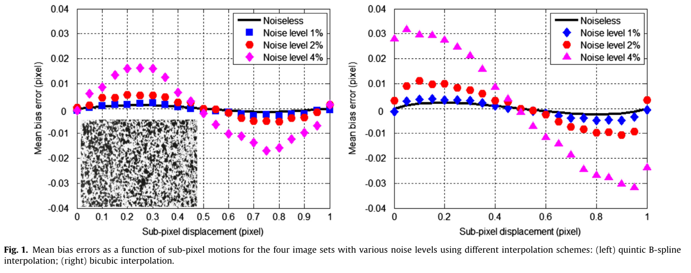
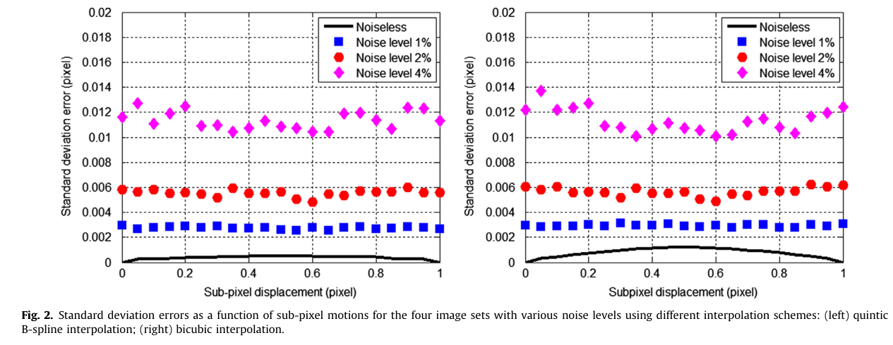
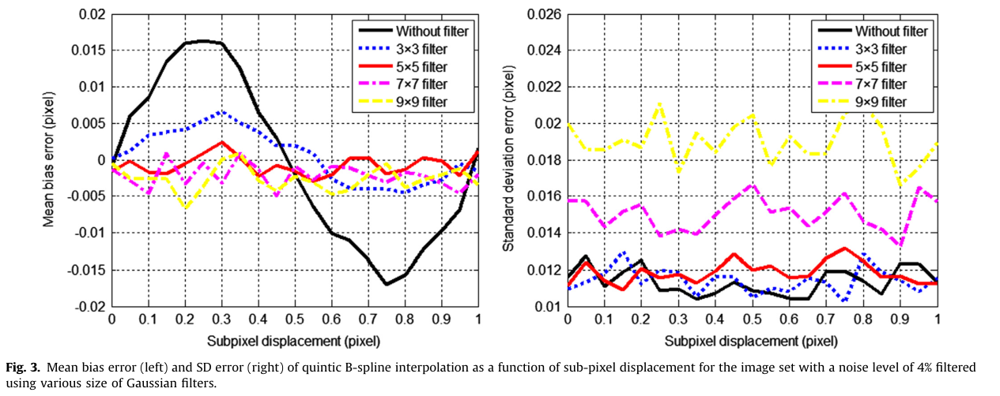
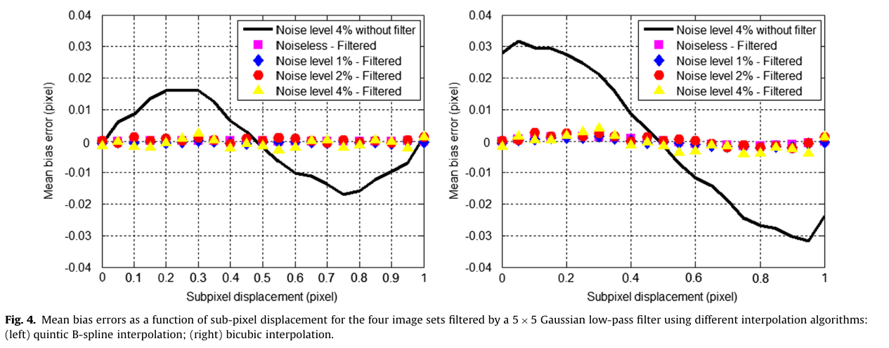
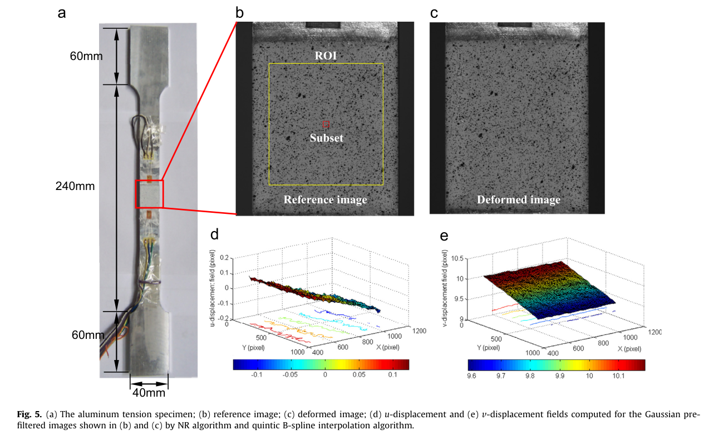
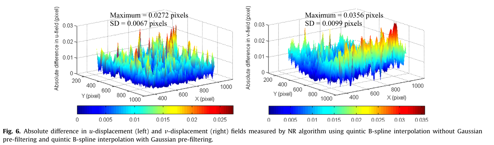
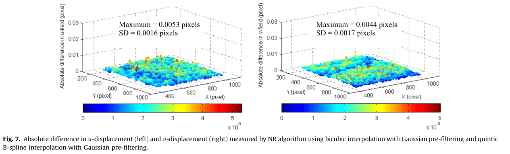

# 가우스 사전 필터링을 이용한 디지털 영상 상관의 편향 오차 저감 (Pan 2013)

- 원제: Bias error reduction of digital image correlation using Gaussian pre-filtering
- 저자: Bing Pan (Institute of Solid Mechanics, Beijing University of Aeronautics & Astronautics)
- 원문: 같은 폴더의 `Pan2013_OLE_gaussian_bias.pdf` (Optics and Lasers in Engineering 51 (2013) 1161–1167, doi:10.1016/j.optlaseng.2013.04.009)
- 번역 범위: 전문(초록, 1~5절, 표 1, 감사의 글). 참고문헌은 원문 그대로 옮겼다.
- 그림: 원문 그림 7개를 `그림/`에 넣고 본문에서 처음 언급되는 곳에 삽입했다.

논문 이력: 2013년 3월 7일 접수, 2013년 4월 15일 수정본 접수, 2013년 4월 15일 게재 승인, 2013년 5월 9일 온라인 공개.
주제어: 디지털 영상 상관(Digital image correlation), 편향 오차(Bias error), 부화소 변위(Sub-pixel displacement)

## 초록

디지털 영상 상관(DIC)에서는 정확한 부화소(sub-pixel) 변위 측정을 위해 고차 B-스플라인 보간 알고리즘을 쓰는 반복적 공간 영역 상호상관 알고리즘이 강력히 권장되어 왔다. 그러나 위치 의존 편향(bias) 오차의 크기는 잡음 수준이 커질수록 증가하며, 이는 실제 실험 영상에서 DIC의 정합(registration) 정확도를 크게 떨어뜨린다. 본 논문은 측정 변위의 편향 오차를 줄이기 위해, 상관 해석 전에 스페클 영상을 5×5화소 가우스 저역통과 필터로 미리 평활화하는 간단한 방법을 제안한다. 수치 모의실험과 실제 실험 모두에서, 단순한 쌍삼차(bicubic) 보간을 쓰더라도 제안 기법이 잡음 있는 영상과 잡음 없는 영상 모두에서 측정 변위의 편향 오차를 무시할 만한 수준으로 줄일 수 있음이 드러났다.
© 2013 Elsevier Ltd. All rights reserved.

## 1. 서론 (Introduction)

디지털 영상 상관(DIC)[1–5]은 실험역학 분야에서 전 시야(full-field) 운동·변형·형상 측정을 위한 가장 인기 있고 중요한 광학 기법 중 하나로 여겨져 왔다. 기준 영상의 기준 부분집합(subset)을 변형 영상의 대응 목표 부분집합과 정확히 정합함으로써, 전 시야 변위를 부화소 정확도로 직접 구할 수 있다. 전 시야 변형률 분포는 얻은 변위장을 적절한 수치 미분 방법[6,7]으로 미분하여 추가로 추정할 수 있다. 부분집합 기반 DIC의 기본 원리와 실제 구현은 간단하지만, 다양한 종류의 잡음(예: 카메라 잡음, 산탄(shot) 잡음, 양자화 잡음)으로 불가피하게 오염된 실제 실험 영상에서 부화소 변위 정합 정확도를 어떻게 높일지는 여전히 풀리지 않은 문제 중 하나다[8].

문헌에서, 고전적인 Newton–Raphson(NR)[9–12] 알고리즘으로 대표되는 반복적 공간 영역 상호상관 알고리즘은 기존 DIC 알고리즘 중 정합 정확도가 가장 높고 적용 범위가 가장 넓어 부화소 변위 측정의 표준(gold standard)으로 널리 인정받아 왔다. NR 알고리즘을 구현할 때는 목표 부분집합 안의 모든 변위된 화소의 부화소 위치에서 밝기와 밝기 도함수를 재구성하기 위해 보간 알고리즘을 써야 한다. 보간 알고리즘은 알고리즘의 정합 정확도에 직접 영향을 주므로 NR 알고리즘에서 결정적인 역할을 한다[13,14]. 널리 쓰이는 쌍삼차 보간과 B-스플라인 보간 계열 등 여러 보간 알고리즘이 NR 알고리즘에 사용되어 왔다. Schreier 등[13]과 Luu 등[14]이 정확히 제어된 부화소 변위를 가진 잡음 없는 스페클 패턴 영상으로 수행한 수치 실험은, 5차(quintic) B-스플라인 보간이 측정 변위에서 가장 높은 수준의 부화소 정합 정확도(즉 가장 작은 편향 오차)를 낸다는 것을 분명히 보였다.

그러나 기존 연구들에서, 실제 실험 영상에 불가피하게 존재하는 잡음의 영향은 충분히 고려되지 않았다. 알려진 대로 실제로 고차 B-스플라인 보간을 구현할 때는 보통 고역통과 필터 역할을 하는 사전 필터(pre-filter)가 들어가며, 이 때문에 5차 같은 고차 보간은 고주파 영상 잡음에 다소 민감하다. 기존 이론 해석은 무작위 잡음이 변위 추정에 편향 오차와 변동성(variability)을 모두 일으킬 수 있음을 보였다[15–18]. 그럼에도 이론 모델과 실험 결과는 모두, 더 큰 부분집합을 쓰면 추정 변위의 변동성은 효과적으로 줄일 수 있지만 편향 오차에는 거의 효과가 없음을 증명했다. 따라서 잡음 있는 영상에서 변위 추정의 편향 오차를 효과적으로 줄이는 방법은 DIC의 측정 정확도를 높이는 데 의미가 있다.

본 연구에서는 두 가지 대표 보간 알고리즘(5차 B-스플라인 보간과 쌍삼차 보간)에 대해 영상 잡음이 추정 변위에 주는 영향을 조사한다. 상관 해석 전에 기준 영상과 변형 영상을 모두 가우스 저역통과 필터로 미리 평활화하는, 간단하지만 효과적인 기법을 편향 오차가 줄어든 정확한 부화소 영상 정합을 위해 제시한다. 또한 커널 크기가 다른 가우스 저역통과 필터를 조사해 최적 커널을 찾는다. 끝으로 수치 실험과 실제 실험을 모두 수행해 제안 기법의 효과를 검증한다.

## 2. DIC 측정에서 무작위 잡음의 영향 (The effect of random noise of DIC measurements)

### 2.1. DIC 개요 (Brief introduction of DIC)

영상 기반 광학 계측법인 DIC 기법은 변형 전에 기록한 기준 영상과 변형 후에 기록한 일련의 변형(목표) 영상을 다룬다. 전 시야 변위를 구하기 위해, 고르게 배치된 격자점을 중심으로 하는 기준 정사각 부분집합들을 기준 영상에서 골라 변형 영상에서 각각의 위치를 추적한다. 조명의 오프셋(offset)과 배율(scale) 변화에 강건하므로[19,20], 기준 부분집합과 목표 부분집합의 유사도를 정량 평가하는 데 영평균 정규화 차제곱합(ZNSSD, zero-mean normalized sum of squared difference) 기준이 강력히 권장된다.

$$
C_{\mathrm{ZNSSD}}(\mathbf p)=\sum_{i=-M}^{M}\sum_{j=-M}^{M}\left[\frac{f(x_i,y_j)-f_m}{\sqrt{\sum_{i=-M}^{M}\sum_{j=-M}^{M}[f(x_i,y_j)-f_m]^2}}-\frac{g(x'_i,y'_j)-g_m}{\sqrt{\sum_{i=-M}^{M}\sum_{j=-M}^{M}[g(x'_i,y'_j)-g_m]^2}}\right]^2 \tag{1}
$$

여기서 $M$(화소 단위)은 부분집합의 반폭(half-width)이다. $\mathbf p=(u,u_x,u_y,v,v_x,v_y)^T$는 기준 부분집합에 대한 목표 부분집합의 모양과 위치를 나타내는, 구하려는 변형 벡터다. $f(x_i,y_j)$와 $g(x'_i,y'_j)$는 각각 기준 부분집합과 목표 부분집합의 좌표 $(x_i,y_j)$와 $(x'_i,y'_j)$에서의 회색조 밝기를 나타낸다. $f_m=1/(2M+1)^2\sum_{i=-M}^{M}\sum_{j=-M}^{M}[f(x_i,y_j)]$와 $g_m=1/(2M+1)^2\sum_{i=-M}^{M}\sum_{j=-M}^{M}[g(x'_i,y'_j)]$는 각각 기준 부분집합과 목표 부분집합의 평균 밝기값이다.

식 (1)에 정의한 상관 기준은 구하려는 변형 벡터에 대한 비선형 함수이며, 고전적 NR 알고리즘으로 풀어 각 부분집합 중심의 운동을 부화소 정확도로 구할 수 있다. 전 시야 변위 추적을 위한 NR 알고리즘의 원리와 효율적 구현에 관한 자세한 내용은 [12]에 잘 정리되어 있다.

### 2.2. 영상 잡음이 DIC 측정에 미치는 영향 (The influence of image noise on DIC measurements)

앞서 말했듯이, NR 알고리즘을 구현할 때는 정수가 아닌 각 위치 $(x_i',y_j')$에서 밝기와 밝기 도함수를 구하기 위해 보간 알고리즘을 써야 한다. 변형 영상을 정확히 재구성한다고 가정하면, 추정 변위의 기댓값은 편향이 없다(unbiased)[17]. 그러나 보간기의 불완전성과 피할 수 없는 고주파 무작위 잡음 때문에 편향 오차와 표준편차(SD) 오차가 모두 존재할 것으로 예상된다. 측정 변위의 SD 오차는 사용한 보간 알고리즘과 무관하며, 영상 잡음의 분산과 부분집합 밝기 기울기 제곱합(SSSIG, sum of squares of subset intensity gradient)의 함수임이 입증되었다[16]. 반면 NR 알고리즘의 편향 오차는 사용한 보간 알고리즘에 강하게 의존한다. 잡음 없는 영상에서는 5차 B-스플라인 보간을 쓰는 NR 알고리즘이 대체로 가장 작은 편향 오차를 낸다[13,14]. 그러나 뒤에서 보이겠지만 잡음 수준이 커지면 변위 추정의 편향 오차는 크게 증가한다. 이는 주로 고차 보간 알고리즘이 고주파 영상 잡음에 더 민감하여, NR 알고리즘이 필요로 하는 부화소 위치의 재구성 밝기와 밝기 도함수의 정확도가 떨어지기 때문이다.

NR 알고리즘으로 계산한 변위에 잡음이 주는 영향을 보이기 위해, 불완전한 촬영[21–23]과 하중[24]에서 오는 오차를 분리할 목적으로 네 세트의 스페클 패턴 영상으로 먼저 수치 모의실험을 수행했다. 첫 번째 영상 세트는 기준 스페클 패턴 하나와 그것을 수치적으로 평행이동한 영상 21장으로 이루어진다. 그림 1의 삽입 그림에 보인 기준 영상은 이전 실험에서 촬영한 실제 영상이다. 나머지 평행이동 영상 21장은 이동 정리(shift theorem)[13]에 따라 푸리에 영역에서 기준 영상에 적절한 이동을 가해 생성했다. 부화소 변위는 $x$ 방향으로 가했으며, 연속한 두 영상 사이의 이동 증분 0.05화소로 0에서 1화소까지 범위를 갖는다. 나머지 세 영상 세트는 첫 번째 영상 세트의 22장 영상 모두에 서로 다른 수준의 백색 가우스 잡음을 더해 생성했다. 더한 잡음 수준은 표준편차 기준으로 전체 256 회색조의 각각 1%, 2%, 4%다.

각 영상 세트에서, 평행이동된 각 스페클 패턴의 변위를 규칙적으로 분포한 2501개 점에서 부분집합 크기 31×31화소로 계산했다. 계산에는 NR 알고리즘과 서로 다른 두 보간 알고리즘을 써서 ZNSSD 상관 기준을 최소화했다. 계산된 부화소 변위는 다음과 같이 평균 편향 오차 $e_u$와 표준편차(SD) 오차 $\sigma_u$로 평가했다.

$$e_u=\bar u-u_{\mathrm{imp}} \tag{2}$$

$$\sigma_u=\sqrt{\frac{1}{N-1}\sum_{i=1}^{N}(u_i-\bar u)^2} \tag{3}$$

여기서 $\bar u=1/N\sum_{i=1}^{N}u_i$는 $N$(=2501)개 추정 변위의 평균이고, $u_{\mathrm{imp}}$는 정확히 부과한 부화소 변위를 나타낸다.

그림 1은 잡음 수준이 다른 네 영상 세트에 대해, 5차 B-스플라인 보간과 쌍삼차 보간 방식을 써서 측정한 변위의 평균 편향 오차를 보여 준다. 평균 편향 오차의 정현파 분포는 보간 오차 때문으로 볼 수 있다. 살펴보면 다음을 알 수 있다. (1) 모든 경우에서 5차 B-스플라인 보간이 쌍삼차 보간보다 우수하며, 5차 B-스플라인 보간의 편향 오차 크기는 쌍삼차 보간의 절반에 불과하다. 이 관찰은 참고문헌 [13,14]에 보고된 기존 결과와 잘 일치한다. (2) 무작위 잡음은 검출된 운동의 편향 오차에 큰 영향을 주며, 두 보간 알고리즘 모두에서 최대 편향 오차는 잡음 수준과 함께 증가한다. 구체적으로, 더한 잡음 수준이 1%에서 4%로 커질 때 최대 편향 오차는 두 보간 알고리즘에서 각각 0.0022화소에서 0.0163화소로, 0.0038화소에서 0.0317화소로 커진다. 여기에 보이지는 않았지만, 이런 종류의 주기적 편향 오차는 사용한 부분집합 크기와 무관하다는 점[11]을 언급할 가치가 있다. 즉 더 큰 부분집합을 계산에 써도 평균 편향 오차는 거의 같은 분포를 보인다.

*그림 1 — 여러 보간 방식을 쓸 때, 잡음 수준이 다른 네 영상 세트에 대한 부화소 운동의 함수로서 평균 편향 오차: (왼쪽) 5차 B-스플라인 보간, (오른쪽) 쌍삼차 보간.*

같은 두 보간 알고리즘으로 잡음 수준이 다른 네 영상 세트에 대해 추정한 변위의 SD 오차는 그림 2와 같다. 잡음 없는 영상에서는 쌍삼차 보간 알고리즘의 SD 오차가 5차 B-스플라인 보간보다 약간 큰 것이 분명하다. 그러나 잡음 수준이 다른 나머지 네 [역주: 원문 그대로. 잡음이 있는 영상 세트는 세 개다] 영상 세트에서는 두 보간 알고리즘 사이의 SD 오차 차이가 뚜렷하지 않다. 따라서 잡음을 불가피하게 포함하는 실제 실험 영상에서 NR 알고리즘의 SD 오차는 사용한 보간 알고리즘과 무관하다고 결론지을 수 있다. 이 경우 SD 오차를 최소화하는 데는 더 큰 부분집합을 쓰는 것이 더 효과적이다.

*그림 2 — 여러 보간 방식을 쓸 때, 잡음 수준이 다른 네 영상 세트에 대한 부화소 운동의 함수로서 표준편차 오차: (왼쪽) 5차 B-스플라인 보간, (오른쪽) 쌍삼차 보간.*

## 3. 가우스 사전 필터링을 이용한 DIC 편향 오차 저감 (Bias error reduction of DIC using Gaussian pre-filtering)

### 3.1. 여러 가우스 필터의 비교 (Comparison of various Gaussian filters)

가우스 평활화는 디지털 영상 처리의 여러 분야에서 영상의 고주파 성분(예: 잡음과 세부)을 제거하는 전처리 도구로 널리 쓰여 왔다[25,26]. 본 연구에서는 이 개념을 앞서 말한 잡음 문제에 대처하는 데 적용한다. 구체적으로, 상관 해석 전에 기준 스페클 영상과 변형 스페클 영상을 모두 가우스 저역통과 필터로 평활화한다. 수학적으로 가우스 저역통과 필터는 다음과 같이 표현된다.

$$g(x,y)=\frac{1}{2\pi\sigma^2}e^{-(x^2+y^2)/2\sigma^2} \tag{4}$$

여기서 $x$와 $y$는 각각 가로축과 세로축 방향으로 원점까지의 거리이고, $\sigma$는 가우스 함수의 표준편차다. 본 연구에서 가우스 필터의 크기($h$로 표기)는 $h=(4\sigma+1)\times(4\sigma+1)$로 정한다.

가우스 사전 필터링은 영상 잡음의 수준을 낮추므로, 영상 잡음에 의한 보간 오차도 그에 따라 줄어들 것으로 예상된다. 그 결과 NR 알고리즘의 편향 오차가 줄어들 것이다. 한편 가우스 필터를 적용하면 영상 세부(영상 기울기)도 줄어들어 각 부분집합의 SSSIG 값이 그만큼 감소한다. SSSIG에 반비례하는 NR 알고리즘의 SD 오차는 따라서 커질 것으로 예상된다. 편향 오차와 SD 오차 사이의 상충은 두 오차의 균형을 맞출 적절한 크기의 가우스 필터를 요구한다. 이 때문에, 먼저 가우스 필터 크기가 NR 알고리즘의 SD 오차에 주는 영향을 조사하여 최적 가우스 필터를 정한다.

### 3.2. 여러 가우스 필터의 비교 (Comparison of various Gaussian filters)

[역주: 3.1절과 3.2절의 제목이 원문에서 같다.]

최적 가우스 필터를 정하기 위해, 크기가 3×3화소에서 9×9화소까지 2화소씩 커지는 가우스 필터 네 개로 잡음 수준 4%인 네 번째 영상 세트의 모든 영상을 평활화했다. 그런 다음 필터링한 영상 세트를 NR 알고리즘과 5차 B-스플라인 보간[원문 오기 "B-splien interpolaiton"]으로 분석했다. 그림 3(a)는 가우스 저역통과 필터로 영상을 미리 평활화하면 편향 오차가 실제로 작아지며, 5×5, 7×7, 9×9 가우스 필터가 비슷한 편향 오차를 내고 이는 3×3 가우스 필터로 얻은 것보다 작다는 것을 보여 준다. 이는 너무 작은 가우스 필터는 영상 잡음을 억제하기에 충분하지 않음을 뜻한다. 한편 그림 3(b)에 보인 SD 오차는 더 큰 가우스 필터가 더 큰 SD 오차로 이어질 수 있음을 나타낸다. 예를 들어 9×9 가우스 필터로 얻은 SD 오차는 5×5 가우스 필터의 약 두 배다. 큰 가우스 필터가 큰 SD 오차를 만드는 이유는, 평활화된 영상에서 부분집합의 SSSIG 값이 줄어들고, 참고문헌 [16]이 보인 대로 SD 오차는 부분집합의 SSSIG 값에 반비례하기 때문이다. SD 오차만 보면 더 작은 가우스 필터(예: 3×3화소, 5×5화소)가 바람직하다. 전체적으로 볼 때, 5×5 가우스 저역통과 필터가 편향 오차를 줄이는 데 최적이라고 결론지을 수 있으며, 따라서 이후 시험에서 이를 사용한다.

*그림 3 — 여러 크기의 가우스 필터로 필터링한 잡음 수준 4% 영상 세트에 대해, 부화소 변위의 함수로서 5차 B-스플라인 보간의 평균 편향 오차(왼쪽)와 SD 오차(오른쪽).*

### 3.3. 가우스 사전 필터링이 측정 변위에 주는 영향 (Effects of Gaussian pre-filtering on measured displacements)

제안 기법의 효과를 더 조사하기 위해 네 영상 세트(잡음 없는 영상 세트와 잡음 있는 세 세트) 모두를 5×5 가우스 저역통과 필터로 미리 평활화했다. 이어서 필터링한 영상 세트를 같은 NR 알고리즘과 서로 다른 보간 방식으로 분석했다. 그림 4(a)와 (b)는 각각 5차 B-스플라인 보간과 쌍삼차 보간을 써서 추정한 부화소 변위의 평균 편향 오차를 보여 준다. 5×5 가우스 저역통과 필터로 영상을 미리 필터링하면, 잡음 있는 영상과 잡음 없는 영상 모두에서 측정 변위의 위치 의존 편향 오차를 무시할 만한 수준(0에 가까움)으로 줄일 수 있음을 관찰할 수 있다. 잡음 수준 4%인 영상 세트에서, NR 알고리즘과 5차 B-스플라인 보간을 쓴 최대 편향 오차는 0.01,629화소에서 0.00,235화소로 극적으로 줄었다. 더 단순한 쌍삼차 보간에서도 그림 4(b)처럼 평균 편향 오차가 비슷하게 뚜렷하게 줄었으며, 최대 편향 오차는 0.03,177화소에서 0.00,318화소로 크게 줄었다. [역주: 수치 표기 "0.01,629" 등은 원문 그대로다.]

*그림 4 — 5×5 가우스 저역통과 필터로 필터링한 네 영상 세트에 대해, 여러 보간 알고리즘을 쓸 때 부화소 변위의 함수로서 평균 편향 오차: (왼쪽) 5차 B-스플라인 보간, (오른쪽) 쌍삼차 보간.*

비교를 위해 표 1에, 사전 필터를 적용한 경우와 적용하지 않은 경우 네 영상 세트에 대한 5차 B-스플라인 보간과 쌍삼차 보간의 최대 편향 오차와 평균 SD 오차를 정리했다. 결과는 가우스 사전 필터링이 두 보간 알고리즘 모두에서 편향 오차를 줄이는 데 효과적이지만, SD 오차에는 거의 영향이 없음을 보여 준다. 단순한 쌍삼차 보간 알고리즘에서도 최대 편향 오차가 모두 0.005화소 미만임에 유의한다. 실제 측정에서 이렇게 0에 가까운 편향 오차는, 표 1에 나타낸 SD 오차와 비교하면 무시할 수 있다.

**표 1** 5×5 가우스 저역통과 필터를 적용한 경우와 적용하지 않은 경우, 네 영상 세트에 대한 5차 B-스플라인 보간과 쌍삼차 보간의 평균 편향 오차와 SD 오차. 빗금(/) 뒤의 데이터는 가우스 필터링 없이 얻은 것이다(단위: 화소). [역주: 제목은 "평균 편향 오차"이나 열 머리는 "최대 편향 오차"다. 원문 그대로 옮겼다. 굵은 글씨는 원문 표기.]

| 영상 세트(잡음 수준) | 5차 B-스플라인 보간: 최대 편향 오차 | 5차 B-스플라인 보간: 평균 SD 오차 | 쌍삼차 보간: 최대 편향 오차 | 쌍삼차 보간: 평균 SD 오차 |
|---|---|---|---|---|
| 0 | **0.00,011**/0.00,145 | 0.00,022/0.00,034 | **0.00,120**/0.00,243 | 0.00,034/0.00,056 |
| 1% | **0.00,018**/0.00,219 | 0.00,304/0.00,275 | **0.00,145**/0.00,379 | 0.00,312/0.00,293 |
| 2% | **0.00,128**/0.00,549 | 0.00,589/0.00,554 | **0.00,270**/0.01,116 | 0.00,596/0.00,566 |
| 4% | **0.00,235**/0.01,629 | 0.01,185/0.01,136 | **0.00,318**/0.03,177 | 0.01,199/0.01,135 |

## 4. 실험 검증 (Experimental verification)

실제 실험에서 제안한 편향 오차 저감 기법의 효과를 검증하기 위해, 알루미늄 시편의 단축[원문 "unaxial"] 인장 시험에서 얻은 그림 5(b)와 (c)의 영상을 처리했다. 인장 시편의 형상은 그림 5(a)와 같다. 기준 영상과 변형 영상은 각각 축 하중 1 kN과 5 kN에서 기록했다. 이 예에서 DIC 계산은 그림 5(b)처럼 기준 영상 중앙에 위치한 직사각형 관심 영역(ROI)에서 41×41화소 부분집합으로 수행했다. 본 연구에서는 세 가지 계산 방식을 사용했다. (1) 원본 영상을 NR 알고리즘과 5차 B-스플라인 보간 알고리즘으로 처리했다. (2) 원본 영상을 5×5 가우스 필터로 미리 필터링한 다음 NR 알고리즘과 쌍삼차 보간 알고리즘으로 분석했다. (3) 원본 영상을 5×5 가우스 필터로 미리 필터링한 다음 NR 알고리즘과 5차 B-스플라인 보간 알고리즘으로 분석했다. 실제 실험에서는 참 변위장을 정확히 알 수 없으므로, 가우스 사전 필터링한 영상에 대해 NR 알고리즘과 5차 B-스플라인 보간 알고리즘으로 측정한 변위를 그림 5(d)와 (e)처럼 기준(benchmark)으로 삼는다.

*그림 5 — (a) 알루미늄 인장 시편; (b) 기준 영상; (c) 변형 영상; (d) (b)와 (c)의 가우스 사전 필터링 영상에 대해 NR 알고리즘과 5차 B-스플라인 보간 알고리즘으로 계산한 $u$-변위장과 (e) $v$-변위장.*

영상에 가우스 사전 필터링을 적용하지 않은 경우와 적용한 경우, NR 알고리즘과 5차 B-스플라인 보간으로 측정한 $u$-, $v$-변위장의 절대 차이는 그림 6과 같으며, 두 측정 사이의 차이가 뚜렷이 보인다. $u$-, $v$-변위의 최대 절대 차이는 각각 0.0272화소와 0.0356화소였다. 이 결과는 5차 B-스플라인 보간을 쓰는 NR 알고리즘에 잡음이 주는 나쁜 영향을 분명히 보여 준다. 비교를 위해 그림 7은 가우스 사전 필터링과 쌍삼차 보간을 쓴 경우와 가우스 사전 필터링과 5차 B-스플라인 보간을 쓴 경우, NR 알고리즘으로 얻은 $u$-, $v$-변위장의 절대 차이를 보여 준다. 이제 $u$-, $v$-변위의 최대 절대 차이는 0.0053화소와 0.0044화소로 추정되어, 가우스 사전 필터링에 의한 편향 오차 감소가 상당함을 나타낸다. 일반적으로 이렇게 작은 차이는 무시할 수 있을 만큼 작다. 이 결과는 NR 알고리즘에 단순하고 구현하기 쉬운 쌍삼차 보간 알고리즘을 써도, 더 복잡한 5차 B-스플라인 보간으로 얻은 것과 거의 같은 측정을 얻을 수 있음을 보여 주므로 실용적으로 중요하다.

*그림 6 — 가우스 사전 필터링 없이 5차 B-스플라인 보간을 쓴 경우와 가우스 사전 필터링과 함께 5차 B-스플라인 보간을 쓴 경우, NR 알고리즘으로 측정한 $u$-변위장(왼쪽)과 $v$-변위장(오른쪽)의 절대 차이.*

*그림 7 — 가우스 사전 필터링과 쌍삼차 보간을 쓴 경우와 가우스 사전 필터링과 5차 B-스플라인 보간을 쓴 경우, NR 알고리즘으로 측정한 $u$-변위(왼쪽)와 $v$-변위(오른쪽)의 절대 차이.*

## 5. 결론 및 고찰 (Conclusion and discussion)

결론적으로, DIC의 부화소 정합 편향 오차를 줄이기 위해 상관 해석 전에 스페클 패턴을 가우스 저역통과 필터로 미리 필터링하는, 간단하지만 효과적인 방법을 제안했다. 필터와 관련된 SD 오차를 고려하여 커널 5×5화소인 최적 필터 크기를 얻었다. 변위와 잡음 수준을 제어한 스페클 패턴으로 한 수치 실험은 제안 방법이 DIC의 편향 오차를 무시할 만한 수준으로 줄일 수 있음을 성공적으로 보였다. 제안 기법의 효과를 더 보이기 위해 실제 실험 영상도 처리했다. 결과는 NR 알고리즘에 단순한 쌍삼차 보간 알고리즘을 쓰더라도 최대 편향 오차가 모두 0.005화소 미만임을 보여 준다. 이렇게 0에 가까운 계통 오차는 실제 측정에서도 무시할 수 있다. 이런 이유로, 제안한 전처리 기법을 쓰는 한, 정확한 변위 측정을 위해 NR 알고리즘에서 5차 B-스플라인 보간 대신 단순한 보간 계수 조회표(look-up table) 방식[12]으로 효율적으로 구현할 수 있는 쌍삼차 보간을 쓸 수 있다고 결론짓는다.

끝으로, 역 합성 정합(inverse compositional matching) 전략과 Gauss–Newton 알고리즘을 쓰는 새로운 반복 공간 영역 상호상관 알고리즘(IC-GN)[27]이 최근 제안되었음을 언급할 가치가 있다. 이 알고리즘은 본 연구에서 쓴, 전진 가산 정합(forward additive matching) 전략과 Newton–Raphson을 기반으로 한 고전적 반복 공간 영역 상호상관 알고리즘(FA-NR)과 등가이지만 더 효율적이다. 그러나 두 알고리즘은 보간을 다르게 사용한다. 구체적으로, IC-GN 알고리즘에서는 부화소 보간 알고리즘으로 부화소 밝기만 재구성하면 되는 반면, 고전적 FA-NR 알고리즘에서는 부화소 밝기와 밝기 기울기를 모두 추정해야 한다. 이 때문에 제안한 가우스 사전 필터링 기법이 IC-GN 알고리즘에 주는 영향은 분명히 더 깊이 조사할 필요가 있다. 또한 3D 내부 변위 측정을 위한 디지털 체적 상관(digital volume correlation) 방법에서도, 삼삼차(tricubic) 보간을 쓰는 반복 알고리즘이 주기적인 부복셀(sub-voxel) 위치 의존 편향 오차를 일으킨다[28]. 따라서 디지털 체적 상관의 편향 오차 저감을 위한 3D 가우스 필터의 가능성을 조사하는 추가 연구가 분명히 필요하다.

## 감사의 글 (Acknowledgements)

이 연구는 중국 국가자연과학기금(NSFC) 과제 번호 11002012, 11272032, 91216301과 대학 신세기 우수인재 프로그램(Program for New Century Excellent Talents in University) 과제 번호 NCET-12-0023의 지원을 받았다.

## 참고문헌

- [1] Pan B, Qian KM, Xie HM, Asundi A. Two-dimensional digital image correlation for in-plane displacement and strain measurement: a review. Meas Sci Technol 2009;20(6):062001.
- [2] Pan B. Recent progress in digital image correlation. Exp Mech 2011;51(7):1223–35.
- [3] Sutton MA, Orteu JJ, Schreier HW. Image correlation for shape, motion and deformation measurements. Springer; 2009.
- [4] Zhou YH, Chen YQ. Propagation function for accurate initialization and efficiency enhancement of digital image correlation. Opt Lasers Eng 2012;50(12):1789–97.
- [5] Genovese K, Casaletto L, Rayas JA, Flores V, Martinez A. Stereo-digital image correlation (DIC) measurements with a single camera using a biprism. Opt Lasers Eng 2013;51(3):279–85.
- [6] Pan B, Asundi A, Xie HM, Gao JX. Digital image correlation using iterative least squares and pointwise least squares for displacement field and strain field measurements. Opt Lasers Eng 2009;47(7-8):865–74.
- [7] Han YG, Kim DW, Kwon HJ. Application of digital image cross-correlation and smoothing function to the diagnosis of breast cancer. J Mech Behav Biomed Mater 2012;14:7–18.
- [8] Cheng P, Menq CH. Real-time continuous image registration enabling ultra-precise two-dimensional motion tracking. IEEE Trans Image Process 2013;22(6):2081–90.
- [9] Bruck HA, McNeil SR, Sutton MA, Peters WH. Digital image correlation using Newton–Raphson method of partial differential correction. Exp Mech 1989;29:261–7.
- [10] Vendroux G, Knauss WG. Submicron deformation field measurements: Part2. Improved digital image correlation. Exp Mech 1998;38(2):86–92.
- [11] Pan B, Xie HM, Xu BQ, Dai FL. Performance of sub-pixel registration algorithms in digital image correlation. Meas Sci Technol 2006;17(6):15–1621.
- [12] Pan B, Li K. A fast digital image correlation method for deformation measurement. Opt Lasers Eng 2011;49(7):841–7.
- [13] Schreier HW, Braasch JR, Sutton MA. Systematic errors in digital image correlation caused by intensity interpolation. Opt Eng 2000;39(11):2915–21.
- [14] Luu L, Wang Z, Vo M, Hoang T, Ma J. Accuracy enhancement of digital image correlation with B-spline interpolation. Opt Lett 2011;36:3070–2.
- [15] Wang ZY, Li HQ, Tong JW, Ruan JT. Statistical analysis of the effect of intensity pattern noise on the displacement measurement precision of digital image correlation using self-correlated images. Exp Mech 2007;47:701–7.
- [16] Pan B, Xie HM, Wang ZY, Qian KM, Wang ZY. Study of subset size selection in digital image correlation for speckle patterns. Opt Express 2008;16(10):7037–48.
- [17] Wang YQ, Sutton MA, Bruch HA, Schreier HW. Quantitative error assessment in pattern matching: effects of intensity pattern noise, interpolation, strain and image contrast on motion measurement. Strain 2009;45:160–78.
- [18] Tong W. Sub-pixel image registration with reduced bias. Opt Lett 2011;36:763–5.
- [19] Tong W. An evaluation of digital image correlation criteria for strain mapping applications. Strain 2005;41(4):167–75.
- [20] Pan B, Xie HM, Wang ZY. Equivalence of digital image correlation criteria for pattern matching. Appl Opt 2010;49(28):5501–9.
- [21] Yoneyama S, Kikuta H, Kitagawa A, Kitamura K. Lens distortion correction for digital image correlation by measuring rigid body displacement. Opt Eng 2006;45(2):023602.
- [22] Pan B, Yu LP, Dafang Wu Liqun Tang. Systematic errors in two-dimensional digital image correlation due to lens distortion. Opt Lasers Eng 2013;51(2):140–7.
- [23] Ma SP, Pang JZ, Ma QW. The systematic error in digital image correlation induced by self-heating of a digital camera. Meas Sci Technol 2011;23:025403.
- [24] Sutton MA, Yan JH, Tiwari V, Schreier WH, Orteu JJ. The effect of out-of-plane motion on 2D and 3D digital image correlation measurements. Opt Lasers Eng 2008;46:746–57.
- [25] Nixon MS, Aguado AS. Feature extraction and image processing. Academic Press; 2008.
- [26] 〈http://en.wikipedia.org/wiki/Gaussian_blur〉.
- [27] Pan, B, Li, K, Fast, Tong W., Robust and accurate digital image correlation calculation without redundant computations[J]. Exp Mech http://dx.doi.org/10.1007/s11340-013-9717-6.
- [28] Pan B, Wu DF, Wang ZY. Internal displacement and strain measurement using digital volume correlation: a least squares framework. Meas Sci Technol 2012;23:045002.
