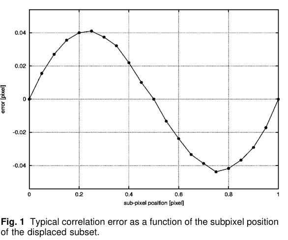
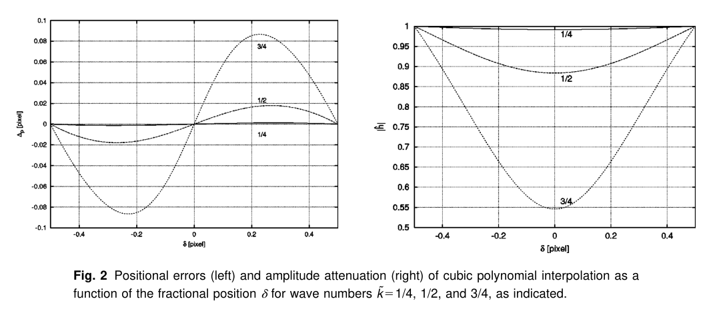
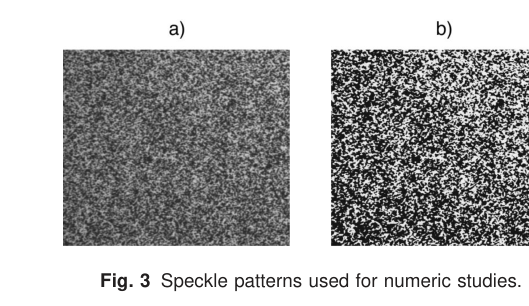
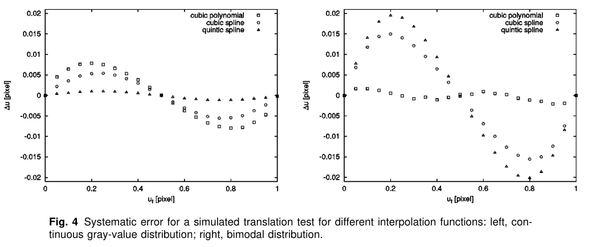
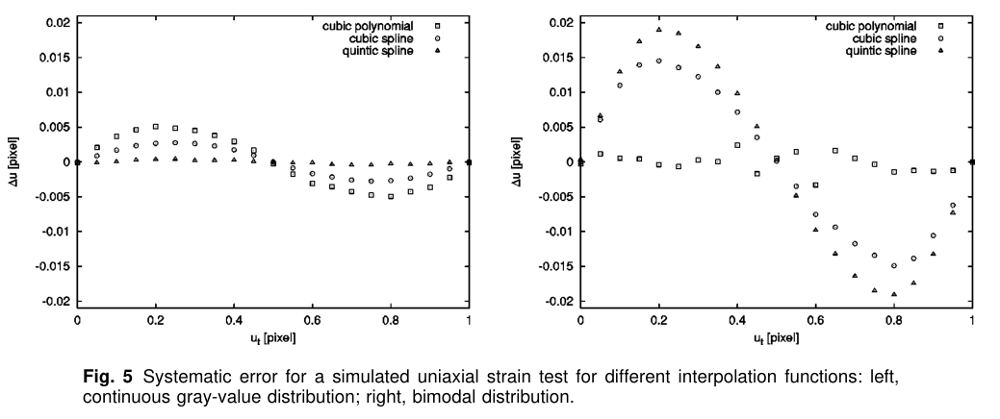
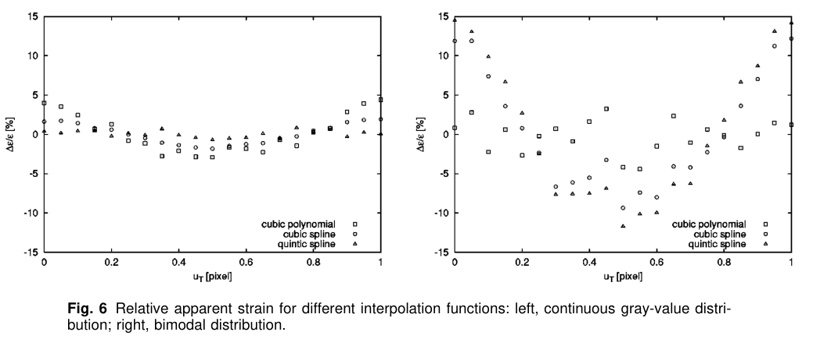
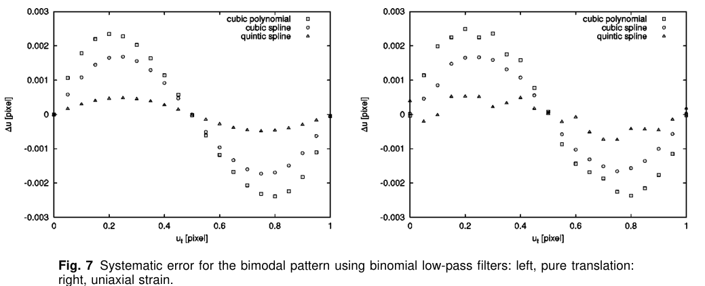

# 밝기 보간이 일으키는 디지털 영상 상관법의 계통 오차 (Schreier 2000)

- 원제: Systematic errors in digital image correlation caused by intensity interpolation
- 저자: Hubert W. Schreier, Joachim R. Braasch, Michael A. Sutton (University of South Carolina, 기계공학과)
- 원문: 같은 폴더의 `Schreier2000_OptEng_interpolation_bias.pdf` (Optical Engineering 39(11), 2915–2921, 2000년 11월)
- 번역 범위: 전문(초록, 1~6절, 감사의 글, 저자 소개). 참고문헌은 원문 그대로 옮겼다.
- 그림: 원문 그림 7개를 `그림/`에 넣고 본문에서 처음 언급되는 곳에 삽입했다(저자 사진은 제외).

## 초록

최근 표면 변형 측정 도구로서 디지털 영상 상관법(digital image correlation)이 실험역학 분야에서 널리 쓰이고 받아들여졌다. 이 방법은 영상 품질, 잡음, 선택한 상관 알고리즘 등 여러 요인에 따라 달라지는 부화소(subpixel) 정확도로 변위를 복원하는 것으로 알려져 있다. 그러나 이 방법의 계통 오차(systematic error)는 자세히 연구되지 않았다. 본 논문은 반복적 공간 영역 상호상관(cross-correlation) 알고리즘에서 회색값 보간(gray-value interpolation)이 일으키는 계통 오차를 다룬다. 위치에 따라 달라지는 편향(bias)을 수치 연구로 조사하고, 그 편향이 실제 변형률 수준의 40% 정도에 이르는 겉보기 변형률(apparent strain)을 낳을 수 있음을 보인다. 또한 이 편향을 허용할 만한 수준으로 줄이는 방법을 제시한다. © 2000 Society of Photo-Optical Instrumentation Engineers. [S0091-3286(00)00911-9]

주제어: 영상 상관; 편향; 계통 오차; 위상 오차; 보간.

논문 990442, 1999년 11월 8일 접수; 수정본 2000년 6월 2일 접수; 2000년 6월 7일 게재 승인.

## 1 서론 (Introduction)

우리의 여러 실험에서, 반복 상호상관 알고리즘[1]이 변위된 부분집합(subset)의 부화소 위치에 따라 달라지는 계통 오차를 만든다는 것이 관찰되었다. 이 오차는 순수 평행이동(translation) 시험에서도, 변형된 시편에서도 관찰되었다. 오랫동안 이 오차는 설명되지 않았고, 최근에야 상호상관 알고리즘에 쓰인 보간 방법에서 비롯된 것으로 밝혀졌다[2]. 계통 변위 오차와 변위된 부분집합의 부화소 위치 사이의 전형적 관계를 보여 주는 그래프가 그림 1이다. 오차는 정수 위치와 중간점(midpoint) 위치에서 0임을 볼 수 있다. $x$ 방향으로 균일하게 변형된 시편에서

$$u(x)=\varepsilon x, \tag{1}$$

이 편향이 일으키는 상대 겉보기 변형률은 다음과 같다.

$$\frac{\Delta\varepsilon}{\varepsilon}=\frac{\partial \Delta u}{\partial(\varepsilon x)}=\frac{\partial \Delta u}{\partial u}, \tag{2}$$

여기서 $\Delta u$는 그림 1의 세로축, $\varepsilon x = u$는 가로축에 해당한다. 따라서 상대 겉보기 변형률은 오차 함수의 기울기로 주어지며, 그림의 경우 실제 변형률 수준의 약 20%에 이르는 최대 상대 겉보기 변형률을 예상할 수 있다. 이는 변형률 측정에 상호상관을 쓰는 것의 유용성을 제한한다.

*그림 1 — 변위된 부분집합의 부화소 위치에 따른 전형적인 상관 오차.*

## 2 보간 오차 (Interpolation Errors)

위치 의존 편향의 원인은 반복 상호상관 알고리즘에 쓰이는 보간기(interpolator)의 성질에 있다. 부화소 정확도를 얻으려면 상호상관 계수(또는 회색값 차의 제곱 같은 다른 정합 기준)를 정수가 아닌 위치에서 계산해야 한다. 따라서 회색값과 회색값 도함수를 보간해야 한다. 가장 흔히 쓰이는 보간기, 즉 다항식 보간기와 B-스플라인 보간기는 부화소 위치와 신호의 파수(wave number)에 따라 신호의 진폭과 위상을 모두 바꾼다는 것이 잘 알려져 있다[3]. 전달 함수(transfer function)가 $\hat h(\tilde k,\delta)$인 선형·이동불변(shift-invariant) 보간 필터에서, 위상 오차 $\Delta\phi$는 이동 정리(shift theorem)에 따라 위치 이동 $\delta$가 일으키는 선형 위상 이동 $\delta\pi\tilde k$를 빼서 계산할 수 있다.

$$\Delta\phi=\arctan\left(\frac{\operatorname{Im}\hat h(\tilde k,\delta)}{\operatorname{Re}\hat h(\tilde k,\delta)}\right)-\delta\pi\tilde k, \tag{3}$$

여기서 $\tilde k$는 정규화 파수를 뜻한다. 위상 이동 $\Delta\phi$에 해당하는 위치 오차 $\Delta_p$는 다음과 같다.

$$\Delta_p=\lambda\,\Delta\phi/2\pi=\Delta\phi/\pi\tilde k. \tag{4}$$

예로, 3차 다항식 보간기는 다음 커널을 갖는 합성곱 연산자로 나타낼 수 있다.

$$[h_0,h_1,h_2,h_3], \tag{5}$$

여기서

$$
\begin{aligned}
h_0&=+\tfrac14\delta^2-\tfrac1{16}+\tfrac1{24}\delta-\tfrac16\delta^3,\\
h_1&=-\tfrac14\delta^2+\tfrac9{16}-\tfrac98\delta+\tfrac12\delta^3,\\
h_2&=-\tfrac14\delta^2+\tfrac9{16}+\tfrac98\delta-\tfrac12\delta^3,\\
h_3&=+\tfrac14\delta^2-\tfrac1{16}-\tfrac1{24}\delta+\tfrac16\delta^3.
\end{aligned}\tag{6}
$$

여기서 다항식은 짝수 부분과 홀수 부분으로 묶었고, $\delta$는 대칭성을 위해 표본 사이 중간점에서 잰 부화소 위치를 나타낸다. 계수의 대칭성을 이용하면 해당 전달 함수를 쉽게 구할 수 있다.

$$
\hat h_c(\tilde k,\delta)=\left(-\tfrac12\delta^2+\tfrac98\right)\cos\left(\tfrac12\pi\tilde k\right)+\left(\tfrac12\delta^2-\tfrac18\right)\cos\left(\tfrac32\pi\tilde k\right)
+i\left[\left(\tfrac94\delta-\delta^3\right)\sin\left(\tfrac12\pi\tilde k\right)-\left(\tfrac1{12}\delta-\tfrac13\delta^3\right)\sin\left(\tfrac32\pi\tilde k\right)\right]. \tag{7}
$$

식 (3)과 (4)를 이용하면, 부화소 위치와 파수의 함수로서 위치 오차는 다음과 같다.

$$
\Delta_p(\tilde k,\delta)=\frac{1}{\pi\tilde k}\arctan
\frac{(9/4\,\delta-\delta^3)\sin(1/2\,\pi\tilde k)-(1/12\,\delta-1/3\,\delta^3)\sin(3/2\,\pi\tilde k)}
{(-1/2\,\delta^2+9/8)\cos(1/2\,\pi\tilde k)+(1/2\,\delta^2-1/8)\cos(3/2\,\pi\tilde k)}-\delta. \tag{8}
$$

위치 오차 $\Delta_p$와 진폭 감쇠 $|\hat h|$를 부분 위치(fractional position) $\delta$와 파수 $\tilde k$의 함수로 그림 2에 나타냈다. 정수 위치 $\delta=1/2$와 $\delta=-1/2$에서는 두 오차가 모두 사라진다. 중간점 $\delta=0$에서는 대칭성 때문에 위치 오차가 0이지만 진폭 오차는 가장 크다. 그림 2에 보인 오차의 일반적인 모양은 모든 다항식 및 B-스플라인 보간기에서 같으며, 오차의 크기만 달라진다는 점에 유의한다.

*그림 2 — 파수 $\tilde k$=1/4, 1/2, 3/4(그림에 표시)에 대해, 부분 위치 $\delta$의 함수로 나타낸 3차 다항식 보간의 위치 오차(왼쪽)와 진폭 감쇠(오른쪽).*

위치 보간 오차가 부화소 복원에 미치는 영향은 오차가 주파수에 따라 달라지므로 예측하기 어렵다. 그러나 두 단색파(monochromatic wave) 사이의 변위를 복원하는 경우라면 그 영향을 쉽게 상상할 수 있다. 상호상관 정합 기준은 배율(scale)에 둔감하므로 보간의 진폭 감쇠는 영향을 주지 않는다. 최대 상관은 원래 파와, 변위된 사본에서 보간한 파의 위상이 같을 때 일어난다. 측정 변위 $u^*$에 위치 오차 $\Delta_p(u^*)$를 더한 값이 참 변위 $u_T$와 같을 때가 그렇다. 따라서 복원 오차 $\Delta u=u^*-u_T$는 다음과 같다.

$$\Delta u=-\Delta_p(u^*). \tag{9}$$

참 변위 $u_T$의 함수로서 오차를 1차 근사하면 $\Delta_p(u^*)\approx\Delta_p(u_T)$로 둘 수 있고, 복원 오차는 보간 오차의 음수가 된다.

## 3 수치 연구 (Numerical Studies)

상호상관 결과의 계통 오차는 스페클 패턴(speckle pattern)의 주파수 성분, 사용한 보간기의 진폭 감쇠와 위상 오차 등 많은 요인의 영향을 받으므로 오차를 해석적으로 예측하기는 쉽지 않다. 그래서 여러 스페클 패턴과 보간 방법으로 수치 연구를 수행했다.

사용한 상관 알고리즘은 상호상관 계수 $r$의 최대값을 찾는 반복 탐색 알고리즘에 기반한다. 간단히, $x,y$ 좌표계의 원점이 첫 번째 영상 $f(x,y)$ 안 $(N+1)\times(N+1)$ 부분집합의 중심 화소에 있다고 하자($N$은 짝수). 두 번째 영상 $g(x,y)$에서 대응하는 부분집합을 찾기 위해 상호상관 계수

$$
r=\frac{\sum_{y=-N/2}^{y=N/2}\sum_{x=-N/2}^{x=N/2} f(x,y)\;g(\xi(x,y,\mathbf s),\eta(x,y,\mathbf s))}
{\left\{\sum_{y=-N/2}^{y=N/2}\sum_{x=-N/2}^{x=N/2} f^2(x,y)\;\sum_{y=-N/2}^{y=N/2}\sum_{x=-N/2}^{x=N/2} g^2[\xi(x,y,\mathbf s),\eta(x,y,\mathbf s)]\right\}^{1/2}} \tag{10}
$$

을 정의한다. 이 식에서 $\mathbf s$는 첫 번째 영상 부분집합의 좌표를 두 번째 영상의 대응 좌표와 연결하는 매개변수 벡터이며, 그 관계는 다음과 같다.

$$\xi(x,y,\mathbf s)=s_1+s_2x+s_3y, \tag{11}$$

$$\eta(x,y,\mathbf s)=s_4+s_5x+s_6y. \tag{12}$$

매개변수 $s_1$과 $s_4$는 각각 부분집합 중심 사이의 $u$, $v$ 변위 성분을 나타내고, 나머지 매개변수는 아핀(affine) 변환을 허용한다. 식 (10)을 최대화하는 매개변수 벡터 $\mathbf s_{\max}$를 찾기 위해, 상관 피크 부근의 점 $\bar{\mathbf s}$에서 상호상관 계수를 2차 테일러 다항식으로 전개한다. 테일러 다항식이 정확하다고 가정하면 최대값은 다음으로 구할 수 있다.

$$\mathbf s_{\max}=\bar{\mathbf s}+\Delta\bar{\mathbf s}, \tag{13}$$

여기서 $\Delta\bar{\mathbf s}$는 다음에서 얻는다.

$$
\begin{bmatrix}
r_{11}&r_{12}&r_{13}&r_{14}&r_{15}&r_{16}\\
\cdots&r_{22}&r_{23}&r_{24}&r_{25}&r_{26}\\
\cdots&\cdots&r_{33}&r_{34}&r_{35}&r_{36}\\
\cdots&\cdots&\cdots&r_{44}&r_{45}&r_{46}\\
\cdots&\cdots&\cdots&\cdots&r_{55}&r_{56}\\
\cdots&\cdots&\cdots&\cdots&\cdots&r_{66}
\end{bmatrix}
\begin{pmatrix}\Delta s_1\\ \Delta s_2\\ \Delta s_3\\ \Delta s_4\\ \Delta s_5\\ \Delta s_6\end{pmatrix}
=-\begin{pmatrix}r_1\\ r_2\\ r_3\\ r_4\\ r_5\\ r_6\end{pmatrix}. \tag{14}
$$

여기서 $r_i$는 $\partial r/\partial s_i|_{\bar{\mathbf s}}$, $r_{ij}$는 $\partial^2 r/\partial s_i\partial s_j|_{\bar{\mathbf s}}$를 뜻한다. 식 (13)과 (14)를 Levenberg-Marquardt 알고리즘에서 사용해 $\mathbf s_{\max}$를 반복적으로 찾는다[4]. 모든 수치 연구에는 "Vic2D" 프로그램을 사용했다[5].

수치 연구에 쓴 스페클 영상은 이전의 여러 실험에서 취했다. 보간의 영향을 분리하기 위해, 평행이동되거나 늘어난 영상을 스페클 영상으로부터 수치적으로 생성했다. 물론 생성된 영상 자체에 보간 편향이 있어서는 안 된다. 따라서 이동 정리에 따라 푸리에 영역에서 적절한 이동을 가해 영상을 얻었다. 주어진 부화소 변위 $\Delta x$에 대해, 신호를 $-\Delta x$만큼 이동시켜 구하려는 값을 정수 위치로 가져옴으로써 보간값을 계산할 수 있다. 이동은 푸리에 필터 $\exp(i\Delta x\pi\tilde k)$로 수행할 수 있어서 이동된 신호의 위상이나 진폭이 손상되지 않는다.

*그림 3 — 수치 연구에 쓴 스페클 패턴.*

## 4 결과 (Results)

선형 보간으로 한 초기 연구에서는 위상 오차 때문에 40%를 넘는 상대 겉보기 변형률 오차가 생길 수 있음이 드러났다. 선형 보간은 파장 4화소인 주기 구조에서 최대 약 1/20화소, 파장 3화소에서 0.13화소의 위치 오차를 일으키므로[3] 이는 놀라운 일이 아니다. 이 오차 크기는 분명히 받아들일 수 없으므로, 이후의 모든 조사는 3차 다항식, 3차 B-스플라인, 5차(quintic) B-스플라인 보간으로 한정했다.

많은 수의 서로 다른 스페클 패턴에 대해 광범위한 연구를 수행했다. 회색값 분포가 쌍봉(bimodal)인 스페클 패턴이 가장 큰 오차를 만들고, 균일 분포인 패턴은 오차가 훨씬 작다는 결과가 일관되게 나왔다. 이는 높은 파수 쪽으로 갈수록 보간 오차가 커지는 데서 쉽게 설명된다. 회색값 분포가 주파수 성분의 정확한 척도는 아니지만, 흰 배경 위의 사실상 검은 스페클로 된 쌍봉 분포(또는 그 반대)가 흑과 백 사이를 부드럽게 넘어가는 영상보다 높은 파수 대역에 더 많은 에너지를 갖는 것은 분명하다. 제시할 데이터의 양을 줄이기 위해 두 스페클 패턴을 골랐다. 그림 3(a)의 스페클 패턴은 조사한 모든 패턴 중 오차가 가장 작았다. 이 영상은 연속적으로 변하는 밝기 패턴에 가깝고 회색값 분포가 균일하다. 두 번째 영상은 회색값의 아래쪽 절반을 가장 아래 4분위로, 위쪽 절반을 가장 위 4분위로 사상하여 쌍봉 회색값 분포를 만든 것이다[그림 3(b) 참조]. 이렇게 만든 영상의 결과를 택한 것은, 실제 실험에서 얻은 영상에서 생긴 오차의 상한으로 볼 수 있기 때문이다. 또한 두 영상의 특성, 특히 스페클 크기와 방향은 비슷하다.

### 4.1 평행이동 (Translation)

먼저 평행이동된 일련의 스페클 영상을 조사했다. 이동된 영상은 푸리에 필터 $\exp(-i\pi n\Delta x)$를 적용해 계산했다. 여기서 $n$은 영상 번호이고 $\Delta x$는 연속한 영상 사이의 이동 증분이다. 이런 방식으로 연속한 영상 사이 이동이 0.05화소인 영상 20장을 생성했다. 그런 다음 앞 절에서 설명한 반복 상호상관 알고리즘으로 영상을 분석했다. 변위는 각 영상마다 1000개 점에서 부분집합 크기 31×31화소로 계산했다. 그림 4는 참 부화소 변위의 함수로서 상관 오차를 보여 준다. 왼쪽은 연속 회색값 분포 영상, 오른쪽은 쌍봉 영상이다. 직관적으로 예상하듯이 연속 영상에서는 5차 스플라인 보간이 가장 작은 오차를 내지만, 쌍봉 회색값 분포에서는 다른 보간기보다 오차가 크다. 이처럼 다소 직관에 반하는 결과는 정합 과정에서 위상 오차와 진폭 감쇠가 모두 중요함을 분명히 보여 준다. 5차 스플라인 보간기는 주어진 파수에서 위상 오차가 더 작지만, 진폭 감쇠가 적어서 낮은 차수의 보간만큼 높은 파수를 걸러 내지 못하므로 더 나쁜 결과를 낼 수 있다. 쌍봉 영상에서는 3차 다항식 보간이 가장 작은 오차를 보인다. 쌍봉의 경우 반복 최소화 과정이 약간 불안정해지며, 반복 횟수가 연속 영상의 약 세 배가 된다. 이 경우 연속 회색값 분포에서 나타난 뚜렷한 계통 오차 대신 평균하면 상쇄되는 더 큰 무작위 오차가 생긴다. 이 불안정은 상호상관 계수의 2차 도함수 오차 때문으로 볼 수 있는데, 효율성 때문에 2차 도함수는 1차 회색값 도함수만으로 근사한다.

*그림 4 — 여러 보간 함수에 대한 모의 평행이동 시험의 계통 오차: 왼쪽, 연속 회색값 분포; 오른쪽, 쌍봉 분포.*

### 4.2 변형률 (Strain)

두 번째 시험으로, 균일하지 않은 변위장이 계통 오차에 어떤 영향을 주는지 조사하기 위해 변형된 영상을 생성했다. 생성한 영상은 수평 방향으로 0.005의 균일 변형률을 가졌다. 0~1화소 사이를 0.05화소 간격으로 부분집합 변위에 대응하는 영상의 21개 열을 상관 프로그램으로 분석했다. 참 변위가 영상의 세로선을 따라 일정하므로 세로 방향으로 평균을 냈다. 각 부화소 변위마다 450개 이상의 데이터 점이 있어, 총 9450개 점을 분석했다. 그림 5는 참 부화소 변위에 대한 복원 변위의 평균 오차를 보여 준다. 연속 회색값 분포와 쌍봉 회색값 분포 모두에서 오차는 균일 변위일 때와 같은 수준이다. 앞서 지적한 불안정이 3차 다항식 보간과 쌍봉 패턴에서 똑같이 나타났다.

*그림 5 — 여러 보간 함수에 대한 모의 단축(uniaxial) 변형률 시험의 계통 오차: 왼쪽, 연속 회색값 분포; 오른쪽, 쌍봉 분포.*

서론에서 말했듯이, 편향이 일으키는 상대 겉보기 변형률 오차는 그림 5의 오차 그래프 기울기로 주어진다. 그림 6은 변위 오차를 수치 미분해 얻은 상대 겉보기 변형률을 보여 준다. 연속 패턴에서는 3차 다항식 보간에서 4% 정도의 오차가 생기고, 쌍봉 패턴에서는 5차 스플라인 보간이 15% 정도의 오차를 만든다.

*그림 6 — 여러 보간 함수에 대한 상대 겉보기 변형률: 왼쪽, 연속 회색값 분포; 오른쪽, 쌍봉 분포.*

0.02~5% 범위의 여러 변형률 수준에서 비슷한 시험을 수행했다. 오차는 변형률 수준에 따라 극적인 변화를 보이지 않았다. 높은 변형률 쪽에서만 오차가 약간 줄어드는 것이 관찰되었다.

### 4.3 오차 저감 (Error Reduction)

보간 오차는 파수 $\tilde k$와 함께 커지므로, 저역통과 필터(low-pass filter)로 스페클 영상의 고주파 성분을 줄이면 계통 오차를 줄일 수 있다. 처음 보면 이 절차는 상관에 바람직한 정보량을 줄이는 것처럼 보인다. 상호상관 알고리즘은 검은 스페클과 흰 스페클 사이의 뚜렷한 경계에 의존할 것이라 예상할 수 있는데, 저역통과 필터는 이 경계를 흐리게 만든다. 그러나 흔한 스페클 패턴의 성질상 저주파 대역의 정보량은 매우 많고 정확한 정합에 충분하다. 저역통과 필터를 적용하는 것은 높은 파수가 상관 결과에 주는 잘못된 기여를 줄이는 가중 함수로 생각할 수 있다. 필터 차단 주파수가 변위 함수의 주파수 대역과 충분히 떨어져 있는 한, 이 절차는 공간 분해능에 영향을 주지 않는다. 그림 7은 상관 전에 이항(binomial) [0.25, 0.5, 0.25] 저역통과 필터를 적용한, 평행이동 및 변형된 쌍봉 스페클 패턴의 상관 오차를 보여 준다. 스플라인 보간의 오차 감소가 크며, 5차 스플라인 보간은 3차 스플라인 보간보다 약 다섯 배 작은 오차를 보인다. 이 경우 3차 보간은 안정적이므로 알고리즘이 편향된 위치로 수렴하고 계통 오차가 뚜렷하다.

*그림 7 — 이항 저역통과 필터를 쓴 쌍봉 패턴의 계통 오차: 왼쪽, 순수 평행이동; 오른쪽, 단축 변형률.*

변형된 쌍봉 스페클 패턴에서 얻은 그림 7 오른쪽 그래프에서, 상대 겉보기 변형률 오차는 보인 오차 곡선의 기울기로 주어진다. 따라서 오차 감소는 변위 오차에 한정되지 않고 변형률 오차도 크게 줄인다. 5차 스플라인 보간에서, 변위 오차를 수치 미분해 얻은 상대 겉보기 변형률 오차는 연구한 모든 경우에 2% 미만이었다.

### 4.4 수렴과 속도 (Convergence and Speed)

공간 영역에서 상관 피크를 탐색하는 상호상관 알고리즘은 흔히 푸리에 영역 방법[6]에 비해 매우 느리다고 여겨진다. 이는 주로 조대-정밀(coarse-to-fine) 탐색 전략을 쓰던 초기 구현[7] 때문인데, 이 전략은 이후 Newton-Raphson이나 Levenberg-Marquardt 방법으로 대체되었다[8]. 푸리에 처리가 예전의 공간 조대-정밀 탐색 방법보다 빠르긴 하지만, 푸리에 방법도 보간에 의존하는 공간 영역 방법과 비슷한 계통 오차를 보인다는 점에 유의해야 한다[9]. 이 편향은 정수 화소 위치에서 표본화된 상호상관 함수로부터 피크 위치의 부화소 추정값을 얻는 데 쓰는 피크 추정기(peak estimator) 때문에 생긴다.

Levenberg-Marquardt 탐색 방법을 쓰면 공간 영역 알고리즘의 속도는 적어도 푸리에 방법과 견줄 만해졌다. 이는 상호상관 함수를 계산해야 하는 점의 수가 줄었기 때문이다. 대개 평균 반복 횟수는 잡음, 변형률, 회전, 그리고 매우 중요하게는 사용한 보간 방법 같은 요인에 따라 2회에서 5회 사이다. 언뜻 보면 선형 보간이 가장 빠른 선택처럼 보인다. 회색값 하나를 보간하는 데 곱셈이 4번이면 되는 반면, 3차 방식은 20번이 필요하다. 그러나 탐색 알고리즘은 선형 보간보다 3차 보간에서 훨씬 빨리 수렴하며, 대부분의 경우 보간에 쓰인 추가 곱셈을 상쇄한다. 또한 상호상관 계수의 도함수를 계산하는 것은 회색값 보간과 미분보다 시간이 더 걸리며, 보간 방법과는 전혀 무관하다. 5차 보간은 3차 보간보다 곱셈이 두 배 넘게 필요하지만, 반복 횟수가 거의 같아서 속도 저하는 평균 약 20%에 불과하다. 변위를 계산하는 점의 수는 대개 적어도 수백 개 정도이므로, 스플라인 변환에 드는 추가 계산 시간은 무시할 만하다. Unser 등의 연구[10,11] 덕분에 스플라인 변환을 매우 효율적으로 구현할 수 있기 때문이다. 이항 저역통과 필터의 추가 계산 비용에도 같은 논리가 적용된다.

요약하면, 3차 및 5차 스플라인 보간은 수렴이 더 좋고 위상 오차가 더 작으므로 다항식 보간보다 바람직하다. 이 이점은 사실상 추가 계산 비용 없이 얻어진다. 매우 적은 점만 계산하고 속도 요구가 중요할 때, 예를 들어 온라인 검사 시스템에서만 3차 다항식 보간이 유리할 수 있다.

## 5 고찰 (Discussion)

계통 오차의 영향을 더 보여 주고 작은 변형률 측정에 대한 이 방법의 잠재력을 파악하기 위해 다음 예를 조사했다. 위에서 설명한 방법에 따라, 연속 회색값 분포를 갖는 시험 영상으로부터 50 με의 변형률을 가한 균일 변형 영상을 만들었다. 영상의 450개 열에 걸친 변위 데이터 한 줄을 여러 보간 방법으로 분석했다. 그런 다음 변위 데이터에 가장 잘 맞는 직선의 기울기로 변형률을 계산했다. 결과는 선형, 3차 다항식, 3차 B-스플라인, 5차 B-스플라인 보간에서 각각 59.8, 53.4, 52.8, 50.1 με였다.

이 결과는 밝기 보간으로 인한 계통 오차를 사실상 없앨 수 있음을 시사한다. 또한 적절한 신호 처리 기법을 쓴다면, 디지털 영상 상관법에는 스트레인 게이지에 견줄 정확도로 변형률을 측정하는 것을 막는 고유한 계통 오차가 없음을 보여 준다. 그러나 이 연구에서 고려하지 않은, 방법의 정확도에 영향을 주는 다른 오차원도 있다. 실험적 요인과는 별개로, 이 방법은 현재 변위 데이터의 무작위 잡음 때문에 다소 제한된다. 앞의 예에서, 5차 B-스플라인 보간으로 얻은 변위 데이터를 수치 미분할 때 게이지 길이 100화소와 31화소를 쓰면 변형률은 각각 ±10, ±50 με의 무작위 변동을 보인다. 무작위 잡음이 변형률 측정에 주는 영향을 줄이기 위해, 변위 데이터의 후처리에만 의존하지 않고 상관 알고리즘에 매끄러움 제약(smoothness constraint)을 직접 넣는 방법을 현재 연구하고 있다.

보간 오차의 영향은 작은 변형률 측정에 국한되지 않는다. 보간으로 인한 절대 변형률 오차는 변형률 수준에 비례해 커진다. 따라서 모든 경우에 보간 오차에 주의를 기울여야 한다. 고차 보간 함수와 저역통과 필터링으로 오차를 줄이는 제안 방법은, 얻을 수 있는 오차 감소에 비해 추가 계산 비용이 매우 적다고 본다. 특히 이 방법으로 얻은 부화소 정보는 심하게 편향되어 있으므로 선형 보간을 계속 쓸 이유는 없다고 본다. 주의를 기울이면, 3차 보간 방법이 일으키는 상대 겉보기 변형률을 5% 미만으로, 5차 B-스플라인 보간을 쓰면 2% 미만으로 제한할 수 있다.

끝으로, 이 연구와 이전 수치 모의실험[12]의 관계를 검토했다. Sutton 등은 수치 모의실험에서 구간 $u\in[0,1]$에서 포물선과 정현파 사이를 오가는 편향이 있음을 보였다. 그들의 모의실험 결과에는 보간 오차, 부분 센서 감도(partial sensor sensitivity), 양자화 오차의 영향이 포함되어 있었다. 우리 연구는 보간 오차의 영향을 정의하고 완화하는 데 초점을 두었으므로 결과를 직접 연결하기는 어렵다. 그러나 한 가지 점에서는 현재 연구와 이전 연구가 일치한다. 고차 보간 방법은 디지털 영상 상관의 계통 오차를 줄이는 데 효과적이다.

## 6 결론 (Conclusion)

디지털 영상 상관에서 보간 위상 오차가 정합 오차에 미치는 영향을 보였다. 이 계통 오차는 영상 상관 방법으로 얻은 데이터에 상당한 겉보기 변형률을 일으킬 수 있다.

계통 오차를 줄이려면 위상 오차가 작은 고차 보간 방법이 바람직하다. 가장 극적인 오차 감소는 선형 보간에서 3차 보간으로 갈 때 나타나며, 5차 보간은 3차 보간에 비해 덜 뚜렷한 개선을 보였다.

또한 스페클 패턴의 주파수 성분이 정합 편향에 미치는 영향을 보였고, 정확한 측정에는 흑백 사이의 부드러운 전이가 바람직함을 알았다. 대안으로, 상관 전에 스페클 영상을 저역통과 필터링하면, 지지 구간이 유한한(compact support) 모든 보간기의 특성인 높은 파수에서의 위상 오차 영향을 제한할 수 있다. 디지털 영상 상관은 특별한 속도 요구가 없는 오프라인 처리 도구로 가장 흔히 쓰이므로, 다소 느린 5차 스플라인 보간을 저역통과 필터와 함께 쓰는 것을 강력히 권장한다.

## 감사의 글 (Acknowledgments)

지원해 주신 University of Karlsruhe의 Herbert Weber 교수와 Bernd Gutmann(Dipl.-Phys.)께 감사드린다. 또한 우리의 요청에 따라 소프트웨어를 수정해 준 Correlated Solutions 직원들께도 감사드린다. 아울러 미국 항공우주국(NASA) EPSCoR 과제 No. NCC5-174와 미국 국립과학재단(NSF) EPSCoR 과제 No. NSF-EPS-9630167의 재정 지원에 깊이 감사드린다.

## 참고문헌

1. W. H. Peters and W. F. Ranson, "Digital imaging techniques in experimental stress analysis," Opt. Eng. 21(3), 427–431 (1982).
2. H. Stone, S. R. McNeill, M. A. Sutton, J. D. Helm, and H. W. Schreier, "Effects of image digitization on digital image correlation," in Proc. SEM Spring Conf. on Experimental and Applied Mechanics, pp. 448–451, Houston, TX (1998).
3. B. Jähne, Practical Handbook on Image Processing for Scientific Applications, CRC Press, Boca Raton, FL (1997).
4. P. Davis, "Levenberg-Marquardt methods and nonlinear optimization," SIAM News 26(6), (1993).
5. Vic2D Digital Image Correlation Program, Correlated Solutions, Inc., http://www.correlatedsolutions.com (1998).
6. D. J. Chen, F. P. Chiang, Y. S. Tan, and H. S. Don, "Digital speckle-displacement measurement using a complex Fourier spectrum method," Appl. Opt. 32(11), 1839–1849 (1993).
7. M. A. Sutton, W. L. Wolters, W. H. Peters, W. F. Ranson, and S. R. McNeill, "Determination of displacements using an improved digital correlation method," Image Vis. Comput. 1(3), 133–139 (1983).
8. M. A. Sutton, M. Cheng, W. H. Peters, Y. J. Chao, and S. R. McNeill, "Application of an optimized digital correlation method to planar deformation analysis," Image Vis. Comput. 4(3), 143–151 (1986).
9. V. N. Dvornychenko, "Bounds on (deterministic) correlation functions with applications to registration," IEEE Trans. Pattern Anal. Mach. Intell. 5(2), 206–213 (1983).
10. M. Unser, A. Aldroubi, and M. Eden, "B-spline processing: part I—theory," IEEE Trans. Signal Process. 41(2), 821–833 (1993).
11. M. Unser, A. Aldroubi, and M. Eden, "B-spline processing: part II—efficient design and applications," IEEE Trans. Signal Process. 41(2), 834–847 (1993).
12. M. A. Sutton, S. R. McNeill, J. Jang, and M. Babai, "Effects of subpixel restoration on digital correlation estimates," Opt. Eng. 27(10), 870–877 (1988).

## 저자 소개

**Hubert W. Schreier**는 1997년 독일 University of Karlsruhe에서 공정공학 디플롬(Diploma)을 받았다. University of Karlsruhe에서는 표면파 분석용 광학 측정 시스템의 설계와 구현을 연구했다. 1997년 University of South Carolina의 Michael A. Sutton 교수 연구실에 박사과정 학생으로 합류했다. 현재 미세 규모의 3차원 변형 측정을 위한 광학 측정 시스템을 개발하고 있다. 그 밖의 관심 분야는 백색광 스페클 측정 시스템의 모델링과 최적화, 줄무늬 투영(fringe projection), 카메라 보정(캘리브레이션) 및 영상 처리 전반이다.

**Joachim R. Braasch**는 1999년 독일 University of Karlsruhe에서 공정공학(ME) 디플롬을 받았다. 1998년 디지털 영상 상관 알고리즘의 정확도 최적화 연구를 위해 Michael A. Sutton 교수 연구실에 반년간 방문했다. 그 전에는 영국 University of Manchester Institute of Science and Technology(UMIST)에 머물렀다. 그는 화학공학과 Cilliers 박사의 연구팀에 합류하여 광업의 부유선별(flotation) 공정 제어에 디지털 영상 처리를 구현하는 일을 했다. 현재 독일 오버하우젠의 Babcock Borsig AG에 고용되어 자회사 Babcock Borsig Power Energy GmbH에서 일하고 있다.

**Michael Albert Sutton**은 University of Illinois에서 박사 학위를 받았다. 그는 기계공학과 Carolina Distinguished Professor이며, State Center for Mechanics, Materials and Non-Destructive Evaluation 소장, NASA Space Grant Campus Director, 기계공학과 임시 학과장이다. 1982년 University of South Carolina 기계공학과에 합류했다. 컴퓨터 비전, 파괴역학, 광학 방법 분야에서 학술지 논문 약 100편, 학술대회 논문 100편 이상, 책의 장 4편을 공동 저술했다. 1999년 실험역학회(Society for Experimental Mechanics) 펠로로 선출되었다. 실험역학회에서 전국 규모 상을 세 번 받았고, 1985년 미국 국립과학재단의 Presidential Young Investigator로 지정되었다. 1997년부터 1998년까지 기계공학과 학과장을 지냈으며 2001년 실험역학회 회장이 될 예정이다.
