# 입자 영상 유속계의 불확도 정량화 (Sciacchitano 2019)

- 원제: Uncertainty quantification in particle image velocimetry
- 원문: 같은 폴더의 `Sciacchitano2019_MST.pdf` (Meas. Sci. Technol. 30 (2019) 092001, 오픈 액세스)
- 번역 범위: 전문 (PDF 1쪽의 IOP 다운로드 표지는 제외)
- 그림: 원문 그림 18개를 `그림/`에 넣고 본문에서 처음 언급되는 곳에 삽입

저자: A Sciacchitano (Aerospace Engineering Department, Delft University of Technology, Delft 2926 HS, The Netherlands, E-mail: a.sciacchitano@tudelft.nl)

투고 2018년 7월 6일, 수정 2019년 3월 8일, 게재 승인 2019년 4월 29일, 출판 2019년 7월 19일. 주제 리뷰(Topical Review). 이 저작물의 원본 내용은 Creative Commons Attribution 3.0 라이선스 조건에 따라 사용할 수 있다. 이 저작물을 다시 배포할 때에는 저자, 논문 제목, 학술지 인용 정보와 DOI를 표기해야 한다.

## 초록

입자 영상 유속계(particle image velocimetry, PIV)는 유체 유동의 속도장 측정을 위한 주된 실험 기법이 되었다. 이 기법은 순간 유동 패턴을 정량적으로 가시화하며, 그 결과는 보통 복잡한 유동에 대한 현상론적 모델을 개발하거나 수치 시뮬레이션을 검증하는 데 쓰인다. 그러나 측정 오차와 실험 파라미터 사이의 관계가 복잡하기 때문에, PIV 불확도(uncertainty)의 정량화는 결코 간단한 일이 아니며 흔히 주관적인 판단에 의존해 왔다. 실험 데이터의 객관적이고 신뢰할 수 있는 불확도 정량화(uncertainty quantification, UQ) 방법론의 중요성이 인식되면서, 최근 몇 년간 PIV 측정에서 객관적인 불확도 범위를 결정하는 것을 목표로 하는 여러 PIV-UQ 접근법이 제안되었다.

PIV 불확도 정량화에 관한 이 주제 리뷰는 독자에게 PIV 측정의 오차원(error source)을 개관하고, PIV 불확도 정량화와 전파(propagation)에 관한 최신 접근법을 알리는 것을 목표로 한다. 먼저 국제표준화기구(ISO)의 지침과 이 주제에 관한 저명한 저서들을 따라 측정 오차와 불확도의 일반적인 정의와 분류를 소개한다. 데이터 획득 시스템의 타이밍과 동기화에서부터 조명, 추적 입자(tracer particle)의 역학적 성질, 그 입자의 결상, 입자 운동의 해석, 데이터 검증과 축약(reduction)에 이르는 측정 체인 전체를 고려하여 주요 PIV 오차원을 상세히 기술한다. 2성분 또는 3성분 속도장을 측정하는 평면 PIV 실험에 초점을 둔다.

PIV 데이터의 불확도를 정량화하는 접근법을 논의한다. 이 접근법들은 PIV 측정 불확도에 대한 일반적인 수치를 제공하는 사전(a-priori) UQ 접근법과, 데이터에 기반하여 특정 데이터 세트의 불확도를 정량화하려는 사후(a-posteriori) UQ 접근법으로 나뉜다. 측정 체인의 이론적 모델링과 수치적 또는 실험적 평가에 기반한 사전 PIV-UQ의 결과를 논의한다. 사후 PIV-UQ의 최신 접근법을 소개하고 그 능력과 한계를 강조한다.

많은 PIV 실험이 속도장에서 도출되는 유동 특성(예: 와도, 시간 평균 속도, 레이놀즈 응력, 압력)을 결정하는 것을 목표로 하므로, PIV 불확도 전파 주제를 테일러 급수(Taylor series)와 몬테카를로(Monte Carlo) 방법에 기반한 최근 연구를 고려하여 다룬다. 마지막으로 체적 접근법(토모그래피 PIV와 라그랑지안 입자 추적)에 의한 3차원 속도 측정의 불확도 정량화를 논의한다.

키워드: 입자 영상 유속계(particle image velocimetry), 측정 오차(measurement errors), 무작위 오차(random errors), 계통 오차(systematic errors), 사전 불확도 정량화(a-priori uncertainty quantification), 사후 불확도 정량화(a posteriori uncertainty quantification), 불확도 전파(uncertainty propagation)

(일부 그림은 온라인 저널에서만 컬러로 보일 수 있다.)

## 1. 서론 (Introduction)

### 1.1. 입자 영상 유속계(PIV)에서 불확도 정량화의 의의 (Relevance of uncertainty quantification in particle image velocimetry (PIV))

PIV는 지난 30년 동안 큰 발전을 이루어 유체역학 연구개발의 선도적인 유동 측정 기법이 되었다(Adrian 2005, Adrian and Westerweel 2011, Raffel et al 2018). 다재다능함과 복잡한 유동장의 3차원 구조를 드러내는 능력 덕분에, PIV는 매우 넓은 범위의 유동 영역과 길이 척도에 적용된 사례가 보고되었다. 기어가는 유동(creeping flow, 속도 1 mm s⁻¹ 정도, Santiago et al 1998)에서부터 초음속·극초음속 유동(속도 1000 m s⁻¹ 정도, Scarano 2008, Avallone et al 2016)까지, 나노 규모 유동 현상(Stone et al 2002)에서부터 목성 대기의 역학(Tokumaru and Dimotakis 1995)까지 적용되었다. PIV는 산업 시설의 공기역학 연구개발에도 매우 매력적인데, 고양력 형상의 항공기 모델 위의 박리 유동이나 비행기·프로펠러·로터 뒤의 와류와 같은 복잡한 유동 현상을 이해할 수 있게 해 주기 때문이다(Kompenhans et al 2001). 나아가 PIV는 수치 시뮬레이션 검증에 적합한 실험 데이터를 제공하여, 문제의 물리가 올바르게 모델링되었는지를 판단할 수 있게 한다(Ford et al 2008, de Bonis et al 2012).

그럼에도 PIV 측정은 완벽하지 않으며 앞으로도 완벽할 수 없다. 불확도 정량화(UQ)는 반복 관측의 산포를 해석하는 합리적인 기반을 제공하며, 따라서 측정의 부정확성(inaccuracy)과 비정밀성(imprecision)을 정량화하는 수단을 제공한다(Kline 1985, Moffat 1988). PIV 실험의 불확도 해석은 여러 목적으로 쓰일 수 있다.

(a) 실험 설계 단계에서, 주어진 실험에 대해 측정 정확도를 최대화하는 장비(예: 카메라, 레이저, 추적 입자)와 실험 파라미터(예: 시딩 농도, 광학 배치, 광원 펄스 간격 시간)를 선택하는 데 쓰인다. 또한 가용 장비로는 요구 정확도를 만족할 수 없는 '가망 없는' 실험을 피할 수 있게 한다.

(b) 영상 평가 단계에서, 결과의 품질을 최대화하는 적절한 처리 파라미터(예: 상관 알고리즘, 질의창(interrogation window)의 크기와 형상)를 선택하는 것을 돕는다(Foucaut et al 2004).

(c) 어떤 물리 과정에 대한 근본적 이해를 높이기 위해 설계·수행되는 물리 발견 실험에서는, 결과의 오해석을 피할 수 있게 한다. 불확도 범위를 알면 실험자는 어떤 물리 현상이 실제로 실험에 포착된 것이고 어떤 것이 순전히 측정 시스템의 인공물(artefact)인지를 알 수 있다. 추정된 불확도는 실제 유동 변동은 보존하면서 무작위 잡음을 억제하여 측정 오차를 줄이는 데에도 쓰일 수 있다(Wieneke 2017a).

(d) 물리 모델의 파라미터를 구성·개선·결정하기 위해 수행되는 모델 보정 실험(예: 난류 모델 파라미터의 보정)에서는, 허용 가능한 파라미터 범위를 결정할 수 있게 한다.

(e) 수학 모델이 물리 과정을 예측하는 능력을 판단하기 위해 수행되는 검증 벤치마크 실험(Smith 2016)에서, 불확도 정량화는 수치 시뮬레이션이 허용 한계 안에서 실험 데이터와 일치하는지, 그리고 둘 이상의 실험실에서 얻은 한 현상에 대한 결과가 일치하는지 아닌지를 판단하는 유일하게 적절한 기반을 제공한다.

(f) PIV 측정을 CFD 시뮬레이션과 결합하여 달리 접근할 수 없거나 측정하기 어려운 유동량을 결정하는 데이터 동화(data assimilation) 접근법에서는, PIV 데이터의 국소 불확도에 따라 수치 시뮬레이션을 적절히 조건화하기 위해 PIV 측정 불확도를 아는 것이 결정적이다(Symon et al 2017).

PIV 변위의 불확도에 대한 전형적인 수치로는 0.1 화소(pixel) 단위가 보고된다(Adrian and Westerweel 2011). 그러나 PIV 측정의 불확도를 이러한 '보편 상수'로 특징짓는 것은 지나치게 단순하다. 실제 불확도는 실험마다 크게 다르고, 하나의 실험 안에서도 특정 유동과 결상 조건, 영상 평가 알고리즘에 따라 공간과 시간에 걸쳐 변하는 것으로 알려져 있기 때문이다. 이러한 이유로 최근 몇 년간 PIV 커뮤니티는 PIV 불확도의 정량화에 점점 더 많은 관심을 기울여 왔다. 이는 2011년 라스베이거스에서 열린 전용 워크숍, 최근의 리스본 국제 심포지엄(Lisbon International Symposia)과 국제 PIV 심포지엄(International Symposia on Particle Image Velocimetry)에 꾸준히 마련된 전용 세션, 그리고 이 주제에 관한 과학 논문 수의 증가(그림 1)로 드러난다. 이 논문은 PIV 불확도 정량화를 위한 가장 중요한 접근법들을 조사하여, 실험자가 자신의 결과의 불확도를 평가하고 문서화하기 위한 올바른 도구와 방법론을 선택하도록 안내하는 것을 목표로 한다.

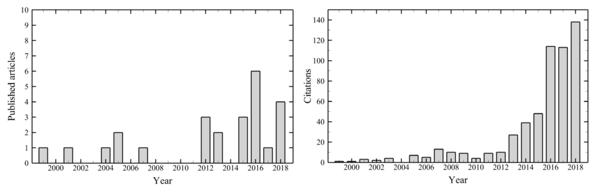
*그림 1 — PIV 불확도 정량화 방법론을 다룬 출판 논문 수(왼쪽)와 그 피인용 수(오른쪽) (데이터 출처: Web of Science).*

### 1.2. 실험 오차와 불확도: 정의와 분류 (Experimental errors and uncertainty: definitions and classification)

PIV 측정 오차와 불확도를 논의하기 전에, Coleman and Steele (2009)과 국제표준화기구의 측정 불확도 표현 지침(Guide to Expression of Uncertainty in Measurement, ISO-GUM 2018)을 따라 일반적인 정의를 제시한다.

#### 1.2.1. 측정 오차와 그 분류 (Measurement errors and their classification)

변수 $X$의 측정은 측정값과 참값 $X_{\mathrm{true}}$의 차이로 정의되는 오차 $\delta$의 영향을 받는다.

$$X = X_{\mathrm{true}} + \delta. \tag{1}$$

참값 $X_{\mathrm{true}}$를 알 수 없으므로 측정 오차도 알 수 없다. ISO-GUM은 측정 오차를 무작위(random) 성분과 계통(systematic) 성분의 두 성분으로 분류한다. 보통 $\varepsilon$으로 표기하는 무작위 오차는 측정에 영향을 주는 우연적(aleatory) 과정에 기인한다. 따라서 무작위 오차는 예측할 수 없으며 일련의 측정 동안 보통 값이 변한다. 정의에 의해 반복 측정에 대한 무작위 오차의 기댓값은 0이다. 반대로 $\beta$로 표기하는 계통 오차(또는 편향(bias) 오차)는 그 원천의 고정된 또는 비교적 고정된 함수이다(Smith and Oberkampf 2014). PIV 커뮤니티가 채택한 정의에 따르면 계통 오차는 측정 동안 반드시 일정한 것은 아니며 입력 원천에 따라 변할 수 있다는 점에 유의한다. 이 정의는 계통 오차를 측정 기간 동안 변하지 않는 오차로 정의하는 Coleman and Steele (2009)의 정의와 상반된다. 부호와 크기를 아는 모든 계통 오차는 제거할 수 있고 제거해야 한다. 남은 오차는 알려지지 않은 채로 남은 모든 무작위 성분과 계통 성분으로 이루어진다.

$$\delta = \varepsilon + \beta. \tag{2}$$

이들이 $X$의 측정에 미치는 영향을 그림 2에 나타냈다.

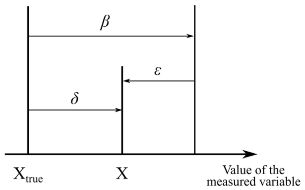
*그림 2 — 측정 변수에 대한 무작위 오차, 계통 오차, 전체 오차의 표현.*

#### 1.2.2. 측정 불확도와 그 분류 (Measurement uncertainties and their classification)

측정 오차는 알 수 없으므로, UQ의 역할은 $X$의 측정값에 영향을 주는 전체 오차의 크기를 일정 확률로 포함하는 구간을 추정하는 것이다.

불확도의 개념을 설명하기 위해, $X$의 측정을 $N$회 반복하고 과정이 정상(steady), 즉 참값 $X_{\mathrm{true}}$가 시간에 대해 일정하다고 가정하자. 측정 오차가 존재하므로 측정마다 다른 결과가 나온다. 그림 3과 같이 $N$회 측정의 표본 모집단(sample population) 분포를 그릴 수 있으며, 이는 각각 평균값 $\bar{X}$와 표준편차 $s_X$로 특징지어진다. 측정 횟수 $N$이 무한대에 가까워지면 표본 모집단 분포는 모 모집단(parent population) 분포에 가까워지며, 그 평균 $\mu$는 $X_{\mathrm{true}}$에서 $\beta$만큼 벗어난다(그림 3 참조). 무작위 오차만 존재하면 $\beta = 0$이고 모 모집단 분포의 평균값 $\mu$는 참값 $X_{\mathrm{true}}$와 일치한다.

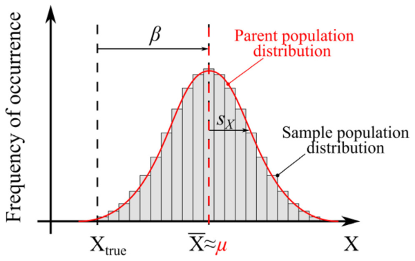
*그림 3 — 반복 측정에서 얻은 모 모집단 분포와 표본 모집단 분포의 표현.*

불확도는 각각 계통 오차원과 무작위 오차원 중 어디에서 비롯되느냐에 따라 계통 불확도와 무작위 불확도로 분류된다¹. ISO-GUM (2018)에 따라, 무작위 표준 불확도와 계통 표준 불확도는 각각 기본(elemental) 무작위 오차원 또는 계통 오차원이 비롯되는 모 모집단의 표준편차의 추정값으로 정의된다. 이들은 각각 $s_X$와 $b_X$로 표기한다. 합성 표준 불확도(combined standard uncertainty)는 두 기여의 제곱합으로 얻는다.

$$u_C = \sqrt{b_X^2 + s_X^2}. \tag{3}$$

합성 표준 불확도는 모 모집단의 형태에 대한 어떠한 가정도 필요로 하지 않는다. 따라서 전체 오차가 구간 $\pm u_C$ 안에 들어갈 확률은 결정할 수 없다. 이러한 이유로 확장 불확도(expanded uncertainty) $U$를 도입하며, 이는 다음을 만족하도록 정의된다.

$$|X_{\mathrm{best}} - X_{\mathrm{true}}| \leqslant U \quad \text{확률 } C\% \text{로} \tag{4}$$

여기서 $X_{\mathrm{best}}$는 $X_{\mathrm{true}}$의 최선 추정값으로, 단일 측정을 수행한 경우에는 $X$, 반복 관측을 수행한 경우에는 $\bar{X}$와 같다. 파라미터 $C$는 신뢰수준(confidence level)이라 하며 보통 95%로 설정한다(Kline and McClintock 1953, Abernethy and Thompson 1973).

확장 불확도는 합성 표준 불확도에 포함 인자(coverage factor) $k$를 곱하여 얻는다.

$$U = k\, u_C. \tag{5}$$

포함 인자를 결정하려면 오차 분포에 대한 지식이 필요하다. 대부분의 공학 및 과학 실험에서는 오차 분포를 가우스 분포로 가정할 수 있으며, 포함 인자 1, 2, 3은 각각 약 68%, 95%, 99.7%의 신뢰수준에 해당한다.

> ¹ 다른 분류도 존재한다. ISO-GUM (2018)은 표준 불확도의 A형(type A) 평가와 B형(type B) 평가를 구분한다. 전자는 반복 관측에 대한 데이터 통계를 수행하는 것이고, 후자는 이전 측정 데이터, 기기의 거동과 특성에 대한 일반 지식, 제조사 사양, 보정(캘리브레이션) 데이터 또는 더 정확한 측정 시스템과의 비교에 의존한다. 모델링 및 시뮬레이션 커뮤니티에서는 불확도를 무작위 사건에서 비롯되는 우연적(aleatory, 또는 확률적(stochastic)) 불확도와 지식 부족에 기인하는 인식적(epistemic) 불확도로 분류한다. 마지막으로 정밀도 불확도(precision uncertainty)는 유한한 수의 표본으로부터 계산한 통계량의 무작위 불확도로 정의된다.

## 2. PIV 측정의 오차원 (Error sources in PIV measurements)

PIV 측정의 오차는 측정 체인의 여러 단계에서, 예를 들어 사용한 특정 유동 시설, 실험 장치의 설치, 영상 기록 과정, 데이터 평가 방법의 선택 때문에 유입될 수 있다(그림 4).

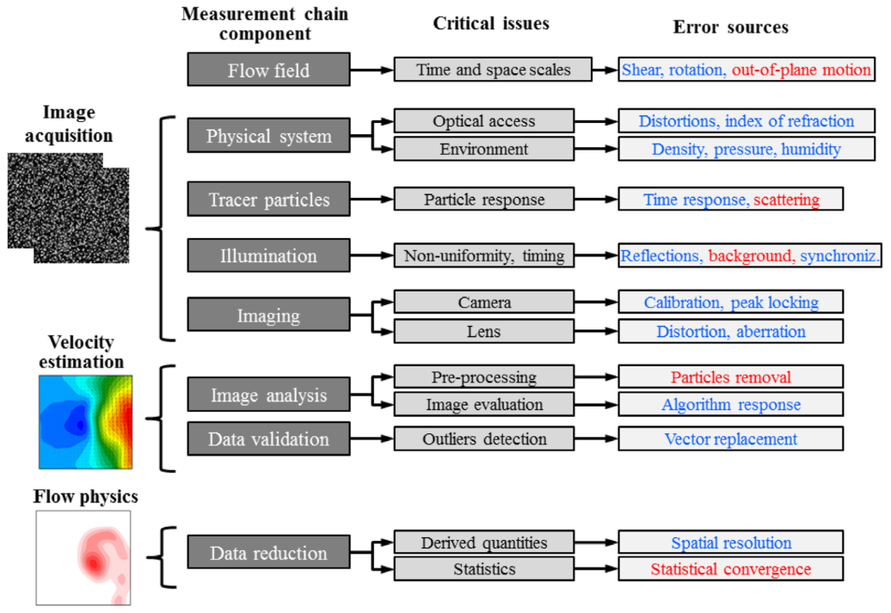
*그림 4 — PIV 측정 체인의 주요 구성 요소와 가장 중요한 오차원의 개략도. 주로 계통적인 오차원은 파란색, 주로 무작위적인 오차원은 빨간색으로 표시했다(피크 로킹(peak locking)처럼 일부 오차원은 무작위적이면서 계통적이기도 하다는 점에 유의). Wieneke (2017b)에서 허락을 받아 재수록. © 2017 B.F.A. Wieneke.*

Wieneke (2017b)는 (최적이 아닌 영상 처리에 기인한 것을 제외한) 모든 오차원이 기록된 영상에 담겨 있지만, 그중 일부는 '숨어' 있어서 영상 기록을 해석해서는 그 불확도를 정량화할 수 없다는 점을 강조한다. 보통 계통적 성격을 띠는 이러한 오차원에는 추적 입자 응답, 하드웨어 타이밍과 동기화, 원근 오차, 보정 오차(특히 스테레오 PIV와 토모 PIV에서)가 포함된다. 반면 입자 상(particle image)의 크기와 형상, 카메라 잡음, 시딩 밀도, 조명 강도 변화, 입자 운동, 영상 질의 알고리즘과 같은 오차원에 연관된 불확도는 3절에서 설명할 UQ 방법을 통해 영상 기록으로부터 정량화할 수 있다. Raffel et al (2018)을 따라, PIV 측정 오차는 크게 시스템 구성 요소에 의한 오차, 유동 자체에 기인한 오차, 평가 기법에 의한 오차로 분류할 수 있다. PIV 오차원에 대한 깊이 있는 논의는 Adrian and Westerweel (2011)과 Raffel et al (2018)의 교과서를 참고하기 바란다.

가능하면 언제나 실험자는 PIV 불확도에 관한 사전 정보를 이용하여 측정 오차를 피하거나 최소화하도록 실험을 설계하고 수행해야 한다는 점을 강조해 둔다. 모든 오차를 피하거나 최소 수준 이하로 줄일 수는 없으므로, 실험자는 남아 있는 가장 중요한 오차원에 연관된 불확도를 정량화하기 위해 사후 불확도 정량화 도구를 사용해야 한다.

### 2.1. 시스템 구성 요소에 의한 오차 (Errors caused by system components)

#### 2.1.1. 설치와 정렬에 기인한 오차 (Errors due to installation and alignment)

평면(2D2C) PIV 시스템은 유동 속도 벡터를 측정 평면에 투영한 것을 측정한다. 측정 평면이 원하는 유동 방향과 제대로 정렬되지 않으면, 속도 투영이 관심 있는 유동 성분과 일치하지 않아 계통 오차가 생긴다(Raffel et al 2018). 또한 면외(out-of-plane) 속도 성분이 존재하면 원근 오차가 생기며, 그 크기는 카메라 렌즈 광축으로부터의 거리에 따라 선형적으로 증가한다. 이러한 오차는 렌즈 평면과 측정 평면 사이의 거리를 늘리거나, 텔레센트릭(telecentric) 렌즈를 사용하거나(Konrath and Schöder 2002), 스테레오 배치로 두 번째 카메라를 추가하여(Prasad 2000) 줄이거나 피할 수 있다. 나아가 보정판(calibration plate)이 정확하게 제작되지 않았거나 보정 평면이 측정 평면과 정확히 일치하지 않으면 보정 절차에서 오차가 유입된다. 스테레오 및 토모그래피 PIV 측정에서는 후자의 오차를 자기 보정(self-calibration) 접근법으로 보정할 수 있다(Wieneke 2005, 2008). 비교적 두꺼운 레이저 시트로 측정을 수행하고 광학 배율이 광축 방향을 따라 변할 때에도 추가적인 보정 오차가 생기며, 이는 추적 입자의 깊이 위치에 따라 잘못된 속도 추정을 낳는다(Raffel et al 2018).

#### 2.1.2. 타이밍과 동기화 오차 (Timing and synchronization errors)

광원의 펄스 지연 $\Delta t$는 사용자가 선택한 값과 다를 수 있다. 가능한 원인은 레이저 발진 과정과 이어지는 레이저 에너지 방출에 연관된 복잡한 물리(Bardet et al 2013)에서부터, 시스템 구성 요소를 트리거하는 데 쓰인 케이블 길이의 차이(Raffel et al 2018)까지 다양하다. PIV에서는 유동 속도를 입자 변위와 펄스 지연 $\Delta t$의 비로 계산하므로, 후자의 오차는 속도 측정의 불확도에 직접적인 영향을 준다.

Bardet et al (2013)은 시판되는 다양한 Q-스위치 Nd:YAG 및 Nd:YLF 레이저의 타이밍 문제를 철저히 조사했다. 시험한 모든 레이저의 타이밍 오차는 주로 계통적이었고 무작위 오차는 무시할 만했다. Nd:YAG, 이중 공진기(dual-cavity) Nd:YLF, 단일 공진기(single-cavity) Nd:YLF 레이저에 대해 각각 최대 50 ns, 1.5 µs, 수 마이크로초의 계통 오차가 측정되었다. 이러한 타이밍 오차는 전형적인 펄스 지연이 100 µs 정도 이상인 저속 유동 측정에서는 무시할 만하다고 볼 수 있지만, 1 µs 정도 이하의 펄스 지연이 필요한 미세유체 및 초음속·극초음속 영역의 유동 측정에서는 결정적이 된다. 그러나 이 오차들은 본질적으로 주로 계통적이므로 전자적으로 쉽게 보정할 수 있다. 또한 초음속 유동에서는 레이저 펄스 폭이 유한(10 ns 정도)하여 입자 상이 유동 방향으로 늘어진 줄무늬(streak)가 될 수 있으며, 이로 인해 추가적인 측정 오차가 생긴다(Ganapathisubramani and Clemens 2006).

#### 2.1.3. 입자의 추종 능력 (Particles tracing capability)

추적 입자의 속도는 일반적으로 주변 유체의 속도와 다르며, 두 속도의 차이를 입자 슬립 속도(particle slip velocity)라고 정의한다. 입자 운동이 스토크스 항력 법칙(Stoke's drag law)을 따른다고 가정하면, 슬립 속도는 국소 유체 가속도와 입자 응답 시간에 의존하며, 후자는 입자 지름의 제곱과 입자와 유체의 밀도 차에 비례한다(Mei 1996, Raffel et al 2018). 공기 유동에는 보통 액체나 고체 추적 입자가 쓰이며, 이들은 보통 공기보다 훨씬 무겁다. 좋은 추종 능력을 얻기 위해 입자 지름은 0.01–2 µm 범위에서 선택한다(Melling 1997, Wang et al 2007, Ghaemi et al 2010, Ragni et al 2011). 최근 도입된 중성 부력 헬륨 충전 비눗방울(neutrally-buoyant helium-filled soap bubbles)은 입자 응답 시간을 10 µs 정도로 유지하면서 입자 지름을 약 300–500 µm까지 늘릴 수 있게 했다(Bosbach et al 2009, Scarano et al 2015, Faleiros et al 2018).

액체 유동에서는 유체의 밀도와 점성이 더 높고 실험이 보통 더 낮은 속도에서 수행되기 때문에 좋은 추적 입자의 조건을 달성하기가 훨씬 쉽다. 따라서 지름 10–50 µm의 추적 입자로도 여전히 낮은 응답 시간을 달성할 수 있다(Melling 1997).

#### 2.1.4. 결상 (Imaging)

피크 로킹(peak-locking)은 디지털 PIV에서 아마도 가장 많은 관심을 받은 오차일 것이다(Westerweel 1997a, Christensen 2004, Overmars et al 2010 외 다수). 피크 로킹은 주로 입자 상이 화소 크기에 비해 작을 때(입자 상 지름이 1화소를 넘지 않을 때) 발생하며, 측정된 입자 상 변위를 가장 가까운 정수 화소 값 쪽으로 편향시키는 효과를 낸다. 그 결과 입자 상 변위의 부화소(sub-pixel) 길이에 따라 측정 속도가 과대 또는 과소 추정될 수 있다. 피크 로킹 오차의 크기는 상호상관(cross-correlation) 변위 피크를 맞추는(fit) 데 쓰는 알고리즘에 따라 상당히 달라진다(Roesgen 2003). 이 오차원 하나만으로도 0.1화소 정도의 오차가 생길 수 있으며, 이는 난류 통계의 정확도에 큰 영향을 준다(Christensen 2004). 피크 로킹 오차를 최소화하거나 보정하기 위해 여러 접근법이 제안되었는데, 더 작은 광학 조리개 사용, 광학 확산판(Michaelis et al 2016, Kislaya and Sciacchitano 2018), 영상 디포커싱(Overmars et al 2010), 다중 $\Delta t$ 영상 획득(Nogueira et al 2009, 2011, Legrand et al 2012, 2018), 데이터 후처리 접근법(Roth and Katz 2001, Hearst and Ganapathisubramani 2015, Michaelis et al 2016) 등이 있다.

추적 입자의 결상에 연관된 추가 오차는 각 화소 판독값의 잡음에 기인한다. 영상 잡음은 영상 해석 알고리즘이 입자 상 변위를 측정할 수 있는 정확도에 영향을 준다. 디지털 카메라에는 주로 세 가지 잡음원, 즉 배경(암) 잡음(background (dark) noise), 광자 산탄 잡음(photon shot noise), 소자 잡음(device noise)이 있다(Adrian and Westerweel 2011). 디지털 PIV에 흔히 쓰이는 여러 센서(즉 CCD, CMOS, 증폭형(intensified) CMOS 센서)의 성능을 자세히 비교한 내용은 Hain et al (2007)의 연구를 참고하기 바란다.

#### 2.1.5. 조명 (Illumination)

두 레이저 펄스가 서로 완벽하게 정렬되지 않았거나 강도 분포가 서로 다르면, 개별 추적 입자의 밝기가 변하여 측정 오차가 생긴다(Nobach and Bodenschatz 2009, Nobach 2011). 반면 두 레이저 펄스 사이의 조명 강도 변화나 광 시트를 따른 완만한 공간적 변화는 측정 오차에 크게 기여하지 않는데, 상호상관 연산자가 절대 강도 변화에 둔감하기 때문이다(Wieneke 2017b). 그럼에도 조명 시스템이 추적 입자와 배경 사이에 충분한 대비를 보장할 만큼 충분한 광 강도를 전달하는 것은 결정적이다(Scharnowski and Kähler 2016a).

### 2.2. 유동에 기인한 오차 (Errors due to the flow)

유동 자체가 측정 오차의 원인이 될 수 있다. 속도 구배, 변동, 유선 곡률은 입자 슬립 때문에, 또는 영상 평가 알고리즘이 이를 분해하거나 대처하지 못하기 때문에 오차를 유발할 수 있다. 면내(in-plane) 속도 구배의 영향은 창 변형(window deformation)을 사용하는 최신 영상 평가 알고리즘으로 완화할 수 있지만(Scarano and Riethmuller 2000), 면외 속도 구배는 질의창 안의 입자 수가 유한하고 입자 위치가 무작위적이기 때문에 측정된 면내 속도 성분에 오차를 일으킨다. 실험 진행 중 유체 특성(예: 온도, 밀도, 점성)이나 유동의 레이놀즈 수와 마하 수가 변하는 것도 추가적인 측정 오차의 원인이 된다. 추적 입자가 광 시트를 가로질러 움직일 때, 광 시트로 들어오거나 나가는 입자는 짝지어지지 않은 입자가 되어 상관 함수의 배경 잡음에 기여한다. 또한 측정 평면 안에서 서로 다른 깊이에 있는 입자에 해당하는 겹친 입자 상들의 강도 변화는 측정 변위에 무작위 오차를 일으킨다(Nobach and Bodenschatz 2009, Nobach 2011).

매우 낮은 속도(1 mm s⁻¹ 미만)에서는 고배율 µPIV 측정에서 입자의 무작위 브라운 운동이 보이게 된다. 브라운 운동은 입자 위치의 무작위적인 면내 떨림(jitter)을 일으켜 상관 함수의 신호 강도를 낮추고, 그 결과 측정 불확도를 높인다(Olsen and Adrian 2001). 이에 연관된 측정 오차는 유체 온도가 높을수록 커지고, 입자 지름과 유동 속도가 커질수록 작아지는 것으로 보고된다(Devasenathipathy et al 2003).

### 2.3. 평가 기법에 기인한 오차 (Errors due to the evaluation technique)

특정 평가 기법과 선택한 처리 파라미터에 연관된 오차는 네 차례의 국제 PIV 챌린지(Stanislas et al 2003, 2005, 2008, Kähler et al 2016)가 보여 주듯이 지난 20년 동안 매우 상세히 분석되었다. PIV 초기에 연구자들의 관심은 잘못된 벡터(이상값(outlier), Keane and Adrian 1990, Westerweel and Scarano 2005)의 검출과 제거 문제에 집중되었다. 유동장의 무작위 위치에 나타나는 고립된 이상값에 대해서는 이 문제가 비교적 간단하지만, 이상값 군집의 검출과 제거는 여전히 연구 주제이다(Masullo and Theunissen 2016). 1990년대 말부터 측정 불확도의 최소화와 공간 분해능의 최대화가 PIV 알고리즘 개발의 핵심 연구 주제가 되어, 분해 가능한 속도 및 길이 척도의 범위(각각 동적 속도 범위 DVR과 동적 공간 범위 DSR, Adrian 1997)를 넓히고자 했다. 이를 위해 연구자들은 다양한 종류의 상관 해석, 질의창 크기와 형상, 상호상관 피크 맞춤 알고리즘, 영상 변형 알고리즘을 위한 영상 및 벡터 보간 방식을 고려하여 여러 평가 알고리즘의 성능을 평가했다. 3절에서 자세히 논의하겠지만, 유동 및 결상 조건에서 비롯되는 가장 흔한 오차원에 대한 평가 알고리즘의 민감도가 분석되었다.

## 3. PIV 불확도 정량화 접근법 (PIV uncertainty quantification approaches)

점 $(x, y)$에서의 국소 유동 속도 $u$는 짧은 시간 간격 $\Delta t$ 동안 추적 입자 집단의 변위 $\Delta x$를 측정하여 계산한다(Adrian and Westerweel 2011).

$$u = \frac{\Delta x}{\Delta t} = \frac{\Delta X}{M \Delta t}. \tag{6}$$

$M$은 배율 인자(magnification factor)로, 물체 공간의 변위 $\Delta x$를 $\Delta X$로 표기하는 영상 평면의 변위로 변환할 수 있게 한다. 시간 간격 $\Delta t$는 보통 유동의 특성 시간 척도보다 훨씬 작게 선택하여 절단 오차를 무시할 수 있게 한다. 추정 속도의 불확도는 $\Delta X$, $\Delta t$, $M$을 독립 변수로 보고 테일러 급수 전파(Coleman and Steele 2009)로 얻는다.

$$\left(\frac{U_u}{u}\right)^2 = \left(\frac{U_{\Delta X}}{\Delta X}\right)^2 + \left(\frac{U_{\Delta t}}{\Delta t}\right)^2 + \left(\frac{U_M}{M}\right)^2. \tag{7}$$

레이저 펄스 간격의 불확도 $U_{\Delta t}$는 보통 B형 불확도로 취급하며(즉 반복 관측에 대한 데이터 통계로부터 얻을 수 없음), 그 정량화는 제조사가 제공하는 정보나 전용 실험(Bardet et al 2013)에 의존한다. $U_{\Delta t}$의 전형적인 값은 1 ns 정도이며(Lazar et al 2010), 대부분의 실험에서 무시할 만한 상대 불확도를 낳는다(2.2절에서 논의했듯이[역주: 타이밍 오차는 2.1.2절에서 논의됨], 1 µs 이하의 레이저 펄스 간격이 필요할 수 있는 µPIV 측정이나 초음속·극초음속 유동 영역의 실험에서는 이 불확도를 무시할 수 없을 수도 있다). $U_M$의 정량화에 관해서는 문헌에 보고된 연구가 제한적이다. Gui et al (2001a)은 물체 평면에서의 카메라 시야 크기와 디지털 영상의 크기에 연관된 불확도를 고려하여 배율 인자의 불확도를 추정했다. 최근 Campagnole dos Santos et al (2018)은 배율 불확도를 보다 철저히 평가했는데, 이를 네 가지 기여의 합으로 계산했다. 즉 (i) 보정판의 제작 한계로 인한 점(dot) 위치와 크기의 불확도, (ii) 원근 오차로 인한 영상 왜곡, (iii) 보정판과 측정 평면 사이의 정렬 불량, (iv) 보정판과 카메라 평면 사이의 정렬 불량이다. 보정 함수(영상 평면에서 물리 공간으로의 사상 함수)의 함수 형태가 모든 광학 왜곡을 설명하기에 충분하지 않을 수 있으므로, 보정 함수의 모델 형태 불확도(model form uncertainty)로부터도 추가 불확도가 생긴다. 그러나 보정을 제대로 수행하면 배율과 보정의 불확도는 전체 불확도에 비해 무시할 만하며, 전체 불확도는 식 (7)의 변위 항이 지배한다. 이러한 이유로 지난 수십 년 동안 $\Delta X$의 불확도를 정량화하는 데 많은 노력이 기울여졌다. $U_{\Delta X}$의 정량화를 위해 제안된 접근법은 크게 사전(a priori)과 사후(a posteriori)로 분류할 수 있다(Sciacchitano et al 2013). 전자는 PIV 측정에서 마주치는 전형적인 조건에 대해 $U_{\Delta X}$의 값 또는 범위를 제공하는 것을 목표로 한다. 궁극적으로 사전 UQ 접근법은 PIV 알고리즘의 불확도에 대한 일반적인 수치를 내놓는다. 이는 보통 측정 체인의 이론적 모델링을 통해서, 또는 합성 영상과 몬테카를로 시뮬레이션에 기반하여 PIV 알고리즘의 성능을 평가하여 이루어진다. 반면 사후 UQ 접근법은 특정 데이터 세트의 국소적·순간적 불확도를 정량화하는 것을 목표로 하며, 따라서 실험자에게 그가 획득한 데이터에 기반하여 측정된 각 속도 벡터에 대한 불확도 대역을 제공한다.

이하에서는 가장 중요한 사전 및 사후 PIV UQ 접근법을 논의하며, 각각의 강점과 한계, 그리고 PIV 데이터의 불확도와 표준 PIV 알고리즘의 성능에 관한 가장 중요한 결과를 강조한다.

### 3.1. 사전 불확도 정량화 접근법 (A-priori uncertainty quantification approaches)

PIV에 대한 사전 불확도 정량화는 이 기법의 초창기부터 제안되었다. 연구자들은 영상 해석 알고리즘의 이론적 모델링 및/또는 몬테카를로 시뮬레이션을 이용하여 PIV 측정 오차의 전형적인 크기와, 그것이 실험 및 처리 파라미터에 어떻게 의존하는지를 결정했다.

#### 3.1.1. 측정 체인의 이론적 모델링에 의한 사전 불확도 정량화 (A-priori uncertainty quantification by theoretical modelling of the measurement chain)

PIV 속도 추정값의 불확도를 정량화하려는 최초의 시도는 Adrian (1986)이 했는데, 그는 측정된 입자 상 변위의 불확도가 $c d_\tau$와 같다고 제안했다. 여기서 $d_\tau$는 입자 상 지름이고 $c$는 입자 상 도심(centroid)의 위치를 정하는 불확도에 연관된 파라미터이다. 입자 상 지름 $d_\tau$는 근사 해석식을 이용해 사전에 평가하거나, 어떤 영상 영역에서 자기상관(auto-correlation) 함수를 계산한 뒤 자기상관 피크에 적절한 함수 형태를 맞추어 사후에 평가할 수 있다(Adrian and Westerweel 2011). $c$의 전형적인 값은 0.1 정도로 보고된다. Adrian의 불확도 원리는 구현과 적용이 매우 쉽다는 장점이 있지만, $c$의 실제 값은 특정 측정 조건과 영상 해석 알고리즘에 의존하며 알 수 없는 채로 남는다. 또한 Adrian의 모델은 피크 로킹으로 인해 작은 입자 상 크기에서 측정 오차가 증가하는 것을 설명하지 못한다. 더욱이 이 단순한 모델은 특정 유동 조건(예: 속도 구배, 면외 운동, 유선 곡률)과 결상 조건(예: 영상 배경 잡음, 레이저 광 반사, 시딩 농도)에서 비롯되는 오차원을 설명하지 못한다. 끝으로 최근 연구들은 입자 상 지름이 3화소를 넘으면 최신 다중 패스(multi-pass) 질의 알고리즘의 측정 오차가 입자 상 지름을 더 늘려도 거의 변하지 않음을 보였다(Raffel et al 2018).

PIV 불확도의 사전 정량화를 위해 이론 모델이 정식화되었다. 문제가 복잡하기 때문에 처리 알고리즘과 유동 조건에 대해 단순화 가정, 예를 들어 이산 창 오프셋(discrete window offset)을 사용한(영상 변형 없음) 상호상관 기반 영상 해석, 균일한 유동 운동, 영상 잡음이나 원근 오차가 없는 완벽한 기록 등을 가정한다. Westerweel (1993, 1997)과 Adrian and Westerweel (2011)은 디지털 PIV의 작동 원리를 선형 시스템 이론으로 기술하는 이론적 틀을 개발했다. 저자들은 $d_r$을 화소 크기라 할 때 $d_\tau \ll d_r$이면 측정 오차가 피크 로킹으로 인한 편향 효과에 지배되고, $d_\tau \gg d_r$이면 무작위 오차가 지배적이며 이 무작위 오차는 입자 상 지름에 비례하여 증가함을 보였다. 32 × 32화소 질의창에 대해 최소 측정 오차의 전형적인 값은 0.05~0.1화소 범위로 보고되었다. 피크 로킹 오차와 그것이 난류 통계에 미치는 영향에 대한 해석 모델은 특히 Cholemari (2007), Angele and Muhammad-Klingmann (2005), Legrand et al (2018)이 정식화했다.

Westerweel (2000)은 개선된 디지털 영상 해석 이론을 제시했는데, 측정 오차를 부화소 변위, 입자 상 지름, 영상 밀도와 관련짓는 해석식을 유도했다. 이 이론은 최소 오차가 $d_\tau = 2$화소에서 발생하고 더 큰 입자 상 지름은 무작위 오차를 증가시킨다는 이전 몬테카를로 시뮬레이션(Adrian 1991, Willert 1996)의 결과를 확인해 준다(그림 5).

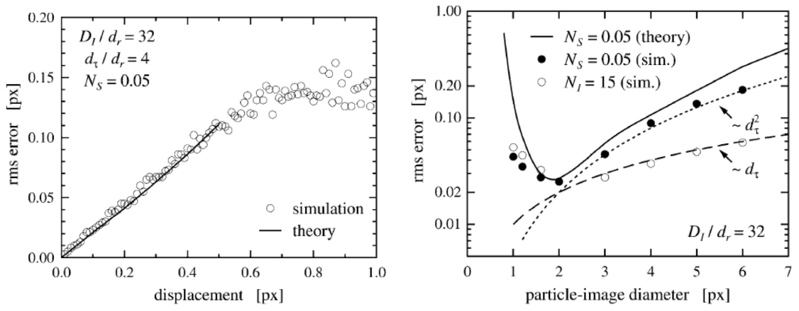
*그림 5 — 입자 상 변위(왼쪽)와 지름(오른쪽)의 함수로 나타낸 RMS 오차(즉 무작위 불확도). Westerweel (2000)에서 재수록. © Springer-Verlag Berlin Heidelberg (2000). Springer의 허락을 받음.*

PIV 질의에서 면내 속도 구배의 영향은 Westerweel (2008)에서 다루어졌는데, 속도 구배가 존재할 때 변위 상관 피크의 진폭, 위치, 폭을 기술하는 해석식이 유도되었다. Adrian의 불확도 원리에 대한 보정이 제안되었으며, 여기에는 국소 입자 상 변위의 변화 $a$의 영향이 포함된다.

$$U_{\Delta x} \cong c\, d_\tau \sqrt{1 + \frac{2}{3}\frac{a^2}{d_\tau^2}}. \tag{8}$$

이 해석은 이산 창 이동(discrete window shift)을 쓰는 비교적 단순한 질의 방법(Westerweel et al 1997)을 고려한 것이라는 점에 유의해야 한다. 창 변형을 사용하는 최신 영상 질의 알고리즘(Scarano and Riethmuller 2000, Fincham and Delerce 2000)은 면내 속도 구배에 기인한 오차에 훨씬 덜 취약하다.

유선 곡률이 존재하면 유한한 질의창 크기 때문에 추가적인 편향 오차가 유입된다(공간 필터링으로 인한 변조 오차; Spencer and Hollis 2005, Lavoie et al 2007). 또한 입자 경로를 곡선이 아닌 직선으로 가정하면 속도 벡터가 실제와 다른 유선 위에 위치하게 된다(Scharnowki and Kähler 2013). Scarano (2003)는 상호상관 해석을 이동 평균 필터로 모델링하여, 이러한 계통 오차의 크기가 속도장의 2계 공간 도함수와 질의창 면적에 비례함을 보였다. 음의 주파수 응답과 0의 주파수 응답을 피하도록 창 가중(window weighting)을 사용하면, 질의창 크기보다 작은 공간 파장을 분해하는 것이 이론적으로 가능해진다(Nogueira et al 2005a, 2005b). 진폭 $A$의 정현파 변위를 받는 상호상관 연산자의 고유 응답에 대한 해석식은 Theunissen (2012)이 유도했으며, 그는 상호상관 연산자가 작은 비 $A/d_\tau < 4$에 대해서만 이동 평균 필터처럼 거동함을 보였다. 이 연구는 Theunissen and Edwards (2018)가 확장했는데, 이들은 앙상블 평균 상호상관 응답에 대한 반해석적(semi-analytical) 식을 유도했다.

#### 3.1.2. 수치적 또는 실험적 평가에 의한 사전 불확도 정량화 (A-priori uncertainty quantification by numerical or experimental assessment)

앞 절에서 논의했듯이, 측정 체인의 이론적 모델링은 처리 알고리즘과 유동 및 결상 조건에 대한 단순화 가정을 필요로 하며, 실험 장치와 영상 해석의 복잡성을 온전히 반영하지 못한다. 이러한 이유로 합성 영상과 몬테카를로 시뮬레이션을 통해, 또는 실험적 평가를 통해 측정 불확도를 사전에 정량화하려는 연구가 많이 수행되었다. 전자의 경우, 정해진 운동을 따르는 추적 입자의 무작위 분포로 영상을 생성한다. 이와 관련하여 Okamoto (2000)와 Lecordier and Westerweel (2004)의 연구는 표준 PIV 영상의 핵심 파라미터, 예를 들어 입자 상의 지름·형상·강도, 시딩 농도, 레이저 시트의 두께와 형상을 선택하는 지침을 정의한다. 합성 영상의 사용은 몇 가지 주요한 장점을 갖는다(Scharnowski and Kähler 2016b). (a) 참 속도장을 알고 있으므로 실제 측정 오차를 평가하기가 간단하다. (b) 모든 실험 파라미터(예: 입자 상 크기, 농도, 난류 강도 등)를 완전히 통제할 수 있으며, 다른 파라미터를 바꾸지 않고 개별적으로 변경할 수 있다. (c) 실제 실험에서 쉽게 달성할 수 없는 값(예: 극히 낮거나 높은 난류 수준)으로 파라미터를 설정할 수 있다. (d) 합성 영상을 생성하는 데 풍동이나 장비가 필요 없으므로 구현이 쉽고 빠르다. 이러한 장점 때문에 합성 영상과 몬테카를로 시뮬레이션의 사용은 PIV 해석 방법의 성능과, 결상·유동·처리 파라미터에 연관된 불확도를 평가하는 표준 접근법이 되었다. 여러 PIV 알고리즘(예: 단일 패스 상관, 이산 및 부화소 창 이동, 창 변형)에 대해 입자 상 크기와 변위, 변위 구배, 시딩 농도, 면외 입자 운동, 영상 보간 알고리즘, 상호상관 피크 맞춤 알고리즘과 같은 파라미터의 함수로 편향 오차와 무작위 오차가 특성화되었다. 합성 영상과 몬테카를로 시뮬레이션으로 사전 UQ 해석을 수행한 대표적 연구를 선별하여 표 1에 제시했다.

*표 1 — 몬테카를로 시뮬레이션으로 조사된 오차원과, 그러한 조사가 수행된 참고문헌 선별 목록.*

| 조사된 오차원 (Error sources investigated) | 참고문헌 (References) |
|---|---|
| 입자 운동(변위, 변위 구배, 면외 운동) | Keane and Adrian (1990), Fincham and Spedding (1997), Scarano and Riethmuller (1999), Fincham and Delerce (2000), Wereley and Meinhart (2001), Mayer (2002), Stanislas et al (2003), Foucaut et al (2004), Nobach and Bodenschatz (2009), Scharnowski and Kähler (2016b) |
| 결상 조건(입자 상 지름, 시딩 밀도, 카메라 잡음, 센서 필 팩터(fill factor)) | Willert and Gharib (1991), Willert (1996), Fincham and Spedding (1997), Stanislas et al (2003), Foucaut et al (2004), Duncan et al (2009), Scharnowski and Kähler (2016a, 2016b) |
| 질의창 크기와 가중 함수 | Gui et al (2001b), Lecordier et al (2001), Nogueira et al (2005b), Duncan et al (2009), Eckstein and Vlachos (2009) |
| 영상 질의 알고리즘 | Huang et al (1997), Scarano and Riethmuller (2000), Lecordier et al (2001), Meunier and Leweke (2003), Stanislas et al (2003, 2005, 2008), Foucaut et al (2004) |
| 피크 로킹 | Nogueira et al (2001), Gui and Wereley (2002), Fore (2010), Michaelis et al (2016) |
| 공간 분해능 | Astarita (2007), Nogueira et al (1999, 2002), Stanislas et al (2003, 2005, 2008), Elsinga and Westerweel (2011), Kähler et al (2012a, 2012b, 2016) |
| 다중 패스 영상 변형 방법의 영상 보간 방식 | Astarita and Cardone (2005), Nobach et al (2005), Astarita (2006), Kim and Sung (2006), Duncan et al (2009) |
| 다중 패스 영상 변형 방법의 벡터 보간 방식 | Astarita (2008) |

몬테카를로 시뮬레이션으로 수행된 조사의 대부분은 모사된 유동 및 결상 조건과 사용된 처리 알고리즘에 따라 오차 크기의 전형적인 수치가 0.01–0.2화소 범위라는 데 동의한다. 특히 영상 변형을 사용하는 다중 패스 질의 알고리즘이 최소 측정 오차를 낸다는 것이 밝혀졌다. 그럼에도 합성 영상은 지나치게 이상화된 결상 및 유동 조건을 가정하기 때문에 비현실적으로 낮은 측정 오차를 낸다는 것이 널리 인정된다(Stanislas et al 2005). 이러한 이유로 여러 연구가 몬테카를로 시뮬레이션의 유용한 대안으로 실험적 평가를 제안했는데, 이는 실제 PIV 측정의 복잡성과 불완전성을 더 현실적으로 재현하려는 것이다. 이러한 평가에서 측정 오차는 측정 속도장과 정확한 속도장을 직접 비교하여 계산하며, 후자는 부과되거나 더 정확한 측정 시스템으로 정량화된다. 특수한 경우가 µPIV인데, 낮은 레이놀즈 수 덕분에 수치 유동 시뮬레이션을 이용하여 측정 불확도를 평가할 수 있다(Cierpka et al 2012). 실험적 평가로 수행된 대표적인 사전 UQ 해석을 선별하여 표 2에 제시했다.

*표 2 — 실험적 평가로 수행된 대표적 사전 불확도 정량화 해석 선별 목록.*

| 실험적 평가 방법 (Experimental assessment method) | 조사된 오차원 (Error sources investigated) | 참고문헌 (References) |
|---|---|---|
| 변위가 0이거나 균일한 유동 측정(실제 변위 또는 전기광학적 영상 이동으로 생성) | 질의 알고리즘 | Willert (1996), Forliti et al (2000) |
| | 결상 조건 | Willert (1996), Reuss et al (2002), Scharnowski and Kähler (2016b) |
| | 면외 입자 운동 | Scharnowski and Kähler (2016a) |
| 정해진 운동(평행이동 및/또는 회전)을 하는 스페클 패턴 | 질의 알고리즘 | Prasad et al (1992), Lourenço and Krothapalli (1995) |
| | 결상 조건 | Willert and Gharib (1991) |
| | 면외 입자 운동 | Nobach and Bodenschatz (2009) |
| | 토모그래피 PIV에서의 입자 운동과 배경 잡음 | Liu et al (2018) |
| 더 정확한 측정 시스템과의 비교 | 공간 분해능 | Spencer and Hollis (2005), Lavoie et al (2007) |
| | 피크 로킹 | Kislaya and Sciacchitano (2018) |
| 수렴하지 않은 통계와 수렴한 통계의 비교 | 통계적 성질의 정밀도 불확도 | Carr et al (2009) |
| 서로 다른 처리 알고리즘 간의 비교 | 피크 로킹 | Christensen (2004), Kähler et al (2016) |
| | 입자 변위와 변위 구배 | Stanislas et al (2003) |

실험적 평가로부터, PIV 변위 오차는 특히 심한 면외 운동과 피크 로킹, 분해되지 않은 길이 척도, 낮은 영상 품질이 있을 때 수십 분의 1화소에 이를 수 있다는 것이 드러난다. 나아가 제4회 국제 PIV 챌린지의 사례 B 해석(Kähler et al 2016)에서 결론 내렸듯이, 평가 파라미터의 선택이 문헌에 보고된 모범 사례뿐 아니라 개인적 경험에도 기반하는 경우가 많기 때문에, 인적 요인이 측정 속도장의 전체 품질에 핵심적인 역할을 한다.

### 3.2. 사후 불확도 정량화 접근법 (A-posteriori uncertainty quantification approaches.)

앞서 논의했듯이, PIV의 측정 오차는 유동 특성, 실험 장치, 영상 처리 알고리즘의 여러 요인에 의존한다. 이 요인들 대부분은 공간과 시간에 따라 변하므로 유동장 전체에 걸쳐 불균일한 오차와 불확도를 낳는다. 사후 불확도 정량화의 목적은 각 속도 벡터의 국소적·순간적 불확도를 정량화하는 것이다. 이를 위해 지난 10년간 여러 사후 UQ 접근법이 제안되었다. 이 접근법들은 보통(Bhattacharya et al 2018) 보정(calibration)으로 얻은 사전 계산된 정보를 이용하는 간접 방법(indirect method)과, 추정된 변위를 사전 정보로 사용하여 영상 평면에서 측정 불확도를 직접 추출하는 직접 방법(direct method)으로 분류된다. 이 접근법들은 서로 다른 원리에 의존하므로 각각 성능과 한계 면에서 고유한 특성을 가지며, 이를 이하에서 논의하고 표 4에 요약했다.

#### 3.2.1. 간접 방법 (Indirect methods)

##### 3.2.1.1. 불확도 곡면 방법 (Uncertainty surface method)

불확도 곡면 방법(Timmins et al 2012)은 각 속도 벡터의 국소적·순간적 불확도를 정량화하는 것을 목표로 한 최초의 사후 불확도 정량화 접근법이었다. 이 방법은 PIV 측정 오차에 가장 크게 기여하는 오차원을 식별해야 한다. Timmins et al은 네 가지 주요 기여 요인, 즉 입자 상 지름, 시딩 밀도, 전단율(shear rate), 입자 상 변위를 고려했다. 원리적으로는 배율 및 보정 오차, 유선 곡률, 영상 잡음, 면외 입자 운동(스테레오 카메라를 추가하거나 상호상관 함수를 해석하여 평가, Scharnowski and Kähler 2016b)과 같은 다른 오차원도 고려할 수 있다.

주요 오차원을 식별한 뒤, 전형적인 PIV 실험의 범위 안에서 오차원의 값을 변화시킨 합성 영상을 생성한다. 그런 다음 이 영상을 PIV 처리 알고리즘으로 해석하고, 그 결과 속도장을 알려진 참 속도와 비교하여 각 오차원 파라미터의 함수로 측정 오차의 분포를 결정한다. 이 과정을 그림 6의 위쪽 행에 나타냈다. 측정 오차의 분포는 참 변위를 포함하는 95% 신뢰 구간을 결정하는 데 쓰인다. 위아래 무작위 불확도 한계(각각 $r_{\mathrm{high}}$와 $r_{\mathrm{low}}$로 표기)는 $\Delta X < \overline{\Delta X} - r_{\mathrm{low}}$와 $\Delta X > \overline{\Delta X} + r_{\mathrm{high}}$인 변위의 확률이 모두 2.5%가 되도록 계산하며, 여기서 $\overline{\Delta X}$는 특정 오차원 조합에 대한 평균 측정 변위이다. 그 결과 무작위 오차는 95% 확률로 범위 $[-r_{\mathrm{low}}, +r_{\mathrm{high}}]$ 안에 포함된다. 계통 불확도 $b_k$는 $\overline{\Delta X}$와 알려진 참 변위 $\Delta X_{\mathrm{true}}$의 차이로 평가하며, 이로부터 합성 불확도 추정값을 얻는다.

$$U^- = \sqrt{r_{\mathrm{low}}^2 + b_k^2};\quad U^+ = \sqrt{r_{\mathrm{high}}^2 + b_k^2}. \tag{9}$$

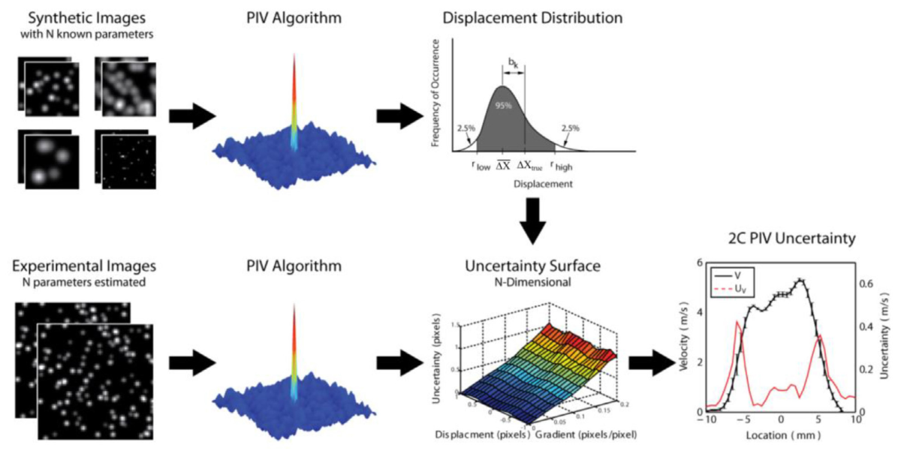
*그림 6 — 불확도 곡면 방법의 작동 원리 개략도. 허락을 받아 재수록(S.O. Warner 제공).*

이 절차를 평면 PIV 측정의 두 속도 성분 모두에 대해 수행하여, 수평 변위와 수직 변위에 대해 서로 다른 불확도 한계를 얻는다. 위의 해석을 $N$개 오차원의 가능한 모든 조합에 대해 반복하면 $N$차원 불확도 곡면이 구축되며, 이는 불확도 한계를 선택된 $N$개 오차원의 각 조합과 관련짓는다.

합성 영상으로부터 불확도 곡면을 구축한 뒤에는 실험 영상을 면밀히 조사한다. 실험 영상을 해석하면 오차원(예: 변위, 전단, 입자 상 지름, 시딩 밀도)의 국소적·순간적 값을 얻으며, 이를 불확도 곡면의 입력으로 주어 각 속도 벡터의 각 성분에 대한 아래·위 불확도 한계를 결정한다(그림 6의 아래쪽 행).

불확도 곡면 방법은 측정 오차 분포의 형태에 대한 어떠한 가정도 필요 없이 그 (비대칭) 분포를 제공한다는 분명한 이점이 있다. 또한 무작위 불확도 성분과 계통 불확도 성분을 구분할 수 있다. 그러나 이 방법은 오차원의 선택과 각 오차원 값의 평가에 의존하는데, 이 값들 자체가 측정 불확도의 영향을 받는다. 또한 불확도 곡면의 계산은 시간이 상당히 많이 걸린다. 더욱이 불확도 곡면은 알고리즘에 의존하므로, 영상 평가 알고리즘의 파라미터를 수정할 때마다 새 불확도 곡면을 구축해야 한다.

##### 3.2.1.2. 상호상관 신호 대 잡음비 지표 (Cross-correlation signal-to-noise ratio metrics)

상호상관 신호 대 잡음비 지표에 기반한 접근법은 개별 오차원에 대한 어떠한 가정, 선택, 평가도 필요 없이, 상호상관 평면에서 도출한 양만으로 측정 불확도를 추정한다. 기본 원리는 상관 기반 영상 평가에서 추정된 입자 상 변위의 오차가 상호상관 함수의 신호 대 잡음비(signal-to-noise ratio, SNR)를 대표하는 적절한 지표 $\phi$와 관련된다는 것이다.

참 변위장을 알고 있어 실제 측정 오차를 직접 계산할 수 있는 합성 영상의 해석에 기반하여, Charonko and Vlachos (2013)와 Xue et al (2014)은 측정된 변위 크기의 표준 불확도 $U_{\Delta X}$와 일반적인 상호상관 SNR 지표 $\phi$ 사이에 다음과 같은 경험적 관계를 제안했다.

$$(U_{\Delta X})^2 = \left(M \exp\left(-\frac{1}{2}\left(\frac{\phi - N}{s}\right)^2\right)\right)^2 + \left(A\phi^{-B}\right)^2 + (C)^2. \tag{10}$$

식 (10)은 측정 불확도가 세 가지 기여의 합으로 어떻게 평가되는지를 보여 준다. 첫째 항은 이상값에 기인한 불확도를 설명하기 위해 쓰는 가우스 함수로, 이상값은 보통 상관 SNR 값이 낮을 때($\phi$가 $N$에 가까워질 때, $N$은 계산된 지표의 이론적 최솟값) 발생한다. 파라미터 $M$은 이상값 또는 무효 벡터에 연관된 불확도를 나타내며, 무효 벡터는 측정 변위와 참 변위의 차이가 상호상관 피크 지름의 절반보다 큰 벡터로 정의된다. 파라미터 $s$는 $\phi$ 값이 감소할 때 불확도가 얼마나 빨리 $M$까지 올라가는지를 결정한다. 둘째 항은 유효 벡터가 측정 불확도에 기여하는 바를 나타내는 거듭제곱 법칙이다. 지수 $B > 0$은 상관 신호 대 잡음비가 높을수록 측정 불확도가 낮음을 나타낸다. 이상값이 없으면($M = 0$) 가장 큰 불확도는 $\phi$가 그 이론적 최솟값 $N$에 가까워질 때 얻어지며 주로 $A$가 결정한다. 마지막 상수 항은 달성 가능한 최저 불확도를 나타내며, 파라미터 $C$와 같다.

문헌에는 상호상관 신호 대 잡음비를 평가하는 여러 지표가 제안되어 있으며, 이를 표 3에 요약했다.

*표 3 — 상호상관 신호 대 잡음비에 대한 여러 지표의 정의.*

| 지표 (Metrics) | 정의 (Definition) | 참고문헌 (Reference) |
|---|---|---|
| 상호상관 1차 피크 비(primary peak ratio) PPR (그림 7 위 참조) | 가장 큰 상관 피크 $C_{\max}$와 두 번째로 높은 상관 피크 $C_2$의 비: $\mathrm{PPR} = \dfrac{C_{\max}}{C_2}$ | Charonko and Vlachos (2013) |
| 피크 대 제곱평균제곱근 비(peak to root-mean-square ratio) PRMSR (그림 7 아래 왼쪽 참조) | 1차 피크 높이의 제곱과, 상관 평면의 잡음 부분에 있는 상호상관 값들의 제곱평균의 비: $\mathrm{PRMSR} = \dfrac{(C_{\max})^2}{C_{rms}^2}$ | Xue et al (2014) |
| 피크 대 상관 에너지(peak to correlation energy) PCE (그림 7 아래 오른쪽 참조) | 1차 피크 높이의 제곱과 상관 에너지(상관 평면 전체에 있는 상호상관 값들의 제곱평균)의 비: $\mathrm{PCE} = \dfrac{(C_{\max})^2}{E_c}$ | Xue et al (2014) |
| 상호상관 엔트로피의 역수(inverse of the cross-correlation entropy) | $(\mathrm{Entropy})^{-1} = -\left[\sum_{i=1}^{N_{\mathrm{bin}}} p_i \log(p_i)\right]^{-1}$, 여기서 $p_i = \dfrac{\text{bin } i\text{의 점 수}}{\text{상관 평면 전체의 총 점 수}}$ | Xue et al (2014) |
| 상호 정보(mutual information) MI | 가장 큰 상관 피크 $C_{\max}$와 평균 입자 상의 자기상관 높이 $A_0$의 비: $\mathrm{MI} = \dfrac{C_{\max}}{A_0}$ | Xue et al (2015) |
| 입자 손실 비(loss of particle ratio) LPR | 짝지어지지 않은 입자 상까지 고려하도록 MI 지표를 보정한 것: $\mathrm{LPR} = \mathrm{MI}\cdot(0.01 + 2 d_x N_I)^{-1}$, 여기서 $N_I$는 영상 밀도, $d_x$는 입자 상 변위 | Novotny et al (2018) |

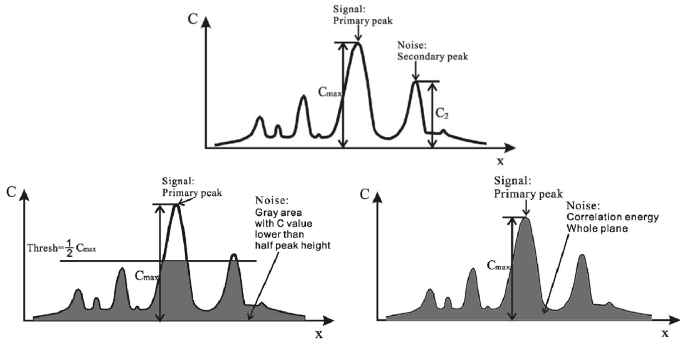
*그림 7 — 1차원 상호상관 함수의 도식적 표현. 위: PPR, 아래 왼쪽: PRMSR, 아래 오른쪽: PCE. Xue et al (2014)에서 재수록. © IOP Publishing Ltd. All rights reserved.*

전반적으로 상호상관 신호 대 잡음 지표에 기반한 불확도 정량화 방법은 구현과 적용이 극히 간단하며, 오차원 크기의 평가 없이 상호상관 평면에 담긴 정보에 전적으로 의존한다. 그러나 이 접근법들은 변위 크기의 불확도를 제공하며, 개별 변위 성분의 불확도는 특정 가정(예: 등방성 오차) 아래에서만 이로부터 얻을 수 있다는 점에 유의해야 한다. 또한 이 접근법들은 경험적으로 개발된 모델에 의존하며, 그 모델의 여섯 파라미터는 합성 데이터에 대한 맞춤(fitting)으로 결정해야 한다.

#### 3.2.2. 직접 방법 (Direct methods)

##### 3.2.2.1. 입자 불일치 방법 (Particle disparity method)

입자 불일치(particle disparity) 또는 영상 일치(image matching) 방법(Sciacchitano et al 2013)에서는 측정된 입자 상 변위의 표준 불확도를 상호상관 피크에 대한 개별 입자 상의 기여를 고려하여 정량화한다. 기본 아이디어는 다음과 같다. 영상 쌍의 입자 상들이 완벽하게 일치하는 경우 상호상관 함수는 날카로운 상관 피크를 가지며, 그 폭은 입자 상 지름에 비례한다. 이 경우 측정 불확도는 최소이다. 반대로 입자 상들이 완벽하게 일치하지 않으면 잔여 위치 불일치(positional disparity)가 존재하며, 이는 상호상관 피크를 넓히고 결과적으로 측정 변위의 불확도를 높인다. 이 접근법은 대응하는 두 질의창의 입자 상들을 속도 추정기가 줄 수 있는 최선으로 일치시키고, 짝지어진 입자 사이의 위치 불일치를 계산한다(그림 8(왼쪽)). 불일치 앙상블의 통계적 해석으로부터 추정 측정 불확도를 얻는다(그림 8(오른쪽)).

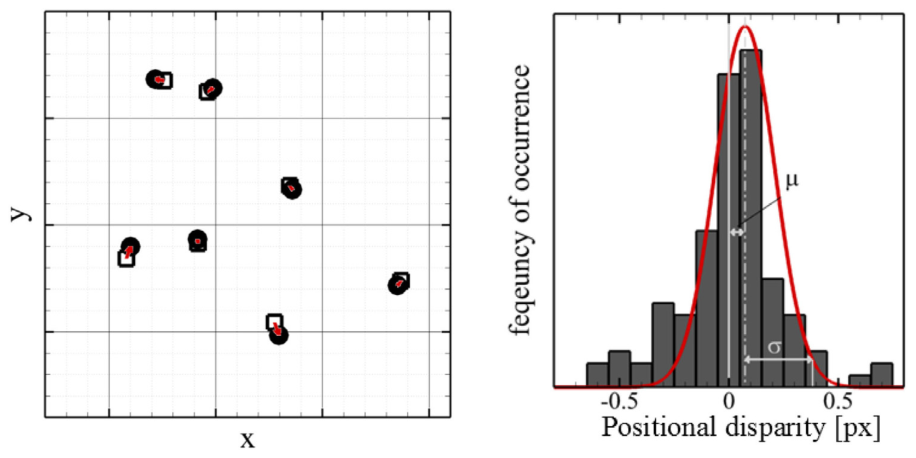
*그림 8 — 짝지어진 입자 상 사이의 위치 불일치(왼쪽)와 그 분포(오른쪽; 통계적 수렴을 위해 더 큰 질의창을 사용함)의 예시. Sciacchitano et al (2013)의 그림을 재구성. © IOP Publishing Ltd. All rights reserved.*

이 방법은 유동 및 결상 조건에 대한 어떠한 가정도 필요 없이 각 속도 성분의 (표준) 불확도를 제공한다. 그러나 이 방법은 개별 추적 입자 상의 식별과 위치 결정에 의존하며, 후자는 특히 입자 상이 겹치거나 결상 조건이 나쁠 때 측정 불확도의 영향을 받는다. 또한 추정된 불확도는 $(2N_I)^{-1/2}$의 고유 변동성(보통 추정값의 5%–25%)을 가지며, 여기서 $N_I$는 영상 밀도이다(Keane and Adrian 1990).

##### 3.2.2.2. 상관 통계 방법 (Correlation statistics method)

상관 통계 방법(Wieneke 2015)은 입자 불일치 방법을 확장한 것으로, 영상의 개별 화소와 그것이 상호상관 피크에 기여하는 바를 해석하여 불확도를 정량화한다. 이 방법은 영상 해석에 창 변형(Scarano 2002)과 예측자-수정자 필터링(predictor-corrector filtering, Schrijer and Scarano 2008)을 쓰는 반복 다중 패스 PIV 알고리즘을 사용하고, 그 알고리즘이 수렴에 도달했다는 가정에 의존한다. 후자의 경우 상호상관 함수의 1차 피크는 대칭이다. 이는 오차원이 존재할 때에도 성립한다. 예측자-수정자 방식이 그 오차원들을 보상하여 대칭 상관 피크를 돌려주고, 이 피크로부터 측정 변위 $\Delta X_{\mathrm{meas}}$를 평가하기 때문이다. 따라서 참(미지) 변위 $\Delta X_{\mathrm{true}}$는 비대칭 상관 피크에 연관되며, 그 비대칭성은 (미지의) 측정 오차 $\delta = \Delta X_{\mathrm{meas}} - \Delta X_{\mathrm{true}}$가 결정한다. 상관 통계 방법은 상관 피크의 비대칭성에 대한 각 화소의 기여를 평가하고, 이 비대칭성을 측정 변위의 불확도와 연관짓는다(그림 9).

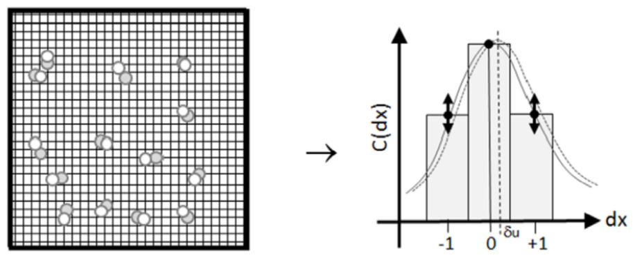
*그림 9 — 상관 통계 방법의 작동 원리 예시. Wieneke (2015)에서 재수록. © IOP Publishing Ltd. CC BY 3.0.*

이 방법의 자세한 유도와 구현은 Wieneke (2015)의 원논문에 보고되어 있다. 입자 불일치 방법과 비교할 때, 상관 통계 방법은 입자 상의 식별과 위치 결정이 필요 없으므로 그러한 작업에 연관된 불확도의 영향을 받지 않는다는 장점이 있다. 두 방법의 계산 비용은 거의 같다.

##### 3.2.2.3. 상관 평면의 모멘트 (Moment of correlation plane)

상관 평면의 모멘트 접근법(Bhattacharya et al 2018)은 상호상관 함수가 입자 상 변위의 확률 밀도 함수(probability density function, pdf)와 평균 입자 상 강도의 합성곱이라는 가설에 의존한다. 따라서 질의창 안 입자 상 변위의 pdf는 일반화 상호상관 평면(generalized cross correlation plane, GCC)으로부터 계산하며, 이는 다음과 같이 계산한다.

$$G(x) = \mathcal{F}^{-1}\left(\frac{R^*}{|R^*|}\right) \tag{11}$$

여기서 $\mathcal{F}^{-1}$은 역 푸리에 변환 연산자, $R^*$는 상호상관 평면의 푸리에 변환을 나타내며, $|R^*|$는 그 크기로서 평균 입자 상 기여를 나타낸다. $G(x)$의 1차 피크 영역은 상관된 영상 쌍에서 상호상관 1차 피크의 평가에 기여하는 모든 가능한 입자 상 짝짓기의 pdf이다(그림 10). 그런 다음 측정 변위의 표준 불확도를 1차 피크 위치에 대한 $G(x)$의 2차 모멘트로부터 평가한다. 날카로운 GCC 피크를 분해하는 분해능이 제한적이기 때문에, Bhattacharya et al은 상호상관 평면 1차 피크의 폭으로부터 지름을 추정한 알려진 가우스 함수로 GCC 피크를 합성곱할 것을 권장한다는 점에 유의해야 한다. 이 과정은 불확도 추정값에 0.02화소 정도의 오차를 유입한다.

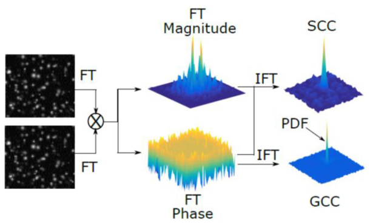
*그림 10 — PIV 영상 쌍의 상호상관으로부터 변위 pdf를 추출하는 방법의 개략도. Bhattacharya et al 2018에서 재수록. © IOP Publishing Ltd. All rights reserved.*

##### 3.2.2.4. 오차 표본추출 방법 (Error sampling method)

Moffat (1982, 1985, 1988)이 도입한 $n$차 반복(nth-order replication) 개념과 밀접히 관련된 오차 표본추출 방법(error sampling method, ESM, Smith and Oberkampf 2014)은 측정에 영향을 주는 미지의 계통 오차원에 연관된 불확도를 추정하는 것을 목표로 한다. 핵심 아이디어는 실험 시설과 장비를 포함하여 가능한 한 많은 측면을 바꾸어 가며 실험을 여러 번 반복하는 것이다. 측정량의 변동은 과정의 비정상성(unsteadiness)이나 실험 장치의 부정확성에 기인한 계통 오차를 대표한다. 이 절에서 논의한 다른 접근법들과 달리, 오차 표본추출 방법은 보통 통계량의 계통 불확도만을 제공하며 순간 속도 벡터의 무작위 불확도는 제공하지 않는다는 점을 강조해 둔다.

Smith and Oberkampf (2014)는 과도 혼합 대류(transient mixed-convection) 시설에서 시간 평균 속도 분포의 계통 불확도를 정량화하는 데 오차 표본추출 방법을 사용했다. 같은 장비와 시설을 사용하여 한 달 동안 매일 평면 PIV 측정을 반복했다. 그 결과 후류 위치와 최대 속도가 모두 매일 달라졌다(그림 11). 나아가 가장 중요하게도, 속도 변동은 표준 불확도 정량화 및 불확도 전파 방법으로 예측할 수 있는 것보다 훨씬 컸다.

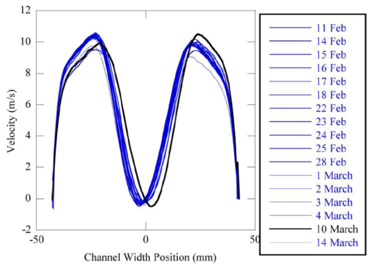
*그림 11 — 과도 혼합 대류 시설에서 한 달에 걸쳐 측정한 시간 평균 유동 방향(streamwise) 속도 분포. Smith and Oberkampf (2014)에서 재수록. Copyright © 2014 by ASME.*

마찬가지로 Beresh (2008)는 세 가지 다른 실험 구성, 즉 2성분 PIV 배치와, 유동 방향 평면 및 횡단 평면(cross-plane)에서의 두 가지 스테레오 PIV 배치를 사용하여 초음속 축대칭 제트와 천음속 횡류(crossflow)의 상호작용을 조사했다. 나아가 원시 데이터를 두 가지 다른 소프트웨어 패키지로 처리했다. 그 결과 횡단 평면의 스테레오 데이터가 시간 평균 속도와 난류 응력 모두에서 더 작은 크기를 냈으며, 영상 변형을 사용하는 처리 알고리즘(Scarano and Riethmuller 2000)을 쓸 때 유동 방향 측정과 횡단 평면 측정 사이의 불일치가 더 작았다.

PIV에 대한 오차 표본추출 방법의 추가적인 예로는 피크 로킹 및 CCD 판독 오차의 추정과 보정을 위한 다중 $\Delta t$ 영상 획득의 사용(Nogueira et al 2009, 2011, Legrand et al 2012, 2018), 보정 불확도를 정량화하기 위해 서로 다른 보정 함수로 PIV 영상을 처리하는 것(Beresh et al 2016), 또는 이중 프레임(dual-frame) 영상 해석 알고리즘의 속도장을 시간 분해 PIV의 고급 다중 프레임 접근법으로 얻은 더 정확한 속도장과 비교하는 것(Sciacchitano et al 2013)이 있다.

*표 4 — 사후 PIV 불확도 정량화 접근법의 주요 장점과 단점.*

| PIV-UQ 방법 (PIV-UQ Method) | 유형 (Type) | 장점 (Advantages) | 단점 (Drawbacks) |
|---|---|---|---|
| 불확도 곡면 (Timmins et al 2012) | 간접 | • 오차 분포의 형태에 대한 가설이 없음 • 위·아래 불확도 대역 한계를 구분할 수 있음 • 계통 불확도 성분과 무작위 불확도 성분을 구분할 수 있음 • 피크 로킹 오차에 연관된 불확도를 정량화할 수 있음 | • 오차원 값의 추정에 의존하는데, 그 추정값 자체가 불확도의 영향을 받음 • 유동 비정상성, 난류, 분해되지 않은 길이 척도를 고려하지 않음 • 처리 파라미터를 하나라도 바꾸면 불확도 곡면을 다시 생성해야 함 • 불확도 곡면 생성에 계산 시간이 많이 듦 |
| 상호상관 신호 대 잡음비 지표 (Charonko and Vlachos 2013, Xue et al 2014, 2015, Novotny et al 2018) | 간접 | • 계산된 상관 평면에 담긴 정보만 사용함 • 구현이 쉬움 • 추가 계산 비용이 무시할 만함 • 원리적으로 이상값에 연관된 불확도를 정량화할 수 있음 | • 변위 크기의 불확도만 제공하고 개별 변위 성분의 불확도는 제공하지 않음 • 경험적으로 개발된 모델에 의존함 |
| 입자 불일치 (Sciacchitano et al 2013) | 직접 | • 유동 및 결상 조건에 대한 가정이 필요 없음 • 각 속도 성분의 (표준) 불확도를 제공함 • 불확도의 계통 성분과 무작위 성분을 모두 제공함 | • 입자 상 위치의 식별에 의존하며, 이는 불확도의 영향을 받을 수 있음 • 질의창 안 입자 상 수가 유한하기 때문에 불확도 추정값에 약 5%–25%의 고유 변동성이 있음 • 이상값을 검출하고 그에 연관된 불확도를 정량화할 수 없음 • 피크 로킹이 있으면 부정확함 |
| 상관 통계 (Wieneke 2015) | 직접 | • 유동 및 결상 조건에 대한 가정이 필요 없음 • 각 속도 성분의 (표준) 불확도를 제공함 • 입자 상의 식별과 위치 결정이 필요 없음 | • 질의창 안 입자 상 수가 유한하기 때문에 불확도 추정값에 약 5%–25%의 고유 변동성이 있음 • 이상값을 검출하고 그에 연관된 불확도를 정량화할 수 없음 • 피크 로킹 오차가 검출되지 않은 채로 남음 |
| 상관 모멘트 (Bhattacharya et al 2018) | 직접 | • 계산된 상관 평면에 담긴 정보만 사용함 • 구현이 쉬움 • 추가 계산 비용이 무시할 만함 | • 상호상관 함수의 이산적 성질로 인한 절단 오차가 불확도 추정값에 영향을 줌 |
| 오차 표본추출 (Smith and Oberkampf 2014) | 직접 | • 측정 장치 전체(영상 평가 과정뿐 아니라 시설과 장비)에 연관된 불확도를 고려함 • 시간에 따라 변하는 계통 오차에 연관된 불확도를 정량화할 수 있음 | • 순간 속도 벡터의 무작위 불확도를 제공하지 않음 • 실험을 반복하는 데 많은 시간과 예산이 필요함 • 실제로는 실행 불가능한 경우가 많음 |

## 4. 사후 불확도 정량화 방법의 평가와 응용 (Assessment and applications of a-posteriori UQ approaches)

### 4.1. 평가 방법 (Assessment methods)

사후(a-posteriori) 불확도 정량화 방법의 성능을 평가하려면 실제 오차를 알아야 한다. 그러나 측정된 속도장만 돌려주는 표준 PIV로는 실제 오차에 접근할 수 없다. 그래서 실제 오차나 그것의 정확한 추정값을 제공하는 여러 접근법이 제안되었다. 표준적인 접근법은 사전(a-priori) 불확도 정량화에 대해 3.1.2절에서 이미 논의한 것처럼 합성 영상과 몬테카를로(Monte Carlo) 시뮬레이션을 쓰는 것이다. 이 경우 추정된 불확도를 알려진 실제 오차와 비교하며(Timmins et al 2012, Sciacchitano et al 2013, Wieneke 2015), 그 절차는 이 절에서 더 논의한다.

합성 영상은 보통 실제 실험에서 마주치는 오차를 충분히 대표하지 못하는 낮은 측정 오차를 내므로(Stanislas et al 2005), 실제 실험 영상에서 실제 오차를 높은 정밀도와 정확도로 정량화하는 방법론이 고안되었다. 이 방법론들은 실제 속도장을 정하기 위해 추가 정보를 쓰며, 그 정보는 예를 들어 이론적 지식이나 더 정확한 측정 시스템의 사용에서 나온다. 예를 들어 Charonko and Vlachos (2013)는 직사각형 물체 주위의 층류 정체점 유동(laminar stagnation point flow)을 조사했는데, 이 유동은 나비에-스토크스(Navier–Stokes) 방정식의 엄밀해로부터 실제 유동이 알려져 있다. Sciacchitano and Wieneke (2016)는 고정밀 회전 스테이지에 장착한 무작위 점 패턴을 이용했다. 배율과 스테이지의 실제 회전을 알고 있으므로 측정 오차를 바로 구할 수 있었다.

실제 속도장을 이론으로도, 추적 입자의 정해진 운동으로도 알 수 없을 때는 이중 실험(dual-experiment)을 수행할 수 있다. 보조 측정 시스템을 써서 표준 측정 시스템(MS, 저해상도 LR이라고도 함)으로 얻는 것보다 더 정확한 속도장을 얻는데, 이 보조 시스템은 보통 고동적범위(high-dynamic-range, HDR, Neal et al 2015) 또는 고해상도(high-resolution, Boomsma et al 2016) 시스템이라 부른다. 고해상도 시스템은 다른 측정 시스템(예: 열선 풍속계, 레이저 도플러 유속계 시스템)일 수도 있고, 영상 배율이 더 높은 추가 PIV 시스템일 수도 있다. 후자의 경우 기본 원리는 영상면에서 더 큰 변위가 측정되어 측정 시스템에 비해 상대 불확도가 낮아진다는 것이다(Sciacchitano 2014). Timmins et al (2012)와 Wilson and Smith (2013a)는 PIV와 열선 풍속계(hot wire anemometry, HWA)로 데이터를 따로 취득했다. PIV와 HWA 데이터의 비교로 유동 통계량(시간 평균 속도와 레이놀즈 수직 응력)에 대한 PIV의 계통 오차를 정할 수 있었다. 그러나 측정이 서로 다른 시각에 이루어졌으므로 순간 오차값에 대한 정보는 얻을 수 없었다. Neal et al (2015)는 세 시스템으로 동시에 속도를 측정했다. 즉 저해상도 2성분 측정 시스템(MS, 그 불확도는 여러 사후 UQ 방법으로 정량함), 최적의 결상 조건과 네 배 높은 영상 배율을 갖춘 HDR 스테레오 PIV 시스템, 그리고 열선 풍속계 시스템(단선 및 교차선 프로브)이다. PIV와 HWA 신호 사이의 간섭을 피하려고 HWA 프로브는 레이저 광으로부터 차폐해야 했고, PIV 시야 하류 약 2 mm에 두었다(그림 12(왼쪽)).

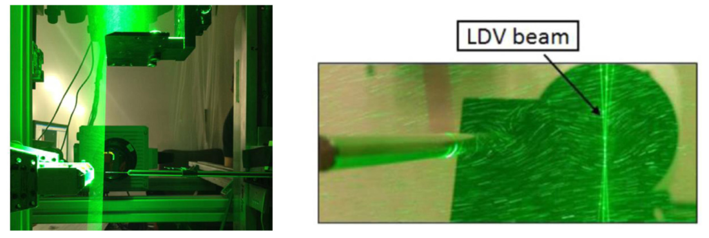
*그림 12 — 국소·순간 실제 속도를 정하기 위한 이중 실험의 예. 왼쪽: PIV와 열선 풍속계(Neal et al 2015); © IOP Publishing Ltd. All rights reserved. 오른쪽: PIV와 레이저 도플러 유속계(Boomsma et al 2016); © IOP Publishing Ltd. All rights reserved.*

Neal et al (2015)와 비슷하게 Boomsma et al (2016)는 공간 해상도가 다른 두 PIV 시스템과 레이저 도플러 유속계(laser doppler velocimetry, LDV) 시스템으로 동시 측정을 수행했다. HWA 시스템과 비교해 LDV 시스템은 비침습적이며 PIV 시야의 어느 점에서나 속도를 측정할 수 있다는 장점이 있다. 그러나 추적 입자의 도착 시간이 무작위이므로 LDV 시계열은 시간적으로 등간격으로 표본추출되지 않으며, 따라서 LDV 신호를 PIV 취득과 동기화할 수 없다. 또한 LDV 레이저 빔은 보통 PIV 영상에 보이므로(그림 12(오른쪽)), 영상 품질과 그에 따른 PIV 측정 정확도가 국소적으로 떨어지지 않도록 걸러내야 한다.

이중 실험을 설계하고 수행할 때는 기준 데이터와 MS 데이터의 측정 위치를 높은 수준으로 일치시키는 것이 무엇보다 중요하다는 점을 강조해 둔다. 실제로 작은 상대 정렬 오차도 MS와 기준 데이터의 비교에 영향을 주어 측정 오차를 과대 추정하게 만든다. 보통 보정 타깃(calibration target)만으로는 데이터 세트를 정렬하기에 충분하지 않아 추가 정렬이 필요하며, 이는 두 시스템의 속도장을 상호상관해 잔여 정렬 오차가 있는지 판정하는 방식으로 수행할 수 있다. 또한 MS와 HDR 사이의 속도 차는 MS의 실제 오차가 아니라 HDR 시스템의 오차에 영향을 받는 그 추정값이라는 점을 기억해야 한다. 이 때문에 HDR 시스템의 오차 크기는 MS 오차의 4분의 1을 넘지 않아야 한다(Sciacchitano et al 2015, Boomsma et al 2016).

국소·순간 측정 오차가 정해지면 정량된 불확도와 비교할 수 있다. 두 양을 비교하는 한 가지 방법은 불확도 포함률(uncertainty coverage, 또는 불확도 유효성 uncertainty effectiveness; Timmins et al 2012, Sciacchitano et al 2015)에 의존하는 것으로, 이는 측정 오차가 불확도 구간 안에 드는 표본의 백분율을 나타낸다. 불확도 포함률을 정하려면 선택한 신뢰수준에서 확장 불확도(expanded uncertainty)를 정해야 한다. 일부 PIV-UQ 방법은 원하는 어떤 신뢰수준에서도 확장 불확도를 계산할 수 있지만, 다른 방법들은 표준 불확도만 정량한다는 점에 유의하라. 후자의 경우 확장 불확도는 오차 분포에 대한 가정(보통 정규분포로 가정)에 근거해 계산해야 한다. 이 분석에는 보통 68% 또는 95% 신뢰수준(정규 오차 분포에서 각각 1-시그마와 2-시그마)을 고려하며, 통계가 덜 수렴한 경우에는 전자가 더 강건한 추정값을 준다(Sciacchitano et al 2015). 추정된 불확도 포함률이 선택한 신뢰수준에 가까울수록 정량된 불확도가 더 정확하다.

대안으로, 계통 오차가 없는 경우(평균 오차 0)에는 측정 오차의 제곱평균제곱근(root-mean-square, RMS)과 표준 불확도를 직접 비교할 수 있다(Sciacchitano et al 2015). 이 비교에는 오차 분포의 모양에 대한 가정이 필요 없다. 다만 오차와 불확도 데이터가 통계적으로 수렴했다(표본 수가 많다)고 가정한다. 이 접근법은 오차가 하나의 모분포가 아니라 분산이 서로 다른 여러 분포의 중첩에서 나올 때에도 쓸 수 있다. 이 개념의 확장은 C% 신뢰수준의 확장 불확도의 RMS를 오차 크기의 C% 백분위수와 비교하는 것이다(Xue et al 2014, Boomsma et al 2016).

### 4.2. 성능 평가 연구 (Performance assessment studies)

사후 불확도 정량화 접근법의 정확도를 평가하기 위해 여러 연구가 수행되었다. Timmins et al (2012)는 합성 영상과 PIV-HWA 측정 비교에 근거해 불확도 곡면 방법(uncertainty surface method)의 성능을 평가했다. 수치 평가는 95% 신뢰수준에서 계산한 불확도 포함률에 근거했다. 많은 경우 추정된 불확도 포함률이 95%보다 상당히 낮다는 것을 발견하고, 저자들은 오차원 매개변수(예: 전단율)가 잘못 추정되었거나 중요한 오차원(예: 면외 변위, 영상 잡음)이 무시되었다고 결론지었다. 방법의 포함률을 높이기 위해 저자들은 '불확도 하한(uncertainty floor)', 즉 불확도 추정값의 최소 가능 값을 도입할 것을 제안했으며, 그 값은 표준 상호상관(standard cross-correlation, SCC, Scarano and Riethmuller 2000) 영상 해석에서 0.050 화소, 강건 위상 상관(robust phase correlation, RPC, Eckstein and Vlachos 2009) 영상 해석에서 0.023 화소이다. 실험적 평가에서는 입자 상 변위가 작을수록 HWA와 PIV 데이터 사이의 불일치가 컸는데, 이는 불확도 곡면 방법으로 추정한 불확도 값이 큰 경우와도 대응했다.

비슷하게 Charonko and Vlachos (2013)는 합성 영상과 실험 영상 모두에 근거해 PPR 방법의 성능을 평가했으며, 68%와 95% 신뢰수준 모두에서 불확도 포함률 분석을 수행했다. PPR 방법의 신뢰성은 SCC 해석보다 RPC 해석에서 더 높았는데, 이는 전자의 영상 평가 알고리즘에서 상호상관 1차 피크 비(primary peak ratio) 값의 범위가 더 넓기 때문으로 보았다. Charonko and Vlachos (2013)와 같은 수치·실험 시험 사례에 근거해 Xue et al (2014, 2015)는 PPR, PRMSR, PCE, 상호상관 엔트로피, MI 방법의 성능을 평가했다. 저자들은 이론적 포함률과 계산값의 차이가 모든 지표에서 5% 미만이라고 결론지었다.

실제 오차의 RMS와 추정 불확도의 RMS를 비교해 Sciacchitano et al (2013)는 PIV 측정에서 가장 흔한 오차원에 대한 입자 불일치 방법(particle disparity method)의 민감도를 보였다. 또한 저자들은 실제 실험의 불확도가 60%를 넘는 정확도(불확도와 실제 오차 RMS의 불일치가 40% 미만)로 정량되었으며, 피크 로킹(peak-locking) 오차가 있을 때는 정확도가 더 낮았다고 보고했다. Wieneke (2015)는 Sciacchitano et al (2013)의 해석과 비슷한 매개변수를 고려해 합성 영상으로 상관 통계 방법(correlation statistics method)을 평가했다. 이 방법은 무작위 가우스 잡음, 입자 상 크기와 밀도, 면내 및 면외 변위를 바꾸어도 추정 불확도와 실제 오차 RMS가 잘 일치했다.

Bhattacharya et al (2018)는 합성 및 실험 시험 사례 모두에 근거해 상관 모멘트 방법(moment of correlation method)의 성능을 평가했다. 저자들은 예측된 불확도의 RMS가 전형적인 PIV 오차원의 넓은 변화 범위에서 오차 RMS의 경향을 따른다는 것을 발견했다. 두 양의 일치는 특히 큰 창 크기로 처리할 때 좋았고, 작은 창 크기에서는 0.02 화소 정도의 편향(bias)이 관찰되어 불확도 값이 과대 추정되었다.

최근 일부 연구는 서로 다른 사후 불확도 정량화 접근법의 성능을 비교 평가하는 데 초점을 맞추었다. Sciacchitano et al (2015)는 직사각형 천이 제트 유동의 측정에 근거해 불확도 곡면(US), 입자 불일치(PD), 피크 비(PR), 상관 통계(CS) 방법을 비교했다(그림 13). 영상 기록은 LaVision DaVis 8.1.6 소프트웨어로 해석했다.

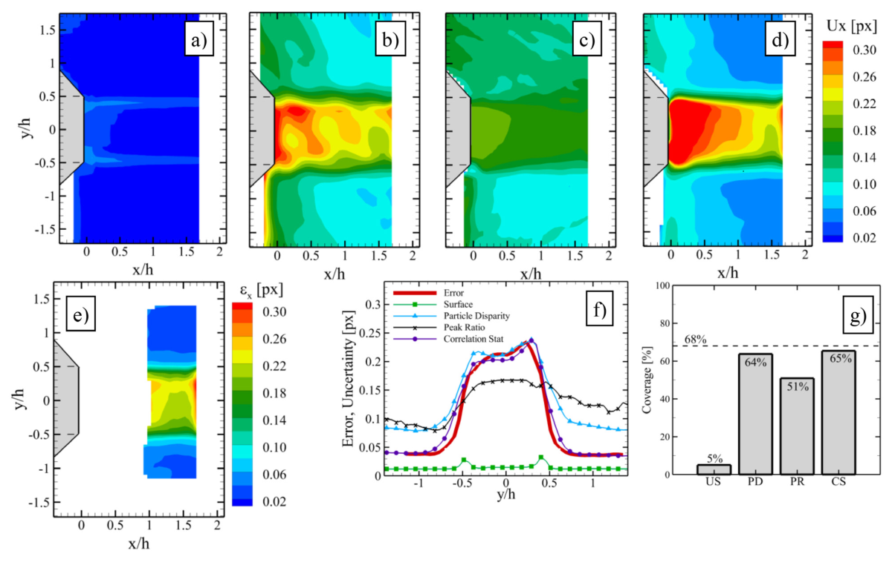
*그림 13 — 제트 중심부에 면외 운동이 있는 제트 유동 실험에서 제곱평균제곱근 불확도와 오차의 비교. 윗줄: 추정 불확도의 제곱평균제곱근. (a) 곡면 방법; (b) 입자 불일치 방법; (c) 피크 비 방법; (d) 상관 통계 방법. 아랫줄: (e) 오차 제곱평균제곱근; (f) x/h = 1.5의 단면을 따른 오차와 불확도 RMS의 비교. 통계 결과는 시간에 걸쳐 계산함; (g) 면외 입자 변위가 가장 큰 제트 중심부에서 68% 신뢰수준의 불확도 포함률. Sciacchitano et al (2015)에서 재구성한 그림. © IOP Publishing Ltd. All rights reserved.*

비교 평가 결과 네 방법 가운데 상관 통계 접근법이 가장 신뢰할 만한 불확도 추정값을 주었으며, 대부분의 경우 정확도가 85%를 넘었고 피크 로킹과 낮은 시딩(seeding) 농도가 있을 때에도 75% 정도였다. 또한 이 방법은 0.03~0.25 화소 범위의 오차 변화에 좋은 민감도를 보였다. Boomsma et al (2016)는 방법들의 비교 평가를 다른 영상 해석 소프트웨어, 즉 Purdue University의 PRANA, TSI의 Insight 4G, LaVision GmbH의 DaVis로 확장했다. 저자들은 1차 피크 비(PPR), 상호 정보량(mutual information, MI), 영상 일치(image matching, IM, 입자 불일치와 같음), 상관 통계(CS) 불확도 정량화 접근법의 성능을 비교했다. 평가는 제트 유동과 원기둥 주위 유동의 실험 데이터에 근거했으며, 기준 속도는 고해상도 PIV 시스템이 제공했다. Sciacchitano et al (2015)의 연구에 비해 PPR 방법은 성능이 크게 향상되었는데(그림 14 참조), 이는 Xue et al (2014)의 개선된 보정 모델과 강건 위상 상관 영상 해석(Eckstein and Vlachos 2009)의 사용 둘 다에 기인한 것으로 보았다.

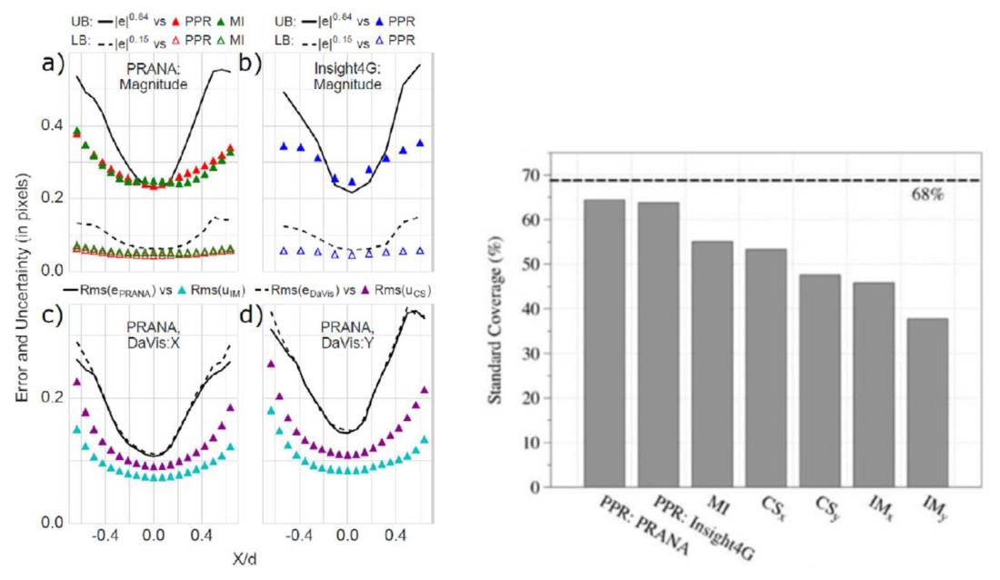
*그림 14 — 왼쪽: 다음 PIV-UQ 방법(및 영상 해석 알고리즘)에 대한 제트 유동을 가로지르는 폭 방향 RMS 오차와 불확도 분포: (a) PPR (PRANA); (b) PPR (Insight4G); (c)와 (d) IM (PRANA)과 CS (DaVis), 각각 X와 Y 변위 성분. UB는 불확도 상한(오차 크기 분포의 84.25%), LB는 불확도 하한(오차 크기 분포의 14.75%)을 나타낸다. 오른쪽: 68.5% 신뢰수준에서 제트 유동 실험의 표준 포함률. Boomsma et al (2016)에서 옮긴 그림. © IOP Publishing Ltd. All rights reserved.*

### 4.3. 응용 사례 조사 (Survey of applications)

사후 UQ 방법론의 응용은 넓은 범위의 유체역학 문제, 특히 비정상 난류 유동의 측정을 포함하는 문제에 대해 보고되었다. Quinn et al (2014)와 Floryan et al (2017)는 비압축성 유동 영역에서 피칭하는 날개의 비정상 후류의 불확도를 특성화하는 데 입자 불일치 방법을 썼으며, 자유류 속도의 1%~5% 정도의 불확도 값을 얻었다. 비슷한 결과가 Pascioni and Cattafesta (2018)에 보고되었는데, 이들은 Re = 1.7 × 10⁶에서 비정상 슬랫-코브(slat-cove) 유동장의 불확도를 정하는 데 상관 통계 방법을 썼다. 입자 불일치 방법을 써서 Shan et al (2014)는 Re = 25 000의 원관 유동에서 원형 오리피스 뒤의 불확도를 특성화했다. 저자들은 0.15~0.30 화소 정도의 가장 높은 불확도가 벽 근처와 전단층 영역에서 나타난다고 보고했다.

와류 및 선회 유동 측정에 대한 다양한 사후 PIV-UQ 방법론의 응용은 Yang et al (2016), Lignarolo et al (2016), Rajamanickam and Basu (2017), Marimon Givannetti et al (2017) 등이 보고했으며, 와류 중심부의 유동 측정은 바깥 영역보다 최대 한 자릿수 큰 불확도 값을 보인다는 점을 강조했다(그림 15(왼쪽 위)). 그 밖의 응용은 제트 유동(Pieris 2017, Charonko and Prestridge 2017), 난류 유동(Dou et al 2016, Elhimer et al 2017), 자연 대류(Naghib et al 2017), 유동 제어 연구(Yarusevich and Kotsonis 2017, Singh et al 2018), 공력음향 연구(Arce León et al 2016, Nickels et al 2016, Upadhyay et al 2017), 터보기계 문제(Saini et al 2016), 연소 문제(Andreini et al 2016, Ebi and Clemens 2016), 시험 설비의 특성화(Chikishev et al 2016), 건물 공기역학(Sánchez et al 2017)에서 순간 속도 불확도를 특성화하는 것을 목표로 했다. 대부분의 응용이 아음속 유동을 다루지만, 몇몇 연구는 천음속(Scharnowski et al 2017, Beresh et al 2017a), 초음속(Davis and Kumar 2015, Kreth et al 2016, Valentich et al 2016, Beresh et al 2017b, Mohaghar et al 2017), 심지어 극초음속(Zhu et al 2018) 유동 영역에서 사후 PIV-UQ 접근법을 사용했다. 그러나 3.2절에서 제시한 사후 UQ 방법들은 입자 미끄러짐(particle slip)에 연관된 불확도를 정량할 수 없으며, 이는 특히 극초음속 유동에서 지배적일 수 있다는 점을 짚어 둔다.

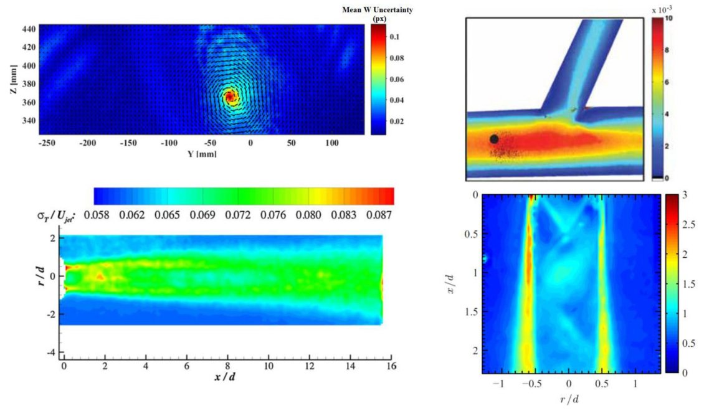
*그림 15 — 사후 PIV-UQ 방법의 응용 예. 왼쪽 위: 날개 끝 와류 유동에서 w-속도 성분의 평균 불확도(화소 단위로 표시). 불확도는 상관 통계 방법으로 정량함. Marimon Giovannetti et al (2017)에서 옮긴 그림. Copyright (2017) with permission from Elsevier. 오른쪽 위: 관상동맥 분기 모델(내부 공칭 지름: 3.96 mm; 입구 속도: 0.2 m s⁻¹)에서 1차 피크 비 방법으로 추정한 m/s 단위의 속도 불확도. Raben et al (2015)에서 옮긴 그림. © 2014 Società Italiana Biomateriali. 왼쪽 아래: 마하 1.80의 지름 1 mm 초음속 자유 제트에 대한 시간 평균 속도 불확도장. 불확도는 상관 통계 방법으로 정량함. Kreth et al (2016)에서 옮긴 그림. © Springer-Verlag Berlin Heidelberg 2016. With permission of Springer. 오른쪽 아래: 마하 1.5의 지름 25.4 mm 초음속 자유 제트에 대한 시간 평균 속도 불확도장. 불확도는 불확도 곡면 방법으로 정량하고 제트 속도의 백분율로 표시함. Davis and Kumar (2015)에서 옮긴 그림. © Springer-Verlag Berlin Heidelberg 2014. With permission of Springer.*

물리적 발견을 위한 실험 외에도, 사후 UQ 방법론은 CFD 시뮬레이션 검증용 데이터베이스를 제공하기 위한 검증 기준 실험(validation benchmark experiments)에 쓰였다. 이러한 응용의 예로는 연소기 유동(Andreini et al 2017), 강제 대류 유동(Harris et al 2016), 생체의학 유동(Raben et al 2015, Paliwal et al 2017)이 있다.

또한 사후 UQ 접근법은 실험 매개변수의 선택을 지원하거나(Persoons 2015), 데이터 후처리 또는 데이터 동화(data assimilation) 접근법을 통한 잡음 변동 억제의 입력을 제공함으로써(de Baar et al 2014, Brindise and Vlachos 2017, Wieneke 2017a, Symon et al 2017) 실험 결과의 품질을 높이는 데 쓰였다.

끝으로, 매우 다양한 유체역학 문제와 여러 목적에서 사후 UQ 접근법이 성공적으로 응용되었다는 사실은 PIV 불확도가 공간과 시간에 따라, 그리고 실험마다 크게 변한다는 것을 확인해 준다(그림 15 참조). 서로 다른 속도 성분 사이에 3배, 유동장의 서로 다른 위치 사이에 한 자릿수의 변화가 보고되었다. 이러한 불확도는 0.1 화소라는 보편 불확도 상수나 합성 데이터와 몬테카를로 시뮬레이션에 근거해 얻은 값보다 상당히 크거나 작을 수 있으므로, 적절한 사후 UQ 접근법을 통한 정확한 평가가 필요하다.

## 5. PIV 불확도 전파 (PIV uncertainty propagation)

PIV 측정의 목적은 순간 속도장을 정하는 데 그치는 경우가 드물고, 흔히 파생된 통계량(예: 시간 평균 속도, 레이놀즈 응력, 고차 통계 모멘트)이나 순간량(예: 와도, 가속도)의 평가로 확장된다. 또한 측정된 속도장으로부터 순간 및 시간 평균 압력장을 구할 수 있다(van Oudheusden 2013). 따라서 순간 속도장을 계산하고 그 불확도를 정량하고 나면, 관심 있는 파생량의 불확도를 정량하기 위해 불확도 전파(uncertainty propagation) 접근법을 쓴다.

실험 과학과 공학의 다른 많은 분야에서처럼 PIV 데이터의 불확도 전파는 보통 테일러 급수법(Taylor series method, TSM)이나 몬테카를로법(Monte Carlo method, MCM)으로 수행한다. $N$개의 측정 변수의 함수인 관심량 $r$을 생각하자:

$$r = r\left(x_1, x_2, \ldots, x_N\right). \tag{12}$$

TSM에서 측정 변수의 계통 불확도와 무작위 불확도(각각 $b$와 $s$)를 모두 고려한 $r$의 합성 표준 불확도는 다음과 같이 계산한다(Coleman and Steele 2009):

$$u_r^2 = \sum_{i=1}^{N}\theta_i^2 b_i^2 + 2\sum_{i=1}^{N-1}\sum_{j=i+1}^{N}\theta_i\theta_j b_{ij} + \sum_{i=1}^{N}\theta_i^2 s_i^2 + 2\sum_{i=1}^{N-1}\sum_{j=i+1}^{N}\theta_i\theta_j s_{ij} \tag{13}$$

여기서 $\theta_i = \partial r/\partial x_i$는 민감도 계수(sensitivity coefficients)이고, $b_{ij}$와 $s_{ij}$는 각각 상관된 계통 불확도와 무작위 불확도를 나타낸다.

MCM에서는 각 오차원마다 그 분포에서 무작위 표본을 뽑아 측정 변수 $x_i$에 더하고, 그 결과로 관심량 $r$을 계산한다. 이 과정을 $r$의 분포가 수렴할 때까지 반복하고, 그 분포로부터 $r$의 불확도를 평가한다.

이 접근법들의 이론과 구현에 대한 상세한 논의는 표준 교과서(예: Bendat and Piersol 2010, Coleman and Steele 2009)와 논문(George et al 1978, Benedict and Gould 1996)에 나와 있다. 이하에서는 PIV의 불확도 전파에 이 방법들을 적용할 때의 특수성에 초점을 맞춘다.

### 5.1. 파생 통계량의 불확도 (Uncertainty of derived statistical properties)

여러 연구가 순간 속도 성분으로부터 관심 통계량으로의 불확도 전파에 초점을 맞추었다. Gui et al (2001a)는 모형 규모 선박의 후류에서 평균 속도, 속도 분산과 공분산(각각 레이놀즈 수직 응력과 전단 응력)의 불확도를 정량하기 위해 테일러 급수법에 근거한 철저한 불확도 해석을 수행했다. 저자들은 물체 크기, 영상 크기(따라서 축척 계수), 레이저 펄스 간격 시간, 측정된 입자 상 변위, 자유류 속도 측정, 좌표 편차가 전체 불확도에 기여하는 것을 고려해 불확도 전파식 (13)을 사용했다. 계통 불확도와 정밀 불확도(precision uncertainty)를 모두 고려했다. 계통 불확도는 보정(물체 크기, 영상 크기, 좌표 편차)으로 추정하거나, 제조사 사양(레이저 펄스 간격 시간)에서 가져오거나, 이전 추정값(자유류 속도)에서 취하거나, 실험과 시뮬레이션으로 계산했다(측정된 입자 상 변위). Adeyinka and Naterr (2005)는 PIV와 LIF 측정으로 평가한 국소 엔트로피 생성의 불확도를 정하기 위해 Gui et al (2001a)와 유사한 접근법을 썼다. Wilson and Smith (2013a)는 평균 편향이 단 하나의 오차원, 즉 실제 속도만의 함수라는 단순화 가정을 없애 Gui et al (2001a)의 연구를 확장했다. 그 대신 이들은 Timmins et al (2012)의 불확도 곡면 방법으로 순간 편향과 무작위 불확도를 추정했다. 또한 완전히 상관된 편향($b_{ij} = b_i b_j$)과 상관되지 않은 편향($b_{ij} = 0$)을 구별했다. 저자들은 순간량들이 동일한 보정, 시스템 편향(예: 온도 효과), 알고리즘 처리의 영향을 받는 PIV 실험에서는 편향 오차가 흔히 상관되어 있다고 지적했다. 상관된 편향의 경우 평균의 불확도 식은 다음과 같다.

$$U^2_{\overline{\Delta X}} = \sqrt{\left(\frac{1}{N}\sum_{i=1}^{N} b_i\right)^2 + \left(\frac{t_{C.I.,\nu}\, s_{\Delta X}}{\sqrt{N}}\right)^2} \tag{14}$$

[역주] 좌변이 $U^2$인데 우변에 제곱근이 있어 차원이 맞지 않는다. 원문 표기 그대로 옮겼다.

여기서 $s_{\Delta X}$는 표본의 표준편차, $N$은 (통계적으로 독립인) 표본 수, $t_{C.I.,\nu}$는 원하는 신뢰구간을 나타내는 $t$-통계량이며 자유도는 $\nu = N - 1$이다(Bendat and Piersol 2010). 우변의 첫째 항은 편향 불확도를, 둘째 항은 유한한 앙상블 크기로 인한 무작위(정밀) 불확도를 나타낸다. 편향 불확도 추정값은 보통 얻기가 매우 어렵다는 점을 짚어 둔다(현재까지 Timmins et al (2012)의 불확도 곡면 방법만이 편향 불확도에 직접 접근하게 해 준다). 유한한 질의창(interrogation window) 크기로 인한 공간 변조(spatial modulation)에 연관된 계통 불확도를 정량하려면, PIV 영상을 서로 다른 질의창 크기로 처리하고 결과의 변동을 보고할 것을 권한다. 또한 평균의 불확도를 정하는 데에는 순간 측정의 무작위 불확도(이는 $s_{\Delta X}$에 포함됨)를 알 필요가 없다는 점에 유의해야 한다.

평균에 대해서는 대칭 불확도(상한이 하한과 같음)를 계산했지만, 분산과 공분산에 대해서는 비대칭 불확도를 추정했다. 특히 무작위 오차와 계통 오차의 분산은 언제나 측정된 실제 분산과 공분산을 과대 추정하게 만들므로, 하한이 상한보다 크다는 것이 증명되었다. Wilson and Smith (2013b)는 제트 유동에서 PIV와 HWA 측정을 비교해 평균 속도와 레이놀즈 수직 응력의 추정 불확도의 정확도를 평가했다. 불확도 전파 방법론은 추적 입자 농도, 속도 구배, 입자 상 크기와 변위의 변화를 고려해 시연되었다. 영상 해석은 두 가지 알고리즘, 즉 LaVision DaVis 7.2와 Purdue University의 PRANA로 수행했다. 그림 16에서 보듯이 DaVis 알고리즘을 쓰면 불확도가 보통 과소 추정되었고, PRANA 알고리즘을 쓰면 비교적 높은 포함률을 보였다.

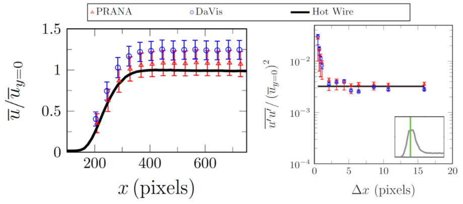
*그림 16 — 왼쪽: 제트 중심부 변위 0.5 화소일 때 열선 및 PIV 측정(DaVis 7.2와 PRANA)으로 얻은 시간 평균 속도 크기 분포. 오른쪽: 입자 상 변위에 따른 레이놀즈 수직 응력. Wilson and Smith (2013b)에서 재구성한 그림. © IOP Publishing Ltd. All rights reserved.*

Sciacchitano and Wieneke (2016)에서는 Wilson and Smith (2013a)와 유사한 접근법을 따라 여러 통계량의 불확도 식을 유도했다. 후자의 저자들과 달리 Sciacchitano와 Wieneke는 부호와 크기를 아는 각 계통 오차가 제거되었다고 가정하고 무작위 오차와 불확도에 초점을 맞추었다. Brown et al (1996)이 제안한 대로 식 (13)의 상관 항은 다음과 같이 계산했다.

$$s_{ij} = \rho\left(\delta x_i, \delta x_j\right) s_i s_j \tag{15}$$

$\rho(\delta x_i, \delta x_j)$는 $x_i$와 $x_j$의 오차 사이의 상호상관 계수이며 $-1 \leqslant \rho(\delta x_i, \delta x_j) \leqslant 1$이다. 저자들은 공간이나 시간에서 인접한 측정의 오차는 어느 정도 상관을 가질 수 있으므로 일반적으로 $\rho(\delta x_i, \delta x_j) \neq 0$이라고 지적했다. 대부분의 PIV-UQ 방법은 $\rho(\delta x_i, \delta x_j)$ 값을 계산할 수 없으므로, 이를 합성 영상과 몬테카를로 시뮬레이션으로 미리 정해 둘 것을 권한다. 또한 저자들은 식 (14)의 정밀 불확도를 평가할 때 상관되지 않은 표본의 유효 개수 $N_{\mathrm{eff}}$를 쓰는 것이 중요하다고 강조했다. $N_{\mathrm{eff}}$는 전체 표본 수 $N$과 크게 다를 수 있는데(보통 $N_{\mathrm{eff}} \leqslant N$), 특히 고속 PIV 시스템으로 수행한 시간 분해(time-resolved) 측정에서 그러하다. 이 경우 비교적 높은 취득 주파수 때문에 표본들 사이에 0이 아닌 시간 상관이 생긴다(Thiébaux and Zwiers 1984, Falchi and Romano 2009). $N_{\mathrm{eff}}$의 평가와 그것이 상관된 데이터의 평균 불확도에 미치는 영향에 대한 상세한 논의는 Smith et al (2018)에 있다. Charonko and Prestridge (2016)는 측정된 속도장의 무작위 오차와 PIV 영상 평가 및 공간 미분으로 인한 계통 오차를 모두 고려해, 테일러 급수법으로 난류 소산율의 불확도를 평가했다.

잭나이프(jackknife, Tukey 1958)와 부트스트랩(bootstrap, Efron 1979) 같은 재표본추출 알고리즘은 난류 통계량의 불확도를 정하는 대안적 접근법이다. 이 접근법들은 가용 데이터의 부분집합을 써서 표본 통계량의 정밀 불확도를 추정한다. 각 부분집합으로 원하는 표본 통계량을 계산하고, 서로 다른 부분집합의 결과가 그 통계량의 분포를 이루며, 그 분포로부터 불확도를 평가한다. 이 방법들의 주된 장점은 오차 분포를 모르거나 표준 불확도 계산식을 모르는 경우에도 일반적으로 적용할 수 있다는 것이다. 이 때문에 고차 난류 통계량의 불확도 평가에 적합하다(Benedict and Gould 1996). Stafford et al (2012)는 반경류 팬 출구의 난류 유동을 조사하기 위해 저속 PIV 측정을 수행했다. 저자들은 표본 크기 $N$의 함수로 정밀 불확도를 해석해 1차 통계량(x, y 속도 성분의 평균과 난류 강도)과 2차 통계량(레이놀즈 전단 응력)의 수렴에 초점을 맞추었다. 테일러 급수법 공식으로 추정한 불확도와 부트스트랩으로 계산한 불확도를 비교해, 저자들은 $N > 10^3$에서 두 접근법이 비슷한 결과를 준다고 결론지었다. 부트스트랩 접근법은 아무 가정 없이 측정 통계량의 오차 분포를 제공한다는 부가 가치를 보였다. Theunissen et al (2008)는 시간 분해 PIV 측정을 수행할 때 중요한 역할을 하는 표본의 시간 상관을 고려하기 위해 종속 순환 블록 부트스트랩(dependent circular block bootstrapping) 접근법을 제안했다. 저자들은 상관되지 않은 표본과 강하게 상관된 표본의 두 경우를 모두 고려해 표본 평균의 신뢰구간을 정하는 데 이 접근법을 시연했다. Chatellier et al (2013)는 표본 통계량의 불확도를 정량하기 위한 다중 블록 취득(multi-block acquisition)의 사용을 논의했다. 원리는 시간 분해 PIV 측정에서 상관된 표본들의 블록을 취득하되, 블록들이 서로 상관되지 않도록 각 블록 사이에 비교적 큰 시간 간격을 두는 것이다. 레이저 도플러 유속계 데이터에 근거해 저자들은 표본 사이의 시간 상관을 고려하지 않는 표준 부트스트랩에 비해 이 기법이 우월함을 보였다.

### 5.2. 파생 순간량의 불확도 (Uncertainty of derived instantaneous properties)

PIV 측정은 흔히 와류를 검출하고 그 순간 매개변수, 즉 위치, 범위, 그리고 어떤 강도 척도를 정량적으로 평가하기 위해 수행된다(Vollmers 2001). 와도, 순환, 전단율, 변형률 같은 순간 운동학 변수는 측정된 속도장으로부터 공간 미분으로 직접 계산된다. 이러한 순간량의 불확도를 정량하기 위해 보통 몬테카를로법이나 테일러 급수법을 쓴다. Oseen 와류 유동을 모사한 합성 영상을 써서 Luff et al (1999)는 측정 오차가 속도장에서 와도장으로 어떻게 전파되는지 조사했다. 저자들은 와도 계산을 위한 여러 알고리즘과 속도장 및 와도장에 대한 여러 공간 필터를 고려했다. 해석 결과 Luff et al은 표준 3점 유한차분 와도 알고리즘을 쓰고 속도 데이터를 국소 다항 회귀와 가우스 평활로 필터링할 때 와도 불확도가 가장 낮다고 결론지었다. 비슷하게 Fouras and Soria (1998)는 무작위 속도 오차가 무작위 와도 오차로 전달되는 이론식을 유도하고, 무작위 속도 오차의 효과는 와도 산포를 키우는 것임을 보였다. 또한 속도의 공간 표본 간격을 키우면 더 큰 편향 오차가 생겨 최대 와도를 과소 추정하게 된다. 더 최근에 Ma and Jiang (2018)는 2D2C PIV의 원근 오차(perspective errors)가 측정 와도에 계통 오차를 일으키며, 이는 면외 속도 성분의 면내 도함수에 비례함을 보였다.

테일러 급수법에 근거해 Sciacchitano and Wieneke (2016)는 중심차분 기법으로 평가한 와도의 표준 불확도 식을 유도했다.

$$U_{\omega} = \frac{U}{d}\sqrt{1 - \rho\left(2h\right)}. \tag{16}$$

식 (16)에서 $U$는 속도의 국소 표준 불확도(두 속도 성분에 대해 같다고 가정), $h$는 격자 간격(x, y 방향 모두에서 균일하다고 가정), $\rho(2h)$는 공간 간격 $2h$인 두 격자점에서 측정 오차의 상호상관 계수이다. [역주] 식 (16)의 분모 $d$는 본문 설명에 정의되어 있지 않으며 격자 간격 $h$로 보인다. 원문 그대로 옮겼다. 이 식은 무작위 오차만 고려하고 절단과 공간 변조로 인한 계통 오차는 무시해 얻었다. 속도의 2차원 발산(divergence)에 대해서도 유사한 식을 얻었다. 일반적으로 측정 오차의 공간 상관($0 < \rho(2h) \leqslant 1$)은 속도 오차가 상관되지 않은 경우($\rho(2h) = 0$)에 비해 와도 불확도를 줄인다. 특정 처리 알고리즘에 대한 $\rho(2h)$ 값은 합성 영상과 몬테카를로 시뮬레이션으로 평가할 수 있다. Sciacchitano와 Wieneke는 32 × 32 화소 질의창과 75% 중첩률에서 $\rho(2h) = 0.45$를 보고했으며, 중첩률이 50% 이하이면 $\rho(2h)$는 0이 된다.

### 5.3. 스테레오 PIV 불확도 정량화 (Stereo-PIV uncertainty quantification)

스테레오 PIV의 불확도 해석은 주로 두 카메라가 측정한 변위의 불확도와 기하 매개변수(즉 광학 배율, 카메라 각도와 거리, 물체 거리)의 불확도를 전파하는 방식으로 사전에 수행되었다. 이 해석은 평행이동(translation) 스테레오 시스템(Arroyo and Greated 1991, Prasad and Adrian 1993, Lawson and Wu 1997 등)과 각변위(angular displacement) 시스템(Lawson and Wu 1997, Zang and Prasad 1997 등) 모두에 대해 수행되었다. 변수들이 상관되지 않고 정합(registration)이 완벽하다고 가정하고, Prasad (2000)는 면외 속도 성분의 무작위 불확도가 면내 속도 성분의 그것보다 tan(θ)배 크다는 것을 보였다. 여기서 θ는 두 카메라 사이의 반각이다. 또한 두 카메라가 최종 결과에 똑같이 기여하므로 면내 속도 성분의 무작위 불확도는 단일 카메라의 것보다 1/√2만큼 작다. 그리고 원근 오차는 스테레오 배치로 제거되지만, 단일 카메라 PIV 측정에서는 상당할 수 있다. Willert (1997)는 선형 오차 전파로 예측한 스테레오 PIV 무작위 불확도를 정지 유동에서의 측정으로 직접 평가한 값과 비교했다. 면내 속도 성분의 예측 불확도는 측정값과 일치했지만, 면외 속도 성분의 불확도는 예측값을 약 10% 초과했다. Van Doorne et al (2003)는 유한한 정합(계통) 오차의 경우로 불확도 해석을 확장했는데, 이 오차는 영상면에서 물리면으로의 사상 함수(mapping function)가 부정확하거나 광 시트 중심과 보정 격자 위치가 어긋나서 생길 수 있다(Coudert and Schon 2001). 후자는 보통 자기 보정(self-calibration) 절차로 보정한다(Wieneke 2005). 그럼에도 큰 스테레오 각과 두꺼운 레이저 시트는 자기 보정이 수렴한 뒤에도 속도에 상당한 편향 오차를 일으킬 수 있으며, 특히 입자 상 지름이 작고 시딩 밀도가 높거나 면외 속도 구배가 있을 때 그러하다(Beresh et al 2016).

최근에야 Bhattacharya et al (2016)가 스테레오 PIV 측정 체인의 각 단계에서 불확도를 사후에 정량하고 요소 불확도를 재구성된 속도 성분으로 전파하는 체계를 도입했다. 그림 17의 흐름도로 요약된 이 체계는 스테레오 각의 불확도를 정하기 위해 물리 좌표 위치, 삼각측량된 z-평면 위치, 사상 함수 계수의 불확도를 고려한다. 끝으로 이를 두 카메라가 측정한 평면 속도의 불확도와 결합해 세 속도 성분의 불확도를 계산한다. 저자들은 자기 보정 절차를 적용한 뒤에는 스테레오 속도 성분의 불확도가 평면 속도 추정값의 불확도에 지배된다는 것을 발견했다. 제안된 체계의 불확도 포함률은 몬테카를로 시뮬레이션과 실험적 평가 모두에서 이론값과 잘 일치했다.

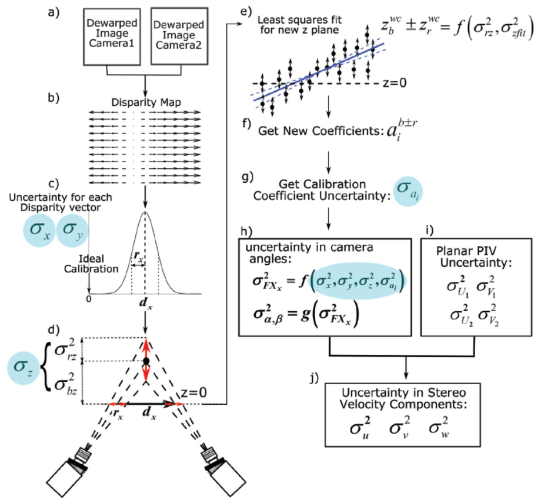
*그림 17 — 스테레오 PIV의 불확도 전파 흐름도. (a)–(c) 물리 좌표계의 불확도; (d)와 (e): 삼각측량된 z-위치의 불확도; (f)와 (g) 사상 함수 계수의 불확도; (h) 스테레오 각의 불확도; (i) 평면 속도 측정의 불확도; (j) 스테레오 PIV 측정의 합성 불확도. Bhattacharya et al (2016)에서 옮긴 그림. © IOP Publishing Ltd. All rights reserved.*

최근에 발표되었음에도 Bhattacharya et al의 스테레오 PIV 불확도 정량화 체계는 아음속과 초음속 유동 영역 모두에서 여러 유동 측정에 이미 성공적으로 쓰였으며, 합성 제트(Paolillo et al 2017), 생체의학 유동(Medero et al 2018), 원자로 모형의 내부 유동(Nguyen and Hassan 2017, Nguyen et al 2018), 초음속 제트(Beresh et al 2017a, Beresh 2018), 충격파-경계층 상호작용(Vanstone et al 2018)에 응용되었다. 실험 데이터에 이 체계를 적용한 결과, 전형적인 스테레오 PIV 불확도는 0.07~0.4 화소 범위이고 면외 변위 성분은 면내 변위 성분보다 2~3배 큰 불확도를 갖는 것으로 나타났다.

### 5.4. 체적 PIV/LPT 불확도 정량화 (Volumetric PIV/LPT uncertainty quantification)

토모그래피 PIV(Elsinga et al 2006b, Scarano 2013)나 3차원 라그랑지안 입자 추적(Lagrangian particle tracking, LPT, Maas et al 1993)에 의한 체적 유동 측정에서는, 서로 다른 시야각의 여러 카메라를 쓰고 입자 상의 3차원 분포를 재구성하기 때문에 측정 불확도의 정량이 더 복잡해진다. 예를 들어 토모그래피 재구성에는 '유령 입자(ghost particles)'라 부르는 가짜 강도 피크가 포함되며(Elsinga et al 2006a), 이는 계산된 속도 구배를 편향시키는 효과가 있다(Elsinga et al 2011, Elsinga and Tokgoz 2014). 그러나 시간 분해 취득에 담긴 시간 정보를 이용하면 유령 입자 문제는 상당히 줄어든다(Novara et al 2010, Lynch and Scarano 2015, Schanz et al 2016).

위와 같은 추가적 복잡성 때문에 3D-PIV/LPT의 불확도 정량화 주제는 아직 초기 단계로 여겨지며(Discetti and Coletti 2018), 주로 합성 영상과 몬테카를로 시뮬레이션에 근거한 사전 접근법으로 다루어졌다(예를 들어 제4회 국제 PIV 챌린지의 사례 C와 D 참조, Kähler et al 2016). 비압축성 유동의 질량 보존 준수(솔레노이드 속도장)에 근거한 사후 접근법이 측정된 속도 성분과 그 공간 도함수의 불확도를 정량하는 데 적용되었다(Scarano and Poelma 2009, Atkinson et al 2011, Lynch and Scarano 2014). 비압축성 유동의 시간 분해 측정의 경우에는 속도 발산 접근법의 대안으로 와도 수송 방정식의 준수가 제안되었다(Novara 2013). Sciacchitano and Lynch (2015)는 유동 비압축성 가정에 의존하지 않고 각 속도 성분의 불확도를 정량하려는 시도로 입자 불일치 접근법을 토모그래피 PIV로 확장하는 것을 연구했다.

라그랑지안 입자 추적에서는 흩어진 속도 벡터를 직교 격자로 보간하는 데서 추가 오차원이 생긴다. 이 불확도를 직접 정량하는 방법이 Schneiders and Sciacchitano (2017)에 의해 제안되었는데, 궤적의 작은 비율을 기준으로 삼아 나머지 궤적으로 얻은 속도 보간의 정확도를 평가한다.

체적 유속 측정의 불확도 정량화에서 앞으로의 발전은 상관 기반 영상 해석보다 우월함을 보인 라그랑지안 입자 추적 접근법에 초점을 맞출 것으로 예상된다(Kähler et al 2016). 이 경우 주된 과제는 측정된 입자 궤적의 불확도를 정량하면서 올바른 궤적과 잘못된 궤적을, 그리고 각 궤적을 따른 물리적 속도 변동과 가짜 속도 변동을 구별하는 것이다.

### 5.5. 압력과 압력 구배의 불확도 (Uncertainty of pressure and pressure gradient)

PIV 속도 데이터로부터 정압을 정하는 일은 지난 10년 동안 흔해졌다(van Oudheusden 2013). 구한 정압장의 전체 불확도는 여러 매개변수에 좌우되며, 그 매개변수는 다음을 포함한다(Charonko et al 2010, de Kat and van Oudheusden 2012, van Oudhesden 2013, Azijli et al 2016, Pan et al 2016, McClure and Yarusevych 2017): 기반 속도장의 불확도; 측정의 공간·시간 해상도; 물질 가속도(material acceleration)를 계산하는 데 쓴 접근법; 경계 조건의 불확도; 압력 적분 절차; 평면 PIV 데이터로 3차원 유동의 압력장을 재구성할 때의 모델링 오차.

De Kat and van Oudheusden (2012)는 물질 가속도의 오일러(Eulerian) 및 라그랑지안(Lagrangian) 정식화를 모두 고려해, 물질 가속도를 통한 속도 불확도의 전파를 위한 테일러 급수법 기반 체계를 개발했다. 해석에서 저자들은 속도 오차가 공간적으로 상관되지 않고 정규분포를 따른다고 가정해 다음을 얻었다.

$$U_{\left(\frac{Du}{Dt}\right)\mathrm{Eul}} \approx U\sqrt{\frac{1}{2\Delta t^2} + \left|\nabla \boldsymbol{u}\right|^2 + \frac{\left|\boldsymbol{u}\right|^2}{2h^2}} \tag{17}$$

$$U_{\left(\frac{Du}{Dt}\right)Lagr} \approx U\sqrt{\frac{1}{2\Delta t^2} + \frac{\left|\nabla \boldsymbol{u}\right|^2}{2}} \tag{18}$$

여기서 $h$는 격자 간격이고 $\Delta t$는 연속한 속도장 사이의 시간 간격이다. 속도 오차가 공간적으로 상관되지 않는다는 가정은 인접 속도 벡터의 공간 상관을 고려하는 더 현실적인 경우에 비해 불확도 값을 과대 추정한다는 점에 유의하라(Sciacchitano and Wieneke 2016). 과대 추정량은 오일러 정식화에서 $\frac{U}{h}\left|\boldsymbol{u}\right|\sqrt{\frac{\rho(2h)}{2}}$와 같고, 라그랑지안 정식화에서는 보통 무시할 만한데, 후자는 서로 다른 시각의 속도 벡터 차에 의존하며 그 오차들은 상관되지 않는다고 가정할 수 있기 때문이다. De Kat and Ganapathisubramani (2012)와 Laskari et al (2016)는 시간 분해 체적 PIV 측정의 경우와, 압력 구배를 정하기 위해 테일러 가설(Taylor's hypothesis)을 적용해야 하는 비시간 분해 측정의 경우를 고려해 해석을 확장했다. 오일러 관점에서 평가한 물질 가속도의 경우(식 (17)), 도함수 추정자의 유한 해상도에서 생기는 절단 오차 항까지 포함하는 해석적 불확도 모델이 McClure and Yarusevych (2017a)에 의해 개발되었다. Van Gent et al (2018)는 물질 가속도를 두 점 사이의 단순 중심차분이 아니라 여러 적분 단계를 거친 유체 덩어리의 의사 추적(pseudo-tracking)으로 계산하는 경우를 고려하도록 이론 체계를 더 확장했다. 후자의 경우 앞선 적분 단계에서 생긴 위치 오차가 이후 적분 단계에서 추가적인(흔히 상관된) 위치 및 속도 오차를 낳는다. 또한 저자들은 의사 궤적을 따른 속도 값의 최소제곱 회귀로 물질 도함수를 계산하는 경우의 불확도 해석식을 개발하고, 후자의 접근법이 속도 오차를 억제하는 데 더 효과적임을 보였다. 끝으로 수치 보간과 적분 절차에 연관된 불확도의 상한을 정했다. Pan et al (2016)는 푸아송(Poisson) 방정식의 해로 평가한 정압장의 불확도를 정량하기 위한 이론 체계를 세웠다. 저자들은 측정 오차가 푸아송 방정식을 통해 어떻게 전파되는지 조사해 압력장의 불확도 한계를 해석적으로 정량했다. 유동 영역의 크기, 유동 유형, 경계 조건의 모양·유형·불확도의 영향을 면밀히 조사했으며, 특히 작은 유동 영역에서 경계 조건 유형이 압력 불확도에 큰 영향을 준다는 것을 증명했다.

순간 압력 구배 오차를 재구성하는 접근법이 McClure and Yarusevych (2017b)에 의해 발산-회전(divergence-curl) 시스템의 해에 근거해 제안되었다. 오차 없는 경계 조건을 가정하고, 저자들은 압력 구배 오차의 근사장을 재구성할 수 있음을 보였다. 측정된 압력 구배에서 오차장을 빼면 내부 영역 전체에서 더 정확한 압력 추정값을 얻었다(그림 18(위)). PIV 기반 압력 데이터의 사후 불확도 정량화를 위한 베이즈(Bayesian) 체계가 Azijli et al (2016)에 의해 도입되었다. 이 체계에서는 사전 분포(속도장에 대한 사전 지식, 예: 유체 운동의 구성 방정식 준수)와 속도 불확도의 통계 모델로부터 사후 분포(PIV 속도 측정이 주어졌을 때 실제 속도의 확률분포)를 구한다. 이어서 사후 분포를 압력에 대한 이산화된 푸아송 방정식으로 전파해 측정된 정압장의 확률밀도함수를 얻는다. 이 연구는 또한 푸아송 방정식의 해로 계산한 압력 불확도에 대해 테일러 급수법에 근거한 식을 제공하는데, 이는 속도 오차가 공간적으로 상관되지 않는다는 단순화 가정에 의존한다. 두 사후 UQ 접근법의 비교는 베이즈 체계의 우월성을 부각했다. 솔레노이드 사전 분포와 물질 가속도의 라그랑지안 정식화를 쓸 때 압력 불확도의 정확도가 가장 높았으며, 1-σ와 2-σ 불확도에 대해 각각 68%와 94%의 포함률 값을 주었다(그림 18(아래)).

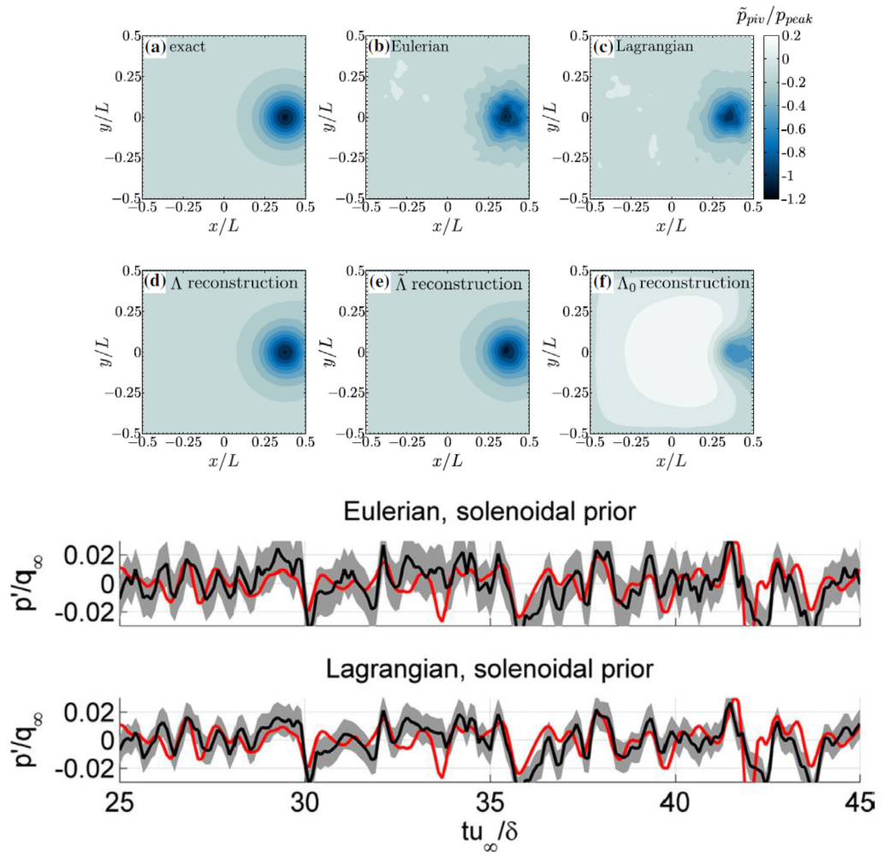
*그림 18 — 위: 램-오신(Lamb-Oseen) 와류의 압력장. 압력 구배 오차 보정을 하지 않은 해(첫째 줄)와 한 해(둘째 줄)의 비교. McClure and Yarusevych (2017b)에서 옮긴 그림. © Springer-Verlag Berlin Heidelberg 2017. With permission of Springer. 아래: 난류 경계층에서 마이크로폰 측정의 기준 압력 시계열(빨강)과 PIV(검정)의 비교. 회색 영역은 68.3% 신뢰수준에서 베이즈 체계로 추정한 불확도를 나타낸다. Azijli et al (2016)에서 옮긴 그림. CC BY 4.0. © The author(s) 2016.*

## 6. 결론 (Conclusions)

PIV 데이터의 불확도 정량화는 PIV 공동체 안에서 큰 관심을 받는 주제가 되었다. 초기에는 PIV-UQ를 주로 사전에 다루었으며, PIV 기법의 정확도에 대한 일반적인 수치를 정하는 것이 목표였다. 이는 측정 체인의 이론적 모델링, 합성 영상과 몬테카를로 시뮬레이션, 또는 입자 운동이 알려진 전용 실험으로 이루어졌다. 더 최근에는 측정된 속도장의 국소·순간 불확도를 정량하려는, 데이터 기반 사후 불확도 정량화로 관심이 옮겨 갔다. 간접 방법과 직접 방법이 도입되었다. 전자는 보통 보정으로 얻은 미리 계산된 정보를 쓰고, 후자는 추정된 변위를 사전 정보로 써서 영상면에서 직접 측정 불확도를 추출한다. 이 사후 UQ 접근법들의 평가는 몬테카를로 시뮬레이션을 통해 수치적으로, 그리고 실제 유속을 이론이나 더 정확한 측정 시스템의 사용(이중 실험)으로 아는 전용 실험을 통해 실험적으로 수행되었다. 비교 평가 연구들은 서로 다른 유동 및 결상 조건에서 이 접근법들의 강점과 약점을 부각했다. 특히 간접 방법은 보통 측정 불확도에 대해 더 완전한 정보(예: 계통 및 무작위 불확도 둘 다, 오차 분포, 이상값에 연관된 불확도를 정량하는 능력)를 제공하지만, 측정 오차 변화에 대한 민감도는 비교적 낮았다. 반대로 직접 방법은 보통 오차 분포에 대한 정보를 주지 않거나 제한적으로만 주지만(그 추정값은, 가능한 경우에도, 질의창 안 입자 상 수가 유한하기 때문에 절단 오차의 영향을 받는다), 0.03~0.3 화소 범위에서 불확도를 더 정확히 예측한다. 직접 및 간접 사후 UQ 접근법 모두 아음속에서 극초음속 유동에 이르는 넓은 범위의 응용과 유체역학 문제에서 성공적인 적용이 보고되었다. 그러나 실험자는 이 접근법들이 기록된 영상에 담긴 불확도만 정량하며, 예를 들어 불균일한 유입류, 실험 중 레이놀즈 수나 마하 수의 변화, 입자 미끄러짐, 시스템 보정, 타이밍과 동기화로 인한 '숨은' 오차원은 따로 평가해야 한다는 점을 명심해야 한다.

추정된 속도 불확도를 순간(예: 와도, 압력) 또는 통계(예: 시간 평균이나 레이놀즈 응력) 파생 유동 특성으로 전파하는 문제는 테일러 급수법과 몬테카를로법으로 다루어졌다. 오늘날 실험자는 평면 PIV 측정에서 상세한 불확도 해석을 수행할 적절한 도구에 기댈 수 있으며, 0.1 화소 단위의 '보편 불확도 상수'는 PIV 불확도에 대한 예비적이고 대략적인(그리고 지나치게 단순한) 추정값으로만 여겨야 한다고 결론지을 수 있다. 스테레오 PIV에 의한 3성분 측정과 토모그래피 PIV 및 LPT에 의한 체적 측정에서는 여러 카메라를 쓰기 때문에 측정 불확도의 정량이 복잡해진다. 스테레오 PIV의 불확도 정량화를 위한 이론 체계는 개발되었지만, 체적 PIV/LPT 데이터의 불확도 정량화는 연구가 진행 중인 주제이다. 상관 기반 해석보다 라그랑지안 입자 추적에 점점 더 의존하는 체적 유동 측정의 최근 발전을 고려하면, PIV-UQ의 향후 발전은 추정된 입자 궤적의 정확도와 분해되지 않은 길이 척도에 연관된 불확도를 정하는 데 초점을 맞출 것으로 예상된다.

끝으로, 무작위 불확도의 사후 정량화에는 많은 노력이 기울여졌지만, PIV 계통 불확도의 사후 정량화를 시도한 연구는 비교적 적다는 점을 짚어 둔다. 계통 불확도는 주로 보정 오차, 공간 또는 시간의 절단 오차(분해되지 않거나 덜 분해된 길이 또는 시간 척도), 또는 피크 로킹에 기인하며, 특히 비정상 및 난류 유동의 연구에서 핵심 역할을 한다. 가까운 장래에 같은 실험에서 여러 취득 매개변수(예: Scharnowski et al (2019)에서처럼 레이저 시트 두께, 광학 조리개, 펄스 간격 시간)와 처리 매개변수(예: 질의창 크기와 가중)를 쓰는 새로운 프로토콜이 고안되어 계통 불확도도 정확히 정량할 수 있게 될 것으로 예상된다.

## 감사의 글 (Acknowledgments)

PIV-UQ에 대한 많은 생산적인 대화와 이 원고에 대한 귀중한 의견을 준 Bernhard Wieneke 박사에게 감사한다. 이 연구는 네덜란드 연구기구 NWO 응용·공학 과학 분야의 지원을 받은 Veni 프로젝트 15854 'Deploying Uncertainty Quantification in Particle Image Velocimetry'의 일부로 수행되었다.

## ORCID iDs

A Sciacchitano https://orcid.org/0000-0003-4627-3787

## 참고문헌 (References)

- Abernethy R B and Thompson J W Jr 1973 Uncertainty in Gas Turbine Measurements Technical Report AIAA-1973-1230
- Adeyinka O B and Naterr G F 2005 Experimental uncertainty of measured entropy production with pulsed laser PIV and planar laser induced fluorescence Int. J. Heat and Mass Transfer 48 1450–61
- Adrian R J 1986 Multi-point optical measurement of simultaneous vectors in unsteady flow—a review Int. J. Heat Fluid Flow 7 127–45
- Adrian R J 1991 Particle-image techniques for experimental fluid mechanics Annu. Rev. Fluid Mech. 23 261–304
- Adrian R J 1997 Dynamic ranges of velocity and spatial resolution of particle image velocimetry Meas. Sci. Technol. 8 1393
- Adrian R J 2005 Twenty years of particle image velocimetry Exp. Fluids 39 159–69
- Adrian R J and Westerweel J 2011 Particle Image Velocimetry (Cambridge: Cambridge University Press)
- Andreini A, Bacci T, Insinna M, Mazzei L and Salvadori S 2017 Hybrid RANS-LES modelling of the aerothermal field in an annular hot streak generator for the study of combustor-turbine interaction J. Eng. Gas Turbines Power 139 021508
- Andreini A, Facchini B, Becchi R, Picchi A and Turrini F 2016 Effect of slot injection and effusion array on the linear heat transfer coefficient of a scaled lean-burn combustor with representative swirling flow J. Eng. Gas Turbines Power 138 041501
- Angele K P and Muhammad-Klingmann B 2005 A simple model for the effect of peak-locking on the accuracy of boundary layer turbulence statistics in digital PIV Exp. Fluids 38 341–7
- Arce León C, Ragni D, Pröbsting S, Scarano F and Madsen J 2016 Flow topology and acoustic emissions of trailing edge serrations at incidence Exp. Fluids 57 91
- Arroyo M P and Greated C A 1991 Stereoscopic particle image velocimetry Meas. Sci. Technol. 2 1181–6
- Astarita T 2006 Analysis of interpolation schemes for image deformation methods in PIV: effect of noise on the accuracy and spatial resolution Exp. Fluids 40 977–87
- Astarita T 2007 Analysis of weighting windows for image deformation methods in PIV Exp. Fluids 43 859–72
- Astarita T 2008 Analysis of velocity interpolation schemes for image deformation methods in PIV Exp. Fluids 45 257–66
- Astarita T and Cardone G 2005 Analysis of interpolation schemes for image deformation methods in PIV Exp. Fluids 38 233–43
- Atkinson C, Coudert S, Foucaut J M, Stanislas M and Soria J 2011 The accuracy of tomographic particle image velocimetry for measurements of a turbulent boundary layer Exp. Fluids 50 1031–56
- Avallone F, Ragni D, Schrijer F F J and Scarano F 2016 Study of a supercritical roughness element in a hypersonic laminar boundary layer AIAA J. 54 1892–900
- Azijli I, Sciacchitano A, Ragni D, Palha A and Dwight R P 2016 A posteriori uncertainty quantification of PIV-based pressure data Exp. Fluids 57 72
- Bardet P M, André M A and Neal D R 2013 Systematic timing errors in laser-based transit-time velocimetry 10th Int. Symp. On Particle Image Velocimetry PIV13 (Delft, The Netherlands)
- Bendat J S and Piersol A G 2010 Random Data—Analysis and Measurement Procedures 4th edn (Hoboken, NJ: Wiley)
- Benedict L H and Gould R D 1996 Towards better uncertainty estimates for turbulence statistics Exp. Fluids 22 129–36
- Beresh S J 2008 Evaluation of PIV uncertainties using multiple configurations and processing techniques 46th AIAA Aerospace Sciences Meeting and Exhibit (Reno, Nevada)
- Beresh S J 2018 Denoising 400 kHz ‘Postage-stamp PIV’ using uncertainty quantification AIAA SciTech Forum (2018 AIAA Aerospace Sciences Meeting) (Kissimmee, Florida, 8–12 January 2018)
- Beresh S J, Henfling J F and Spillers R W 2017a ‘Postage-stamp PIV’: small velocity fields at 400 kHz for turbulence spectra measurements AIAA SciTech Forum (55th AIAA Aerospace Sciences Meeting) (Grapevine, Texas, 9–13 January 2017)
- Beresh S J, Henfling J F and Spillers R W 2017b Pulse-burst PIV of a supersonic wake of a wall-mounted hemisphere AIAA Aviation Forum (47th AIAA Fluid Dynamics Conf.) (Denver, Colorado, 5–9 June 2017)
- Beresh S J, Wagner J L and Smith B L 2016 Self-calibration performance in stereoscopic PIV acquired in a transonic wind tunnel Exp. Fluids 57 48
- Bhattacharya S, Charonko J J and Vlachos P P 2016 Stereo-particle image velocimetry uncertainty quantification Meas. Sci. Technol. 28 015301
- Bhattacharya S, Charonko J J and Vlachos P P 2018 Particle image velocimetry (PIV) uncertainty quantification using moment of correlation (MC) plane Meas. Sci. Technol. 29 115301
- Boomsma A, Bhattacharya S, Troolin D, Pothos S and Vlachos P P 2016 A comparative experimental evaluation of uncertainty estimation methods for two-component PIV Meas. Sci. Technol. 27 094006
- Bosbach J, Kühn M and Wagner C 2009 Large scale particle image velocimetry with helium filled soap bubbles Exp. Fluids 46 539–47
- Brindise M C and Vlachos P P 2017 Proper orthogonal decomposition truncation method for data denoising and order reduction Exp. Fluids 58 28
- Brown K K, Coleman H W, Steele W G and Taylor R P 1996 Evaluation of correlated bias approximations in experimental uncertainty analysis AIAA J. 34 1013–8
- Campagnole dos Santos A A, Childs M, Nguyen T D and Hassan Y 2018 Convergence study and uncertainty quantification of average and statistical PIV measurements in a matched refractive index 5  ×  5 rod bundle with mixing vane spacer grid Exp. Therm. Fluid Sci. 102 215–31
- Carr Z R, Ahmed K A and Forliti D J 2009 Spatially correlated precision error in digital particle image velocimetry measurements of turbulent flows Exp. Fluids 47 95–106
- Charonko J J and Prestridge K 2016 Error and uncertainty for dissipation estimates using particle image velocimetry 18th Int. Symp. on Applications of Laser and Imaging Techniques to Fluid Mechanics (Lisbon, Portugal)
- Charonko J J and Prestridge K 2017 Variable-density mixing in turbulent jets with coflow J. Fluid Mech. 825 887–921
- Charonko J J and Vlachos P P 2013 Estimation of uncertainty bounds for individual particle image velocimetry measurements from cross correlation peak ratio Meas. Sci. Technol. 24 065301
- Charonko J J, King C V, Smith B L and Vlachos P P 2010 Assessment of pressure field calculation from particle image velocimetry measurements Meas. Sci. Technol. 21 105401
- Chatellier L, Jeon Y J, Braud P, Parent V and David L 2013 Assessment of the statistical relevance of TR-PIV datasets 10th Int. Symp. On Particle Image Velocimetry PIV13 (Delft, The Netherlands)
- Chikishev L M et al 2016 PIV characterization of high-Reynolds flow in turbine test facility AIP Conf. Proc. 1770 030022
- Cholemari M R 2007 Modeling and correction of peak-locking in digital PI Exp. Fluids 42 913–22
- Christensen K T 2004 The influence of peak locking errors on turbulence statistics computed from PIV ensembles Exp. Fluids 36 484–97
- Cierpka C, Rossi M, Segura R, Mastrangelo F and Kähler C J 2012 A comparative analysis of the uncertainty of astigmatismµPTV, stereo-µPTV and µPIV Exp. Fluids 52 605–15
- Coleman H W and Steele W G 2009 Experimentation, Validation, and Uncertainty Analysis for Engineers 3rd edn (Hoboken, NJ: Wiley)
- Coudert S J M and Schon J P 2001 Back-projection algorithm with misalignment corrections for 2D3C stereoscopic PIV Meas. Sci. Technol. 12 1371–81
- Davis T B and Kumar R 2015 Shear layer characteristics of supersonic free and impinging jets Shock Waves 25 507–20
- De Baar J H S, Percin M, Dwight R P, van Oudheusden B W and Bijl H 2014 Kriging regression of PIV data using a local error estimate Exp. Fluids 55 1650
- de Bonis J R et al 2012 Assessment of computational fluid dynamics and experimental data for shock boundary-layer interactions AIAA J. 50 891–903
- de Kat R and Ganapathisubramani B 2012 Pressure from particle image velocimetry for convective flows: a Taylor’s hypothesis approach Meas. Sci. Technol. 24 024002
- de Kat R and van Oudheusden B W 2012 Instantaneous planar pressure determination from PIV in turbulent flow Exp. Fluids 52 1089–106
- Devasenathipathy S, Santiago J G, Wereley S T, Meinhart C D and Takehara K 2003 Particle imaging techniques for microfabricated fluidic systems Exp. Fluids 34 504–14
- Discetti S and Coletti F 2018 Volumetric velocimetry for fluid flows Meas. Sci. Technol. 29 042001
- Dou Z, Pecenak Z K, Cao L, Woodwards S H, Liang Z and Meng H 2016 PIV measurement of high-Reynoldsnumber homogeneous and isotropic turbulence in an enclosed flow apparatus with fan agitation Meas. Sci. Technol. 27 035305
- Duncan J, Bryce T, Thomsen H, Dabiri D, Hove J R and Gharib M 2009 An extended study of a generalized digital particle image velocimetry (DPIV) processing technique Meas. Sci. Technol. 20 075401
- Ebi D and Clemens N T 2016 Experimental investigation of upstream flame propagation during boundary layer flashback of swirl flames Combust. Flame 168 39–52
- Eckstein A and Vlachos P P 2009 Digital particle image velocimetry (DPIV) robust phase correlation Meas. Sci. Technol. 20 055401
- Efron B 1979 Bootstrap methods: another look at the jackknife Ann. Statist. 7 1–26
- Elhimer M, Praud O, Marchal M, Xazin S and Bazile R 2017 Simultaneous PIV/PTV velocimetry technique in a turbulent particle-laden flow J. Vis. 20 289–304
- Elsinga G E and Tokgoz S 2014 Ghost hunting—an assessment of ghost particle detection and removal methods for tomographicPIV Meas. Sci. Technol. 25 084004
- Elsinga G E and Westerweel J 2011 The point-spread-function and the spatial resolution of PIV cross-correlation methods 9th Int Symp. on Particle Image Velocimetry (Tsukuba, Japan)
- Elsinga G E, Scarano F, Wieneke B and van Oudheusden B W 2006a Tomographic particle image velocimetry Exp. Fluids 41 933–47
- Elsinga G E, van Oudheusden B W and Scarano F 2006b Experimental assessment of tomographic–PIV accuracy 13th Int. Symp. on Applications of Laser Techniques to Fluid Mechanics (Lisbon, Portugal)
- Elsinga G E, Westerweel J, Scarano F and Novara M 2011 On the velocity of ghost particles and the bias errors in tomographicPIV Exp. Fluids 50 825–38
- Falchi M and Romano G P 2009 Evaluation of the performance of high speed PIV compared to standard PIV in a turbulent jet Exp. Fluids 47 509–29
- Faleiros D E, Tuinstra M, Sciacchitano A and Scarano F 2018 Helium-filled soap bubbles tracing fidelity in wall-bounded turbulence Exp. Fluids 59 56
- Fincham A M and Delerce G 2000 Advanced optimization of correlation imaging velocimetry algorithms Exp. Fluids 29 S13–22
- Fincham A M and Spedding G R 1997 Low cost, high resolution DPIV for measurement of turbulent fluid flow Exp. Fluids 23 449–62
- Floryan D, van Buren T and Smits A J 2017 Forces and energetics of intermittent swimming Acta Mech. Sin. 33 725–32
- Ford M D et al 2008 PIV-measured versus CFD-predicted flow dynamics in anatomically realistic cerebral aneurysm models J. Biomed. Eng. 130 021015
- Fore L 2010 Reduction of peak-locking errors produced by Gaussian sub-pixel interpolation in cross-correlation digital particle image velocimetry Meas. Sci. Technol. 21 035402
- Forliti D J, Strykowski P J and Debatin K 2000 Bias and precision errors of digital particle image velocimetry Exp. Fluids 28 436–47
- Foucaut J M, Miliat B, Perenne N and Stanislas M 2004 Characterization of different PIV algorithms using the EUROPIV synthetic image generator and real images from a turbulent boundary layer Particle Image Velocimetry: Recent Improvements (Berlin: Springer) pp 163–85
- Fouras A and Soria J 1998 Accuracy of out-of-plane vorticity measurements derived from in-plane velocity field data Exp. Fluids 25 409–30
- Ganapathisubramani B and Clemens N T 2006 Effect of laser pulse duration on particle image velocimetry AIAA J. 44 1368–70
- George W K Jr, Beuther P D and Lumley J L 1978 Processing of random signals Proceedings of the Dynamic Flow Conference on Dynamic Measurements in Unsteady Flows (Dordrecht: Springer) pp 757–800
- Ghaemi S, Schmidt-Ott A and Scarano F 2010 Nanostructured tracers for laser-based diagnostics in high-speed flows Meas. Sci. Technol. 21 105403
- Gui L and Wereley S T 2002 A correlation-based continuous window-shift technique to reduce the peak-locking effect in digital PIV image evaluation Exp. Fluids 32 506–17
- Gui L, Longo J and Stern F 2001a Towing tank PIV measurement system, data and uncertainty assessment for DTMB Model 5512 Exp. Fluids 31 336–46
- Gui L, Longo J and Stern F 2001b Biases of PIV measurement of turbulent flow and the masked correlation-based interrogation algorithm Exp. Fluid 30 27–35
- Hain R, Kähler C J and Tropea C 2007 Comparison of CCD, CMOS and intensified cameras Exp. Fluids 42 403–11
- Harris J R, Lance B W and Smith B L 2016 Experimental validation data for computational fluid dynamics of forced convection on a vertical flat plate J. Fluids Eng. 138 011401
- Hearst R J and Ganapathisubramani B 2015 Quantification and adjustment of pixel-locking in particle image velocimetry Exp. Fluids 56 191
- Huang H T, Dabiri D and Gharib M 1997 On errors of digital particle image velocimetry Meas. Sci. Technol. 8 1427–40
- International Organization for Standardization ISO 2018 Guide to the Expression of Uncertainty in Measurement (International Organization for Standardization)
- Kähler C J et al 2016 Main results of the 4th International PIV Challenge Exp. Fluids 57 97
- Kähler C J, Scharnowski S and Cierpka C 2012a On the uncertainty of digital PIV and PTV near walls Exp. Fluids 52 1641–56
- Kähler C J, Scharnowski S and Cierpka C 2012b On the resolution limit of digital particle image velocimetry Exp. Fluids 52 1629–39
- Keane R D and Adrian R J 1990 Optimization of particle image velocimeters. Part I: Double pulsed systems Meas. Sci. Technol. 1 1202–15
- Kim B J and Sung H J 2006 A further assessment of interpolation schemes for window deformation in PIV Exp. Fluids 41 499–511
- Kislaya A and Sciacchitano A 2018 Peak-locking error reduction by birefringent optical diffusers Meas. Sci. Technol. 29 025202
- Kline S J 1985 The purpose of uncertainty analysis J. Fluids Eng. 107 1f3
- Kline S J and McClintock F A 1953 Describing uncertainties in single sample experiments Mech. Eng. 75 3–8
- Kompenhans J et al 2001 Particle image velocimetry: status of development and examples of application in industrial test facilities Proc. 3rd ONERA-DLR Aerospace Symp. (Paris, France)
- Konrath R and Schöder W 2002 Telecentric lenses for imaging in particle image velocimetry: a new stereoscopic approach Exp. Fluids 33 703–8
- Kreth P A, Ali M Y, Fernandez E J and Alvi F S 2016 Velocity field measurements of high-frequency, supersonic microactuators Exp. Fluids 57 76
- Laskari A, de Kat R and Ganapathisubramani B 2016 Full-field pressure from snapshot and time-resolved volumetric PIV Exp. Fluids 57 44
- Lavoie P, Avallone G, de Gregorio F, Romano G P and Antonia R A 2007 Spatial resolution of PIV for the measurement of turbulence Exp. Fluids 43 39–51
- Lawson N J and Wu J 1997 Three-dimensional particle image velocimetry: error analysis of stereoscopic techniques Meas. Sci. Technol. 8 894–900
- Lazar E, de Blauw B, Glumac N, Dutton C and Elliott G 2010 A practical approach to PIV uncertainty analysis 27th AIAA Aerodynamic Measurement Technology and Ground Testing Conf. (Chicago, Illinois)
- Lecordier B and Westerweel J 2004 The EUROPIV synthetic image generator (S.I.G.) Particle Image Velocimetry: Recent Improvements (Berlin: Springer) pp 145–61
- Lecordier B, Demare D, Vervisch L M J, Réveillon J and Trinité M 2001 Estimation of the accuracy of PIV treatments for turbulent flow studies by direct numerical simulation of multiphase flow Meas. Sci. Technol. 12 1382–91
- Legrand M, Nogueira J, Jimenez R, Lecuona A and de Gregorio F 2018 Full characterization of the peak-locking error by means of orthogonal functions and application to the flow around a helicopter fuselage model 19th Int. Symp. on Applications of Laser and Imaging Techniques to Fluid Mechanics (Lisbon, Portugal)
- Legrand M, Nogueira J, Ventas R and Lecuona A 2012 Simultaneous assessment of peak-locking and CCF readout errors through a multiple Δt strategy Exp. Fluids 53 121–35
- Lignarolo L E M, Ragni D, Ferreira C J and van Bussel G J W 2016 Experimental comparison of a wind-turbine and of an actuatordisc near wake J. Renew. Sustain. Energy 8 023301
- Liu N, Wu Y and Ma L 2018 Quantification of tomographic PIV uncertainty using controlled experimental measurements App. Opt. 57 420–7
- Lourenço L and Krothapalli A 1995 On the accuracy of velocity and vorticity measurements with PIV Exp. Fluids 18 421–8
- Luff J D, Drouillard T, Rompage A M, Linne M A and Hertzberg J R 1999 Experimental uncertainties associated with particle image velocimetry (PIV) based vorticity algorithms Exp. Fluids 26 36–54
- Lynch K P and Scarano F 2014 Experimental determination of tomographic PIV accuracy by a 12-camera system Meas. Sci. Technol. 25 084003
- Lynch K P and Scarano F 2015 An efficient and accurate approach to MTE-MART for time-resolved tomographic PIV Exp. Fluids 56 66
- Ma B F and Jiang H G 2018 Estimation of perspective errors in 2D2C-PIV measurements for 3D concentrated vortices Exp. Fluids 59 101
- Maas H G, Gruen A and Papantoniou D 1993 Particle tracking velocimetry in three-dimensional flows—part 1: photogrammetric determination of particle coordinates Exp. Fluids 15 133–46
- Marimon Giovannetti L, Banks J, Turnock S R and Boyd S W 2017 Uncertainty assessment of coupled digital image correlation and particle image velocimetry for fluid-structure interaction wind tunnel experiments J. Fluids Struct. 68 125–40
- Masullo A and Theunissen R 2016 Adaptive vector validation in image velocimetry to minimise the influence of outlier clusters Exp. Fluids 57 33
- Mayer S 2002 A generalized processing technique in digital particle image velocimetry with direct estimation of velocity gradients Exp. Fluids 33 443–57
- McClure J and Yarusevych S 2017a Optimization of planar PIV—based pressure estimates in laminar and turbulent wakes Exp. Fluids 58 62
- McClure J and Yarusevych S 2017b Instantaneous PIV/PTV—based pressure gradient estimation: a framework for error analysis and correction Exp. Fluids 58 92
- Medero R, Hoffman C and Roldan-Alzáte A 2018 Comparison of 4D Flow MRI and particle image velocimetry using an in vitro carotid bifurcation model Ann. Biomed. Eng. 46 2112–22
- Mei R 1996 Velocity fidelity of flow tracer particles Exp. Fluids 22 1–13
- Melling A 1997 Tracer particles and seeding for particle image velocimetry Meas. Sci. Technol. 8 1406–16
- Meunier P and Leweke T 2003 Analysis and treatment of errors due to high velocity gradients in particle image velocimetry Exp. Fluids 35 408–21
- Michaelis D, Neal D R and Wieneke B 2016 Peak-locking reduction for particle image velocimetry Meas. Sci. Technol. 27 104005
- Moffat R J 1982 Contributions to the theory of single sample uncertainty analysis ASME J. Fluids Eng. 104 250–60
- Moffat R J 1985 Using uncertainty analysis in the planning of an experiment ASME J. Fluids Eng. 107 173–82
- Moffat R J 1988 Describing the uncertainties in experimental results Exp. Therm. Fluids Sci. 1 3–17
- Mohaghar M, Carter J, Musci B, Reilly D, McFarland J and Ranjan D 2017 Evaluation of turbulent mixing transition in a shock-driven variable-density flow J. Fluid Mech. 831 779–825
- Naghib A, Patterson J C, Lei C and Hattori T 2017 Natural convection induced by radiation in a water filled square cavity: experimental observations Exp. Therm. Fluid Sci. 80 105–16
- Neal D R, Sciacchitano A, Smith B L and Scarano F 2015 Collaborative framework for PIV uncertainty quantification: the experimental database Meas. Sci. Technol. 26 074003
- Nguyen T and Hassan Y 2017 Stereoscopic particle image velocimetry measurements of flow in a rod bundle with a spacer grid and mixing vanes at a low Reynolds number Int. J. Heat Fluid Flow 67 202–19
- Nguyen T, Goth N, Jones P, Vaghetto R and Hassan Y 2018 Stereoscopic PIV measurements of near-wall flow in a tightly packed rod bundle with wire spacers Exp. Therm. Fluid Sci. 92 420–35
- Nickels A, Ukeiley L, Reger R and Cattafesta L N 2016 The influence of velocity field estimation on the prediction of far-field acoustics AIAA Aviation Forum (46th AIAA Fluid Dynamics Conf.) (Washington, DC, 13–17 June 2016)
- Nobach H 2011 Influence of individual variations of particle image intensities on high-resolution PIV Exp. Fluids 50 919–27
- Nobach H and Bodenschatz E 2009 Limitations of accuracy in PIV due to individual variations of particle image intensities Exp. Fluids 47 27–38
- Nobach H, Damaschke N and Tropea C 2005 High-precision sub-pixel interpolation in particle image velocimetry image processing Exp. Fluids 39 299–304
- Nogueira J, Lecuona A and Rodríguez P A 1999 Local field correction PIV: on the increase of accuracy of digital PIV systems Exp. Fluids 27 107–16
- Nogueira J, Lecuona A and Rodríguez P A 2001 Local field correction PIV, implemented by means of simple algorithms, and multigrid versions Meas. Sci. Technol. 12 1911–21
- Nogueira J, Lecuona A and Rodríguez P A 2005a Limits on the resolution of correlation PIV iterative methods. fundamental Exp. Fluids 39 305–13
- Nogueira J, Lecuona A, Nauri S, Legrand M and Rodríguez P A 2009 Multiple Δt strategy for particle image velocimetry (PIV) error correction, applied to a hot propulsive jet Meas. Sci. Technol. 20 074001
- Nogueira J, Lecuona A, Nauri S, Legrand M and Rodríguez P A 2011 Quantitative evaluation of PIV peak locking through a multiple Δt strategy: relevance of the rms component Exp. Fluids 51 785–93
- Nogueira J, Lecuona A, Rodríguez P A, Alfaro J A and Acosta A 2005b Limits on the resolution of correlation PIV iterative methods. Practical implementation and design of weighting functions Exp. Fluids 39 314–21
- Nogueira J, Lecuona A, Ruiz-Rivas U and Rodríguez P A 2002 Analysis and alternatives in two-dimensional multigrid particle image velocimetry methods: application of a dedicated weighting function and symmetric direct correlation Meas. Sci. Technol. 13 963–74
- Novara M 2013 Advances in tomographic PIV PhD Thesis Delft University Press
- Novara M, Batenburg K J and Scarano F 2010 Motion trackingenhanced MART for tomographic PIV Meas. Sci. Technol. 21 034501
- Novotny J, Novakova L and Machovska I 2018 Advanced metric for particle image velocimetry accuracy estimation 19th Int. Symp. on Applications of Laser and Imaging Techniques to Fluid Mechanics (Lisbon, Portugal)
- Okamoto K, Nishio S, Saga T and Kobayashi T 2000 Standard images for particle-image velocimetry Meas. Sci. Technol. 11 685–91
- Olsen M G and Adrian R J 2001 Brownian motion and correlation in particle image velocimetry Opt. Laser Technol. 32 621–7
- Overmars E F J, Warncke N G W, Poelma C and Westerweel J 2010 Bias errors in PIV: the pixel locking effect revisited 15th Int. Symp. on Applications of Laser Techniques to Fluid Mechanics (Lisbon, Portugal, 05–08 July 2010)
- Paliwal N et al 2017 Methodology for computational fluid dynamic validation for medical use: application to intercranial aneurism J. Biomech. Eng. 139 121004
- Pan Z, Whitehead J, Thomson S and Truscott T 2016 Error propagation dynamics of PIV-based pressure field calculations: how well does the pressure Poisson solver perform inherently Meas. Sci. Technol. 27 084012
- Paolillo G, Greco C S and Cardone G 2017 The evolution of quadruple synthetic jets, Exp. Therm. Fluid Sci. 89 259–75
- Pascioni K A and Cattafesta L N 2018 Unsteady characteristics of a slat-cove flow field Phys. Rev. Fluids 3 034607
- Persoons T 2015 Time-resolved high-dynamic range particle image velocimetry using local uncertainty estimation AIAA J. 53 8
- Pieris S 2017 Experimental investigation of a normally impinging planar jet MSc Thesis University of Waterloo (https://uwspace. uwaterloo.ca/handle/10012/12686)
- Prasad A K 2000 Stereoscopic particle image velocimetry Exp. Fluids 29 103–16
- Prasad A K and Adrian R J 1993 Stereoscopic particle image velocimetry applied to liquid flows Exp. Fluids 14 49–60
- Prasad A K, Adrian R J, Landreth C C and Offutt P W 1992 Effect of resolution on the speed and accuracy of particle image velocimetry interrogation Exp. Fluids 13 105–16
- Quinn D B, Moored K W, Dewey P A and Smits A J 2014 Unsteady propulsion near a solid boundary J. Fluid Mech. 742 152–70
- Raben J S, Morlacchi S, Burzotta F, Migliavacca F and Vlachos P P 2015 Local blood flow patterns in stented coronary bifurcations: an experimental and numerical study J. Appl. Biomater. Funct. Mater. 13 e116–26
- Raffel M, Willert C E, Scarano F, Kähler C J, Wereley S and Kompenhans J 2018 Particle Image Velocimetry: a Practical Guide (Berlin: Springer)
- Ragni D, Schrijer F F J, van Oudheusden B W and Scarano F 2011 Particle tracer response across shocks measured by PIV Exp. Fluids 50 53–64
- Rajamanickam K and Basu S 2017 On the dynamics of vortexdroplet interactions, dispersion and breakup in a coaxial swirling flow J. Fluid Mech. 827 572–613
- Reuss D L, Megerle M and Sick V 2002 Particle-image velocimetry measurement errors when imaging through a transparent engine cylinder Meas. Sci. Technol. 13 1029–35
- Roesgen T 2003 Optimal subpixel interpolation in particle image velocimetry Exp. Fluids 35 252–56
- Roth G I and Katz J 2001 Five techniques for increasing the speed and accuracy of PIV interrogation Meas. Sci. Technol. 12 238–45
- Saini P, Arndt C M and Steinberg A M 2016 Development and evaluation of gappy-POD as a data reconstruction technique for noisy PIV measurements in gas turbine combustors Exp. Fluids 57 122
- Sánchez M N, Giancola E, Suárez M J, Blanco E and Heras M R 2017 Experimental evaluation of the airflow behaviour in horizontal and vertical open joint ventilated facades using stereo-PIV Renew. Energy 109 613–23
- Santiago J G, Wereley S T, Meinhart C D, Beebe D J and Adrian R J 1998 A particle image velocimetry system for microfluidics Exp. Fluids 25 316–9
- Scarano F 2002 Iterative image deformation methods in PIV Meas. Sci. Technol. 13 R1–19
- Scarano F 2003 Theory of non-isotropic spatial resolution in PIV Exp. Fluids 35 268–77
- Scarano F 2008 Overview of PIV in Supersonic Flows, n Particle Image Velocimetry (Berlin: Springer) pp 445–63
- Scarano F 2013 Tomographic PIV: principle and practice Meas. Sci. Technol. 24 012001
- Scarano F and Poelma C 2009 Three-dimensional vorticity patterns of cylinder wakes Exp. Fluids 47 69–83
- Scarano F and Riethmuller M L 1999 Iterative multigrid approach in PIV image processing with discrete window offset Exp. Fluids 26 513–23
- Scarano F and Riethmuller M L 2000 Advances in iterative multigrid PIV image processing Exp. Fluids 29 S51–60
- Scarano F et al 2015 On the use of helium-filled soap bubbles for large-scale tomographic PIV in wind tunnel experiments Exp. Fluids 56 42
- Schanz D, Gesemann S and Schröder A 2016 Shake-the-box: Lagrangian particle tracking at high particle image densities Exp. Fluids 57 70
- Scharnowski S and Kähler C J 2013 On the effect of curved streamlines on the accuracy of PIV vector fields Exp. Fluids 54 14–35
- Scharnowski S and Kähler C J 2016a On the loss-of-correlation due to PIV image noise Exp. Fluids 57 119
- Scharnowski S and Kähler C J 2016b Estimation and optimization of loss-of-pair uncertainties based on PIV correlation functions Exp. Fluids 57 23
- Scharnowski S, Bolgar I and Kähler C J 2017 Characterization of turbulent structures in a transonic backward-facing step flow Flow Turbul. Combust. 98 947–67
- Scharnowski S, Bross M and Kähler C J 2019 Accurate turbulence level estimations using PIV/PTV Exp. Fluids 60 1
- Schneiders J F G and Sciacchitano A 2017 Track benchmarking method for uncertainty quantification of particle tracking velocimetry interpolations Meas. Sci. Technol. 28 065302
- Schrijer F F J and Scarano F 2008 Effect of predictor-corrector filtering on the stability and spatial resolution of iterative PIV interrogation Exp. Fluids 45 927–41
- Sciacchitano A 2014 Uncertainty quantification in particle image velocimetry and advances in time-resolved image and data analysis PhD Thesis Delft University
- Sciacchitano A and Lynch K P 2015 A posteriori uncertainty quantification for tomographic PIV 11th Int. Symp. on Particle Image Velocimetry PIV15 (Santa Barbara, California)
- Sciacchitano A and Wieneke B 2016 PIV uncertainty propagation Meas. Sci. Technol. 27 084006
- Sciacchitano A, Neal D R, Smith B L, Warner S O, Vlachos P P, Wieneke B and Scarano F 2015 Collaborative framework for PIV uncertainty quantification: comparative assessment of methods Meas. Sci. Technol. 26 074004
- Sciacchitano A, Wieneke B and Scarano F 2013 PIV uncertainty quantification by image matching Meas. Sci. Technol. 24 045302
- Shan F, Fujishiro A, Tsuneyoshi T and Tsuji Y 2014 Effects of flow field on the wall mass transfer rate behind a circular orifice in a round pipe Int. J. Heat Mass Transfer 73 542–50
- Singh B, Rajendran L K, Giarra M, Vlachos P P and Bane S P M 2018 Measurement of the flow field induced by a spark plasma using particle image velocimetry Exp. Fluids 59 179
- Smith B L 2016 The difference between traditional experiments and CFD validation benchmark experiments Nucl. Eng. Des. 312 42–7
- Smith B L and Oberkampf W L 2014 Limitations of and alternatives to traditional uncertainty quantification for measurements Proc. FEDSM2014, ASME Fluids Engineering Summer Meeting (Chicago, Illinois)
- Smith B L, Neal D R, Feero M and Richards G 2018 Assessing the limitations of effective number of samples for finding the uncertainty of the mean of correlated data Meas. Sci. Technol. 29 125304
- Spencer A and Hollis D 2005 Correcting for sub-grid filtering effects in particle image velocimetry data Meas. Sci. Technol. 16 2323–35
- Stafford J, Walsh E and Egan V 2012 A statistical analysis for timeaveraged turbulent and fluctuating flow fields using particle image velocimetry Flow Meas. Instrum. 26 1–9
- Stanislas M, Okamoto K and Kähler C J 2003 Main results of the first international PIV challenge Meas. Sci. Technol. 14 R63–89
- Stanislas M, Okamoto K, Kähler C J and Westerweel J 2005 Main results of the second international PIV challenge Exp. Fluids 39 170–91
- Stanislas M, Okamoto K, Kähler C J, Westerweel J and Scarano F 2008 Main results of the third international PIV challenge Exp. Fluids 45 27–71
- Stone S W, Meinhard C D and Wereley S T 2002 A microfluidicbased nanoscope Exp. Fluids 33 613–9
- Symon S, Dovetta N, McKeon B J, Sipp D and Schmid P J 2017 Data assimilation of mean velocity from 2D PIV measurements of flow over an idealized airfoil Exp. Fluids 58 61
- Theunissen R 2012 Theoretical analysis of direct and phase-filtered cross-correlation response to a sinusoidal displacement for PIV image processing Meas. Sci. Technol. 23 065302
- Theunissen R and Edwards M 2018 A general approach to evaluate the ensemble cross-correlation response for PIV using kernel density estimation Exp. Fluids 59 174
- Theunissen R, Di Sante A, Riethmuller M L and van den Braembussche R A 2008 Confidence estimation using dependent circular block bootstrapping: application to the statistical analysis of PIV measurements Exp. Fluids 44 591–6
- Thiébaux H J and Zwiers F W 1984 The interpretation and estimation of effective sample size J. Clim. Appl. Meteorol. 23 800–11
- Timmins B H, Wilson B W, Smith B L and Vlachos P P 2012 A method for automatic estimation of instantaneous local uncertainty in particle image velocimetry measurements Exp. Fluids 53 1133–47
- Tokumaru P T and Dimotakis P E 1995 Image correlation velocimetry Exp. Fluids 19 1–15
- Tukey J W 1958 Bias and confidence in not-quite large samples Ann. Math. Statist. 29 614
- Upadhyay P, Valentich G, Kumar R and Alvi F 2017 Flow and acoustic characteristics of non-axisymmetric jets a t subsonic conditions Exp. Fluids 58 52
- Valentich G, Upadhyay P and Kumar R 2016 Mixing characteristics of a moderate aspect ratio screeching supersonic rectangular jet Exp. Fluids 57 71
- van Doorne C W H, Westerweel J and Nieuwstadt F T M 2003 Measurement Uncertainty Stereoscopic-PIV for Flow With Large Out-of-Plane Motion, n Particle Image Velocimetry: Recent Improvements (Berlin: Springer) pp 213–27
- Van Gent P L, Schrijer F F J and van Oudheusden B W 2018 Assessment of the pseudo-tracking approach for the calculation of material acceleration and pressure fields from time-resolved PIV: part I. Error propagation Meas. Sci. Technol. 29 045204
- Van Oudheusden B W 2013 PIV-based pressure measurement Meas. Sci. Technol. 24 032001
- Vanstone L, Musta M N, Seckin S and Clemens N 2018 Experimental study of the mean structure and quasi-conical scaling of a swept-compression-ramp interaction at Mach 2 J. Fluid Mech. 841 1–27
- Vollmers H 2001 Detection of vortices and quantitative evaluation of their main parameters from experimental velocity data Meas. Sci. Technol. 12 1199–207
- Wang S, Mao J and Liu G 2007 Uncertainty of PIV testing results for gas flow field caused by tracer particles and seeding method AIP Conf. Proc. 914 148–55
- Wereley S T and Meinhart C D 2001 Second-order accurate particle image velocimetry Exp. Fluids 31 258–68
- Westerweel J 1993 Digital particle image velocimetry—theory and application PhD Thesis Delft University
- Westerweel J 1997 Fundamentals of digital particle image velocimetry Meas. Sci. Technol. 8 1379–92
- Westerweel J 2000 Theoretical analysis of the measurement precision in particle image velocimetry Exp. Fluids 29 S3–12
- Westerweel J 2008 On velocity gradients in PIV interrogation Exp. Fluids 44 831–42
- Westerweel J and Scarano F 2005 Universal outlier detection for PIV data Exp. Fluids 39 1096–100
- Westerweel J, Dabiri D and Gharib M 1997 The effect of a discrete window offset on the accuracy of cross correlation analysis of digital PIV recordings Exp. Fluids 23 20–8
- Wieneke B 2005 Stereo-PIV using self-calibration on particle images Exp. Fluids 39 267–80
- Wieneke B 2008 Volume self-calibration for 3D particle image velocimetry Exp. Fluids 45 549–56
- Wieneke B 2015 PIV uncertainty quantification from correlation statistics Meas. Sci. Technol. 26 074002
- Wieneke B 2017a PIV anisotropic denoising using uncertainty quantification Exp. Fluids. 58 94
- Wieneke B 2017b PIV uncertainty quantification and beyond PhD Thesis Delft University Press
- Willert C E 1996 The fully digital evaluation of photographic PIV recordings Appl. Sci. Res. 56 79–102
- Willert C E 1997 Stereoscopic digital particle image velocimetry for application in wind tunnel flows Meas. Sci. Technol. 8 1465–79
- Willert C E and Gharib M 1991 Digital particle image velocimetry Exp. Fluids 10 181–93
- Wilson B M and Smith B L 2013a Taylor-series and Monte-Carlomethod uncertainty estimation of the width of a probability distribution based on varying bias and random error Meas. Sci. Technol. 24 035301
- Wilson B M and Smith B L 2013b Uncertainty on PIV mean and fluctuating velocity due to bias and random errors Meas. Sci. Technol. 24 035302
- Xue Z, Charonko J J and Vlachos P P 2014 Particle image velocimetry correlation signal-to-noise ratio metrics and measurement uncertainty quantification Meas. Sci. Technol. 25 115301
- Xue Z, Charonko J J and Vlachos P P 2015 Particle image pattern mutual information and uncertainty estimation for particle image velocimetry Meas. Sci. Technol. 26 074001
- Yang Y, Sciacchitano A, Veldhuis L L M and Eitelberg G 2016 Spatial-temporal and modal analysis of propeller induced ground vortices by particle image velocimetry Phys. Fluids 28 105103
- Yarusevych S and Kotsonis M 2017 Effect of local DBD plasma actuation on transition in a laminar separation bubble Flow Turbul. Combust. 98 195–216
- Zang W and Prasad A K 1997 Performance evaluation of a Scheimpflug stereocamera for stereoscopic particle image velocimetry App. Opt. 36 8738–44
- Zhu Y, Chen X, Wu J, Schen S, Lee C and Gad-el-Hal M 2018 Aerodynamic heating in transitional hypersonic boundary layers: role of second-mode instability Phys. Fluids 30 011701
