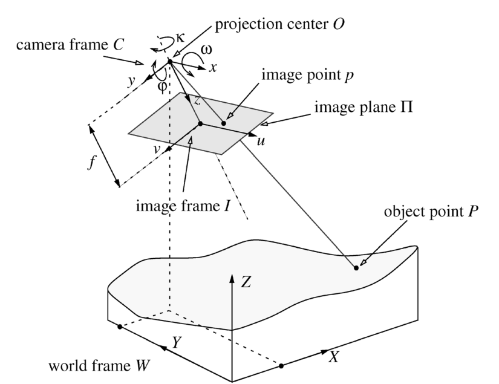
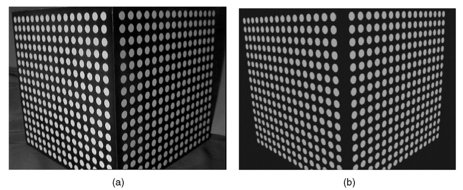
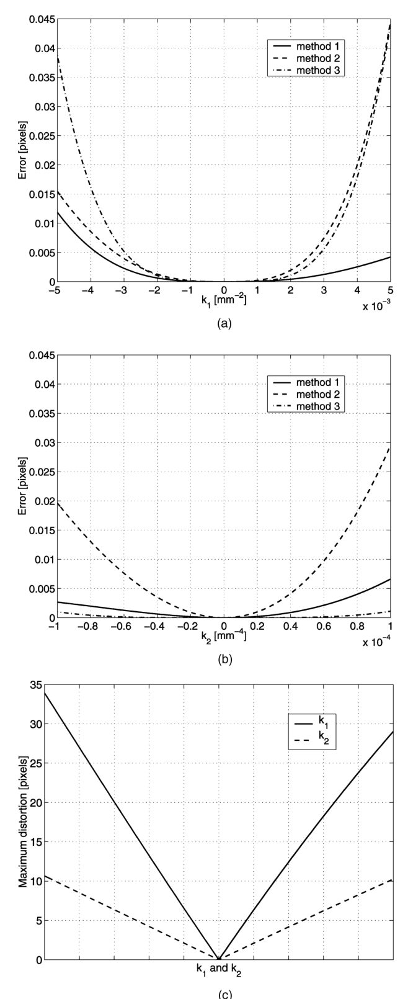
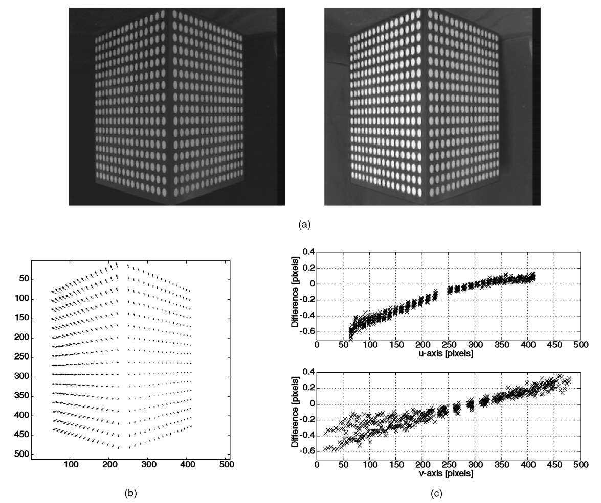

# 원형 기준점을 이용한 기하학적 카메라 보정 (Heikkilä 2000)

- 원제: Geometric Camera Calibration Using Circular Control Points
- 원문: 같은 폴더의 `Heikkila2000_TPAMI_circular_calibration.pdf` (IEEE Transactions on Pattern Analysis and Machine Intelligence, vol. 22, no. 10, pp. 1066–1077, Oct. 2000. 저자 Janne Heikkilä, University of Oulu)
- 번역 범위: 전문 (PDF의 텍스트 층이 깨져 있어 쪽 이미지를 직접 읽어 번역했다)
- 그림: 원문 그림을 `그림/`에 넣고 본문에서 처음 언급되는 곳에 삽입. 표는 마크다운 표로 옮겼다.

## 초록 (Abstract)

최신 CCD 카메라는 보통 화소 크기의 1/50보다 나은 공간 정확도를 낼 수 있다. 그러나 영상 형성 과정에 영향을 주는 여러 오차원 때문에 이런 정확도를 얻기는 쉽지 않다. 현재의 보정(캘리브레이션, calibration) 방법들은 보통 관측값이 편향(bias)되어 있지 않고, 유일한 오차는 관측 영상 좌표에 있는 평균 0의 독립·동일 분포 무작위 잡음이며, 카메라 모델이 3D 좌표와 영상 좌표 사이의 사상을 완전히 설명한다고 가정한다. 일반적으로 이 조건들은 충족되지 않으며, 그 결과 보정 결과가 기대보다 덜 정확해진다. 이 논문에서는 정밀 3D 컴퓨터 비전 응용을 위한 보정 절차를 설명한다. 이 절차는 원형 기준점(circular control points)에 대한 편향 보정과, 왜곡 모델을 역으로 적용하는 비재귀적(nonrecursive) 방법을 도입한다. 정확도 해석을 제시하고, 이론적 정확도를 떨어뜨릴 수 있는 오차원들을 논의한다. 합성 영상 시험은 오차가 제한된 조건에서 보정 결과가 개선됨을 나타낸다. 실제 영상에서는 외부 오차원의 억제가 성공적인 보정의 전제 조건이 된다.

**색인어(Index Terms)** — 카메라 모델, 렌즈 왜곡, 역 왜곡 모델, 보정 절차, 편향 보정, 보정 정확도.

## 1 서론 (INTRODUCTION)

3D 머신 비전에서는 3D 물체 좌표와 영상 좌표 사이의 관계를 알아야 한다. 이 변환은 기하학적 카메라 보정에서 카메라 모델의 미지 파라미터를 풀어 결정한다. 처음에 카메라 보정 기법은 항공 촬영과 측량을 위해 사진측량학(photogrammetry) 분야에서 개발되었다. 처음에는 사진 카메라를 썼지만 최근에는 비디오 카메라가 거의 완전히 대체했다. 또한 로봇 비전과 산업 계측처럼 카메라 보정이 중요한 역할을 하는 새로운 응용 분야도 등장했다.

응용에 따라 카메라 보정에 대한 요구 사항이 다르다. 로봇 유도 같은 일부 응용에서는 보정 절차가 빠르고 자동이어야 하지만, 계측 응용에서는 보통 정밀도가 더 중요한 요소다. 번들 조정(bundle adjustment) [1] 같은 전통적인 카메라 보정 절차는 계산량이 많은 전면적 최적화 접근이다. 그래서 지난 수십 년 동안 컴퓨터 비전 문헌에서 제안된 보정 방법 대부분은 주로 최적화 문제를 단순화하거나 선형화하여 과정을 빠르게 하도록 설계되었다. Roger Tsai [2]가 개발한 잘 알려진 보정 방법이 이 범주에 속한다. 선형 변환에 기반한 다른 기법들, 예를 들어 [3], [4], [5], [6]도 빠르지만 꽤 부정확하다. 단순화는 파라미터 추정값의 정밀도를 떨어뜨리며, 그 결과 이 방법들은 그 자체로는 3D 계측 응용에 적합하지 않다.

표준 워크스테이션의 처리 능력이 커지면서, 추정 문제의 비선형성은 몇 년 전만큼 제약이 되지 않는다. 보정 절차를 반복 계산으로 몇 초 안에 마칠 수 있다. 이것은 계산 시간을 크게 늘리지 않고 보정 방법의 정확도를 높일 좋은 이유가 된다. 화소 크기의 1/50(영상 크기의 약 1/50,000)의 정확도는 적절한 부화소(subpixel) 특징 추출 기법을 쓰면 저잡음 조건에서 달성할 수 있는 현실적인 목표다. 다음 절들에서 제시하는 새 보정 절차의 주된 개선점은 양방향으로 정확한 사상을 허용하는 카메라 모델과, 원형 기준점 좌표의 편향 제거다.

2절에서는 투영과 역투영(back-projection)을 위한 카메라 모델을 설명하는 것으로 시작한다. 3절에서는 원형 기준점의 사영 기하를 살펴보고 원을 영상 평면으로 사상하는 데 필요한 식들을 제시한다. 4절은 원형 기준점을 위한 3단계 보정 절차를 설명한다. 5절에서 보정 절차의 실험 결과를 보고하고, 6절에서 몇몇 전형적인 오차원의 영향을 논의한다. 끝으로 7절에서 결론을 맺는다.

*(각주) 저자는 University of Oulu 전기공학과 및 Infotech Oulu의 Machine Vision and Media Processing Unit 소속이다(FIN-90014 Oulu, Finland. E-mail: jth@ee.oulu.fi). 원고 접수 1998년 12월 4일, 수정 1999년 10월 4일, 채택 2000년 5월 31일. K. Bowyer가 게재를 추천했다. 이 논문의 별쇄본은 tpami@computer.org로 IEEECS Log Number 108389를 적어 요청할 수 있다.*

## 2 카메라 모델 (CAMERA MODEL)

카메라 보정에서 3D 월드 좌표에서 2D 영상 좌표로의 변환은 카메라 모델의 미지 파라미터를 풀어 결정한다. 정확도 요구에 따라 모델은 보통 정사영(orthographic) 또는 원근(perspective) 투영에 기반한다. 정사영 변환은 3D 공간의 물체가 영상 평면에 직교 투영된다고 가정하는 가장 거친 근사다. 기하학적 정확도 요구가 다소 낮은 비전 응용에 더 적합하다. 선형성 덕분에, 비선형 사상인 원근 투영보다 더 단순하고 계산 비용이 적은 해를 준다. 그러나 3D 운동 추정과 복원 문제에서 원근 투영은 이상화된 수학적 틀을 주며, 이는 고품질 카메라 시스템에서 실제로 꽤 정확하다. 기성품 시스템에서는 원근 투영 모델에 렌즈 왜곡 모델을 덧붙이는 경우가 많다.

먼저 그림 1에 보인 순수 원근 투영(즉 핀홀) 카메라 모델을 생각하자. 투영 중심은 카메라 좌표계 $C$의 원점 $O$에 있다. 영상 평면 $\Pi$는 $xy$ 평면에 평행하며, $O$에서 $z$축을 따라 거리 $f$(초점 거리)만큼 떨어져 있다. $z$축은 광축(optical axis) 또는 주축(principal axis)이라고도 하며, $\Pi$와 광축의 교점을 주점(principal point) $o$라 한다. 2D 영상 좌표계 $I$의 $u$축과 $v$축은 각각 $x$축과 $y$축에 평행하다. $I$에서 주점의 좌표는 $[u_0, v_0]^T$이다.

*그림 1 — 핀홀 카메라 모델.*

$P$를 $z$축의 양의 쪽에 있는 임의의 3D 점, $p$를 그것의 $\Pi$ 위 투영이라 하자. 카메라 좌표계 $C$에서 $P$의 좌표는 $[x, y, z]^T$이고 월드 좌표계 $W$에서는 $[X, Y, Z]^T$이다. $I$에서 $p$의 좌표는 $[u, v]^T$이며, 다음 변환으로 주어지는 동차 좌표에서 풀 수 있다.

$$\begin{bmatrix} u \\ v \\ 1 \end{bmatrix} \propto \begin{bmatrix} \lambda u \\ \lambda v \\ \lambda \end{bmatrix} = \mathbf{F} \begin{bmatrix} X \\ Y \\ Z \\ 1 \end{bmatrix} = \mathbf{PM} \begin{bmatrix} X \\ Y \\ Z \\ 1 \end{bmatrix}, \tag{1}$$

여기서 $\mathbf{F}$는 원근 변환 행렬(perspective transformation matrix, PTM)이고,

$$\mathbf{P} = \begin{bmatrix} sf & 0 & u_0 & 0 \\ 0 & f & v_0 & 0 \\ 0 & 0 & 1 & 0 \end{bmatrix}, \tag{2}$$

$\lambda$는 축척 인자, $s$는 종횡비(aspect ratio)이며, $\mathbf{M}$은 $W$에서 $C$로의 사상을 기술하는 4×4 행렬이다. $\mathbf{M}$은 다음과 같이 분해된다.

$$\mathbf{M} = \begin{bmatrix} \mathbf{R} & \mathbf{t} \\ \mathbf{0} & 1 \end{bmatrix}, \tag{3}$$

여기서 $\mathbf{t} = [t_x, t_y, t_z]^T$는 두 좌표계 사이의 평행이동(translation)을 기술하고, $\mathbf{R}$은 세 오일러 각 $\omega$, $\varphi$, $\kappa$로 정의할 수 있는 3×3 정규직교 회전(rotation) 행렬이다. $\mathbf{R}$을 알면 이 각들은 예를 들어 다음 분해로 계산할 수 있다 [6].

$$\begin{aligned} \varphi &= \sin^{-1} r_{31} \\ \omega &= \text{atan}2\left(-\frac{r_{32}}{\cos\varphi}, \frac{r_{33}}{\cos\varphi}\right) \\ \kappa &= \text{atan}2\left(-\frac{r_{21}}{\cos\varphi}, \frac{r_{11}}{\cos\varphi}\right), \end{aligned} \tag{4}$$

여기서 $r_{ij}$는 행렬 $\mathbf{R}$의 $i$번째 행, $j$번째 열 원소이고, $\text{atan}2(y, x)$는 $(-\pi, \pi]$ 범위의 각을 주는 2인수 역탄젠트 함수다. $\sin\varphi = \sin(\pi - \varphi)$이므로 오일러 각은 회전 행렬을 유일하게 표현하지 않는다. 따라서 행렬 $\mathbf{R}$에는 동등한 분해가 두 가지 있다. 보다시피 (4)는 $r_{31} = \pm 1$, 즉 $\varphi = \pi/2$ 또는 $\varphi = 3\pi/2$일 때 특이성을 가진다. 그런 경우에는 $\kappa = 0$, $\omega = \text{atan}2(r_{12}, r_{22})$로 하거나 그 반대로 선택할 수 있다 [6]. 대부분의 상황에서는 보정 구성을 신중하게 계획하여 특이성을 막을 수도 있다.

파라미터 $t_x, t_y, t_z, \omega, \varphi, \kappa$를 *외부 파라미터(extrinsic parameters)* 또는 *외부 사영 파라미터(exterior projective parameters)* 라 하고, 파라미터 $s, f, u_0, v_0$를 핀홀 카메라 모델의 *내부 파라미터(intrinsic parameters)* 또는 *내부 사영 파라미터(interior projective parameters)* 라 한다.

영상 좌표는 보통 화소 단위로 표현하는 것이 더 편리하다. 따라서 (1)에서 얻은 좌표에 화소와 물리적 물체 단위(예: 밀리미터) 사이의 관계를 지정하는 인자 $D_u$와 $D_v$를 곱한다. 그러나 이 변환 인자의 정확한 값을 알 필요는 없다. 보정 중에 조정되는 파라미터 $s$와 $f$에 선형 종속이기 때문이다.

실제 카메라에서는 보통 원근 투영만으로는 사상을 정밀하게 모델링하기에 충분하지 않다. 이상적으로는 장면에서 오는 광선이 광학 중심을 직선으로 지나야 하지만, 실제로 렌즈 시스템은 여러 광학 요소로 구성되어 광 경로와 그 결과 영상에 비선형 왜곡을 들인다. (1)의 카메라 모델은 투영점 $p$의 이상적인 영상 좌표 $[u, v]^T$를 낸다. 이 오차 없지만 관측할 수 없는 좌표를 관측 가능한 왜곡된 좌표와 구분하기 위해, 앞으로 (1)의 올바른, 즉 보정된(corrected) 좌표를 $\mathbf{a}_c = [u_c, v_c]^T$로, 왜곡된 좌표를 $\mathbf{a}_d = [u_d, v_d]^T$로 표기한다.

렌즈 왜곡을 보정하는 여러 방법이 개발되었다. 가장 흔히 쓰는 접근은 왜곡을 방사(radial) 성분과 편심(decentering) 성분으로 분해하는 것이다 [7]. 왜곡된 영상 좌표 $\mathbf{a}_d$를 알면 보정된 좌표 $\mathbf{a}_c$는 다음으로 근사된다.

$$\mathbf{a}_c = \mathbf{a}_d + \mathcal{F}_D(\mathbf{a}_d, \boldsymbol{\delta}), \tag{5}$$

여기서

$$\mathcal{F}_D(\mathbf{a}_d, \boldsymbol{\delta}) = \begin{bmatrix} \bar{u}_d(k_1 r_d^2 + k_2 r_d^4 + k_3 r_d^6 + \ldots) \\ \quad + \left(2p_1\bar{u}_d\bar{v}_d + p_2(r_d^2 + 2\bar{u}_d^2)\right)(1 + p_3 r_d^2 + \cdots) \\ \bar{v}_d(k_1 r_d^2 + k_2 r_d^4 + k_3 r_d^6 + \ldots) \\ \quad + \left(p_1(r_d^2 + 2\bar{v}_d^2) + 2p_2\bar{u}_d\bar{v}_d\right)(1 + p_3 r_d^2 + \cdots) \end{bmatrix}, \tag{6}$$

$$\bar{u}_d = u_d - u_0, \; \bar{v}_d = v_d - v_0, \; r_d = \sqrt{\bar{u}_d^2 + \bar{v}_d^2},$$

이고 $\boldsymbol{\delta} = [k_1, k_2, \ldots, p_1, p_2, \ldots]^T$이다. [역주: (6)의 행렬은 2성분 벡터이며 각 성분이 두 줄에 걸쳐 쓰였다.] 파라미터 $k_1, k_2, \ldots$는 실제 영상점을 영상 평면에서 방사 방향으로 변위시키는 방사 왜곡의 계수이고, 파라미터 $p_1, p_2, \ldots$는 렌즈 시스템에서 렌즈 면들의 곡률 중심이 엄밀히 동일 직선 위에 있지 않을 때 생길 수 있는 편심 또는 접선(tangential) 왜곡의 계수다.

문헌에는 다른 왜곡 모델도 제안되었다. 예를 들어 Melen [6]은 (2)의 $\mathbf{P}$에 선형 왜곡 항을 더한 모델을 썼다. 이는 영상 축이 직교하지 않을 때 유용하지만, 대부분의 경우 CCD 배열은 거의 완벽한 직사각형이므로 선형 왜곡 성분은 무시할 만하다(0.01 화소 미만 [8]). Faugeras와 Toscani [5]가 제안한 보정 방법에서는 작은 영상 영역에서 쌍선형(bilinear) 변환을 써서 기하 왜곡을 보정했다.

카메라 보정에서는 3D 월드 좌표에서 실제 영상 좌표로의 변환을 찾는 것이 유리하다. 그러면 카메라 파라미터의 최적 추정기로 최소제곱 기법을 쓸 수 있다. (1)과 (5)를 직접 적용하면 먼저 왜곡을 보정한 다음 (1)의 카메라 파라미터를 추정해야 한다. 분명한 문제는 왜곡 계수를 보통 미리 알지 못하며, 강한 결합 때문에 다른 카메라 파라미터를 모르고는 신뢰성 있게 추정할 수 없다는 것이다.

문헌에는 이 문제를 극복하는 몇 가지 해법이 있다. Tsai [2]와 Lenz·Tsai [9]는 카메라 모델을 파라미터들이 분리되는 선형 부분과 비선형 부분으로 분해했다. 그러나 방사 왜곡만 쓸 수 있고 해가 최적이 아니다. Weng 등 [10]은 왜곡 모델과 투영 모델의 파라미터를 번갈아 고정하고 따로 추정하는 반복 방식을 제안했다. 사진측량학에서 흔히 쓰는 접근 [7]은 보정된 영상 좌표와 카메라 모델이 주는 합성 좌표 사이의 오차 제곱합을 최소화하여 모든 파라미터에 대해 전면적 최적화를 하는 것이다. 실제로 이는 (6)을 잡음 섞인 관측값으로 계산한다는 뜻이며, 보정 결과를 악화시킬 수 있다. 관측 좌표와 모델 좌표 사이의 오차를 최소화하려면, 왜곡된 영상 좌표를 왜곡되지 않은 좌표로 표현해야 한다. 이를 위해서는 역 왜곡 모델(inverse distortion model)이 필요하다. 쉽게 알 수 있듯이 역문제에는 해석해가 없으므로 근사해야 한다. 예를 들어 Melen [6]은 다음 모델을 썼다.

$$\mathbf{a}_d \approx \mathbf{a}_c - \mathcal{F}_D(\mathbf{a}_c, \boldsymbol{\delta}). \tag{7}$$

왜곡 계수가 보통 작은 값이어서 모델이 거의 선형이 되므로, 이 모델의 맞춤 결과는 흔히 만족스럽다. 최소제곱 의미에서 최적인 왜곡 계수가 (5)와 (7)에서 서로 다르다는 점에 유의해야 한다.

또 다른 해법은 (5)에 기반해 다음 재귀를 만드는 것이다.

$$\begin{aligned} \mathbf{a}_d &\approx \mathbf{a}_c - \mathcal{F}_D(\mathbf{a}_d, \boldsymbol{\delta}) \approx \mathbf{a}_c - \mathcal{F}_D(\mathbf{a}_c - \mathcal{F}_D(\mathbf{a}_d, \boldsymbol{\delta}), \boldsymbol{\delta}) \\ &\approx \mathbf{a}_c - \mathcal{F}_D(\mathbf{a}_c - \mathcal{F}_D(\mathbf{a}_c - \mathcal{F}_D(\mathbf{a}_d, \boldsymbol{\delta}), \boldsymbol{\delta}), \boldsymbol{\delta}) \approx \cdots. \end{aligned} \tag{8}$$

우변에서 $\mathbf{a}_d$를 $\mathbf{a}_c$로 대체할 때 생기는 오차는 반복할 때마다 작아진다. 실제로는 강한 렌즈 왜곡을 보상하려면 적어도 서너 번의 반복이 필요하다. 이는 왜곡 함수 $\mathcal{F}_D$를 영상의 여러 위치에서 여러 번 계산해야 한다는 뜻이며, 이 기법을 덜 매력적으로 만든다.

많은 계산을 피하기 위해 $\mathbf{a}_c$에 대한 $\mathcal{F}_D$의 1차 테일러 급수 근사를 취할 수 있다.

$$\mathbf{a}_c \approx \mathbf{a}_d + \mathcal{F}_D(\mathbf{a}_c, \boldsymbol{\delta}) + \mathbf{D}(\mathbf{a}_c)(\mathbf{a}_d - \mathbf{a}_c), \tag{9}$$

여기서

$$\mathbf{D}(\mathbf{a}_c) = \left[ \frac{\partial}{\partial u}\mathcal{F}_D(\mathbf{a}, \boldsymbol{\delta}) \; \frac{\partial}{\partial v}\mathcal{F}_D(\mathbf{a}, \boldsymbol{\delta}) \right] \Bigg|_{\mathbf{a}=\mathbf{a}_c} \tag{10}$$

이다. (9)에서 $\mathbf{a}_d$를 풀면

$$\mathbf{a}_d \approx \mathbf{a}_c - (\mathbf{I} + \mathbf{D}(\mathbf{a}_c))^{-1}\mathcal{F}_D(\mathbf{a}_c, \boldsymbol{\delta}). \tag{11}$$

을 얻는다. $\mathbf{D}(\mathbf{a}_c)$의 원소는 작으므로($\ll 1$) 다음 근사를 쓸 수 있다.

$$\mathbf{a}_d \approx \mathbf{a}_c - \frac{1}{d_{11}(\mathbf{a}_c) + d_{22}(\mathbf{a}_c) + 1}\mathcal{F}_D(\mathbf{a}_c, \boldsymbol{\delta}) \equiv \mathbf{a}_c - \mathcal{F}_D^*(\mathbf{a}_c, \boldsymbol{\delta}), \tag{12}$$

여기서 $d_{11}(\mathbf{a}_c)$와 $d_{22}(\mathbf{a}_c)$는 각각 $\mathbf{D}(\mathbf{a}_c)$의 왼쪽 위와 오른쪽 아래 원소다. 방사 왜곡 계수 $k_1$, $k_2$ 두 개와 편심 왜곡 계수 $p_1$, $p_2$ 두 개만 쓰면, 역 왜곡 모델의 근사는 다음이 된다.

$$\mathcal{F}_D^*(\mathbf{a}_c, \boldsymbol{\delta}) = \frac{1}{4k_1 r_c^2 + 6k_2 r_c^4 + 8p_1\bar{v}_c + 8p_2\bar{u}_c + 1}\mathcal{F}_D(\mathbf{a}_c, \boldsymbol{\delta}), \tag{13}$$

여기서 $r_c = \sqrt{\bar{u}_c^2 + \bar{v}_c^2}$이다. 필요하면 이 모델을 고차 항으로 확장하는 것은 간단하다.

(1)에서 $u = u_c$, $v = v_c$로 바꾸고 (12)와 결합하면, 3D 월드 좌표를 왜곡된 영상 좌표로 변환하는 *순방향(forward)* 카메라 모델을 얻는다.

*역방향(backward)* 카메라 모델을 쓰면, 왜곡된 카메라 좌표를 3D 월드 좌표계의 시선(lines of sight)으로, 또는 이 시선과 알려진 2D 평면의 교점으로 변환할 수 있다. 원점이 $\mathbf{h}_0 = [X_0, Y_0, Z_0]^T$에 있고 3D 벡터 $\mathbf{h}_1 = [X_1, Y_1, Z_1]^T$과 $\mathbf{h}_2 = [X_2, Y_2, Z_2]^T$로 생성되는 좌표계 $H$를 가진 2D 평면 $\Pi'$이 있다고 하자. (5)가 내는 보정된 영상 좌표 $\mathbf{a}_c = [u_c, v_c]^T$에서 평면 $\Pi'$ 위로의 변환은 다음과 같이 표현할 수 있다.

$$\lambda \begin{bmatrix} \mathbf{x}_H \\ 1 \end{bmatrix} = (\mathbf{FH})^{-1} \begin{bmatrix} \mathbf{a}_c \\ 1 \end{bmatrix}, \tag{14}$$

여기서 $\lambda$는 축척 인자, $\mathbf{x}_H = [X_H, Y_H]^T$는 $H$에서의 역투영 좌표이며,

$$\mathbf{H} = \begin{bmatrix} \mathbf{h}_1 & \mathbf{h}_2 & \mathbf{h}_0 \\ 0 & 0 & 1 \end{bmatrix}.$$

이루어진 근사 때문에 $\mathcal{F}_D^*$는 $\mathcal{F}_D$의 정확한 역함수가 아니다. 따라서 (6)에서는 (13)에서와 약간 다른 파라미터 $\boldsymbol{\delta}'$을 써야 할 수 있다. 이 파라미터들을 추정하는 방법은 4절에서 제시한다.

## 3 원형 기준점 (CIRCULAR CONTROL POINTS)

물체 공간의 직선은 영상 평면에서 직선으로 사상되지만, 일반적으로 원근 투영은 모양을 보존하는 변환이 아니다. 2차원·3차원 모양은 영상 평면과 동일 평면에 있지 않으면 변형된다. 보정에서 흔히 기준점으로 쓰는 원형 표지(circular landmarks)도 마찬가지다. 그러나 영상에서 투영된 모양의 중심을 원 중심의 투영으로 취급하면 관측값과 모델 사이에 편향이 생긴다. 이 절에서는 편향을 들이지 않고 투영의 중심을 영상 관측값으로 쓰는 데 필요한 식들을 살펴본다.

반지름 $r$인 원형 기준점 $R$이 평면 $\Pi'$ 위에 있어 그 중심이 평면 좌표계 $H$의 원점에 있다고 하자. 원은 다음과 같이 표현할 수 있는 2차 곡선이다.

$$AX_H^2 + 2BX_HY_H + CY_H^2 + 2DX_H + 2EY_H + F = 0, \tag{15}$$

여기서 $A$, $B$, $C$, $D$, $E$, $F$는 곡선의 모양과 위치를 정하는 계수다. 동차 좌표에서 이 곡선은 다음과 같이 쓸 수 있다.

$$\begin{bmatrix} \mathbf{x}_H \\ 1 \end{bmatrix}^T \mathbf{Q} \begin{bmatrix} \mathbf{x}_H \\ 1 \end{bmatrix} = 0, \tag{16}$$

여기서

$$\mathbf{Q} = \begin{bmatrix} A & B & D \\ B & C & E \\ D & E & F \end{bmatrix}.$$

원 $R$에 대해서는

$$\mathbf{Q} = \begin{bmatrix} -1/r^2 & 0 & 0 \\ 0 & -1/r^2 & 0 \\ 0 & 0 & 1 \end{bmatrix}.$$

(14)를 쓰면 $R$을 영상 평면에 투영할 수 있다. 그 결과 곡선은

$$\begin{bmatrix} \mathbf{a}_c \\ 1 \end{bmatrix}^T \mathbf{S} \begin{bmatrix} \mathbf{a}_c \\ 1 \end{bmatrix} = 0, \tag{17}$$

이 되며, 여기서

$$\mathbf{S} = ((\mathbf{FH})^{-1})^T \mathbf{Q} (\mathbf{FH})^{-1}. \tag{18}$$

결과는 2차 곡선이며, 기하학적으로는 원, 쌍곡선, 포물선, 또는 타원임을 알 수 있다. 실제로는 영상 평면에 대응하는 유한한 직사각형 때문에 투영은 타원이 되며, 특수한 경우에는 원이 된다. [11]에서 보였듯이 타원의 중심 $\mathbf{e}_c = [u_e, v_e]^T$는 다음에서 얻을 수 있다.

$$\lambda \begin{bmatrix} \mathbf{e}_c \\ 1 \end{bmatrix} = \mathbf{S}^{-1} \begin{bmatrix} 0 \\ 0 \\ 1 \end{bmatrix}. \tag{19}$$

(18)과 (19)를 결합하면

$$\lambda \begin{bmatrix} \mathbf{e}_c \\ 1 \end{bmatrix} = \mathbf{FG}\mathbf{f}_3, \tag{20}$$

를 얻는다. 여기서 $\mathbf{G} = \mathbf{HQ}^{-1}\mathbf{H}^T$이고, $\mathbf{f}_3$는 $\mathbf{F}$의 마지막 행으로 이루어진 벡터다. 행렬 $\mathbf{G}$는 기준점의 기하, 위치, 방향을 지정하고, 원근 변환 행렬 $\mathbf{F}$는 월드 좌표에서 왜곡되지 않은 영상 좌표로의 사상을 지정하며, 이 좌표는 (12)를 써서 다시 왜곡된 영상 좌표 $\mathbf{e}_d$로 변환할 수 있다. 그 결과

$$\mathbf{e}_d = \mathbf{e}_c - \mathcal{F}_D^*(\mathbf{e}_c, \boldsymbol{\delta}). \tag{21}$$

를 얻는다.

(1) 대신 (20)을 쓰면 관측된 타원 중심과 카메라 모델 사이에 편향 없는(unbiased) 관계를 얻는다는 점에 유의해야 한다.

## 4 보정 절차 (CALIBRATION PROCEDURE)

다음에 제시하는 보정 절차는 주로 원형 표지와 함께 쓰도록 의도되었다. 그러나 특정한 기하가 없는 작은 점에도 적합하다. 그 경우에는 반지름을 0으로 둔다. 카메라 모델은 내부 파라미터 8개 $\boldsymbol{\theta}_{int} = [s, f, u_0, v_0, k_1, k_2, p_1, p_2]^T$와 외부 파라미터 6개 $\boldsymbol{\theta}_{ext} = [t_x, t_y, t_z, \omega, \varphi, \kappa]^T$를 포함한다고 가정한다. 필요하면 모델에 고차 항을 더하는 것은 간단하다. 다중 프레임 보정에서는 각 프레임이 별도의 외부 파라미터를 가지지만 내부 파라미터는 공통이다. 기준점의 반지름 $r$과 변환 인자 $D_u$, $D_v$는 기준점의 3D 좌표 및 관측 영상 좌표와 함께 미리 알려져 있다고 가정한다.

카메라 모델의 비선형 사상 때문에, 최소제곱 의미에서 최적해를 내는 모든 카메라 파라미터의 직접 추정기는 없다. 따라서 반복 탐색 기법을 써서 다음 벡터를 추정한다.

$$\boldsymbol{\theta} = \left[\boldsymbol{\theta}_{int}^T, \boldsymbol{\theta}_{ext}^T(1), \boldsymbol{\theta}_{ext}^T(2), \cdots, \boldsymbol{\theta}_{ext}^T(K)\right]^T, \tag{22}$$

여기서 $K$는 프레임 수다. 추정기를 쓰기 전에, 전역 최솟값에 도달할 수 있음을 보장하는 카메라 파라미터 초기값이 있어야 한다. 이 문제는 렌즈 왜곡을 무시하고 나머지 파라미터에 선형 추정기를 써서 해결한다.

**1단계: 초기화 (Step 1: Initialization).** 문헌에는 선형 보정 기법의 많은 변형이 제안되었다. 예를 들어 [3], [4], [5], [6]이다. 그러나 모두 원근 변환 행렬 $\mathbf{F}$를 먼저 추정한 다음 내부·외부 카메라 파라미터로 분해한다는 같은 아이디어에 기반한다. 이 방법들은 카메라 파라미터에 대한 닫힌 형식(closed-form) 해를 준다. 주된 단점은 최소 분산 추정값을 내지 않으므로 최적 추정기가 아니라는 것이다. 또 다른 문제는 방사 및 편심 렌즈 왜곡의 영향을 무시한다는 것이다. 이런 단점에도 불구하고 선형 보정 기법은 반복 탐색의 좋은 출발점을 줄 수 있다.

$\mathbf{F}$를 추정하는 잘 알려진 절차가 여럿 있다(예: [5]). 선형 보정 방법들 사이의 주된 차이는 $\mathbf{F}$를 카메라 파라미터로 어떻게 분해하느냐이다. 예를 들어 Faugeras와 Toscani [5]는 선형 방정식 세트를 써서 내부 파라미터 5개와 외부 파라미터 6개를 추출했고, Melen [6]은 QR 분해를 써서 내부 파라미터 6개와 외부 파라미터 6개를 추정했다. 원리적으로 이 기법들을 직접 적용해 반복 최적화 단계의 초기 추정값을 얻을 수 있다. 그러나 위에 나열한 단점 때문에 이 추정기들은 관측 잡음에 꽤 민감한 경향이 있다. $\mathbf{F}$의 작은 부정확성도 특히 내부 파라미터에 상당한 오차를 낼 수 있다. 그 결과 최적화가 실패할 수 있다.

카메라 파라미터의 최종 추정값이 아니라 첫 추정값을 내는 것이 목표인 초기화 단계에서는, 초점 거리, 종횡비, 영상 중심의 공칭값을 내부 파라미터로 쓰는 것이 흔히 더 신뢰할 만하다. 이 값들로 (2)를 써서 투영 행렬 $\mathbf{P}$를 바로 쓸 수 있다. 기준점들이 동일 평면에 있지 않다고, 즉 원근 변환 행렬 $\mathbf{F}$의 완전한 3×4 추정값이 있고 이를 $\hat{\mathbf{F}}$로 표기한다고 하자. 그러면 다음 식을 쓸 수 있다.

$$\hat{\mathbf{F}} = \mathbf{P}\hat{\mathbf{M}} = \left[\mathbf{P}_{13}\hat{\mathbf{R}} \quad \mathbf{P}_{13}\hat{\mathbf{t}}\right], \tag{23}$$

여기서 $\mathbf{P}_{13}$은 $\mathbf{P}$의 처음 세 열로 이루어진 행렬이고, $\hat{\mathbf{R}}$과 $\hat{\mathbf{t}}$는 각각 $\mathbf{R}$과 $\mathbf{t}$의 추정값이다. 이제 다음을 바로 얻는다.

$$\hat{\mathbf{R}} = \mathbf{P}_{13}^{-1}\hat{\mathbf{F}}_{13} \tag{24}$$

그리고

$$\hat{\mathbf{t}} = \mathbf{P}_{13}^{-1}\hat{\mathbf{F}}_4, \tag{25}$$

여기서 $\hat{\mathbf{F}}_{13}$은 $\hat{\mathbf{F}}$의 처음 세 열로 이루어진 행렬이고 $\hat{\mathbf{F}}_4$는 마지막 열이다.

행렬 $\hat{\mathbf{R}}$은 표준 회전 행렬의 정규직교 제약을 만족하지 않지만, 특이값 분해(SVD)를 써서 정규화·직교화할 수 있다.

$$\hat{\mathbf{R}} = \mathbf{U}\Sigma\mathbf{V}^T. \tag{26}$$

$\hat{\mathbf{R}}$의 정규직교 버전은 다음으로 주어진다.

$$\hat{\mathbf{R}}' = \mathbf{U}\Sigma'\mathbf{V}^T, \tag{27}$$

여기서 $\Sigma'$은 대각 원소가 내림차순으로 1, 1, $|\mathbf{UV}^T|$인 대각 행렬이다 [11]. 이제 (4)를 써서 $\hat{\mathbf{R}}'$에서 오일러 각을 추출할 수 있다.

기준점이 모두 동일 평면에 있으면 $\mathbf{F}$의 부분 행렬만 결정할 수 있다. 기본적으로 절차는 위와 같으나, $\hat{\mathbf{R}}'$의 두 열만 추정된다는 점이 다르다. 셋째 열은 기저 벡터의 직교성을 이용해 쉽게 얻는다. 다중 프레임 보정을 쓰면 초기화 단계는 프레임마다 따로 수행한다. 초기 파라미터는 다음 벡터로 모은다.

$$\hat{\boldsymbol{\theta}}_0 = \left[1, f_0, N_u/2, N_v/2, 0, 0, 0, 0, \boldsymbol{\theta}_{ext}^T(1), \boldsymbol{\theta}_{ext}^T(2), \cdots, \boldsymbol{\theta}_{ext}^T(K)\right]^T, \tag{28}$$

여기서 $f_0$는 공칭 초점 거리, $N_u$와 $N_v$는 영상의 가로·세로 크기다.

**2단계: 반복 탐색 (Step 2: Iterative search).** 이 단계에서는 관측값과 모델 사이 차이의 가중 제곱합을 최소화하여 순방향 카메라 모델의 파라미터를 추정한다. $n = 1, \ldots, N$과 $k = 1, \ldots, K$로 색인되는 원형 기준점 $N$개와 영상 $K$장이 있다고 하자. 프레임 $k$에서 타원 $n$의 중심의 관측 영상 좌표를 담은 벡터를 $\mathbf{e}_o(n, k)$로, (20)과 (21)의 순방향 카메라 모델이 내는 대응 벡터를 $\mathbf{e}_d(n, k)$로 표기한다. 이제 목적함수는 다음과 같이 표현할 수 있다.

$$J(\boldsymbol{\theta}) = \mathbf{y}^T(\boldsymbol{\theta})\mathbf{C}_e^{-1}\mathbf{y}(\boldsymbol{\theta}), \tag{29}$$

여기서

$$\mathbf{y}(\boldsymbol{\theta}) = \left[\left(\mathbf{e}_o(1,1) - \mathbf{e}_d(1,1)\right)^T, \left(\mathbf{e}_o(2,1) - \mathbf{e}_d(2,1)\right)^T, \cdots, \left(\mathbf{e}_o(N,K) - \mathbf{e}_d(N,K)\right)^T\right]^T$$

이고 $\mathbf{C}_e$는 관측 오차의 공분산 행렬이다. $\mathbf{C}_e$에 영향을 줄 수 있는 원인은 다양하다. 그중 일부는 뒤의 6절에서 논의한다. 공분산 행렬을 모르거나 개별 관측값의 측정 잡음이 통계적으로 독립이고 동일 분포이면 (29)의 $\mathbf{C}_e^{-1}$은 생략할 수 있다. 일반적으로 통계적으로 독립이고 동일 분포인 잡음이라는 가정은 충족되지 않는다. 오차 분산이 영상 속 타원의 크기에 의존하고, 타원이 기울어져 있으면 가로 좌표와 세로 좌표 사이의 공분산이 0이 아니기 때문이다. 그 결과 측정 잡음 공분산 행렬 $\mathbf{C}_e$는 다음과 같이 표현할 수 있다.

$$\mathbf{C}_e = \begin{bmatrix} \mathbf{C}_e(1,1) & \mathbf{0} & \mathbf{0} & \mathbf{0} \\ \mathbf{0} & \mathbf{C}_e(2,1) & \cdots & \mathbf{0} \\ \vdots & \vdots & \ldots & \vdots \\ \mathbf{0} & \mathbf{0} & \ldots & \mathbf{C}_e(N,K) \end{bmatrix}, \tag{30}$$

여기서

$$\mathbf{C}_e(n,k) = E\left\{\left[\mathbf{e}_o(n,k) - E\{\mathbf{e}_o(n,k)\}\right]\left[\mathbf{e}_o(n,k) - E\{\mathbf{e}_o(n,k)\}\right]^T\right\}.$$

$\mathbf{C}_e(n,k)$를 모르면 추정할 수 있다. 실제로 이는 같은 위치와 방향에서 영상을 여러 장 찍은 다음 다음과 같이 표본 공분산을 계산해야 한다는 뜻이다.

$$\hat{\mathbf{C}}_e(n,k) = \frac{1}{W-1}\sum_{i=1}^{W}\left[\mathbf{e}_o(n,k,i) - \overline{\mathbf{e}_o(n,k)}\right]\left[\mathbf{e}_o(n,k,i) - \overline{\mathbf{e}_o(n,k)}\right]^T, \tag{31}$$

여기서 $W$는 $\mathbf{C}_e(n,k)$ 추정에 쓴 영상의 수, $\mathbf{e}_o(n,k,i)$는 관측 영상 좌표(타원 $n$, 자세 $k$, 프레임 $i$), $\overline{\mathbf{e}_o(n,k)}$는 평균 좌표 벡터다. 이 접근의 분명한 문제는 한 번의 보정에 많은 영상을 찍어야 한다는 것이다.

순방향 카메라 모델의 파라미터는 $J(\boldsymbol{\theta})$를 최소화하여 얻는다.

$$\hat{\boldsymbol{\theta}} = \arg\min_{\theta} J(\boldsymbol{\theta}). \tag{32}$$

(32)의 최적화 문제에는 Levenberg-Marquardt 방법 [12] 같은 여러 수치 기법을 적용할 수 있다. 효율적인 기법을 쓰면 보통 몇 번의 반복만으로 최솟값에 도달한다.

**3단계: 역방향 카메라 모델 (Step 3: Backward camera model).** 많은 응용에서 관측 영상 좌표를 3D 좌표로 역투영해야 한다. 이 절차는 이미 2절에서 설명했다. 그러나 2단계에서 쓴 (13)의 역 왜곡 모델은 (6)의 정확한 역이 아니다. 양방향에서 더 일관된 결과를 얻기 위해 (6)의 파라미터 벡터를 따로 추정한다. 다른 내부 파라미터는 순방향 모델과 역방향 모델에서 같다.

1단계와 2단계를 마쳤다면 순방향 모델의 파라미터는 이미 있다. 이 모델을 써서 임의의 점 $\{\mathbf{a}_c(i)\}$, $i = 1, \ldots, M$에 대한 왜곡된 점 집합 $\{\mathbf{a}_d(i)\}$를 만들 수 있다. 점 $\{\mathbf{a}_c(i)\}$는 약 1,000–2,000개 점, 예를 들어 40×40의 등간격 2D 격자를 이루도록 생성한다. 점들은 영상 전체 영역을 덮어야 하며, 영상 경계 근처에서도 정확한 사상을 얻으려면 가장 바깥쪽 점들이 유효 영상 영역의 약 5–10% 바깥에 있어야 한다. 역변환이 정확하다면 이 점들은 다음 행렬 형태로 표현한 (5)를 만족할 것이다.

$$\begin{bmatrix} \mathbf{a}_c(1) - \mathbf{a}_d(1) \\ \mathbf{a}_c(2) - \mathbf{a}_d(2) \\ \vdots \\ \mathbf{a}_c(M) - \mathbf{a}_d(M) \end{bmatrix} = \begin{bmatrix} \mathbf{B}(1) \\ \mathbf{B}(2) \\ \vdots \\ \mathbf{B}(M) \end{bmatrix}\boldsymbol{\delta}, \tag{33}$$

여기서

$$\mathbf{B}(i) = \begin{bmatrix} \bar{u}_d(i)r_d^2(i) & \bar{u}_d(i)r_d^4(i) & \ldots & 2\bar{u}_d(i)\bar{v}_d(i) & r_d^2(i) + 2\bar{u}_d^2(i) & \ldots \\ \bar{v}_d(i)r_d^2(i) & \bar{v}_d(i)r_d^4(i) & \ldots & r_d^2(i) + 2\bar{v}_d^2(i) & 2\bar{u}_d(i)\bar{v}_d(i) & \ldots \end{bmatrix}$$

$$\bar{u}_d(i) = u_d(i) - u_0, \; \bar{v}_d(i) = v_d(i) - v_0,$$

그리고

$$r_d(i) = \sqrt{\bar{u}_d^2(i) + \bar{v}_d^2(i)}.$$

역 왜곡 모델의 유도에서 이루어진 근사 때문에 (33)은 정확히 성립하지 않는다. 따라서 역투영을 위해 파라미터 벡터 $\boldsymbol{\delta}$를 조정해야 한다. 이는 다음 최소제곱 정식화로 할 수 있다.

$$\hat{\boldsymbol{\delta}}' = \begin{bmatrix} \mathbf{B}(1) \\ \mathbf{B}(2) \\ \vdots \\ \mathbf{B}(M) \end{bmatrix}^{+} \begin{bmatrix} \mathbf{a}_c(1) - \mathbf{a}_d(1) \\ \mathbf{a}_c(2) - \mathbf{a}_d(2) \\ \vdots \\ \mathbf{a}_c(M) - \mathbf{a}_d(M) \end{bmatrix}, \tag{34}$$

여기서 $\hat{\boldsymbol{\delta}}'$은 역방향 카메라 모델에서 쓸 왜곡 파라미터 벡터이고, $[\,.\,]^+$는 행렬의 의사역행렬(pseudoinverse)을 나타낸다 [13].

## 5 실험 (EXPERIMENTS)

4절에서 제안한 카메라 보정 절차를 두 가지 실험으로 시험했다. 첫째, 합성 영상을 써서 순방향 카메라 모델의 파라미터 추정값을 통계적으로 분석하고, 결과를 대응하는 실제 영상의 결과와 비교했다. 둘째, 무작위 영상 좌표를 보정하고 왜곡시켜 (13)의 역 왜곡 모델의 정밀도를 평가했다.

### 5.1 순방향 카메라 모델의 보정 (Calibrating the Forward Camera Model)

시험은 합성 영상 200장과, 기준 모델로 쓴 실제 영상 1장으로 수행했다. 그림 2a에 보인 이 실제 영상은 6.3 mm × 4.7 mm 영상 센서와 8.5 mm Cosmicar TV 렌즈를 단 기성품 흑백 CCD 카메라(Sony SSC-M370CE)로 촬영했다. 영상은 Sunvideo 프레임 그래버로 아날로그 CCIR 방식 비디오 신호에서 디지털화했다. 영상 크기는 768×576 화소이고 최대 동적 범위는 256 계조다.

*그림 2 — 보정 영상: (a) 실제 영상, (b) 합성 영상.*

영상에는 서로 수직인 두 평면으로 된 보정 물체가 있고, 각 평면에 원형 기준점이 256개씩 있다. 이 점들의 중심은 모멘트·곡률 보존 타원 검출 기법 [14]과 재정규화(renormalization) 원뿔곡선 맞춤 [15]으로 찾았다. 보정 절차를 먼저 적용해 실제 영상을 바탕으로 카메라 파라미터를 추정했다. 그다음 보정에서 얻은 카메라 파라미터와 기준점의 알려진 3D 모델로 광선 추적(ray tracing)을 하여 합성 영상을 만들었다. 합성 영상이 실제 영상에 더 잘 대응하도록 그 밝기값에 가산 가우스 잡음($\sigma = 2$)을 더하고 3×3 가우스 필터($\sigma = 1$ 화소)로 흐리게 했다. 표본 영상은 그림 2b에 보였다.

합성 영상에서는 오차원을 양자화와 무작위 영상 잡음으로만 제한한다. 다른 모든 오차원을 무시하는 것은 약간 비현실적이지만, 극도로 정확한 보정 결과를 얻으려면 이런 오차원들은 어떻게든 제거하거나 적어도 최소화해야 한다. 실제 영상 대신 모의 영상을 쓰는 이점은 절차의 몇몇 통계적 성질을 추정할 수 있다는 것이다.

합성 영상의 기준점은 실제 영상에서와 같은 기법, 즉 부화소 경계 검출과 타원 맞춤으로 추출했다. 세 가지 서로 다른 보정 방법을 모든 점 집합에 따로 적용했다. 첫째 방법(방법 A)은 기준점에 아무 기하도 가정하지 않는 전통적인 카메라 보정 접근이다. 둘째 방법(방법 B)에서는 원형 기하를 활용하며 모든 관측값에 같은 가중치를 준다. 셋째 방법(방법 C)에서는 (31)과 영상 200장 전부로 추정한 관측 오차 공분산 행렬 $\mathbf{C}_e$의 역으로 각 관측값에 가중치를 준다. 표 1은 세 방법 모두에 대해 내부 파라미터의 추정 편향(평균 오차)을 보여 준다. 95% 신뢰 수준의 신뢰 구간도 제시했다. [역주: 표 1의 머리글에는 신뢰 수준이 99%로 적혀 있다. 원문 그대로 옮겼다.] 보다시피 세 방법 모두 약간 편향된 추정값을 냈다. 그러나 기준점의 원형 기하를 고려하면 편향을 크게 줄일 수 있다. 남은 오차는 완전히 편향 없지는 않은 부화소 타원 검출기 때문에 생긴다. 그러나 남은 오차의 영향은 매우 작아서 실용적 의미가 없다.

**표 1** — 신뢰 한계를 포함한 추정 편향 (Estimated Bias with Confidence Limits). 각 칸의 세 값은 위에서부터 추정 편향, 신뢰 하한(99%), 신뢰 상한(99%)이다.

| 파라미터 [단위] | 참값 (true value) | 방법 A | 방법 B | 방법 C |
|---|---|---|---|---|
| $s_u$ | 1.00377723 | -0.00030584 / -0.00030696 / -0.00030473 | 0.00003237 / 0.00003126 / 0.00003348 | 0.00003740 / 0.00003648 / 0.00003832 |
| $f$ [mm] | 8.345900 | 0.005178 / 0.005122 / 0.005233 | -0.000064 / -0.000121 / -0.000007 | -0.000168 / -0.000213 / -0.000124 |
| $u_0$ [pixels] | 367.3353 | -0.0096 / -0.0170 / -0.0022 | 0.0090 / 0.0017 / 0.0163 | 0.0221 / 0.0162 / 0.0280 |
| $v_0$ [pixels] | 305.9960 | 0.4879 / 0.4775 / 0.4983 | -0.0175 / -0.0280 / -0.0070 | -0.0343 / -0.0429 / -0.0256 |
| $k_1$ ($\cdot 10^{-3}$) [mm$^{-2}$] | 3.29545 | -0.06682 / -0.06730 / -0.06634 | -0.00953 / -0.01001 / -0.00904 | -0.01034 / -0.01079 / -0.00988 |
| $k_2$ ($\cdot 10^{-5}$) [mm$^{-4}$] | -2.6287 | 0.4829 / 0.4796 / 0.4863 | 0.0902 / 0.0870 / 0.0934 | 0.1009 / 0.0977 / 0.1040 |
| $p_1$ ($\cdot 10^{-5}$) [mm$^{-1}$] | -0.13 | -1.996 / -2.030 / -1.962 | -1.386 / -1.419 / -1.352 | -1.370 / -1.401 / -1.339 |
| $p_2$ ($\cdot 10^{-5}$) [mm$^{-1}$] | 4.065 | -1.228 / -1.249 / -1.206 | -1.201 / -1.222 / -1.180 | -1.237 / -1.257 / -1.217 |

**표 2** — 신뢰 한계를 포함한 추정 표준편차 (Estimated Standard Deviation with Confidence Limits). 각 칸의 세 값은 위에서부터 추정 표준편차, 신뢰 하한(95%), 신뢰 상한(95%)이다.

| 파라미터 [단위] | 이론 표준편차 (theoretical std) | 방법 A | 방법 B | 방법 C |
|---|---|---|---|---|
| $s_u$ | 0.00000417 | 0.00000802 / 0.00000731 / 0.00000890 | 0.00000797 / 0.00000726 / 0.00000885 | 0.00000659 / 0.00000601 / 0.00000732 |
| $f$ [mm] | 0.000210 | 0.000398 / 0.000362 / 0.000442 | 0.000410 / 0.000374 / 0.000456 | 0.000321 / 0.000292 / 0.000356 |
| $u_0$ [pixels] | 0.0261 | 0.0530 / 0.0483 / 0.0588 | 0.0522 / 0.0476 / 0.0580 | 0.0424 / 0.0386 / 0.0471 |
| $v_0$ [pixels] | 0.0366 | 0.0748 / 0.0682 / 0.0831 | 0.0753 / 0.0687 / 0.0836 | 0.0622 / 0.0567 / 0.0691 |
| $k_1$ ($\cdot 10^{-3}$) [mm$^{-2}$] | 0.00196 | 0.00347 / 0.00316 / 0.00385 | 0.00347 / 0.00317 / 0.00386 | 0.00328 / 0.00299 / 0.00365 |
| $k_2$ ($\cdot 10^{-5}$) [mm$^{-4}$] | 0.0138 | 0.0239 / 0.0218 / 0.0265 | 0.0233 / 0.0212 / 0.0259 | 0.0227 / 0.0207 / 0.0253 |
| $p_1$ ($\cdot 10^{-5}$) [mm$^{-1}$] | 0.132 | 0.243 / 0.221 / 0.270 | 0.242 / 0.220 / 0.268 | 0.222 / 0.203 / 0.247 |
| $p_2$ ($\cdot 10^{-5}$) [mm$^{-1}$] | 0.087 | 0.154 / 0.141 / 0.171 | 0.148 / 0.135 / 0.165 | 0.144 / 0.131 / 0.160 |

내부 파라미터의 추정 표준편차는 표 2에 주어져 있다. 달성할 수 있는 이론적 정확도는 다음 식으로 근사한다.

$$\mathbf{C}_{\theta} = E\left\{(\boldsymbol{\theta} - \hat{\boldsymbol{\theta}})(\boldsymbol{\theta} - \hat{\boldsymbol{\theta}})^T\right\} \approx \left[\mathbf{L}^T(\hat{\boldsymbol{\theta}})\mathbf{C}_e^{-1}\mathbf{L}(\hat{\boldsymbol{\theta}})\right]^{-1}, \tag{35}$$

여기서 $\mathbf{L}(\hat{\boldsymbol{\theta}})$는 $\hat{\boldsymbol{\theta}}$에서 계산한 $\mathbf{y}(\boldsymbol{\theta})$의 자코비안 행렬이다. 보정 방법 C에서와 같은 $\mathbf{C}_e$를 쓴다. 이제 방법 A와 B가 낸 결과는 표준편차에서 크게 다르지 않지만, 개별 가중값을 쓴 방법 C에서는 정밀도가 훨씬 좋음을 알 수 있다. 모든 방법에서 이론값과는 여전히 꽤 차이가 있다. 주된 이유는 공분산 행렬 $\mathbf{C}_e$를 미리 정확히 알지 못해 먼저 추정해야 했기 때문이다. 그 결과 카메라 파라미터가 최적이 아니며, 다른 한편 이 경우 $\mathbf{C}_e$가 과소 추정되어 이론값이 참값보다 분명히 작아졌다.

계산 측면에서 새 절차는 필요한 반복 횟수를 늘리지 않는다. 방법 A와 B에서는 평균 11회 반복을 수행했다. 방법 C에서는 수렴에 약 20회의 반복이 필요했다. 원형 기하를 고려하는 방법 B와 C에서 합성 영상의 평균 맞춤 잔차는 약 0.01 화소로, 원래 요구치인 1/50 화소보다 좋다. 방법 A에서는 오차가 0.02 화소를 넘어 한계를 초과한다.

실제로는 앞의 모의실험에서 고려하지 않은 오차원들이 잔차를 크게 늘릴 수 있다. 예를 들어 그림 2a의 실제 영상을 쓰면 평균 잔차는 0.048 화소(가로)와 0.038 화소(세로)이며, 이는 카메라 전자 장치, 조명, 광학계, 보정 표적에서 비롯된 작은 오차 성분이 있다는 표시다. 분명히 실제 영상에 대한 보정 결과의 정확도는 이런 오차원들과 강하게 결합되어 있다.

### 5.2 역 왜곡 모델의 보정 (Calibrating the Reverse Distortion Model)

이 실험에서는 넓은 범위의 왜곡 파라미터로 역 왜곡 모델의 정확도를 시험했다. 보정 절차의 셋째 단계를 적용해 각 $\hat{\boldsymbol{\delta}}$에 대해 파라미터 벡터 $\hat{\boldsymbol{\delta}}'$을 풀었다. 다음으로 영상 영역 안에 무작위 점 10,000개를 생성했다. 이 모의 점들을 (5)로 보정한 다음 (12)로 다시 왜곡시켰다. 결과 좌표와 원래 좌표의 차이를 왜곡 파라미터의 여러 값에 대해 조사했다. 그림 3a의 실선은 첫 번째 방사 왜곡 파라미터 $k_1$의 함수로 나타낸 영상 좌표의 RMS 오차다. 파라미터 범위는 흔히 쓰는 기성품 렌즈 대부분을 포괄하도록 했다. 거의 모든 파라미터 값에서 오차가 0.005 화소 아래로 유지됨을 볼 수 있다. 참고로 다른 두 기법의 결과도 제시했다. 방법 2는 (7)처럼 왜곡 모델을 역방향으로 쓰는 아이디어에 기반하되, 결과를 개선하기 위해 양방향에 대해 파라미터 값을 따로 추정한다는 점이 다르다. 방법 3은 재귀적 접근으로 (8)에 기반하며,

*그림 3 — 세 가지 역 왜곡 모델의 오차: (a) $k_1$의 함수, (b) $k_2$의 함수, (c) $k_1$과 $k_2$에 대한 영상 좌표의 최대 왜곡.*

반복을 세 번 한다. 이 두 방법은 분명히 방법 1보다 상당히 큰 오차를 낸다.

그림 3b에서는 같은 시험을 두 번째 방사 왜곡 계수 $k_2$로 수행했다. 이번에는 방법 3이 방법 1보다 나은 것으로 보이지만, 두 경우 모두 오차는 작게 유지된다. 방법 2는 분명히 가장 부정확하며, 정밀 응용에서 의미 있을 수 있는 오차를 낸다. 그림 3c는 두 파라미터 각각에 대한 최대 방사 왜곡을 보여 준다. 보통 첫 번째 파라미터가 지배적이고 두 번째 파라미터의 효과는 훨씬 작다. 일부 렌즈에서는 세 번째 방사 왜곡 계수를 쓰는 것이 유용할 수 있지만, 그래도 그 효과는 다른 두 파라미터보다 분명히 작다. 같은 시험 절차를 편심 왜곡으로도 수행했으나, 점들을 보정하고 다시 왜곡시킨 후의 오차는 세 방법 모두에서 무시할 만큼 작음을 확인했다.

## 6 기타 보정 오차 (OTHER CALIBRATION ERRORS)

앞 절에서 쓴 합성 영상에는 양자화 잡음과 무작위 가우스 잡음만 있었다. 실제 영상에서 확인했듯이 보정 절차의 성능을 떨어뜨릴 수 있는 다른 원인들도 있다. 이 절에서는 더 중요한 오차원 몇 가지를 간단히 살펴본다.

**불충분한 투영 모델 (Insufficient projection model).** (6)의 왜곡 모델은 정확한 광선 추적으로 유도되었지만, 특히 광각 광학계에서는 이 모델로 보상되지 않는 왜곡 성분이 여전히 있을 수 있다. 사용한 카메라 모델은 주점이 왜곡 중심과 일치한다고 가정한다. [16]에서 말했듯이 이 가정은 실제 렌즈 시스템에는 맞지 않는다. 나아가 핀홀 카메라 모델에서는 서로 다른 방향과 거리에서 오는 광선이 한 점, 즉 투영 중심을 지난다. 이는 대부분의 응용에 좋은 근사이지만, 불행히도 실제 광학계는 정확히 그렇게 동작하지 않는다. 보통 초점 거리, 촬상 거리, 조리개 크기 사이에 어느 정도 비선형 의존성이 있다. 그 결과 핀홀보다 큰 조리개에서는 특히 짧은 거리에서 초점 거리가 약간 변한다.

**조명 변화 (Illumination changes).** 카메라가 받는 방사조도(irradiance)와 파장의 변화는 기하학적 카메라 보정에서 보통 무시된다. 그러나 조명 조건의 변화도 보정 결과에 상당한 영향을 줄 수 있다. 그림 4a에는 같은 카메라 설정으로 정확히 같은 위치와 각도에서 촬영하고 전체 조명만 형광등에서 할로겐등으로 바꾼 영상 두 장이 있다. 그림 4b는 영상 평면에서 검출된 기준점 위치의 차이를 보여 준다. 차이는 영상 중심 근처에서 가장 작고 영상 경계에 가까워질수록 방사 방향으로 커진다. 그림 4c에서 차이가 가로·세로 좌표의 함수로서 거의 선형임을 알 수 있다. 그 이유는 색수차(chromatic aberration)다. Smith와 Thomson [17]에 따르면 색수차는 여러 색에 걸친 영상점의 퍼짐을 측정한 것이다. 영상 평면의 종방향 이동으로 표현하거나 배율 변화로 표현할 수 있지만, 기본적으로 굴절면의 굴절력이 파장에 의존하는 결과다.

*그림 4 — (a) 두 가지 광원 아래의 보정 물체: 왼쪽은 형광등, 오른쪽은 할로겐등. (b)와 (c) 검출된 점 위치 사이의 차이($\mathbf{a}_{halogen} - \mathbf{a}_{fluorescent}$).*

**카메라 전자 장치 (Camera electronics).** 그림 4c에서 또 다른 종류의 계통 오차를 구별할 수 있는데, 관측된 점 위치의 가로 방향 이동이다. 이 이동은 전체 조명 강도의 작은 변화로 생긴다. 문제는 들어오는 빛의 강도 수준 변화에 영향을 받는 위상 고정 루프(phase locked loop, PLL) 동작에서 비롯된다. Beyer [18]에 따르면 동기 펄스 검출은 수준에 민감하며 신호 수준의 어떤 변화에도 영향을 받는다. 이 편차를 라인 지터(line jitter)라 하며, 그림 4c처럼 계통적일 수도 있고, 무작위일 수도 있는데 무작위인 경우에는 기준점의 가로 영상 좌표에서 관측 잡음 증가로 검출된다.

**보정 표적 (Calibration target).** 제시한 보정 절차에서는 3D 기준점 좌표를 그 오차가 영상에서 관측되지 않을 만큼 정밀하게 안다고 가정한다. 이 가정이 충족되지 않으면 카메라 파라미터 추정값이 부정확해진다. 물체 공간의 상대 정확도는 영상 공간에서 목표하는 정확도보다 좋아야 한다. 예를 들어 목표가 화소의 1/50, 즉 영상 크기의 약 1/50,000의 정확도이고 보정 표적의 가로 방향 크기가 100 mm × 100 mm라면, 원형 기준점의 3D 좌표는 2 μm보다 나은 분해능으로 알려져 있어야 한다. 특히 이 한계를 넘는 계통 오차는 파라미터 추정값에 상당한 편향을 일으킬 수 있다.

위에 나열한 오차원들의 영향은 관측값에 섞여 있으며, 개별 원인을 알아보기가 흔히 매우 어렵다. 그러나 카메라 모델로 보상되지 않는 원인들의 혼합 효과는 맞춤 잔차에서 증가한 무작위 잡음과 계통적 변동으로 관찰할 수 있다. [7]에서는 남은 오차의 계통 성분을 *이상 왜곡(anomalous distortion)* 이라 부른다. 정밀 카메라 보정에서는 이 성분이 파라미터 추정값에 미치는 영향이 무시할 만할 정도로 작아야 한다.

## 7 결론 (CONCLUSIONS)

기하학적 카메라 보정은 3D 월드 좌표와 2D 영상 좌표 사이의 사상을 기술하는 데 필요하다. 최적의 보정 기법은 카메라 파라미터의 편향 없는 최소 분산 추정값을 내야 한다. 실제로는 촬상 과정에 영향을 주는 여러 오차원 때문에 이를 달성하기가 꽤 어렵다. 이 논문에서 제안한 보정 절차는 원형 기준점을 활용하며, 월드 좌표에서 영상 좌표로의 사상과, 거꾸로 영상 좌표에서 시선 또는 3D 평면 좌표로의 사상을 수행한다. 사용한 카메라 모델은 왜곡된 영상 좌표로 최소제곱 최적화를 할 수 있게 한다. 계산량은 전통적인 카메라 모델에 비해 약간 늘어나지만, 가중을 쓰지 않으면 최적화에 필요한 반복 횟수는 같다. 가중 최소제곱에서는 반복 횟수가 두 배가 된다. 실험은 라인 지터와 색수차 같은 오차원을 제거하면 이 기법으로 화소 크기의 1/50 정확도를 달성할 수 있음을 보였다.

실험에 쓴 Matlab용 카메라 보정 툴박스는 인터넷 http://www.ee.oulu.fi/~jth/calibr/ 에서 구할 수 있다.

## 감사의 글 (ACKNOWLEDGMENTS)

저자는 귀중한 의견과 제안을 준 익명의 심사위원들에게 감사한다. 핀란드 학술원(Academy of Finland)과 전자·통신·자동화 대학원 과정(Graduate School in Electronics, Telecommunications, and Automation, GETA)의 재정 지원에 감사한다.

## 참고문헌 (REFERENCES)

- [1] D.C. Brown, "Evolution, Application and Potential of the Bundle Method of Photogrammetric Triangulation," Proc. ISP Symp., pp. 69, Sept. 1974.
- [2] R.Y. Tsai, "A Versatile Camera Calibration Technique for High-Accuracy 3D Machine Vision Metrology Using Off-the-Shelf TV Cameras and Lenses," IEEE J. Robotics and Automation, vol. 3, no. 4, pp. 323-344, Aug. 1987.
- [3] Y.I. Abdel-Aziz and H.M. Karara, "Direct Linear Transformation into Object Space Coordinates in Close-Range Photogrammetry," Proc. Symp. Close-Range Photogrammetry, pp. 1-18, Jan. 1971.
- [4] S. Ganapathy, "Decomposition of Transformation Matrices for Robot Vision," Pattern Recognition Letters, vol. 2, pp. 401-412, 1984.
- [5] O.D. Faugeras and G. Toscani, "Camera Calibration for 3D Computer Vision," Proc. Int'l Workshop Industrial Applications of Machine Vision and Machine Intelligence, pp. 240-247, Feb. 1987.
- [6] T. Melen, "Geometrical Modelling and Calibration of Video Cameras for Underwater Navigation," doctoral dissertation, Norwegian Univ. of Science and Technology, Trondheim, Norway, 1994.
- [7] Manual of Photogrammetry, fourth ed., C.C. Slama, ed., Falls Church, Va.: Am. Soc. Photogrammetry, 1980.
- [8] H. Haggrén, "Photogrammetric Machine vision," Optics and Lasers in Eng., vol. 10, nos. 3-4, pp. 265-286, 1989.
- [9] R.K. Lenz and R.Y. Tsai, "Techniques for Calibration of the Scale Factor and Image Center for High Accuracy 3D Machine Vision Metrology," IEEE Trans. Pattern Analysis and Machine Intelligence, vol. 10, no. 5, pp. 713-720, May 1988.
- [10] J. Weng, P. Cohen, and M. Herniou, "Camera Calibration with Distortion Models and Accuracy Evaluation," IEEE Trans. Pattern Analysis and Machine Intelligence, nol. 14, no. 10, pp. 965-980, Oct. 1992.
- [11] K. Kanatani, Geometric Computation for Machine Vision. Oxford: Clarendon Press, 1993.
- [12] W.H. Press, S.A. Teukolsky, W.T. Vetterling, and B.P. Flannery, Numerical Recipes in C—The Art of Scientific Computing, second ed., Cambridge Univ. Press, 1992.
- [13] G. Strang, Linear Algebra and Its Applications, third ed., San Diego, Calif.: Harcourt Brace Jovanovich, 1988.
- [14] J. Heikkilä, "Moment and Curvature Preserving Technique for Accurate Ellipse Boundary Detection," Proc. 14th Int'l Conf. Pattern Recognition, pp. 734-737, Aug. 1998.
- [15] K. Kanatani, "Statistical Bias of Conic Fitting and Renormalization," IEEE Trans. Pattern Analysis and Machine Intelligence, vol. 16, no. 3, pp. 320-326, Mar. 1994.
- [16] R.G. Willson and S.A. Shafer, "What is the Center of the Image?," Proc. IEEE Conf. Computer Vision and Pattern Recognition, pp. 670-671, 1993.
- [17] F.G. Smith and J.H. Thomson, Optics, second ed., Wiley, Chichester, 1988.
- [18] H.A. Beyer, "Linejitter and Geometric Calibration of CCD Cameras," ISPRS J. Photogrammetry and Remote Sensing, vol. 45, pp. 17-32, 1990.

## 저자 소개

**Janne Heikkilä**는 핀란드 University of Oulu에서 1993년 전기공학 석사(MSc) 학위를, 1998년 정보공학 박사(PhD) 학위를 받았다. 1998년 9월부터 2000년 7월까지 University of Oulu의 Machine Vision and Media Processing Unit에서 박사후 연구원으로 있었다. 현재 University of Oulu의 신호처리공학 대행 교수(acting professor)다. 연구 관심사는 카메라 기반 정밀 3D 측정, 기하학적 카메라 보정, 영상 시퀀스에서의 사람 추적, 운동 추정이다.
