# QR 바코드의 블라인드 디블러링과 잡음 제거를 위한 정칙화 접근 (van Gennip 2014)

- 원제: A Regularization Approach to Blind Deblurring and Denoising of QR Barcodes
- 원문: 같은 폴더의 `vanGennip_arXiv1410.6333_QR_Deblurring.pdf` (arXiv:1410.6333v3 [cs.CV], 2017-03-24 개정판, IEEE Transactions on Image Processing 양식, 14쪽)
- 저자: Yves van Gennip, Prashant Athavale, Jérôme Gilles, Rustum Choksi
- 번역 범위: 전문
- 그림: 원문 그림 19개를 `그림/`에 넣고 본문에서 처음 언급되는 곳에 삽입. 표 I은 마크다운 표로 옮김. 그림 안의 축 이름·그래프 제목은 그림 그대로 두었다.

## 초록

QR 바코드는 영상의 일부가 사전에 알려져 있는(필수 패턴) 원형적인 영상이다. ZBar [1] 같은 오픈소스 바코드 판독기를 쉽게 구할 수 있다. 우리는 이 두 사실을 모두 활용하여, 잡음이 있을 때 QR 바코드를 블라인드 디블러링(blind deblurring)하는 순수 정칙화(regularization) 기반 방법을 제시하고 평가한다.

색인어 — QR 바코드, 블라인드 디블러링, 탐지 패턴(finder pattern), TV 정칙화, TV 흐름(TV flow).

## I. 서론 (Introduction)

1994년 도요타 자회사 덴소 웨이브(Denso Wave)가 일본에서 발명한 QR 바코드(Quick Response 바코드)는 매트릭스 2D 바코드의 일종으로([2], [3], [4]), 원래 제조 과정에서 차량을 추적하기 위해 만들어졌다(그림 1 참조). 내용을 고속으로 해독할 수 있도록 설계되었으며, 지금은 가장 널리 쓰이는 매트릭스 2D 바코드가 되어 대부분의 스마트폰으로 쉽게 읽힌다.

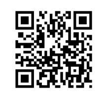
*그림 1 — QR 바코드(이 논문에서 설명하는 시험에서 "Code 1"로 사용). 출처: 위키백과 [4]*

표준 1D 바코드는 좁은 광선으로 기계적으로 스캔되도록 설계된 반면, QR 바코드는 반도체 영상 센서로 2D 디지털 영상으로 검출된 뒤 프로그램된 프로세서로 디지털 분석된다([2], [4]). 이 검출의 핵심은 일련의 *필수 패턴(required patterns)*이다. 이는 다음으로 이루어진다. 영상의 위쪽 모서리 두 곳과 왼쪽 아래 모서리의 고정된 정사각형 세 개(*분리자(separators)*로 둘러싸인 *탐지 패턴(finder pattern)* 또는 *위치 패턴(position pattern)*), 오른쪽 아래 모서리 근처의 더 작은 정사각형(*정렬 패턴(alignment pattern)*), 그리고 위쪽 두 모서리를 그 아래쪽에서, 왼쪽 두 모서리를 그 오른쪽에서 잇는 화소 선 두 개(*타이밍 패턴(timing patterns)*)이다. 그림 2를 보라.

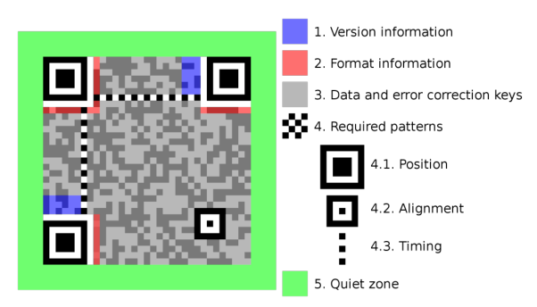
*그림 2 — QR 바코드의 구조. 컬러로 보는 것이 가장 좋다. 출처: 위키백과 [4] (Bobmath 작, CC BY-SA 3.0). [역주: 범례는 1. 버전 정보, 2. 형식 정보, 3. 데이터 및 오류 정정 키, 4. 필수 패턴(4.1 위치, 4.2 정렬, 4.3 타이밍), 5. 여백(quiet zone).]*

(저자 소속: Y. van Gennip — 영국 노팅엄대학교 수리과학부, University Park, Nottingham, NG7 2RD, UK, 이메일: y.vangennip@nottingham.ac.uk. P. Athavale — 토론토대학교 필즈 연구소. J. Gilles — 샌디에이고 주립대학교 수학통계학과. R. Choksi — 맥길대학교 수학통계학과.)

이 글에서 우리는 잡음이 있을 때 QR 바코드의 블라인드 디블러링과 잡음 제거(denoising)를 다룬다. 우리 방법은 디블러링과 관련된 미지의 점확산함수(point spread function, PSF)의 성질(예: 가우시안)에 대해 아무런 가정도 하지 않으므로 *블라인드*라는 용어를 쓴다. 이는 상당한 관심을 끄는 문제이다. 카메라를 갖춘 스마트폰이 QR 바코드 판독에 점점 더 많이 쓰이지만, 카메라의 한계 때문에 촬영된 영상은 항상 흐리고 잡음이 있다. 카메라 블러의 흔한 원인은 카메라와 바코드 사이의 상대 운동이다. 따라서 디블러링과 바코드 기호 체계(symbology)의 상호작용은 스마트폰을 성공적으로 쓰는 데 중요하다([5], [6], [7], [8], [9], [10]).

### A. 바코드 블라인드 디블러링의 기존 접근 (Existing Approaches for Blind Deblurring of Bar codes)

현재 일반 영상의 디블러링을 위한 정칙화 기반 방법은 매우 많다. 신호 $f$에 대해 많은 방법이 모든 $u$와 PSF $\phi$에 걸쳐

$$E(u, \phi) = F(u * \phi - f) + R_1(u) + R_2(\phi)$$

를 최소화하려 한다. 여기서 $F$는 충실도(fidelity) 항, $R_i$는 흔히 총변동(total variation, TV) 유형의 정칙화 항이며, $u$는 복원된 영상이 된다(참조: [11], [12], [13], [14], [15], [16], [17], [18], [19]). 최근 연구는 영상과 PSF를 정칙화하기 위해 희소성 기반 사전 정보(sparsity based priors)를 쓴다(참조: [20], [21], [22], [23], [24]).

한편 바코드의 단순한 구조는 정칙화 기반과 비정칙화 기반 모두에서 맞춤형 디블러링 방법에 적합했다. 1D 바코드에 대해서는 많은 연구가 이루어졌다(예: [25], [8], [26], [27], [28], [29], [30], [31]). 2D 매트릭스 및 적층형(stacked) 바코드([2])는 관심을 덜 받았다(예: [32], [33], [34], [35]). Liu 등의 논문 [34]가 본 연구와 가장 가까우며, 가우시안 블러 가정(ansatz) 아래에서 특정 2D 매트릭스 바코드를 위한 반복적 증분 구속 최소제곱(Increment Constrained Least Squares) 필터 방법을 제안한다. 특히 그들은 코드의 L자형 탐지 패턴을 써서 가우시안 PSF의 표준편차를 추정한 뒤, 이준위(bi-level) 구속을 연속적으로 적용하여 영상을 복원한다.

### B. QR 바코드를 위한 우리의 접근 (Our Approach for QR Bar Codes)

이 글에서 우리는 QR 기호 체계의 필수 패턴을 알려진 정칙화 방법에 통합하여 혼합(hybrid) 방법을 설계한다. QR 바코드가 스마트폰 응용에서 널리 쓰인다는 점을 고려하여, 구현의 단순성, 적은 메모리 요구, 잠재적 속도 때문에 전적으로 이러한 방법에 집중하기로 하였다. 우리는 이 방법을 훼손된 바코드의 큰 목록에 적용하고, 그 결과를 오픈소스 소프트웨어 ZBar [1]로 평가한다. 바코드를 스캔하면 측정 신호 $f$를 얻으며, 이는 깨끗한 바코드 $z$의 흐리고 잡음 섞인 버전이다. 우리는 $f$가 다음 형태라고 가정한다.

$$f = N(\phi_b * z), \tag{1}$$

여기서 $\phi_b$는 PSF(블러 커널)이고 $N$은 잡음 연산자이다. 바코드의 일부는 알려져 있다고 가정한다. 특히 우리는 QR 바코드의 알려진 왼쪽 위 모서리에 집중한다. 우리의 목표는 이 알려진 정보를 활용해 미지의 PSF $\phi_b$를 정확하게 추정하고, 이를 디컨볼루션(deconvolution)과 잡음 제거를 위한 최신 TV 기반 정칙화 방법으로 보완하는 것이다. 구체적으로 다음 네 단계를 수행한다. (i) 가중 TV 흐름(weighted TV flow)으로 신호의 잡음을 제거한다. (ii) 왼쪽 위 모서리의 알려진 탐지 패턴을 같은 모서리에서 단계 (i)의 잡음 제거된 신호와 비교하는 것에 기반한 고차 매끄러운 정칙화 방법으로 PSF를 추정한다. (iii) 단계 (ii)의 PSF로 적절히 정칙화된 디컨볼루션을 적용한다. (iv) 단계 (iii)의 출력을 임계값 처리(thresholding)한다. 또한 전체 방법을 네 단계의 다음 부분집합/변형과 비교한다. 단계 (i)과 (iv)만 쓰는 경우, 그리고 단계 (ii)를 균일 PSF 가정에 기반한 더 단순한 추정으로 대체하는 경우이다.

원리적으로 우리 방법은 영상의 일부가 사전에 알려진 모든 종류의 영상의 블라인드 디블러링과 잡음 제거로 확장된다. 우리가 QR 바코드에 집중하는 이유는, 이것이 이 성질을 가진 어디에나 있는 영상의 표준적인 부류이고, 블록으로 된 단순한 이진 구조가 단순한 비등방성(anisotropic) TV 정칙화에 잘 맞으며, QR 바코드를 생성하고 읽는 소프트웨어를 쉽게 구할 수 있어 우리 방법을 단순하고 모호함 없이 평가할 수 있기 때문이다.

## II. TV 정칙화와 분할 브레그만 반복 (TV Regularization and Split Bregman Iteration)

Rudin-Osher-Fatemi의 기념비적 논문 [36] 이후, TV(즉 기울기의 $L^1$ 노름) 기반 정칙화 방법은 영상 잡음 제거와 디컨볼루션에서 성공적임이 입증되었다. 그 이후 비등방성([37], [38]) 및 비국소(nonlocal)([39]) TV 같은 여러 개선이 탐구되었다. 비등방성 TV 잡음 제거의 경우를 설명하여 이러한 모델의 철학을 상기해 보자.

이 방법은 관측 영상 $f$로부터 다음을 풀어 복원 영상 $u_0$를 구성한다.

$$u_0 = \operatorname*{argmin}_u \|\nabla u\|_1 + \frac{\mu}{2}\|u - f\|_2^2, \tag{2}$$

여기서 $\|\nabla u\|_1 = |u_x| + |u_y|$이다($u_x, u_y$는 각각 $x$와 $y$ 방향의 $u$의 편도함수). TV 기반 정칙화 방식의 빠른 수치 계산을 위한 현재 최고 수준의 방법 중 하나는 분할 브레그만 반복(split Bregman iteration)이다([40], [41], [42]). 이는 추가 변수 $d_x = u_x$와 $d_y = u_y$(새 변수의 아래첨자는 미분을 뜻하지 않는다)를 도입하여 위 최소화 문제를 풀기 쉬운 여러 문제로 분할하는 것이다. (2)를 푸는 것은 다음 단계를 푸는 $u_0, d_x, d_y$를 찾는 것과 동등하다([40], [41]).

1) $(u^{k+1}, d_x^{k+1}, d_y^{k+1}) = \operatorname{argmin} \|d_x\|_1 + \|d_y\|_1 + \frac{\mu}{2}\|u - f\|_2^2 + \frac{\lambda}{2}\|d_x - u_x + b_x^k\|_2^2 + \frac{\lambda}{2}\|d_y - u_y + b_y^k\|_2^2$
2) $b_x^{k+1} = b_x^k + u_x^{k+1} - d_x^{k+1}$
3) $b_y^{k+1} = b_y^k + u_y^{k+1} - d_y^{k+1}$

그러면 $u_0$는 최종 $u^k$로 주어진다.

첫 번째 단계는 변수 두 개를 번갈아 고정하고 나머지 하나를 푸는 방식으로 다룰 수 있다. $d_x$와 $d_y$를 고정하면 가우스-자이델(Gauss-Seidel) 방식 [41]이나 푸리에 영역 [42]에서 효율적으로 풀 수 있는 $L^2 - L^2$ 문제를 얻음을 쉽게 알 수 있다. 여기서는 푸리에 접근을 쓴다. 갱신 $d_x^{k+1}, d_y^{k+1}$은 $L^1 - L^2$ 유형 문제의 해에 해당하며 다음과 같이 주어진다.

$$d_x^{k+1} = \mathit{shrink}(u_x^{k+1} + b_x^k, 1/\lambda)$$
$$d_y^{k+1} = \mathit{shrink}(u_y^{k+1} + b_y^k, 1/\lambda)$$

여기서 연산자 $\mathit{shrink}$는 $\mathit{shrink}(v, \delta) = \mathit{sign}(v)\max(0, |v| - \delta)$로 주어진다.

## III. 방법 (The Method)

### A. 흐리고 잡음 섞인 QR 시험 코드 만들기 (Creating Blurred and Noisy QR Test Codes)

우리는 QR 바코드 모음에 대해 시험을 수행하였으며, 그중 일부를 그림 7에 보였다. 각 경우 깨끗한 바코드를 $z$로 나타낸다. *모듈 폭(module width)*은 바코드의 가장 작은 정사각형의 길이를 뜻한다(1D 바코드의 $X$-치수(X-dimension)에 해당). 이 논문에서 쓴 각 QR 코드에서 이 길이는 8화소이다. 실제로 이 길이는 바코드의 깨끗한 모서리나 타이밍 선에서 자동으로 추출할 수 있다.

깨끗한 바코드 $z$의 흐리고 잡음 섞인 버전은 다음과 같이 만든다. MATLAB의 함수 "fspecial"을 써서 블러 커널 $\phi_b$를 만든다. 이 논문에서는 등방성 가우시안 블러(크기와 표준편차를 지정)와 모션 블러(영상과 컨볼루션하면, 지정된 화소 수만큼 반시계 방향 30도 각도로 카메라가 선형 운동하는 것을 근사하는 필터)를 사용한 결과를 논의한다. 컨볼루션은 MATLAB의 "imfilter(·,·,'conv')" 함수로 수행한다.

실험에서는 블러된 바코드 $\phi_b * z$에 네 가지 유형의 잡음 연산자 $N$ 중 하나를 적용한다.

- *가우시안 잡음*(평균 0, 지정된 표준편차[역주: 원문 'standard variation'은 'standard deviation'의 오기로 보임]): 표준 정규분포에서 뽑은 의사난수에 표준편차를 곱해 각 화소에 더한다(MATLAB의 함수 "randn").
- *균일 잡음*(지정된 구간에서 추출): 균일 분포 의사난수(MATLAB의 함수 "rand")를 각 화소에 더하여 만든다.
- *소금-후추 잡음(salt and pepper noise)*(지정된 밀도): MATLAB의 "imnoise" 함수로 구현한다.
- *스페클 잡음(speckle noise)*(지정된 분산): MATLAB의 "imnoise" 함수로 구현한다.

시험에 쓴 블러와 잡음 파라미터의 세부는 IV절에 제시한다.

바코드 왼쪽 위 모서리의 탐지 패턴 영역을 $C_1$¹로 나타내며, 이 영역에 놓인 (깨끗한) 바코드 부분은 사전에 알려져 있다는 점에 주목한다. 잡음을 제거하고 디블러링하기 위해, 이제 (1)로 정의한 신호 $f$에 다음 4단계 과정을 적용한다.

(각주 1: 정확히 말하면 $C_1$은 왼쪽 위 탐지 패턴[역주: 원문 'patter'는 오기], 그 분리자, 그리고 $C_1$을 정사각형으로 완성하는 데 필요한 여백(quiet zone) 부분으로 이루어진 정사각형 영역이다. 간단히 하기 위해 $C_1$ 안의 패턴을 탐지 패턴이라고 부르겠다.)

### B. 단계 (i): 가중 TV 흐름에 의한 잡음 제거 (Step (i): Denoising via weighted TV flow)

예비 실험에서, 잡음 제거와 커널 추정을 동시에 수행하면 각 절차에 별도의 단계를 할애할 때보다 결과가 훨씬 나쁘다는 것을 보였다. 따라서 먼저 가중 TV 흐름²([45], [46], [47])으로 영상의 잡음을 제거한다.

$$\frac{\partial u}{\partial t} = \mu(t)\,\mathrm{div}\!\left(\frac{\alpha\nabla u}{|\nabla u|}\right) \tag{3}$$

경계 조건은 노이만(Neumann) 경계 조건이다. 여기서 $u(x, t)$의 초기 조건은 $u(x, 0) = f$로 주어지며, $\alpha$는 확산을 제어하는 함수이다.

$$\alpha(x) := \frac{1}{\sqrt{1 + \frac{|(G_\sigma * \nabla f)(x)|^2}{\beta^2}}},$$

여기서 $G_\sigma$는 평균 0, 표준편차 $\sigma$인 정규화된 가우시안 함수이다.

흐름 (3)은 표준 총변동 흐름([48], [49])과 밀접하게 관련되며, $f$의 계층적 $(BV_\alpha, L^2)$ 분해의 극한 경우로 얻을 수 있다 [45]. 여기서 $u$의 $BV_\alpha$ 반노름(semi-norm)은 $|u|_{BV_\alpha} := \int_\Omega \alpha|\nabla u|$로 정의된다. $f$의 계층적 $(BV_\alpha, L^2)$ 분해에서는 더 미세한 규모의 성분이 $f$에서 연속적으로 제거된다.

가중 함수 $\alpha$는 주어진 QR 영상의 두드러진 에지, 즉 기울기 $|\nabla f|$가 큰 점 $x$에서 확산을 줄인다. 가우시안 평활화는 잡음을 에지로 잘못 특성화하는 것을 막으며, $\beta$ 값은 영상의 관련 에지에서 $\alpha(x)$가 작도록 선택한다. (3)의 함수 $\mu(t)$는 단조 증가하는 "속도" 함수이다. 흐름의 속도가 $\mu(t)$에 직접 의존함을 보일 수 있다(참조: [45]). 더 정확히는 $\|\frac{\partial u}{\partial t}\|_{\alpha^*} = \mu(t)$이며, 여기서 $\|\cdot\|_{\alpha^*}$는 $L^2$ 내적에 대한 가중 $BV_\alpha$ 반노름의 쌍대(dual)를 나타낸다.

(각주 2: 실험 초기 단계에서는 잡음 제거에 비국소 TV 접근([44]에 설명된 분할 브레그만 기법에 기반한 [43]의 코드)을 사용하였다. 에지 보존 성질 때문에 위에서 설명한 가중 TV 흐름 기법이 모서리가 덜 둥글어진 더 나은 결과를 주므로, 이 논문의 결과를 만드는 데에는 이것을 사용하였다.)

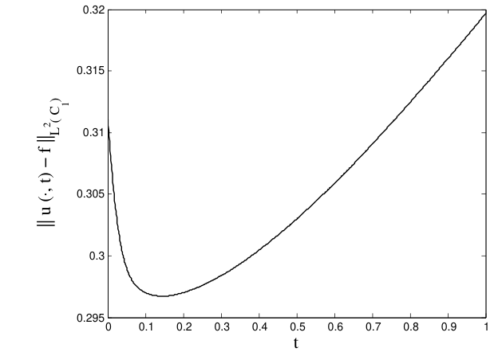
*그림 3 — 가중 $TV$ 흐름의 전형적인 실행. 그 동안 $\|u(\cdot, t) - f\|_{L^2(C_1)}$은 먼저 감소했다가 다시 증가한다.*

영상의 가장자리에서는 동차 노이만 경계 조건을 쓰며([50], [51]을 따름), 실제로는 영상을 그 경계 밖으로 경계와 같은 화소값으로 확장하여 구현한다.

$t$가 커질수록 $u(., t)$는 점점 더 매끄러운 $f$가 되므로, $u(\cdot, t_s)$가 $f$의 (거의) 최적으로 평활화된 버전이 되는 정지 시간 $t_s$를 정해야 한다. 우리는 왼쪽 위 모서리 $C_1$이 사전에 알려져 있다는 사실을 활용한다. $\|u(\cdot, t) - f\|_{L^2(C_1)}$이 최소에 도달하는 시간 $t_s$에 흐름을 멈추고, 함수 $u_1 := u(\cdot, t_s)$를 이후 처리를 위한 QR 코드의 잡음 제거 버전으로 삼는다. 이 현상을 그림 3에 나타냈다. 따라서 다른 최소화 기법에 비해 가중 TV 흐름을 쓰는 장점 중 하나는 최적의 결과를 얻기 위해 잡음 제거 파라미터를 바꿀 필요가 없다는 것이다.

이 논문의 실험에서는 $\beta = 0.05$를 선택하였는데, 이는 영상 $f$의 관련 에지에서 정칙화를 줄이는 것에 해당한다. 가우시안의 표준편차는 경험적으로 $\sigma = 1$로 정하였다. 가중 TV 흐름은 $t$가 커질수록 원래 영상 $f$에서 작은 규모의 구조를 연속적으로 제거한다. 잡음은 보통 영상에서 가장 미세한 규모의 구조이므로, 가중 TV 흐름이 작은 $t$ 값에서 잡음을 제거할 것으로 기대한다(그림 3 참조). 과평활화를 피하면서 작은 규모의 잡음을 효과적으로 제거하려면 작은 $t$ 값에서 속도 함수 $\mu(t)$의 크기를 제어해야 한다. 그래서 $\mu(t) = 1.1^t$로 선택하여, 작은 $t$ 값에서 속도가 $\|\frac{\partial u}{\partial t}\|_{\alpha^*} \approx 1$이 되게 한다.

### C. 단계 (ii): PSF 추정 (Step (ii): PSF estimation)

블러 커널을 정하기 위해, $z$의 왼쪽 위 모서리 $C_1$에 있는 알려진 탐지 패턴을 $u_1$의 같은 모서리와 비교한다.

$$\phi_* = \operatorname*{argmin}_\phi \frac{1}{2}\int_{C_1} |\nabla\phi|^2 + \frac{\lambda_1}{2}\|\phi * z - u_1\|^2_{L^2(C_1)}.$$

여기서 $\lambda_1 > 0$은 파라미터이며 그 선택은 III-F절과 IV-D절에서 더 자세히 논의한다.

이 변분 문제는 엄밀히 볼록(strictly convex)하므로 다음 오일러-라그랑주(Euler-Lagrange) 방정식을 푸는 유일한 최소화 해를 가진다.

$$-\Delta\phi_* + \lambda_1(\phi_* * z - u_1) * z = 0.$$

햇(hat) 기호로 푸리에 변환을 나타내어 이 방정식을 푸리에 공간에서 풀면 다음을 얻는다.

$$\begin{aligned} &-\hat\Delta\widehat{\phi_*} + \lambda_1(\widehat{\phi_*}\hat z - \hat u_1)\hat z = 0\\ \Leftrightarrow\ &(-\hat\Delta + \lambda_1|\hat z|^2)\widehat{\phi_*} - \lambda_1\hat u_1\hat z = 0\\ \Leftrightarrow\ &\widehat{\phi_*} = (-\hat\Delta + \lambda_1|\hat z|^2)^{-1}\lambda_1\hat u_1\hat z. \end{aligned}$$

역 푸리에 변환을 취해 $\phi_*$를 얻는다. 커널이 적절히 정규화되도록, 즉 $\int\phi_* = 1$이 되도록, 알고리즘을 적용하기 전에 입력 신호 $u_1$과 $z$를 단위 질량(unit mass)으로 정규화한다.

위 절차에서 경계 효과의 영향을 줄이기 위해, $z$와 $u_1$(의 모서리) 둘 다를 모든 변에서 거울상으로 확장하여 주기 경계 조건을 부과하고, 최소화 후 결과에서 원래 영상(모서리) 크기에 해당하는 중앙 영상을 추출한다.

실제 커널은 더 작지만 알고리즘의 출력은 $C_1$과 같은 크기이다. 이를 보완하기 위해 수동 절단(즉 커널 행렬에서 지정된 크기의 중앙 정사각형을 제외한 모든 원소를 0으로 설정)으로 출력 커널의 크기를 줄인다. 이 더 작은 크기는 $\phi_*$를 줄여 서로 다른 크기의 커널 모음 $\{\phi_1, \phi_2 \ldots, \phi_n\}$을 구성하고, $\|\phi_i * z - u_1\|^2_{L^2(C_1)}$을 최소화하는 $\phi_i$를 선택하여 자동으로 정한다. 이 비교는 꽤 빠르며, 실제로는 원래 출력의 전체 크기까지 여러 또는 모든 크기의 커널을 비교한다. 줄인 커널을 다시 단위 질량으로 정규화하는 것이 중요하다. 이 정규화된 커널을 이후 $\phi_*$로 나타낸다.

### D. 단계 (iii): 디블러링(디컨볼루션) (Step (iii): Deblurring (Deconvolution))

최소화 커널 $\phi_*$를 가지고, 다음 변분 문제로 잡음 제거된 신호 $u_1$을 디블러링한다.

$$u_2 = \operatorname*{argmin}_u \int |u_x| + |u_y| + \frac{\lambda_2}{2}\|\phi_* * u - u_1\|^2_{L^2}.$$

파라미터 $\lambda_2 > 0$의 선택은 III-F절에서 논의한다.

이 최소화 문제는 II절에서 앞서 설명한 분할 브레그만 반복 방법 [42, ATV_NB_Deconvolution]으로 푼다. 이 방법은 분할 변수에 대한 내부 충실도 파라미터를 쓰며, 그 값은 100으로 정한다. 내부 브레그만 반복은 두 번 쓴다. 여기서도 $u$와 $u_1$을 거울상으로 확장하여 주기 경계 조건을 부과하고, 결과에서 원래 영상 크기에 해당하는 중앙 영상을 추출한다.

### E. 단계 (iv): 임계값 처리 (Step (iv): Thresholding)

마지막으로 화소별 회색값을 기준으로 결과를 임계값 처리하여 이진 영상 $u_3$를 얻는다. 임계값은 다시 $z|_{C_1}$에 대한 사전 지식을 이용해 자동으로 정한다. 즉 여러 값(최솟값에서 최댓값까지 $u_3|_{C_1}$의 회색값 범위에서 등간격인 100개 값)을 시험하여 $\|u_3 - z\|^2_{L^2(C_1)}$을 최소화하는 값을 고른다.

화소별 임계값 처리 대신, 크기가 모듈 폭 × 모듈 폭인 화소 블록별 평균 회색값을 기준으로 최종 결과를 임계값 처리하는 것도 실험하였으며, 이때도 경험적으로 최적화한 임계값을 사용하였다. ZBar를 이용한 시험은, 블록별 처리의 출력이 더 '바코드다워' 보임에도 불구하고 블록별보다 화소별 임계값 처리를 상당히 선호함을 보였다(참조: 그림 4).

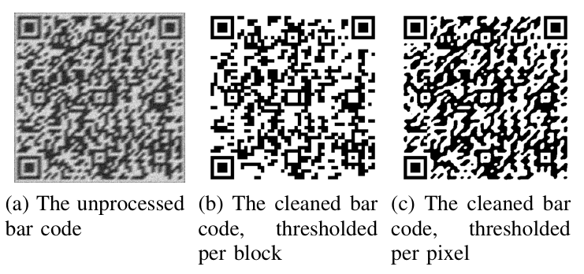
*그림 4 — 모션 블러(길이 11)와 균일 잡음([0, 0.6]에서 추출)이 있는 Code 10. 흐리고 잡음 섞인 바코드(a)도, 블록별로 임계값 처리한 정리된 코드(b)도 ZBar로 읽을 수 없다. 화소별로 임계값 처리한 정리된 코드(c)는 읽을 수 있다. (a) 처리하지 않은 바코드, (b) 블록별로 임계값 처리한 정리된 바코드, (c) 화소별로 임계값 처리한 정리된 바코드.*

이 논문의 나머지에서는 화소별 임계값 처리만 고려한다. 최종 출력에서는 QR 바코드의 알려진 부분, 즉 그림 2의 필수 패턴을 다시 더한다.

### F. 충실도 파라미터 추정 (Fidelity parameter estimation)

우리는 충실도 파라미터 $\lambda_1$과 $\lambda_2$ 두 개를 도입하였다. 원래의 Rudin-Osher-Fatemi 모델 [36]에서는 데이터가 잡음이 있지만 블러되지 않았다면 충실도 파라미터 $\lambda$가 잡음 분산에 반비례해야 한다 [11, Section 4.5.4]. 따라서 $\lambda_2 = 1/\sigma_2^2$로 정하며, 여기서 $\sigma_2^2$는 $(\phi_* * z - u_1)\big|_{C_1}$의 분산이다. 충실도 파라미터 $\lambda_2$를 선택하는 휴리스틱은 신호 $u_1$이 블러되지 않았다는 가정에 기반한다. 따라서 일부 시험으로 뒷받침된 기대는, 이 자동 선택 $\lambda_2$가 작은 블러 커널에서 더 잘 동작한다는 것이다. 블러가 더 크면 $\lambda_2$를 (시행착오로) 수동 선택하여 결과를 개선할 수도 있겠지만, 이 논문에 보고한 결과는 모두 자동 선택한 $\lambda_2$에 대한 것이다. 매우 최근에 우리는 아직 발표되지 않은 새로운 통계적 방법 [52]을 알게 되었는데, 향후 연구에서 $\lambda_2$에 대한 초기 추정을 개선하는 데 쓸 수 있을 것이다.

'깨끗한' 참 커널 $\phi_b$를 모르므로, $\lambda_1$을 고르는 데 같은 휴리스틱을 쓸 수 없다. 초기 시행착오 실행에 기반하여, 달리 명시하지 않으면 실험에서 $\lambda_1 = 10000$을 쓴다. IV-D절에서는 $\lambda_1$의 선택에 따라 알고리즘 성능이 어떻게 달라지는지를 다룬다.

## IV. 결과 (Results)

가우시안 블러 또는 모션 블러와 네 가지 유형의 잡음(가우시안, 균일, 스페클, 소금-후추)이 있는 흐리고 잡음 섞인 바코드 부류에 알고리즘을 적용하였다. 그런 다음 ZBar로 결과를 시험하여 원래 신호와 정리된 신호의 판독 가능성(readability)을 비교하였다.

### A. 잡음과 블러 파라미터의 선택 (Choice of noise and blurring parameters)

원래의 깨끗한 이진 영상은 $\{0, 1\}$ ($\{$검정, 흰색$\}$) 값을 갖도록 정규화한다. MATLAB의 함수 "fspecial"로 회전 대칭의 정규화된 가우시안 블러 커널을 만들려면 두 개의 자유 파라미터를 지정해야 한다. 정사각형 블러 커널 행렬의 크기(즉 행의 수)와 가우시안의 표준편차이다. 전자는 $\{3, 7, 11, 15, 19\}$의 값으로, 후자는 $\{3, 7, 11\}$의 값으로 바꾼다.

"fspecial"로 모션 블러 행렬을 만들려면 운동의 각도와 선형 운동의 길이를 지정해야 한다. 모든 실험에서 전자는 30도로 고정하고 후자는 $\{3, 7, 11, 15, 19\}$ 화소로 바꾼다.

가우시안 블러 커널은 모션 블러 커널보다 자유 파라미터가 하나 더 많으므로, 후자의 경우에 더 넓은 범위의 잡음 파라미터를 쓴다.

평균 0, 표준편차 $s$인 가우시안 잡음을 만들기 위해, (표준 정규분포에서 뽑은) i.i.d. 의사난수 행렬에 $s$를 곱해 영상에 더한다. 가우시안 블러에는 $s = 0.05$를 쓰고, 모션 블러에서는 $s$를 $\{0, 0.05, 0.1, \ldots, 0.5\}$로 바꾼다.

균일 잡음을 만들기 위해, 균일 분포 의사난수 행렬에 $a$를 곱해 영상에 더한다. 이는 구간 $[0, a]$에서 추출한 균일 분포 가산 잡음을 생성한다. 가우시안 블러의 경우 $a \in \{0.4, 0.7, 1\}$로 시험한다. 모션 블러의 경우 $a$를 $\{0, 0.2, 0.4, \ldots, 2\}$로 바꾼다.

소금-후추 잡음은 파라미터 하나, 즉 밀도를 입력해야 한다. 가우시안 블러의 경우 밀도를 0.2로 고정하고, 모션 블러의 경우 $\{0, 0.1, 0.2, \ldots, 1\}$로 바꾼다.

스페클 잡음을 만들려면 그 분산을 지정한다. 가우시안 블러의 경우 이를 0.4로 고정하고, 모션 블러의 경우 분산을 $\{0, 0.1, 0.2, \ldots, 1\}$로 바꾼다.

이렇게 얻은 흐리고 잡음 섞인 바코드는 각각 다시 정규화하여 각 화소가 0과 1 사이의 회색값을 갖게 한다.

### B. 정리된 바코드의 몇 가지 예 (Some examples of cleaned bar codes)

그림 5는 가우시안 블러와 여러 유형의 잡음이 있는 QR 바코드를 우리 알고리즘의 정리된 출력과 함께 보여 준다. 이 모든 경우에 소프트웨어 ZBar는 흐리고 잡음 섞인 바코드는 읽지 못했지만 정리된 출력은 읽을 수 있었다. 그림 6은 모션 블러가 있는 QR 바코드에 대한 비슷한 예를 보여 준다. 우리는 복원이 좋은지 아닌지의 판단 기준으로 주관적인 미적 만족감을 쓰지 않고, 출력을 ZBar가 읽을 수 있는지 여부를 쓴다는 점을 강조한다.

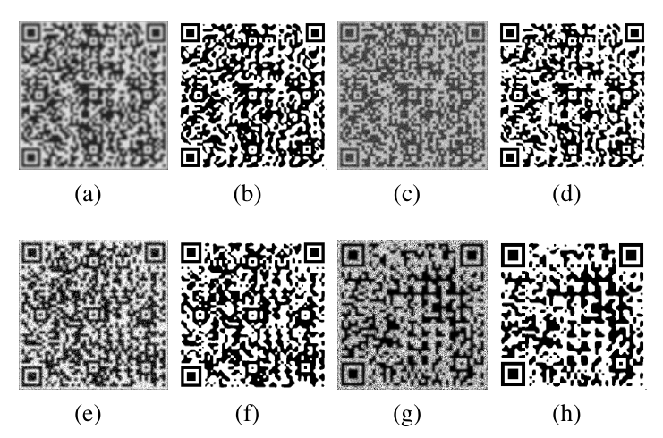
*그림 5 — 가우시안 블러와 여러 유형의 잡음이 있는 예. **(a)-(b):** 가우시안 블러(크기 11, 표준편차 11)와 가우시안 잡음(평균 0, 표준편차[역주: 원문 'standard variation'] 0.05)이 있는 Code 7의 처리 전과 정리 후, **(c)-(d):** 가우시안 블러(크기 7, 표준편차 3)와 균일 잡음($[0, 0.7]$에서 추출)이 있는 Code 7의 처리 전과 정리 후, **(e)-(f):** 가우시안 블러(크기 7, 표준편차 11)와 소금-후추 잡음(밀도 0.2)이 있는 Code 10의 처리 전과 정리 후, **(g)-(h):** 가우시안 블러(크기 7, 표준편차 7)와 스페클 잡음(분산 0.6)이 있는 Code 5의 처리 전과 정리 후.*

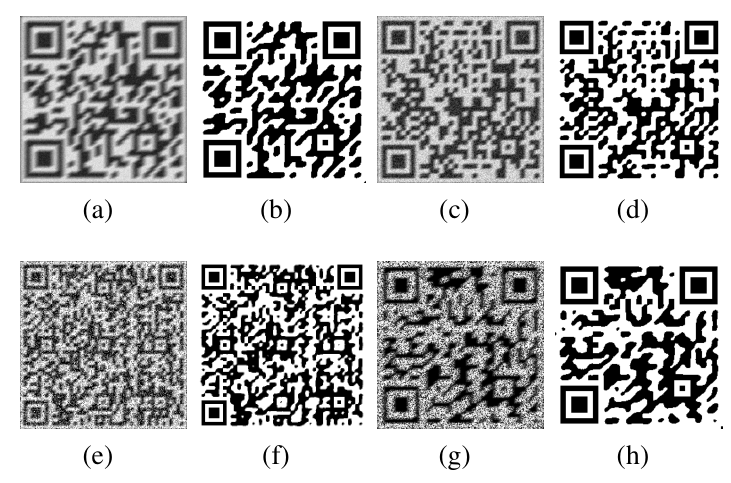
*그림 6 — 모션 블러와 여러 유형의 잡음이 있는 예. **(a)-(b):** 모션 블러(길이 11, 각도 30)와 가우시안 잡음(평균 0, 표준편차 0.05)이 있는 Code 2의 처리 전과 정리 후, **(c)-(d):** 모션 블러(길이 7, 각도 30)와 균일 잡음($[0, 0.6]$에서 추출)이 있는 Code 3의 처리 전과 정리 후, **(e)-(f):** 모션 블러(길이 7, 각도 30)와 소금-후추 잡음(밀도 0.4)이 있는 Code 4의 처리 전과 정리 후, **(g)-(h):** 모션 블러(길이 7, 각도 30)와 스페클 잡음(분산 0.6)이 있는 Code 9의 처리 전과 정리 후.*

### C. 알고리즘의 결과 (Results of our algorithm)

결과가 원래의 깨끗한 바코드의 특성이나 확률적 잡음의 특정 실현에 크게 영향받지 않음을 확인하기 위해, 서로 다른 열 개의 바코드(세 개를 그림 7에 보임)에 대해 실험을 수행하고, 코드마다 같은 확률적 잡음의 열 번의 실현에 대해 결과("ZBar로 읽을 수 없음"은 0, "ZBar로 읽을 수 있음"은 1)를 평균하였다. 이 시험으로 그림 8–15의 '상태도(phase diagram)' 열여섯 개를 얻었다. 각 도표는 특정 바코드 하나에 대한 열 번 실행의 평균 결과를 보여 준다는 점에 유의하라. 진한 빨강은 ZBar 소프트웨어가 열 번 실행 모두에서 바코드(흐리고 잡음 섞인 것이든 우리 알고리즘의 정리된 출력이든)를 읽을 수 있음을, 진한 파랑은 ZBar가 열 번 중 한 번도 읽지 못함을 나타낸다³. 각 상태도는 시험 바코드 하나만 써서 얻었지만, 우리의 결과는 그 선택에 대해 강건함을 보였다.

(각주 3: 그림 5와 6에 보인 바코드는 상태도에서 모든 실행의 출력을 읽을 수 있는 부분에서 골랐다는 점에 유의하라.)

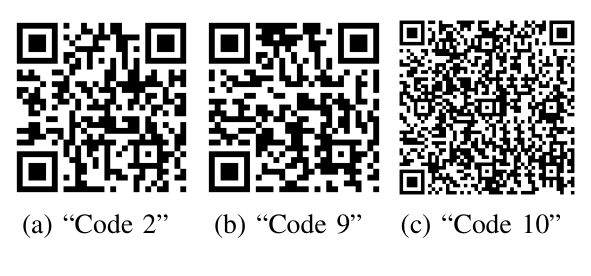
*그림 7 — 실험에 사용한 깨끗한 바코드 일부. (a) "Code 2", (b) "Code 9", (c) "Code 10".*

구체적인 결과를 살펴보기 전에, 모션 블러에 대한 일반적 경향 하나에 주목하자. 잡음이 없고 블러가 클 때(길이 15), 정리된 바코드는 읽을 수 없는 반면 정리하지 않은 바코드는 읽을 수 있다. 잡음 제거 단계 (i)(III-B절)을 빼고 잡음 없는 영상에 알고리즘을 실행해도 이 문제는 해결되지 않는다. 가우시안 블러의 경우에는 이 문제가 보통 일어나지 않는다. 이 문제와 그 해결책은 IV-E절에서 다시 다룬다. 아주 약간의 잡음만 있어도 이 문제는 사라진다. 잡음은 일반적으로 정리하지 않은 바코드를 완전히 읽을 수 없게 만든다(그림 9의 낮은 수준 가우시안 잡음은 작은 예외). 바로 이런 상황에서 우리 알고리즘이 성과를 낸다.

#### 1) 가우시안 잡음 (Gaussian noise)

그림 8에서 보듯, ZBar는 잡음의 표준편차가 0.05로 낮을 때조차 가우시안 잡음이 있으면 매우 나쁜 성능을 보인다. 바코드는 작은 블러 커널에서만 읽을 수 있다. 그러나 정리된 코드는 꽤 넓은 범위의 블러 커널 크기와 표준편차에서 일관되게 읽을 수 있다.

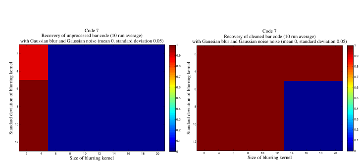
*그림 8 — 가우시안 블러 커널의 여러 크기와 표준편차에 대한, 가우시안 잡음(평균 0, 표준편차 0.05)이 있는 Code 7의 처리 전과 정리 후 판독 가능성. 색 척도는 서로 다른 잡음 실현으로 한 열 번의 실행 중 ZBar로 읽을 수 있는 바코드가 된 비율을 나타낸다.*

모션 블러의 경우(참조: 그림 9), 큰 블러 커널에서 표준편차가 낮은 잡음에 대해 판독 가능성이 약간이지만 눈에 띄게 개선된다. 아래의 모션 블러 결과와 비교하면, 가우시안 잡음은 분명히 우리 알고리즘이 가장 어려움을 겪는 유형이다.

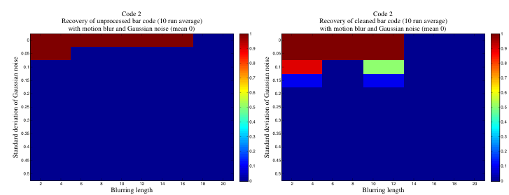
*그림 9 — 여러 블러 길이와 가우시안 잡음 표준편차(평균은 0)의 여러 값에 대한, 그림 7a의 Code 2의 판독 가능성.*

#### 2) 균일 잡음 (Uniform noise)

그림 10에서, 가우시안 블러와 균일 잡음이 있는 처리 전 바코드는 우리가 쓴 잡음 수준에서 ZBar로 전혀 읽을 수 없음을 본다. 우리 알고리즘은 판독 가능성을 어느 정도 개선하지만, 이 경우 결과는 부족하다. 또한 그림 10b에서 다른 바코드의 결과에도 일관되게 나타나는 다소 의아한 특징을 발견한다. 판독 가능성 결과가 블러 커널 크기 3보다 크기 7에서 더 좋다. 이 문제들은 IV-E절에서 다룬다.

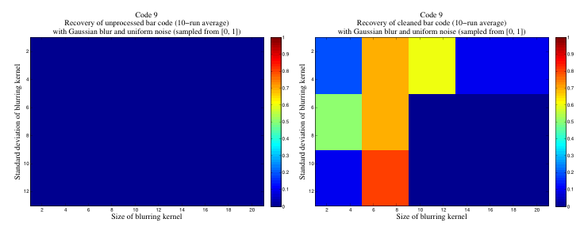
*그림 10 — 가우시안 블러 커널의 여러 크기와 표준편차에 대한, 균일 잡음($[0, 1]$에서 추출)이 있는 그림 7b의 Code 9의 판독 가능성.*

균일 잡음이 조금이라도 있으면, 처리 전 모션 블러 바코드는 대부분 읽을 수 없다(참조: 그림 11). 우리 알고리즘은 낮은 잡음의 코드를 일관되게 읽을 수 있게 만들며, 높은 잡음 수준의 코드도 무시할 수 없는 비율로 읽을 수 있게 한다. 또한 가우시안 블러의 경우와 비슷한(다만 덜 뚜렷할 수 있는) 경향, 즉 블러 커널 크기 7의 결과가 크기 3보다 더 좋은 경향(역시 모든 코드에서 나타남)을 발견한다. 이 문제의 추가 논의는 다시 IV-E절을 참조하라.

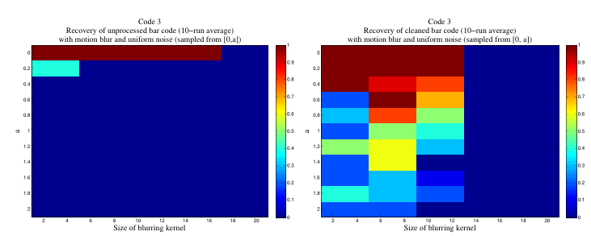
*그림 11 — 여러 블러 길이와 균일 잡음 추출 구간 $[0, a]$의 여러 길이에 대한 Code 3의 판독 가능성.*

#### 3) 소금-후추 잡음 (Salt and pepper noise)

우리 알고리즘은 가우시안 블러와 모션 블러 모두에서 블러와 잡음 파라미터의 일정 범위에 대해 일관되게 좋은 성능을 보인다(참조: 그림 12와 13). 정리하지 않은 코드는 아주 약간의 잡음만 있어도 완전히 읽을 수 없다.

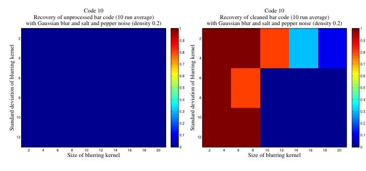
*그림 12 — 가우시안 블러 커널의 여러 크기와 표준편차에 대한, 소금-후추 잡음(밀도 0.2)이 있는 그림 7c의 Code 10의 판독 가능성.*

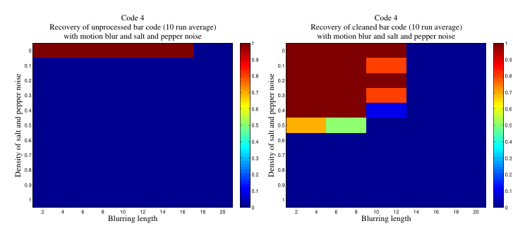
*그림 13 — 여러 블러 길이와 소금-후추 잡음 밀도의 여러 값에 대한 Code 4의 판독 가능성.*

#### 4) 스페클 잡음 (Speckle noise)

여기서의 결과는 소금-후추 잡음의 결과와 꽤 비슷하다(참조: 그림 14와 15). 그러나 모션 블러 코드의 판독 가능성 개선이 위의 다른 어떤 잡음 유형에서 본 것보다 더 좋다는 점에 주목한다.

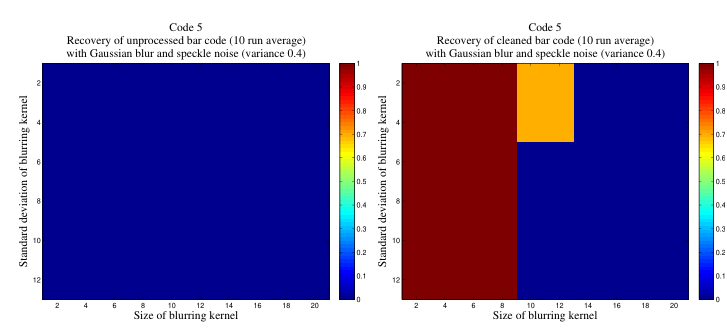
*그림 14 — 가우시안 블러 커널의 여러 크기와 표준편차에 대한, 스페클 잡음(분산 0.4)이 있는 Code 5의 판독 가능성.*

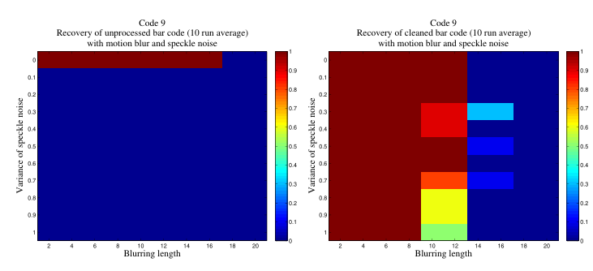
*그림 15 — 여러 블러 길이와 스페클 잡음 분산의 여러 값에 대한, 그림 7b의 Code 9의 판독 가능성.*

### D. $\lambda_1$의 다른 선택 (Different choices for $\lambda_1$)

PSF 추정 단계(III-C절에서 설명)에서 파라미터 $\lambda_1$의 선택은 중요하다. 지금까지 논의한 모든 결과에서는 $\lambda_1 = 10000$을 썼다. 이 선택은 여러 $\lambda_1$ 값으로 한 초기 시행착오 실행에 기반하였다. 여기서는 $\lambda_1$을 $10^{-6}$부터 $10^6$까지⁴ 바꾸며 코드 몇 개에 알고리즘을 실행하여 $\lambda_1$ 선택의 영향을 더 자세히 살펴본다. 결과를 그림 16(가우시안 블러)과 17(모션 블러)에 나타냈다.

(각주 4: 구체적으로 $\lambda_1 \in \{10^{-6}, 10^{-5}, \ldots, 10^2, 10^3, 5 \times 10^3, 10^4, 1.5 \times 10^4, 10^5, 10^6\}$.)

$\lambda_1$에 대한 성능의 구체적 의존성은 코드마다 다르지만, 몇 가지 일반적 경향을 알아볼 수 있다. 블러가 너무 강하지 않으면 $0 < \lambda_1 < 0.1$이 가우시안 블러와 모션 블러 모두에서 좋은 성능을 낸다. 이는 이런 경우 상수 PSF가 단계 (ii)의 PSF 추정과 같거나 더 좋은 성능을 낼 수 있음을 시사한다. 이는 IV-E절에서 더 조사한다.

대부분의 경우 $\lambda_1 = 1$ 근처에서 성능이 뚜렷하게 떨어지며, 이는 상수 PSF($\lambda_1 = 0$)와 "높은 충실도"(큰 $\lambda_1$)로 복원한 PSF 사이의 "중간 길"이 결코 선호되는 선택이 아님을 뜻한다. 블러가 심할 때는 특히 모션 블러의 경우 $10^2$와 $10^4$ 사이의 $\lambda_1$ 값이 대체로 좋은 성능을 낸다. 이는 앞서 선택한 $\lambda_1 = 10000$이 좋은 결과를 낸 사실로도 뒷받침된다.

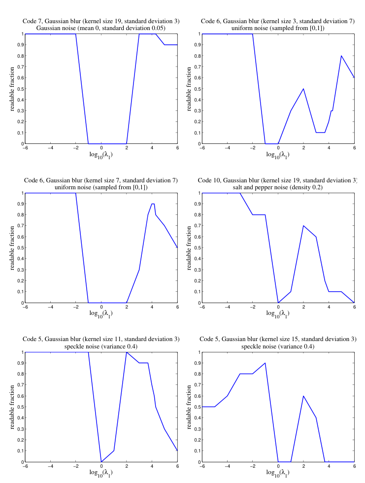
*그림 16 — 가우시안 블러와 여러 유형의 잡음이 있는 코드의 판독 가능성(서로 다른 잡음 실현으로 한 10회 실행 중 비율)을 $\log_{10}(\lambda_1)$의 함수로 나타냄.*

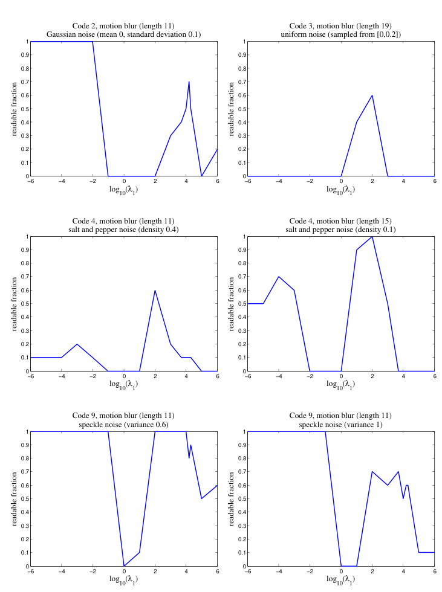
*그림 17 — 모션 블러와 여러 유형의 잡음이 있는 코드의 판독 가능성(서로 다른 잡음 실현으로 한 10회 실행 중 비율)을 $\log_{10}(\lambda_1)$의 함수로 나타냄.*

### E. 세 가지 알고리즘 (Three different algorithms)

결과 논의에서 나온 세 가지 문제가 아직 남아 있다. (a) IV-C절에서 심한 모션 블러(길이 15)가 있는 잡음 없는 코드는 처리 전 형태로는 읽을 수 있지만 (표준 알고리즘, 즉 $\lambda_1 = 10000$으로) 정리한 뒤에는 읽을 수 없음을 보았다. (b) IV-C2절에서 논의했듯이, 균일 잡음이 있는 정리된 코드는 (특히 가우시안 블러에서) 블러가 약간 더 심할 때보다 블러가 아주 약할 때 덜 읽힌다. (c) IV-D절의 결과는 약한 블러에서 상수 PSF가 우리의 PSF 추정 단계로 복원한 PSF와 같거나 더 좋은 성능을 낼 수 있음을 시사한다.

이 문제들을 조사하기 위해, 바코드 몇 개에 대해 우리 알고리즘의 세 가지 변형을 실행한다. "잡음 제거만(Denoising only)"(D)은 전체 알고리즘에서 단계 (i)과 (iv)(III-B절과 III-E절)만 수행하는 것이다. "균일 PSF(Uniform PSF)"(UPSF)는 단계 (i), (iii), (iv)를 유지하되 PSF 추정 단계 (ii)를 바꾼다. $\phi_*$에 대한 변분 문제를 푸는 대신 $\phi_*$를 상수로 두고, III-C절에서와 같이 $\|\phi_i * z - u_1\|^2_{L^2(C_1)}$을 최소화하여 커널의 최적 크기를 고른다. 휴리스틱하게 이는 원래 단계 (ii)에서 $\lambda_1 = 0$을 고르는 것에 해당한다. 마지막으로 "전체 PSF(Full PSF)"(FPSF)는 원래 알고리즘을 가리키며, IV-D절에서 설명한 것과 같은 범위의 $\lambda_1$ 값으로 실행한다.

그림 18과 19는 균일 잡음이 있는 코드에서 각각 (D)와 (UPSF)의 대표적 결과를 보여 준다. 그림 10, 11과 비교하면, 이런 경우 문제 (a)와 문제 (b)가 모두 사라지고 (D)가 (UPSF)보다도 더 나은 성능을 냄을 보며, 이는 균일 잡음이 있을 때 PSF 추정 단계가 이롭지 않음을 시사한다.

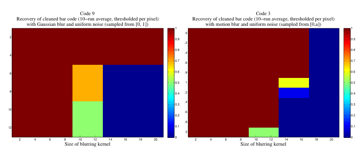
*그림 18 — 균일 잡음이 있을 때 "잡음 제거만" 알고리즘의 대표적 결과.*

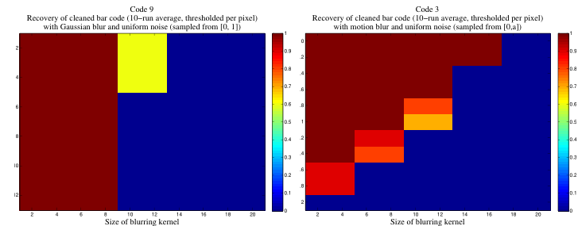
*그림 19 — 균일 잡음이 있을 때 "균일 PSF" 알고리즘의 대표적 결과.*

표 I은 모든 블러-잡음 조합을 대표하는 코드 몇 개에 대한 결과를 나열한다. 표의 (FPSF) 결과 일부에 해당하는 그림 16과 17의 그래프도 다시 참조하라. (FPSF)가 작은 $\lambda_1$을 가질 때 (UPSF)의 성능이 (FPSF)와 비슷함에 주목한다. 또한 $\lambda_1 = 100$인 (FPSF)가 심한 모션 블러가 있을 때 좋은 성능을 내며, 일부 경우 다른 알고리즘보다 분명히 우수함에 주목한다. 이는 소금-후추 잡음과 (매우 심한 블러에서의) 낮은 균일 잡음에서 가장 두드러진다. 이는 PSF 추정 단계가 출력의 판독 가능성을 상당히 개선하는 경우가 있음을 확인해 준다.

**표 I:** 바코드 표본의 판독 가능성. 열 **C**: 열 개 코드 목록에서 사용한 깨끗한 바코드의 번호. 열 **B**: $G(m, s)$ (평균 $m$, 표준편차 $s$인 가우시안 블러)[역주: 본문 IV-A의 정의로 보면 $m$은 평균이 아니라 커널 크기이다], $M(l)$ (길이 $l$인 모션 블러). 열 **N**: $G(s)$ (평균 0, 표준편차 $s$인 가우시안 잡음), $U(x)$ ($[0, x]$에서 추출한 균일 잡음), $Sa(d)$ (밀도 $d$인 소금-후추 잡음), $Sp(v)$ (분산 $v$인 스페클 잡음). 열 **U**("처리 전, Unprocessed"), **D**("잡음 제거만, Denoising only"), **UPSF**("균일 PSF, Uniform PSF")는 코드마다 잡음의 열 번 실현 중 ZBar로 읽을 수 있는 코드의 수를 보여 준다. **FPSF**("전체 PSF, Full PSF") 열은 같은 것을, 가장 좋은 판독 가능성을 주는 $\lambda_1$ 값(마지막 열에 나열)에 대해 나열한다. 여기서 "S"는 작은 $\lambda_1$, 즉 $0 < \lambda_1 \le 0.1$을, "A"는 시도한 모든 $\lambda_1$ 값에서 결과가 같았음을 나타낸다.

| C | B | N | U | D | UPSF | FPSF | $\lambda_1$ |
|---|---|---|---|---|---|---|---|
| 7 | $G(19, 3)$ | $G(0.5)$ | 0 | 10 | 10 | 10 | S, $10^3$, $5 \cdot 10^3$, $10^4$, $1.5 \cdot 10^4$ |
| 7 | $G(19, 7)$ | $G(0.5)$ | 0 | 0 | 0 | 0 | A |
| 9 | $G(19, 3)$ | $U(1)$ | 0 | 10 | 0 | 1 | $10^3$, $5 \cdot 10^3$, $10^4$, $1.5 \cdot 10^4$ |
| 9 | $G(19, 7)$ | $U(1)$ | 0 | 0 | 0 | 0 | A |
| 10 | $G(15, 7)$ | $Sa(0.2)$ | 0 | 0 | 0 | 0 | A |
| 10 | $G(19, 3)$ | $Sa(0.2)$ | 0 | 0 | 10 | 10 | S |
| 5 | $G(11, 3)$ | $Sp(0.4)$ | 0 | 6 | 10 | 10 | S, $10^2$ |
| 5 | $G(15, 3)$ | $Sp(0.4)$ | 0 | 0 | 5 | 9 | S |
| 2 | $M(11)$ | $G(0.1)$ | 0 | 10 | 10 | 10 | S |
| 2 | $M(15)$ | $G(0.05)$ | 0 | 10 | 9 | 10 | S, $10^2$ |
| 3 | $M(15)$ | $U(1)$ | 0 | 6 | 0 | 0 | A |
| 3 | $M(19)$ | $U(0.2)$ | 0 | 0 | 0 | 6 | $10^2$ |
| 4 | $M(11)$ | $Sa(0.4)$ | 0 | 0 | 1 | 6 | $10^2$ |
| 4 | $M(15)$ | $Sa(0.1)$ | 0 | 6 | 5 | 10 | $10^2$ |
| 9 | $M(11)$ | $Sp(1)$ | 0 | 1 | 10 | 10 | S |
| 9 | $M(15)$ | $Sp(0.7)$ | 0 | 0 | 0 | 1 | $10^2$, $10^3$, $10^4$, $1.5 \cdot 10^4$ |

(원문 표에서 위 8행은 가우시안 블러, 아래 8행은 모션 블러로 이중선으로 구분되어 있다. [역주: 원문 표의 N 열 $G(0.5)$는 IV-A절에서 가우시안 블러에 $s = 0.05$를 썼다는 서술과 맞지 않아 $G(0.05)$의 오기일 가능성이 있으나 원문대로 옮겼다.])

## V. 맺음말 (Final Comments)

우리는 QR 바코드의 블라인드 디블러링과 잡음 제거를 위한 정칙화 기반 알고리즘을 제시하고 ZBar로 시험하였다. 우리 방법의 강점은 PSF와 잡음의 구조에 대해 가정(ansatz)이 없다는 것이다. 특히 모션 블러를 다룰 수 있다. 구현의 단순성, 적은 메모리 요구, 속도 때문에 전적으로 정칙화 기반 방법에 집중했다는 점에 유의하라. 더 정교한 잡음 제거 기법을 쓸 수도 있음은 물론이다. 예를 들어 패치 기반 잡음 제거 기법은 현재 최고 수준이다([53], [54]). 가장 효율적인 것 중 하나는 BM3D(block matching 3D)로, 블록 정합 접근으로 검출·정합한 비슷한 패치들을 조합해 만든 3D 변환 영역에서의 효과적인 필터링에 기반한다. 이러한 방법은 실제로 더 나은 잡음 제거 결과를 줄 수 있지만, 두 가지 주요 단점이 있다. 3D 영역을 저장하기 위해 상당한 메모리가 필요하고 시간이 많이 걸린다. QR 바코드는 스마트폰으로 널리 읽히므로, 우리는 구현이 쉽고 메모리가 적게 들며 계산 효율이 높은 잡음 제거 알고리즘을 선택하였다.

우리 방법과 다른 알려진 디블러링 방법의 비교에 대해 몇 가지 언급한다. QR 바코드로 작업하는 이점 중 하나는 결과를 "눈대중 노름(eye-ball norm)"으로 평가할 필요도, 그러고 싶지도 않고, 오픈소스 ZBar 같은 바코드 판독 소프트웨어로 평가한다는 것이다. QR 코드의 블라인드 디블러링과 잡음 제거를 위해 특별히 설계된 다른 방법은 알지 못하지만, 가장 가까운 방법은 2D 매트릭스 코드를 위한 [34]의 방법이다. 그 방법은 잡음과 블러에 대한 가우시안 가정에 기반하지만, 탐지 패턴(그 경우 L자형 모서리)도 활용한다. 저자들은 다른 판독 소프트웨어인 ClearImage [55]를 쓰지만, 그들의 방법을 QR 코드에 맞게 고쳐 가우시안 블러와 잡음에 대해 그 결과를 우리 결과와 비교해 보는 것은 흥미로울 것이다. 우리는 [34]에서 쓴 것과 같은 하드웨어(프린터, 카메라)나 소프트웨어에 접근할 수 없으므로 이 논문에 그런 비교를 넣지 않았다. 그 논문의 결과는 이러한 요인에 크게 의존하므로, 다른 도구로 만든 비교는 오해를 낳을 것이다.

## 감사의 글 (Acknowledgment)

제1저자와 제3저자의 작업 중 상당 부분은 그들이 UCLA 수학과에 있는 동안 수행되었다. RC의 작업은 부분적으로 캐나다 NSERC Discovery Grant의 지원을 받았다. 이 논문의 이전 판에 대해 유용한 의견을 주어 상당한 개선으로 이어지게 한 심사위원들에게 감사한다.

## 참고문헌

- [1] "ZBar bar code reader," http://zbar.sourceforge.net/
- [2] R. Palmer, The Bar Code Book: A Comprehensive Guide to Reading, Printing, Specifying, Evaluating, and Using Bar Code and Other Machine-Readable Symbols, fifth edition, Trafford Publishing, 2007.
- [3] "QR Stuff," http://www.qrstuff.com
- [4] Wikipedia, "QR Code," http://en.wikipedia.org/wiki/QR code
- [5] H. Kato and K. T. Tan, "Pervasive 2D barcodes for camera phone applications," IEEE Pervasive Comput., vol. 6, no. 4, 76–85, 2007.
- [6] O. Eisaku, H. Hiroshi, and A. H. Lim, "Barcode readers using the camera device in mobile phones," in Proc. 2004 Internat. Conf. on Cyber worlds, Tokyo, Japan, 2004, pp. 260–265.
- [7] J. T. Thielemann, H. Schumann-Olsen, H. Schulerud, and T. Kirkhus, "Handheld PC with camera used for reading information dense barcodes," in Proc. IEEE Int. Conf. on Computer Vision and Pattern Recognition, Demonstration Program, Washington, DC, 2004.
- [8] W. Turin and R. A. Boie, "Bar code recovery via the EM algorithm," IEEE Trans. Signal Process., vol. 46, no. 2, 354–363, 1998.
- [9] C.-H. Chu, D.-N. Yang, and M.-S. Chen, "Image stabilization for 2d barcode in handheld devices," in Proceedings of the 15th International Conference on Multimedia 2007, Augsburg, Germany, September 24-29, 2007, R. Lienhart, A. R. Prasad, A. Hanjalic, S. Choi, B. P. Bailey, and N. Sebe, eds., ACM, 2007, pp. 697–706.
- [10] H. Yang, C. Alex, and X. Jiang, "Barization of low-quality barcode images captured by mobile phones using local window of adaptive location and size," IEEE Trans. Image Process., vol. 21, no. 1, 418–425, 2012.
- [11] T. F. Chan and J. Shen, Image Processing and Analysis: Variational, PDE, Wavelet, and Stochastic Methods, Society for Industrial and Applied Mathematics, 2005.
- [12] Y. You and M. Kaveh, "A regularization approach to joint blur identification and image restoration," IEEE Trans. Image Process., vol. 5, 416–428, 1996.
- [13] T. F. Chan and C. K. Wong, "Total variations blind deconvolution," IEEE Trans. Image Process., vol. 7, 370–375, 1998.
- [14] R. Molina, J. Mateos, and A. K. Katsaggelos, "Blind deconvolution using a variational approach to parameter, image, and blur estimation," IEEE Trans. Image Process., vol. 15, no. 12, 3715–3727, 2006.
- [15] L. Bar, B. Berkels, M. Rumpf, and G. Sapiro, "A variational framework for simultaneous motion estimation and restoration of motion-blurred video," in Proc. ICCV, 2007, pp. 1–8.
- [16] P. D. Romero and V. F. Candela, "Blind deconvolution models regularized by fractional powers of the Laplacian," J. Math. Imag. Vis., vol. 32, no. 2, 181–191, 2008.
- [17] L. He, A. Marquina, and S. Osher, "Blind deconvolution using TV regularization and Bregman iteration," Int. J. Imag. Syst. Technol., vol. 15, no. 1, 74–83, 2005.
- [18] Q. Shan, J. Jia, and A. Agarwala, "High-quality motion deblurring from a single image," in Proc. SIGGRAPH, 2008, 1–10.
- [19] H. Takeda and P. Milanfar. "Removing Motion Blur with Space-Time Processing," IEEE Trans Image Process., vol. 10, 2990–3000, 2011.
- [20] M. M. Bronstein, A. M. Bronstein, M. Zibulevsky, and Y. Y. Zeevi, "Blind deconvolution of images using optimal sparse representations," IEEE Trans. Image Process., vol. 14, no. 6, 726–736, 2005.
- [21] D. G. Tzikas, A. C. Likas, and N. P. Galasanos, "Variational Bayesian sparse kernel-based blind image deconvolution with student's t-priors," IEEE Trans. Image Process., vol. 18, no. 4, 753–764, 2009.
- [22] J.-F. Cai, S. Osher, and Z. Shen, "Linearized Bregman iterations for frame-based image deblurring," SIAM J. Imag. Sci., vol. 2, no. 1, 226–252, 2009.
- [23] J.-F. Cai, H. Ji, C. Liu, and Z. Shen, "Blind motion deblurring from a single image using sparse approximation," in Proc. CVPR, 2009, pp. 104–111.
- [24] J.-F. Cai, H. Ji, C. Liu, and Z. Shen, "Framelet-based blind motion deblurring from a single image," IEEE Trans. Image Process., vol. 21, no. 2, 562–572, 2012.
- [25] E. Joseph and T. Pavlidis, "Bar code waveform recognition using peak locations," IEEE Trans. Pattern Anal. Machine Intell., vol. 16, no. 6, 630–640, 1994.
- [26] S. Kresic-Juric, "Edge detection in bar code signals corrupted by integrated time-varying speckle," Pattern Recognition, vol. 38, no. 12, 2483–2493, 2005.
- [27] S. Kresic-Juric, D. Madej, and F. Santosa, "Applications of hidden Markov models in bar code decoding," Pattern Recognition Lett., vol. 27, no. 14, 1665–1672, 2006.
- [28] J. Kim and H. Lee, "Joint nonuniform illumination estimation and deblurring for bar code signals," Opt. Express, vol. 15, no. 22, 14817–14837, 2007.
- [29] S. Esedoglu, "Blind deconvolution of bar code signals," Inverse Problems, vol. 20, 121–135, 2004.
- [30] R. Choksi and Y. van Gennip, "Deblurring of One Dimensional Bar Codes via Total Variation Energy Minimization," SIAM J. on Imaging Sciences, vol. 3, no. 4, 735-764, 2010.
- [31] M. A. Iwen, F. Santosa, and R. Ward, "A symbol-based algorithm for decoding bar codes," SIAM J. Imaging Sci., vol. 6, no. 1, 56–77, 2013.
- [32] D. Parikh and G. Jancke, "Localization and segmentation of a 2D high capacity color barcode," in Proc. 2008 IEEE Workshop on Applications of Computer Vision, 2008, pp. 1–6.
- [33] W. Xu and S. McCloskey, "2D barcode localization and motion deblurring using a flutter shutter camera," in 2011 IEEE Workshop on Applications of Computer Vision (WACV), 2011, pp. 159–165.
- [34] N. Liu, X. Zheng, H. Sun, and X. Tan, "Two-dimensional bar code out-of-focus deblurring via the Increment Constrained Least Squares filter," Pattern Recognition Letters, vol. 34, 124–130, 2013.
- [35] C. Brett, C. M. Elliott, and A.S. Dedner, "Phase field methods for binary recovery," in Optimization with PDE Constraints. New York, NY, USA: Springer-Verlag, 2014, pp. 25–63.
- [36] L. I. Rudin, S. Osher, and E. Fatemi, "Nonlinear total variation based noise removal algorithms," Physica D, vol. 60, 259–268, 1992.
- [37] S. Esedoglu and S. Osher, "Decomposition of images by the anisotropic Rudin-Osher-Fatemi model," Comm. Pure Appl. Math., vol. 57, 1609–1626, 2004.
- [38] R. Choksi, Y. van Gennip, and A. Oberman, "Anisotropic Total Variation Regularized L1-Approximation and Denoising/Deblurring of 2D Bar Codes," Inverse Problems and Imaging, vol. 5, no. 3, 591–617, 2011.
- [39] G. Gilboa and S. Osher, "Nonlocal operators with applications to image processing," Multiscale Model. Simul., vol. 7, 1005–1028, 2008.
- [40] W. Yin, S. Osher, J. Darbon, and D. Goldfarb. "Bregman Iterative Algorithms for Compressed Sensing and Related Problems," SIAM Journal on Imaging Sciences, vol. 1, no. 1, 143-168, 2008.
- [41] T. Goldstein and S. Osher, "The split Bregman method for L1 regularized problems," SIAM Journal on Imaging Sciences, vol. 2, no. 2, 323–343, 2009.
- [42] J. Gilles, "The Bregman Cookbook," http://www.mathworks.com/matlabcentral/fileexchange/35462-bregman-cookbook
- [43] Y. Mao and J. Gilles, "Non rigid geometric distortions correction - Application to Atmospheric Turbulence Stabilization," Journal of Inverse Problems and Imaging, vol. 6, no. 3, 531–546, 2012.
- [44] X. Zhang, M. Burger, X. Bresson, and S. Osher, "Bregmanized Nonlocal Regularization for Deconvolution and Sparse Reconstruction," SIAM Journal on Imaging Sciences, vol. 3, no. 3, 253-276, 2010.
- [45] P. Athavale, R. Xu, P. Radau, A. Nachman, and G. Wright, "Multiscale TV flow with applications to fast denoising and registration," SPIE Medical Imaging, International Society for Optics and Photonics, 86692K1–86692K7, 2013.
- [46] R. Xu and P. Athavale, "Multiscale Registration of Realtime and Prior MRI Data for Image Guided Cardiac Interventions," IEEE Transactions on Biomedical Engineering, Advance online publication, doi: 10.1109/TBME.2014.2324998, 2014.
- [47] P. Athavale, R. Xu, P. Radau, G. Wright, and A. Nachman, "Multiscale Properties of Weighted Total Variation Flow with Applications to Denoising and Registration," Accepted for publication in Medical Image Analysis, 2015.
- [48] F. Andreu, C. Ballester, V. Caselles, and J. Mazón, "Minimizing total variation flow," Differential and integral equations, vol. 14, no. 3, 321–360, 2001.
- [49] F. Andreu, V. Caselles, J. Diaz and J. Mazón, "Some qualitative properties for the total variational flow," Journal of functional analysis, vol. 188, 516–547, 2002.
- [50] E. Tadmor, S. Nezzar, and L. Vese. "A Multiscale Image Representation Using Hierarchical (BV,L2) Decompositions," Multiscale Modeling & Simulation, vol. 4, no. 2, 554–579, 2004.
- [51] E. Tadmor, S. Nezzar, and L. Vese. "Multiscale hierarchical decomposition of images with applications to deblurring, denoising, and segmentation," Communications in Mathematical Sciences, vol. 6, 2, 281–307, 2008.
- [52] J. L. Mead, "Statistical tests for total variation regularization parameter selection," http://math.boisestate.edu/∼mead/papers/TV.pdf
- [53] K. Dabov, A. Foi, V. Katkovnik, and K. Egiazarian, "Image denoising with block-matching and 3D filtering," in Proc. SPIE Electronic Imaging '06, 2006, no. 6064A–30.
- [54] P. Milanfar, "A Tour of Modern Image Filtering: New Insights and Methods, Both Practical and Theoretical," IEEE Signal Process. Mag. vol. 30, no. 1, 106–128, 2013.
- [55] "ClearImage Free Online Barcode Reader / Decoder," http://online-barcode-reader.inliteresearch.com/
