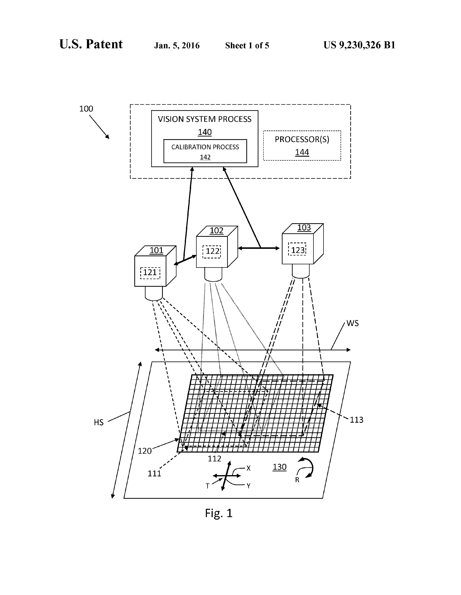
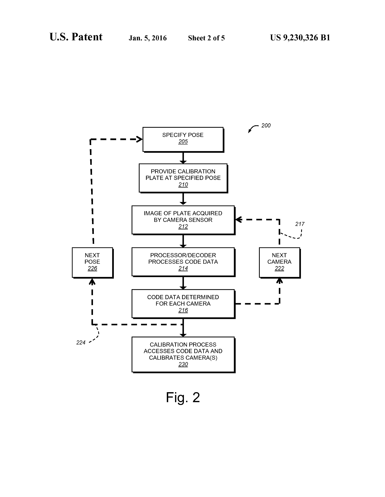
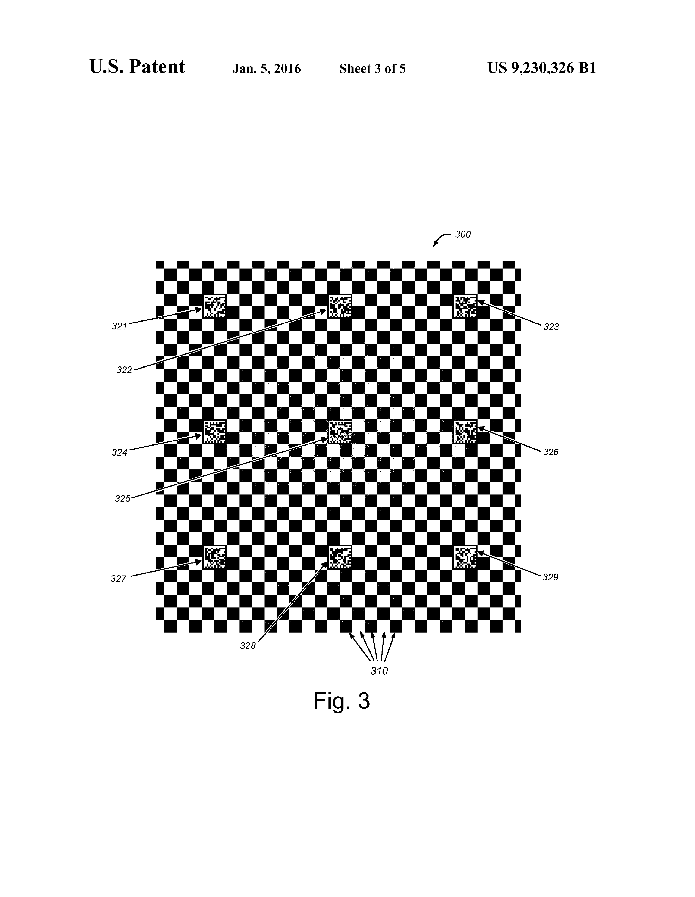
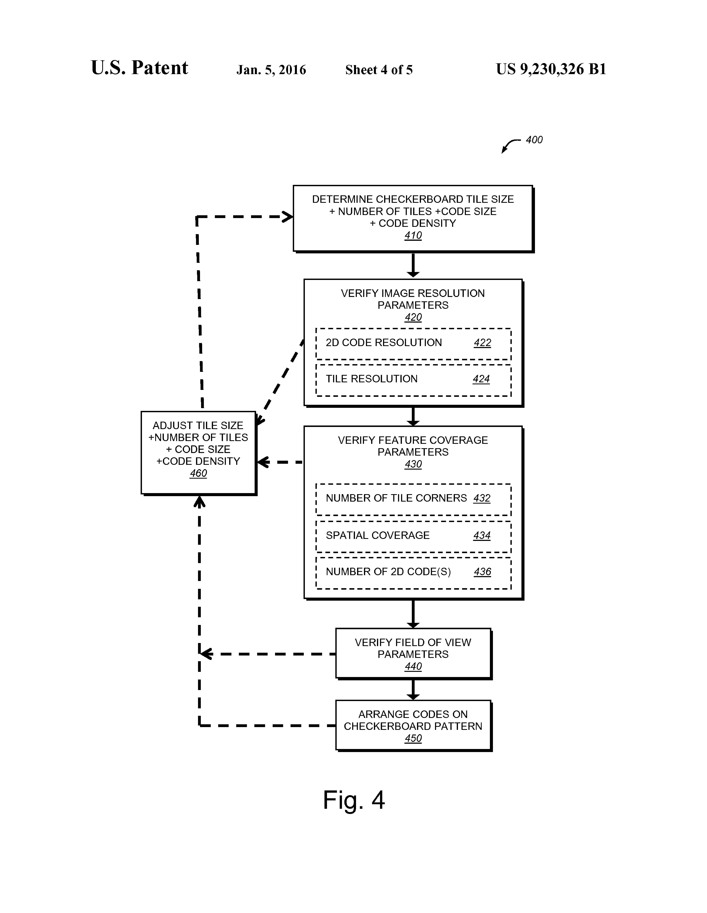
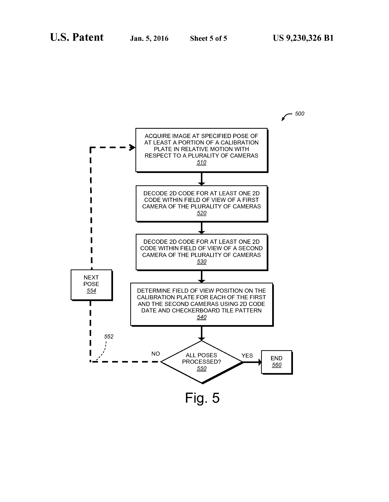

# 2D 데이터 코드를 자기 위치 결정 기준점으로 내장한 시스템, 방법 및 교정판 (US9230326B1)
- 원제: System, method and calibration plate employing embedded 2D data codes as self-positioning fiducials
- 원문: 같은 폴더의 PDF, https://patents.google.com/patent/US9230326B1/en
- 번역 기준: USPTO 등록 PDF 스캔 본문을 직접 읽어 옮김 (Google Patents 접근 제한). 원문 오기는 고치지 않음.
- 도면: 원문 PDF 도면 시트 5장을 도면/ 폴더에 넣고 상세한 설명에서 처음 설명되는 곳에 삽입함

## 요약

본 발명은 체커보드 타일 패턴과 체커보드 패턴 안에 내장된 복수의 2D 코드를 가진 테셀레이션 교정판을 사용하는, 하나 이상의 카메라의 자동(비수동) 교정을 위한 시스템 및 방법을 제공한다. 각 2D 코드는 패턴 안에서 타일 교정 특징 위치를 식별하는 (X, Y) 좌표를 부호화하며, 나머지 주변 타일은 교정 특징인 코너 위치의 측정을 가능하게 한다. 하나 이상의 비전 시스템 카메라(들)를 단일 좌표계로 자동 교정할 수 있다. 교정 중에 교정판의 적어도 일부의 영상이 획득되고, 각 카메라 시야 안의 적어도 하나의 2D 코드에 대해 부호화 데이터가 디코딩된 다음, 2D 코드 데이터와 체커보드 타일 패턴을 사용하여 각 카메라에 대해 교정판 위 시야의 위치가 결정된다.

## 청구범위

청구하는 것은 다음과 같다.

1. 적어도 하나의 카메라를 교정하는 시스템으로서,

제1 카메라로서, 물체를 포함하는 장면의 제1 카메라 시야를 가지는 제1 카메라;

교정 특징과, 교정 패턴의 제1 코드 포함 영역 안에 내장되어 제1 2D 코드가 상기 교정 패턴의 미리 정해진 부분을 대체하도록 하는 적어도 제1 2차원(2D) 코드를 제공하는 교정 패턴을 정의하는 교정판으로서, 상기 제1 2D 코드는 상기 교정 특징 중 적어도 하나에 대해 정의된 적어도 제1 앵커 교정 특징의 기준 위치를 나타내는 수치 좌표값으로 부호화되는, 교정판;

상기 제1 카메라에 동작 가능하게 연결되어, 상기 제1 앵커 교정 특징으로부터 도출된 상기 교정 특징 중 적어도 일부의 물리적 위치와 상기 교정 특징의 각 촬상 위치에 기반하여 상기 제1 카메라에 대한 제1 좌표계를 결정하는 비전 시스템 프로세스; 및

(a) 상기 교정판의 미리 정해진 위치, 또는 (b) 교정 시스템 프로세스 중 상기 교정판과 상기 제1 카메라 중 어느 하나를 이동시키는 모션 생성 장치의 특성 중 어느 하나에 기반하는 공통 좌표계에 대한 상기 제1 카메라의 상기 제1 좌표계의 위치와 방향을 결정하도록 상기 제1 카메라를 교정하는 교정 시스템 프로세스를 포함하는, 시스템.

2. 제1항에 있어서, 다음을 더 포함하는 시스템;

제2 카메라로서, 상기 장면의 제2 카메라 시야를 가지며, 상기 제2 카메라 시야는 (a) 상기 제1 2D 코드, 및 (b) 상기 교정 특징 중 적어도 하나에 대해 정의된 적어도 제2 앵커 교정 특징의 기준 위치를 나타내는 수치 좌표값으로 부호화된 제2 2D 코드 중 적어도 하나를 촬상하는, 제2 카메라,

상기 비전 시스템 프로세스는 상기 제2 카메라에 동작 가능하게 연결되어, (a) 상기 제1 앵커 교정 특징 및 (b) 상기 제2 앵커 교정 특징 중 적어도 하나로부터 도출된 상기 교정 특징 중 적어도 일부의 물리적 위치에 기반하여 상기 제2 카메라에 대한 제2 좌표계를 결정하고,

상기 교정 시스템 프로세스는 상기 공통 좌표계에 대한 상기 제2 카메라의 상기 제2 좌표계의 위치와 방향을 결정하도록 상기 제2 카메라를 교정한다.

3. 제2항에 있어서, 상기 제1 2D 코드와 상기 제2 2D 코드 각각은 DataMatrix 유형 코드를 포함하는, 시스템.

4. 제2항에 있어서, 상기 모션 생성 장치는 평행이동 및 회전 운동 중 적어도 하나로 물체를 그 안으로 이동시키도록 구성·배치되고, 상기 비전 시스템 프로세스와 상기 교정 프로세스 각각은 모션 단계 사이의 미리 정해진 간격으로 획득된 상기 교정판의 복수 영상에 대해 동작하도록 구성·배치되는, 시스템.

5. 제2항에 있어서, 상기 제1 카메라 시야는 상기 교정판의 상기 제2 카메라 시야와 겹치는, 시스템.

6. 제1항에 있어서, 상기 교정 패턴은 타일의 체커보드 패턴을 정의하는, 시스템.

7. 제6항에 있어서, 상기 타일의 체커보드 패턴은 서로에 대해 대비되는 시각적 외관을 가지는 테셀레이션 타일을 정의하는, 시스템.

8. 제7항에 기재된 시스템으로서, 상기 대비되는 시각적 외관은 대비되는 가시광의 밝고 어두운 색을 포함하는, 시스템.

9. 제7항에 있어서, 상기 2D 코드는 (a) 상기 타일의 크기, (b) 상기 체커보드 패턴 내 상기 타일의 수, (c) 상기 2D 코드의 크기, (d) 상기 교정판 위 2D 코드의 수, 및 (e) 상기 수치 좌표값에 대한 측정 단위 중 적어도 하나를 부호화하는, 시스템.

10. 제1항에 있어서, 상기 모션 생성 장치는 평행이동 및 회전 운동 중 적어도 하나로 물체를 그 안으로 이동시키도록 구성·배치되고, 상기 비전 시스템 프로세스와 상기 교정 프로세스 각각은 모션 단계 사이의 미리 정해진 간격으로 획득된 상기 교정판의 복수 영상에 대해 동작하도록 구성·배치되는, 시스템.

11. 제1항에 있어서, 상기 제1 2D 코드는 DataMatrix 유형 코드를 포함하는, 시스템.

12. 적어도 하나의 카메라를 교정하기 위한 교정판으로서,

교정 특징을 제공하는 교정 패턴; 및

상기 교정 패턴의 각 코드 포함 영역 안에 내장되어 상기 제1 2D 코드가 상기 교정 패턴의 미리 정해진 부분을 대체하도록 하는 복수의 2차원(2D) 코드로서, 상기 복수의 2D 코드 각각은 앵커 교정 특징을 각각 정의하는 상기 교정 특징 중 하나 이상에 대한 각자의 기준 위치로 부호화되는, 복수의 2D 코드를 포함하고;

상기 2D 코드는, 상기 카메라로부터 미리 정해진 관측 거리에서 상기 카메라의 시야 안에 상기 2D 코드 중 적어도 하나를 제공하는 밀도로 상기 교정 패턴 위에 배열되는, 교정판.

13. 제12항에 있어서, 상기 2D 코드 각각은 DataMatrix 코드를 포함하는, 교정판.

14. 제13항에 있어서, 상기 교정 패턴은 타일의 체커보드 패턴을 정의하는, 교정판.

15. 제14항에 있어서, 상기 타일의 체커보드 패턴은 서로에 대해 대비되는 시각적 외관을 가지는 테셀레이션 타일을 정의하는, 교정판.

16. 제15항에 있어서, 상기 대비되는 시각적 외관은 가시광의 밝고 어두운 색을 포함하는, 교정판.

17. 교정판 제15항에 있어서, 상기 2D 코드는 (a) 상기 타일의 크기, (b) 상기 체커보드 패턴 내 상기 타일의 수, (c) 상기 2D 코드의 크기, (d) 상기 교정판 위 2D 코드의 수, 및 (e) 각 기준 위치의 수치 값에 대한 측정 단위 중 적어도 하나를 부호화하는, 교정판.

18. 적어도 하나의 카메라를 교정하는 방법으로서,

교정 특징과, 교정 패턴의 제1 코드 포함 영역 안에 내장되어 제1 2D 코드가 상기 교정 패턴의 미리 정해진 부분을 대체하도록 하는 적어도 제1 2차원(2D) 코드를 제공하는 교정 패턴을 정의하는 교정판을 제공하는 단계로서, 상기 제1 2D 코드는 상기 교정 특징 중 적어도 하나에 대해 정의된 적어도 제1 앵커 교정 특징의 기준 위치를 나타내는 좌표값으로 부호화되는, 단계;

제1 카메라 시야를 가지는 제1 카메라로 상기 교정판의 적어도 하나의 영상을 획득하는 단계;

상기 제1 앵커 교정 특징으로부터 도출된 상기 교정 특징 중 적어도 일부의 물리적 위치와 상기 교정 특징의 각 촬상 위치에 기반하여, 상기 제1 카메라에 대한 제1 좌표계를 결정하는 단계; 및

(a) 상기 교정판의 미리 정해진 위치, 또는 (b) 상기 제1 카메라를 교정하는 단계 중 상기 교정판과 상기 제1 카메라 중 어느 하나를 이동시키는 모션 생성 장치의 특성 중 어느 하나에 기반하는 공통 좌표계에 대한 상기 제1 카메라의 상기 제1 좌표계의 위치와 방향을 결정하도록 상기 제1 카메라를 교정하는 단계를 포함하는, 방법.

19. 제18항에 있어서, 다음을 더 포함하는 방법;

제2 카메라를 제공하는 단계로서, 상기 제2 카메라는 상기 장면의 제2 카메라 시야를 가지며, 상기 제2 카메라 시야는 (a) 상기 제1 2D 코드, 및 (b) 상기 교정 특징 중 적어도 하나에 대해 정의된 적어도 제2 앵커 교정 특징의 기준 위치를 나타내는 좌표값으로 부호화된 제2 2D 코드 중 적어도 하나를 촬상하는, 단계,

상기 제2 카메라로 상기 교정판의 적어도 하나의 영상을 획득하는 단계;

(a) 상기 제1 앵커 교정 특징 및 (b) 상기 제2 앵커 교정 특징 중 적어도 하나로부터 도출된 상기 교정 특징 중 적어도 일부의 물리적 위치에 기반하여 상기 제2 카메라에 대한 제2 좌표계를 결정하는 단계, 및

상기 공통 좌표계에 대한 상기 제2 카메라의 상기 제2 좌표계의 위치와 방향을 결정하도록 상기 제2 카메라를 교정하는 단계.

## 상세한 설명

### 발명의 분야 (FIELD OF THE INVENTION)

본 발명은 머신 비전 시스템 응용에 사용되는 시스템, 방법 및 교정판(calibration plate)에 관한 것이다.

### 발명의 배경 (BACKGROUND OF THE INVENTION)

머신 비전 시스템(본 명세서에서 "비전 시스템"이라고도 함)에서는, 하나 이상의 카메라를 사용하여 촬상 장면 내의 물체 또는 표면에 대해 비전 시스템 프로세스를 수행한다. 이러한 프로세스에는 검사, 심볼로지(symbology) 디코딩, 얼라인먼트 및 기타 다양한 자동화 작업이 포함될 수 있다. 보다 구체적으로, 비전 시스템은 촬상 장면을 통과하는 평평한 작업물을 검사하는 데 사용될 수 있다. 장면은 일반적으로 하나 이상의 비전 시스템 카메라에 의해 촬상되며, 이 카메라들은 결과를 생성하기 위해 관련 비전 시스템 프로세스를 운용하는 내부 또는 외부 비전 시스템 프로세서를 포함할 수 있다. 일반적으로 하나 이상의 카메라가 충분한 정확도와 신뢰성으로 비전 작업을 수행할 수 있도록 카메라를 교정하는 것이 바람직하다. 카메라를 교정하는 데 교정판이 사용될 수 있다.

교정판은 흔히 표면에 독특한 패턴이 보이게 만든 평평한 물체로 제공된다. 독특한 패턴은 일반적으로 주의 깊고 정밀하게 설계되어, 사용자가 카메라로 획득한 판의 영상에서 각각의 보이는 특징을 쉽게 식별할 수 있게 한다. 예시적인 패턴으로는 점 격자, 선 격자, 또는 생각할 수 있는 것으로 벌집 패턴, 삼각형 체커보드 등이 있으나 이에 한정되지 않는다. 각각의 보이는 특징의 특성, 예컨대 설계 안에 암묵적으로 정의된 기준 위치 및/또는 좌표계에 대한 위치 및/또는 방향은 판의 설계로부터 알려져 있다. 설계에 존재하는 특징들 중에는 교정 특징(calibration feature)이 있다. 이것은 교정판 설계에서 그 특성(예를 들어 특징의 위치, 크기, 색 등)을 쉽게 측정할 수 있고, 명목 설계에 의한 의도된 특성이 정밀하게 알려져 있는 개별 특징이다. 예를 들어, 가능한 교정 특징 위치로는 체커보드 패턴 타일의 코너 또는 중심, 점 격자에서 점의 중심, 또는 선 격자에서 선의 교차점 등이 있다. 필수는 아니지만, 대부분의 교정판 설계는 반복 패턴으로 배열된 다수의 교정 특징을 포함한다. 보다 근본적으로, 교정 특징에 대한 주된 요건은 획득된 영상에서 쉽게 측정할 수 있는 알려진 특성을 제공하는 것이다.

체커보드 패턴의 설계는, 원근 및 렌즈 왜곡, 패턴의 부분적 손상, 불균일한 조명 등의 비이상적 조건이 있는 경우에도 패턴의 교정 특징을 찾는 정확도와 강건성 면에서 일정한 장점을 제공한다는 점에 유의한다.

교정판의 설계는 흔히 하나 이상의 교정 기준점(calibration fiducial)을 포함한다. 이 교정 기준점은 교정 특징의 특별한 부분 집합으로서, 그렇지 않으면 반복적인 교정 특징 패턴 안에서 "랜드마크" 역할을 한다. 예를 들어, 카메라의 시야가 제한되어 체커보드 패턴의 일부만 촬상한다면, 카메라는 패턴의 어느 부분을 보고 있는지 알 수 없다. 많은 그러한 경우에, 모션 스테이지를 사용해 판을 (예를 들어 반 타일만큼) 이동시키고, 카메라가 교정판의 다른 영상을 획득한다. 패턴이 반복되기 때문에, 두 영상(이동 전과 후)의 분석으로는 스테이지가 0.5 타일을 움직였는지, 1.5 타일인지, 2.5 타일인지 등을 판별할 수 없다. 이러한 모호성을 해결하기 위해, 두 영상에서 식별되고 대응될 수 있는 독특한 모양의 기준점을 설계에 내장하는데, 이는 판 전체에 그러한 독특한 기준점이 하나뿐이고 그 기준점이 이동 전 영상과 이동 후 영상 모두에서 보이는 한 가능하다. 교정 기준점이 수행하는 기능은 부분적으로 그것이 영상에 제시하는 정보에 의존한다. 이는 아래에서 더 설명한다.

교정판과 같은 강체(rigid body)의 경우, 모션은 한 쌍의 자세(pose)로 특징지을 수 있다. 즉, 모션 직전의 시작 자세와 모션 직후의 끝 자세이다. 여기서 "자세"는 어떤 기반 좌표계에서 임의의 특정 순간에 물체의 상태를 기술하는 수치 값의 집합, 즉 물체의 가상적 특성화로 정의된다. 예를 들어, 2차원(2D)에서 강체는 세 개의 수, 즉 X 방향 평행이동, Y 방향 평행이동, 및 회전 R로 특징지을 수 있다. 교정판의 맥락에서 자세는, 카메라(들)와 교정판 사이에 상대 운동이 있을 때 교정판이 카메라(들)에 어떻게 제시되는지를 기술한다. 일반적으로, 표준적인 이른바 "핸드-아이 교정(hand-eye calibration)"에서는 교정판이 여러 다른 자세로 카메라(들)에 제시되고, 각 카메라는 그러한 각 자세에서 교정판의 영상을 획득한다. 머신 비전 핸드-아이 교정의 경우, 교정판은 미리 정해진 복수의 자세로 이동되고, 그 자세에서 카메라들이 판의 각 영상을 획득한다. 이러한 핸드-아이 교정의 목표는 "모션 좌표계"에서 카메라(들)와 교정판의 강체 자세를 결정하는 것이다. 모션 좌표계는 다양한 방식으로 정의될 수 있다. (교정판 및/또는 카메라가 공간의 어디에 있는지를 지정하는) 자세의 수치들은 적절한 좌표계에서 해석되어야 한다. 단일 통합 좌표계가 선택되면, 자세와 모션은 그 전역 좌표계에서 기술/해석된다. 이렇게 선택된 좌표계를 흔히 "모션 좌표계"라 한다. 일반적으로 "모션"은 로봇 암, 또는 갠트리와 같은 모션 스테이지처럼 물리적 운동을 만들어 낼 수 있는 물리 장치에 의해 제공된다. 판이 하나 이상의 고정된 카메라(들)에 대해 움직일 수도 있고, 카메라(들)가 고정된 판에 대해 움직일 수도 있다는 점에 유의한다. 이러한 모션 생성 장치의 제어기는 수치 값(즉, 자세)을 사용해 장치가 원하는 모션을 만들도록 명령하며, 그 값들은 해당 장치의 고유 좌표계에서 해석된다. 모션 생성 장치와 카메라(들)에 대해 공통의 전역 좌표계를 제공하기 위해 어떤 모션 좌표계든 선택할 수 있지만, 흔히 모션 생성 장치의 고유 좌표계를 전체 모션 좌표계로 선택하는 것이 바람직하다는 점에 유의한다.

따라서 핸드-아이 교정은, (교정판을 움직이거나 카메라를 움직이는) 모션을 만들고 그 모션 전후에 영상을 획득하여 그러한 모션이 움직이는 물체에 주는 효과를 결정함으로써, 시스템을 단일 모션 좌표계로 교정한다. 추가 배경으로, 이는 머신 비전 응용에 일반적으로 어떠한 모션 생성 장치도 없는 표준 "비-핸드-아이(non-hand-eye)" 교정과 다르다. 그러한 경우, 카메라(들)는 일반적으로 모든 카메라의 시야 안의 특정 위치에 있는 판의 획득 영상 한 장을 사용하여, 모두 교정판 자체의 좌표계에 대해 교정된다. 머신 비전 교정 소프트웨어는 각 카메라가 획득한 판의 영상으로부터 각 카메라의 상대 위치를 추론한다. 이 교정을 "카메라를 판에 교정한다"고 하고, 핸드-아이 교정은 "카메라를 모션 좌표계에 교정한다"고 한다.

머신 비전 시스템이 핸드-아이 교정을 사용할 때, 그 소프트웨어는 영상에서 관측된 모션 효과를 (명령 모션 데이터가 알려져 있는) 명령된 모션과 상관시켜 자세를 푼다. 교정의 또 다른 결과는 카메라 영상의 각 화소 위치와 모션 좌표계의 물리적 위치 사이의 매핑이며, 이에 따라 영상 공간에서 위치를 찾은 뒤 모션 좌표계의 위치로 변환하고 모션 생성 장치가 그에 따라 동작하도록 명령할 수 있다.

핸드-아이 교정에서 종래의 교정판에는 몇 가지 단점이 있다. 일반적으로, 반복되는(예를 들어 테셀레이션된) 동일한 외관의 교정 기준점을 가지며 각 기준점이 교정판 좌표계에서 국소 원점 역할을 하는 전통적인 체커보드 패턴을 사용하는 교정판과 같은 종래 교정판에는 적어도 세 가지 단점이 있다. 일반적으로, 패턴 요소들이 동일하다는 성질 때문에 판의 교정 기준점은 전역 좌표계에서 자신의 위치에 관한 개별 정보를 담을 수 없다. 더욱이, 교정 기준점/국소 원점의 상대 위치를 지정하기 위해 일반적으로 시스템의 사용자 또는 작업자가 외부 입력을 수동으로 입력해야 한다. 특정 카메라의 시야 크기는, (교정판 위의) 교정 기준점이 시야 안에 남아 있도록 최대 모션 범위를 제한한다. 또한, 교정판 위의 인접 기준점과 혼동하지 않도록 상당한 주의와 신경을 기울여야 한다.

종래 교정판과 관련된 단점을 해결하려는 다양한 시도가 있었다. 한 시도는 나란히 배열된 복수의 2D DataMatrix 코드를 사용하고, 2D DataMatrix 코드 내부의 개별 셀을 교정 특징으로 사용하는 것이다. 각 개별 셀은 둥근 점이거나 정사각형/직사각형일 수 있다. 그러나 원형 점은 원근 및 방사 왜곡이 있을 때 교정 정확도가 낮은 것으로 알려져 있다. 또한 정사각형 셀에는 적어도 두 가지 단점이 있다. 첫째, 원하는 정확도를 얻으려면 셀이 (화소 수로) 충분히 커야 하며, 이 때문에 전체 코드가 위치 결정 목적에 비해 너무 커진다. 둘째, 일반 체커보드와 비교할 때 2D DataMatrix 코드에는 보이지 않는 코너가 많다. 특징 추출의 복잡도가 증가하고 사용 가능한 특징의 수가 감소하여 전체 효율이 떨어진다.

여러 카메라의 교정을 자동화하기 위해 각 체커보드 패턴 타일의 중심에 식별 마커를 사용하는 방법도 사용되었다. 그러나 이 방법은 더 큰 체커보드 패턴 타일을 사용해야 하므로, 체커보드 패턴 타일 밀도가 바람직하지 않게 낮아진다. 개별 체커보드 패턴 타일 안에 직접 내장된 2D DataMatrix 코드는 충분한 분해능으로 2D 위치를 완전히 부호화하지 못한다.

따라서, 자기 위치 결정 기준점(self-positioning fiducial)이 내장된 교정판을 제공하는 것이 바람직하다. 이 교정판은 카메라 시야와 물체 사이의 상대 운동을 수반하는 핸드-아이 교정과, 그러한 상대 운동을 수반하지 않는(그것이 없는) 표준 비-핸드-아이 교정 모두에 대해, 하나 이상의 비전 시스템 카메라(들)의 교정을 가능하게 해야 한다. 또한 여러 머신 비전 카메라를 포함하는 시스템이 단일 좌표계로 자동 교정되는 것이 바람직하다.

### 발명의 요약 (SUMMARY OF THE INVENTION)

종래 기술의 단점은 하나 이상의 비전 시스템 카메라(들)를 교정하는 시스템 및 방법을 제공함으로써 극복된다. 교정판이 제공되며, 이 교정판은 예를 들어 교정 패턴(예시적으로 체커보드 패턴)의 코드 포함 영역(본 명세서에서 "코드 포함 타일"이라고도 함) 안에 내장된 2차원(2D) 코드 형태의 교정 기준점을 적어도 하나, 예시적으로는 복수 개 포함하며, 각 2D 코드는 (교대로 배치되어 테셀레이션된 밝고 어두운 체커보드의) 교정 패턴 타일 중 미리 정해진 수를 대체한다. 예시적 실시예에서 2D 코드는 ECC200 DataMatrix에 기반하지만, 대안적 실시예에서는 QR과 같은 다른 2D 코드 유형을 사용할 수 있다. 2D 코드와 그에 연관된 체커보드 패턴 타일 패턴의 배열은, 장면에 대한 카메라(들)의 특정 방향과 무관하게 비전 시스템 내 카메라(들)의 자동(즉, 비수동) 교정을 가능하게 한다. 예시적 2D DataMatrix 코드는 영상 분해능 요건, 특징 범위(coverage) 요건, 그리고 카메라 시야 안에 적어도 하나의 코드가 있어야 한다는 요건 사이의 좋은 균형을 모두 달성할 수 있도록 적당한 밀도로 배열된다. 각 2D 코드는 그 중심 위치(또는 선택한 코너와 같은 지정된 임의의 기준점)의 (X, Y) 좌표를 밀리미터(mm), 센티미터, 인치 또는 다른 미리 정해진 측정 단위로 부호화한다. 대안적으로, 2D 코드가 수치 값에 더하여 측정 단위(예: 밀리미터, 미터, 밀(mil), 인치 등)를 명시적으로 부호화하도록 만들 수 있다. 예시적 실시예에 따르면, 2D 코드는 핸드-아이 교정에서 식별 목적의 교정 기준점으로 사용되고, 나머지 체커보드 패턴 타일의 일부 또는 전부가 교정 특징을 제공한다. 특정 응용에 따라, 영상 분해능, 특징 범위, 그리고 적어도 하나의 코드가 항상 시야 안에 있어야 한다는 요건 사이의 균형을 맞추도록 2D 코드의 크기와 밀도를 조정할 수 있다. 예시적 실시예에서, 코드 포함 영역 또는 "타일"은 밝고 어두운 대비를 이루는 일반 체커보드 패턴 타일 네 개의 공간을 차지한다. 대안적 실시예에서, 코드 포함 타일은 더 크거나 작아서 각각 더 많거나 더 적은 일반 타일을 차지할 수 있다.

일반적으로, 핸드-아이 교정에서 교정 기준점으로 작용하는 각 2D 코드는 세 가지 주된 목적을 수행한다. (1) 기준점은 비전 시스템이 모션 전후에 같은 물리적 점을 추적할 수 있게 한다. 이 추적 목적을 위해, 기준점은 고유하게 식별 가능해야 하지만 수치 정보를 포함할 필요는 없다. 2) 기준점은 같은 기준점이 모션 전과 모션 후 모두 카메라 시야 안에서 보일 수 없는 더 큰 모션을 허용한다. 즉, 모션 전에 적어도 하나의 고유한 교정 기준점이 카메라에 의해 촬상될 수 있고, 모션 후에 적어도 하나의 다른 고유한 기준점이 카메라에 의해 촬상될 수 있다. 보다 일반적으로, 시스템은 두 개(또는 그 이상)의 교정 기준점 사이의 기하학적 관계(예: 두 기준점 사이의 체커보드 패턴 타일 수)를 체커보드 설계로부터 결정한다. 이 목적을 위해 각 교정 기준점은 수치 정보를 부호화하며(따라서 위의 목적 (1)도 지원할 수 있다), 부호화된 수치 정보는 각 개별 기준점마다 고유/구별되어야 한다. 예시적 2D DataMatrix 코드는 이 목적을 충족한다. (3) 2D 코드에 부호화된 수치(및 기타) 정보는 카메라/비전 시스템이 교정판 위의 절대 위치를 결정하는 데 사용된다. 같은 교정판의 겹치지 않는 영역을 보는 여러 카메라의 경우, 각 카메라는 그 카메라가 획득한 하나 이상의 코드의 수치 정보를 사용하여 각 카메라가 교정판의 어느 부분을 촬상하고 있는지 결정할 수 있다.

예시적 실시예에서, 체커보드 패턴은 폭 0.5 mm, 높이 0.5
mm인 타일로 구성된다. 이 치수는 대안적 실시예에서 매우 다양하게 바뀔 수 있다. 2D 코드를 디코딩하는 디코더는 비전 시스템 카메라 안에 내장될 수도 있고, 원하는 데이터 디코딩을 제공하기 위해 다른 하드웨어 및/또는 소프트웨어 환경에 별도로 제공될 수도 있다.

예시적 실시예에 따르면, 하나 이상의 비전 시스템 카메라(들)를 교정하는 절차는 교정판이 시야 안에서 정지해 있을 때 교정판의 적어도 일부의 영상을 획득하는 것으로 시작한다. 영상(들)은 카메라(들)에 대한 판의 상대 운동이 일어나지 않는 경우(즉, 표준 비-핸드-아이 교정) 또는 교정판과 카메라(들) 사이에 상대 운동이 존재할 때(즉, 핸드-아이 교정) (적어도) 두 번, 즉 모션 전에 한 번, 모션 후에 한 번 카메라(들)에 의해 획득된다. 교정판은 체커보드 패턴 위에 배열된 복수의 2D 코드를 포함한다. 복수의 카메라(적어도 제1 카메라와 제2 카메라)가 장면을 촬상하는 데 사용되는 실시예에서, 시스템은 제1 카메라의 시야 안에서 보이는 적어도 하나의 2D 코드(및 잠재적으로 둘 이상의 2D 코드, 또는 모든 2D 코드)를 디코딩한다. 시스템은 또한 제2 카메라의 시야 안의 적어도 하나의 2D 코드(및 잠재적으로 둘 이상의 2D 코드, 또는 모든 2D 코드)를 디코딩한다. 교정판에 대한 각 카메라의 시야 위치는, 2D 코드를 둘러싼 나머지 타일 위에서 교정 특징 역할을 하는 코너 위치를 찾고/측정함으로써 결정되며, 코드는 전역 교정판 좌표계에서 타일과 그에 연관된 코너의 위치를 식별하는 역할을 한다.

일 실시예에서, 적어도 하나의 카메라를 교정하기 위한 교정판은 복수의 타일을 정의하는 체커보드 패턴을 포함한다. 체커보드 패턴 타일은 연관된 좌표계의 측정에 사용되는 격자 교차점/코너와 같은 교정 특징을 제공한다. 복수의 2D 코드가 체커보드 패턴의 코드 포함 타일 안에 내장된다. 복수의 2D 코드 각각은 하나 이상의 앵커(anchor) 교정 특징에 대한 각자의 기준 위치로 부호화된다. 2D 코드는 예시적으로, 카메라로부터 미리 정해진 런타임 관측 거리에서 카메라의 시야 안에 2D 코드가 적어도 하나 있도록 하는 밀도로 체커보드 패턴 위에 배열된다. 2D 코드는 DataMatrix 유형 코드를 포함할 수 있다. 예시적으로, 교정판은 모션 스테이지 위에서(또는 다른 모션 생성 장치와 함께) 사용하도록 구성되며, 여기서 카메라(들)는 각각 미리 정해진 간격으로 복수의 영상을 획득하고, 각 간격 사이에 모션이 일어난다. 그런 다음 카메라/비전 시스템 하드웨어/소프트웨어 구성 요소가 복수의 영상을 사용하여 카메라(들)에 대한 각각의 좌표계를 수립한다. 여러 카메라가 사용되는 경우, 각 카메라의 각 좌표계를 사용하여 적절한 기법으로 카메라 전체 시스템을 단일 전역 좌표계(예: 모션 좌표계)로 교정한다.

### 도면의 간단한 설명 (BRIEF DESCRIPTION OF THE DRAWINGS)

아래의 발명 설명은 첨부 도면을 참조하며, 도면은 다음과 같다.

도 1은 예시적 실시예에 따라, 체커보드 패턴 위에 자기 위치 결정 기준점으로서 내장된 2D 코드를 가진 교정판을 사용하여 카메라(들)를 촬상 장면 내의 좌표계로 교정하는, 하나 이상의 비전 시스템 카메라를 교정하기 위한 전체 시스템의 개략도이다.

도 2는 예시적 실시예에 따라, 시스템이 카메라(들)에 대해 상대 운동이 있을 때 물체를 촬상하는 예에서, 비전 시스템 내 하나 이상의 카메라의 교정을 자동으로 수행하는 전체 절차의 흐름도이다.

도 3은 예시적 실시예에 따라 복수의 내장 2D 코드를 포함하는 예시적인 교정판 패턴의 개략도이다.

도 4는 예시적 실시예에 따라, 도 3의 교정판 위에서 2D 코드와 그에 연관된 체커보드 패턴 타일의 배열을 결정하는 절차의 흐름도이다.

도 5는 예시적 실시예에 따라, 공통 모션 스테이지 좌표계에 대해 복수 카메라의 런타임 교정을 수행하는 절차의 흐름도이다.

### 상세한 설명 (DETAILED DESCRIPTION)

개요로, 머신 비전 시스템(간단히 "비전 시스템"이라 함)에서 하나 이상의 카메라를 교정하는 시스템은, 비전 시스템 내 카메라(들)의 자동(즉, 비수동) 교정을 위해 복수의 2차원(2D) 코드가 배열된 교정판을 포함한다. 예시적 실시예에서, 교정(핸드-아이 교정 또는 표준 비-핸드-아이 교정)은 예를 들어 휴대폰, 컴퓨팅 태블릿(Apple iPads® 등) 및 평판 디스플레이의 커버 렌즈 스크린 인쇄에서처럼, 평평한 작업물을 공정 장비에 얼라인하기 위해 수행된다. 2D 코드(이 예에서는 DataMatrix 유형 코드로 구성됨)는, 영상 분해능 요건, 특징 범위 요건, 그리고 적어도 하나의 코드가 카메라 시야 안에서 항상 보이는(완전히 촬상/디코딩 가능한) 상태로 남아야 한다는 요건 사이의 좋은 균형이 달성되도록 적당한 밀도로 배열된다. 예시적 실시예에서, 각 2D 코드는 그 기준 위치의 (X, Y) 좌표를 (예를 들어) 밀리미터로 부호화한다. 따라서 각 2D 코드는 고유 식별자(그 위치)를 가지며, 다른 인접하거나 가까운 2D 코드와 혼동될 수 없다(혼동이 없다). 예시적 실시예에 따르면, 2D 코드는 식별 목적으로 사용되는 교정 기준점이고, 나머지 체커보드 패턴 타일은 코너 위치 측정용이다. 특정 응용에 따라, 영상 분해능, 특징 범위, 그리고 적어도 하나의 코드가 시야 안에 있어야 한다는 요건 사이의 균형을 맞추도록 2D 코드의 크기와 밀도를 조정할 수 있다.

예시적 실시예에서, 2D DataMatrix 코드는 일반적으로 적어도 두 수준의 데이터를 포함한다. 첫 번째 수준의 데이터는 2D DataMatrix 구조 안의 각 점을 식별하기 위한 그 자체의 기하 구조와 그 자체의 좌표계이다. 두 번째 수준의 데이터는 모든 점이 함께 서로 다른 정보를 부호화한다는 것이다. 예를 들어, 2D 코드는 (예를 들어) 밀리미터를 길이 측정 단위로 사용하여, 예컨대 −999부터 +999까지의 조합을 포괄하도록 세 자리 수 두 개로 이루어진 좌표 또는 수의 쌍을 부호화할 수 있다. 대안적으로, 길이 측정을 미터로 표현할 수 있으며, 이 경우 값 범위 −999 ~ +999는 −0.999 ~ +0.999 미터에 대응할 수 있다. 예를 들어, 1.998 미터 × 1.998 미터인 교정판을 표현하기 위해, 중심(기준) 위치가 0, 0이고 −1 미터(X축을 따라 0, 0의 왼쪽)는 좌표 −999(−0.999 미터), 0으로 표시되고, +1 미터(X축을 따라 0, 0의 오른쪽)는 좌표 +999(+0.999 미터), 0으로 표시된다. 마찬가지로, 이 예에 따르면, 이 방향에서 Y축을 따른 가장 위의 점(+0.999 미터)은 좌표값 0, +999를 가지고, (2D 코드의) Y축을 따른 가장 아래 점은
좌표값 0, −999를 가진다. 다른 예에 따르면, 아홉(9) 자리 영숫자 값(예: 12345ABCD)을 제공하기 위해 14×14 2D DataMatrix 코드가 구현된다. 추가 실시예에서는 더 큰 코드를 사용할 수 있으며, 본 명세서에서 설명한 다른 데이터(예: 측정 단위(들))에 더하여 체커보드 패턴 타일의 물리적 크기(예: x-y 치수)도 2D DataMatrix 안에 부호화할 수 있다.

이제 예시적 실시예에 따라 하나 이상의 비전 시스템 카메라(들)(간단히 "카메라(들)"이라고도 함)를 교정하기 위한 전체 시스템(100)의 개략도를 나타내는 도 1을 참조한다. 세 개의 카메라(101, 102, 103)가 도시되어 있지만, 시스템은 그보다 적거나 많은 수의 카메라를 사용할 수 있으며, 모두 대체로 장면을 향하고, 각 카메라 시야 사이에 겹침이 있을 수도 없을(겹침이 없을) 수도 있다. 일 실시예에서는 단일 카메라(예를 들어 카메라(101))를 사용해 장면을 촬상할 수 있으며, 아래에서 설명하는 예시적 실시예의 교정판과 프로세스는 배열된 복수의 카메라를 대상으로 하지만, (달리 표시하지 않는 한) 그러한 판과 프로세스가 단일 카메라의 교정을 대상으로 할 수 있다는 점이 명시적으로 고려된다.

*도 1 — 카메라 3대(101·102·103)가 표면(130) 위 교정판(120)을 촬상하는 전체 교정 시스템(100)*

시스템(100)은, 복수의 카메라를 공통 전역(모션) 좌표계로 교정하기 위해 체커보드 패턴 타일의 적어도 일부를 대신하여 자기 위치 결정 교정 기준점으로서 체커보드 패턴 위에 배열된 2D 코드(간략화를 위해 도 1에는 도시하지 않음 — 도 3 참조)를 가진 예시적 교정판(120)을 사용한다. 예시적 판에서는 테셀레이션된 밝고 어두운 정사각형의 체커보드 격자로 이루어진 패턴을 설계로 사용하지만, 대안적 실시예에서는 위에서 설명한 바와 같이 다양한 대안 패턴과 그에 연관된 교정 특징을 사용할 수 있다는 점에 유의한다. 예시적 카메라(101, 102, 103)는 장면을 촬상하는 데 사용되며, 각 카메라는 일반적으로 교정판(120)을 포함하는 각자의 시야(111, 112, 113)를 정의한다. 각 카메라(101, 102, 103)는 각 카메라의 시야(111, 112, 113) 안의 영상 화소 데이터를 획득하기 위한 이미지 센서(121, 122, 123)("이미저" 또는 간단히 "센서"라고도 함)를 각각 포함한다. 핸드-아이 교정 프로세스를 사용하는 다양한 실시예에서, 교정판(120)은 카메라(101, 102, 103)를 공통 모션 좌표계로 교정하기 위해 적절한 모션 생성 장치(예: 갠트리, 로봇 암 등)에 의해 표면(130)을 따라 (x 및/또는 y축을 따른) 평행이동(T) 및/또는 회전 운동(R)으로 이동된다. 대안적 실시예에서는, 교정판이 촬상 장면에 대해 정지해 있고 카메라(들)가 장면에 대해 이동 가능할 수 있다. 또한, 예시적 실시예에서 모션을 설명하지만, 본 명세서에서 설명하는 판과 절차가 표준 비-핸드-아이 교정의 경우처럼 그러한 정지 배치에도 적용될 수 있다는 점이 명시적으로 고려된다. 모션이 일어날 때 그것은 평행이동 운동, (일반적으로 판/기반 모션 스테이지의 평면에 수직인 축을 중심으로 한) 회전 운동, 또는 평행이동과 회전의 조합으로 특징지을 수 있다. 도시하지는 않았지만, 다양한 실시예가 (a) x축과 y축이 정의하는 평면에 수직인 z축을 따른 평행이동, 및 (b) x-y 평면 밖으로의 기울기/회전 중 적어도 하나를 포함하는 3차원(3D) 모션도 고려할 수 있다는 점이 명시적으로 고려된다. 아래에서 언급하는 바와 같이, 적절한 카메라 배치와 응용이 시스템에 3D 자세 정보를 제공할 수 있다. 따라서 본 명세서에서 사용될 때, 2D 시스템으로 제한되지 않는 한 "평행이동"과 "회전"이라는 용어는 3D 모션에 적용될 수 있다.

센서(121, 122, 123)가 획득한 영상 데이터는 (당업계에 알려진 적절한 무선, 유선 또는 기타 통신 채널/링크를 통해) 교정 프로세스(142)를 포함하는 비전 시스템 프로세스(140)로 전송된다. 비전 시스템과 교정을 위한 적절한 프로세스를 수행하기 위해 프로세서(들)(144)도 제공된다. 본 명세서에서 사용될 때 "프로세스" 및/또는 "프로세서"라는 용어는 다양한 전자 하드웨어 및/또는 소프트웨어 기반 기능과 구성 요소를 포함하도록 넓게 해석되어야 한다는 점에 유의한다. 더욱이, 도시된 프로세스나 프로세서는 다른 프로세스 및/또는 프로세서와 결합되거나 다양한 하위 프로세스 또는 프로세서로 나뉠 수 있다. 그러한 하위 프로세스 및/또는 하위 프로세서는 본 명세서의 실시예에 따라 다양하게 결합될 수 있다. 마찬가지로, here herein의 임의의 기능, 프로세스 및/또는 프로세서는 전자 하드웨어, 프로그램 명령의 비일시적 컴퓨터 판독 가능 매체로 구성된 소프트웨어, 또는 하드웨어와 소프트웨어의 조합을 사용하여 구현될 수 있다는 점이 명시적으로 고려된다. 또한, 도 1에 도시된 프로세서(들)와 프로세스(들)는 카메라들 사이에 분산되거나, 단일 카메라 안에 구현되거나, 도 1에 도시된 바와 같이 별도의 독립형 프로세서로 구현될 수 있다.

다시, 도 1의 도시와 본 명세서에서 설명하는 예시적 절차는 모션 생성 장치(평행이동, 회전 또는 둘 다)를 포함하는 장면을 촬상하는 복수(적어도 둘, 그리고 도시된 것처럼 셋 이상)의 카메라에 기반하지만, 단일 카메라를 사용할 수 있고(또는 복수 카메라 중 한 번에 하나의 카메라만 교정되고) 및/또는 교정판과 카메라(들)가 서로에 대해 상대 운동하거나 정지해 있을 수 있다는 점이 명시적으로 고려된다.

예시적 실시예에서, 예를 들어 도 3을 참조하여 더 자세히 설명하는 교정판(120)은 폭 약 1 m, 높이 약 1 m를 가지지만, 교정판(120)의 정확한 크기와 형상은 시스템의 런타임 동작에서 분석되는 물체나 표면의 특정 응용과 크기에 따라 폭과 높이 수 밀리미터에서 수 미터까지 통상의 기술 범위 안에서 매우 다양하게 바뀔 수 있다. 예를 들어, 예시적 실시예에 따른 체커보드 패턴 설계를 가진 교정판 일부의 예시도를 나타내는 도 3을 참조한다. 예시적으로, 표면(130)은 폭 WS 약 0.5 미터, 높이 HS 약 0.5 미터(정사각형)를 정의하지만, 교정판(120)이 지나가는 표면(130)의 폭과 높이는 비전 시스템의 특정 응용과 환경에 따라 통상의 기술 범위 안에서 매우 다양하며, 1 밀리미터 미만에서부터 카메라를 교정할 때 교정판을 표면을 따라 이동시키기에 실용적인 임의의 길이까지 될 수 있다.

흔히, 비전 시스템 카메라(101, 102, 103)는 독립형 유닛으로 동작할 수 있게 하는 내부 프로세서와 기타 구성 요소를 포함하여, 재고 추적 컴퓨터 시스템과 같은 하위(downstream) 프로세스에 원하는 출력 데이터(예: 특징 정보 및 디코딩된 심볼 정보)를 제공한다. 프로세서는 카메라 본체 안에 완전히 내장되거나, 본체 안에 부분적으로 포함되거나, (144)에 나타낸 것처럼 독립형 컴퓨터(예: PC) 또는 기타 원격 컴퓨팅 장치처럼 본체 외부에 있을 수 있다. 센서(121, 122, 123)와 프로세서(들)(144) 및 기타 하위 영상 데이터 처리 및/또는 영상 데이터 취급 구성 요소 사이에는 적절한 유선 및/또는 무선 통신 링크가 제공된다. 프로세서(144)는 내부 또는 외부 조명(도시하지 않음), 트리거링 등과 같은 다른 통상적 기능도 제어할 수 있다.

이제 도 2를 참조하면, 시스템이 카메라(들)에 대해 상대 운동이 있을 때 물체를 촬상하는 예에서, 장면을 촬상하는 비전 시스템 내 하나 이상의 카메라의 자동(비수동) 교정을 수행하는 전체 절차(200)의 흐름도가
도시되어 있다(표면 또는 물체(예: 교정판)를 포함하는 장면). 핸드-아이 교정 프로세스와 표준 비-핸드-아이 교정 프로세스가 모두 도시되어 있다. 단계 205에서, 모션 생성 장치가 만들어 낼 위치와 방향(자세)이 지정된다. 이 단계는 예시적으로, 물체/교정판이 컨베이어 또는 다른 모션 생성 장치 위에서 장면을 통과해 이동하고, 카메라가(또는 복수의 카메라가 각각) 모션 생성 장치가 만들어 낸 복수의 자세 각각에서 교정판의 각 영상을 획득할 때 구현된다. 따라서 단계 210에서 교정판은 기반 전역 좌표계(예: 교정판을 싣고 다니는 모션 생성 장치의 좌표계 — "모션 좌표계")에서 지정된 주어진 위치와 방향(자세)에 놓인다. 그런 다음 단계 212에서 교정판 위의 타일 및 코드 데이터가 카메라 센서에 의해 획득된다. 본 명세서의 예시적 실시예에 따른 교정판은, 본 명세서에서 특히 도 3~5를 참조하여 더 자세히 설명하는 바와 같이, 자기 위치 결정 기준점 역할을 하는 복수의 내장 2D 코드를 포함한다. 예로서, 사용되는 2D 코드는 표준 ECC200 DataMatrix 2D 형식이지만, "2D 코드"라는 용어는 다양한 다른 코드 유형(예를 들어 QR 코드)을 포함하도록 넓게 해석될 수 있다.

*도 2 — 자세 지정(205) → 영상 획득(212) → 코드 데이터 처리(214·216) → 카메라 교정(230)의 전체 절차(200)*

도 2를 더 참조하면, 단계 214에서 프로세서 또는 디코더가 코드 데이터를 처리한다. 여러 카메라가 사용되는 경우, 단계 216에서 각 카메라에 대한 코드 데이터가 결정되고, 시스템은 비전 시스템 내 각 카메라(블록 222)에 대해 코드 데이터가 결정될 때까지 단계 212, 214 및 216을 반복하는 루프 217을 통해 계속된다. 이 루프 217은 다수(복수)의 카메라를 사용하는 배치에서 구현되므로 점선 분기로 표시된다. 또한 선택적으로, 카메라(들)와 표면 및/또는 교정판 사이에 상대 운동이 있을 때 단계 205, 210, 212, 214 및 216이 미리 정해진 간격으로 반복된다. 그러한 간격은 모션 생성 장치가 의도한 모션을 완료하고 교정판을 지정된 자세에 놓았음을 나타내는 외부 트리거 신호에 기반하여 설정될 수 있으며, 이 신호는 예를 들어 장치 구동 모터에 연관된 엔코더 펄스에 기반하여 생성될 수 있다. 절차 루프 224는 모션이 완료된 후 각 (다음) 지정 자세(블록 226)에 대해 반복된다. 표준 비-핸드-아이 교정을 포함하는 다른 실시예에서는, 교정판이 정지해 있을 수 있고 교정을 수행하기 위해 그러한 정지 위치에서 하나 이상의 영상이 획득되며, 이 경우 루프 224는 생략되거나, 루프 224의 각 반복에서 같은 자세의 판 영상이 반복적으로 획득·처리된다는 점에 유의한다. 절차 200의 단계 순서는 폭넓게 바뀔 수 있다는 점에 유의한다. 예를 들어, 모든 영상 프레임을 각 카메라에서 획득·저장한 다음 처리 단계(예: 214, 216 및 230)가 일어날 수 있다. 마찬가지로, 일부 처리 단계는 각 자세에 대해 각 카메라 안에서 동시에 일어나고, 그다음 교정 단계(즉, 아래 단계 230)가 각 개별 카메라의 프로세서/저장소에서 결합된 데이터로 일어날 수 있다.

모든 자세에서, 그리고 모든 카메라에 대해 판의 영상이 처리되면, 단계 230에서 교정 프로세스 200은 코드 데이터에 접근하고, 코드 데이터와 카메라 센서가 찾아 프로세서가 처리한 체커보드 패턴 타일 위치에 기반하여 카메라를 교정한다. 프로세서는 각 카메라 안에 또는 그 일부로, 카메라 중 하나의 일부로, 또는 본 명세서에 도시·설명한 처리 기능을 수행하는 독립형 프로세서로 구현될 수 있다.

종래 기술의 교정판은 카메라가 교정판에 대한 자신의 위치를 자동으로 결정할 수 있게 하는 정보가 없기 때문에 수동 교정이 필요하다. 따라서, 도 3의 교정판(300) 도면에 나타낸 바와 같이, 교정판(300)은 복수의 체커보드 패턴 타일(310)을 포함하고, 추가로 체커보드 패턴 위에 배열된 복수의 예시적 2D DataMatrix 코드(321, 322, 323, 324, 325, 326, 327, 328, 329)를 포함한다. 도 3에 도시된 코드의 수는 예시적 체커보드 패턴 위에 교정 기준점으로 제공될 수 있는 2D DataMatrix 코드의 수(밀도)를 예시한 것이다. 체커보드 패턴 안의 2D 코드의 수와 배치는, 영상 분해능 요건, 특징 범위 요건, 그리고 카메라 시야 안에 적어도 하나의 코드가 있어야 한다는 요건 사이의 좋은 균형을 모두 달성하도록 통상의 기술 범위 안에서 매우 다양하게 바뀔 수 있다. 예시적 실시예에서, 각 2D 코드는 그 기준 위치의 (X, Y) 좌표를 밀리미터로 부호화한다. 예시적 실시예에 따르면, 2D 코드는 식별 목적으로 사용되고 나머지 체커보드 패턴 타일은 코너 위치 측정용이다. 특정 응용에 따라, 영상 분해능, 특징 범위, 그리고 적어도 하나의 코드가 시야 안에 있어야 한다는 요건 사이의 균형을 맞추도록 2D 코드의 크기와 밀도를 조정할 수 있다. 2D 코드는 교정판 위의 자신의 체커보드 격자 위치를 제공함으로써 앵커 점(anchor point) 역할을 하며, 이에 따라 카메라에 의해 교정판에 대한 연관 교정 특징(예: 코너)의 위치가 자동으로 결정될 수 있다. 예를 들어, 예시적 2D DataMatrix 코드(321)는 그 기준 위치의 (X, Y) 좌표로 부호화된다. 체커보드 패턴 타일은 각 체크 타일의 코너 위치 측정에 사용되며, 2D 코드에 인접한 체커보드 코너는 예를 들어 (0, 1), (1, 1), (1, 0), (1, −1), (0, −1), (−1, −1), (−1, 0) 및 (−1, 1)로 이루어진 여덟 개의 값을 가진다. 2D DataMatrix 코드에 대한 각 코너의 X, Y 위치는 2D 코드 데이터와 X, Y 좌표로부터 쉽게 식별할 수 있다.

*도 3 — 체커보드 타일(310) 사이에 2D DataMatrix 코드 9개(321~329)를 고르게 내장한 교정판(300)*

예로서, 도 3의 교정판 설계는 내부 코너 29×30개를 가진 가로 약 30 타일 × 세로 30 타일의 테셀레이션 체커보드 패턴을 정의한다. 그 결과 표준 체커보드 패턴에 따라 870개의 코너가 생기며, 이 실시예에서 이것들이 교정 특징으로 사용된다. 각 2D 코드는 아홉(9) 개의 코너를 없앤다. 예시적 실시예에서, 판 패턴 안에 아홉(9) 개의 2D 코드를 사용하면 코너/교정 특징 81개가 없어진다. 따라서 체커보드 패턴에서 가능한 교정 특징의 약 9.3 퍼센트가 없어지는데, 이는 반대로 지루하고 오류가 생기기 쉬운 수동 데이터 입력 없이(그것이 없이) 자동 교정 능력을 얻기 위한 비교적 낮은 비율이다. 예시적으로 2D DataMatrix 코드는 교정판 위에 고르게 간격을 두고(분포되어) 배치되며, 이는 교정 중에 카메라(들)의 시야(FOV) 안에서 적어도 하나의 2D DataMatrix 코드가 보이도록 보장한다. 보다 구체적으로, 판 위의 예시적 2D 코드 밀도(타일 수 대비 코드 수)는 일반적으로 11×11 타일로 이루어진 비교적 작은 카메라 FOV의 사용을 허용하며, 이에 따라 적어도 하나의 코드가 FOV에 나타나는 것이 보장된다. 카메라 FOV가 더 크면, 판 위의 2D 코드 밀도를 줄여 없어지는 교정 특징의 비율을 낮출 수 있다.

도 4를 참조하면, 예시적 실시예에 따라 교정판 위에서 2D DataMatrix 코드와 그에 연관된 체커보드 패턴 타일의 배열을 결정하는 절차(400)의 흐름도가 도시되어 있다. 절차 400은 단계 410에서 체커보드 패턴 타일 크기와 타일 수를 결정하는 것으로 시작한다. 선택된 타일 크기, 타일 수, 코드 크기 및 코드 수에 대해, 단계
420에서 영상 분해능 파라미터가 검증된다. 영상 분해능 파라미터에는 2D 코드 분해능(422)이 포함되며, 이는 촬상된 특정 2D 코드를 사용자가 얼마나 디코딩할 수 있는지에 기반하여 도출될 수 있다. 영상 분해능 파라미터에는 타일 분해능(424)도 포함된다. 교정 중에는, 교정 특징인 코너 위치를 정확히 측정하여 체커보드 타일 패턴에 대한 카메라의 정확한 위치를 확인할 수 있도록 충분한 타일 화소 분해능을 갖는 것이 바람직하다. 코드가 디코딩 가능하고, 식별된 타일/타일 코너 위치가 만족스러운 정확도로 찾아지며, 따라서 영상 분해능 파라미터가 만족스러우면, 절차는 단계 430에서 특징 범위 파라미터를 검증하는 것으로 계속된다. 특징 범위 파라미터에는 체커보드 패턴 타일 코너의 수(432), 공간 범위(434) 및 획득된 2D 코드의 수(436)가 포함된다. 체커보드 패턴 타일 코너의 수를 최대로 하고, 타일의 공간 범위를 넓게 하며, 2D 코드를 적당히 조밀하게 배열하는 것이 바람직하다. 마지막으로, 단계 440에서 절차는 교정 절차 중 교정판이 놓이는(및/또는 이동하는) 표면/스테이지에 대한 원하는 임의의 카메라 배치에서 각 카메라의 시야 안에 적어도 하나의 코드가 있도록 시야 요건을 검증한다. 모든 파라미터가 검증되면, 단계 450에서 코드가 체커보드 패턴 위에 배열된다. 영상 분해능 파라미터(420), 특징 범위 파라미터(430) 및 시야 파라미터(440)를 포함하여 어느 때든 파라미터가 충족되지 않으면, 절차 400은 단계 460으로 진행하여 타일 크기, 타일 수, 코드 크기 및 코드 밀도를 조정하고, 원하는 2D 코드의 수와 배치가 달성될 때까지 절차 400을 반복한다.

*도 4 — 타일·코드 크기와 밀도 결정(410) → 영상 분해능(420)·특징 범위(430)·시야(440) 검증 → 배열(450), 불만족 시 조정(460)*

2D 코드의 수와 위치 결정은 매우 다양하며, 특정 비전 시스템 응용에 원하는 교정 절차와 기능을 달성하기 위해 통상의 기술을 가진 자에게 쉽게 명백할 것이다. 일반적으로, 특정 응용을 위해 교정판이 한 번 만들어지면, 카메라가 특정 카메라의 시야 안에서 볼 수 있는 코드 데이터의 분석과 처리를 통해 교정판에 대한 자신의 위치를 자동으로 확인할 수 있으므로, 이 교정판은 카메라를 교정하는 데 무한정 여러 번 사용될 수 있다.

이제 하나 이상의 카메라를 공통(전역) 좌표계로 교정하는 절차(500)의 흐름도를 나타내는 도 5를 참조한다. 절차 500은 예시적 실시예에 따라 표준 비-핸드-아이 교정 프로세스에서의 정지된 물체/교정판, 또는 카메라(들)와 물체/교정판 사이에 상대 운동이 제공되는 핸드-아이 교정을 사용하는 시스템/프로세스 중 어느 쪽에도 적용될 수 있다. 단계 510에서 교정판의 적어도 일부의 영상이 획득되며, 여기서 교정판과 복수의 카메라 사이에 상대 운동이 있고 그러한 상대 운동은 지정된 자세로 기술된다. 각 지정 자세에 대해, 그다음 단계 520에서 제1 카메라 시야 안의 적어도 하나의 2D 코드(및 잠재적으로 복수의 2D 코드 또는 모든 2D 코드)의 부호화 데이터를 디코딩하여 제1 카메라에 대한 교정판의 위치를 결정한다. 단계 530에서, 제2 카메라 시야 안의 적어도 하나의 2D 코드(및 잠재적으로 복수의 2D 코드 또는 모든 2D 코드)의 부호화 데이터를 디코딩하여 제2 카메라에 대한 교정판의 위치를 결정한다. 코드 데이터를 디코딩하는 단계는 시스템 내 각 카메라의 시야 안 2D 코드의 데이터가 디코딩될 때까지 반복될 수 있다. 마지막으로, 단계 540에서 절차는 2D 코드 데이터와 체커보드 타일 패턴을 사용하여 제1 및 제2 카메라 모두에 대해 교정판 위 시야의 위치를 결정하였다. 판단 단계 550은 모든 지정 자세가 처리되었는지를 판단한다. 판과 카메라(들) 사이의 상대 운동(또는 다른 요인) 전후에 복수의 지정 자세에서 영상이 획득되고 처리할 자세가 남아 있는 경우, 절차 500은 (선택적 분기 552와 단계 554를 통해) 초기 절차 단계 510으로 되돌아간다. 모든 지정 자세에 대한 영상이 처리되면, 판단 단계 550은 절차 500을 종료한다(단계 560). 따라서, 교정판에 대한 각 카메라의 위치는 카메라의 센서가 접근한 정보에 기반하여 자동으로 결정된다. 이에 따라 카메라(들)는 카메라 센서가 접근한 정보를 사용함으로써 자동(비수동) 프로세스를 통해 전역 좌표계로 교정될 수 있다.

*도 5 — 영상 획득(510) → 제1·제2 카메라 시야 안 2D 코드 디코딩(520·530) → 판 위 시야 위치 결정(540), 모든 자세 반복(550)*

추가 요약으로, 2D 코드가 교정 특징을 효과적으로 식별(즉, "이름"을 부여하거나 레이블을 설정)한다는 점이 명확해야 한다. 예시적인 규칙적 체커보드 패턴(모든 타일이 정확히 같은 크기인 경우)의 경우, 체커보드 패턴 타일의 코너는 사실상 격자(lattice grid)를 형성한다. 격자 구조 자체는 강체이므로, 한 격자 교차점에서 다음 교차점까지의 거리와 방향에는 고정된 간격이 있다. 격자 위치가 한 번 설정되면 그 교차점(코너)은 고정된 채로 남는다. 따라서 모든 교차점의 물리적 위치는 고정되어 있다. 격자의 강체 구조 덕분에, 시스템 및 방법은 특정 교차점을 선택하여 그것을 좌표 (A, B)로 식별/명명/레이블링할 수 있으며, 여기서 A와 B는 정수일 수 있다. 이 수들은 격자망을 따른 양/음의 X 방향과 양/음의 Y 방향으로 더 특징지을 수 있다. 이런 방식으로, 다른 모든 격자 교차점에는 (A, B) 레이블 체계와 일관된 고유한 이름/레이블이 암묵적으로 부여된다. 다시 말해, 양의 X 방향을 따른 다음 교차점은 (A+1, B) 등이 되어야 한다. 이 레이블은 일반적으로 격자 안의 교차점을 식별하거나, 격자 위의 위치를 표시하는 역할을 한다. 레이블링은 어느 교차점이 첫 번째 앵커 교차점으로 선택되는지, 그리고 시스템이 그것에 부여한 특정 레이블에 따라 임의적일 수 있다. 각 교차점은 또한 격자 전체의 위치에 의해 결정되는 물리적 위치를 제공한다. 교정판의 지정 자세에 대해, 모든 격자 교차점의 물리적 위치는 고유하게 결정되며 알려져 있다. 교차점들 사이의 상대 위치는 상대 운동에 따른 자세 상태와 무관하게 변하지 않는다.

예시적 2D 코드는 격자 교차점을 식별하는 데 사용된다. 예를 들어, 일 실시예에서 각 2D 코드는 체커보드 패턴 타일 네 개의 공간을 차지하며, 따라서 하나의 격자 교차점(2D 코드의 중심)을 가린다. 가려졌지만, 그 교차점은 체커보드 패턴 타일 코너의 기반 격자 위에 여전히 존재하며, 이 교차점은 사실상 2D 코드에 의해 표시된다. 즉, 가려진 교차점의 물리적 위치는 기반 격자의 배열에 의해 암묵적으로 정의된다. 예시적으로, 올바른 대응을 보장하기 위해 반 타일 거리 안에 있는 한, 식별된 격자 교차점의 위치는 2D 코드 위치와 무관하다. 일반적으로, 2D 코드는 격자의 정사각형 안에서의 특정 위치와 무관하게 앵커 교차점에 대한 레이블을 제공하여, 전체 격자의 레이블링이 그 앵커 점으로부터 "자라날" 수 있는 것이 바람직하다. 이는 격자 위의 모든 2D 코드가 서로 일관되어야 한다는 규칙을 부과한다. 이 구현에 기반하여, 전체 격자는 어느 시드(앵커 점)가 선택되는지와 무관하게 같은 레이블링 체계로 정의될 것이며,
레이블을 키워 나간다. 시스템 안에서 격자가 올바르게 자라도록 보장하기 위해, 각 코드는 개별적이고 서로 충돌하지 않는 값을 나타낸다.

예시적으로, 교정 프로세스는 각 격자 교차점(코너)에 대해 위치와 레이블을 모두 사용한다. 비전 시스템 프로세스는 획득된 영상으로부터 (체커보드 패턴 타일 코너의) 위치를 측정할 수 있고, 다른 프로세스는 영상에서 보이는 격자 부분을 구성하고 2D 코드가 제공하는 앵커 점(코너)으로부터 격자를 레이블링함으로써 레이블을 자동으로 부여할 수 있다. 카메라가 영상에서 보이는 2D 코드를 둘 이상 촬상하면, 패턴 안의 코드 일부가 손상되었거나 다른 이유로 디코딩할 수 없는 경우에 추가 코드(또는 코드들)가 향상된 강건성을 제공한다.

본 명세서에 도시·설명한 시스템 및 방법은, 전형적인 핸드-아이 교정에서처럼 교정판과 카메라(들) 사이의 상대 운동을 필요로 하거나, 표준 비-핸드-아이(정지) 교정에서처럼 그러한 상대 운동을 전혀 필요로 하지 않는 교정 프로세스에서, 비전 시스템 내 하나 이상의 카메라의 자동 교정을 유리하게 허용한다는 점이 명확해야 한다. 교정판은 판의 교정 특징에 대한 코드 자신의 위치를 식별하는 2D 데이터 코드를 포함하여, 카메라가 2D 데이터 코드에 포함된 데이터에 기반하여 교정판에 대한 자신의 위치를 자동으로 결정할 수 있게 한다. 이는 바람직하게도 카메라의 자동·비수동 교정을 허용한다.

결론적으로, 적어도 하나의 카메라를 교정하는 시스템을 위한 시스템 및 방법은, 물체를 포함하는 장면의 제1 카메라 시야를 가진 제1 카메라를 제공하는 것을 수반한다. 교정 패턴을 정의하는 교정판이 제공된다. 이 패턴은 교정 특징, 그리고 교정 패턴의 제1 코드 포함 영역 안에 내장된 적어도 제1 2차원(2D) 코드를 제공한다. 제1 2D 코드는 교정 특징 중 적어도 하나에 대해 정의된 적어도 제1 앵커 교정 특징의 기준 위치를 나타내는 수치 좌표값으로 부호화된다. 제1 카메라에 동작 가능하게 연결된 비전 시스템 프로세스는, 제1 앵커 교정 특징으로부터 도출된 교정 특징 중 적어도 일부의 물리적 위치와 교정 특징의 각 촬상 위치에 기반하여, 제1 카메라에 대한 제1 좌표계를 결정한다. 또한, 교정 시스템 프로세스는 공통 좌표계에 대한 제1 카메라의 제1 좌표계의 위치와 방향을 결정하도록 제1 카메라를 교정한다. 이 공통 좌표계는 (a) 교정판의 미리 정해진 위치, 또는 (b) 교정 시스템 프로세스 중 교정판 또는 제1 카메라를 이동시키는 모션 생성 장치의 특성 중 어느 하나에 기반한다.

예시적으로, 장면의 제2 카메라 시야를 가진 제2 카메라도 제공될 수 있다. 이 제2 카메라 시야는 (a) 제1 2D 코드, 및 (b) 교정 특징 중 적어도 하나에 대해 정의된 적어도 제2 앵커 교정 특징의 기준 위치를 나타내는 수치 좌표값으로 부호화된 제2 2D 코드 중 적어도 하나를 촬상한다. 비전 시스템 프로세스는 제2 카메라에 동작 가능하게 연결되어, (a) 제1 앵커 교정 특징 및 (b) 제2 앵커 교정 특징 중 적어도 하나로부터 도출된 교정 특징 중 적어도 일부의 물리적 위치에 기반하여 제2 카메라에 대한 제2 좌표계를 결정한다. 교정 시스템 프로세스는 공통 좌표계에 대한 제2 카메라의 제2 좌표계의 위치와 방향을 결정하도록 제2 카메라를 교정한다. 하나 이상의 카메라를 사용하는 시스템 및 방법에서, 모션 생성 장치는 평행이동 및 회전 운동 중 적어도 하나로 물체를 그 안으로 이동시키도록 구성·배치되고, 비전 시스템 프로세스와 교정 프로세스 각각은 모션 단계 사이의 미리 정해진 간격으로 획득된 교정판의 복수 영상에 대해 동작하도록 구성·배치된다.

앞의 내용은 본 발명의 예시적 실시예에 대한 상세한 설명이었다. 본 발명의 사상과 범위를 벗어나지 않고 다양한 수정과 추가를 할 수 있다. 위에서 설명한 다양한 실시예 각각의 특징은, 관련된 새로운 실시예에서 다수의 특징 조합을 제공하기 위해 적절히 다른 설명된 실시예의 특징과 결합될 수 있다. 더욱이, 앞의 내용은 본 발명의 장치 및 방법의 여러 별개 실시예를 설명하지만, 본 명세서에서 설명한 것은 본 발명의 원리 적용을 예시한 것에 불과하다. 예를 들어, 본 명세서에 도시·설명한 비전 시스템은 카메라 세 대를 사용하지만, 카메라 교정을 위한 원하는 영상 분해능, 특징 범위 및 시야 파라미터를 달성하기 위해 임의의 수의 카메라가 고려된다. 또한, 교정판이 지나가는 표면에 대한 카메라와 센서의 방향은 대안적 실시예에서 매우 다양하며, 예를 들어 비전 시스템 사정에 따라 바뀔 수 있다. 추가 실시예에서는 (보이지 않는 특징과 대비되는) 보이는 교정 특징을 레이블링할 수 있다는 점도 고려된다. 보다 일반적으로, 교정 특징은 격자 교차점으로 정의될 수 있다. 따라서 체커보드 패턴에서 교정 특징은 타일 코너(높은 정확도에 바람직함) 또는 타일 중심(낮은 정확도 응용에서 허용될 수 있음)일 수 있다. 더욱이, 다양한 예시적 실시예를 테셀레이션 체커보드 패턴에 대해 나타냈지만, 기하학적 형상, 기반 교정 특징, 그리고 2D 코드 기반 교정 기준점의 임의의 유사한 패턴을 통상의 기술 범위 안에서 구현할 수 있다. 또한, 체커보드 패턴은 보이는, 테셀레이션된 복수의 밝고 어두운 타일(예: 흑백)로 이루어지지만, 다른 대비 타일 조합을 사용할 수 있다 — 예를 들어, IR과 비-IR 대비 타일, 서로 다른 가시 색, 또는 비가시 파장과 가시 파장의 조합. 보다 일반적으로, 교정 패턴의 서로 다른 체커보드 패턴 타일(또는 다른 구조)은 서로에 대해 서로 다른(대비되는) 시각적 외관을 가지는 것으로 정의될 수 있다. 이 시각적 외관 차이는 서로 다른 투과 파장/주파수 응답, 또는 같은 주파수 응답 안의 다른 차이 — 예를 들어 반사면 대 무광(서리, 피닝 등) 표면 — 에 기반할 수 있다. 센서가 그것들을 구별할 수 있게 하는 어떠한 표면 특성이든 사용할 수 있다. 2D 코드도 마찬가지로 인쇄 구조, 또는 피닝되거나 식각된 패턴, 또는 비가시(예: IR 투과) 패턴과 같은 다른 시각적(촬상 가능한) 구조로 제공될 수 있다. 또한, 본 명세서에서 사용될 때 "체커보드 패턴"이라는 용어는 점 격자, 선 격자, 테셀레이션 다각형(삼각형, 육각형 등), 그리고 그러한 배열의 조합을 포함하되 이에 한정되지 않는 임의의 적절한 "교정 패턴"으로 넓게 해석되어야 한다. 또한, 핸드-아이 교정을 수행하기 위해 교정판이 복수의 2D 자세 각각에서 촬상되지만, 적절한 카메라 배치(예: 스테레오 카메라, 다중 카메라 삼각측량, 거리 감지 카메라 등)를 사용하여 변화하는 3차원(3D)을 포함하는 자세에서 교정판을 촬상할 수 있다는 점이 명시적으로 고려된다. 따라서 이 설명은 예로서만 받아들여야 하며, 달리 본 발명의 범위를 제한하려는 것이 아니다.
