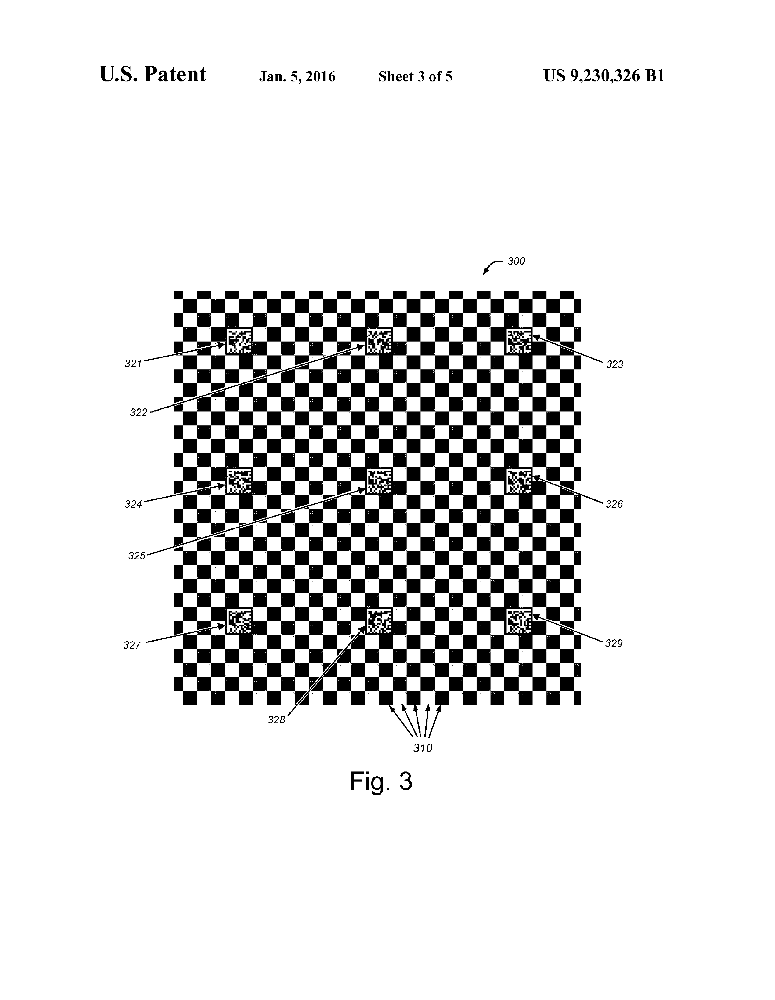
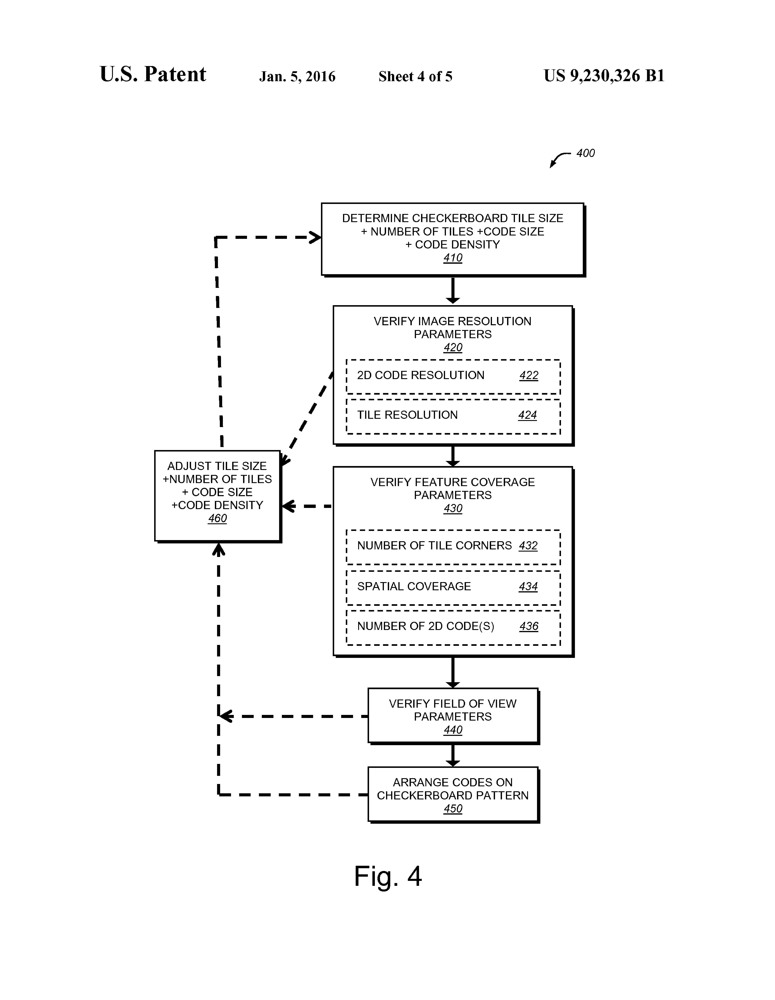

# US9230326B1 — 2D 데이터 코드를 자기 위치 결정 기준점으로 내장한 교정판 (Cognex)

| 항목 | 내용 |
|---|---|
| 원문 | `US9230326.pdf`(등록, 2016-01-05) · 공개본 없음(B1, 등록 전 공개 없이 등록) |
| 출원인 | Cognex Corporation (발명자 Gang Liu) |
| 출원일 | 2012-12-31 (우선권 주장 없음) |
| 청구항 | 19항 (독립항 1·12·18) |
| 핵심 | 반복 체커보드 격자 안에 DataMatrix(대안: QR) 코드를 고르게 내장하고, 각 코드에 자기 기준 위치의 (X, Y) 좌표를 부호화한다. 코드를 디코딩해 앵커 교차점의 레이블을 얻고, 강체 격자 규칙(다음 교차점 = (A+1, B))으로 레이블을 "키워" 시야 안 모든 코너에 절대 ID를 준다. 위치 측정은 코드가 아니라 주변 체커보드 코너가 맡는다. |
| 관련도 | ◎ 반복 무늬 대응 문제를 "코드 = 절대 ID, 코너 = 측정점" 분업으로 직접 해결 |
| 해결 P# | P1(반복 무늬 대응) · P3(측정점 종류) · P6(코드 일부 손상 시 강건성) |
| 본 과제와의 관계 | 팀의 "QR 디코딩 → 구조점 536개 ID 고정 → 추적" 방식과 같은 원리를 산업용 교정판으로 권리화한 사례다. 디코딩한 코드는 식별만, 정밀 측정은 코너로 하라는 설계가 명시되어 있다. |
| 링크 | [Google Patents](https://patents.google.com/patent/US9230326B1/en) |

---

## 상세 요약 (번역본 기준)

### 1. 해결하려는 문제
- 종래 체커보드 교정판은 모든 교정 기준점이 같은 모양이라, 시야가 판의 일부만 보면 어느 부분인지 알 수 없다.
- 스테이지로 판을 움직이면 이동 전후 영상만으로 0.5·1.5·2.5 타일 중 얼마를 움직였는지 판별할 수 없다(반복 패턴 모호성).
- 기준점의 상대 위치를 사람이 수동 입력해야 하고, 기준점이 시야 밖으로 나가지 않도록 모션 범위가 제한되며, 인접 기준점과의 혼동에 주의해야 한다.
- 기존 대안의 한계
  - DataMatrix 셀 자체를 교정 특징으로 쓰는 방식: 원형 점은 원근·방사 왜곡에서 교정 정확도가 낮고, 사각 셀은 정확도를 내려면 셀이 커야 해 코드 전체가 너무 커지며, 보이지 않는 코너가 많아 사용 가능한 특징이 줄어든다.
  - 타일 중심에 식별 마커를 넣는 방식: 타일이 커져 타일 밀도가 낮아진다. 타일 안에 직접 넣은 DataMatrix는 2D 위치를 충분한 분해능으로 부호화하지 못한다.

### 2. 핵심 구성
| 구성 | 부호 | 위치·역할 |
|---|---|---|
| 카메라 | 101·102·103 | 시야 111·112·113, 이미지 센서 121·122·123. 시야는 겹쳐도 되고 안 겹쳐도 됨 |
| 교정판 | 120 / 300 | 예: 약 1 m × 1 m. 표면(130, 예 0.5 m × 0.5 m) 위를 모션 장치가 평행이동(T)·회전(R) |
| 체커보드 타일 | 310 | 예: 0.5 mm × 0.5 mm 타일, 약 30 × 30 타일, 내부 코너 29 × 30 = 870개 |
| 내장 2D 코드 | 321~329 | ECC200 DataMatrix(대안 QR). 코드 하나가 일반 타일 4개 자리를 차지하고 코너 9개를 없앰 → 9개 코드로 81개(약 9.3 %) 제거 |
| 비전 시스템 프로세스 | 140 | 교정 프로세스(142), 프로세서(144) |

- 코드에 부호화하는 정보: 중심(또는 지정 코너) 기준 위치의 (X, Y) 좌표(예: −999~+999, mm 또는 m 단위). 필요하면 측정 단위, 타일 크기, 타일 수, 코드 크기, 코드 수(청구항 9·17).
- 코드 밀도 기준: 약 11 × 11 타일의 작은 시야에도 코드가 적어도 하나 보이도록 고르게 배치. 시야가 크면 밀도를 줄여 잃는 코너를 줄인다.
- 코드의 세 가지 역할: (1) 이동 전후 같은 물리점 추적(고유 식별) (2) 이동 전후에 서로 다른 코드가 보여도 둘 사이의 기하 관계(타일 수)를 설계에서 계산 (3) 판 위 절대 위치 결정 — 시야가 겹치지 않는 여러 카메라도 각자 판의 어느 부분을 보는지 앎.

### 3. 동작 순서
1. 판 설계(도 4, 절차 400): 타일 크기·수, 코드 크기·수 결정(410) → 영상 분해능 검증(420: 코드 디코딩 가능성 422, 코너를 정확히 잴 타일 화소 분해능 424) → 특징 범위 검증(430: 코너 수 432, 공간 범위 434, 코드 수 436) → 시야 검증(440: 모든 카메라 배치에서 코드 ≥ 1개) → 배열(450). 불만족이면 조정(460) 후 반복.
2. 교정 실행(도 2, 절차 200): 모션 장치가 자세 지정(205) → 판 위치(210) → 카메라가 타일·코드 영상 획득(212) → 코드 디코딩(214) → 카메라별 코드 데이터(216, 카메라 루프 217) → 다음 자세(루프 224) → 코드 데이터와 코너 위치로 카메라 교정(230).
3. 다중 카메라(도 5, 절차 500): 영상 획득(510) → 제1·제2 카메라 시야 안 코드 디코딩으로 판에 대한 각 카메라 위치 결정(520·530) → 코드 데이터와 체커보드 패턴으로 시야 위치 결정(540) → 모든 자세 처리까지 반복(550).
4. 레이블 부여 규칙
   - 코드가 가린 교차점(코드 중심)도 기반 격자 위에 존재하며, 그 물리 위치는 격자 배열이 정한다.
   - 코드가 앵커 교차점의 레이블 (A, B)를 주면, 강체 격자 규칙으로 양의 X 방향 다음 교차점은 (A+1, B) 등으로 전체 격자 레이블이 "자란다".
   - 코드 위치와 교차점이 **반 타일 거리 안**이면 대응이 올바름이 보장된다.
   - 모든 코드는 서로 일관된 값(충돌 없는 개별 값)이어야 하며, 어느 앵커에서 시작해도 같은 레이블이 나온다.
   - 시야에 코드가 둘 이상이면 일부 코드가 손상·디코딩 불가여도 나머지가 강건성을 준다.

### 4. 청구항 요지
- 청구항 1(시스템): 제1 카메라 + 교정 패턴의 일부를 대체하는 제1 2D 코드(앵커 교정 특징의 기준 위치를 수치 좌표로 부호화)를 가진 교정판 + 앵커에서 도출한 교정 특징의 물리 위치와 촬상 위치로 카메라 좌표계를 정하는 비전 프로세스 + 공통 좌표계((a) 판의 정해진 위치 또는 (b) 모션 장치 특성 기준)에 대해 카메라 위치·방향을 교정하는 프로세스.
- 청구항 12(교정판): 복수 2D 코드가 각자 앵커 교정 특징 기준 위치로 부호화되고, **정해진 관측 거리에서 카메라 시야에 코드가 적어도 하나 들어오는 밀도**로 배열.
- 청구항 18(방법): 청구항 1의 방법 형태.
- 주요 종속항
  - 2·19: 제2 카메라는 제1 코드나 제2 코드 중 하나를 보면 됨.
  - 3·11·13: DataMatrix 유형 코드.
  - 4·10: 모션 단계 사이 정해진 간격으로 얻은 여러 영상으로 동작.
  - 5: 두 카메라 시야가 겹침.
  - 6~8·14~16: 대비되는 밝고 어두운 체커보드 타일.
  - 9·17: 코드에 타일 크기·타일 수·코드 크기·코드 수·측정 단위 중 하나 이상을 부호화.

### 5. 대표 도면

*도 3 — 체커보드 타일(310) 사이에 2D DataMatrix 코드 9개(321~329)를 고르게 내장한 교정판(300)*

*도 4 — 영상 분해능·특징 범위·시야 요건을 검증하며 타일·코드 크기와 밀도를 정하는 설계 절차(400)*

### 6. 본 과제(Y·Θ 얼라인먼트)와 비교
- 같은 점
  - 반복 격자(체커보드 ↔ QR 모듈)의 대응 모호성을 2D 코드 디코딩으로 없앤다. 팀의 "디코딩 → 536점 ID 고정" 방식과 원리가 같다(논문 결과서 P1, 05번 PuzzleBoard와 같은 계열).
  - 판(강체) 위 점들의 상대 위치가 자세와 무관하게 고정된다는 성질을 이용한다.
  - 모션 장치(스테이지·로봇)가 판을 평행이동·회전시키며 여러 자세의 영상을 얻는다.
- 다른 점
  - 목적이 카메라 교정(핸드-아이 포함)이며 실시간 보정이 아니다.
  - 정밀도 수치(px, mm), 부화소 측정 방법, 편향 분석은 없다. 코너를 "측정한다"고만 한다.
  - 판을 새로 설계하는 특허다. 본 과제는 QR 3개 판이 주어져 있다.
- 참고할 점 (논문 결과서 4장 할 일과 연결)
  - **P1-3 디코딩 실패 대비**: 코드 하나만 읽혀도 강체 격자 규칙((A+1, B))으로 나머지 점의 ID를 전파한다. QR 3개 중 일부 디코딩이 실패해도, 읽힌 QR 또는 파인더 3개로 앵커를 잡고 center 영상의 격자 좌표를 옮겨 ID를 붙이는 경로의 근거가 된다.
  - **P1-1 초기값 여유**: "코드 위치와 교차점이 반 타일 거리 안이면 대응이 올바름"이 명시되어 있다. 본 과제의 초기값 허용 범위(현재 계획: 모듈 피치 1/4)를 정할 때 상한 근거로 쓴다(반 모듈 = 이론 상한, 1/4 = 여유).
  - **P3 점 종류**: 정밀 측정은 코드 셀이 아니라 **체커보드 코너**로 한다. 원형 점은 원근·방사 왜곡에서 정확도가 낮고, 정사각 셀은 커야 정확하다고 적시한다. 팀이 모듈 중심(블롭)을 측정점으로 추가하지 않기로 한 판단(논문 결과서 P3)과 일치한다. 또 "타일 코너는 고정밀, 타일 중심은 저정밀 응용에 허용"이라고 구분한다.
  - **P6-1 품질 게이트**: 시야에 코드가 여러 개면 일부 손상·디코딩 불가에도 강건하다. 본 과제는 QR 3개 중 몇 개가 디코딩되었는지를 게이트 ① 항목으로 쓰고, 일부 실패 시 남은 QR로 ID를 유지할지 기각할지 규칙을 정한다.
  - 판 설계 절차(도 4)의 "코드 디코딩 가능성 + 코너를 정확히 잴 화소 분해능" 두 조건은, 본 과제에서 모듈 피치(px)와 디코딩 성공률을 함께 기록해야 하는 이유가 된다.
