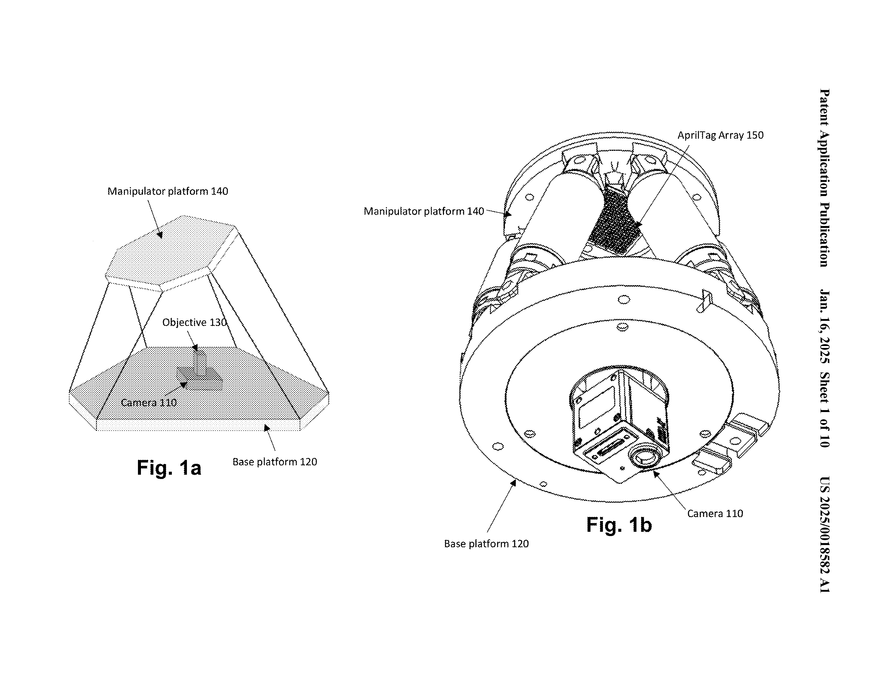
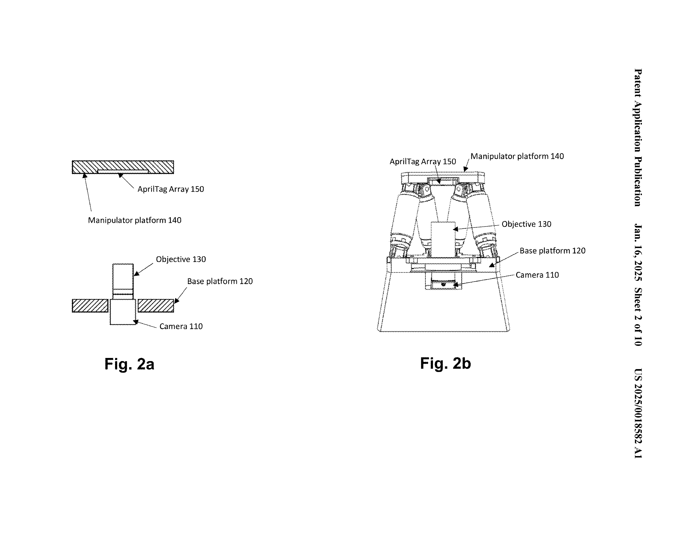
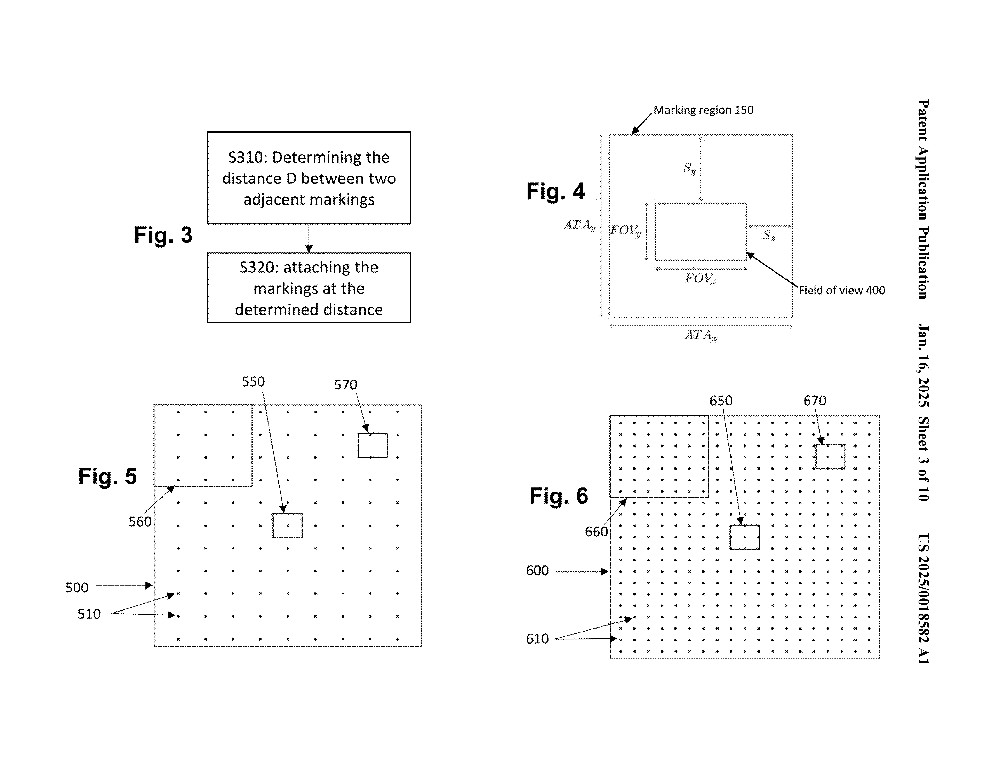
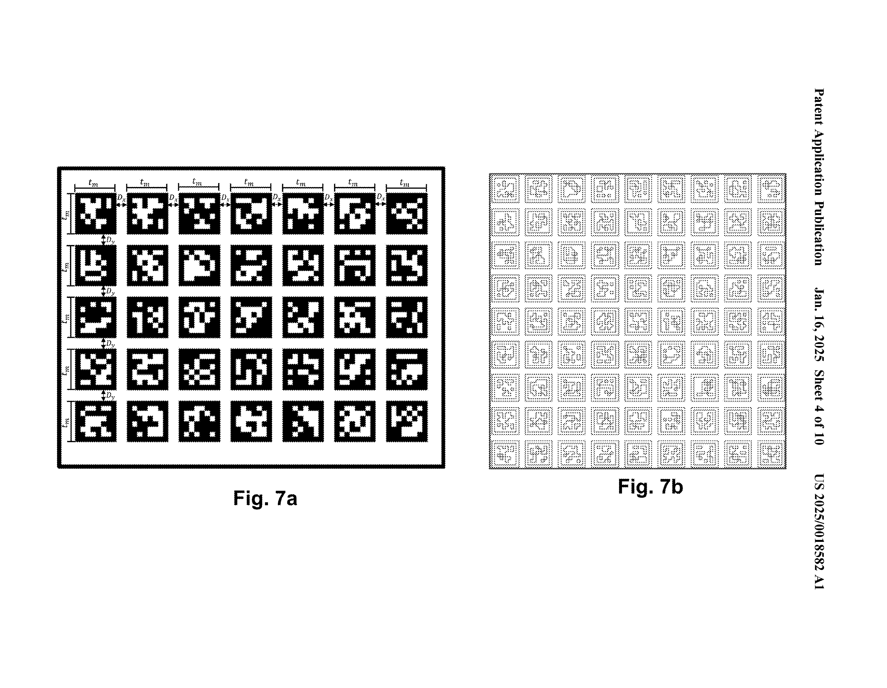
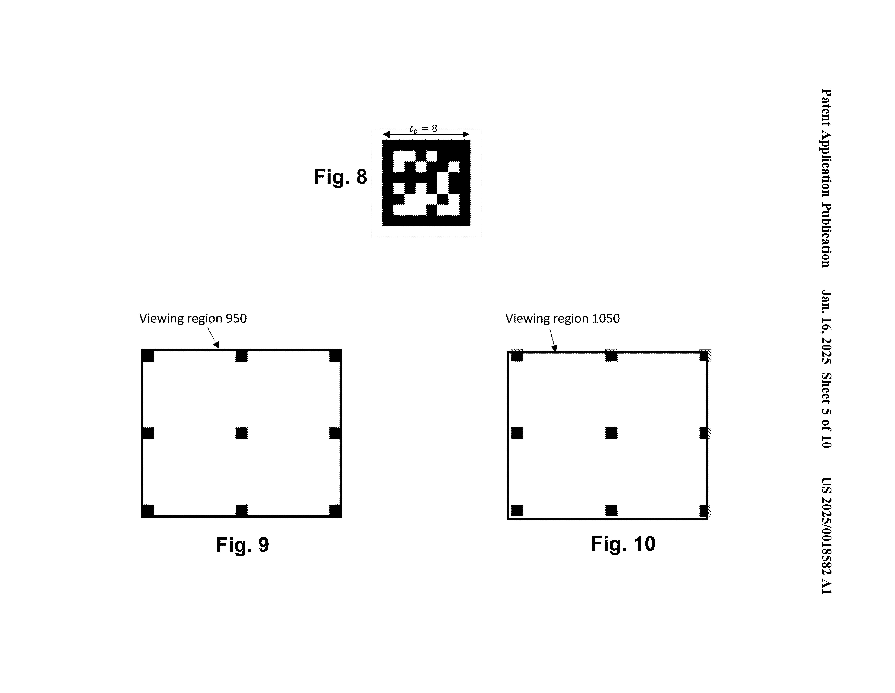
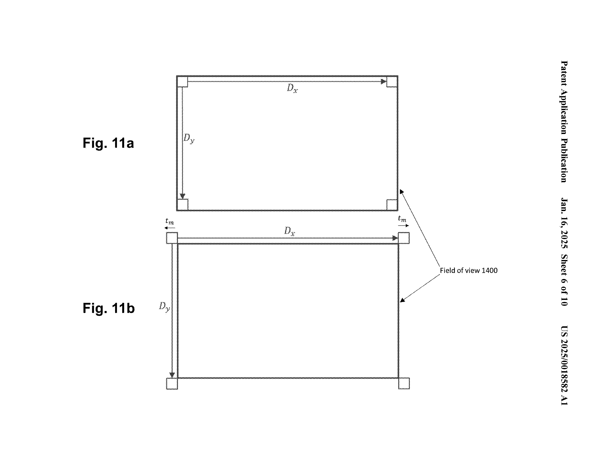
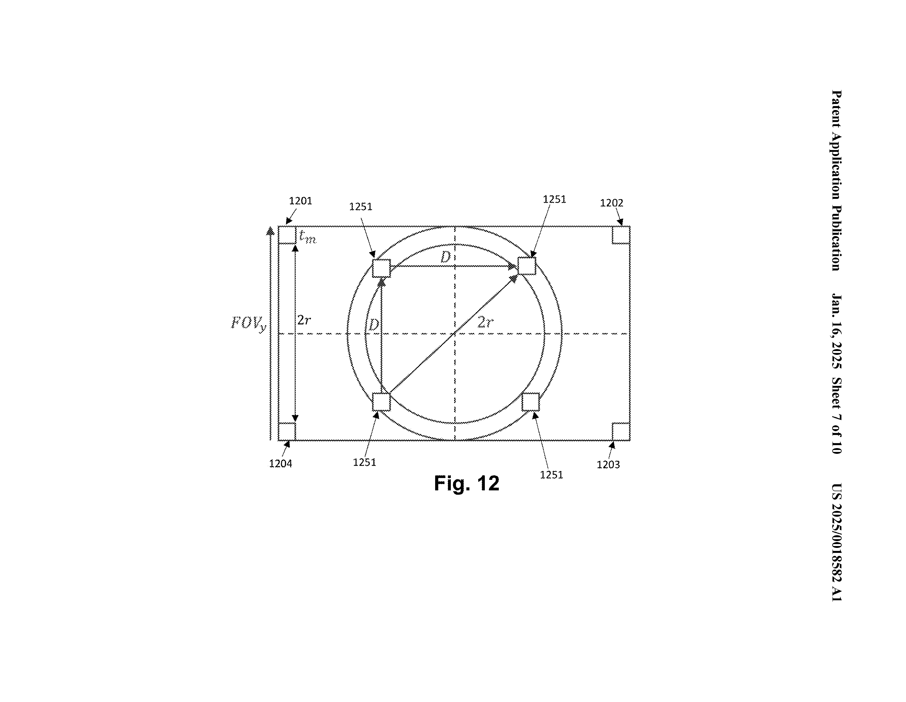
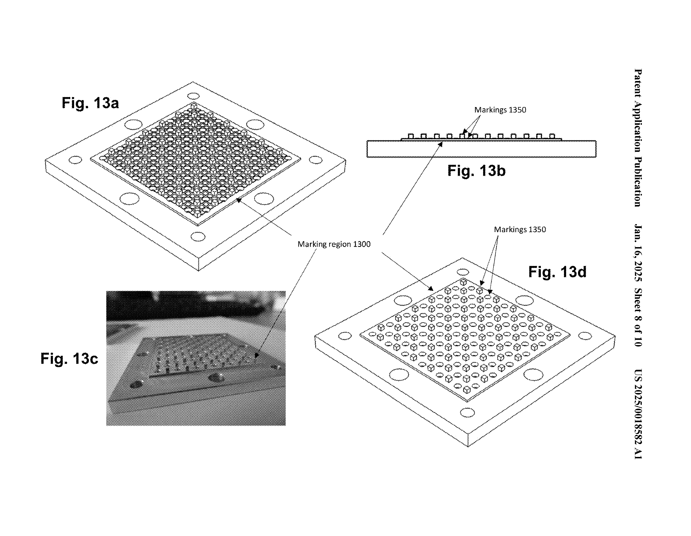
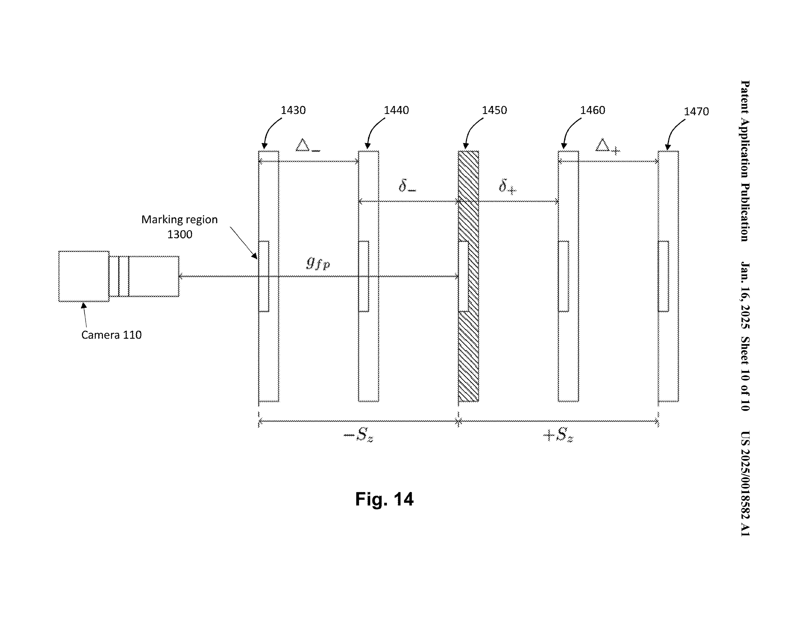
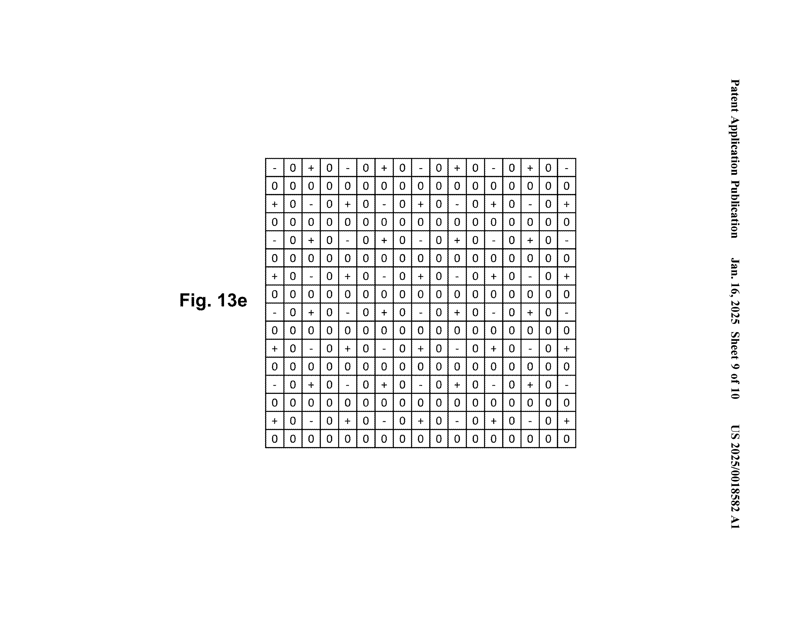

# 기준 마커를 이용한 병렬 키네마틱 시스템의 자세 결정 (US20250018582A1)
- 원제: Pose Determination in Parallel Kinematics Systems with Reference Markers
- 원문: 같은 폴더의 PDF(`US20250018582.pdf`, 공개 2025-01-16), https://patents.google.com/patent/US20250018582A1/en
- 번역 기준: USPTO 공개 PDF 스캔 본문을 직접 읽어 옮김 (Google Patents 접근 제한). 수식은 일반 텍스트로 옮겼고, 원문 오기(예: "9 min", "Δ_Δ_", "도 11a에서는 상한")는 고치지 않고 그대로 둠.
- 도면: 원문 PDF 도면 시트 10장을 도면/ 폴더에 넣고(가로 시트는 바로 세움) 본문에서 처음 설명되는 곳에 삽입함
- 청구항: 1~10항은 삭제(canceled), 유효 청구항은 11~20항(10개)

## 요약

병렬 키네마틱 시스템은 마킹 영역에서 병렬 키네마틱 시스템에 부착된, 서로 구별 가능한 마킹들을 포함한다. 마킹 영역은 키네마틱 시스템의 자세와 함께 움직이는 키네마틱 시스템의 영역이다. 마킹들은 한 방향으로 n개의 마킹이 그 방향으로 항상 완전히 보이도록 보장하는 거리로 부착될 수 있으며, 카메라가 촬영하고 그 방향으로 적어도 n개의 마킹을 포함하는 영상에 기반하여 병렬 키네마틱 시스템의 자세를 결정할 수 있다. 마킹들은 한 방향으로 n개 이상의 마킹이 그 방향으로 완전히 보이도록 보장하는 거리로 부착되고, 서로 다른 평면에 부착될 수 있으며, 카메라가 촬영하고 그 방향으로 적어도 임의의 n개의 마킹을 포함하는 영상에 기반하여 병렬 키네마틱 시스템의 자세를 결정할 수 있다.

## 청구범위

1-10. (삭제)

11. 병렬 키네마틱 시스템과 상기 병렬 키네마틱 시스템의 자세를 결정하는 수단을 갖는 배열체로서,

카메라와, 서로 구별 가능한 마킹들을 갖는 마킹 영역을 포함하며, 상기 카메라는 상기 병렬 키네마틱 시스템의 서로 다른 자세들에서 상기 마킹 영역을 관찰하도록 구성되고,

상기 병렬 키네마틱 시스템의 자세를 결정하는 수단은, 상기 카메라가 촬영한 상기 마킹 영역의 영상들 중 하나가 한 방향으로 임의의 상기 마킹을 적어도 n개(n은 1 이상) 포함하면, 상기 카메라가 촬영한 상기 마킹 영역의 영상들에만 기초하여 상기 병렬 키네마틱 시스템의 자세를 결정하도록 구성되며,

상기 방향으로 인접한 임의의 두 마킹 사이의 거리 D는 다음 식을 만족하고:

  (FOV_min − (n+2)·t_m) / (n+1) < D ≤ (FOV_min − (n+1)·t_m) / n,

여기서

t_m은 상기 마킹들 중 하나의 길이이고,

FOV_min은 상기 카메라가 상기 마킹 영역으로부터 최소 거리에 있을 때 상기 카메라의 시야에 들어오는 상기 마킹 영역 구간의 길이이며,

상기 최소 거리는 자세 변화로 인해 상기 마킹 영역이 상기 카메라로부터 떨어질 수 있는 거리들 중 최소 거리인, 배열체.

12. 제11항에 있어서,

상기 길이 FOV_min은 다음 식을 만족하고:

  FOV_min = (g_min/f − 1) · l_Sensor,

g_min은 상기 최소 거리, l_Sensor는 상기 카메라의 센서의 길이, f는 상기 카메라의 초점 거리인, 병렬 키네마틱 시스템.

13. 제11항에 있어서,

상기 마킹들은 규칙적인 배열 패턴에 따라 상기 마킹 영역에 배열되는, 병렬 키네마틱 시스템.

14. 제11항에 있어서,

상기 마킹 영역은 상기 병렬 키네마틱 시스템의 작업 플랫폼의 아랫면에 부착되고 상기 카메라는 상기 병렬 키네마틱 시스템의 베이스 안 또는 위에 부착되어 상기 작업 플랫폼의 아랫면을 향하거나,

상기 마킹 영역은 상기 병렬 키네마틱 시스템의 베이스 안 또는 위에 부착되고 상기 카메라는 상기 작업 플랫폼의 아랫면에 부착되어 상기 병렬 키네마틱 시스템의 베이스를 향하는, 병렬 키네마틱 시스템.

15. 제11항에 있어서,

마킹의 길이 t_m은 다음 식을 만족하고:

  t_m ≥ px · p · t_b · (g_max/f − 1),

여기서

p는 상기 카메라에 따라 정해지는 2 이상 5 이하의 값이고,

px는 상기 카메라의 샘플링 값 하나에 대응하는 길이이며,

g_max는 자세 변화로 인해 상기 마킹 영역이 상기 카메라로부터 떨어질 수 있는 거리들 중 최대 거리이고,

f는 상기 카메라의 초점 거리이며,

t_b는 상기 마킹의 정보 단위 개수인, 병렬 키네마틱 시스템.

16. 제11항에 있어서,

상기 마킹들은 ARToolKit 마킹, ArUco 마킹, QR 코드 및 AprilTag 마킹 중에서 선택되는 기준 마킹인, 병렬 키네마틱 시스템.

17. 제11항에 있어서,

상기 마킹들 각각은 여러 개의 정사각형으로 이루어지며,

상기 정사각형은 상기 정보 단위에 대응하고 각 정사각형에 1비트를 부호화할 수 있는, 병렬 키네마틱 시스템.

18. 카메라가 촬영한 마킹 영역의 영상들 중 하나가 한 방향으로 적어도 미리 정해진 개수 n개(n은 2 이상)의 마킹을 포함하면 상기 영상들에만 기초하여 병렬 키네마틱 시스템의 자세를 결정할 수 있도록, 제11항에 따른 배열체의 병렬 키네마틱 시스템에 서로 구별 가능한 마킹들을 마킹 영역에서 부착하는 방법으로서,

상기 방향으로 인접한 임의의 두 마킹 사이의 거리 D를 다음 식에 따라 결정하는 단계:

  (FOV_min − (n+2)·t_m) / (n+1) < D ≤ (FOV_min − (n+1)·t_m) / n,

여기서

t_m은 상기 마킹들 중 하나의 길이이고,

FOV_min은 상기 카메라가 상기 마킹 영역으로부터 최소 거리에 있을 때 상기 카메라의 시야에 들어오는 상기 마킹 영역 구간의 길이이며,

상기 최소 거리는 자세 변화로 인해 상기 마킹 영역이 상기 카메라로부터 떨어질 수 있는 거리들 중 최소 거리임; 및

각각 인접한 마킹들을 상기 결정된 거리로 부착하는 단계를 포함하는, 방법.

19. 병렬 키네마틱 시스템과 상기 병렬 키네마틱 시스템의 자세를 결정하는 수단을 갖는 배열체로서,

카메라와, 서로 구별 가능한 마킹들을 갖는 마킹 영역을 포함하며, 상기 카메라는 상기 병렬 키네마틱 시스템의 서로 다른 자세들에서 상기 마킹 영역을 관찰하도록 구성되고,

한 방향으로 인접한 임의의 두 마킹 사이의 거리 D는 다음 식을 만족하며:

  D ≤ (FOV_min − (n+1)·t_m) / n,

여기서

t_m은 상기 마킹들 중 하나의 길이이고,

FOV_min은 상기 카메라가 상기 마킹 영역으로부터 최소 거리에 있을 때 상기 카메라의 시야에 들어오는 상기 마킹 영역 구간의 길이이며,

상기 최소 거리는 자세 변화로 인해 상기 마킹 영역이 상기 카메라로부터 떨어질 수 있는 거리들 중 최소 거리이고,

상기 마킹들은 서로 다른 평면에 배치되며,

상기 병렬 키네마틱 시스템의 자세를 결정하는 수단은, 상기 카메라가 촬영한 상기 마킹 영역의 영상들 중 하나가 한 방향으로 임의의 상기 마킹을 적어도 n개(n은 2 이상) 포함하면, 상기 카메라가 촬영한 상기 마킹 영역의 영상들에만 기초하여 상기 병렬 키네마틱 시스템의 자세를 결정하도록 구성되는, 배열체.

20. 카메라가 촬영한 마킹 영역의 영상들 중 하나가 한 방향으로 적어도 미리 정해진 개수 n개(n은 2 이상)의 마킹을 포함하면 상기 영상들에만 기초하여 병렬 키네마틱 시스템의 자세를 결정할 수 있도록, 제19항에 따른 배열체의 병렬 키네마틱 시스템에 서로 구별 가능한 마킹들을 마킹 영역에서 부착하는 방법으로서,

상기 방향으로 인접한 임의의 두 마킹 사이의 거리 D를 다음 식에 따라 결정하는 단계:

  D ≤ (FOV_min − (n+1)·t_m) / n,

여기서

t_m은 상기 마킹들 중 하나의 길이이고,

FOV_min은 상기 카메라가 상기 마킹 영역으로부터 최소 거리에 있을 때 상기 카메라의 시야에 들어오는 상기 마킹 영역 구간의 길이이며,

상기 최소 거리는 자세 변화로 인해 상기 마킹 영역이 상기 카메라로부터 떨어질 수 있는 거리들 중 최소 거리임; 및

상기 방향으로 인접한 임의의 마킹들을 상기 결정된 거리로 부착하는 단계를 포함하며,

상기 마킹들은 서로 다른 평면에 배치되도록 부착되는, 방법.

## 상세한 설명

### 관련 출원의 상호 참조 (CROSS REFERENCE TO RELATED APPLICATIONS)

[0001] 본 출원은 2022년 11월 22일 출원된 국제 출원 번호 PCT/EP2022/082765의 35 U.S.C. 371에 따른 미국 국내 단계 출원이며, 이 국제 출원은 2021년 11월 26일 출원된 독일 특허 출원 번호 10 2021 213 358.4에 대해 우선권을 주장한다. 위 출원들의 전체 개시 내용은 참조로서 본 명세서에 명시적으로 통합된다.

### 기술 분야 (TECHNICAL FIELD)

[0002] 본 발명은 병렬 키네마틱 시스템의 자세(pose)를 결정하는 장치 및 방법에 관한 것이다.

### 배경 기술 (BACKGROUND ART)

[0003] 로봇을 제어할 때의 일반적인 문제는 로봇의 현재 자세(위치 및 방향)를 결정하는 것이다.

[0004] 그러나 특히 병렬 키네마틱 시스템에서는, 예를 들어 헥사포드(hexapod)의 가동 작업 플랫폼의 자세, 즉 위치 및 방향을 구동되는 다리의 길이나 관절 각도로부터 직접 및/또는 정밀하게 계산할 수 없다. 대신 이를 위해서는 수치적 방법, 예를 들어 반복 최적화 방법이 필요하다. 한편으로 이러한 방법은 시간이 오래 걸리고 계산량이 많으며, 얻을 수 있는 정확도 수준은 사용된 초기 추정값에 크게 의존한다. 다른 한편으로 이러한 방법은 일반적으로 내부 센서(예: 헥사포드의 다리 길이를 측정하는 증분형 센서)를 이용한 다리 길이 및/또는 관절 각도의 측정에 기반하므로, 다리, 관절 및/또는 가동 플랫폼 자체의 오프셋, 변형, 유격 및 역유격(백래시) 같은 영향을 (다리에 절대형 센서를 쓰더라도) 검출할 수 없고, 따라서 이에 기반한 수치적 방법으로는 이를 고려할 수 없다. 나아가 예를 들어 증분형 센서를 쓰면 다리의 영점 위치를 얻기 위해 복잡한 기준 주행(reference run)이 필요하고, 수치적 방법이 존재하지 않는 특수한 병렬 키네마틱 시스템도 있다.

[0005] 그러나 외부의 광학식 증분형 및 절대형 센서를 사용하면, 모든 자유도를 측정할 수 있으려면 일반적으로 많은 수의 센서가 필요하다. 센서의 측정 범위가 제한되어 있어 병렬 키네마틱 시스템의 큰 조정 운동을 얻는 것도 흔히 불가능하다.

[0006] 사진측량(photogrammetry)에 의한 6D 측정 기술을 사용할 때에는, 정확한 3D 스캔을 생성하기 위해 가능한 한 많은 서로 다른 위치에서 촬영한 많은 수의 영상이 흔히 필요하다. 비교적 넓은 영역을 촬영해야 하므로 비교적 낮은 수준의 정확도만 얻을 수 있으며, 예를 들어 나노미터 범위의 위치 변화를 검출할 수 있으려면 카메라의 해상도가 극도로 높아야 한다.

[0007] Moldagalieva, Akmaral 외, "Computer vision-based pose estimation of tensegrity robots using fiducial markers." 2019 IEEE/SICE International Symposium on System Integration (SiI) IEEE, 2019는 로봇의 작업 공간 전체를 카메라의 시야(영상 영역) 안에 유지하려는 기준 태그(fiducial tag) 기반 방법을 개시한다. 이는 카메라의 시야 영역이 매우 커야 하고 따라서 카메라를 가동 작업 플랫폼으로부터 상당히 먼 거리에 설치해야 함을 의미한다. 주어진 카메라 해상도에서 얻을 수 있는 정확도는 카메라와 태그 사이의 거리가 멀어질수록 떨어지므로, 이 방법은 낮은 수준의 정확도로만 키네마틱 시스템의 자세를 결정하는 데 사용될 수 있다.

[0008] 따라서 본 발명은 병렬 키네마틱 시스템의 자세 결정을 개선하는 것을 목적으로 한다.

[0009] 이 목적은 본 발명에 따라 독립 청구항의 특징에 의해 달성된다. 일부 유리한 실시예는 종속 청구항의 대상이다.

### 발명의 내용 (SUMMARY)

[0010] 본 발명은 기준 마커들 중 적어도 하나 또는 일정한 최소 개수의 기준 마커가 항상 카메라의 시야 안에 있도록 병렬 키네마틱 시스템에 여러 개의 기준 마커를 부착한다는 착상에 기반한다.

[0011] 본 발명의 제1 양태에 따르면 병렬 키네마틱 시스템이 제공된다. 병렬 키네마틱 시스템은 카메라와, 서로 구별 가능한 마킹들을 갖는 마킹 영역을 포함하며, 카메라는 병렬 키네마틱 시스템의 서로 다른 자세들(또는 가능한 모든 자세들)에서 마킹 영역을 관찰하도록 구성된다. 카메라가 촬영한 마킹 영역의 영상이 한 방향으로 임의의 마킹을 적어도 n개(n은 1 이상) 포함하면, 그 영상에 기반하여 병렬 키네마틱 시스템의 자세를 결정할 수 있다. 한 방향으로 인접한 임의의 두 마킹 사이의 거리 D는 다음 식을 만족한다.

  (FOV_min − (n+2)·t_m) / (n+1) < D ≤ (FOV_min − (n+1)·t_m) / n,

여기서 t_m은 마킹 하나의 길이, FOV_min은 카메라가 마킹 영역으로부터 최소 거리에 있을 때 카메라의 시야에 들어오는 마킹 영역 구간의 길이이며, 최소 거리는 자세 변화로 인해 마킹 영역이 카메라로부터 떨어질 수 있는 거리들 중 최소 거리이다.

[0012] 본 발명의 제2 양태에 따르면, 영상 안에서 한 방향으로 적어도 미리 정해진 개수 n개의 마킹이 배치되어 있으면 마킹 영역의 영상에 기반하여 병렬 키네마틱 시스템의 자세를 결정할 수 있도록, 서로 구별 가능한 마킹들을 마킹 영역에서 병렬 키네마틱 시스템에 부착하는 방법이 제공된다. 이 방법은 그 방향으로 인접한 임의의 두 마킹 사이의 거리 D를 다음 식에 따라 결정하는 단계를 포함한다.

  (FOV_min − (n+2)·t_m) / (n+1) < D ≤ (FOV_min − (n+1)·t_m) / n,

여기서 t_m은 마킹 하나의 길이, FOV_min은 카메라가 마킹 영역으로부터 최소 거리에 있을 때 카메라의 시야에 들어오는 마킹 영역 구간의 길이이며, 최소 거리는 자세
 변화로 인해 마킹 영역이 카메라로부터 떨어질 수 있는 거리들 중 최소 거리이다. 이 방법은 결정된 거리를 갖는 인접 마킹들을 부착하는 단계를 더 포함한다.

[0013] 본 발명의 제3 양태에 따르면 병렬 키네마틱 시스템이 제공된다. 병렬 키네마틱 시스템은 카메라와, 서로 구별 가능한 마킹들이 부착된 마킹 영역을 포함하며, 카메라는 병렬 키네마틱 시스템의 서로 다른 자세들(또는 가능한 모든 자세들)에서 마킹 영역을 관찰하도록 구성된다. 한 방향으로 인접한 임의의 두 마킹 사이의 거리 D는 다음 식을 만족한다.

  D ≤ (FOV_min − (n+1)·t_m) / n,

여기서 t_m은 마킹 하나의 길이, FOV_min은 카메라가 마킹 영역으로부터 최소 거리에 있을 때 카메라의 시야에 들어오는 마킹 영역 구간의 길이이며, 최소 거리는 자세 변화로 인해 마킹 영역이 카메라로부터 떨어질 수 있는 거리들 중 최소 거리이다. 나아가 마킹들은 서로 다른 평면에 배치되며, 카메라가 촬영한 영상이 그 방향으로 임의의 마킹을 적어도 n개(n은 2 이상) 포함하면 그 영상에 기반하여 병렬 키네마틱 시스템의 자세를 결정할 수 있다.

[0014] 본 발명의 제4 양태에 따르면, 영상 안에서 적어도 미리 정해진 개수 n개(n은 2 이상)의 마킹이 한 방향으로 배치되어 있으면 카메라가 촬영한 마킹 영역의 영상에 기반하여 병렬 키네마틱 시스템의 자세를 결정할 수 있도록, 서로 구별 가능한 마킹들을 마킹 영역에서 병렬 키네마틱 시스템에 부착하는 방법이 제공된다. 이 방법은 그 방향으로 인접한 임의의 두 마킹 사이의 거리 D를 다음 식에 따라 결정하는 단계를 포함한다: D≤(〚FOV〛_min−(n+1)*t_m)/n, 여기서 t_m은 마킹 하나의 길이, 〚FOV〛_min은 카메라가 마킹 영역으로부터 최소 거리만큼 떨어져 있을 때 카메라의 시야에 들어오는 마킹 영역 구간의 길이이며, 최소 거리는 자세 변화로 인해 마킹 영역이 카메라로부터 떨어질 수 있는 거리들 중 최소 거리이다. 이 방법은 그 방향으로 인접한 각 마킹을 결정된 거리로 부착하는 단계를 더 포함하며, 마킹들은 서로 다른 평면에 배치되도록 부착된다.

[0015] 일반적으로 제1 내지 제4 양태의 실시예에서 길이 FOV_min은 다음 식을 만족할 수 있다.

  FOV_min = (g_min / f − 1) · l_sensor,

여기서 g_min은 최소 거리, l_Sensor는 카메라 센서의 길이, f는 카메라의 초점 거리이다.

[0016] 일반적으로 제1 및 제3 양태의 실시예에서 마킹들은 규칙적인 배열 패턴에 따라 마킹 영역에 배열될 수 있다.

[0017] 일반적으로 제2 및 제4 양태의 실시예에서 부착 단계의 마킹들은 규칙적인 배열 패턴에 따라 마킹 영역에 부착될 수 있다.

[0018] 일반적으로 제1 및 제3 양태의 실시예에서 마킹 영역은 병렬 키네마틱 시스템의 작업 플랫폼 아랫면에 부착될 수 있고, 카메라는 병렬 키네마틱 시스템의 베이스 안 또는 위에 부착되어 작업 플랫폼의 아랫면을 향할 수 있다.

[0019] 일반적으로 제1 및 제3 양태의 실시예에서 마킹 영역은 병렬 키네마틱 시스템의 베이스 안 또는 위에 부착될 수 있고 카메라는 병렬 키네마틱 시스템의 작업 플랫폼 아랫면에 부착될 수 있으며, 카메라는 병렬 키네마틱 시스템의 베이스를 향할 수 있다. 제1 및 제3 양태의 실시예에서 마킹 영역을 부착하는 단계에서, 마킹 영역은 대안적으로 병렬 키네마틱 시스템의 베이스 안 또는 위에 부착될 수 있고, 카메라는 병렬 키네마틱 시스템의 작업 플랫폼 아랫면에 부착되어 병렬 키네마틱 시스템의 베이스를 향할 수 있다.

[0020] 일반적으로, 마킹 영역을 부착하는 단계에서 마킹 영역을 부착하는 단계에서, 마킹 영역은 병렬 키네마틱 시스템의 작업 플랫폼 아랫면에 부착될 수 있고, 및/또는 카메라는 병렬 키네마틱 시스템의 베이스 안 또는 위에 부착되어 작업 플랫폼의 아랫면을 향할 수 있다. 제2 및 제4 양태의 실시예에서 의 마킹 영역을 부착하는 단계에서, 마킹 영역은 대안적으로 병렬 키네마틱 시스템의 베이스 안 또는 위에 부착될 수 있고, 카메라는 병렬 키네마틱 시스템의 작업 플랫폼 아랫면에 부착되어 병렬 키네마틱 시스템의 베이스를 향할 수 있다.

[0021] 제1 내지 제4 양태의 실시예에서 마킹의 길이 t_m은 일반적으로 다음 식을 만족한다.

  t_m ≥ px · p · t_b · (g_max / f − 1),

여기서 p는 카메라에 따라 정해지는 2 이상 5 이하의 값, px는 카메라의 샘플링 값에 대응하는 길이, g_max는 자세 변화로 인해 마킹 영역이 카메라로부터 떨어질 수 있는 거리들 중 최대 거리, f는 카메라의 초점 거리, t_b는 마킹의 정보 단위 개수이다.

[0022] 일반적으로 제1 내지 제4 양태의 실시예에서 마킹들은 ARToolKit 마킹, ArUco 마킹, QR 코드 또는 특히 AprilTag 마킹과 같은 기준 마커일 수 있다.

[0023] 일반적으로 제1 내지 제4 양태의 실시예에서 마킹 각각은 여러 개의 정사각형으로 이루어질 수 있으며, 정사각형은 정보 단위에 대응하고 각 정사각형에 1비트를 부호화할 수 있다.

### 도면의 간단한 설명 (BRIEF DESCRIPTION OF THE DRAWINGS)

[0024] 본 발명의 추가적인 세부 사항, 이점 및 특징은 이하의 설명과, 본문에 기술되지 않은 모든 세부 사항에 관하여 명시적으로 참조되는 도면으로부터 드러날 것이며, 도면에서:

[0025] 도 1a 및 b는 예시적인 병렬 키네마틱 시스템의 개략적인 3차원 표현을 도시한다.

[0026] 도 2a 및 b는 예시적인 병렬 키네마틱 시스템의 개략적인 단면 표현을 도시한다.

[0027] 도 3은 마킹 영역에 마킹을 부착하는 예시적인 단계를 보여주는 흐름도를 도시한다.

[0028] 도 4는 키네마틱 시스템의 자세 변화에 대해 마킹 영역의 보이는 구간을 나타낸 개략도이다.

[0029] 도 5는 x 및 y 방향의 서로 다른 변위(deflection)에서 마킹 영역의 최소 시야와 그에 대응하는 최대 시야를 나타낸 개략도이다; 마킹들의 거리는 적어도 1개, 한계 경우에는 4개의 마킹이 완전히 보이도록 선택된다.

[0030] 도 6은 x 및 y 방향의 서로 다른 변위에서의 최소 시야와 그에 대응하는 최대 시야를 나타낸 개략도이다; 마킹들의 거리는 적어도 4개, 한계 경우에는 9개의 마킹이 완전히 보이도록 선택된다.

[0031] 도 7a 및 b는 마킹들이 균일하게 배열된 마킹 영역을 나타낸 개략도이다.

[0032] 도 8은 예시적인 마킹을 도시한다.

[0033] 도 9는, 한계 경우에 x 및 y 방향으로 완전히 보이는 마킹이 원하는 최소 개수 n_x=n_y=2보다 많은(즉 x 또는 y 방향으로 (n_x+1)=(n_y+1)=3개) 마킹 영역의 관찰 영역을 도시한다.

[0034] 도 10은 도 9의 관찰 영역에 비해 왼쪽 아래로 작은 변위만큼 이동한 관찰 영역을 도시한다; 이는 x 및 y 방향으로 다시 n_x=n_y=2개의 마킹만 완전히 보인다는 것을 의미한다.

[0035] 도 11a는, 한계 경우에 x 및 y 방향으로 완전히 보이는 마킹이 원하는 최소 개수 n_x=n_y=1보다 많은(즉 총 4개) 마킹 영역의 관찰 영역을 도시한다;

[0036] 도 11b는 x 및 y 방향의 마킹 간 거리를 2t_m만큼 늘린 뒤의 도 11a의 관찰 영역을 도시하며, 이는 한계 경우에 더 이상 어떤 마킹도 완전히 보이지 않음을 의미한다.

[0037] 도 12는 회전을 고려할 때 마킹 간 거리를 결정하는 것을 나타낸 개략도이다.

[0038] 도 13a 내지 d는 마킹들이 서로 다른 평면에 배열된 마킹 영역이다.

[0039] 도 13e는 마킹들을 세 개의 서로 다른 평면에 부착할 때 따를 수 있는 주기적 패턴을 나타낸 개략도이다.

[0040] 도 14는 마킹이 부착되는 여러 평면을 사용함으로써 담당할 수 있는 작업 영역의 크기가 늘어나는 것을 나타낸 개략도이다.

### 발명을 실시하기 위한 구체적인 내용 (DETAILED DESCRIPTION)

[0041] 본 발명은 마킹이 부착된 병렬 키네마틱 시스템과, 병렬 키네마틱 시스템에 마킹을 부착하는 방법에 관한 것이다.

### 병렬 키네마틱 시스템 (Parallel Kinematic Systems)

[0042] 로봇 기술에서는 직렬 키네마틱과 병렬 키네마틱이라는 주요 부류를 근본적으로 구분한다. 직렬과 병렬 키네마틱을 결합한 하이브리드 키네마틱도 있다. 직렬 키네마틱 시스템은 일련의 링크(예: 직선 축 및/또는 회전 축)로 열린 키네마틱 체인을 이루는 반면, 본 출원에서 고려하는 병렬 키네마틱 시스템은 여러 개의 닫힌 키네마틱 체인으로 이루어진다. 실제로 병렬 운동 축에는 평행 로드 키네마틱 시스템, 로드 액추에이터 및/또는 회전 액추에이터가 자주 사용되며, 서로 상대 운동하는 두 평면을 결합한다. 따라서 각 구동부는 (엔드) 이펙터(예: 공구 캐리어)에 직접 연결된다. 이는 직렬 키네마틱 시스템의 경우처럼 구동부가 후속하는 모든 링크와 구동부의 질량을 짊어지지 않는다는 것을 의미한다. 따라서 모든 구동부가 동시에, 즉 서로 병렬로 움직이므로 하중이 모든 안내 요소에 (더) 고르게 분산된다. 그 결과 움직이는 자중이 작아 높은 속도와 가속도로 극한의 동특성을 가능하게 하면서 동시에 높은 수준의 기계적 정확도를 갖는다. 직렬 메커니즘과의 또 다른 차이는 병렬 키네마틱 시스템에서는 구동부, 특히 모터와 기어가 정지 상태로 남는다는 점이다. 이는 이러한 로봇의 동특성과 성능뿐 아니라 에너지 수지도 최적화한다. 따라서 병렬 키네마틱 시스템은 높은 수준의 반복 정확도와 속도를 갖는 단순한 동작 시퀀스가 요구될 때 자주 사용된다. 병렬 키네마틱 시스템의 대표적인 예는 헥사포드와 델타 로봇이다. 여기서 본 출원에서 자주 사용되는 헥사포드의 예는 단지 예시일 뿐이며, 일반적으로 말한 내용은 다른 병렬 키네마틱 시스템에도 적용된다는 점에 유의해야 한다.

### 실시예 (EMBODIMENTS)

[0043] 본 발명의 일 실시예에 따르면 병렬 키네마틱 시스템이 제공된다. 도 1, 2a 및 2b에 예로서 도시된 바와 같이, 병렬 키네마틱 시스템은 병렬 키네마틱 시스템의 자세와 함께 움직이는 병렬 키네마틱 시스템의 마킹 영역(150)을 관찰하도록 구성된 카메라(110)를 포함한다. 병렬 키네마틱 시스템은 마킹 영역(150)에서 병렬 키네마틱 시스템에 부착된, 서로 구별 가능한 마킹들을 더 포함한다.

*도 1a, 도 1b — 헥사포드: 베이스 플랫폼(120)의 카메라(110)·대물렌즈(130)가 매니퓰레이터 플랫폼(140) 아랫면의 AprilTag 배열(150)을 관찰*

*도 2a, 도 2b — 같은 구성의 단면도: 카메라(110)가 매니퓰레이터 플랫폼(140)의 AprilTag 배열(150)을 향함*

[0044] 마킹 영역의 마킹들은 다음 중 하나로 부착된다:

[0045] 한 방향으로 인접한 임의의 두 마킹 사이의 거리 D가 다음 식을 만족하도록 부착되며,

  (FOV_min − (n+2)·t_m) / (n+1) < D ≤ (FOV_min − (n+1)·t_m) / n,

카메라(110)로 촬영한 마킹 영역의 영상이 그 방향으로 임의의 마킹을 적어도 n개(n은 1 이상) 포함하면 그 영상에 기반하여 병렬 키네마틱 시스템의 자세를 결정할 수 있다; 또는

[0046] 서로 다른 평면에 부착되며, 한 방향으로 인접하여 부착된 임의의 두 마킹 사이의 거리 D가 다음 식을 만족하고,

  D ≤ (FOV_min − (n+1)·t_m) / n,

카메라가 촬영한 마킹 영역의 영상(예: 임의의 또는 각각의 개별 영상)이 그 방향으로 임의의 마킹을 적어도 n개(n은 2 이상) 포함하면 그 영상에 기반하여 병렬 키네마틱 시스템의 자세를 결정할 수 있다; 또는

[0047] 아래에서 더 자세히 설명하는 바와 같이, 여기서 t_m은 마킹 하나의 길이를 나타내고, FOV_min은 카메라(110)의 최소 시야의 길이를 나타낸다.

[0048] 다른 실시예에 따르면, 이에 따라 서로 구별 가능한 마킹들을 마킹 영역에서 병렬 키네마틱 시스템에 부착하는 방법이 제공된다. 이러한 방법은 도 3에 도시되어 있으며, 다음 식

  (FOV_min − (n+2)·t_m) / (n+1) < D ≤ (FOV_min − (n+1)·t_m) / n;

또는 다음 식

  D ≤ (FOV_min − (n+1)·t_m) / n.

중 어느 하나에 따라 거리를 결정하는 단계 S310을 포함한다.

*도 3 — 마킹 부착 흐름도(S310 인접 마킹 거리 D 결정 → S320 결정된 거리로 부착), 도 4 — 자세 변화에 따른 마킹 영역의 보이는 구간, 도 5·도 6 — 최소·최대 시야와 완전히 보이는 마킹 수(1~4개, 4~9개)*

[0049] 이 방법은, 영상 안에서 적어도 미리 정해진 개수 n개의 마킹이 그 방향으로 배치되어 있으면 카메라가 촬영한 마킹 영역의 영상에 기반하여 병렬 키네마틱 시스템의 자세를 결정할 수 있도록, 그 방향으로 각각 인접한 마킹들을 결정된 거리 D로 부착하는 단계 S320을 더 포함한다. 다시 말해, (임의의) 촬영 영상이 그 방향으로 적어도 미리 정해진 개수 n개의 마킹을 포함하면, 그 영상에 기반하여 자세를 결정할 수 있다. 일반적으로 부착 단계 S320에서 마킹들은 서로 다른 평면에 부착될 수 있으며, 특히 n이 2 이상이고/이거나 위 두 식 중 두 번째 식, 즉

  D ≤ (FOV_min − (n+1)·t_m) / n

이 사용될 때 그러하다.

[0050] 마킹을 통해 가동 작업 플랫폼의 위치 또는 자세를 직접 결정함으로써, 더 이상 수치적 방법을 사용해 복잡한 방식으로 순기구학(forward kinematics)을 풀 필요가 없다(제어기의 부담 경감, 더 높은 대역폭, 다만 프레임 속도와 요구되는 식별 시간에 따라 다름). 나아가 다리, 링크 또는 가동 플랫폼 자체의 오프셋, 변형, 유격 및 백래시 같은 영향을 검출할 수 있다. 절대 위치를 결정할 수 있으므로 기준 주행을 생략할 수 있다. 더욱이 종래처럼 구동되는 링크(예: 헥사포드의 다리 길이만)가 아니라 가동 작업 플랫폼의 위치를 직접 조절할 수 있는 가능성이 생긴다. 또한 6 자유도를 측정하는 데 단 하나의 센서(카메라)만 사용되므로 여러 센서의 복잡한 정렬을 생략할 수 있다. 특히 단 하나의 센서 영상, 즉 하나의 센서 신호만 사용하는 것이 가능하며, 이는 자세 결정을 더욱 단순화한다. 병렬 키네마틱 시스템의 모든 자세에서 적어도 하나의 마킹(또는 요구되는 최소 개수)이 보이므로, 이러한 직접 측정은 로봇의 작업 영역 전체에서 자세를 결정할 때 높은 수준의 정확도를 달성할 수 있다.

[0051] 이하의 상세한 설명은 본 발명에 따른 병렬 키네마틱 시스템과 본 발명에 따른 부착 방법 모두에 동일하게 관련된다는 점에 유의해야 한다.

### 카메라 (Camera)

[0052] 일반적으로 본 발명에 따른 병렬 키네마틱 시스템은 카메라를 포함할 수 있다. 그러나 본 발명에 따른 병렬 키네마틱 시스템은 카메라를 포함하지 않을 수도 있으므로 본 발명은 이에 한정되지 않는다. 병렬 키네마틱 시스템은 예를 들어 본 발명에 따라 카메라를 부착할 수 있는(즉, 예를 들어 카메라가 마킹 영역을 향하도록 부착할 수 있는) 부착 위치, 부착 장치 및/또는 부착 브래킷 하나만을 포함할 수 있다. 병렬 키네마틱 시스템이 특정 위치에 서서 마킹 영역을 향하는 (특정 초점 거리를 갖는) 카메라와 함께 사용되도록만 제공되는 것도 가능하다.

[0053] 또한 본 명세서에서 카메라라는 용어는 넓게 이해되어야 하며, 광학적 영상 취득을 위한 모든 장치, 특히 광학계가 있는 카메라와 광학계가 없는 카메라(예: "핀홀")를 포함한다는 점에 유의해야 한다.

[0054] 나아가 카메라는, 예를 들어 카메라의 초점을 가동 작업 플랫폼에 맞추기 위해 카메라에 나사로 결합할 수 있는 적절한 대물렌즈(경우에 따라 중간 링 포함)를 포함할 수 있다. 카메라라는 용어는 이처럼 교체 가능할 수 있는 대물렌즈도 포함한다. 예를 들어 본 출원에서 카메라의 초점 거리가 언급되면, 이는 광학계 및/또는 대물렌즈의 초점 거리를 포함하거나 그것일 수 있다. 본 명세서에서 사용되는 다른 카메라 파라미터에도 같은 내용이 적용된다.

[0055] 나아가 카메라는 초점면까지의 거리를 줄이는 하나 이상의 중간 링을 포함할 수 있다. 줄어든 작동 거리 g'는 다음 식으로 계산할 수 있다.

  g'_fp = 1 / (1/f − 1/(b + zr))
  b = 1 / (1/f − 1/g_fp)

여기서 zr은 중간 링의 폭을 나타낸다.

[0056] 카메라는 병렬 키네마틱 시스템의 서로 다른 자세 또는 가능한 모든 자세에서 마킹 영역을 관찰하도록 구성된다. 카메라와 마킹 영역은 가능한 모든 자세에서 마킹 영역을 관찰할 수 있는 방식으로 부착될 수 있으나, 반드시 그래야 하는 것은 아니다. 예를 들어 이론적으로 접근 가능한 특정 자세에 실제로 접근하거나 이를 마킹을 사용해 정밀하게 결정하는 것이 의도되지 않을 수 있다. 특히 마킹과 카메라에 기반한 자세 결정은 특정 작업 영역의 자세에 대해서만 수행되어야 할 수 있다. 이는 예를 들어 특히 정밀한 자세 결정이 필요한 특정 작업/과업(또는 작업/과업의 특정 부분)을 수행하기 위한 작업 영역일 수 있다.

[0057] 여기서 "관찰한다"는 카메라가 마킹 영역을 향하고 있거나 향할 수 있어서, 예를 들어 그 영상을 촬영할 수 있다는 의미이다. 이 영상들은 아래에서 더 설명하는 바와 같이 키네마틱 시스템의 자세를 결정하는 데 사용될 수 있다. 이것이 카메라가 항상 마킹 영역 전체를
 시야에 두어야 한다는 의미는 아니라는 점에 유의해야 한다. 예를 들어 아래에서 더 자세히 설명하는 바와 같이, 카메라는 마킹 영역의 한 구간만을 시야에 둘 수 있다.

[0058] 카메라는 예를 들어 병렬 키네마틱 시스템의 베이스 안 또는 베이스에 부착될 수 있다. 베이스는 예를 들어 키네마틱 시스템 또는 헥사포드의 베이스 플레이트 또는 플랫폼일 수 있으며, 그 안/거기에 카메라를 부착 및/또는 고정할 수 있다. 카메라는 특히 마킹 영역이 작업 플랫폼 아랫면에 있는 경우 작업 플랫폼 아랫면을 향할 수 있다.

[0059] 이는 도 1과 도 2a 및 도 2b에도 도시되어 있다. 거기서 볼 수 있듯이, 카메라(110)는 베이스 플랫폼(120)에 설치되어, AprilTag 배열(150)도 배치된 매니퓰레이터 플랫폼(140)의 아랫면을 향한다. 여기서 렌즈(130)도 카메라(110)의 일부로 간주될 수 있다는 점에 다시 유의해야 한다.

[0060] 그러면 카메라는 헥사포드의 영점 위치 또는 "홈 위치"에서 가동 플랫폼(또는 마킹 영역)에 수직으로 배치되도록 정렬될 수 있다. 영점 위치는 특히 가동 작업 플랫폼이 베이스 플레이트와 평행한 자세일 수 있다. 서로 다른 자세(또는 가능한 모든 자세)에서 카메라가 마킹 영역을 관찰할 수 있는 한, 카메라의 다른 위치 설정 및/또는 방향 설정도 가능하다.

[0061] 마킹 영역의 부착 위치에 대한 설명에서 아래에 설명하는 바와 같이, 카메라와 마킹 영역의 위치를 "맞바꾸면", 카메라는 함께 움직이는 위치, 예를 들어 엔드 이펙터 위, 특히 작업 플랫폼의 아랫면에도 부착될 수 있다.

### 시야, 최소 시야 FOV_min, 최대 시야 FOV_max (Field of View, Minimum Field of View FOV_min, and Maximum Field of View FOV_max)

[0062] 시야(본 명세서에서 사용하는 약어 "FOV"는 영어 용어 "field of view"에서 유래한다)는 본 명세서에서 카메라가 촬영하는 영역을 가리킨다. 시야는 카메라의 해당 센서와 같은 모양을 갖는다. 설명의 단순성과 명료성을 위해 이하에서는 직사각형 및/또는 정사각형 센서의 경우만 명시적으로 설명하지만, 본 발명은 이에 한정되지 않는다.

[0063] 직사각형 센서의 경우 시야는 센서와 같은 종횡비를 가지며 다음과 같이 주어진다.

  FOV_x = (g/f − 1) · Sensor_x
  및
  FOV_y = (g/f − 1) · Sensor_y,

여기서 f는 카메라의 초점 거리, FOV_x는 시야의 폭, FOV_y는 시야의 높이, Sensor_x는 센서 폭, Sensor_y는 센서 높이를 나타낸다. 따라서 시야는 카메라가 마킹 영역으로부터 일정 거리에 있을 때 카메라가 관찰할 수 있는 마킹 영역의 영역 또는 구간에 해당한다. 따라서 더 큰 센서는 같은 작동 거리 또는 물체 거리 g에서 더 큰 시야를 "포착"할 수 있다. 다시 말해, 시야를 얻기 위해 센서의 치수는 역 종횡비

  1 / (b/g) = (g/f − 1)

로 배율 조정된다(b는 통상과 같이 상 거리를 나타내며 1/f=1/b+1/g가 성립한다).

[0064] 하나 이상의 마킹이 항상 시야 안에 있도록 보장하기 위해, 아래에서 더 설명하는 마킹 거리를 결정할 때 최소 시야를 사용할 수 있다. 위 식에 따르면 시야의 최소 길이는 FOV_min이다.

  FOV_x,min = (g_min/f − 1) · Sensor_x
  및
  FOV_y,min = (g_min/f − 1) · Sensor_y.

[0065] 여기서 최소 거리라고도 하는 거리 g_min은 마킹 영역이 카메라로부터 떨어질 수 있는 거리들 중 최소, 즉 가장 짧은 거리이다. 따라서 최소 거리 g_min은 응용에 따라 제한될 수 있는 자세 공간의 특정 영역 안에서 자세를 바꿈으로써(다시 말해 로봇을 움직임으로써) 얻을 수 있는, 함께 움직이는 마킹 영역의 최소 물체 폭(object width)에 해당한다. 따라서 예를 들어 이론적으로 접근 가능한 특정 자세에 실제로 접근하거나 이를 마킹을 사용해 정밀하게 결정하는 것이 의도되지 않는 경우, g_min은 실제의 가장 짧은 최소 거리일 필요가 없다. 다시 말해 최소 거리는 마킹과 카메라에 기반한 자세 결정을 수행해야 하는 가장 짧은 거리일 수 있다. 특히 이는 최소 작동 거리, 즉 정밀한 자세 결정이 필요한 특정 작업/과업을 수행하기 위한 최소 거리일 수 있다.

[0066] 길이 FOV_x,min 및 FOV_y,min은 이에 따라 각각 카메라가 마킹 영역으로부터 최소 거리에 있을 때 카메라의 시야에 들어오는 마킹 영역 구간의 폭과 높이이다. 센서 폭과 높이 외에, 카메라의 최소 시야는 예를 들어 사용된 대물렌즈에 의해 주어지는 초점 거리 f와 카메라로부터 마킹 영역까지의 최소 거리에 의해 정해진다.

[0067] 특히 센서가 정사각형이거나 및/또는 자세 변화로 인해 마킹 영역이 센서에 대해 회전할 수 있는 경우, 최소 시야의 길이 FOV_min 하나만으로 작업하는 것도 타당할 수 있다. 다시 말해 최소 시야의 길이, 즉 카메라가 마킹 영역으로부터 최소 거리에 있을 때 카메라의 시야에 들어오는 마킹 영역 구간의 길이는 다음 식으로도 결정할 수 있다.

  FOV_min = (g_min/f − 1) · l_Sensor,

여기서
l_Sensor로는 두 길이 Sensor_x와 Sensor_y 중 짧은 쪽을 선택해야 한다. 다시 말해 FOV_min은 두 길이 FOV_x,min과 FOV_y,min 중 짧은 쪽(또는 더 길지 않은 쪽)에 해당한다.

[0068] 단순화를 위해 이하에서는 최소 길이 FOV_min 하나만 있는 경우, 즉 정사각형 센서의 경우를 자주 고려한다. 그러나 FOV_min에 대해 아래에서 말하는 내용은 일반적으로 FOV_x,min과 FOV_y,min에도 적용된다는 점에 유의해야 한다. 다시 말해 FOV_min은 (문맥상 그렇지 않음이 분명한 경우를 제외하고) FOV_x,min, FOV_y,min, 또는 두 길이 중 짧은 쪽일 수 있다. Sensor_x와 Sensor_y에 관한 l_Sensor에도 같은 내용이 적용된다.

[0069] 최소 시야와 유사하게, 최대 작동 거리 g_max에서의 시야인 최대 시야의 치수는 다음과 같이 결정할 수 있다.

  FOV_x,max = (g_max/f − 1) · Sensor_x
  및
  FOV_y,max = (g_max/f − 1) · Sensor_y.

[0070] 여기서 최대 작동 거리 g_max는 자세 변화로 인해 마킹 영역이 카메라로부터 떨어질 수 있는 거리들 중 최대 거리이다. 위의 최소 거리와 마찬가지로, 이는 로봇이 움직일 때 카메라로부터 마킹 영역까지의 최대 거리이다.

[0071] 센서가 정사각형이거나 및/또는 자세 변화로 인해 마킹 영역이 센서에 대해 회전할 수 있으면,

  FOV_max = (g_max/f − 1) · L_Sensor

를 사용할 수 있으며, 여기서 L_Sensor로는 두 길이 Sensor_x와 Sensor_y 중 긴 쪽을 선택해야 한다.

### 마킹 영역 (Marking Region)

[0072] 일반적으로 마킹 영역은 키네마틱 시스템의 자세와 함께 움직이도록 위치할 수 있다. 마킹 영역은 예를 들어 자세에 의해 위치와 방향이 기술되는 엔드 이펙터에 부착될 수 있다. 따라서 헥사포드의 경우 마킹 영역은 특히 가동 작업 플랫폼 위, 예를 들어 작업 플랫폼 중심 안 및/또는 중심 주위에 대칭으로 위치할 수 있다. 특히 카메라가 헥사포드의 베이스 플레이트에 부착되거나 그 안에 제공되는 경우, 마킹 영역은 병렬 키네마틱 시스템의 작업 플랫폼 아랫면에 부착될 수 있다(부착 방법).

[0073] 마킹 영역은 예를 들어 먼저 별도의 추가 플레이트 위에 만들어질 수 있다. 그런 다음 이 추가 플레이트를 작업 플랫폼에 부착(예: 나사 결합)하여 개구부를 통해 아래에서 보이도록 할 수 있다.

[0074] 여기서 본 출원에서는 주로 고정된 카메라와 그와 함께 움직이는 마킹 영역의 경우만 예시로서 명시적으로 설명한다는 점에 유의해야 한다. 그러나 본 발명은 함께 움직이는 마킹 영역에 한정되지 않는다. 더 정확히 말하면, 설명된 카메라와 마킹 영역의 위치(즉 부착 위치)를 맞바꾸는 것이 가능하다. 따라서 여기서 명시적으로 설명된 본 발명의 각 실시예에 대해, 카메라와 마킹 영역의 위치를 맞바꾼 대응하는 추가 실시예가 존재하며 본 발명은 이에도 관련된다. 이때 카메라는 함께 움직이고 마킹 영역은 정지해 있다. 따라서 예를 들어 마킹 영역을 병렬 키네마틱 시스템의 베이스에 부착하고(따라서 움직이지 않음) 카메라를 헥사포드의 작업 플랫폼 아랫면에 부착하는(따라서 함께 움직임) 것이 가능하다.

[0075] 또한 이하에서 마킹 영역에 대해 약어 ATA(영어 AprilTagArray에서 유래)를 사용하지만, 이것이 반드시 마킹의 특정 배열 및/또는 AprilTag의 사용을 가리킬 필요는 없다는 점에 유의해야 한다. 태그 배열을 사용하면 카메라에 작은 영상 영역(시야)만 필요하다. 이로써 카메라를 작업 플랫폼에 훨씬 가깝게 둘 수 있어, 얻을 수 있는 정확도가 높아진다.

### 마킹 영역의 치수 (Dimensions of the Marking Region)

[0076] 마킹 영역의 크기는, 로봇이 의도된 범위 안에서 움직일 때에도 카메라가 항상 마킹 영역의 한 구간을 관찰하도록 카메라의 위치 및/또는 시야에 맞출 수 있다.

[0077] 이는 도 4에서 직사각형 치수를 갖는 센서, 즉 폭과 높이가 각각 FOV_x와 FOV_y인 직사각형 시야(400)에 대해 도시되어 있다. 보이는 바와 같이 마킹 영역(150)의 치수, 즉 폭과 높이는 각각 ATA_x와 ATA_y로 표시된다. 도시된 시야(400)는 마킹 영역(150)의 중앙에 있으며 로봇의 특정 자세, 예를 들어 정지 자세, 홈 자세, 홈 위치 및/또는 기준 위치에 해당한다. 양방향 화살표로 도시된 바와 같이, 로봇이 움직이면 마킹 영역(150)은 시야(400)에 대해 움직일 수 있다. 여기서 S_x는 도시된 바와 같이 헥사포드의 중앙(정지) 위치에서 시작하여 x 방향, 즉 "오른쪽"과 "왼쪽" 양쪽으로의 조정 범위를 나타낸다. 마찬가지로 S_y는 y 방향, 즉 "위쪽"과 "아래쪽" 양쪽으로의 조정 범위를 나타낸다. 다시 말해 수평 및 수직 방향에서 고려하는 헥사포드의 운동 범위는 각각 2S_x와 2S_y이다. 이러한 운동 중에 시야가 항상 ATA 영역 안에 있도록 보장하기 위해, ATA의 치수를 헥사포드의 조정 범위에 따라 계산할 수 있다. 여기에는 카메라까지의 최대 거리(g_max)에서 나오는 시야가 사용된다(더 큰 시야에 맞춰 설계하므로 g_min에서의 더 작은 시야에도 적합하다. 그 결과 마킹 영역의 수평 또는 수직 길이로

  ATA_x = FOV_x,max + 2·S_x
  및
  ATA_y = FOV_y,max + 2·S_y

가 얻어진다.

[0078] 이제 최소 시야, 최대 시야, 조정 범위 및 마킹 영역의 치수 사이의 관계를 도 5와 6을 사용해 다시 설명한다. 보이는 바와 같이, 각각 복수의 마킹
(510, 610)을 포함하는 마킹 영역(500, 600)이 각각 도 5와 6에 도시되어 있다. 여기서 마킹 영역(500, 600)은 마킹의 밀도, 즉 마킹 간 거리가 크게 다르며, 이는 아래에서 더 논의한다.

[0079] 나아가 도 5와 도 6에는 세 영역이 표시되어 있다. 영역(550, 650)은 마킹 영역의 중심을 향한 카메라가 마킹 필드로부터 최소 거리 g_min에 있을 때의 시야를 나타낸다. 따라서 영역(550, 650)은 조정 범위 방향으로 변위가 없는 중앙 자세에서의 것이다; 헥사포드/로봇은 영점, 예를 들어 정지 자세에 있다. 영역(560, 660)은 최대 작동 거리 g_max와 최대 변위 S_x 및 S_y(왼쪽 위로)에서의 대응하는 시야를 나타낸다. 보이는 바와 같이 이 시야들은 도시된 다른 시야들보다 크다. 영역(570, 670)은 최종적으로 g_min의 최소 작동 거리와 최대 변위 S_x 및 S_y(오른쪽 위로)에서의 시야이다.

### 마킹 영역에서 마킹의 배열 (Arrangement of the Markings in the Marking Region)

[0080] 일반적으로 마킹 영역은 여러 개의 마킹을 포함한다. 특히 마킹 영역은 "기준 태그(fiducial tag)", 예를 들어 AprilTag의 배열(필드)일 수 있다. 이들은 규칙적인 배열 패턴에 따라 마킹 영역에 배열될 수 있다. 예를 들어 도 7a와 7b에 도시된 바와 같이, 마킹들은 2차원 격자의 점들에 대응하여, 특히 균일한 거리로 부착될 수 있거나 부착되어 있을 수 있다. 마킹 영역은 또한 예를 들어 중심점 주위의 동심원 위에 마킹들이 배열된 마킹 격자로 이루어질 수도 있다.

*도 7a, 도 7b — 마킹을 균일한 2차원 격자로 배열한 마킹 영역*

[0081] 여기서 중요할 수 있는 것은, 적어도 하나의 마킹 또는 특정 개수의 마킹이 항상 완전히 보이도록 격자를 구성하고 카메라의 시야(렌즈 포함)를 설정하는 것이다. 마킹 영역은 또한 헥사포드의 극단 위치에서도 적어도 하나의 마킹 또는 원하는 개수의 마킹이 완전히 보이도록 충분히 커야 한다. 자세를 결정하기 위해서는 배열 위에서 각 마킹의 정확한 위치도 추가로 알고 있어야 한다.

### 마킹 (Markings)

[0082] 이미 언급한 바와 같이, 병렬 키네마틱 시스템은 서로 구별 가능한 마킹(태그라고도 함)을 포함하고, 부착 방법은 각각 서로 구별 가능한 마킹을 마킹 영역에 부착하는 단계를 포함한다. 여기서 서로 구별 가능하다는 것은 모든 두 마킹을 구별할 수 있다는 것, 즉 카메라가 촬영한 영상에 기반하여 마킹을 고유하게 식별할 수 있다는 것을 의미한다. 이 목적에 키네마틱 시스템의 마지막으로 알려진 자세를 사용할 수도 있다.

[0083] 개별 태그 사이의 구별 가능성(및 배열 위에서의 알려진 위치)은 단일 태그로부터 가동 플랫폼의 정확한 위치(위치 및 방향)를 추론할 수 있게 한다.

[0084] 일반적으로 마킹들은 ARToolKit 마킹, ArUco 마킹, QR 코드 또는 특히 AprilTag 마킹과 같은 기준 마커일 수 있다.

[0085] 특히 기준 마커의 특정 체계인 AprilTag(영어로 "fiducial tags"라고도 함)는 로보틱스에서 특히 널리 쓰이게 되었다. 이들은 QR 코드의 특수한 유형으로 볼 수 있으며, QR 코드와 비슷하게 식별, 오류 정정, 오검출 방지, 또는 가림(occlusion) 발생 시 검출 보장을 위한 특정 모양과 특정 레이아웃을 갖는다. 그러나 일반적인 QR 코드에 비해 AprilTag는 더 적은 데이터를 담으며, 먼 거리에서의 강건한 식별과 카메라에 대한 정확한 위치 및 방향의 빠른 해독을 위해 특별히 설계되어, 실시간 로보틱스 응용에 특히 유리할 수 있다. 예시적인 AprilTag가 도 8에 도시되어 있다.

*도 8 — 예시 AprilTag, 도 9·도 10 — 관찰 영역(950, 1050) 안에서 완전히 보이는 마킹 수(한계 경우 3개, 소변위 후 2개)*

[0086] 그러나 본 발명은 특수한 유형의 마킹 및/또는 태그에 한정되지 않는다. 일반적으로, 마킹들이 서로 구별 가능하고 아래에서 더 설명하는 바와 같이 키네마틱 시스템의 자세를 결정하는 데 사용될 수 있는 한, 어떤 유형의 광학 마킹도 사용할 수 있다.

### 마킹의 길이 (Length of a Marking)

[0087] 본 출원에서 마킹 하나의 길이는 t_m으로 표시한다. 여기서 t_m은 실제 길이를 나타내므로 예를 들어 미터나 밀리미터로 지정할 수 있다. 일반적으로 모든 마킹은 같은 길이 t_m을 갖고 정사각형일 수 있다. 그러나 본 발명은 이에 한정되지 않는다. 마킹은 예를 들어 직사각형일 수도 있고 및/또는 예를 들어 원형인 경우처럼 직사각형의 전체 영역을 실제로 사용하지 않을 수도 있다.

[0088] 나아가 t_b는 길이 t_m 방향으로 마킹의 정보 단위 개수를 나타낸다. 예를 들어 t_b는 길이 t_m도 측정되는 방향으로 나란히 부호화된 비트 수를 나타낸다. 예를 들어 t_b가 마킹의 폭 및/또는 높이를 비트로 나타내는 반면, t_m은 마킹의 "실제" 폭 및/또는 높이를 나타낸다. t_m과 달리 크기 t_b는 각각 단위가 없거나 무차원이다. 여기서도 단순화를 위해 마킹이 정사각형으로 구성된다고, 즉 각 정사각형을 정의하는 두 방향 모두에서 비트 수 t_b가 같다고 다시 가정한다.

[0089] 정보 단위라는 용어는 마킹을 구성할 수 있고 각각 정보를 부호화할 수 있는 개별 영역을 가리킨다. 마킹은 예를 들어 도 8에 도시된 바와 같이 여러 개의 정사각형으로 이루어질 수 있으며, 정사각형은 정보 단위에 대응하고 각 정사각형에 1비트를 부호화할 수 있다. 따라서 정보 단위 하나는 AprilTag의 단일 비트 또는 정사각형에 대응할 수 있다. 그러나 본 발명은 이에 한정되지 않는다. 예를 들어 색 및/또는 서로 다른 높이를 사용함으로써 한 단위에 1비트보다 많은 정보를 부호화하는 것이 가능하다.

[0090] 마킹을 쉽게 인식할 수 있도록, 마킹의 길이 t_m은 다음 식에 따라 결정할 수 있다.

  t_m ≥ px · p · t_b · (g_max/f − 1)

[0091] 여기서 화소 길이 px는 카메라의 샘플링 값 하나에 대응하는 센서의 길이를 나타낸다. px는 카메라의 화소 크기, 예를 들어 미터 단위이며, 예를 들어 센서의 x 방향 길이가 Sensor_x이고 x 방향 샘플링 값 또는 화소 수를 N_px로 나타내면, 화소 길이는 다음과 같다(Sensor_x는 위에서 설명한 바와 같이 x 방향 카메라 센서 길이를 나타낸다):

  px = Sensor_x / N_px

[0092] N_px는 x 방향 영상 해상도(즉 x 방향 화소 수)에 해당하며, px 값이 작을수록 카메라의 해상도가 높다. 정사각형이 아닌 센서의 경우, y 방향에 대해서도 비슷하게 정의된 화소 길이 py와 y 방향용 별도의 t_m 및 t_b를 갖게 된다. 그러나 x와 y 방향 센서 치수가 다르더라도(Sensor_x≠Sensor_y) x와 y 방향 화소 길이가 같을(px=py) 수도 있다. 단순화를 위해 이하에서는 카메라의 화소가 정사각형이어서 적어도 px=py가 성립한다고 가정한다.

[0093] 변수 p는 나이퀴스트-섀넌 표본화 정리에 따른 정보 단위당 원하는 최소 샘플링 값 개수에 해당하며 바람직하게는 5이다. 그러나 일반적으로 p는 카메라 및/또는 응용에 따라 다르게 선택할 수 있지만, 통상 2 이상 5 이하이다. 예를 들어 흑백 카메라의 경우 p=2이고, RGB 카메라의 경우에는 p=3 내지 4 값이 더 적합할 수 있다.

[0094] 이렇게 AprilTag의 최소 크기 t_m을 결정하면, 최대 작동 거리 이하의 임의의 거리 g≤g_max에서 AprilTag를 여전히 충분히 잘 검출할 수 있다.

### 마킹 간 거리 D (Distance D Between Markings)

[0095] 일반적으로 적어도 항상 보여야 하는 태그의 "원하는 개수"의 지정과 주어진 시스템 파라미터, 특히 초점 거리에 기반하여 태그의 밀도를 결정(예: 계산)할 수 있다. 이러한 "원하는" 또는 미리 정해진 개수를 본 출원에서는 "n"(x와 y 방향을 명시적으로 구분하는 경우 n_x와 n_y)이라 하며, 일반적으로 1 이상의 임의의 정수(예: n=1, n=2 등)일 수 있다. 일반적으로 n_x와 n_y는 같거나 다를 수 있다. 따라서 영상 안 태그의 원하는 최소 개수는 n*n, 또는 x와 y 방향을 구분하는 경우 n_x*n_y이다.

[0096] 예를 들어, 키네마틱 시스템의 자세를 마킹 영역의 영상에 기반하여 결정하기 위해서는 그 영상에서 한 방향(예: x 또는 y 방향)으로 n개의 마킹이 보이면 충분할 수 있다. 특히 마킹의 개수 n은 키네마틱 시스템의 자세를 결정하기 위해 마킹 영역의 영상에서 한 방향(예: x 또는 y 방향)으로 적어도 보여야 하는 마킹의 개수에 해당할 수 있다. 다시 말해 n은 고려하는 방향으로 n개의 마킹을 갖는 영상에 기반하여 항상 자세를 결정할 수 있도록 하는 데 필요한(그리고 충분한) 최소 마킹 개수일 수 있다. 여기서 "항상"은 물론 다른 방향으로도 충분한 수의 마킹(고려하는 방향의 개수와 다를 수 있음)이 보여야 한다는 의미로 이해되어야 한다.

[0097] 예를 들어 n_x와 n_y는 영상에 기반하여 자세를 결정할 수 있도록 영상에서 각각 x와 y 방향으로 보여야 하는 최소 마킹 개수일 수 있다. 그러면 영상에 (i) x 방향으로 n_x개의 마킹과 (ii) y 방향으로 n_y개의 마킹이 모두 있으면 항상 자세를 결정할 수 있다. 따라서 이 문맥에서 "충분"이라는 말은 고려하는 방향을 가리키며, 다른 방향으로도 일정 수의 마킹이 보여야 할 필요가 없다는 의미가 아니다. 마찬가지로, x 방향으로 n_x개의 마킹이 보이면 항상 자세를 결정할 수 있다는 진술은, y 방향으로도 n_y개의 마킹이 보이지 않는 경우에 그것이 가능하다는 의미이다.

[0098] 따라서 영상에 n개보다 적은 마킹이 있으면 (적어도 임의의 자세에서 촬영한 영상에 대해서는) 자세를 더 이상 고유하게 결정할 수 없는 경우가 있을 수 있다. 그러나 본 출원은 이러한 "최소" n에 한정되지 않는다. 예를 들어 개수 n은 검출의 신뢰성/강건성을 개선하기 위해 키네마틱 시스템의 자세 결정에 이론적으로 필요한 것보다 클 수도 있다. 개수 n은 예를 들어 사용하는 마킹의 선택에 의해 미리 정해지거나 마킹의 선택에 기반하여 결정될 수 있다.

[0099] 예를 들어 x와 y 방향으로 인접한 태그 사이의 거리 D_x와 D_y는, 각각 x와 y 방향으로 적어도 항상 완전히 보여야 하는 태그의 원하는 개수의 지정에 기반하여 계산할 수 있다. 마킹들은 예를 들어 도 7a에 표시된 바와 같이 x와 y 방향으로 각각 균일한 간격 D_x와 D_y를 갖도록 배열될 수 있다. 이때 인접이라는 용어는 x 또는 y 방향으로 가장 가까운 마킹을 가리킨다.

[0100] 적어도 원하는 개수(예: 1개)의 마킹이 보이므로, 접근할 각 자세에 대해 헥사포드 가동 플랫폼의 위치를 검출할 수 있다. 동시에, 여기서 설명하는 긴 거리는 예를 들어 서로 다른 마킹을 더 적게 사용하고/하거나 카메라가 촬영한 단일 영상 위에 있는 마킹의 개수를 줄일 수 있게 한다. 이는 영상에서 마킹의 검출/식별과 자세 결정을 단순화하고 가속할 수 있다.

[0101] 먼저, 이하에서 거리 D^max, D_x, D_y 및 D_y 각각을 명시적으로 언급하지 않더라도, 기술된 내용은 마킹 간 거리 D^max, D_x 및 D_y에 대해 같은 방식으로, 즉 유사하게 적용된다는 점에 유의해야 한다. 예를 들어 마킹 영역이 카메라에 대해 회전하지 않고 센서 치수도 정사각형이 아니면 D_x와 D_y를 구분할 수 있다. 정사각형 센서의 경우 D_x=D_y=D이며, 상대 회전이 가능하면 두 거리 D_x와 D_y 중 짧은 쪽을 사용해야 한다(그리고 아래에서 더 자세히 설명하는 바와 같이 √2로 나누어야 한다).

[0102] 예를 들어 행당 태그의 원하는 개수 n_x(수평으로 배열된 태그, "x 방향")와 열당 태그의 원하는 개수 n_y(수직으로 배열된 태그, "y 방향")를 지정할 수 있다. 원하는 개수의 태그(n_x 및 n_y)가 항상 카메라의 시야 안에 있도록 보장하기 위해, x 방향 태그 간 거리 D_x와 y 방향 태그 간 거리 D_y를 이에 기반하여 다음에 따라 계산할 수 있다.

  D_x ≤ D_x^max = (FOV_X − (n_x+1)·t_m) / n_x
  D_y ≤ D_y^max = (FOV_y − (n_y+1)·t_m) / n_y

[0103] 따라서 관찰 영역에는 n_x*n_y개의 AprilTag가 있게 된다. 작동 거리가 늘어나면 시야가 커지므로, 9 min에서의 시야를
 계산에 사용할 수 있다. 더 정확히 말하면 FOV_X와 FOV_y로 각각 FOV_x,min과 FOV_y,min을 사용한다. 음이 아닌 거리 D_x^max 또는 D_y^max가 나오도록 FOV_x,min≥(n_x+1)*t_m과 FOV_y,min≥(n_y+1)*t_m이 성립해야 한다는 점에 유의한다. 위 최대 거리는 작업 영역 전체에서 원하는 최소 개수를 보장할 수 있다. 동시에 비교적 큰 거리가 가능해져 개별 마킹의 식별이 쉬워지고 계산 시간이 절약된다.

[0104] 특히 언제든 마킹 하나만 완전히 보이면 충분한 경우, 영역 안에서 인접한 임의의 두 마킹 사이의 거리 D(여기서 D는 특히 D_x 및/또는 D_y를 나타낸다)는

  (FOV_min − 3t_m)/2 < D ≤ FOV_min − 2t_m

로 선택할 수 있다. 이로써 적어도 하나의 태그가 여전히 충분히 보이면서 큰 태그 간격을 사용할 수 있다.

### 한계 경우 — D^max (D_x^max, D_y^max)의 증가 (Limit Case—Increase D^max (D_x^max, D_y^max))

[0105] 거리 D_x와 D_y를 위에서 설명한 대로 결정하면, n_x*n_y개보다 많은 태그가 완전히 보이는 한계 경우가 있으며, 더 정확히는 최대 (n_x+1)*(n_y+1)개의 태그가 완전히 보일 수 있다. 이는 도 9에 n_x=n_y=2인 경우에 대해 도시되어 있다. 보이는 바와 같이 9개의 태그가 완전히 보이며, 즉 관찰 영역(950) 안에 완전히 들어 있다. 여기서 한계 경우는 태그의 열이나 행이 시야에서 넘어가는 순간(예: 한쪽에서 새 행이 막 밀려 들어왔지만 다른 쪽의 행은 아직 다시 밀려 나가기 시작하지 않은 때)을 가리킨다.

[0106] 도 10에 도시된 바와 같이, 최소한의 변위만 있어도 이미 그렇지 않다. 즉 (x 및 y 방향으로) 작은 변위가 있으면 다시 n_x*n_y개의 태그만 보이며, 즉 고려하는 예에서 완전히 보이는, 즉 관찰 영역(1050) 안에 완전히 배치된 태그는 4개뿐이다.

[0107] 카메라는 통상 유한한 해상도를 가지므로, 이 한계 경우를 이용해 최대 거리 D_x^max와 D_x^max, 따라서 D_x와 D_y도 각각 화소 크기 px 하나만큼 늘릴 수 있다. 그러면 다음이 얻어진다.

  D_X ≤ D_x^max = (FOV_X,min − (n_x+1)·t_m) / n_x + px·(g_min/f − 1)
  D_y ≤ D_y^max = (FOV_y,min − (n_y+1)·t_m) / n_y + py·(g_min/f − 1)

[0108] 따라서 마킹 간 거리가 가능한 가장 짧은 분해 가능 거리, 즉 px 또는 py만큼 이동된다. 순수하게 기하학적으로 보면 이는 나머지 태그들이 시야 안에 완전히 배치되지 않으므로 시야 안에 항상 n_x*n_y개의 태그가 (완전히) 배치된다는 것을 의미한다.

[0109] 더 좋은 카메라(더 작은 화소 크기 px 또는 py)는 Apriltag 간 거리 D_X 또는 및 D_y의 가능한 증가를 막는다. 위 식에 px와 py 항을 더한 결과, 한계 경우에 여러 개의 보이는 태그가 정확히 한 화소만큼 떨어져 밀려나므로, 두 가장자리 태그 중 하나의 정확히 한 화소 폭의 줄이 빠져 그 태그가 더 이상 완전히 보이지 않게 된다. 카메라가 좋을수록 분해되는 화소가 작아지며, 한계 경우에 가장자리 태그의 한 화소만 빠져야 한다면 태그들은 서로 더 가까워야 한다. 이는 더 좋은 카메라의 더 높은 분해 가능 정확도를 충분히 활용하려면 더 조밀한 배열이 필요하다는 것을 의미한다. 방금 말한 내용은 (미리) 정해진 마킹 길이 t_m에 적용된다는 점에 유의해야 한다. 마킹 길이를 더 좋은 해상도(더 작은 px 또는 py)에 맞추면, 더 좋은 카메라를 쓸 때 더 작은 태그도 사용할 수 있으며, 즉 위 식

  t_m = px · p · t_b · (g_max/f − 1),

에서 이제 더 좋은 카메라의 더 짧은 화소 길이 px 또는 py를 사용한다. 특히 t_m에 대한 px 의존 식을 위의 거리 D_x 및 D_y 식에 대입하면, 마킹 길이 t_m을 더 좋은 카메라에 맞추어 조정하면 통상 화소 크기가 작아질수록 거리를 늘릴 수 있음을 알 수 있다.

[0110] 한편, 카메라의 이 더 좋은 해상도를 마킹 간 거리를 늘리는 데 사용하는 것도 가능하다. 일반적으로 정보 단위의 길이는 t_m/t_b이며, 카메라로부터 마킹까지의 거리 g에서 샘플링 값 하나는 길이

  px·(g/f − 1).

에 해당한다. 따라서 작동 거리 g에서는

  P(g) = t_m / (t_b·px) · (f / (g − f))

개의 정보 단위 샘플링 값이 카메라에 포착된다. 보이는 바와 같이 px가 더 작은 카메라를 사용하면 얻어지는 샘플링 값의 개수 P가 늘어난다. 일반적으로 얻어지는 샘플링 값의 최소 개수 Pg_max가 미리 정해진 최소 개수 p보다 크면, 마킹을 더 작게 만들 수 있어 P가 작아지고/지거나 마킹 간 거리를 더 길게 만들 수 있다. 특히 거리를 더 길게 하려면, 가장자리에 있는 두 정보 단위 각각에서 (P−p)개의 샘플링 값을 생략할 수 있다. 따라서 마킹 간 거리를 예를 들어

  D_X ≤ D_x^max = (FOV_X,min − (n_x+1)·t_m) / n_x + (2P(g) − 2p + 1)·px·(g_min/f − 1)

까지 늘릴 수 있다.

[0111] P(g)로는 예를 들어 보수적으로 P(g_max)를 사용할 수 있다. 그러나 최소 작동 거리에서는 일반적으로 n_x개의 마킹이 모두 완전히 보이지는 않으므로, 거기서 P(g_min)을 사용할 수도 있다.

[0112] 거리 또는 최대 거리를

  D_X = D_x^max = (FOV_x − (1 − n_x)·t_m) / n_x

로 더 늘리면,

[0113] 한계 경우에 (n_x−1)*(n_y−1)개가 완전히 보인다. 마킹의 한 행은 이미 시야 밖으로 밀려 나갔고, 다음 행은 아직 시야 안으로 밀려 들어오기 시작하지 않았다. 이제 한계 경우에는 더 많은 마킹이 아니라 더 적은 마킹이 보인다; n_x=n_y=2이면 이렇게 늘린 거리에서는 한계 경우에 태그 하나만 보이게 된다.

[0114] 일반적으로 태그를 식별하고/하거나 그 위치를 결정하기 위해 태그를 완전히 볼 필요가 없는 경우도 있을 수 있다. 도 11a와 11b에 도시된 바와 같이, 이때 거리 D_x^max는 다음 영역(한계 사이)에서 움직인다.

  (FOV_X − (n_x+1)·t_m) / n_x ≤ D_x^max < (FOV_x − (1 − n_x)·t_m) / n_x

*도 11a, 도 11b — 같은 시야(1400)에서 마킹 간 거리를 하한(도 11a)에서 2t_m 늘린 경우(도 11b) 완전히 보이는 마킹 수의 변화*

[0115] 더 구체적으로, 도 11a에서는 D_X를 위 식의 하한(왼쪽 변에 해당)과 같게 설정하고, 도 11a에서는 상한(오른쪽 변에 해당)과 같게 설정한다. 도 11a와 b의 시야(1400)는 같은 크기이며 마킹 간 거리만 바뀌었다. 도 11b에 표시된 바와 같이, D_X=D_x^max 또는 D_y=D_y^max가 변하는 범위의 길이는 2t_m이다. 범위의 한계는 (n_x+1)개의 태그가 보이는 한계 경우(하한, 위 식의 왼쪽 식에 해당) 또는 (n_x−1)개의 태그가 보이는 한계 경우(상한, 위 식의 오른쪽 식에 해당)를 나타낸다. 특히 상한에 대해 n_x=n_y=1을 선택하면 어떤 태그도 완전히 보이지 않게 된다.

[0116] 일반적으로 하한에서는 적어도 n_x·n_y개의 태그가 항상 완전히 보이며, 한계 경우에는 더 많은 태그, 즉 최대 (n_x+1)·(n_y+1)개가 완전히 보인다. 상한에서는 최대 n_x·n_y개의 태그가 완전히 보인다. 이는 한계 경우에 더 적은 태그, 즉 (n_x−1)·(n_y−1)개까지가 완전히 보인다는 것을 의미한다.

[0117] 예를 들어 n_x=n_y=3을 선택하고 하한에 해당하는 거리를 사용하면, 시야 안에 적어도 n_x·n_y=3·3=9개의 태그가 항상 완전히 보인다. 한계 경우, 즉 특정 자세에서는 9개보다 많은 태그가 완전히 보인다(최대 16개). 같은 n_x, n_y 선택에 대해 상한에 해당하는 거리를 사용하면 최대 9개의 태그가 시야 안에 완전히 있지만, 한계 경우에는 9개보다 적은 태그(최소 4개)가 있다.

[0118] 따라서 마킹을 식별하고/하거나 그 위치를 결정하기 위해 마킹을 완전히 볼 필요가 없으면, 거리 D_x^max를 거의 2t_m까지 늘릴 수 있다. 다시 말해 예를 들어 태그의 일부분 0<R≤1만 보면 충분하다면, 태그 간 거리를 다음에 따라 결정할 수 있다.

  D_X = D_x^max = (FOV_X − (n_x+1)·t_m) / n_x + 2t_m(1 − R)

### 회전의 고려 (Accounting for Rotations)

[0119] 마킹 영역이 센서에 대해 회전할 수 있으면, 시야의 두 길이 FOV_x와 FOV_y 중 짧은 쪽을 사용한다. 나아가 D_X와 D_y를 더 이상 구분하지 않아야 한다. 이때 수평 및 수직 방향에 같은 거리 D=D_X=D_y를 사용한다. 거리는 위 식들 중 어느 것에 따라서도 결정할 수 있지만, 회전을 고려하기 위해 √2로 나누어, 즉 크기를 줄인다. 전체적으로 그 결과는 다음과 같다.

  D ≤ min{D_x^max/√2, D_y^max/√2}

[0120] 이제 이를 도 12를 참조하여 더 자세히 설명한다. 도 12에서 정사각형(1201, 1202, 1203, 1204)은 회전을 고려하지 않은 AprilTag를 나타낸다. 보이는 바와 같이 인접 태그 사이의 x와 y 방향 거리는 여전히 크기가 다르다. 이 예에서는 y 방향 거리가 더 짧은 거리이다.

*도 12 — 회전을 고려한 마킹 간 거리 결정: 회전 미고려 태그(1201~1204)와 시야 안 반지름 위에 놓인 조정 태그(1251~1254)*

[0121] FOV의 중심에 대한 회전을 고려하면, 이제 AprilTag들이 모두 시야 안의 한 반지름 위에 배치되도록 거리를 조정한다. 그 결과 거리가 조정된 AprilTag를 나타내는 정사각형(1251, 1252, 1253, 1254)이 얻어진다. 표시된 바와 같이 거리 D는 결과적인 지름 2r이 y 방향 거리에 해당하도록, 즉 D_y^max 이하가 되도록 선택되며, 즉 예를 들어

  2r = D_y^min = (FOV_y − (n_y+1)·t_m) / n_y = √2·D

가 성립한다. 따라서 거리에 대한 결과는 다음과 같다.

  D = (FOV_y − (n_y+1)·t_m) / (√2·n_y)

[0122] n_y=1이면 이는 명시적으로 다음을 의미한다.

  D = (FOV_y − 2t_m) / √2

### 3D-ATA (3D-ATA)

[0123] 일부 실시예에서 마킹들은 마킹 영역 안의 서로 다른 평면에 부착된다. 특히 인접한 두 마킹은 서로 다른 평면에 부착된다. 그러나 모든 인접 마킹이 서로 다른 평면에 배치될 필요는 없다. 이는 도 13a, 13b, 13c 및 13d에 도시되어 있다. 보이는 바와 같이 마킹(1350)은 각 마킹 영역(1300)에서 서로 다른 평면에 부착된다.

*도 13a~13d — 마킹(1350)을 서로 다른 평면(높이)에 부착한 3차원 마킹 영역(1300)*

[0124] 따라서 서로 다른 평면이라는 용어는 개별 마킹의 xy 평면이 서로 다른 높이 또는 깊이에 배치되어 있다는 사실을 가리킨다. 따라서 마킹들은 "z 방향"으로 어긋나 있으며, 여기서 z 방향은 앞서 설명한 xy 평면에 직교한다. 다시 말해 주어진 자세에서 서로 다른 평면은 서로 다른 작동 거리, 특히 카메라로부터 서로 다른 거리에 있다. 따라서 서로 다른 평면의 마킹들은 주어진 자세에서 서로 다른 물체 폭을 갖는다.

[0125] 3차원 마킹 영역("3D-ATA")을 사용하면 카메라가 마킹을 여전히 충분히 잘 인식할 수 있는 작업 영역을 넓힐 수 있다. 이런 방식으로 피사계 심도(field
 depth)를 병렬 메커니즘의 원하는 작업 영역 전체에 걸쳐 얻을 수 있다. 도 14에 도시된 바와 같이, 이는 z 방향의 조정 범위 ±S_z에 해당한다. 특정 초점 거리와 임의의 중간 링을 더한 주어진 카메라 구성에서, 평면에 초점이 정확히 맞는(초점면(1450)) 대물렌즈 앞 렌즈까지의 작동 거리 g_fp가 생긴다. 이 거리를 기준으로 ATA를 ±S_z만큼 작은 증분으로 이동시키며 검출되는 태그의 개수를 기록한다. 예를 들어 ±5.5 mm의 조정 범위에서는 여전히 충분한 수의 태그가 인식되지만 원하는 조정 범위가 ±6.5 mm라면, 헥사포드의 원하는 작업 영역을 담당하기에 여전히 1 mm가 "부족"하다. 이는 태그를 ATA 위의 한 평면이 아니라 여러 평면에 부착함으로써 달성할 수 있다.

*도 14 — 초점면(1450) 기준 ±δ까지 인식되는 범위와 원하는 조정 범위 ±S_z의 차이(Δ)를 높이거나 낮춘 평면의 태그로 메우는 구성*

[0126] 도 14는 카메라로부터 g_fp 거리에 배치된 초점면(1450)에서 시작하여 길이 ±δ만큼 변위된 매니퓰레이터 플랫폼(1440, 1460)(예: 헥사포드의 가동 플랫폼, 여기서는 마킹 영역(1300)을 대표함)을 도시한다. 이들은 충분한 수의 AprilTag가 여전히 인식되는 것으로 측정된 거리이다.

[0127] 매니퓰레이터 플랫폼(1430, 1470)은 z 방향으로 매니퓰레이터 플랫폼의 원하는 최대 변위에 해당하는 매니퓰레이터 플랫폼의 변위를 나타내며, 즉 헥사포드의 조정 범위 ±S_z에 해당한다. 이것이 달성되어야 한다. 원하는 작업 영역 전체를 담당하기(즉 마킹의 선명한 영상을 촬영할 수 있기) 위해, Δ_+만큼 높인 평면 또는 Δ_−만큼 깊게 한 평면에 태그를 부착하여 차이 ±Δ를 극복한다. 이때 거리는 다음과 같이 계산한다.

[0128] 높임: Δ_+=S_z−δ_+

[0129] 깊게 함: Δ_−=S_z−δ_−

[0130] 일반적으로 도 14에 도시된 바와 같이 δ_+=δ_−=δ 또는 Δ=Δ_+=Δ_Δ_도 성립할 수 있다; 그러면 높인 평면은 초점면에 대해 Δ=S_z−δ만큼 높여지고 깊게 한 평면은 (같은 길이) Δ=S_z−δ만큼 깊어진다. 두 개보다 많은 평면을 만들 수도 있다. 일반적으로 예를 들어 2k개의 평면을 사용할 수 있으며, 이때 마킹들은 초점면(1450)에 대해 z 방향으로

  ±Δ_i = (Δ/k)·i

(i={1, . . . , k})만큼 높이거나 깊게 한 평면에 부착된다. 마킹을 영 평면(즉 초점면(1450), 여기서는 Δ_0=0이 성립)에도 부착하면 그에 따라 2k+1개의 평면이 된다. 여기서 x 또는 y 방향으로 마킹들을 예를 들어 규칙적인 패턴에 따라 서로 다른 평면에 주기적으로 할당할 수 있다. 특히 임의의 두 인접 마킹이 서로 다른 평면에 배치되도록 마킹을 서로 다른 평면에 할당할 수 있다. 그러나 반드시 그래야 하는 것은 아니며, 일부 인접 마킹이 같은 평면에 배치되는 패턴도 생각할 수 있다(도 13e 참조).

*도 13e — 마킹을 세 평면(0: 초점면, +: 높인 평면, −: 깊게 한 평면)에 할당하는 주기 패턴(x·y 방향 4개마다 반복)*

[0131] 3D ATA 실시예에서는 둘 이상의 마킹이 항상 카메라의 시야 안에 있도록 마킹들이 (조밀하게) 배열되거나 거리 D가 결정된다(부착 방법)는 점을 지적해 둔다. 이때 n_x 및/또는 n_y는 1보다 크게 선택되며, 따라서 임의의 두 인접 마킹 사이의 거리 D는 다음 식을 만족한다.

  2D ≤ FOV_min − 3t_m

n_x와 n_y는 마킹의 평면 할당, 특히 평면의 개수에 따라 선택된다. 특히 n_x와 n_y는 서로 다른 평면의 마킹이 항상 시야 안에 있도록 마킹의 평면 할당에 기반하여 선택된다. 특히 항상 보이는 마킹의 개수를 서로 다른 평면의 개수 이상으로 선택하고, 각 평면의 마킹이 항상 보이도록 마킹을 평면에 할당할 수 있다. 그러면 충분히 선명하게 초점을 맞출 수 있는 마킹도 항상 보인다. 따라서 태그 간격 D_X, D_y는 n_x*n_y개의 태그가 항상 시야 안에 있도록 할 수 있고, 태그들은 최대 n_x*n_y개의 서로 다른 평면에 배열될 수 있다.

[0132] 예를 들어 마킹들은 도 13e에 도시된 바와 같이 세 개의 서로 다른 평면에 할당될 수 있다. 도 13e는 x와 y 방향으로 네 마킹마다 반복되는 균일한 패턴을 보여주므로 그에 따라 계속 이어 갈 수 있다. "0"은 영 평면/초점면, "+"는 영 평면에 비해 높인 평면, "−"는 깊게 한 평면에 해당한다. 따라서 여기서는 영 평면이 다른 두 평면보다 훨씬 자주 프레임으로 사용된다. 그러면 예를 들어 x 방향으로 4개, y 방향으로 4개의 마킹이 항상 완전히 보이도록(즉 항상 총 16개의 마킹) 시야를 선택할 수 있으며, 이로써 세 평면 각각에서 적어도 하나의 마킹이 항상 완전히 보이는 것이 보장된다.

### 마킹 영상에 기반한 자세 결정 (Pose Determination Based on Image of a Marking)

[0133] 이미 언급한 바와 같이, 마킹 또는 기준 마커는 키네마틱 시스템의 자세(위치 및 방향)를 결정하는 데 사용될 수 있다. 이를 위해 카메라의 현재 시야에 따라 마킹 영역의 영상, 더 정확히는 마킹 영역 중 현재 보이는 구간의 영상을 촬영한다.

[0134] 먼저 본 출원에서 키네마틱 시스템의 자세라는 용어는 예를 들어 해당 키네마틱 시스템의 엔드 이펙터의 자세를 가리킨다는 점에 유의해야 한다. 엔드 이펙터는 예를 들어 키네마틱 체인의 마지막 링크를 가리킨다. 이는 통상 실제 핸들링 작업을 수행하는 부품 또는 조립체이다. 다시 말해 이펙터는 로봇(즉 키네마틱 시스템)과 그 환경 사이의 실제 상호작용을 일으킨다. 엔드 이펙터는 특히 공구, 공구 캐리어, 그리퍼, 또는 (예: 헥사포드의 경우) 움직일 플랫폼일 수 있다. 나아가 결정되는 것은 영상 촬영 시점에 키네마틱 시스템이 취하고 있던 키네마틱 시스템의 자세라는 점에 유의해야 한다.

[0135] 더 구체적으로, 마킹들은 카메라가 촬영한 마킹 영역의 영상이 한 방향으로 임의의 마킹을 적어도 n개(n은 1 이상) 포함하면 그 영상에 기반하여 병렬 키네마틱 시스템의 자세를 결정할 수 있는 성질의 것일 수 있다. 특히 n=1이면, 카메라가 촬영한 마킹의 영상에 기반하여 각 마킹에 대해 병렬 키네마틱 시스템의 자세를 결정할 수 있다. 다시 말해 자세 결정에는 촬영된 영상 안에 임의의 단일 마킹이 배치되어 있는 것으로 충분할 수 있다. 따라서 영상은 이 하나의 마킹 외에 다른 마킹을 포함하지 않을 수도 있으며 자세는
 이 하나의 마킹이 어느 마킹인지와 관계없이 결정될 수 있다. 일반적으로, 앞서 이미 설명한 바와 같이, 마킹 영역의 영상 안에 한 방향으로 적어도 n개의 마킹이 배치되어 있는 것이 충분하고/하거나 필요할 수도 있으며, n은 1보다 클 수도 있다. 앞에서와 마찬가지로 이 경우 그 방향으로 영상에 어느 n개의 마킹이 배치되어 있는지는 중요하지 않다(해당 방향으로 적어도 n개가 있고, 앞서 이미 설명한 바와 같이 다른 방향으로도 충분한 수의 마킹이 있는 한).

[0136] 이를 위해 영상을 촬영한 센서 또는 카메라의 알려진 위치를 사용한다. 개별 태그 사이의 구별 가능성도 사용할 수 있으며, 이는 고유한 식별(패밀리 및 개체)을 가능하게 하여 영상 안의 여러 태그를 인식하고 구별할 수 있게 한다. 나아가 카메라에 대한 공간 내 마킹의 위치(위치 및 방향)를 촬영 영상에 기반하여 결정할 수 있다는 점을 이용할 수 있다. 그러면 배열 위 또는 키네마틱 시스템 위에서 개별 마킹의 알려진 위치를 사용하여 개별 태그의 위치로부터 가동 플랫폼의 정확한 위치(위치 및 방향)를 추론할 수 있다. 카메라에 대한 촬영된 마킹(들)의 위치(위치 및 회전)는 단일 영상으로부터 결정할 수 있으며, 카메라의 알려진 위치/방향과 키네마틱 시스템 위 마킹의 위치를 사용하여 결국 키네마틱 시스템의 자세를 결정할 수 있다. 이로써 예를 들어 헥사포드의 움직이는 플랫폼의 절대 위치를 결정할 수 있다. 이를 가능하게 하는 마킹은 특히 이미 언급한 AprilTag이다.

[0137] AprilTag를 이용한 위치 인식은 여러 단계로 자동화된 방식으로 수행될 수 있다. 이하에서는 AprilTag 인식과 카메라에 대한 태그 자세 결정을 위한 9단계 과정을 설명한다:

[0138] 단계 1 ("Decimate"): 카메라가 촬영한 영상을 실행 시간에 설정할 수 있는 임의의 배율 N으로 축소한다. 매 N번째 행과 열만 새 영상으로 복사하며, 이 영상이 이후 단계에서 처리된다. 원본은 "Refinement" 및 "Decode" 단계에서 다시 필요하다.

[0139] 단계 2 ("BlurSharpen"): 이 단계에서는 축소된 영상을 가우스 필터로 흐리게 하거나 선명하게 할 수 있다. 필터의 강도는 시작 전에 설정할 수 있는 파라미터로 조절할 수 있다. 파라미터의 부호가 흐리게 할지 선명하게 할지를 정한다.

[0140] 단계 3 ("Threshold"): 밝은 영역과 어두운 영역, 그리고 대비가 작은 영역으로 분할한다. 이를 위해 국소 임계값 방법을 사용할 수 있다. 먼저 영상을 4×4 화소 타일로 나누고, 각 타일의 최솟값과 최댓값으로 각각 새 영상을 만든다. 최솟값 영상은 침식(erode)하고 최댓값 영상은 팽창(dilate)한다. 그런 다음 최솟값과 최댓값의 평균으로 임계값을 계산한다. 차이가 너무 작으면 대비가 충분하지 않은 것이다.

[0141] 단계 4 ("Connected Components Labeling"): 연결된 분할 영역들을 결합하여 성분을 만들고 고유한 레이블을 부여한다. 이를 위해 UnionFind 자료 구조를 사용할 수 있다.

[0142] 단계 5: (Gradient Cluster): 이 단계에서는 밝은 성분과 어두운 성분 사이의 경계에 배치된 모든 부화소(subpixel)를 포착한다(에지 화소). 이때 8-이웃을 사용한다. 각 성분 조합마다 별도의 부화소 목록을 유지하며 위치와 에지 방향을 저장한다. 데이터를 해당 목록과 연결하는 데 해시 테이블을 사용한다.

[0143] 단계 6 ("Quad"): 먼저 목록의 모든 화소를 포함하는 경계 상자를 사용해 에지의 중심을 결정한다. 그런 다음 화소들을 중심 주위의 각도에 따라 정렬하고 한 위치에 대한 중복 항목을 제거한다. 이어서 알고리즘은 사각형의 꼭짓점을 찾는다(여기서는 마킹이 사각형이라고 가정한다). 이를 위해 연속된 에지 화소들로 이루어진 창에 직선을 맞춘다. 이 창을 전체 시퀀스에 걸쳐 밀고 나간다. 마킹의 코너점은 맞춤 오차가 가장 크게 나타나는 점에 있다. 마지막으로 코너점 사이의 구간에 직선을 맞추고, 그 교점이 사각형의 최종 코너점이 된다.

[0144] 단계 7 ("Refinement"): 원본 영상을 사용해 찾은 사각형의 에지를 다시 샘플링하여, 영상 축소로 손상된 정확도를 높인다. 알고리즘은 에지 위에 고르게 분포한 위치에서 법선을 따라 가장 큰 기울기를 찾는다. 점의 개수는 에지 길이의 1/8(t_b=8인 경우)이다. 그 결과 에지를 따라 직선을 다시 계산하기 위한 지지점이 얻어지고, 그 교점이 새 코너점이 된다.

[0145] 단계 8 ("Decode"): 먼저 영상 좌표와 인식된 사각형(마킹) 사이의 호모그래피를 계산한다. 이를 사용해 샘플링 점을 원본 영상에 투영한다. 태그 가장자리의 샘플링 점은 알려진 색(흑/백)을 갖는다. 이로써 색 기울기의 모델을 만들 수 있고, 그로부터 실제 데이터 점에 대한 임계값을 생성한다. 태그 패밀리는 알려진 점과 데이터 점이 어디에 있는지에 대한 정보를 제공한다. 유효한 ID를 해독하면 태그의 방향도 알 수 있다.

[0146] 단계 9 ("Pose Estimation"): 이 단계에서는 카메라 파라미터를 사용한다. 앞서 호모그래피를 계산한 뒤, 이를 이용해 카메라에 대한 위치와 회전도 결정할 수 있다. 회전 행렬과 이동 벡터는 반복 방법으로 계산한다.

### 수치 예 (Example with Numerical Values)

[0147] 여기서 언급한 파라미터 대부분을 이하에서 예시 값과 함께 다시 지정한다.

### 작업 영역 (Work Region)

[0148] 대물렌즈 또는 앞 렌즈에서 초점면까지의 거리 g_fp는 예를 들어 측정으로 결정할 수 있다. 이는 AprilTag 배열이 초점이 맞은 상태로 검출되는 렌즈와 AprilTag 배열 사이의 거리를 기술한다. z 방향 헥사포드의 조정 범위가 S_z이면 작업 영역은 g_fp±S_z가 된다.

  g_min = g_fp − S_z
  g_max = g_fp + S_z
  g_min ≤ g ≤ g_max

[0149] 병렬 메커니즘의 x, y 및 z 방향 조정 범위가 S_x=17 mm, S_y=16
 mm, 또는 S_z=6.5 mm로 주어지면, 예시 거리 g_fp=20 mm에서 작업 영역 g_min≤g≤g_max는 다음과 같다:

  g_min = g_fp − S_z = 20 mm − 6.5 mm = 13.5 mm
  g_max = g_fp + S_z = 20 mm + 6.5 mm = 26.5 mm

### 카메라와 시야 (Camera and Field of View)

[0150] 카메라에 의해 다음 파라미터가 주어진다:

[0151] 초점 거리 f=8 mm

[0152] 화소 크기 px=3.45 μm

[0153] x 방향 센서 치수 Sensor_x=8.446 mm

[0154] y 방향 센서 치수 Sensor_y=7.066 mm

[0155] 최소 및 최대 거리에 대해 카메라 파라미터로부터 시야(FOV)의 치수를 계산할 수 있다. 최소 작동 거리 g_min에서의 시야는 다음과 같다.

  FOV_x^min = (g_min/f − 1)·Sensor_x = (13.5 mm / 8 mm − 1)·8.446 mm = 5.81 mm
  FOV_y^min = (g_min/f − 1)·Sensor_y = (13.5 mm / 8 mm − 1)·7.066 mm = 4.86 mm

[0156] 최대 작동 거리 g_max에서의 시야도 결정할 수 있다.

  FOV_x^max = (g_max/f − 1)·Sensor_x = (26.5 mm / 8 mm − 1)·8.446 mm = 19.53 mm
  FOV_y^max = (g_max/f − 1)·Sensor_y = (26.5 mm / 8 mm − 1)·7.066 mm = 16.34 mm

### 마킹 영역의 치수 (Dimensions of the Marking Region)

[0157] 위 예시 값으로부터 마킹 영역의 치수가 다음과 같이 얻어진다:

  ATA_x = FOV_x,max + 2·S_x = 19.53 mm + 2*17 mm = 53.53 mm
  ATA_y = FOV_y,max + 2·S_y = 16.34 mm + 2*16 mm = 48.34 mm

### 태그 크기 (Tag Size)

[0158] 그러면 AprilTag의 최소 크기는 최대 작동 거리에 따라 다음과 같이 계산된다:

  t_m ≥ px·p·t_b·(g_max/f − 1) ≥ 3.45 μm·5·8·(26.5 mm / 8 mm − 1) ≥ 0.32 mm

### AprilTag 간 거리 (Distances Between AprilTags)

[0159] n_x와 n_y를 지정한 뒤, 최소 시야 FOV^min에 대한 AprilTag 간 거리는 다음에 따라 계산된다:

  D_x = (FOV_x^min − (n_x+1)·t_m) / n_x,  D_y = (FOV_y^min − (n_y+1)·t_m) / n_y

[0160] FOV_x^min과 t_m에 대해 알려진 의존 관계를 위 식에 넣으면, AprilTag 간 거리는 일반형으로 다음과 같다:

  D_x = (FOV_x^min − (n_x+1)·t_m) / n_x
      = [ ((g_fp − S_z)/f − 1)·Sensor_x − (n_x+1)·px·p·t_b·((g_fp + S_z)/f − 1) ] / n_x

[0161] x 또는 y 방향 AprilTag의 원하는 개수로 n_x=n_y=1을 지정하면, 위 예시 값으로 수치상 다음이 얻어진다:

  D_x = (5.81 mm − (1+1)·0.32 mm) / 1 = 5.17 mm
  D_y = (4.86 mm − (1+1)·0.32 mm) / 1 = 4.22 mm

[0162] 그러나 n_x=n_y=3이면 D_x=1.51 mm와 D_y=1.194 mm가 된다.

[0163] 회전을 고려하면 n_x=n_y=1에 대한 거리는 다음으로 짧아진다:

  D_x = D_y = D = (4.86 mm − (1+1)·0.32 mm) / √2 = 2.984 mm

[0164] 요약하면, 본 발명은 병렬 키네마틱 시스템과 병렬 키네마틱 시스템을 제조하는 방법에 관한 것이다. 본 발명에 따른 병렬 키네마틱 시스템은 마킹 영역에서 병렬 키네마틱 시스템에 부착된, 서로 구별 가능한 마킹들을 포함한다. 마킹 영역은 키네마틱 시스템의 자세와 함께 움직이는 키네마틱 시스템의 영역이다.

[0165] 본 발명의 일 양태에 따르면, 마킹들은 한 방향으로 n개의 마킹이 그 방향으로 항상 완전히 보이도록 보장하는 거리로 부착되며, 그 방향으로 적어도 n개의 마킹을 포함하는, 카메라가 촬영한 영상에 기반하여 병렬 키네마틱 시스템의 자세를 결정할 수 있다. 대응하는 부착 방법은 마킹의 각 부착에 관한 것이다.

[0166] 본 발명의 추가 양태에 따르면, 마킹들은 한 방향으로 n개 이상의 마킹이 완전히 보이도록 보장하는 거리로 부착되고, 마킹들은 서로 다른 평면에 부착되며, 그 방향으로 임의의 n개
의 마킹을 포함하는, 카메라가 촬영한 영상에 기반하여 병렬 키네마틱 시스템의 자세를 결정할 수 있다. 각 부착 방법은 마킹의 적절한 부착에 관한 것이다.
