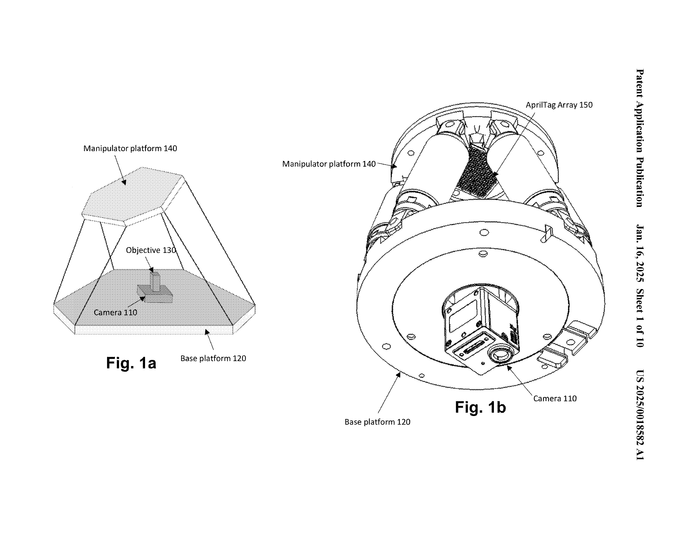
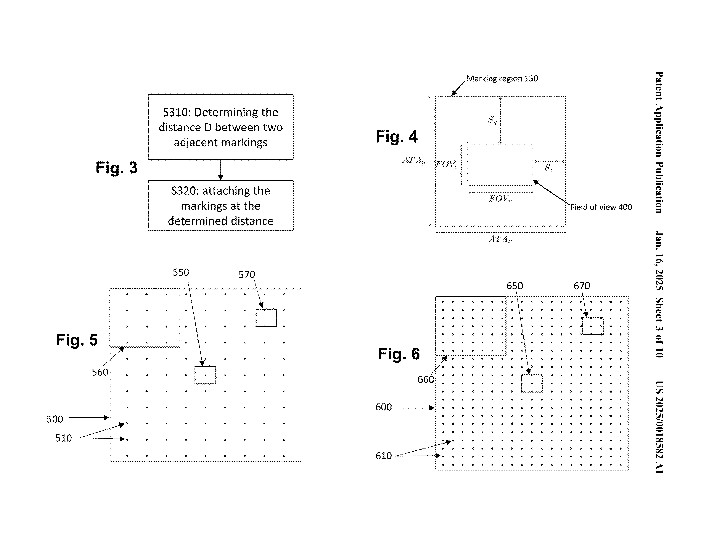
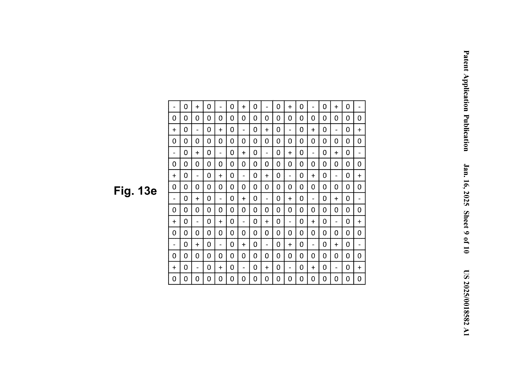

# US20250018582A1 — 기준 마커를 이용한 병렬 키네마틱 시스템의 자세 결정 (Physik Instrumente)

| 항목 | 내용 |
|---|---|
| 원문 | `US20250018582.pdf`(공개, 2025-01-16) · 등록본 없음(이 PDF와 Google Patents 접근 제한으로 등록 여부 미확인) |
| 출원인 | Physik Instrumente (PI) GmbH & Co. KG (독일 Karlsruhe). 발명자 Stefan Schulz, Constantin Schempp |
| 우선일 | 2021-11-26 (DE 10 2021 213 358.4) · PCT 출원 2022-11-22 (PCT/EP2022/082765) · 미국 371(c) 2024-05-20 |
| 분류 | CPC B25J 13/088, G06K 7/10722, G06K 7/1417, B25J 9/0069 |
| 청구항 | 20항 중 1~10항 삭제, 유효 11~20항(독립 11·18·19·20) |
| 핵심 | 서로 구별 가능한 2D 마커(AprilTag·ArUco·QR) 배열을 헥사포드 플랫폼 아랫면에 붙이고, 베이스의 카메라 한 대로 시야 안 마커 하나(또는 n개)에서 6자유도 자세를 절대값으로 구한다. 마커 크기 t_m과 간격 D를 시야·거리·화소 크기로 정하는 식을 청구한다. |
| 관련도 | ◎ 2D 코드 마커로 정밀 스테이지의 위치·자세를 직접 측정 |
| 해결 P# | P3(마커 크기·화소 수·점 선택 설계), P6(작업 영역 전체에서 마커 n개가 항상 완전히 보이게 하는 조건, 신뢰성용 n 증가), P1(마커마다 고유 ID로 대응 모호성 제거), P4(초점 심도 부족을 높이가 다른 평면의 마커로 해결) |
| 본 과제와의 관계 | 판에 QR 3개를 붙여 한 카메라로 판의 움직임을 재는 본 과제와 구성이 같다. 마커 한 개가 보이기만 하면 자세를 낸다는 점, 마커 정보 단위(모듈)당 최소 화소 수 p(2~5)를 설계 조건으로 둔다는 점이 본 과제의 모듈 피치 검증(P1-1)·마커 설계 근거가 된다. 부화소 정밀화는 AprilTag 표준 9단계(에지 법선 최대 기울기 → 직선 교점 코너 → 호모그래피 → 반복 자세 추정)로만 설명하며 편향 보정은 없다. |
| 링크 | [Google Patents](https://patents.google.com/patent/US20250018582A1/en) |

---

## 상세 요약 (번역본 기준)

### 1. 해결하려는 문제
- 병렬 키네마틱(헥사포드 등)은 다리 길이·관절 각도로 플랫폼 자세를 직접 계산할 수 없어 반복 수치해법이 필요하다. 계산이 무겁고 초기값에 정확도가 좌우된다.
- 내부 센서로는 다리·관절·플랫폼의 오프셋, 변형, 유격, 백래시를 검출할 수 없다. 증분형 센서는 영점용 기준 주행이 필요하다.
- 외부 광학 센서는 자유도마다 센서가 필요하고 측정 범위가 좁다. 사진측량은 넓은 영역을 찍어야 해 정확도가 낮다.
- 종래 기준 태그 방식(Moldagalieva 2019)은 작업 공간 전체를 한 시야에 담으려 카메라를 멀리 두어야 하고, 거리가 멀수록 정확도가 떨어진다.

### 2. 핵심 구성
| 구성 | 부호 | 위치·역할 |
|---|---|---|
| 카메라 | 110 | 베이스 플랫폼(120)에 설치, 홈 위치에서 플랫폼에 수직. 대물렌즈(130)·중간 링 포함 |
| 마킹 영역(ATA) | 150 / 500·600 / 1300 | 매니퓰레이터 플랫폼(140) 아랫면, 서로 구별 가능한 마커 배열(2D 격자 또는 동심원) |
| 마킹 | 510·610·1350 | AprilTag(예시), ArUco, ARToolKit, QR. 정사각형 정보 단위 t_b개 × t_b개, 단위당 1비트 |
| 시야 | 400, 550~670, 950, 1050, 1400 | 최소 거리 g_min·최대 거리 g_max에서의 FOV |
| 3D-ATA | 1300, 1430~1470 | 높이가 다른 평면(+, 0, −)에 마커를 나눠 붙여 피사계 심도를 넓힘 |

- 설계식(청구항 11·12·15·19)
  - 시야: FOV_min = (g_min/f − 1)·l_Sensor, FOV_max = (g_max/f − 1)·L_Sensor
  - 마커 크기: t_m ≥ px·p·t_b·(g_max/f − 1) — p는 정보 단위당 최소 샘플 수(나이퀴스트, 흑백 2, RGB 3~4, 바람직 5)
  - 간격(평면 1개): (FOV_min − (n+2)·t_m)/(n+1) < D ≤ (FOV_min − (n+1)·t_m)/n — 한 방향으로 n개 마커가 항상 완전히 보임
  - 간격(여러 평면): D ≤ (FOV_min − (n+1)·t_m)/n, n ≥ 2
  - 마킹 영역 크기: ATA_x = FOV_x,max + 2·S_x
  - 회전 고려: D ≤ min{D_x^max/√2, D_y^max/√2}
  - 화소 1개 여유: D_x^max에 px·(g_min/f − 1) 추가. 마커 일부 R만 보여도 되면 + 2t_m(1 − R)

### 3. 동작 순서
1. S310: 원하는 최소 가시 마커 수 n, 카메라(f, px, 센서 크기), 작업 범위(S_x, S_y, S_z)로 t_m과 D를 계산한다(도 3).
2. S320: 결정한 간격 D로 마커를 부착한다. 필요하면 서로 다른 평면에 주기 패턴(도 13e: 4개 주기, 0·+·− 세 평면)으로 붙인다.
3. 운전 중 카메라가 현재 보이는 마킹 영역 구간을 촬영한다.
4. AprilTag 9단계 검출: Decimate(N배 축소) → BlurSharpen(가우스) → Threshold(4×4 타일 최소·최대, 대비 부족 판정) → 연결 성분 → Gradient Cluster(경계 부화소) → Quad(직선 맞춤 오차 최대점 = 코너, 직선 교점) → Refinement(원본에서 에지 법선 최대 기울기, 지지점 = 에지 길이의 1/8) → Decode(호모그래피, 가장자리 흑백으로 임계값 모델, 유효 ID와 방향) → Pose Estimation(카메라 파라미터, 반복법으로 R·t).
5. 마커 ID로 배열 위 알려진 위치를 찾아, 카메라 대비 마커 자세로부터 플랫폼의 절대 자세를 구한다(마커 1개로 충분, n개도 가능).
- 수치 예: g_fp 20 mm, S_z 6.5 mm → g 13.5~26.5 mm. f 8 mm, px 3.45 μm, 센서 8.446×7.066 mm → FOV_min 5.81×4.86 mm, FOV_max 19.53×16.34 mm. ATA 53.53×48.34 mm. t_m ≥ 0.32 mm(p=5, t_b=8). n=1이면 D_x 5.17 mm, D_y 4.22 mm, 회전 고려 D 2.984 mm. n=3이면 D_x 1.51 mm, D_y 1.194 mm.

### 4. 청구항 요지
- 청구항 11(독립, 배열체): 카메라 + 구별 가능 마커의 마킹 영역. 영상 하나가 한 방향으로 마커 n개(n≥1)를 포함하면 영상만으로 자세 결정. 인접 마커 간격 D가 (FOV_min − (n+2)t_m)/(n+1) < D ≤ (FOV_min − (n+1)t_m)/n.
- 12: FOV_min = (g_min/f − 1)·l_Sensor. 13: 규칙 배열 패턴. 14: 마킹 영역은 작업 플랫폼 아랫면·카메라는 베이스(또는 반대). 15: t_m ≥ px·p·t_b·(g_max/f − 1), 2 ≤ p ≤ 5. 16: ARToolKit·ArUco·QR·AprilTag. 17: 정사각형 정보 단위당 1비트.
- 청구항 18(독립, 방법): 청구항 11 배열체에 n≥2로 간격 D를 정해 부착.
- 청구항 19(독립, 배열체): D ≤ (FOV_min − (n+1)t_m)/n, 마커를 서로 다른 평면에 배치, n≥2.
- 청구항 20(독립, 방법): 청구항 19 배열체의 부착 방법, 서로 다른 평면.

### 5. 대표 도면

*도 1a, 도 1b — 베이스 플랫폼(120)의 카메라(110)가 매니퓰레이터 플랫폼(140) 아랫면의 AprilTag 배열(150)을 관찰*

*도 3 — 부착 흐름(S310·S320), 도 4~6 — 자세 변화에 따른 시야와 완전히 보이는 마커 수*

*도 13e — 세 평면(0·+·−)에 마커를 할당하는 주기 패턴*

### 6. 본 과제(Y·Θ 얼라인먼트)와 비교
- 같은 점
  - 카메라 한 대로 판(플랫폼)에 붙은 2D 코드 마커를 찍어 스테이지 자세를 절대값으로 구한다(청구항 16에 QR 명시).
  - 마커마다 고유 ID가 있어 배열 위 위치가 정해진다 → 반복 무늬 대응 모호성(P1)을 마커 단위에서 없애는 원리는 논문 결과서 05번(PuzzleBoard)·본 과제의 디코딩 기반 536점과 같다.
- 다른 점
  - 마커 수십 개의 배열을 두고 "시야 안에 n개가 항상 완전히 보이게" 설계한다. 본 과제는 QR 3개 고정이라 배열 설계 대신 "3개가 항상 시야 안"이라는 조건을 확인하는 쪽이다.
  - 자세 계산은 마커별 호모그래피 + 반복 자세 추정(AprilTag 표준)이다. 본 과제처럼 점별 변위장(536점)을 2차 계수로 요약해 미세 변형을 읽는 방식은 아니다.
  - 정밀도 수치(μm, px 단위 오차)는 제시하지 않는다. 부화소 편향(P2) 보정 내용은 없다.
- 본 과제에서 할 일(논문 결과서 4장 연결)
  - P1-1 보강: 특허의 t_m ≥ px·p·t_b·(g_max/f − 1)을 화면 기준으로 바꾸면 "모듈당 화소 수 ≥ p(2~5)"이다. 341장에서 QR 모듈 피치(px)를 재어 최악 자세에서도 p ≥ 5(바람직 값)를 만족하는지 표로 남긴다.
  - P6-1 보강: 특허는 신뢰성을 위해 n을 이론 최소보다 크게 잡을 수 있다고 한다([0098]). 본 과제 게이트의 "QR 3개 모두 검출" 조건을 시야 여유로 확인한다. T=2(약 160 px 이동)에서도 각 QR이 시야 가장자리에서 1모듈 이상 떨어져 있는지 측정한다.
  - P4 참고: 초점 심도가 부족하면 높이가 다른 평면에 마커를 나누는 3D-ATA를 쓴다([0125]~[0132]). 본 과제는 판이 고정이라 적용 대상은 아니며, 대신 P4-1 블러 내성 곡선으로 초점 여유를 확인한다.
  - P3 참고: 특허의 Refinement 단계(에지 법선 최대 기울기 → 직선 교점 코너)는 코너 기반 정밀화로, 논문 결과서 03·08번의 블러 취약성 논의와 함께 본 과제가 템플릿 GN을 유지하는 근거 비교 대상이 된다.
