# 위치 검출 방법 (US7352891B2)
- 원제: Position detecting method
- 원문: 같은 폴더의 PDF, https://patents.google.com/patent/US7352891B2/en
- 번역 기준: USPTO 등록 PDF 스캔 본문을 직접 읽어 옮김 (Google Patents 접근 제한). 원문 오기는 고치지 않고 그대로 옮기고, 필요한 곳에 원어를 괄호로 병기함.
- 도면: 원문 PDF 도면 시트 27장(도 1~29)을 도면/ 폴더에 넣고 본문에서 처음 설명되는 곳에 삽입함

## 요약

복수의 마크 요소를 포함하는 얼라인 마크가 형성된 물체의 위치를 검출하는 위치 검출 방법이 제공된다. 이 방법은 복수 마크 요소 각각의 위치를 나타내는 위치 정보를 얻는 단계, 얻는 단계에서 얻은 복수의 위치 정보 중에서 소정의 정밀도를 갖는 위치 정보를 선택하는 단계, 및 선택하는 단계에서 선택된 소정의 정밀도를 갖는 위치 정보를 사용하여 물체의 위치를 계산하는 단계를 포함한다.

## 청구범위

청구하는 것은 다음과 같다.

1. 복수의 마크 요소를 포함하는 얼라인 마크가 형성된 물체의 위치를 검출하는 위치 검출 방법으로서,

상기 복수의 마크 요소의 위치를 검출하고 상기 복수의 마크 요소 사이의 소정 마크 요소 간격을 얻는 단계;

상기 얻는 단계에서 얻은 상기 소정 마크 요소 간격과, 상기 소정 마크 요소 간격에 대응하는 상기 얼라인 마크의 설계값으로 계산되는 상기 소정 마크 요소의 간격 기준값 사이의 오프셋을 계산하는 단계;

상기 오프셋에 기초하여 상기 마크 요소의 이상을 판정하는 단계;

상기 판정하는 단계에서 이상으로 판정된 마크 요소의 위치를, 정상으로 판정된 마크 요소의 위치로부터 생성하는 단계; 및

상기 판정하는 단계에서 정상으로 판정된 마크 요소의 위치와 상기 생성하는 단계에서 생성된 마크 요소의 위치를 사용하여 상기 얼라인 마크의 위치를 계산하는 단계를 포함하는, 위치 검출 방법.

2. 제1항에 있어서, 상기 판정하는 단계는 상기 얼라인 마크 내 인접한 3개 마크 요소의 마크 간격의 조합에 기초하여 상기 3개 마크 요소의 이상을 판정하는, 위치 검출 방법.

3. 제1항에 있어서, 상기 판정하는 단계에서 이상으로 판정된 마크 요소의 위치를 반복하여 검출하는 단계를 더 포함하는, 위치 검출 방법.

4. 제1항에 있어서, 상기 판정하는 단계는,

상기 오프셋의 평균 제곱 오차를 계산하는 단계; 및

상기 계산하는 단계에서 계산된 평균 제곱 오차에 기초하여 상기 복수의 마크 요소 각각이 정상인지 이상인지 판정하는 단계를 포함하는, 위치 검출 방법.

5. 복수의 마크 요소를 포함하는 얼라인 마크가 형성된 물체를 검출하는 위치 검출 장치로서,

상기 마크 요소의 위치를 검출하는 검출기; 및

제1항에 따른 위치 검출 방법을 제공하는 처리기를 포함하는, 위치 검출 장치.

6. 투영 광학계를 통해 소정 패턴을 노광하는 노광 장치로서,

제5항에 따른 위치 검출 장치; 및

상기 위치 검출기에 의한 검출 결과를 사용하여 검출될(to detected) 물체를 얼라인먼트하는 얼라인먼트 유닛을 포함하는, 노광 장치.

7. 제6항에 있어서, 상기 물체는 상기 소정 패턴이 노광되는 웨이퍼인, 노광 장치.

8. 제6항에 있어서, 상기 물체는 상기 소정 패턴이 형성된 레티클인, 노광 장치.

9. 디바이스 제조 방법으로서,

제6항에 따른 노광 장치를 사용하여 물체를 노광하는 단계; 및 노광된 상기 물체를 현상하는 단계를 포함하는, 디바이스 제조 방법.

10. 노광 방법으로서,

제1항에 따른 위치 검출 방법을 사용하여 물체 상의 소정 영역을 얼라인먼트하는 단계; 및

상기 얼라인먼트하는 단계에서 얼라인먼트된 상기 물체 상의 상기 소정 영역을 노광하는 단계를 포함하는, 노광 방법.

## 상세한 설명

### 위치 검출 방법 (POSITION DETECTING METHOD)

본 출원은 2003년 6월 19일에 출원된 일본 특허출원 제2003-174263호에 기초한 외국 우선권의 이익을 주장하며, 그 전체 내용은 본 명세서에 완전히 기재된 것처럼 참조로 포함된다.

### 발명의 배경 (BACKGROUND OF THE INVENTION)

본 발명은 위치 검출 방법에 관한 것으로, 보다 구체적으로는 IC, LSI 등의 반도체 칩, 액정 디스플레이, CCD, 자기 헤드를 포함하는 각종 디바이스의 제조에 쓰이는 노광 장치에서 웨이퍼와 같은 물체의 위치를 검출하는 위치 검출 방법에 관한 것이다. 본 발명은 예를 들어 레티클과 웨이퍼 사이의 얼라인먼트에 적합하다.

최근 전자 기기의 소형화·박형화 요구에 따라, 그 안에 실장되는 반도체 디바이스의 미세 가공이 점점 더 요구되고 있다. 포토리소그래피로 반도체 디바이스를 제조하기 위해, 종래에는 투영 광학계를 사용하여 마스크(또는 레티클) 상의 회로 패턴을 웨이퍼 등에 투영하여 회로 패턴을 전사하는 축소 투영 노광 장치가 사용되어 왔다.

투영 노광 장치가 전사할 수 있는 최소 임계 치수("CD") 또는 해상도는 노광에 쓰이는 빛의 파장에 비례하고 투영 광학계의 개구수("NA")에 반비례한다. 파장이 짧을수록 해상도가 좋아진다. 더 미세한 반도체 디바이스에 대한 최근의 요구에 따라, 자외광의 단파장화가 초고압 수은 램프(파장 약 365 nm의 i선 등)에서 KrF 엑시머 레이저(파장 약 248 nm), ArF 엑시머 레이저(파장 약 193 nm), F₂ 레이저(파장 약 157 nm), 싱크로트론 방사("SR") 광으로 진행되어 왔다.

투영 노광 장치는 더 미세한 회로 패턴 또는 더 높은 해상도에서 레티클과 웨이퍼 사이의 고정밀 얼라인먼트를 수행해야 한다. 얼라인먼트에 필요한 전형적인 정밀도는 회로 패턴의 약 1/3이다. 예를 들어 1-Gbit DRAM 회로 패턴의 설계 룰 0.18 μm에는 60 nm 이하의 중첩(overlay) 정밀도가 요구된다. 중첩이란 노광 영역 전체의 얼라인먼트를 의미한다.

웨이퍼 상의 높은 중첩 정밀도는, 반도체 디바이스의 성능과 제조 수율 또는 처리량을 향상시키기 위해 현재 반도체 산업에서 노광 장치의 핵심 과제이다. 이에 따라 얼라인먼트 광학계를 사용하여 웨이퍼 등에 형성된 얼라인 마크의 위치를 광학적으로 검출하고, 그 검출 결과에 기초하여 웨이퍼를 레티클에 맞춘다. 보다 구체적으로, 얼라인 마크의 위치는 얼라인 마크로부터 얻은 얼라인먼트 신호를 처리하여 검출된다. 신호 처리에 대해 다양한 제안이 있었으며, 예를 들어 얼라인먼트 신호의 대칭성을 이용하는 접힘 대칭 처리(folded symmetrical processing)가 있다(예를 들어 일본 특허출원 공개 제8-094315호 참조).

어떤 얼라인먼트는 모든 노광 위치 또는 샷의 위치를 반복적으로 검출하지만(이를 "다이 바이 다이 방식(die-by-die system)"이라 함), 보통은 처리량이 좋은 글로벌 얼라인먼트가 사용된다. 글로벌 얼라인먼트는 웨이퍼 상의 여러 샘플 샷의 위치 좌표를 측정하고, 측정값을 통계 처리하여 웨이퍼의 시프트, 배율 및 회전 오차를 계산한다. 이 오차들에 기초하여 웨이퍼 좌표계를 보정한 뒤, 각 샷으로의 스텝 이동이 이어진다. 더 최근에는 글로벌 얼라인먼트를 발전시켜, 레이저 간섭계를 갖춘 XY 스테이지의 정확도에 의존하여 웨이퍼의 위치를 측정하는 어드밴스드 글로벌 얼라인먼트("AGA")가 사용된다. AGA는 웨이퍼의 배율, 회전 및 시프트 양을 계산하고, 이상값 제거와 같은 통계 처리를 적용한다. 이상값 제거는 샷들의 측정값으로부터 평균과 표준편차를 계산하고, 크게 벗어난 샷의 측정값을 제거한다.

그러나 화학적 기계적 연마("CMP") 공정과 같은 특수한 반도체 제조 기술의 도입은 얼라인 마크 형상이 웨이퍼 간 및 샷 간에 흩어지게 하여, 불리하게도 얼라인먼트 정확도를 떨어뜨린다. 이는 도포, 식각 및 CMP를 포함하는 공정 조건이 CD가 0.1 μm 내지 0.15 μm인 미세 회로 패턴에 최적화되어 있고, 예를 들어 CD가 0.6 μm 내지 4.0 μm로 큰 얼라인 마크에는 최적화되어 있지 않기 때문이다. 회로 패턴의 미세 가공에 따라 회로 패턴의 CD와 얼라인 마크의 CD 사이의 차이가 커진다.

얼라인 마크의 CD를 회로 패턴의 CD에 맞추는 것도 생각할 수 있으나, 얼라인먼트 광학계의 해상도 부족이 신호 강도 또는 콘트라스트를 낮추고 얼라인먼트 신호의 안정성을 떨어뜨린다. 또한 회로 패턴과 같은 CD를 갖는 얼라인 마크를 검출하기 위한 얼라인먼트 광학계는 높은 NA와 단파장 얼라인먼트 광원을 필요로 하여 장치 비용을 증가시킨다.

더욱이 웨이퍼 기인 시프트("WIS")는 검출 결과에 큰 오차를 일으키거나 얼라인먼트 신호를 비대칭으로 만들어 얼라인먼트 정확도를 떨어뜨린다. 그 주요 요인은 비대칭인 얼라인 마크 및/또는 레지스트이다. 노광 장치 또는 얼라인먼트 광학계에서 비롯되는 장치 기인 시프트("TIS")와 WIS 사이의 상호작용, 즉 TIS-WIS 상호작용도 얼라인먼트 정확도를 떨어뜨린다.

AGA는 이러한 오차를 포함하는 측정값에 이상값 제거를 적용하고, 이상 샷이 많을 때는 대체 샷을 측정한다. 그러나 대체 샷의 측정에도 WIS로 인한 오차가 포함되며, 그 측정 오차량이 작더라도 문제가 완전히 해결되지 않을 수 있다.

중첩 결과는 노광 후에 확인되고, 중첩 오차는 오프셋 보정으로 제거된다. 그러나 오프셋 보정은 처리량을 낮추므로 실제로는 로트마다 또는 공정마다 수행된다. 따라서 문제는 여전히 남는다. 중첩 결과에 기초하여 오차를 일으키는 샷을 식별할 수는 있으나 시간이 오래 걸린다.

### 발명의 간단한 요약 (BRIEF SUMMARY OF THE INVENTION)

따라서 본 발명의 예시적 목적은, 얼라인 마크의 검출 결과가 흩어지는 경우에도 필요한 얼라인먼트 정확도와 처리량을 양립시키는 위치 검출 방법을 제공하는 것이다.

본 발명의 일 양태에 따른, 복수의 마크 요소를 포함하는 얼라인 마크가 형성된 물체의 위치를 검출하는 위치 검출 방법은, 복수의 마크 요소 각각의 위치를 나타내는 위치 정보를 얻는 단계, 얻는 단계에서 얻은 복수의 위치 정보 중에서 소정의 정밀도를 갖는 위치 정보를 선택하는 단계, 및 선택하는 단계에서 선택된 소정의 정밀도를 갖는 위치 정보를 사용하여 물체의 위치를 계산하는 단계를 포함한다.

본 발명의 다른 목적과 추가 특징은 첨부 도면을 참조한 실시예에 대한 다음 설명으로부터 쉽게 명백해질 것이다.

### 도면의 간단한 설명 (BRIEF DESCRIPTION OF THE DRAWINGS)

도 1은 본 발명의 일 양태에 따른 위치 검출 방법을 설명하기 위한 흐름도이다.

도 2는 3개의 마크 요소를 갖는 얼라인 마크를 나타내는 개략 평면도이다.

도 3은 얼라인 마크 내 3개 마크 요소의 이상 판별 결과를 나타내는 도면이다.

도 4는 8개의 마크 요소를 갖는 얼라인 마크를 나타내는 개략 평면도이다.

도 5는 얼라인 마크의 8개 마크 요소 중 인접한 3개 마크 요소의 이상 판별 결과를 나타내는 개략도이다.

도 6은 도 5에 나타낸 결과를 플롯한 그래프로, 가로축은 웨이퍼 번호, 세로축은 마크 간격 측정값과 설계 기준값 사이의 오프셋 양 또는 잔차를 나타낸다.

도 7은 얼라인 마크의 8개 마크 요소 중 인접한 3개 마크 요소의 이상 판별 결과를 나타내는 도면이다.

도 8은 도 7에 나타낸 결과를 플롯한 그래프로, 가로축은 웨이퍼 번호, 세로축은 마크 간격 측정값과 설계 기준값 사이의 오프셋 양 또는 잔차를 나타낸다.

도 9는 도 4에 나타낸 얼라인 마크에서 마크 간격 측정값과 설계 기준값 사이의 잔차 값을 나타내는 도면이다.

도 10은 도 9에 나타낸 마크 간격 측정값과 설계 기준값 사이의 잔차에 수학식 7을 적용한 결과를 나타내는 도면이다.

도 11은 도 10에 나타낸 결과를 플롯한 그래프로, 가로축은 웨이퍼 번호, 세로축은 마크 간격 측정값과 설계 기준값 사이의 오프셋 양 또는 잔차를 나타낸다.

도 12는 도 9에 나타낸 마크 간격 측정값과 설계 기준값 사이의 잔차 값에 수학식 10 또는 11을 적용한 결과를 나타내는 도면이다.

도 13은 도 12에 나타낸 결과를 플롯한 그래프로, 가로축은 웨이퍼 번호, 세로축은 마크 간격 측정값과 설계 기준값 사이의 오프셋 양 또는 잔차를 나타낸다.

도 14는 얼라인먼트 측정 대상 샷의 배치를 나타내는 개략 평면도이다.

도 15는 마크 간격 측정값과 설계 기준값 사이의 잔차 및 평균 제곱 오차 값을 나타내는 도면이다.

도 16은 도 15에 나타낸 결과를 플롯한 그래프로, 가로축은 웨이퍼 번호, 세로축은 마크 간격 측정값과 설계 기준값 사이의 오프셋 양 또는 잔차, 및 평균 제곱 오차를 나타낸다.

도 17은 본 발명에 따른 일 실시예의 노광 장치의 개략도이다.

도 18은 도 17에 나타낸 얼라인먼트 광학계의 주요 요소에 대한 개략 광로를 나타낸다.

도 19a 및 19b는 도 17에 나타낸 얼라인 마크의 개략 평면·단면도이다.

도 20a 및 20b는 도 17에 나타낸 얼라인 마크의 개략 평면·단면도이다.

도 21은 도 19a, 19b, 20a 및 20b에 나타낸 얼라인 마크를 광학적으로 검출했을 때의 전형적인 검출 결과를 나타내는 그래프이다.

도 22는 도 17에 나타낸 얼라인먼트 신호 처리기의 주요 기능 모듈을 나타내는 개략 블록도이다.

도 23은 도 22에 나타낸 검출 결과에 적용할 수 있는 패턴 또는 템플릿 매칭을 나타낸다.

도 24는 마크 요소의 측정 위치가 WIS의 영향으로 시프트되는 일례를 나타내는 개략도이다.

도 25는 4개의 마크 요소 중 왼쪽에서 세 번째 마크 요소의 오른쪽 에지에 입자(grain)가 부착된 얼라인 마크의 개략 평면도이다.

도 26은 도 25에 나타낸 얼라인 마크로부터 검출된 얼라인먼트 신호가 부분적으로 왜곡된 파형을 갖는 일례를 나타내는 그래프이다.

도 27은 얼라인먼트 신호의 왜곡 파형으로 인해 마크 요소 일부의 파형이 다른 마크 요소의 파형과 다르다는 것을 나타내는 도면이다.

도 28은 디바이스(IC, LSI 등의 반도체 칩, LCD, CCD 등)를 제조하는 방법을 설명하기 위한 흐름도이다.

도 29는 도 28에 나타낸 웨이퍼 공정의 단계 4에 대한 상세 흐름도이다.

### 바람직한 실시예의 상세한 설명 (DETAILED DESCRIPTION OF THE PREFERRED EMBODIMENTS)

이하, 첨부 도면을 참조하여 발명의 위치 검출 방법을 설명한다. 각 도면에서 같은 요소는 같은 참조 부호로 표시하고, 그 설명은 생략한다.

도 17은 본 발명의 일 양태에 따른 노광 장치(100)의 개략도이다. 노광 장치(100)는 레티클 상의 회로 패턴을 예를 들어 스텝 앤 리피트 또는 스텝 앤 스캔 방식으로 웨이퍼에 노광하는 투영 노광 장치이다. 이러한 노광 장치는 서브미크론 또는 쿼터미크론 리소그래피 공정에 적합하며, 본 실시예는 스텝 앤 스캔 노광 장치("스캐너"라고도 함)를 예시적으로 설명한다. 여기서 "스텝 앤 스캔 방식"이란 마스크에 대해 웨이퍼를 연속 주사하여 마스크 패턴을 웨이퍼에 노광하고, 한 샷의 노광 후 다음 노광 영역으로 웨이퍼를 스텝 이동시키는 노광 방법이다. "스텝 앤 리피트 방식"은 웨이퍼 상에 셀을 투영하는 샷마다 다음 샷의 노광 영역으로 웨이퍼를 스텝 이동시키는 또 다른 노광 방식이다.

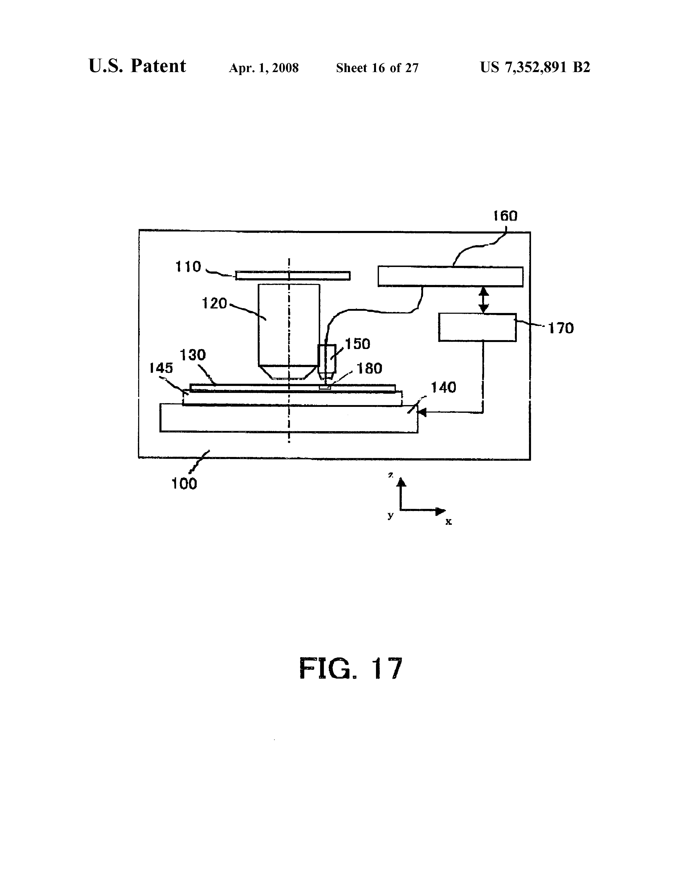
*도 17 — 노광 장치(100)의 개략도*

도 17을 참조하면, 노광 장치(100)는 원하는 패턴(회로 패턴 등)을 갖는 레티클(110)의 축소 상을 투영하는 투영 광학계(120), 전처리 단계에서 하지(primary coat) 패턴과 얼라인 마크(180)가 형성된 웨이퍼(130)를 유지하는 웨이퍼 척(145), 웨이퍼(130)를 소정 위치에 위치시키는 웨이퍼 스테이지(140), 웨이퍼(130) 상의 얼라인 마크(180)의 위치를 측정하는 얼라인먼트 광학계(또는 얼라인먼트 스코프)(150), 얼라인먼트 신호 처리기(160), 및 제어기(170)를 포함한다.

도 17에서는 광원, 및 광원으로부터의 빛으로 레티클(110)을 조명하는 조명 광학계를 생략하였다. 제어기(170)는 CPU와 메모리(도시하지 않음)를 포함하며 노광 장치(100)의 동작을 제어한다. 제어기(170)는 레티클 스테이지(도시하지 않음), 웨이퍼 스테이지(140), 및 얼라인먼트 신호 처리기(160)에 전기적으로 연결된다. 제어기(170)는 얼라인먼트 신호 처리기(160)로부터의 얼라인 마크의 위치 정보에 기초하여 웨이퍼 스테이지(140)를 통해 웨이퍼(130)를 위치시킨다.

이하, 얼라인 마크(180)의 검출 원리를 설명한다. 도 18은 도 17에 나타낸 얼라인먼트 광학계(150)의 주요 요소의 개략 광로를 나타낸다. 도 18을 참조하면, 얼라인먼트 광원(151)으로부터의 조명광은 빔 스플리터(152)에서 반사된 후 렌즈(153)를 통과하여 웨이퍼(130) 상의 얼라인 마크(180)를 조명한다. 얼라인 마크(180)로부터의 (반사 또는 회절된) 빛은 렌즈(153), 빔 스플리터(152), 및 렌즈(154)를 통과하고, 빔 스플리터(155)에서 분할되어 CCD 센서(156, 157)에 수광된다.

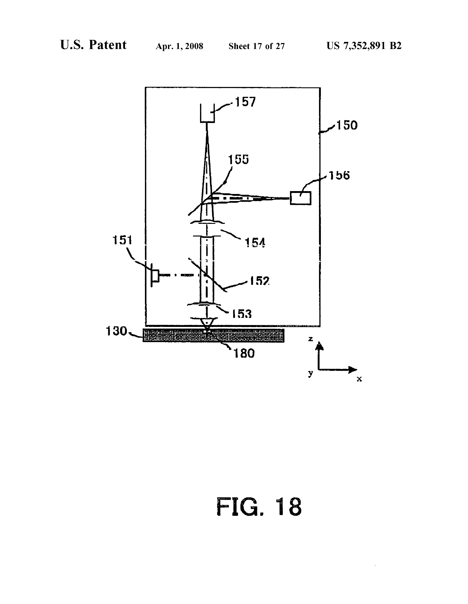
*도 18 — 얼라인먼트 광학계(150)의 개략 광로*

얼라인 마크(180)는 렌즈(153, 154)에 의해 약 100배의 결상 배율로 확대되어 CCD 센서(156, 157)에 결상된다. CCD 센서(156, 157)는 각각 X 방향과 Y 방향의 얼라인 마크(180)의 오프셋을 측정하는 데 쓰이며, 광축에 대해 90°의 회전 각도로 배치된다. CCD 센서로 라인 센서를 사용할 수 있으며, 이 경우 측정 방향에 수직한 방향으로의 집광, 광학적 적분 및 평균화를 위해 측정 방향에 수직한 방향으로 파워를 갖는 원통 렌즈를 사용하는 것이 바람직하다.

얼라인 마크(180)는 샷마다 스크라이브 라인 상에 배치되며, 예를 들어 도 19a, 19b, 20a 및 20b에 나타낸 얼라인 마크(180A, 180B)를 사용할 수 있다. 얼라인 마크(180)는 얼라인 마크(180A, 180B)를 일반화한 것이다. 여기서 도 19a 및 19b는 도 17에 나타낸 얼라인 마크(180A)의 평면·단면도이다. 도 20a 및 20b는 도 17에 나타낸 얼라인 마크(180B)의 평면·단면도이다. 도 19a, 19b, 20a 및 20b에서 얼라인 마크(180A, 180B) 각각은 등간격으로 배치된 4개의 마크 요소(182A, 182B)를 포함한다. 도 19a, 19b, 20a 및 20b에서는 얼라인 마크(180A, 180B)에 실제로 도포되는 레지스트를 생략하였다.

얼라인 마크(180A)는, 도 19a에 나타낸 바와 같이, 측정 방향 X로 4 μm, 비측정 방향 Y로 20 μm의 크기를 갖는 4개의 직사각형 마크 요소(182A)를 X 방향으로 20 μm 피치로 배치한다. 마크 요소(182A)는 도 19b에 나타낸 바와 같이 오목한 단면 형상을 갖는다. 얼라인 마크(180B)는, 도 20a 및 20b에 나타낸 바와 같이, 도 19a 및 19b의 마크 요소(182A)의 윤곽을 선폭(임계 치수) 0.6 μm로 대체한 4개의 마크 요소(182B)를 배치한다.

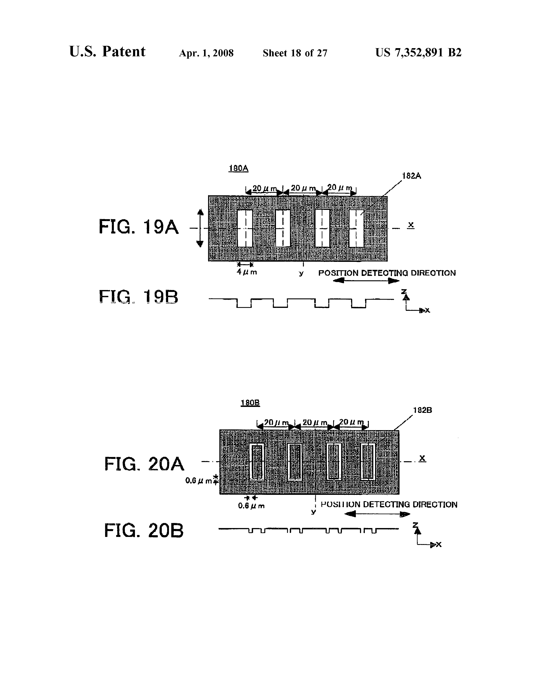
*도 19A·19B — 얼라인 마크(180A)의 평면·단면, 도 20A·20B — 얼라인 마크(180B)의 평면·단면*

도 19a 및 19b 또는 20a 및 20b의 얼라인 마크(180A, 180B) 중 어느 것을 사용하든, 얼라인먼트 광학계(150)의 렌즈(153, 154)의 NA 밖에 있는 렌즈 에지에서 산란 광선이 발생하고 간섭하기 때문에, CCD 센서(156)는 일반적으로 도 21에 나타낸 것과 같은 상을 취한다. 얼라인 마크(180A)는 어두운 윤곽을 가지며, 얼라인 마크(180B)는 명시야에서 특징적으로 자주 관찰되는 것처럼 어둡거나 밝은 오목부를 갖는다. 여기서 도 21은 도 19a, 19b, 20a 및 20b에 나타낸 얼라인 마크(180A, 180B)를 광학적으로 검출했을 때의 전형적인 검출 결과를 나타내는 그래프이다.

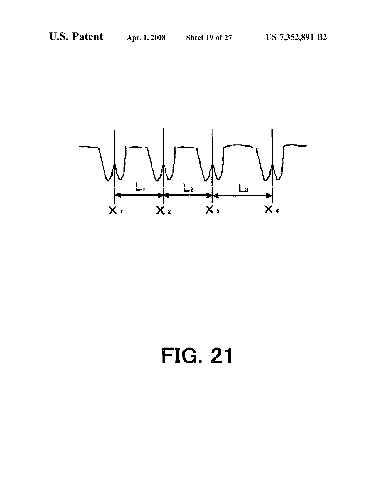
*도 21 — 얼라인 마크의 전형적인 검출 신호 (마크 요소 위치 X1~X4, 간격 L1~L3)*

얼라인먼트 신호 처리기(160)는 이렇게 취한 얼라인 마크(180)의 상에 대해 다음과 같이 신호 처리를 수행한다. 도 22는 도 17에 나타낸 얼라인먼트 신호 처리기(160)의 주요 기능 모듈을 나타내는 개략 블록도이다.

도 22를 참조하면, A/D 변환기(161)는 CCD 센서(156, 157)로부터의 얼라인먼트 신호를 디지털화한다. 저장부(162)의 각종 신호 처리기는 디지털화된 얼라인먼트 신호에서 잡음을 제거하고 그 결과 신호를 메모리에 저장한다. 마크 중심 검출기(163)는 저장된 디지털 얼라인먼트 신호에 대해 디지털 신호 처리를 수행한다. 마크 중심 검출기(163)는 디지털화된 얼라인먼트 신호에 대해 연산 요소로 후술하는 위치 검출 방법(1000)을 실행하여, 얼라인먼트 신호의 중심 위치를 검출한다. CPU(164)는 A/D 변환기(161), 저장부(162), 마크 중심 검출기(163)에 연결되어, 이들의 동작을 제어하기 위한 제어 신호를 출력한다. 통신부(165)는 필요한 데이터, 제어 명령 등의 통신을 위해 도 17에 나타낸 제어기(170)와 통신한다.

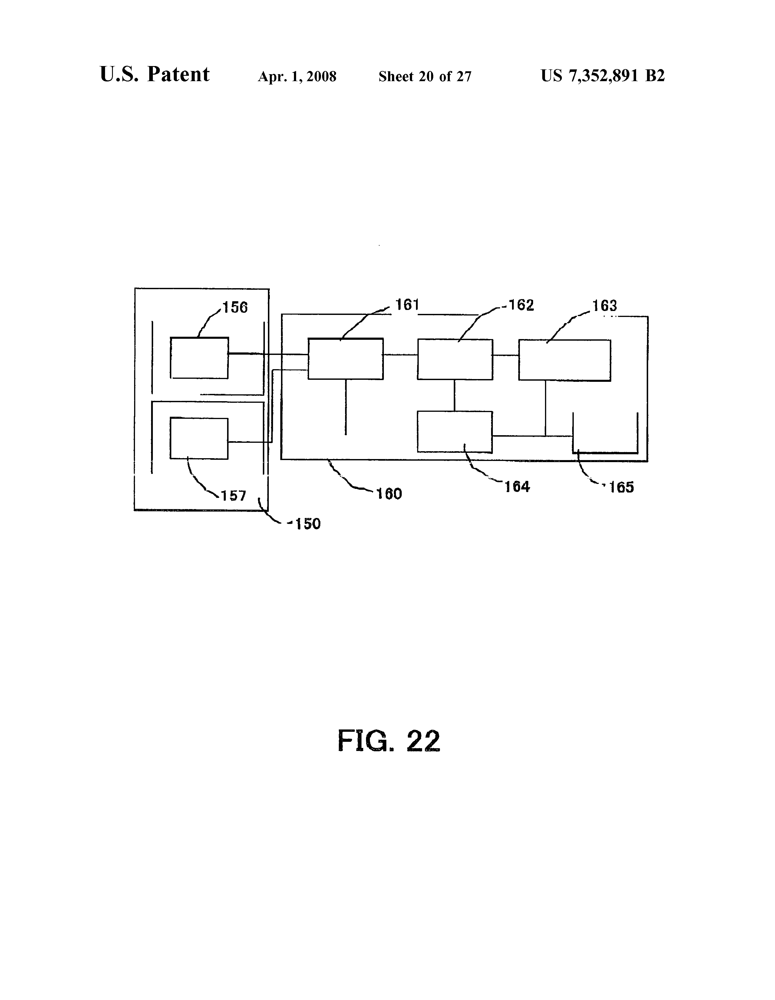
*도 22 — 얼라인먼트 신호 처리기(160)의 기능 블록 (A/D 변환기 161, 저장부 162, 마크 중심 검출기 163, CPU 164, 통신부 165)*

마크 중심 검출기(163)에 의한 디지털 신호 처리에는 다양한 방법이 제안되어 왔으며, 여기에는 얼라인먼트 신호의 에지 부분을 검출하여 에지 사이의 거리를 계산하는 방법, 및 정규화 함수를 사용하는 템플릿 또는 패턴 매칭이 포함된다. 본 발명은 디지털 신호 처리의 일례로서, 얼라인먼트 신호에서 중심 위치를 검출하는 위치 검출 방법(1000)을 제안한다. 신호원은 2차원 또는 1차원 신호일 수 있다. 2차원 상은 그 수평 화소를 수직 방향으로 배열한 뒤 투표 처리(voting-processed)하여 히스토그램을 만들고, 주성분에 대해 평균하여 1차원 상으로 변환한다. 제안된 발명의 디지털 신호 처리는 X 측정과 Y 측정을 독립적으로 수행하며, 위치 결정을 위한 기본 신호 처리는 1차원 신호 처리이다. 예를 들어 CCD 센서(156, 157) 상의 2차원 상을 나타내는 디지털 신호를 적분·평균하여 1차원 라인 신호로 변환한다.

먼저 본 발명자들은 종래의 디지털 신호 처리인 템플릿 매칭을 연구한 결과, 여러 가지 개선이 가능함을 발견하였다. 그 문제점을 설명한다.

템플릿 매칭은 도 23B에 나타낸 획득 신호 S를 장치에 저장된 도 23A의 모델 신호 또는 템플릿 T와 상관시키고, 상관이 가장 높은 위치를 얼라인 마크의 중심으로 검출한다. 도 23C에 나타낸 상관값 함수 E를 사용하여 피크 화소로부터 좌우 수 화소 범위의 영역에서 무게중심 화소 위치를 계산함으로써 1/10 내지 1/50의 분해능을 선택할 수 있다. 여기서 도 23은 도 22에 나타낸 검출 결과에 적용할 수 있는 템플릿 매칭을 나타내는 도면이다.

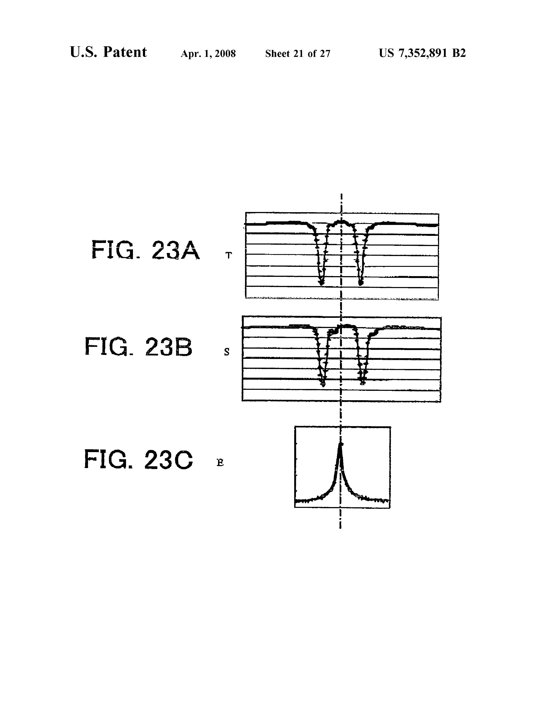
*도 23 — 템플릿 T(23A), 획득 신호 S(23B), 상관값 E(23C)*

템플릿 매칭은 다음 수학식 1을 사용하며, 여기서 S는 CCD 센서로 얻은 신호, T는 모델 신호 또는 템플릿, E는 상관 결과이다.

$$E(X)=\frac{1}{\sum_{J=-k}^{k}[S(X+J)-T(J)]^2} \qquad (1)$$

도 23은 신호 S, 모델 신호 T, 상관값 E 사이의 관계를 나타낸다. 도 7은 4개의 마크 요소(181) 중 하나의 마크 요소 상에 대한 처리를 나타낸다. 여기서 상관값을 최대로 하는 X는 마크 상의 위치로 간주된다. 제안된 또 다른 방법은 모델 신호 T에 대한 상관 연산을 수행하고 파형 대칭성을 이용해 신호 S의 왼쪽 절반을 되접음(returning)으로써 얼라인 마크의 위치를 결정한다. 또는 상관값 E의 정밀도를 높이기 위해, 스플라인 함수, 가우스 함수 등을 사용한 보간으로 X 방향의 좌표 위치를 계산하고, 그 좌표 위치를 마크 요소(181)의 중심 위치로 설정할 수도 있다.

이하 마찬가지로 적용하여, 템플릿 매칭은 나머지 세 마크 요소에 대해서도 CCD 센서 상의 상 위치를 검출한다.

도 21은 디지털화된 얼라인먼트 신호를 마크 측정 위치 방향으로 적분·평균하여 얻은 얼라인먼트 신호이다. 1차원 라인 센서와 광학적 집광을 사용하면 화상 처리 후 2차원 상에서 1차원 상으로의 변환이 필요 없어진다.

템플릿 매칭은 마크 요소 상 위치 X₁, X₂, X₃ 및 X₄(단위는 화소)를 계산한다. 다음 수학식 2로 표현되는 얼라인 마크(180) 전체의 중심 좌표 Xa는 4개 마크 요소 상의 중심 위치 X₁ 내지 X₄를 평균하여 계산된다.

$$Xa=\frac{X_1+X_2+X_3+X_4}{4} \qquad (2)$$

그 결과, 다음 수학식 3은 웨이퍼(130) 상의 얼라인 마크(180)의 위치 오프셋을 계산하며, 여기서 M은 얼라인먼트 광학계(150)의 결상 배율, Px는 얼라인먼트 측정 방향에서 CCD 센서(156)의 화소 피치이다.

$$Xw=\frac{Xa}{Px\cdot M} \qquad (3)$$

예를 들어 얼라인먼트 광학계(150)의 결상 배율 M이 100이고 화소 피치 Px가 24 μm일 때, CCD 센서(156) 상의 1 화소의 위치 오프셋은 웨이퍼(130) 상의 얼라인 마크(180)의 위치 오프셋 Xw로 24 μm/100=240 nm에 해당한다.

템플릿 매칭으로 대표되는 종래의 신호 처리는 WIS의 영향에 따른 정확도 저하를 고려하며(does consider), WIS의 영향을 간과한다. 종래의 신호 처리는 마크 요소마다 상을 측정하고, 마크 요소 수에 해당하는 측정 결과를 평균하여, 마크 요소의 부분적 결함으로 인한 측정 정확도의 저하를 줄인다(평균화 효과). 그러나 본 발명자들은 종래의 평균화가 반도체 디바이스의 미세 가공에 따른 고정밀 얼라인먼트에 대한 최근의 요구를 만족시킬 수 없음을 발견하였다.

따라서 본 발명자들은 종래의 평균화 효과 대신, 소정의 정확도를 갖는 정보만을 사용함으로써 잘못된 정보를 제거하고 측정 정확도의 저하를 방지하는 위치 검출 방법(1000)을 제안한다. 본 발명의 위치 검출 방법(1000)은 얼라인 마크의 복수 마크 요소 중 중심 위치가 현저하게 오프셋된 마크 요소로부터 정보가 나오는 경우에 적합하다. 위치 검출 방법(1000)은 WIS, 보다 구체적으로는 얼라인 마크의 비대칭 형상으로 인한 얼라인먼트 오차를 발생시키지 않는 신호 처리이다.

종래의 템플릿 매칭을 사용한 신호 처리에서는, 도 24에 나타낸 바와 같이 WIS가 마크 요소의 중심 위치의 검출 좌표를 시프트시킬 수 있다. 도 24를 참조하면, 하지 위에 비대칭으로 식각되었거나 패턴 중심에서 벗어난 레지스트가 오른쪽으로 시프트되어 있다. 여기서 도 24는 WIS(얼라인먼트 비대칭)의 영향으로 마크 요소의 측정 위치가 시프트되는 일례를 나타내는 개략도이다.

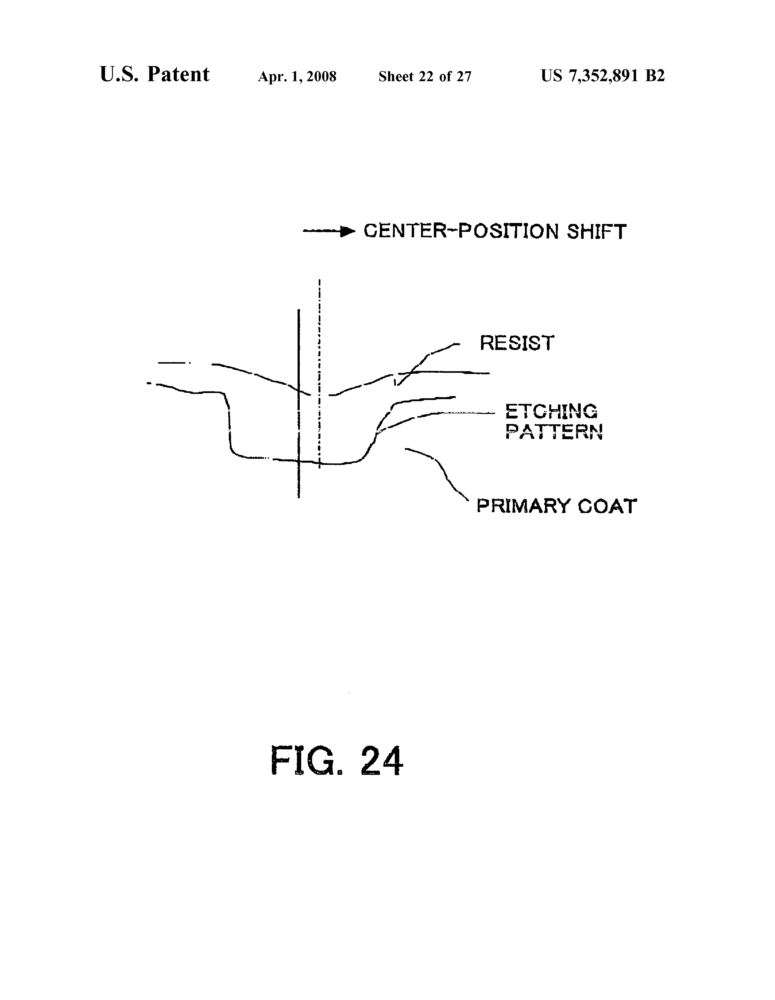
*도 24 — WIS(레지스트 비대칭)로 마크 요소의 측정 중심이 시프트되는 예*

검출된 얼라인먼트 신호를 마크 요소 4개마다 비교하는 경우, 예를 들어 4개 마크 요소 중 하나만이 WIS의 영향으로 왜곡된 파형을 갖는다. 이는 그 하나의 마크 요소 주변에 입자가 부착되었거나, 불량한 웨이퍼 처리로 레지스트의 도포 두께가 부분적으로 변하여 반사율이 변하기 때문으로 생각된다.

도 25는 4개 마크 요소 중 왼쪽에서 세 번째 마크 요소의 오른쪽 에지에 입자 GR이 부착된 경우의 얼라인 마크(180B)의 개략 평면도이다. 입자 GR의 영향으로, 검출된 얼라인먼트 신호는 크게 왜곡된 부분을 포함한다. 도 26은 도 25에 나타낸 얼라인 마크(180B)로부터 검출된 얼라인먼트 신호가 부분적으로 왜곡된 파형을 갖는 일례를 나타내는 그래프이다. 도 26을 참조하면, 4개의 마크 요소(181B) 중 세 번째 마크 요소(181B)는 얼라인먼트 신호 파형의 비대칭성을 키우는 왜곡 또는 잡음 성분을 포함한다. 이러한 얼라인먼트 신호에 템플릿 매칭과 같은 종래의 신호 처리를 적용하면, 측정에서 왜곡의 영향으로 마크 요소의 중심 위치가 시프트된다.

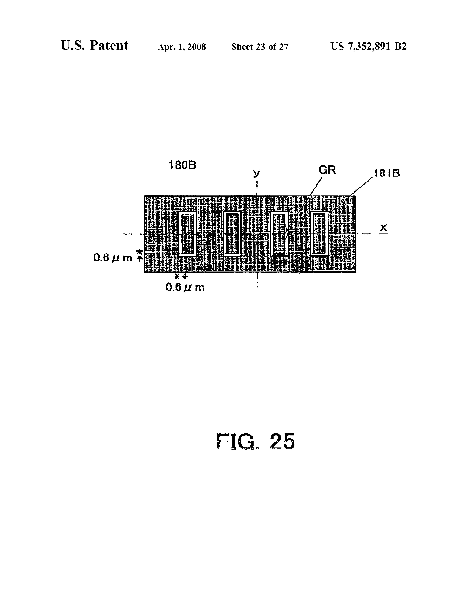
*도 25 — 세 번째 마크 요소 오른쪽 에지에 입자 GR이 부착된 얼라인 마크(180B)*

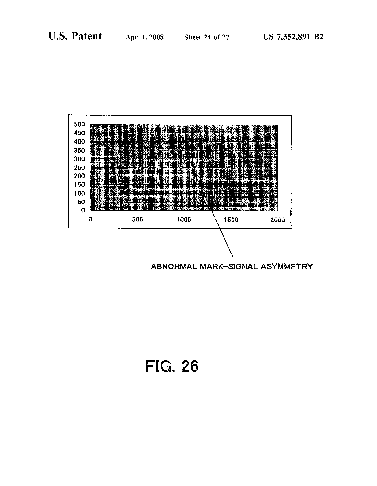
*도 26 — 부분적으로 왜곡된 얼라인먼트 신호 (비정상 마크 신호 비대칭)*

도 27은 얼라인먼트 신호의 왜곡 파형으로 인해 마크 요소 일부의 파형이 다른 마크 요소의 파형과 다르다는 것을 나타내는 도면이다. 도 27은 도 25에 나타낸 얼라인 마크(180B)로부터 검출된 얼라인먼트 신호에서 각 마크 요소(181B)의 파형을 추출하고(또는 얼라인먼트 신호를 20 μm, 즉 마크 요소(181B)의 간격마다 분할하고), 마크 요소(181B)의 간격 20 μm에 해당하는 화소 차이를 뺀 각 마크 요소(181B)의 파형을 겹쳐 놓은 것이다. 얼라인 마크(180B)로부터 검출된 얼라인먼트 신호에서 추출한 4개 마크 요소(181B)의 파형 중 특징적인 두 파형을 나타내었고, 나머지는 실선과 겹치므로 생략하였다.

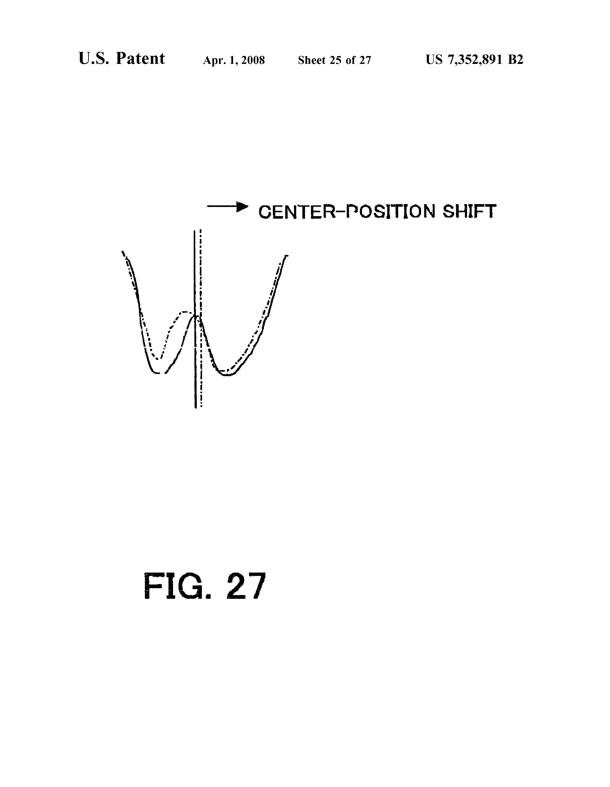
*도 27 — 마크 요소별 파형을 겹친 결과: 일부 요소(파선)는 좌우 폭이 달라 중심이 시프트됨*

도 27을 참조하면, 마크 요소(181B) 일부의 파선 파형은 좌우 마크 폭이 서로 다르다. 이 경우에도 종래의 신호 처리 또는 템플릿 매칭을 적용하면 중심 위치가 시프트되는데, 마크 요소(181B) 일부의 시프트된 파형이 얼라인 마크(180B) 전체의 위치 오프셋에 영향을 주어 얼라인먼트 측정 오차를 일으키기 때문이다.

이하, 도 1 내지 도 16을 참조하여, 얼라인먼트 신호 처리기(160)의 마크 중심 검출기(163)에 의한 디지털 신호 처리의 일례로서 본 발명의 위치 검출 방법(1000)을 설명한다.

도 1은 본 발명의 일 양태에 따른 위치 검출 방법을 설명하기 위한 흐름도이다. 위치 검출 방법(1000)은 복수의 마크 요소를 포함하는 얼라인 마크가 형성된 물체의 위치를 검출한다.

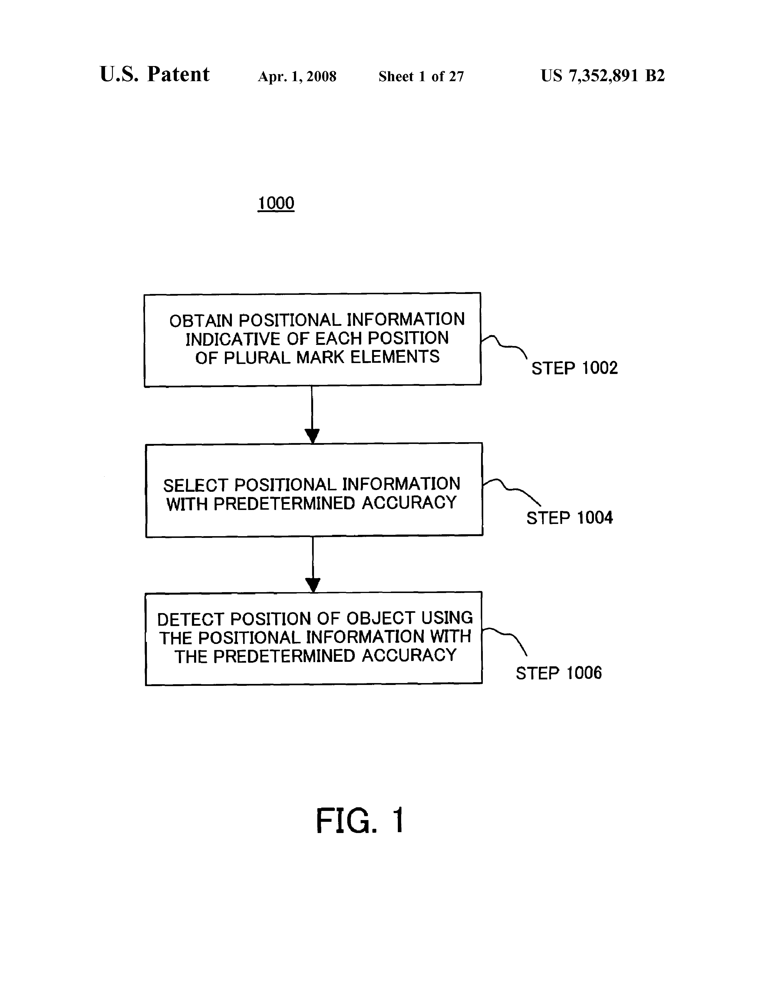
*도 1 — 위치 검출 방법(1000) 흐름도: 마크 요소별 위치 정보 획득(1002) → 소정 정확도의 위치 정보 선택(1004) → 물체 위치 검출(1006)*

도 1을 참조하면, 얼라인먼트 신호에서 마크 요소 각각의 중심 위치를 검출함으로써, 복수 마크 요소 각각의 위치를 나타내는 위치 정보를 복수 마크 요소 사이의 소정 마크 간격으로서 얻는다(단계 1002).

다음으로, 단계 1002에서 얻은 복수 마크 요소 각각의 위치를 나타내는 복수의 위치 정보 중에서 소정의 정확도를 갖는 위치 정보를 선택한다(단계 1004). 단계 1004에서 선택된 소정의 정확도를 갖는 위치 정보를 사용하여 물체의 위치를 검출한다. 다시 말해, 위치 검출 방법(1000)은 부정확한 위치 정보를 제거하고 소정의 정확도를 갖는 위치 정보만을 사용하여 물체의 위치를 검출한다. 소정의 정확도를 갖는 위치 정보로부터 제거된 부정확한 위치 정보를 계산하는 것도 가능하다.

이하, 위치 검출 방법(1000)에서 가장 특징적인 단계인 단계 1004에서의 위치 정보 선택을 설명한다.

도 2는 3개의 마크 요소 MK1 내지 MK3을 갖는 얼라인 마크를 나타내는 개략 평면도이다. 도 2를 참조하면, X₁ 내지 X₃은 신호 처리 결과로서의 인접 마크 요소 MK1 내지 MK3의 중심 위치 좌표이다. L₁은 마크 요소 MK1과 마크 요소 MK2의 중심 위치 좌표 사이의 간격(또는 마크 간격), 즉 L₁=X₂−X₁을 나타낸다. 마찬가지로 L₂는 마크 요소 MK3과 마크 요소 MK2 사이의 마크 간격을 나타낸다. L₂₁은 마크 요소 MK3과 마크 요소 MK1 사이의 마크 간격이다. 중심 위치 좌표는 오른쪽 방향으로 증가한다.

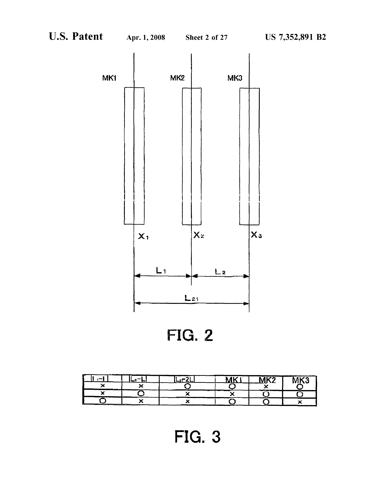
*도 2 — 마크 요소 3개(MK1~MK3)의 중심 좌표 X1~X3과 마크 간격 L1, L2, L21, 도 3 — 3개 마크 요소의 이상 판별 결과(○/×)*

정상 측정은 정상 마크 요소 MK1 내지 MK3에 대해 배율 없이 설계 마크 간격 Lₒ를, L₁=L₂=Lₒ 및 L₂₁=2Lₒ와 같이 제공한다. 측정 정확도는 기본 마크 요소 MK1 내지 MK3의 특징량으로서 일정한 마크 간격을 사용하여 판정된다. 이 판정을 얼라인 마크 내 마크 요소들과 조합하면, 측정에 따라 이상이거나 오차를 포함하는 마크 요소를 즉시 식별할 수 있다.

마크 요소 MK1 내지 MK3 사이의 마크 간격이 설계값 Lₒ(단위: μm)를 가질 때, 다음 수학식 4 내지 6을 사용하여 세 마크 요소 MK1 내지 MK3 중 이상 마크 요소를 식별한다. 여기서 L은 장치 고유의 배율에 대해 미리 교정된 기준값이고, δL은 마크 간격의 허용 오차 또는 오프셋 양이다.

$$|L_1-L|<\delta L \qquad (4)$$

$$|L_2-L|<\delta L \qquad (5)$$

$$|L_{21}-2L|<\delta L \qquad (6)$$

도 3은 얼라인 마크 내 세 마크 요소의 이상을 판정한 결과를 나타내는 도면이다. 도 3은 수학식 4 내지 6 각각을 만족하면 "o", 만족하지 않으면 "x"를 부여한다.

도 3에서 마크 요소 MK2를 이상으로 간주하는 조건은 수학식 4에 "x", 수학식 5에 "x", 수학식 6에 "o"의 조합이다. 마크 요소 MK1의 이상으로 간주하는 조건은 수학식 4에 "x", 수학식 5에 "o", 수학식 6에 "o"의 조합이다. 마크 요소 MK1의 이상으로 간주하는 조건은 수학식 4에 "o", 수학식 5에 "x", 수학식 6에 "x"의 조합이다. 이러한 판정을 기본 형태로 하여, 얼라인 마크 내 모든 마크 요소에 대해 측정 정확도를 판정한다. 판별 알고리즘(discriminantal algorism)은 "If Then Else"와 같은 소프트웨어 판별문으로 쉽게 작성된다.

도 4는 8개의 마크 요소 MK1 내지 MK8을 갖는 얼라인 마크를 나타내는 개략 평면도이다. 도 4를 참조하면, X₁ 내지 X₈은 신호 처리 결과로서의 인접 마크 요소 MK1 내지 MK8의 중심 위치 좌표이다. L₁은 마크 요소 MK1과 마크 요소 MK2의 중심 위치 좌표 사이의 간격(또는 마크 간격), 즉 L₁=X₂−X₁을 나타낸다. 마찬가지로 L₂는 마크 요소 MK3과 마크 요소 MK2 사이의 마크 간격을 나타낸다. L₃은 마크 요소 MK4와 마크 요소 MK3 사이의 마크 간격을 나타낸다. L₄는 마크 요소 MK5와 마크 요소 MK4 사이의 마크 간격을 나타낸다. L₅는 마크 요소 MK6과 마크 요소 MK5 사이의 마크 간격을 나타낸다. L₆은 마크 요소 MK7과 마크 요소 MK6 사이의 마크 간격을 나타낸다. L₇은 마크 요소 MK8과 마크 요소 MK7 사이의 마크 간격을 나타낸다. L₂₁은 마크 요소 MK3과 마크 요소 MK1 사이의 마크 간격이다. L₃₂는 마크 요소 MK4와 마크 요소 MK2 사이의 마크 간격이다. L₄₃은 마크 요소 MK5와 마크 요소 MK3 사이의 마크 간격이다. L₅₄는 마크 요소 MK6과 마크 요소 MK4 사이의 마크 간격이다. L₆₅는 마크 요소 MK7과 마크 요소 MK5 사이의 마크 간격이다. L₇₆은 마크 요소 MK8과 마크 요소 MK6 사이의 마크 간격이다. 중심 위치 좌표는 오른쪽 방향으로 증가한다.

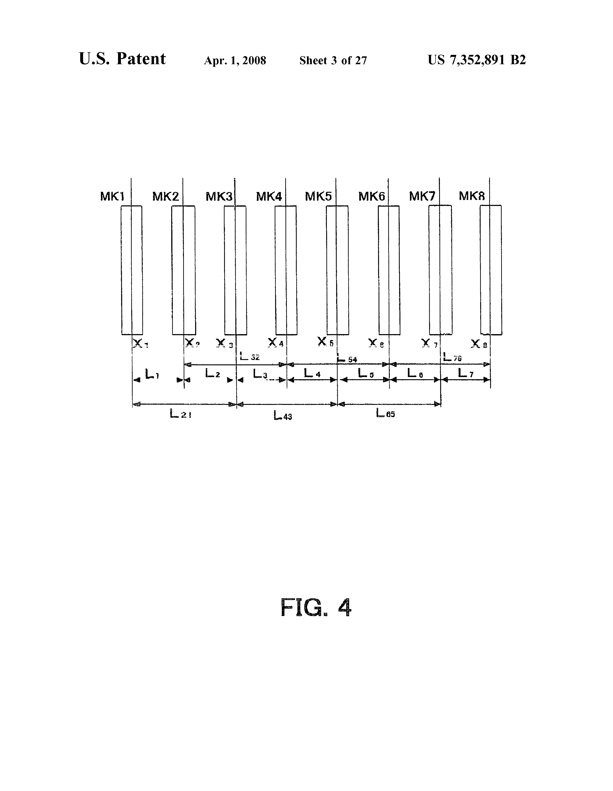
*도 4 — 마크 요소 8개(MK1~MK8)의 중심 좌표 X1~X8과 마크 간격 L1~L7, L21~L76*

이 경우, 마크 간격 L₁, L₂ 및 L₂₁의 조합부터 마크 간격 L₆, L₇ 및 L₇₆의 조합까지 6가지 조합을 조사하여 마크 요소 MK1 내지 MK8이 이상인지 확인한다. 마크 요소 MK1 내지 MK8의 수가 증가할수록 평균화 효과가 마크 요소 MK1 내지 MK8의 중심 위치 좌표 X₁ 내지 X₈의 산포 오차를 줄일 수 있다.

도 5는 얼라인 마크의 8개 마크 요소 MK1 내지 MK8 중 인접한 세 마크 요소 MK1 내지 MK3의 이상 판별 결과를 나타내는 개략도이다. 수학식 4 내지 6을 사용하여 마크 요소 MK1 내지 MK3이 이상인지 확인한다. 마크 간격 측정값과 설계 기준값 사이의 잔차가 1.5를 초과하는 것, 즉 δL≧1.5는 이상으로 판정되어 "x"가 부여된다.

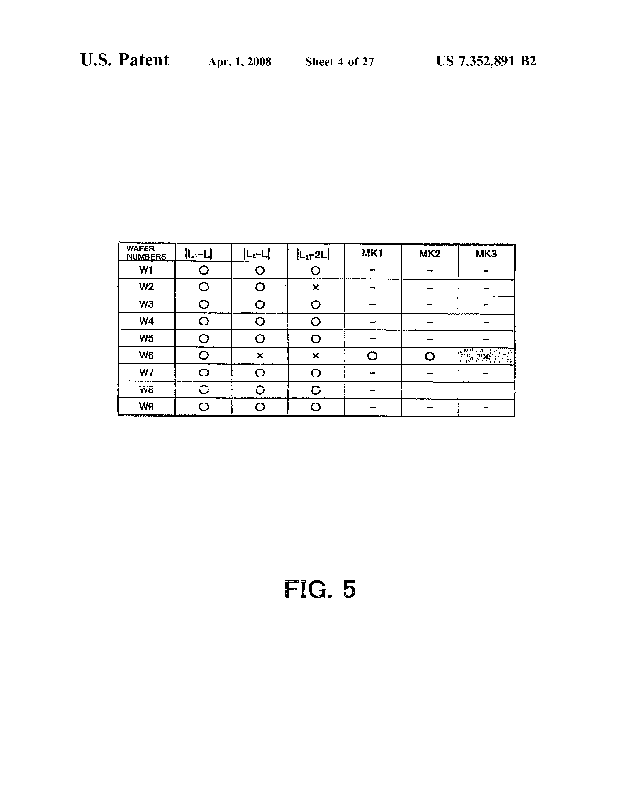
*도 5 — 웨이퍼 W1~W9에서 MK1~MK3의 이상 판별 결과(○/×)*

도 5는 웨이퍼 번호 W6의 마크 요소 MK3에서 얻은 중심 위치 좌표 X₃의 측정 결과를 이상으로 판정한다. 도 6은 도 5에 나타낸 결과를 플롯한 그래프로, 가로축은 웨이퍼 번호, 세로축은 마크 간격 측정값과 설계 기준값 사이의 오프셋 양 또는 잔차를 나타낸다. 도 6으로부터도 마크 간격 |L₂−L|과 |L₂₁−L|이 웨이퍼 번호 W6에서 가장 큰 오프셋 양을 가지며 마크 요소 MK3이 이상임을 알 수 있다.

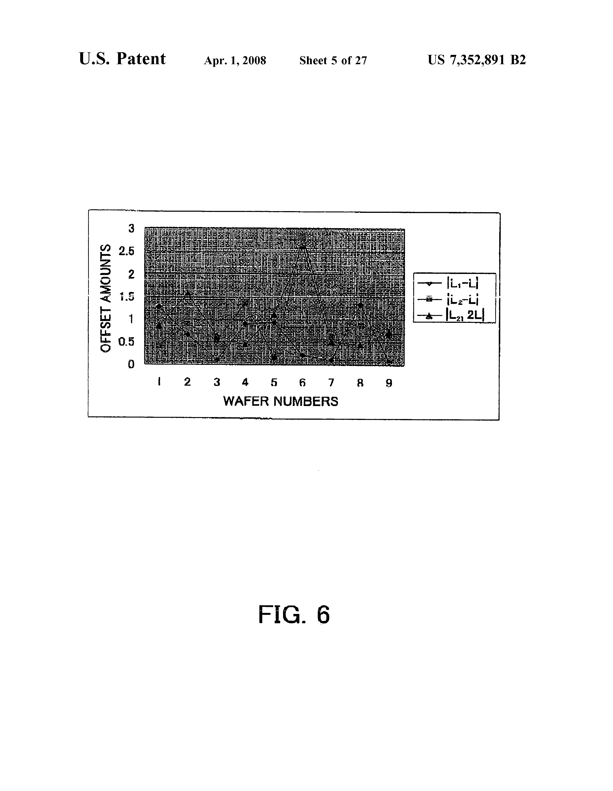
*도 6 — 도 5 결과의 그래프 (가로축 웨이퍼 번호, 세로축 마크 간격 잔차)*

같은 얼라인 마크에서 오른쪽의 마크 요소 MK2 내지 MK4 조합에 대해 마찬가지로 확인한 결과를 제시한다. 도 7은 얼라인 마크의 8개 마크 요소 MK1 내지 MK8 중 인접한 세 마크 요소 MK2 내지 MK4의 이상 판별 결과를 나타내는 도면이다. 도 8은 도 7에 나타낸 결과를 플롯한 그래프로, 가로축은 웨이퍼 번호, 세로축은 마크 간격 측정값과 설계 기준값 사이의 오프셋 양 또는 잔차를 나타낸다. 도 7 및 8로부터 웨이퍼 번호 6의 마크 요소 MK3이 이상임을 알 수 있다.

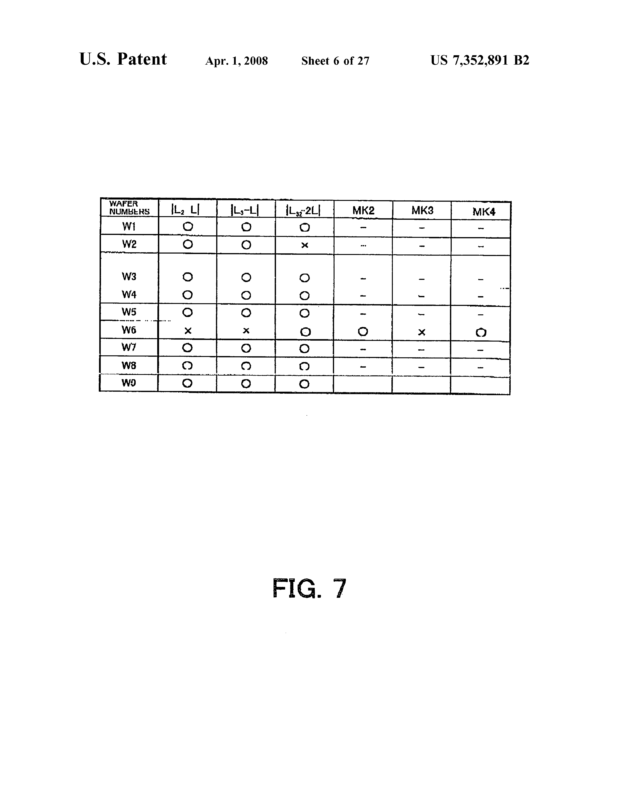
*도 7 — 웨이퍼 W1~W9에서 MK2~MK4의 이상 판별 결과(○/×)*

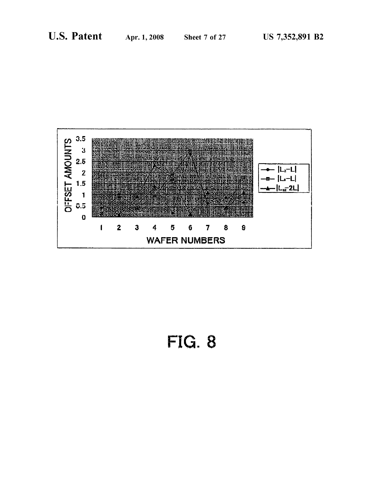
*도 8 — 도 7 결과의 그래프*

예를 들어 이러한 판별에서 나온 공정 데이터를 데이터베이스 형태로 저장함으로써 공정 관리에 유용한 데이터가 만들어진다. 이 데이터베이스는 이상 마크 요소의 검출 데이터와 정량 데이터를 포함하며, WIS의 정량화에 유용하다.

얼라인먼트는 이상 마크 요소의 측정값을 제거하고, 나머지 마크 요소의 측정값만 사용할 수 있다. 또는 얼라인먼트는 이상 마크 요소의 측정값을 보정한 값을 계산하여 그 보정값을 사용할 수 있다. 어느 경우에도 얼라인먼트는 소정의 정확도를 갖는 측정값만을 사용한다.

도 9는 도 4에 나타낸 얼라인 마크에서 마크 간격 측정값과 설계 기준값 사이의 잔차 값을 나타내는 도면이다. 도 9로부터 웨이퍼 번호 W6에서 마크 요소 MK3의 중심 위치 좌표 X₃이 이상임을 알 수 있다.

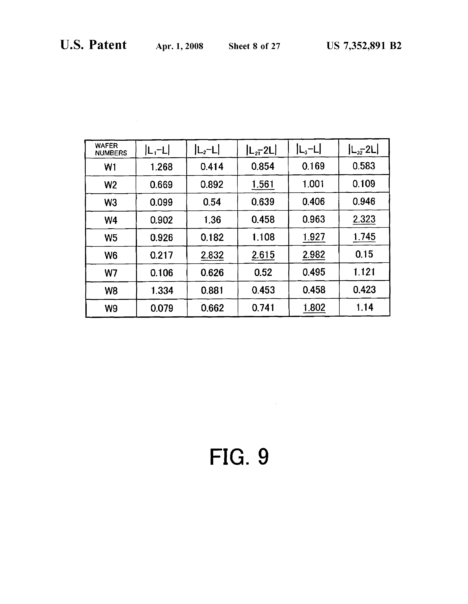
*도 9 — 웨이퍼 W1~W9의 마크 간격 잔차 값 (|L1−L|, |L2−L|, |L21−2L|, |L3−L|, |L32−2L|)*

다음 수학식 7로 주어지는 마크 요소 MK3의 중심 위치 좌표 X₃'는 마크 요소 MK2의 중심 위치 좌표 X₂와 마크 요소 MK4의 중심 위치 좌표 X₄로부터 계산된다.

$$X_3'=\frac{X_2+X_4}{2} \qquad (7)$$

마크 요소 MK3의 중심 위치 좌표 X₃의 측정값 대신, 소정의 정확도를 갖는 마크 요소 MK2의 중심 위치 좌표 X₂와 마크 요소 MK4의 중심 위치 좌표 X₄로부터 중심 좌표 Xa를 계산한다. 잘못된 중심 위치 좌표 X₃은 중심 위치 좌표 X₃'를 사용함으로써 제거된다. 중심 좌표 Xa는 다음 수학식 8로 주어진다.

$$Xa'=\frac{X_1+X_2+X_3'+X_4}{4}=\frac{2X_1+3X_2+3X_4}{8} \qquad (8)$$

도 10은 도 9에 나타낸 마크 간격 측정값과 설계 기준값 사이의 잔차에 수학식 7을 적용한 결과를 나타내는 도면이다. 도 11은 도 10에 나타낸 결과를 플롯한 그래프로, 가로축은 웨이퍼 번호, 세로축은 마크 간격 측정값과 설계 기준값 사이의 오프셋 양 또는 잔차를 나타낸다. 도 10 및 11로부터 웨이퍼 번호 W6에서 마크 요소 MK3의 중심 위치 좌표 X₃에 대해 마크 간격이 개선됨을 알 수 있다.

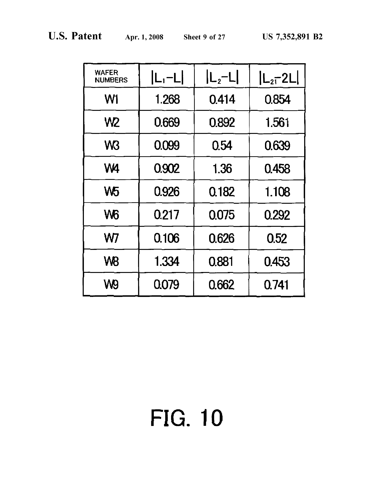
*도 10 — 수학식 7을 적용한 뒤의 마크 간격 잔차 (W6의 |L2−L|이 2.832 → 0.075)*

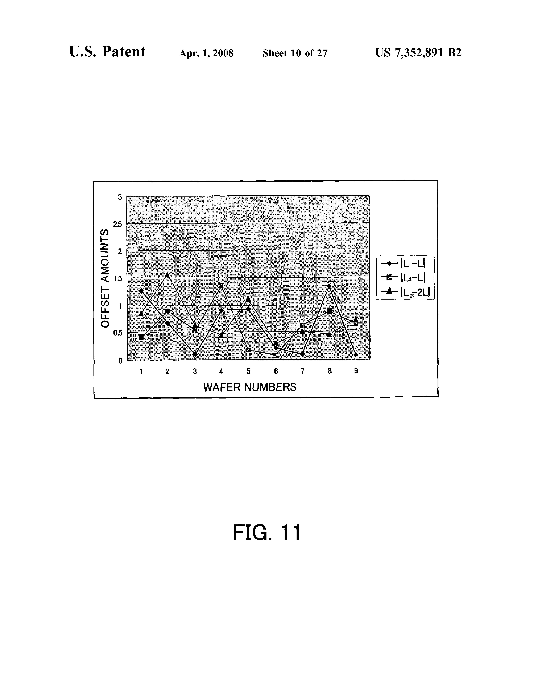
*도 11 — 도 10 결과의 그래프*

마찬가지로, 웨이퍼 번호 W5의 마크 요소 MK4의 중심 위치 좌표 X₄가 이상일 때, 다음 수학식 9를 사용하여 마크 요소 MK2의 중심 위치 좌표 X₂와 마크 요소 MK3의 중심 위치 좌표 X₃으로부터 마크 요소 MK4의 중심 위치 좌표 X₄'를 계산한다.

$$X_4'=\frac{X_2+X_3}{2}+1.5L$$

마크 요소 MK4의 잘못된 중심 위치 좌표 X₄ 대신, 중심 위치 좌표 X₄'를 사용하여 얼라인 마크 전체의 중심 좌표 Xa를 계산한다. 중심 위치 좌표 X₄'는 소정의 정확도를 갖는 마크 요소 MK2의 중심 위치 좌표 X₂와 마크 요소 MK3의 중심 위치 좌표 X₃으로부터 계산된다. 잘못된 중심 위치 좌표 X₄는 중심 위치 좌표 X₄'를 사용함으로써 제거되며, 이는 다음 수학식 10으로 주어진다.

$$Xa'=\frac{X_1+X_2+X_3+X_4'}{4}=\frac{2X_1+3X_2+3X_3+3L}{8}$$

중심 위치 좌표 X₄'는 다음 수학식 11, 마크 요소 MK1의 중심 위치 좌표 X₁, 마크 요소 MK2의 중심 위치 좌표 X₂, 및 마크 간격 L₂의 평균을 사용하여 계산할 수 있다.

$$X_4'=X_3+\frac{L_1+L_2}{2}=X_3+\frac{X_2-X_1}{2}+\frac{X_3-X_2}{2}=\frac{3X_3-X_1}{2} \qquad (11)$$

다음 수학식 12는 얼라인 마크 전체의 중심 좌표 Xa를 나타낸다. 이 경우에도 잘못된 중심 위치 X₄를 잘못된 중심 위치 좌표 X₄'로 치환함으로써 제거할 수 있다.

$$Xa'=\frac{X_1+X_2+X_3+X_4'}{4}=\frac{X_1+2X_2+5X_3}{8} \qquad (12)$$

도 12는 도 9에 나타낸 마크 간격 측정값과 설계 기준값 사이의 잔차 값에 수학식 10 또는 11을 적용한 결과를 나타내는 도면이다. 도 13은 도 12에 나타낸 결과를 플롯한 그래프로, 가로축은 웨이퍼 번호, 세로축은 마크 간격 측정값과 설계 기준값 사이의 오프셋 양 또는 잔차를 나타낸다. 도 12 및 13으로부터 웨이퍼 번호 W5에서 마크 요소 MK4의 중심 위치 좌표 X₄에 대해 마크 간격이 개선됨을 알 수 있다.

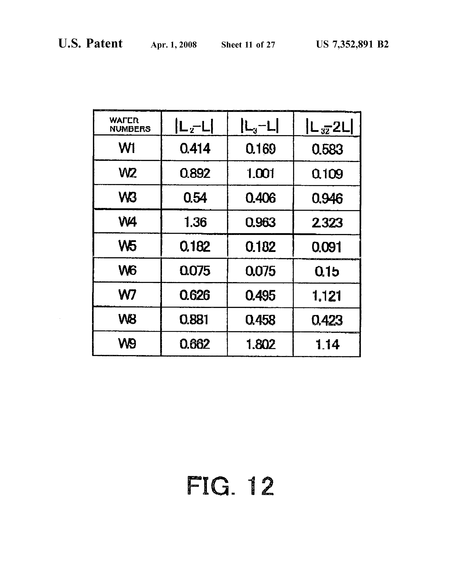
*도 12 — 수학식 10 또는 11을 적용한 뒤의 마크 간격 잔차*

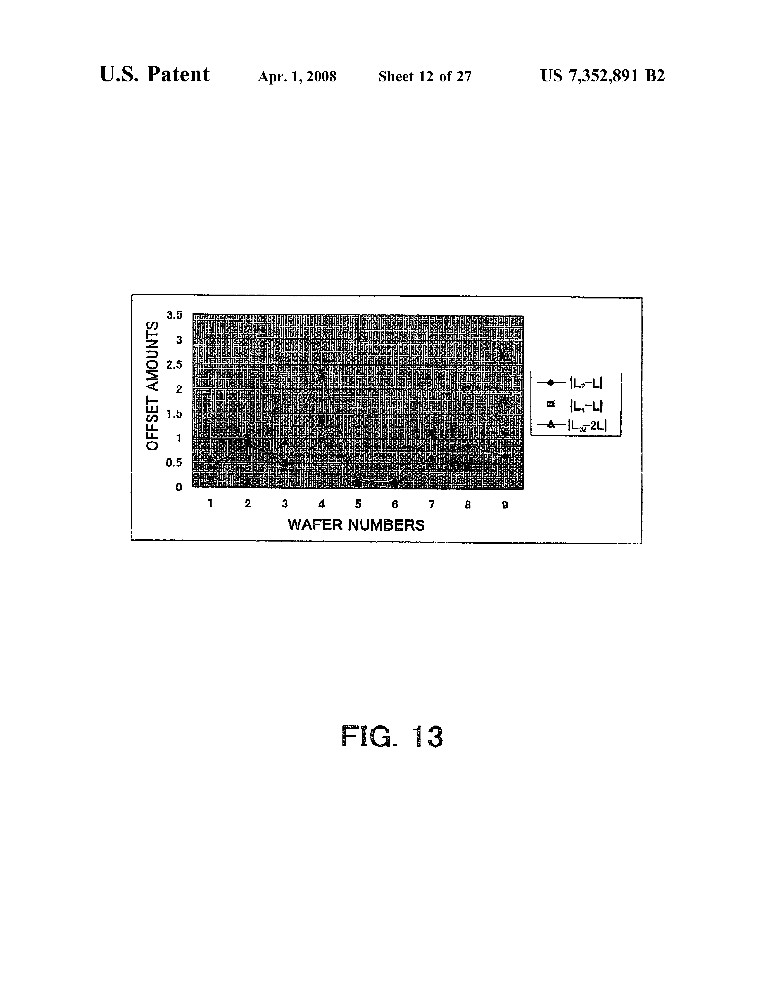
*도 13 — 도 12 결과의 그래프*

이와 같이, 얼라인 마크에서 마크 요소가 이상인지 판정하고 소정의 정확도를 갖는 측정값만을 선택함으로써 신호 처리로 인한 정확도 저하가 방지된다. 이상 마크 요소에서 측정한 측정값을 사용하는 대신, 다른 마크 요소에서 측정한 소정 정확도의 측정값으로부터 계산한 값을 사용할 수 있다.

얼라인먼트 측정은 예를 들어 도 14에 나타낸 바와 같이 샷 5, 21, 29 및 39에 대해 수행된다. 예를 들어 샷 29에서 이상이 발생하면, 대체 샷 28이 얼라인먼트 측정에 사용된다. 여기서 도 14는 얼라인먼트 측정 대상 샷의 배치를 나타내는 개략 평면도로, 숫자는 노광 순서를 나타낸다.

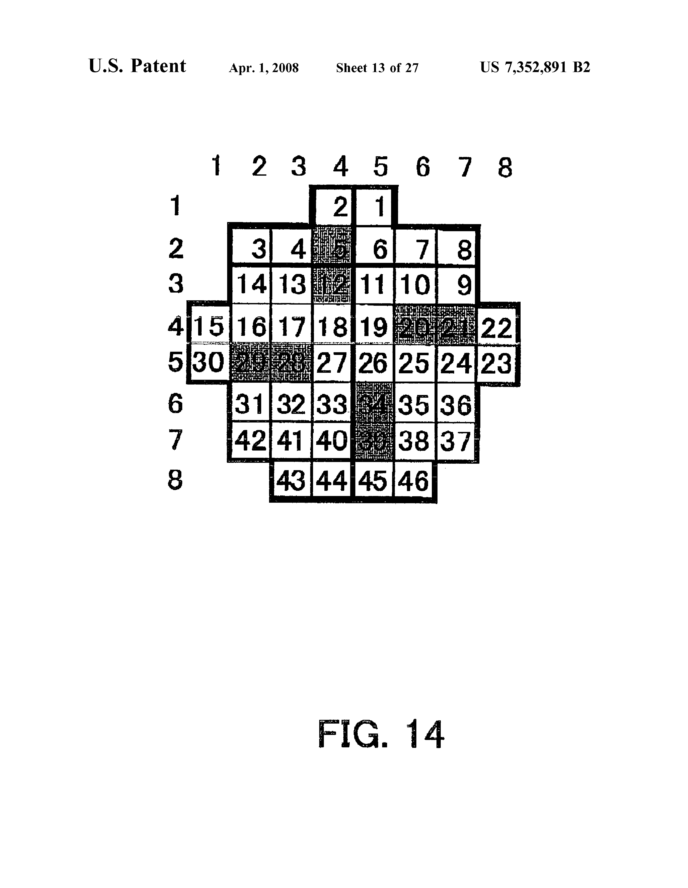
*도 14 — 얼라인먼트 측정 샷 배치 (숫자는 노광 순서, 음영은 측정 샷)*

대체 샷에 대한 얼라인먼트 측정이 이상인지 판정한다. 정상으로 판정되면 그 측정값을 사용한다(use). 이상으로 판정되면 얼라인먼트 측정을 반복한다. 소정 횟수(예를 들어 3회)의 얼라인먼트 측정 후에도 이상이 남으면 경보 등으로 작업자에게 경고한다. 그렇지 않으면 측정값을 사용한다.

얼라인먼트 측정 정확도는 얼라인 마크 전체에 비추어 확인할 수도 있다. 신호 처리에 이어, 도 17에 나타낸 얼라인먼트 신호 처리기(160)에 의해, 도 21에 나타낸 4개 마크 요소의 중심 위치 좌표 X₁ 내지 X₄와 다음 수학식 13 내지 15를 사용하여 마크 간격 L₁ 내지 L₃을 계산한다.

$$L_1=X_2-X_1 \qquad (13)$$

$$L_2=X_3-X_2 \qquad (14)$$

$$L_3=X_4-X_3 \qquad (15)$$

검출 오차나 WIS가 발생하지 않으면, 마크 간격 L₁ 내지 L₃은 도 19a, 19b, 20a 및 20b에 나타낸 바와 같이 설계값 20 μm로 일정해진다. 이로써 측정 정확도를 확인할 수 있다.

마크 간격에 대해 설계된 기준값 L=20 μm에 대해 마크 간격 L₁ 내지 L₃에 편차가 없는 것이 바람직하다. 그러나 부분적으로 왜곡된 얼라인먼트 신호는 마크 간격 측정값과 설계 기준값 사이의 잔차, 즉 L₁−L, L₂−L 및 L₃−L 중 하나를 크게 만든다.

마크 간격 측정값과 설계 기준값 사이의 잔차로서 평균 제곱 오차를 계산함으로써, 얼라인 마크 전체의 측정 오차와 오프셋 양을 포함하는 오차량을 얻을 수 있다. 다음 수학식 16은 평균 제곱 오차 sq를 제공하며, 여기서 N은 마크 간격의 수이다.

$$sq=\sqrt{\frac{(L_1-L)^2+(L_2-L)^2+(L_3-L)^2}{N}} \qquad (16)$$

수학식 16으로부터 마크 간격의 수 N이 증가할수록 정확도가 N^{1/2}만큼 증가함을 알 수 있다.

도 15는 도 19a 및 19b에 나타낸 얼라인 마크(180A)에서 마크 간격 측정값과 설계 기준값 사이의 잔차, 및 평균 제곱 오차 값을 나타내는 도면이다. 도 16은 도 15에 나타낸 결과를 플롯한 그래프로, 가로축은 웨이퍼 번호, 세로축은 마크 간격 측정값과 설계 기준값 사이의 오프셋 양 또는 잔차, 및 평균 제곱 오차를 나타낸다.

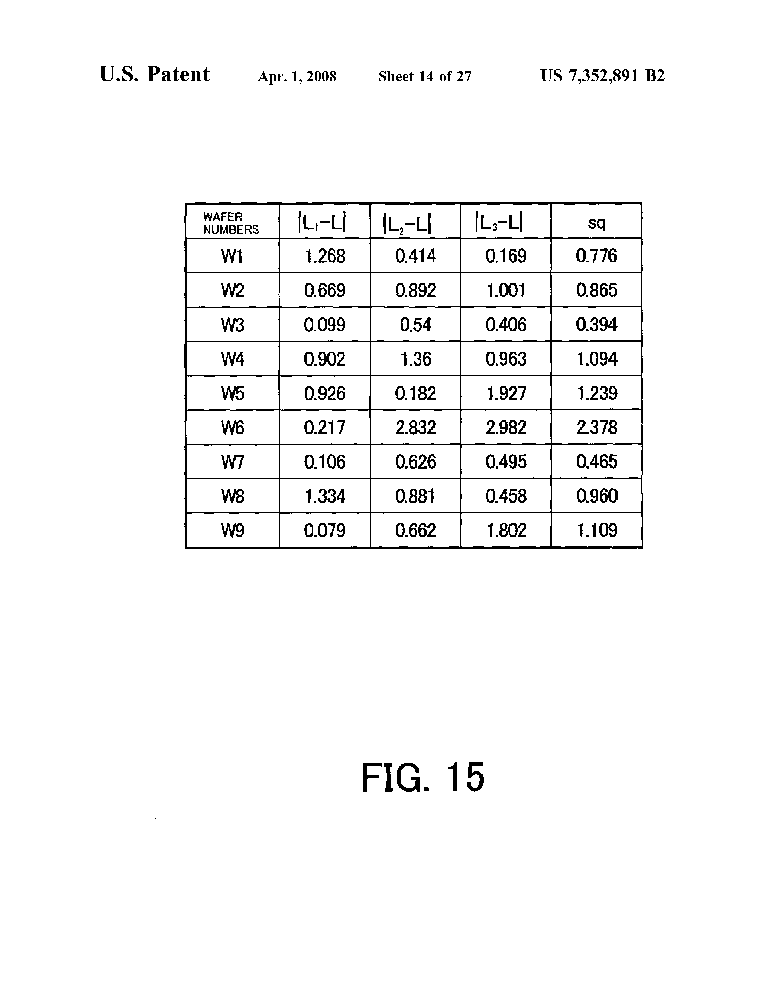
*도 15 — 마크 간격 잔차 |L1−L|, |L2−L|, |L3−L|와 평균 제곱 오차 sq (W6 sq=2.378)*

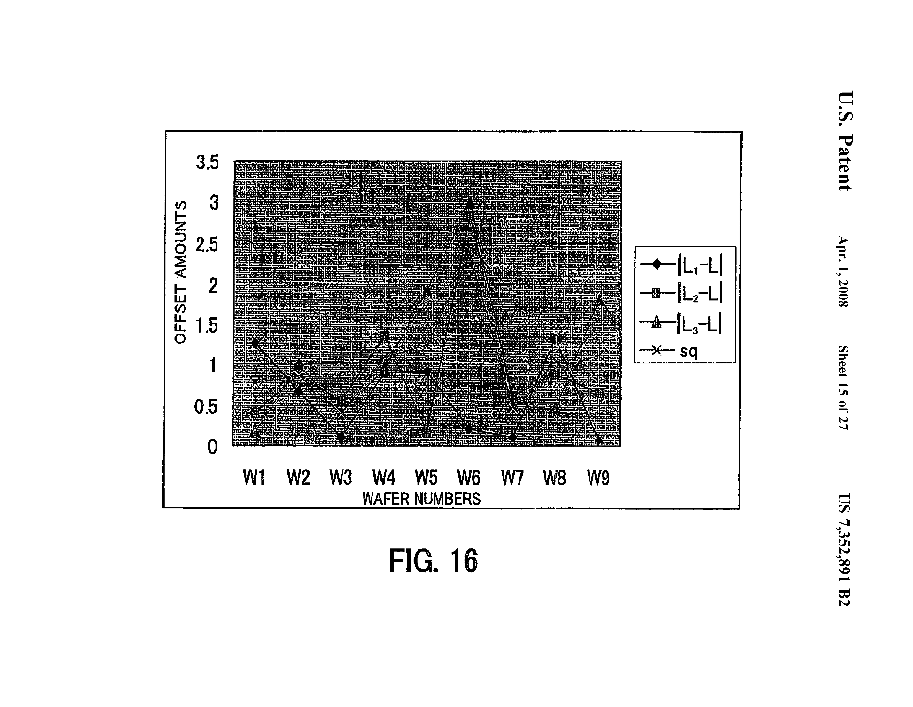
*도 16 — 도 15 결과의 그래프*

도 15 및 16으로부터 웨이퍼 번호 W6이 크게 벗어남을 알 수 있다. 다음 수학식 17을 사용하는 JOB 설정은 δp보다 큰 측정값을 이상값으로 검출할 수 있게 하며, 여기서 δp는 JOB 설정값이다.

$$sq>\delta p \qquad (17)$$

본 실시예는 δp=1.5 이상인 측정값을 설정하고, 웨이퍼 번호 W6의 측정값이 설정 범위를 초과하는 이상값이라고 판정한다. 얼라인 마크가 이상값을 나타낸다고 검출되면, 수학식 14 및 15가 이상 마크 요소를 식별한다. 이상으로 판정된 마크 요소는 사용하지 않으며, 정확도 저하를 막기 위해 인접 마크 요소의 측정값 또는 설계 기준값으로 대체한다.

본 발명의 위치 검출 방법(1000)은 얼라인 마크의 검출 정확도를 즉시 판정하고, 정밀도를 떨어뜨리는 측정값을 제거하여, 전체 정확도의 저하와 처리량의 저하를 방지한다.

종래 기술처럼 노광 후 중첩 검사에 기초하여 오프셋 보정을 실행하는 방법도 있지만, 노광 전에 판정할 수 있는 본 발명의 방법은 정밀도 저하를 즉시 방지할 수 있다. 오프셋 보정값이 항상 같지는 않을 때 종래 방법은 적절히 보정할 수 없지만, 본 발명은 그 경우에도 효과가 있다.

종래에는 AGA 샷에 대해 웨이퍼 전체의 이상을 검출하는 방법이 수행되어 왔지만, 본 발명은 특징적으로 각 AGA 샷의 측정 결과를 판정하고 얼라인 마크 내의 이상 마크 요소를 즉시 식별한다. 본 발명의 효과는 AGA와 같은 글로벌 얼라인먼트에 한정되지 않고 다이 바이 다이 방식에도 적용할 수 있다.

노광 시, 조명 장치(도시하지 않음)로부터 방출된 빛이 예를 들어 레티클(110)을 쾰러 조명한다. 레티클(110)을 통과하여 레티클 패턴을 반영하는 빛은 투영 광학계(120)를 통해 웨이퍼(130) 상에 상을 형성한다. 위치 검출 방법(1000)이 노광 장치(100)에 고정밀 얼라인먼트를 제공하므로, 노광 장치(100)는 우수한 디바이스(반도체 디바이스, LCD 디바이스, 촬상 디바이스(CCD 등), 박막 자기 헤드 등)를 높은 처리량과 경제성으로 제공할 수 있다.

이제 도 28 및 29를 참조하여, 위 노광 장치(100)를 사용한 디바이스 제조 방법의 실시예를 설명한다. 도 28은 디바이스(즉, IC 및 LSI와 같은 반도체 칩, LCD, CCD 등)의 제조를 설명하기 위한 흐름도이다. 여기서는 반도체 칩의 제조를 예로 설명한다. 단계 1(회로 설계)은 반도체 디바이스 회로를 설계한다. 단계 2(마스크 제작)는 설계된 회로 패턴을 갖는 마스크를 형성한다. 단계 3(웨이퍼 준비)은 실리콘 등의 재료를 사용하여 웨이퍼를 제조한다. 전처리라고도 하는 단계 4(웨이퍼 공정)는 마스크와 웨이퍼를 사용한 포토리소그래피를 통해 웨이퍼 상에 실제 회로를 형성한다. 후처리라고도 하는 단계 5(조립)는 단계 4에서 형성된 웨이퍼를 반도체 칩으로 만들며, 조립 단계(예: 다이싱, 본딩), 패키징 단계(칩 밀봉) 등을 포함한다. 단계 6(검사)은 단계 5에서 만든 반도체 디바이스에 대해 유효성 시험, 내구성 시험 등 각종 시험을 수행한다. 이 단계들을 거쳐 반도체 디바이스가 완성되어 출하된다(단계 7).

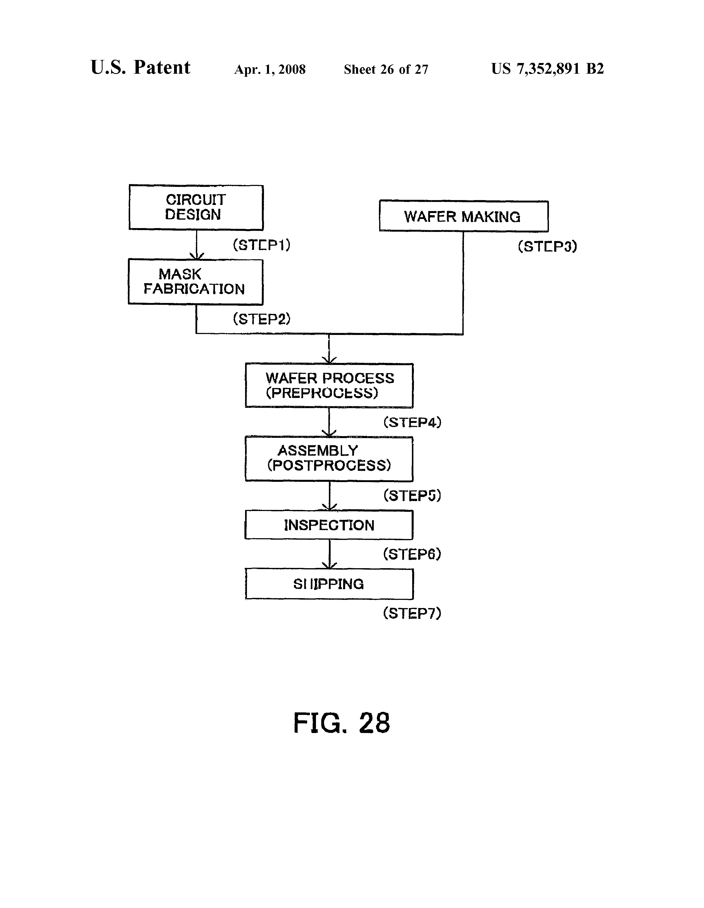
*도 28 — 디바이스 제조 흐름도*

도 29는 단계 4의 웨이퍼 공정의 상세 흐름도이다. 단계 11(산화)은 웨이퍼 표면을 산화시킨다. 단계 12(CVD)는 웨이퍼 표면에 절연막을 형성한다. 단계 13(전극 형성)은 증착(vapor disposition) 등으로 웨이퍼 상에 전극을 형성한다. 단계 14(이온 주입)는 웨이퍼에 이온을 주입한다. 단계 15(레지스트 공정)는 웨이퍼에 감광재를 도포한다. 단계 16(노광)은 노광 장치(100)를 사용하여 마스크 상의 회로 패턴을 웨이퍼에 노광한다. 단계 17(현상)은 노광된 웨이퍼를 현상한다. 단계 18(식각)은 현상된 레지스트 상 이외의 부분을 식각한다. 단계 19(레지스트 박리)는 식각 후 불필요한 레지스트를 제거한다. 이 단계들을 반복하여 웨이퍼 상에 다층 회로 패턴을 형성한다. 본 실시예의 디바이스 제조 방법은 종래보다 고품질의 디바이스를 제조할 수 있다. 따라서 노광 장치(100)를 사용하는 디바이스 제조 방법과 그 결과물인 디바이스는 본 발명의 일 양태를 구성한다.

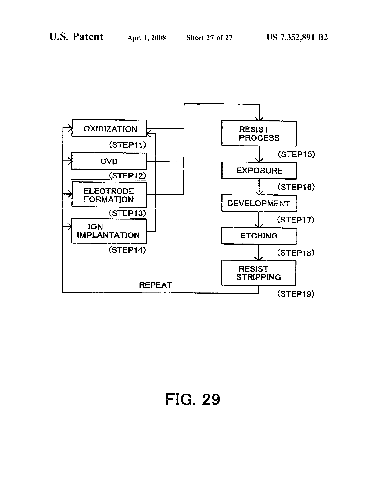
*도 29 — 웨이퍼 공정(단계 4) 상세 흐름도*

또한 본 발명은 이러한 바람직한 실시예에 한정되지 않으며, 본 발명의 범위를 벗어나지 않고 다양한 변형과 수정이 이루어질 수 있다. 예를 들어 본 발명은 웨이퍼의 얼라인먼트에 더하여 레티클의 얼라인먼트에도 적용할 수 있다.

이와 같이, 본 발명은 얼라인 마크의 검출 결과가 흩어지는 경우에도 필요한 얼라인먼트 정확도와 처리량을 양립시키는 위치 검출 방법을 제공할 수 있다.
